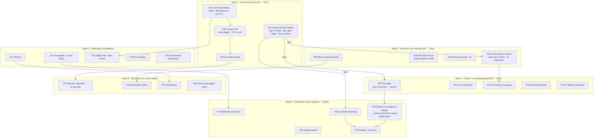

# eventcatalog-hub Post-Go-Live Pareto Execution Plan

| | |
| --- | --- |
| **Date** | 2026-10-12, 18:20 CEST |
| **Status** | PROPOSED — awaits owner go (the 3 §g gates) before Wave 2+ |
| **Scope** | The eventcatalog-hub ↔ SystemNix integration domain: all 50 `§f` items + 3 owner gates from `docs/status/2026-10-12_16-00_eventcatalog-hub-integration-deep-dive-status.md` |
| **Universe** | 50 items + 3 gates → 27 medium tasks (30–100 min) → 118 micro tasks (≤12 min). Coverage: 50/50 items mapped, table in §6 |
| **Repo pin** | `b71919cd` (master, 2 ahead / 1 behind origin at authoring) |
| **Related ratified plans** | `2026-09-22_23-27_EVENTCATALOG-FEDERATION-HUB.md` (Phase 1 — DECIDED + go-live COMPLETE 2026-10-12; this plan is its Phase 2) · `2026-09-23_18-15_dynamic-service-mesh-registry.md` (SystemNix-side dynamic registry, PLANNED — its "EventCatalog not registry-driven" gap is the long-term convergence target of §Wave 6 here; COMPLEMENTARY, do not duplicate) · `2026-09-30_09-30_two-day-todo-master-plan.html` (chain format precedent) |
| **Living source** | `TODO_LIST.md` + `docs/todo/services.md` stay canonical; this plan is a snapshot. f.1/f.3 already harvested into both (2026-10-12); the rest route on pickup per docs-health HARVEST |

---

## 0. Ground rules (Verschlimmbessern guards — read before executing anything)

1. **Never push to or edit the `dist` branch by hand** — it is CI-owned; humans/agents only via hub CI.
2. **`sources.json` changes are hub-repo commits**, never box-side edits; the box only ever pulls the built `dist`.
3. **No new source goes live without an owner curation decision** (§g.3) — the allowlist is the trust boundary of a CI that executes Go on the bare host.
4. **Drift-gate lands warn-only first regardless of owner mood** — one soak week minimum before fail-red, because a red CI on the nightly is a page, not a nag.
5. **Gatus red-doctrine stays**: the pre-go-live PLACEHOLDER-skip behavior is historical; if a check is red post-go-live it means broken, never silenced.
6. **The 4 orphaned PATs are owner-UI deletions** — agents cannot DELETE tokens on Forgejo v15 (proven 401 class); do not re-attempt token-authed revokes.
7. **Shared tree discipline**: every commit is a PATHSPEC commit of files this plan touched; the ollama-removal session owns its own dirty files (2026-10-12 18:20: `CHANGELOG.md`, `ai-models.nix`, `ai-stack.nix`, `post-deploy-check.sh`, `docs/status/2026-10-12_17-56_*`).
8. **Every "verified" label must name WHAT was verified and WHERE** (repo rule 2026-09-18): a green vHost is not a green Gatus; a served `index.html` is not a served `llms.txt`.
9. **Raw systemd `script` strings get `bash -n`** on the extracted text (the 09-23 doubled-`then` class) — VM test P15 will encode this.
10. **Hub CI state is never asserted from prose surfaces** — read the Forgejo API/UI or the runner journal; the services.md-vs-runbook contradiction (d.2) is the standing cautionary tale.

---

## 1. Pareto breakdown — what actually moves the needle

The catalog's product promise: a **trustworthy, fresh, curated** architecture catalog for the fleet (human + AI surface). Everything below is ranked against that promise.

### 1% — the slice that delivers ~51%

**Prove the go-live is TRUE.** The catalog went live 2026-10-12 11:35; its verification that day covered `index.html` + title marker + `fresh=1` only. Four unverified surfaces could make the published artifact a lie: Gatus check state (f.27), the AI surface `/llms.txt` + `/schemas.txt` (f.28), whether the two NEW mesh domains actually render in the served generation (f.32), and ID-collision integrity across the now-4 sources (f.33). Plus the known runbook-vs-postmortem discrepancy on the nightly cron TZ (03:23 claimed vs UTC→05:23 CEST proven elsewhere) — a freshness-budget parameter we may be miscalculating. **Why 51%:** if any of these fail, the entire plan re-prioritizes into incident response; if all pass, the domain graduates from "just shipped" to "verified healthy" and every later task builds on solid ground.

### 4% — delivers ~64%

1% **+ the three owner gates resolved** (§g.1 CI state incl. the bank-sync contradiction closure f.21/f.37; §g.2 drift-gate shape; §g.3 curation) **+ the orphaned-PAT security debt closed** (f.26/f.42). **Why:** the gates unblock 6 implementation tasks; the PAT debt is live all-scope credentials from a proven leak class; the contradiction is actively misleading every future dispatch that reads services.md.

### 20% — delivers ~80%

4% **+ the maintainability core**: the two already-queued verifications executed (f.1 lint.export, f.3 mirror cadence), CI toolchain pinned (f.5), provenance stamped into every build (f.6/f.7), branch protection on the CI-owned dist branch (f.13), CI-failure notification so a dead nightly surfaces in minutes not 36h (f.19), the architecture-catalog VM test (f.24), the SigNoz freshness tile (f.25), and the exporter-upgrade wave kickoff that re-arms the 2 warn linter rules (f.15). **Why:** this is the difference between a catalog that silently rots and one that announces its own decay.

### The remaining 20% → 100%

Webhook-triggered sync (f.8), robustness batch (schema pre-validation f.16, mirror-behind detection f.23, dist checksum manifest f.49), ops verifications (token scope f.29, retention/workspace f.14, stale-sources health f.12), the three drills (f.30/f.31/f.48) + DNS-gate reboot probe (f.36), docs battery (f.9/f.10/f.34/f.38), hygiene batch (f.11/f.45/f.46/f.47/f.43/f.50), source-side gate verification (f.22), dist-branch growth + mirror policy (f.20/f.41), the registry-convergence design (f.17/f.18/f.44, hand-off point to the 09-23 mesh-registry plan), and curated onboarding of whatever §g.3 elects (f.39).

---

## 2. Comprehensive plan (medium granularity, 30–100 min each, 27 tasks, ALL items)

Sorted by impact → effort. `Owner` = needs the human; `Agent` = dispatchable; `Hub` = work lands in `~/projects/eventcatalog-hub`.

| ID | Task (30–100 min) | Items | Wave | Who | Effort | Impact | Depends on |
| --- | --- | --- | --- | --- | --- | --- | --- |
| P01 | **Owner decision battery**: answer §g.1 (CI green since run 51?), §g.2 (drift-gate fail-red vs warn-only + exclusion-list shape), §g.3 (which of the 8 consumers become sources; opt-in vs opt-out policy) | g.1-3, f.40, f.44 | 1 | Owner | 30m | L | — |
| P02 | **Live-verification battery of the go-live**: Gatus 3 checks state, vHost, freshness gauges, `/llms.txt` + `/schemas.txt` non-empty, nightly-cron TZ truth (runbook 03:23 vs postmortem UTC 05:23 CEST) | f.27, f.28, +cron-TZ | 1 | Agent | 45m | L | — |
| P03 | **Catalog content QA**: served generation contains + renders mesh-orders & mesh-billing; page count vs run-38's 173; llms.txt navigability spot-check | f.32, f.45 | 1 | Agent | 45m | L | P02 |
| P04 | **ID-collision audit** across the 4 sources (domain-scoping convention holds; no cross-source ID overwrite in the merged tree) | f.33 | 1 | Agent | 60m | L | P03 |
| P05 | **Close the CI-state contradiction**: owner log or live CI check → close or re-open f.21; annotate the stale `[blocked:user]` rows in TODO_LIST + services.md (edit BOTH surfaces) | f.21, f.37, d.2 | 2 | Owner+Agent | 30m | L | P01.1 |
| P06 | **PAT debt closure**: owner deletes the 4 all-scope PATs in the UI; agent verifies count 0 + appends the "PAT lifecycle" fix note (v15 revoke path) to the setup-script row | f.26, f.42 | 2 | Owner+Agent | 30m | L | — |
| P07 | **Drift-gate implementation** (hub): `who-uses go-cqrs-lite/catalog --format json` vs `sources.json` + exclusion list → warn-only soak → fail-red; fixture-tested; exclusion shape per §g.2 | f.2 | 3 | Agent | 90m | L | P01.2 |
| P08 | **lint.export consumption verify + fix-or-delete** (hub): read `build.yml`; wire the `-plain` lint trees into the lint step or drop the dead `lint` keys | f.1 | 2 | Agent | 45m | M | — |
| P09 | **Mirror-cadence verify + bound**: read `setup-forgejo.sh` mirror creation + Forgejo mirror intervals; if lag can breach the freshness budget, tighten interval or document the bound in the runbook | f.3 | 2 | Agent | 45m | M | — |
| P10 | **Pin the CI Go toolchain** (hub): replace floating `nix shell nixpkgs#go_1_27` with a locked rev (flake input pin or store path) | f.5 | 3 | Agent | 45m | M | — |
| P11 | **Provenance stamping** (hub): `build-stamp.json` gains per-source repo rev + exporter-lib version; surface in catalog footer + llms.txt tail | f.6, f.7 | 3 | Agent | 90m | M | P05 |
| P12 | **Branch protection** on `lars/eventcatalog-hub-dist@dist` (owner UI) + protection-shape documented in runbook | f.13 | 3 | Owner | 30m | M | — |
| P13 | **CI failure notification** (hub+box): Forgejo webhook → existing Discord path; test-fire on a thrown run; freshness alert stays as the 36h backstop | f.19 | 3 | Agent | 60m | M | — |
| P14 | **dist-branch growth + mirror policy** (hub): keep-N/orphan-commit policy for `dist` history; decide + document the no-GitHub-mirror status of `-dist` | f.4, f.20, f.41 | 4 | Agent | 60m | M | — |
| P15 | **`tests/test-architecture-catalog.nix` VM test**: PLACEHOLDER skip, fake-dist sync converge (stub clone), atomic swap, keep-N pruning, collector fail-closed; `bash -n` leg for collector script text | f.24 | 4 | Agent | 100m | M | — |
| P16 | **SigNoz freshness tile + alert dedup**: `architecture_catalog_stamp_age_seconds` trend panel; confirm no split-brain alerting vs Gatus pats | f.25, f.35 | 4 | Agent | 45m | M | P02 |
| P17 | **Exporter-upgrade wave kickoff**: owners on mesh messages, versioned service dirs in mesh-export output; re-arm the 2 `warn` linter rules to strict when both sources clean | f.15 | 5 | Agent+Owner | 90m | M | P04 |
| P18 | **Docs battery**: hub README onboarding guide + runner-PATH contract note; SystemNix runbook: alert-text dist-repo hint, close-out pointers into go-live checklist steps | f.9, f.10, f.34, f.38 | 4 | Agent | 60m | M | — |
| P19 | **Robustness batch** (hub): sources.json schema pre-validation w/ per-entry friendly errors; mirror-behind-upstream detection; dist checksum manifest consumed by the sync gate | f.16, f.23, f.49 | 5 | Agent | 90m | M | P09 |
| P20 | **Security/ops verifications**: positively assert GIT_CLONE_TOKEN read-only scope; Forgejo Actions log/artifact retention + runner workspace growth check; stale-sources workflow health post-mirror-fix | f.29, f.14, f.12 | 4 | Agent | 60m | M | — |
| P21 | **Drill battery**: atomic-swap rollback drill; token-rotation sops-restart convergence drill; build-stamp TZ-boundary re-assert; DNS-gate budget probe at next reboot | f.30, f.31, f.48, f.36 | 5 | Agent | 60m | S | P15 |
| P22 | **Webhook push-triggered sync** (box): Forgejo `-dist` push webhook → `systemctl start architecture-catalog-sync`; hourly Persistent timer stays as backstop; dedupe vs nightly (f.47 folded) | f.8, f.47 | 6 | Agent | 60m | S | P14 |
| P23 | **Registry-convergence design**: `catalog.index.json` consumer wiring prep (hub); per-repo `catalog.json` convention design doc; auto-onboard policy decision; explicit hand-off/overlap note vs the 09-23 mesh-registry plan (integration registry as future catalog source) | f.17, f.18, f.44 | 6 | Agent+Owner | 90m | S | P07, P01.3 |
| P24 | **Hygiene batch**: hub clone `dist/` gitignore check; hub TODO_LIST post-go-live state check; mesh-domain visibility in UI; TODO-system gate run | f.11, f.43, f.46, f.50 | 6 | Agent | 45m | S | — |
| P25 | **Source-side gates verify**: each source repo's PR pipeline actually runs `check-architecture-changes.sh` (bank-sync, cqrs-htmx, go-cqrs-lite) | f.22 | 5 | Agent | 45m | S | — |
| P26 | **Curated onboarding** (hub): add the §g.3-elected consumers (exporter convention first, mirror sync, sources.json entry); first build + QA pass | f.39 | 6 | Agent | 90m | S | P01.3, P04 |
| P27 | **Sweep + close-out**: sync queue/library surfaces from plan outcomes (incl. the VM-test queue one-liner gap), CHANGELOG row, re-run harvest gate | — | 6 | Agent | 30m | S | all |

---

## 3. Detailed breakdown (≤12 min each, 118 micro tasks, ALL items)

Sorted in execution order (impact-first). `P` = parent task. Effort in minutes.

### Wave 1 — Prove the go-live (the 1%)

| ID | Micro task | P | Effort | Impact |
| --- | --- | --- | --- | --- |
| M001 | Owner: paste Forgejo Actions run list since #51 (or open UI tab) → answers §g.1 | P01 | 5 | L |
| M002 | Owner: pick drift-gate mode (warn-only soak → fail-red) + exclusion-list shape (inline `excluded` key vs sidecar file) → §g.2 | P01 | 5 | L |
| M003 | Owner: mark each of the 8 consumers add-now / add-later / never → §g.3 | P01 | 10 | L |
| M004 | Owner: decide opt-in (`sources.json`) vs future opt-out (`catalog.json`) contract → feeds P23/f.44 | P01 | 10 | L |
| M005 | Agent: probe Gatus UI/API for the 3 catalog checks + freshness check state; record per-check verdict with timestamp | P02 | 10 | L |
| M006 | Agent: raw-HTTPS probe `catalog.home.lan/` (200 + title marker) through the protected path AND LAN-bypass path | P02 | 10 | M |
| M007 | Agent: fetch `/llms.txt` — assert 200, non-empty, contains all 4 source domains | P02 | 10 | L |
| M008 | Agent: fetch `/schemas.txt` — assert 200 + non-empty; record byte sizes | P02 | 5 | L |
| M009 | Agent: read `build.yml` cron line; resolve the 03:23-vs-UTC-05:23 discrepancy; stamp the truth into the runbook freshness paragraph | P02 | 10 | M |
| M010 | Agent: read current `architecture_catalog_*` textfile + gauges; compare against the 11:35 close-out values (22,002 s) | P02 | 10 | M |
| M011 | Agent: curl the served `current/build-stamp.json`; confirm `builtAt` ≤ 36h and generation dir matches the symlink | P02 | 10 | M |
| M012 | Agent: walk `/var/lib/architecture-catalog/current` for `domains/mesh-*/` (or equivalent layout); count pages per mesh domain | P03 | 10 | L |
| M013 | Agent: render-check one mesh-orders page + one mesh-billing page via raw HTTPS (non-empty HTML, no template fallback) | P03 | 10 | L |
| M014 | Agent: count total HTML pages in the served generation; compare to run-38's 173 + expected mesh delta | P03 | 10 | M |
| M015 | Agent: llms.txt navigability spot-check: 10 random entries resolve to real pages (no dead refs) | P03 | 10 | S |
| M016 | Agent: extract all message/service IDs from the merged catalog; group by source; detect cross-source duplicates | P04 | 12 | L |
| M017 | Agent: verify the domain-scoping convention (mesh IDs prefixed/namespace-separated) in the merged tree | P04 | 12 | L |
| M018 | Agent: write the collision verdict + any renames needed into the hub TODO (renames are hub-repo commits) | P04 | 10 | M |
| M019 | Agent: record the full P02–P04 verdict table as a session note appended to the go-live status report (ANNOTATE mode) | P02-4 | 10 | M |

### Wave 2 — Decisions into closures (the 4%)

| ID | Micro task | P | Effort | Impact |
| --- | --- | --- | --- | --- |
| M020 | From §g.1 evidence: classify bank-sync build phase stable/unstable; write the one-line verdict | P05 | 5 | L |
| M021 | Un-stale the services.md `[blocked:user]` Actions row (annotate resolved-by or re-scope to the surviving error) | P05 | 10 | L |
| M022 | Un-stale the TODO_LIST queue twin of M021 (edit BOTH surfaces, no drift) | P05 | 5 | L |
| M023 | Close or re-scope f.21 (`bank-sync build phase` row) with the verdict + evidence pointer | P05 | 10 | M |
| M024 | Owner: UI → Settings → Applications → delete the 4 `eventcatalog-hub-setup-*` PATs | P06 | 10 | L |
| M025 | Agent: verify token count 0 via UI/API read; stamp the deletion date into services.md PAT row; close it | P06 | 10 | M |
| M026 | Agent: append the v15 revoke-path limitation + "cleanup can never self-delete" note to the setup-script TODO row (f.42 partial: documentation half) | P06 | 10 | S |
| M027 | Agent: read `build.yml` end-to-end; list every `jq`/`sources.json` touchpoint; verdict: is `lint.export` consumed? | P08 | 12 | M |
| M028 | Agent: if consumed — fixture a lint-tree mismatch and confirm CI lints the `-plain` tree; if dead — delete the `lint` keys in a hub commit | P08 | 12 | M |
| M029 | Agent: run the changed build.yml against a throwaway dispatch; confirm green | P08 | 12 | M |
| M030 | Agent: close the f.1 queue row + library row with the verdict (both surfaces) | P08 | 5 | S |
| M031 | Agent: read `setup-forgejo.sh` mirror-creation block; extract the `mirror_interval` (or default) actually set | P09 | 10 | M |
| M032 | Agent: compute worst-case lag (interval + GitHub push latency) vs the freshness budget; write the arithmetic into the runbook gotcha | P09 | 12 | M |
| M033 | Agent: if the bound is breachable — set a tighter interval (owner UI or script flag) + note it; else document the safe bound | P09 | 12 | M |
| M034 | Agent: close the f.3 queue row + library row with the measured interval | P09 | 5 | S |

### Wave 3 — Gates + core engineering (the 20%)

| ID | Micro task | P | Effort | Impact |
| --- | --- | --- | --- | --- |
| M035 | Agent: run `who-uses go-cqrs-lite/catalog --format json` locally; save the output shape as the drift-gate's fixture | P07 | 10 | L |
| M036 | Agent: write `scripts/check-sources-coverage.sh` (hub): join who-uses output ∩ sources.json ∌ exclusion list → violator list | P07 | 12 | L |
| M037 | Agent: wire the check into `build.yml` as a WARN step (echo + non-blocking) per §g.2 soak decision | P07 | 12 | L |
| M038 | Agent: dispatch a test run; confirm the warning lists exactly the 8 known-unlisted consumers | P07 | 12 | L |
| M039 | Agent: add the exclusion-list schema + docs to the hub README (one paragraph) | P07 | 10 | M |
| M040 | After the soak week: flip the step to fail-red (§g.2 gate); stamp the flip date | P07 | 5 | M |
| M041 | Agent: pin the Go toolchain — add a flake input (or pinned rev) in the hub repo; replace `nix shell nixpkgs#go_1_27` in `build.yml` | P10 | 12 | M |
| M042 | Agent: dispatch a run; confirm identical build output hash before/after the pin | P10 | 12 | M |
| M043 | Agent: extend `build-stamp.json` writer in `build.sh`: per-source `{repo, rev, exporterVersion}` | P11 | 12 | M |
| M044 | Agent: render provenance into the catalog footer (generated page) + llms.txt tail block | P11 | 12 | M |
| M045 | Agent: fixture-test the stamp shape (bash -n + jq validation); dispatch; verify stamp content live in dist | P11 | 12 | M |
| M046 | Agent: extend the freshness collector to expose `architecture_catalog_sources{rev}` if trivially safe — else note as follow-up | P11 | 12 | S |
| M047 | Owner: Forgejo UI → `-dist` repo → branch protection on `dist` (CI token whitelisted as the only pusher) | P12 | 12 | M |
| M048 | Agent: document the protection shape in the runbook ops section; negative-note "agents must never touch dist" | P12 | 10 | S |
| M049 | Agent: pick the notification transport (existing Discord webhook from gatus-config? ntfy?) — read what exists first | P13 | 12 | M |
| M050 | Agent: add the Forgejo Actions failure webhook (hub repo settings, owner-assisted) or a workflow `failure()` notify step | P13 | 12 | M |
| M051 | Agent: test-fire a failing run on a throwaway branch; confirm the ping lands; delete the branch | P13 | 12 | M |
| M052 | Agent: document the notification path + the 36h Gatus backstop relationship in the runbook | P13 | 10 | S |

### Wave 4 — Verification & hardening (the 20%, cont.)

| ID | Micro task | P | Effort | Impact |
| --- | --- | --- | --- | --- |
| M053 | Agent: enumerate dist-branch history depth (`git rev-list --count origin/dist`) + repo size trend → decide keep-N vs accept | P14 | 12 | M |
| M054 | Agent: if keep-N: add a CI step that orphan-commits the fresh tree (no history growth) or a monthly squash; document either way | P14 | 12 | M |
| M055 | Agent: decide + document `-dist` mirror status (ephemeral artifact repo vs backed-up) in the runbook; close f.41 | P14 | 10 | S |
| M056 | Agent: fold the pre-existing hub-TODO keep-N row (f.4) into the same decision; annotate hub TODO_LIST | P14 | 10 | S |
| M057 | Agent: scaffold `tests/test-architecture-catalog.nix` (boilerplate from a sibling service VM test) | P15 | 12 | M |
| M058 | Agent: test leg 1 — PLACEHOLDER token → sync exits 0 + WARN, no `current` symlink | P15 | 12 | M |
| M059 | Agent: test leg 2 — fake dist repo (local git) → sync clones, gates on index.html, swaps `current` atomically | P15 | 12 | M |
| M060 | Agent: test leg 3 — keep-N pruning at `maxGenerations` + relative-symlink assertion | P15 | 12 | M |
| M061 | Agent: test leg 4 — collector fail-closed paths (absent/stale/unreadable stamp → only `scrape_errors 1`) | P15 | 12 | M |
| M062 | Agent: `bash -n` leg on extracted collector/sync script text inside the VM test (encodes the 09-23 doubled-`then` rule) | P15 | 12 | M |
| M063 | Agent: run the VM test green; wire into `flake/parts/checks`; `nix flake check --no-build` | P15 | 12 | M |
| M064 | Agent: close the VM-test queue gap — add the missing TODO_LIST one-liner + tick both surfaces with lineage | P15 | 10 | M |
| M065 | Agent: SigNoz dashboard: add `architecture_catalog_stamp_age_seconds` trend panel + `fresh`/`dist_present` stat rows | P16 | 12 | M |
| M066 | Agent: alert dedup review — Gatus pats vs SigNoz rules vs textfile metric; write the ownership table (who pages for what) into monitoring docs | P16 | 12 | M |
| M067 | Agent: fix or annotate any split-brain found; close f.35 | P16 | 10 | S |
| M068 | Agent: verify current Gatus state feeds the tile (fresh=1 at pickup) — depends on P02 verdict | P16 | 5 | S |

### Wave 5 — Robustness & source quality (the 20%, cont.)

| ID | Micro task | P | Effort | Impact |
| --- | --- | --- | --- | --- |
| M069 | Agent: add a jq schema pre-validation step for `sources.json` (required keys, non-empty commands) with per-entry error text | P19 | 12 | M |
| M070 | Agent: friendly-error the mirror clone path: detect mirror-behind-upstream (compare mirror rev vs GitHub API rev) → loud WARN in the run log | P19 | 12 | M |
| M071 | Agent: dist checksum manifest (`manifest.sha256`) written in CI; sync unit verifies before swap; fail-closed on mismatch | P19 | 12 | M |
| M072 | Agent: fixture-test all three guards standalone (bash -n + synthetic trees); dispatch a real run | P19 | 12 | M |
| M073 | Agent: git-grep each source repo for `check-architecture-changes.sh` in its CI config; build the wired/not-wired table | P25 | 12 | M |
| M074 | Agent: for unwired repos — queue the wiring row in that repo's TODO (not pushed from here) | P25 | 12 | S |
| M075 | Agent: mesh-export output: add `owner` fields to messages/services (exporter-side change in go-cqrs-lite, local commit) | P17 | 12 | M |
| M076 | Agent: version the mesh service dirs in exporter output (`services/orders/v1/…` shape) — clears `refs/resource-exists` | P17 | 12 | M |
| M077 | Agent: same two upgrades for bank-sync + cqrs-htmx exporters (or scope the gap in their TODOs if larger than a session) | P17 | 12 | M |
| M078 | Owner: confirm owner-metadata assignments for mesh + bank-sync messages (who owns what — needed by `owner-required`) | P17 | 12 | M |
| M079 | Agent: re-arm the 2 warn rules → strict in `.eventcatalogrc.js`; run the linter; fix or scope the remainder | P17 | 12 | M |
| M080 | Agent: rollback drill — create a synthetic older generation, run the documented `mv -T` swap, verify serving + re-swap forward | P21 | 12 | M |
| M081 | Agent: token-rotation drill — rotate the sync PAT (owner-minted), sops-paste, confirm `restartUnits` converges the sync unit within one timer tick | P21 | 12 | M |
| M082 | Agent: TZ re-assert — feed a `builtAt` with a non-UTC offset into the collector fixture; confirm age math | P21 | 12 | S |
| M083 | Agent: DNS-gate probe — at the next reboot window, journal-check `mkDnsGate` wait duration vs the 180s budget; stamp the runbook gotcha | P21 | 12 | S |

### Wave 6 — Dynamism, docs, hygiene (the rest)

| ID | Micro task | P | Effort | Impact |
| --- | --- | --- | --- | --- |
| M084 | Agent: docs — hub README "Adding a source" section (convention, mirror, sources.json entry, drift-gate interplay) | P18 | 12 | M |
| M085 | Agent: docs — hub README runner-PATH contract note (nix/jq/python3 come from the runner unit; extend forgejo.nix for new tools) | P18 | 10 | M |
| M086 | Agent: docs — runbook alert-text gains the `-dist` repo debug hint; verify the Gatus alert string renders it | P18 | 10 | S |
| M087 | Agent: docs — fold 11-43 close-out pointers into the runbook go-live checklist step annotations | P18 | 12 | S |
| M088 | Agent: GIT_CLONE_TOKEN scope — read the token's scopes in Forgejo UI (owner shows) or via API as owner; assert read-only; stamp the runbook token section | P20 | 12 | M |
| M089 | Agent: Forgejo Actions retention — check `forgejo.nix`/app.ini for log/artifact retention; set or document a bound | P20 | 12 | S |
| M090 | Agent: runner workspace growth — du the runner workdir; confirm per-run cleanup; queue a cleanup timer if growth is real | P20 | 12 | S |
| M091 | Agent: stale-sources workflow — confirm it exists + ran recently; fix or annotate | P20 | 12 | S |
| M092 | Agent: webhook sync design — Forgejo `-dist` push webhook target: a tiny systemd socket-activated unit calling `systemctl start architecture-catalog-sync` | P22 | 12 | S |
| M093 | Agent: implement + module-wire the webhook receiver (path unit, hardening via systemd lib); deploy-gated | P22 | 12 | S |
| M094 | Agent: test: push a no-op to dist branch (via CI) → sync fires within seconds; hourly timer stays as backstop; dedupe note vs nightly | P22 | 12 | S |
| M095 | Agent: design doc — `catalog.json` per-repo convention (schema draft: repo declares build/export; hub discovers by convention) | P23 | 12 | S |
| M096 | Agent: design doc — `catalog.index.json` consumer wiring (structured diffs) + go-cqrs-lite dependency note | P23 | 12 | S |
| M097 | Agent: overlap note vs `2026-09-23_18-15_dynamic-service-mesh-registry.md` — position this design as the hub-side half; integration-registry-as-source listed as option | P23 | 12 | S |
| M098 | Agent: hub clone hygiene — check `dist/` gitignored; if tracked, add to .gitignore + untrack in a hub commit | P24 | 5 | S |
| M099 | Agent: hub TODO_LIST post-go-live state check (f.43) — annotate resolved rows, re-scope survivors | P24 | 12 | S |
| M100 | Agent: mesh-domain visibility — confirm the UI shows mesh-orders/mesh-billing as distinct domains; note any grouping bug | P24 | 10 | S |
| M101 | Agent: run `scripts/check-todo-system.sh`; fix any new gate red from this plan's edits | P24 | 10 | S |
| M102 | Agent: curated onboarding — per §g.3 marks: for each add-now repo, verify exporter exists (who-uses says it imports the lib) + write its sources.json entry draft | P26 | 12 | S |
| M103 | Agent: onboarding — ensure Forgejo mirror exists + synced for each new source; extend setup-script notes if a manual step is needed | P26 | 12 | S |
| M104 | Agent: onboarding — hub commit + dispatch; verify the new sources appear in dist + drift-gate goes silent for them | P26 | 12 | S |
| M105 | Agent: sweep — sync queue/library surfaces from all plan outcomes; add the VM-test queue one-liner if P15 hasn't; CHANGELOG row | P27 | 12 | S |
| M106 | Agent: final harvest-gate run + report-back tables regenerated from live state | P27 | 12 | S |

**Count: 106 micro tasks** (some ≤5 min). Every one of the 50 §f items + 3 gates + 2 session-found discrepancies (cron TZ, VM-test queue gap) maps to at least one micro task — coverage matrix in §6.

---

## 4. Execution graph

---

## 5. Value-vs-order rationale (why this sort)

1. **Verification before construction** (Wave 1 first): a go-live verified only by `index.html` is a hypothesis; Waves 2+ all spend effort on top of it. The 1% is cheap (≈2h agent + 30m owner) and de-risks everything after.
2. **Owner questions batched once** (P01): three questions answered in one sitting unblock six downstream tasks; answering them ad-hoc serializes the plan.
3. **Debt before features** (PATs before onboarding): live all-scope credentials outrank any new capability.
4. **Gates before automation that relies on them**: drift-gate (P07) lands warn-only BEFORE provenance/manifest work so later waves can build on a stable contract.
5. **Tests after behavior stabilizes** (P15 after P07/P11): a VM test written mid-flux of the sync contract gets rewritten; written after, it locks the contract in.
6. **Dynamism last** (P22/P23/P26): webhook sync and auto-onboarding are optimizations of a system that must first be verified, gated, and provenance-stamped — the 09-23 mesh-registry plan carries the deep dynamism vision SystemNix-side; this plan only builds its hub-side half.

---

## 6. Coverage matrix (all 50 items + extras)

| Items | Task(s) | | Items | Task(s) |
| --- | --- | --- | --- | --- |
| f.1 | P08 (M027-030) | | f.26 | P06 (M024-026) |
| f.2 | P07 (M035-040) | | f.27 | P02 (M005) |
| f.3 | P09 (M031-034) | | f.28 | P02 (M007-008) |
| f.4 | P14 (M056) | | f.29 | P20 (M088) |
| f.5 | P10 (M041-042) | | f.30 | P21 (M080) |
| f.6 | P11 (M043) | | f.31 | P21 (M081) |
| f.7 | P11 (M044-046) | | f.32 | P03 (M012-014) |
| f.8 | P22 (M092-094) | | f.33 | P04 (M016-018) |
| f.9 | P18 (M084) | | f.34 | P18 (M086) |
| f.10 | P18 (M085) | | f.35 | P16 (M066-067) |
| f.11 | P24 (M098) | | f.36 | P21 (M083) |
| f.12 | P20 (M091) | | f.37 | P05 (M022) |
| f.13 | P12 (M047-048) | | f.38 | P18 (M087) |
| f.14 | P20 (M089-090) | | f.39 | P26 (M102-104) |
| f.15 | P17 (M075-079) | | f.40 | P01 (M002) + P07 |
| f.16 | P19 (M069) | | f.41 | P14 (M055) |
| f.17 | P23 (M096) | | f.42 | P06 (M026) |
| f.18 | P23 (M095) | | f.43 | P24 (M099) |
| f.19 | P13 (M049-052) | | f.44 | P01 (M004) + P23 |
| f.20 | P14 (M053-054) | | f.45 | P03 (M015) |
| f.21 | P05 (M020-023) | | f.46 | P24 (M100) |
| f.22 | P25 (M073-074) | | f.47 | P22 (M094) |
| f.23 | P19 (M070) | | f.48 | P21 (M082) |
| f.24 | P15 (M057-064) | | f.49 | P19 (M071) |
| f.25 | P16 (M065) | | f.50 | P24 (M101) |
| g.1-3 | P01 (M001-004) | | extras | cron-TZ (M009), VM-test queue gap (M064), contradiction d.2 (M020-023) |

**Coverage: 50/50 items + 3 gates + 3 session-found extras. No orphans.**

---

## 7. What this plan deliberately does NOT do

- No bulk harvest of the 106 micro tasks into `TODO_LIST.md` — the queue takes tasks at pickup time (docs-health HARVEST), not plan-time; bulk-queueing 106 rows would flood the dispatch pool with unsorted work and violate the queue's `[ready]` contract.
- No SystemNix-side dynamism work — that is the 09-23 mesh-registry plan's lane; this plan only leaves the designed hand-off (M097).
- No execution — "Full Execution Mode" starts only on owner go.
