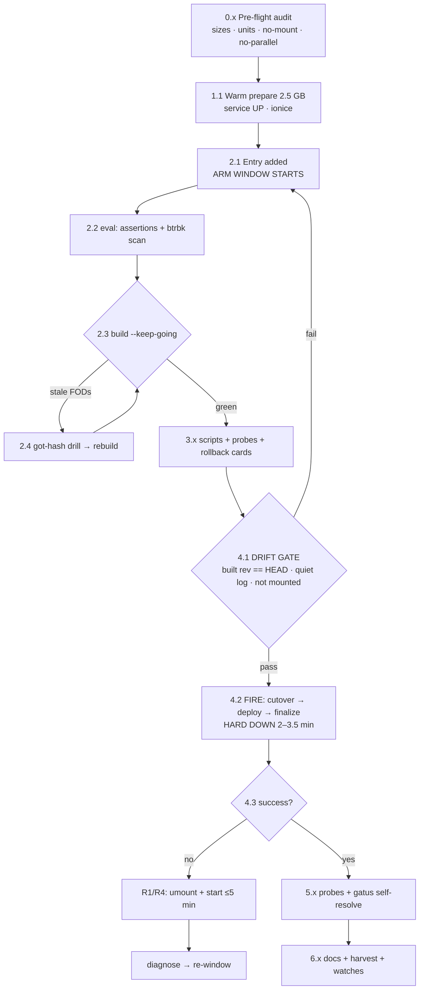

# Plan: dnsblockd → Samsung Hot-DB Tier (Wave 2) — Minimum-Downtime Engineering

**Authored:** 2026-10-14 19:03 CEST · **Status:** PLAN ONLY (awaiting owner GO)
**Blast radius if botched:** the sole LAN resolver — every client, every service lookup.
**Historical failure classes to design out:** 48-min drift deploy (waves 1+4 window), 71-min shadow-split (pocket-id wave 3, same day).

---

## 0. Pareto Breakdown — what actually buys downtime + safety

| Tier | Slice | Deliverable | Why it dominates |
| --- | --- | --- | --- |
| **1% → 51%** | **The atomic chained window** | ONE script: `drift-gate → cutover → deploy → finalize`, closure pre-built, zero human/tool latency between steps. Everything heavy happens BEFORE `dnsblockd` stops. | Hard-down = delta-rsync + eval + switch only. Every historical disaster was latency *between* these steps (48 min drift gap) or an armed entry meeting a foreign deploy (71 min split). |
| **4% → 64%** | **Pre-flight gates, all green before the window** | (a) eval **and build** green incl. FODs (HaGeZi churn guard), (b) fresh-drift check (built rev == HEAD), (c) mounted-guard at every step (`findmnt` refuses), (d) parallel-deploy quiet check, (e) prepare-completed populated subvol | Today proved eval-green ≠ build-green (16 stale FODs) and that human discipline fails under parallel sessions. Gates are the invariants. |
| **20% → 80%** | **Full pre-window prep** | 2.5 GB warm copy service-up; entry edit + pre-build compressed to a ≤10-min arm window; probes pre-scripted; rollback ladder written; storm escapes documented; gatus-page expectation set | The window itself must be pure execution. Surprise is the enemy of downtime. |
| **Last 20% → 100%** | **Closeout** | docs (wave row 2, harvest both surfaces), live watches (btrbk cycle, gatus check render, soak-end reclaim), storm-calm smoke re-run | The wave isn't done when it works; it's done when the system's immune system covers it. |

**Do NOT Verschlimmbessern (explicit anti-goals):**
- NO creative pruning mid-wave (the stale `dnsblockd_tracking.db` legacy file migrates verbatim — byte-exact verify depends on it; cleanup is a separate owner decision).
- NO new tooling written *during* the window. The `preflight` action is designed here but ships AFTER, not during.
- NO reordering that puts the entry in the tree before its pre-build exists (the arm window starts at the daemon's first sweep of my edit, not at my deploy).

---

## 1. Downtime anatomy & budget (the number we're engineering)

Hard-down window = `dnsblockd` stopped → serving again:

| Component | Est. | Depends on |
| --- | --- | --- |
| delta rsync (quiesced) | 10–60 s | prepare freshness (stats DB churns continuously) |
| deploy re-eval | 60–90 s | observed on this box; unavoidable (`nix run .#deploy` contract) |
| switch activation | 20–40 s | closure pre-built → cached; mount + restart |
| service start → resolving | 2–5 s | ExecStart gates |
| **TOTAL target** | **≈ 2–3.5 min** | vs. 48-min and 71-min historical classes |
| Abort path (worst case) | ≤ 5 min to serving | R0/R1 rollback ladder below |

Client impact: resolvers-cached clients see nothing; uncached lookups fail for the window; gatus "DNS Resolver" pages once and self-resolves (runbook-expected, announce in window).

---

## 2. Rollback ladder (written BEFORE the window, per doctrine)

| Level | Trigger | Action | Cost |
| --- | --- | --- | --- |
| **R0** | cutover verify fails (counts/bytes differ) | script auto-restarts units on the untouched QLC source (built-in); wave aborts cleanly | 0 — by construction |
| **R1** | deploy fails post-cutover (subvol mounted, service stopped) | fix-forward if trivial (eval typo); else `umount /var/lib/dnsblockd` + `systemctl start dnsblockd` — QLC shadow is complete-through-cutover | ~1 min to serving; entry removal at leisure |
| **R2** | service fails ON the subvol post-switch (config/derivation issue) | same as R1, then diagnose offline | ~1 min |
| **R3** | corruption discovered post-soak | subvol is byte-exact vs. marker; QLC shadow = full insurance until soak-end reclaim — **but see the secret-store caveat: dnsblockd keeps no secrets; its shadow is unconditionally safe rollback media** | n/a |
| **R4** | the landmine springs anyway (foreign deploy mounts mid-window) | the pocket-id rescue playbook, proven today: stop → umount → script `cutover` (byte-exact from clean QLC) → remount → finalize | ~2 min |

---

## 3. Comprehensive plan (medium granularity, 30–100 min tasks)

| # | Task (30–100 min) | Impact | Effort | Est. | Downtime? |
| --- | --- | --- | --- | --- | --- |
| 1 | **Pre-flight state audit** — live sizes (`du` via root wrapper), units active, subvol absent, dataDir NOT a mountpoint, no btrbk reference (eval scan will re-gate), parallel-session deploy check (recent `git log`, in-flight switch), PSI reading recorded | HIGH | S | 15 min | no |
| 2 | **Warm prepare 2.5 GB** (service RUNNING) — `migrate-hot-db.sh prepare dnsblockd` via the MIGRATE_PSI_FILE=/dev/null harness, ionice/nice; verify 25-file-class receipt + populated subvol | HIGH | S | 15–45 min (storm-dependent) | no |
| 3 | **Entry add + eval + full toplevel build** — `entries.dnsblockd` (unit only, no extraUnits — registry-verified), then `nix eval` (assertions + landmine scan) AND `nix build .#nixosConfigurations.evo-x2.config.system.build.toplevel --keep-going` (FOD-class HaGeZi guard); on stale-FOD failure: got-hash capture → mechanical patch → rebuild (drill documented in pipeline.md) | HIGH | M | 15–45 min | no |
| 4 | **Window script authored + probes pre-staged** — the atomic chain (drift-gate → cutover → deploy → finalize), root wrappers tested, probe battery staged (`dig @127.0.0.1` x3 domains, `/health`, `hot_db_entry_mounted`, gatus journal) | HIGH | S | 15 min | no |
| 5 | **THE WINDOW** — drift gate in the same minute (built rev == HEAD, quiet git log) → fire the chain → hard-down ≈ 2–3.5 min → probes | CRITICAL | S | 5 min | **YES — the only downtime** |
| 6 | **Verification battery** — probes green, marker vs. live counts, `findmnt` source = `hot/dnsblockd`, mount-gated consumers healthy, gatus "DNS Resolver" self-resolved, Gatus "Hot Tier dnsblockd" check renders | HIGH | S | 15 min | no |
| 7 | **Docs + harvest** — hot-db.md wave row 2 LIVE + current-state, harvest: tonight-agnostic resolver watch, btrbk live-cycle for `hot/dnsblockd`, soak-end reclaim row; both queue surfaces | MEDIUM | S | 30 min | no |
| 8 | **Ship the preflight action** (post-wave, owner-approved) — codify gates (a)–(e) into `migrate-hot-db.sh` so wave 6 + postgres inherit them as code | HIGH (durable) | M | 60–90 min | no |
| 9 | Storm-calm re-verification (next calm window): post-deploy-check.sh full pass; gatus cycle green incl. new anchored check | MEDIUM | S | 15 min | no |

---

## 4. Detailed micro-breakdown (T-minus schedule, ≤15 min each)

| # | Micro-task | Window | Est. | Down? |
| --- | --- | --- | --- | --- |
| 0.1 | root-wrapper live audit: `du -sb /var/lib/dnsblockd`, file count, biggest files, units, timers | T-120 min | 5 min | no |
| 0.2 | confirm subvol absent + dataDir not a mountpoint + tier healthy (610 G free) | T-120 | 2 min | no |
| 0.3 | parallel-deploy check: `git log --format="%h %ad" -5`, no switch-in-flight evidence | T-120 | 3 min | no |
| 0.4 | record PSI baseline; confirm force-escape harness vars | T-120 | 2 min | no |
| 1.1 | fire `prepare dnsblockd` (warm, ionice -c3 nice -n19) | T-110 | 15–45 min | no |
| 1.2 | verify prepare receipt: file count + byte total + populated subvol | T-90 | 3 min | no |
| 2.1 | edit `entries.dnsblockd` into configuration.nix (ARM WINDOW STARTS — daemon sweeps within ~10 min) | T-85 | 5 min | no |
| 2.2 | `nix eval` toplevel (assertions + btrbk landmine scan) | T-80 | 3 min | no |
| 2.3 | `nix build` toplevel `--keep-going` (FODs incl. HaGeZi) | T-75 | 10–40 min | no |
| 2.4 | if stale FODs: capture got-hashes → verify content genuine → mechanical patch → rebuild | T-40 | 10–15 min | no |
| 3.1 | author the atomic window script (cutover+deploy+finalize chained, `set -euo pipefail`, wrappers) | T-30 | 10 min | no |
| 3.2 | stage probe battery script (dig x3, /health, metric, gatus journal grep) | T-20 | 5 min | no |
| 3.3 | rollback R1/R4 runbook cards on stdout of the window script (abort = one paste) | T-15 | 5 min | no |
| 4.1 | **DRIFT GATE**: `git rev-parse HEAD` == built rev; `git status --short` md5 unchanged; no new commits; `findmnt` still negative | **T-1** | 1 min | no |
| 4.2 | **FIRE**: cutover (stop → delta → verify → marker) → deploy (force escapes) → finalize (verify → start) | **T-0** | 2–4 min | **YES** |
| 4.3 | abort ladder armed: R0 auto; R1/R2 = umount+start one-liner pasted on failure | (on failure) | ≤5 min | partial |
| 5.1 | probe battery + marker cross-check + findmnt source | T+2 min | 5 min | no |
| 5.2 | gatus self-resolution confirm ("DNS Resolver" check back green) | T+5 min | 5 min | no |
| 5.3 | consumer sweep: everything resolving via 127.0.0.1:53 healthy (spot: gatus, caddy, SigNoz ingest) | T+10 min | 10 min | no |
| 6.1 | docs: wave row 2 LIVE + current-state paragraph | T+30 min | 10 min | no |
| 6.2 | harvest both surfaces (btrbk-cycle watch, soak reclaim, resolver-watch) | T+40 min | 10 min | no |
| 6.3 | report close-out + todo updates | T+50 min | 10 min | no |

---

## 5. Explicit non-goals (verschlimmesser guard)

1. **No `dnsblockd_tracking.db` pruning during the wave** — byte-exact verify depends on verbatim copy; cleanup is a separate, owner-visible task.
2. **No preflight tooling authored mid-wave** — the gates run as scripted checks today; codification ships after the wave (§3 task 8).
3. **No deployment of unrelated in-tree WIP** — the tree currently carries the parallel session's nix-heavy-gate deletion in flight; the build includes whatever is on disk at build time (shared-tree reality), but I will re-check drift at T-1 and refuse the window if their refactor is mid-cascade.
4. **No storm-waiting beyond the owner's directive** — "lowest downtime" = tight window engineering, not waiting for quiescence; all gates run on the documented two-var force escapes as ratified this afternoon.

## 6. Success criteria

- `findmnt /var/lib/dnsblockd` → `nvme1n1p2[/hot/dnsblockd]`
- Cutover verify byte-exact vs. marker; finalize gates green
- `dig @127.0.0.1 home.lan` + external name resolve within 5 s of finalize
- `hot_db_entry_mounted{name="dnsblockd"} 1`
- Gatus "DNS Resolver" self-resolved; new anchored hot-tier check renders
- Hard-down ≤ 3.5 min (stretch: ≤ 2.5 min)
- Docs + harvest landed both surfaces; watches queued
