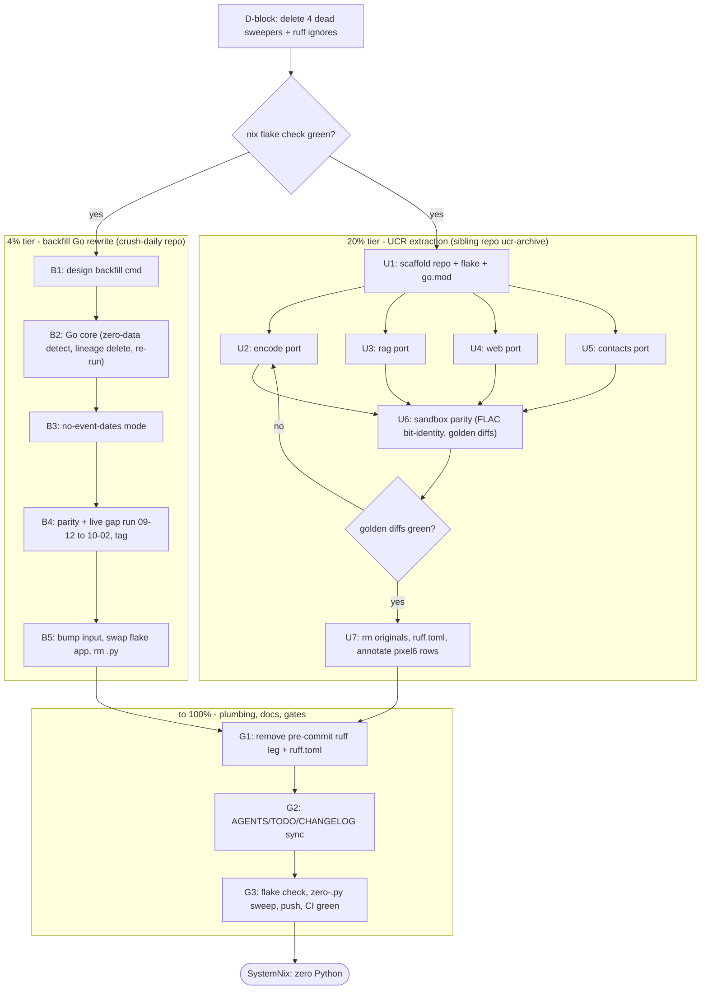

# SystemNix Zero-Python Pareto Plan

**Date:** 2026-10-14 22:08 CEST
**Goal:** SystemNix ends at **zero Python** — dead sweepers deleted, the UCR call-archive pipeline rehomed in a sibling Go repo, the last flake Python (`crush-daily-backfill`) rewritten in Go — with nothing broken in between.

---

## 1. Current state (all facts verified live this session)

Inventory (`scc scripts`, 2026-10-14): **9 files, 2,502 lines** (1,977 code / 191 comments / 334 blanks).

| Script | Lines | Last touched | Live wiring | Verdict |
| --- | --- | --- | --- | --- |
| `pixel6-contacts.py` | 535 | 2026-09-19 | ruff.toml E501 ignore only | Extract → Go (`ucr contacts`) |
| `ucr-rag.py` | 409 | 2026-10-01 | — | Extract → Go (`ucr rag`) |
| `crush-daily-backfill.py` | 302 | 2026-10-04 | **flake app** `apps.nix:268-277` (`writePython3Bin`, the ONLY `writePython3` in the flake) + open TODO row | Rewrite in Go inside the `crush-daily` repo |
| `ucr-web-archive.py` | 233 | 2026-09-19 | ruff.toml E501 ignore only | Extract → Go (`ucr web`) |
| `migrate-envrc.py` | 249 | 2026-08-21 | docs only | **Delete** (migration verified complete: all ~71 project `.envrc` use the smart pattern — spot-checked CV, templ-components) |
| `ucr-mirror-encode.py` | 298 | 2026-10-01 | — | Extract → Go (`ucr encode`) |
| `fix-versions.py` | 208 | 2026-08-21 | docs only | **Delete** (one-off sweep, ran May–Aug per archived status reports) |
| `commit-tag-push.py` | 189 | 2026-08-21 | docs only | **Delete** (companion to fix-versions) |
| `prefetch-crates.py` | 79 | 2026-08-21 | zero references | **Delete** (re-creatable as a 15-line shell script if crates.io UA-blocks ever return) |

Adjacent plumbing (verified):

- `scripts/ucr-ffprobe-sweep.sh` — produces the `encode-manifest.tsv` the encode leg consumes → **moves with the extraction** (shell stays shell).
- `.githooks/pre-commit:390-401` — ruff leg on staged `.py` → **removed** once `scripts/*.py` = 0.
- `ruff.toml` — 2 per-file ignores → **removed** with the UCR extraction.
- `flake/parts/checks/lint-static.nix:48-52` — python3-usage guard → **KEEP** (it is a guard against accidental Python in shell/nix runtime inputs, not Python usage).
- `crush-daily` is already a flake input (`flake.lock:862`) → the app swap rides an input bump, no new infra.
- UCR data root: `/mnt/pool/backups/pixel6/2026-08-20` (hardcoded `ROOT_DEFAULT` in 4 scripts) — data stays put; only code moves.
- `docs/todo/pixel6.md` backlog holds 3 `[ready]` rows for UCR work that **shipped 2026-09-15** (per `docs/status/2026-09-15_05-46_pixel6-ucr-sweep-mirror-webarchive-contacts-rag-status.md`) — stale rows, annotated during U7.
- Planning pre-read (`rg -il python docs/planning docs/brainstorming`, 2026-10-14): **no ratified plan exists** for Python removal — this plan is the source of truth.

## 2. Goal state / definition of done

1. `rg -l '\.py$' scripts/` → empty; `rg writePython3 flake/` → empty.
2. Pre-commit ruff leg + `ruff.toml` gone; lint-static python3 **guard** retained.
3. New sibling repo `ucr-archive` (Go, own flake + `ucr` app) passes its own `nix flake check` and parity-verified against the Python originals on a sandbox copy.
4. `crush-daily` repo gains `backfill [--no-event-dates]` (Go), tagged, and SystemNix's `nix run .#crush-daily-backfill` serves the Go binary; the 2026-09-12 → 2026-10-02 gap backfilled.
5. TODO surfaces consistent: `TODO_LIST.md` queue ↔ `docs/todo/services.md` / `docs/todo/pixel6.md` (drift rule), stale pixel6 rows annotated, CHANGELOG pruned.
6. `/mnt/pool` **never written** during parity work; all experiments on `/tmp` sandbox copies.

## 3. Non-negotiables (anti-verschlimmbessern)

- **Land the replacement BEFORE removing the old source** (2026-08-31 rule): U7 deletion only after U6 parity is green; B5 app swap only after B4 live-run parity.
- **Content-pin before every write** (`git rev-parse HEAD` + `git status --short` + `git log --stat`) — shared tree, auto-commit daemon races.
- **PATHSPEC commits** when committing out of a shared dirty index; amend-forward only, never reset.
- **Sandbox parity only**: encode/rag/web/contacts verification runs against `/tmp/ucr-parity/...` copies; the real-root leg is strictly read-only (rag query, regen to /tmp).
- Pin the ffmpeg version in `ucr-archive`'s flake so FLAC/opus output is reproducible (parity depends on it).
- Queue↔library drift rule: every queue one-liner edit lands in BOTH `TODO_LIST.md` and the domain library file.
- Git identity comes from the repo config; no placeholder identity ever.

## 4. Pareto tiers

| Tier | Slice | What | Result share |
| --- | --- | --- | --- |
| **1%** | D-block, 4 fine tasks (~37 min) | Delete the 4 dead sweepers + their ruff ignores | **51%** of the hygiene value: 725 LOC (29% of all Python) gone at zero risk; `scripts/` becomes 100% alive; the "dead code in a config repo" class eliminated |
| **4%** | + B-block, 27 fine tasks (~4.5 h) | Go rewrite of the backfill in `crush-daily` + flake app swap | **64%**: last flake Python gone, an OPEN incident-adjacent TODO (report-gap row) closed with the no-event-dates mode built in from the start |
| **20%** | + U-block, 45 fine tasks (~7.5 h) | Extract UCR pipeline to sibling repo, Go rewrite, parity, remove | **80%**: 1,475 LOC (59% of Python) rehomed where the data and domain live; ruff.toml goes with it |
| **to 100%** | + G-block, 11 fine tasks (~1.9 h) | Pre-commit plumbing, docs sync, full gates, push, CI | **100%**: wiring consistent, guards retained, surfaces drift-free, CI green |

Execution order = tier order: **D → B ∥ U → G** (B and U are independent; U's ports parallelize after U1).

## 5. Execution graph

## 6. Comprehensive plan — medium tasks (30–100 min each)

Sorted by importance/impact/effort. 16 tasks, ALL work items included.

| # | ID | Task | Block | Effort | Impact | Depends |
| --- | --- | --- | --- | --- | --- | --- |
| 1 | D | Delete 4 dead one-off sweepers + ruff.toml ignores, reference sweep, gates, commit | 1% | 45 min | HIGH (29% LOC, zero risk) | — |
| 2 | B1 | Design the Go `backfill` command in the crush-daily repo (CLI surface, DSN discovery, DailyReport lineage deletion via store API) | 4% | 60 min | HIGH (closes open TODO row's approach) | D |
| 3 | B2 | Implement Go backfill core: zero-data detection, aggregate-lineage deletion, collect+insights+report re-run | 4% | 100 min | HIGH | B1 |
| 4 | B3 | Implement no-event-dates mode (missing-report discovery + session-data check) + tests | 4% | 60 min | HIGH | B2 |
| 5 | B4 | Dry-run parity vs Python on sample dates, live gap run 2026-09-12→10-02, tag + push crush-daily | 4% | 60 min | HIGH | B3 |
| 6 | B5 | Bump SystemNix crush-daily input, swap flake app writePython3Bin→Go binary, delete the .py | 4% | 45 min | HIGH | B4 |
| 7 | U1 | Scaffold sibling repo `ucr-archive`: flake.nix (pinned ffmpeg, `ucr` app), go.mod, package layout, data-root contract README | 20% | 60 min | MED (unblocks all ports) | — |
| 8 | U2 | Port `ucr-mirror-encode` → `ucr encode` (+ move `ucr-ffprobe-sweep.sh`) | 20% | 100 min | MED (492 LOC) | U1 |
| 9 | U3 | Port `ucr-rag` → `ucr rag` (sqlite schema, whisper-format import, FTS query) | 20% | 100 min | MED (409 LOC) | U1 |
| 10 | U4 | Port `ucr-web-archive` → `ucr web` (static player + search generation) | 20% | 90 min | MED (233 LOC) | U1 |
| 11 | U5 | Port `pixel6-contacts` → `ucr contacts` (evidence registry, VCF decode, cards) | 20% | 100 min | MED (535 LOC) | U1 |
| 12 | U6 | Parity verification on `/tmp` sandbox: FLAC bit-identity, opus deltas, golden web/contacts/rag diffs | 20% | 90 min | HIGH (gates U7) | U2–U5 |
| 13 | U7 | Remove the 4 UCR `.py` + sweep script + ruff.toml ignores from SystemNix; annotate stale pixel6.md rows | 20% | 45 min | MED | U6 |
| 14 | G1 | Remove pre-commit ruff leg; remove `ruff.toml`; hook self-check | 100% | 30 min | MED | B5, U7 |
| 15 | G2 | Docs sync: AGENTS.md scripts line, TODO_LIST/services/pixel6 row edits, CHANGELOG prune, plan annotation | 100% | 45 min | MED | G1 |
| 16 | G3 | Full gates: flake check, zero-`.py` sweep assert, push, CI green, close-out consistency | 100% | 45 min | MED | G2 |

## 7. Detailed breakdown — fine tasks (≤12 min each)

Sorted by execution order within blocks; blocks in tier order. 87 tasks.

### D-block — deletions (1% tier, ~37 min)

| ID | Task | Min |
| --- | --- | --- |
| D1 | Content-pin (rev/status/log-stat) + `rg` reference sweep of the 4 scripts (docs-only refs expected) | 10 |
| D2 | `git rm` fix-versions.py, commit-tag-push.py, migrate-envrc.py, prefetch-crates.py + drop the 2 ruff.toml E501 ignores | 5 |
| D3 | Gates: `nix flake check --no-build`, `nix fmt` scoped, scratch pre-commit run | 12 |
| D4 | Detailed PATHSPEC commit (deletion rationale + verdict evidence in body) | 10 |

### B-block — backfill Go rewrite (4% tier, ~4.5 h)

| ID | Task | Min |
| --- | --- | --- |
| B1.1 | Read `scripts/crush-daily-backfill.py` fully; map control flow (zero-data detect → lineage delete → re-run) | 12 |
| B1.2 | Read crush-daily repo layout: DailyReport aggregate, store, collect/insights/report entry points | 12 |
| B1.3 | Decide CLI surface: `crush-daily backfill [--no-event-dates] [--from --to] [--dry-run]` + note the decision | 10 |
| B1.4 | Map Python's sqlite DSN discovery + version-conflict deletion onto go-cqrs-lite store calls | 12 |
| B1.5 | Write the decision note into crush-daily docs/ADR | 10 |
| B2.1 | `backfill` command skeleton: flags + wiring into the existing CLI | 10 |
| B2.2 | Dry-run mode: print planned dates/actions, mutate nothing | 10 |
| B2.3 | Zero-data detection query: sessions-per-date across hot DBs (part 1) | 10 |
| B2.4 | Zero-data detection (part 2): hot-DB iteration + date bucketing | 12 |
| B2.5 | Aggregate-lineage deletion via store API, not raw SQL (part 1) | 12 |
| B2.6 | Lineage deletion (part 2) + idempotency guard (already-backfilled skip) | 12 |
| B2.7 | Re-run pipeline per date (part 1): collect | 12 |
| B2.8 | Re-run pipeline (part 2): insights + report + progress logging | 12 |
| B3.1 | no-event-dates discovery (part 1): dates with missing reports | 10 |
| B3.2 | no-event-dates discovery (part 2): session-data-present check per date | 10 |
| B3.3 | Wire mode into the backfill loop + summary table output | 12 |
| B3.4 | Unit tests: date-discovery edges (partial-day events, DST-adjacent, empty DBs) | 10 |
| B3.5 | `go test` + build gates in crush-daily | 10 |
| B4.1 | Dry-run parity vs Python on sample date A — diff report sets | 12 |
| B4.2 | Dry-run parity on sample date B | 12 |
| B4.3 | Live gap run (part 1): 2026-09-12 → 09-24 | 12 |
| B4.4 | Live gap run (part 2): 09-25 → 10-02 | 12 |
| B4.5 | Verify reports landed; tag release; push crush-daily | 12 |
| B5.1 | Bump SystemNix flake input `crush-daily` to the released rev | 10 |
| B5.2 | Swap `apps.nix:268-277` app: drop `writePython3Bin`, wrap the Go binary from the input | 12 |
| B5.3 | `git rm scripts/crush-daily-backfill.py` | 2 |
| B5.4 | `nix flake check --no-build` + `nix run .#crush-daily-backfill -- --help`/dry-run + commit | 12 |

### U-block — UCR extraction (20% tier, ~7.5 h)

| ID | Task | Min |
| --- | --- | --- |
| U1.1 | Init `~/projects/ucr-archive`: README with the data-root contract (`/mnt/pool/backups/pixel6/2026-08-20`, derived/ layout), .gitignore | 12 |
| U1.2 | flake.nix: Go build of the `ucr` app, devShell with pinned ffmpeg, flake check | 12 |
| U1.3 | go.mod + `cmd/ucr` skeleton with subcommand routing (encode/rag/web/contacts) | 10 |
| U1.4 | Package layout `internal/{encode,rag,web,contacts}` + shared config (root path flag/env) | 12 |
| U2.1 | Read `ucr-ffprobe-sweep.sh` + `ucr-mirror-encode.py`; document the manifest contract (columns, verdicts) | 12 |
| U2.2 | `git mv` sweep script into ucr-archive/scripts/ (SystemNix copy removed only at U7) | 5 |
| U2.3 | Go: manifest TSV parser + verdict==OK filter | 12 |
| U2.4 | Go: ffmpeg FLAC (-8) + opus 32k voip encodes (opus encoded FROM the flac) | 12 |
| U2.5 | Go: target tree `derived/flac/<Contact>/<Year>/<name>.flac` + skip-existing idempotence | 12 |
| U2.6 | Go: summary log + failure quarantine list | 10 |
| U2.7 | Sandbox run: 5-file manifest slice through the encode leg | 10 |
| U2.8 | ffprobe verify: durations/streams match source | 10 |
| U2.9 | Fix deltas until U2.8 green (iterate max 3, then reassess) | 12 |
| U3.1 | Read `ucr-rag.py`: inventory schema, import formats, query semantics | 12 |
| U3.2 | Go: sqlite driver choice (how-to-golang policy) + schema init | 12 |
| U3.3 | Go: whisper JSON parser (openai-whisper/whisper.cpp/faster-whisper shapes) | 10 |
| U3.4 | Go: SRT/VTT/txt parsers | 12 |
| U3.5 | Go: import pipeline + call metadata from the mirror | 12 |
| U3.6 | Go: FTS index + `init`/`import`/`query` subcommands | 12 |
| U3.7 | Canned-query parity vs Python on sandbox transcripts (3 queries) | 10 |
| U3.8 | Fix deltas until query parity | 12 |
| U4.1 | Read `ucr-web-archive.py`: inventory template, search, player wiring | 12 |
| U4.2 | Go: html/template port — index page (part 1) | 12 |
| U4.3 | Go: template port (part 2) — per-contact views + search index | 12 |
| U4.4 | Go: opus relative-stream links + keyboard/player parity | 10 |
| U4.5 | Sandbox generate + link-lint (no dead hrefs, relative paths intact) | 10 |
| U4.6 | Fix deltas until structural parity | 12 |
| U5.1 | Read `pixel6-contacts.py` (part 1): `derive` subcommand evidence rules | 12 |
| U5.2 | Read (part 2): `decode-vcf`/`decode` subcommands + output tree | 12 |
| U5.3 | Go: Cube ACR JSON + UCR filename scanners | 12 |
| U5.4 | Go: evidence JSON writer (`derived/contacts/contacts-evidence.json`) | 10 |
| U5.5 | Go: vCard unfolding + QUOTED-PRINTABLE decoding | 12 |
| U5.6 | Go: vCard 2.1/3.0/4.0 field mapping + base64 photo decode | 12 |
| U5.7 | Go: per-contact cards + `index.html` renderer | 12 |
| U5.8 | Read-only run vs Python: contact-count + card parity on the 2026-08-20 incoming VCF | 10 |
| U6.1 | Build `/tmp/ucr-parity` sandbox: manifest slice + contacts fixtures (NEVER write /mnt/pool) | 12 |
| U6.2 | Full Go pipeline run on the sandbox root | 12 |
| U6.3 | FLAC bit-identity (`flac -t` + md5 on sample set) + opus size/duration deltas <1% | 12 |
| U6.4 | Golden-file diffs: web archive tree, contacts JSON/cards, rag query outputs | 12 |
| U6.5 | Record verdict + deviations in ucr-archive README verification log | 10 |
| U6.6 | Real-root READ-ONLY sanity: rag query + web-archive regen to /tmp | 12 |
| U7.1 | `git rm` the 4 UCR `.py` + `ucr-ffprobe-sweep.sh` + ruff.toml E501 ignores | 10 |
| U7.2 | ANNOTATE the 3 stale `[ready]` rows in docs/todo/pixel6.md inline (shipped 2026-09-15, now rehomed) | 12 |
| U7.3 | Pointer note on the 2026-09-15 status report (code now lives in ucr-archive) + CHANGELOG prune | 10 |
| U7.4 | Gates + detailed commit | 12 |

### G-block — plumbing, docs, gates (to 100%, ~1.9 h)

| ID | Task | Min |
| --- | --- | --- |
| G1.1 | Remove the ruff leg from `.githooks/pre-commit` (STAGED_PY block, lines 390-401) | 10 |
| G1.2 | Remove `ruff.toml` entirely (zero per-file ignores remain) | 5 |
| G1.3 | `bash -n` + shellcheck pre-commit + scratch-commit hook run with a dummy `.py` (hook must stay inert-but-valid) | 12 |
| G2.1 | AGENTS.md: `scripts/` line "Shell + Python operational scripts" → "Shell operational scripts" + zero-Python note (guard retained) | 10 |
| G2.2 | TODO_LIST.md: close the backfill gap row + update the 4 plan-derived queue rows | 12 |
| G2.3 | docs/todo/services.md + pixel6.md: mirror the same edits (drift rule: edit both) | 12 |
| G2.4 | CHANGELOG prune + annotate this plan (point-in-time snapshot note) | 10 |
| G3.1 | `nix flake check --no-build` + scoped `nix fmt` | 12 |
| G3.2 | Asserts: `rg -l '\.py$' scripts/` empty; `rg writePython3 flake/` empty; python3 guard still fires (selftest) | 5 |
| G3.3 | Push + watch nix-check.yml until green | 12 |
| G3.4 | Close-out: verify queue ↔ library consistency; record the zero-Python verdict | 12 |

## 8. Verification matrix

| Gate | Command / check | Blocks |
| --- | --- | --- |
| Eval | `nix flake check --no-build` | D3, B5.4, U7.4, G3.1 |
| Zero Python | `rg -l '\.py$' scripts/` + `rg writePython3 flake/` | G3.2 |
| Guard alive | lint-static python3-usage selftest still fires | G3.2 |
| Encode parity | FLAC md5 + `flac -t` on sandbox sample set | U6.3 |
| Data safety | `/mnt/pool` mtimes/atimes untouched by parity runs (all writes to /tmp) | U6.1-U6.6 |
| Backfill parity | Python vs Go dry-run report-set diff on 2 sample dates | B4.1-B4.2 |
| Gap closure | crush-daily reports exist for every date 2026-09-12 → 10-02 | B4.5 |
| Hook health | `bash -n` + shellcheck + scratch commit with dummy `.py` | G1.3 |
| Drift check | every queue row's library twin edited in the same commit | G2.2-G2.3, G3.4 |
| CI | nix-check.yml green after push | G3.3 |

## 9. Risk register

| Risk | Mitigation |
| --- | --- |
| FLAC output differs across ffmpeg versions → false parity failure | Pin ffmpeg in ucr-archive flake; compare against Python leg built in the SAME shell env |
| Btrfs QLC `/tmp` too small for a manifest slice | Slice ≤5 files (~few GB); use `/mnt/hot/tmp` if /tmp is tight (hot tier, instant-free) |
| Go rewrite drifts from Python semantics (report aggregate version conflicts) | B1.4 maps the exact lineage-deletion contract BEFORE coding; parity diffs gate the live run |
| Parallel agent session races the shared tree | Content-pin before every write; PATHSPEC commits; re-read before every edit |
| crush-daily input bump breaks other consumers | Input bump isolated in B5; `nix flake check` gates; revert = lock restore (soft reset only) |
| Deleting scripts another session still references | D1 reference sweep covers docs + flake + hooks + CI at execution time, not just today's snapshot |

## 10. Out of scope

- Throwaway `/tmp` Python probes (bank-sync-sca-watch.py, live-verify-404.py) — not repo code; their runbook-folding TODOs already exist.
- The whisper transcription service itself (upstream producer of `derived/transcripts/`) — unchanged; ucr-archive only consumes its output.
- Navidrome/music-server configuration — consumes the FLAC leg by path; paths unchanged.
- `lint-static.nix` python3-usage guard — stays forever (it guards, it doesn't use).

## 11. Queue sync (this commit)

- `TODO_LIST.md`: +3 new `[ready]` rows (deletions, UCR extraction, plumbing removal); backfill gap row amended to the Go-rewrite approach.
- `docs/todo/services.md`: +2 rows (deletions, plumbing removal); backfill row amended in lockstep.
- `docs/todo/pixel6.md`: +1 row (UCR extraction).
- Stale pixel6 backlog rows: annotated during U7 (not silently marked done — verification protocol applies).

_Arte in Aeternum_
