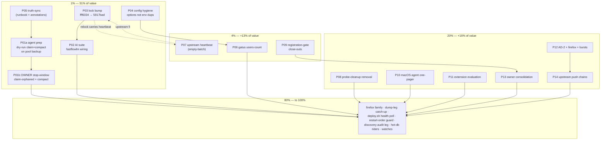

# SystemNix Browser-History Pareto Execution Plan — the 1% that Delivers 51% (2026-10-15 19:35 CEST)

**Method:** library deep dive of the `browser-history` flake input (2026-10-15, `docs/2026-10-15_browser-history-deep-dive.html`, commit `9bab1252`) scored adoption at **76/100 — 9/13 capability groups fully leveraged**. This plan partitions **all 38 browser-history-scope open todos** (20 existing rows in `docs/todo/services.md`, 8 in `docs/todo/upstream.md`, 2 pipeline/storage legs, 8 new tasks surfaced by the audit) into **14 work packages** (30–100 min slices) and then into **48 micro-tasks (≤12 min each)**.

**Lineage (pre-read, not re-invented):** the 2026-10-06 queue-wide PARETO plan (`docs/planning/2026-10-06_16-59_PARETO-1PERCENT-EXECUTION-PLAN.md`) covered browser-history as P06 (empty-dashboard chain) — that chain is now mostly converged (dashboard live with 3,179+ attributed visits); this plan supersedes nothing, it deep-dives the one service. Deploy authority, hot-db windows, and Pocket-ID audits remain owned by the standing queue rows they came from.

**Owner decisions taken (2026-10-15):** execution scope = **plan + agent-safe execution** (no sudo, no live-DB mutation, no secret pasting); AI-suite endpoint = **local fastflowlm** (`http://127.0.0.1:52625/v1`, PMA precedent `OPENAI_API_KEY=local`).

**Row census:** 8 new `[ready]` · 10 existing `[ready]` · 5 `[blocked:user]` · 2 `[blocked:push]` · 3 `[decision]` · 4 `[watch]` · 6 upstream-fix/verify rows. Blocked/decision/watch rows appear as gated tracks, never dropped.

---

## 1. Pareto breakdown

### The 1% → ~51% of total value (3 items)

| #   | Item                                                                                                                                                                                                                                                                                                                                                                                                                                                                                                                                                       | Why it is the 1%                                                                                                                                            |
| --- | ------------------------------------------------------------------------------------------------------------------------------------------------------------------------------------------------------------------------------------------------------------------------------------------------------------------------------------------------------------------------------------------------------------------------------------------------------------------------------------------- | ----------------------------------------------------------------------------------------------------------------------------------------------------------- |
| 1.1 | **Stop-window: `claim-orphaned` + `compact-visit-journal` on the live DB** (P01, owner-gated). The 2026-10-14 manual-SQL re-attribution left the event journal zero-user (replay caveat — a full replay would resurrect zero-user ownership) and 217 behavioural rows unclaimed. The replay-consistent CLI ships in the deployed binary and was dry-run-verified on a backup copy 2026-10-07.                                                                                                                                                    | The only open item that can silently UNDO past work. Everything else is additive value; this one is correctness.                                             |
| 1.2 | **AI-suite enablement + lock-bump train** (P02+P03): `llm.baseUrl` → fastflowlm, `LLM_API_KEY=local`, model `qwen3.6-moe:35b-a3b`, timeout 10m; lock bump `fff6034 → 5917bad` carries `/chat` + the DSN artifact fix.                                                                                                                                                                                                                                                                              | Largest dark feature suite (summaries, cron digests, themes, chat) turned on with ~5 lines of nix + one lock move. Audit's #2 finding, closed cheaply.       |
| 1.3 | **Config-hygiene bundle** (P04): `logLevel` / agent `user` / `environmentFile` via module options instead of unit-level duplicates (kills the last-wins env-fragility class), freshness clocks aligned (30m vs 60m), stale `flake.nix` input comment refreshed.                                                                                                                                                                                                                                                                                            | Removes the silent-flip risk class (`LOG_LEVEL` could invert on a module change) at near-zero effort; the audit's #4 finding.                                |

### The 4% → cumulative ~64% (adds 4 items)

4.1 **Truth-sync package** (P05): runbook lock-note → `fff6034`, claim-orphaned/compact recipes replace the manual-tx template, live-probe `sqlite3` recipe fix, annotation of the 10-15 close-out's stale "still 8900354" claim. · 4.2 **Upstream empty-batch heartbeat** (P07, `~/projects/browser-history`): agent sends a heartbeat batch on quiet days so `/health` stops 503-degrading (row services.md:71). · 4.3 **Registration-gate security close-outs** (P09): CSRF double-submit smoke + `/auth/import` reachability + `registrationMu` bypass sweep. · 4.4 **Gatus users-count check** (P06): `browser_history_users` decrease/exceed alert — the count-bypass exploitation detector.

### The 20% → cumulative ~80% (adds 6 items)

P08 (self-neutralized `probeRegistrationCleanup` block removal) · P10 (macOS second-agent decision packaging) · P11 (dwell-time extension evaluation + Chrome-policy wiring plan) · P12 (AD-2 pin-check at deployed rev + firefox below-fold render-proof + slow-render burst correlation) · P13 (owner-gated consolidation: probe user, OAuth2 first-login, E2E login, revoke 4 users — one runbook) · P14 (upstream push chains + verify-close candidates: `reattribute` superseded by claim-orphaned, empty-dashboard chain vs live state).

### The remaining 80% (to 100%)

Firefox finding family (downloads=0 mechanism, redirect-chain decision, behavioural marshal failure, search-query extraction — rows upstream.md:189-195) · dump-leg `Persistent` catch-up browser-history leg (storage.md:979) · deploy.sh `/health` poll + explicit-restart drop (pipeline.md:697) · dnsblockd→browser-history restart-ordering guard before `maxPerRun` bump (services.md:435) · Pocket-ID one-shot-discovery browser-history leg (services.md:442) · hot-db adjacent (combined-window variant codify, CAP_DAC_OVERRIDE deploy rider) · watch items (24h post-deploy tick refresh, first hot-mount backup, slow-render bursts).

---

## 2. Comprehensive plan — 14 packages (30–100 min slices)

Sorted by impact/effort/customer-value. Imp 1–5; Eff = minutes. Gate column: `agent` = executable now, `owner` = needs user (sudo/ceremony/decision), `upstream` = work lands in `~/projects/browser-history`.

| ID  | Package (tier)                                                                | Todos | Imp | Eff | Gate   | Covers (anchor asks)                                                                                                                                                                                       | Depends                       |
| --- | ----------------------------------------------------------------------------- | ----- | --- | --- | ------ | ---------------------------------------------------------------------------------------------------------------------------------------------------------------------------------------------------------- | ----------------------------- |
| P01 | **Stop-window claim-orphaned + compact** (1%, owner-gated)                    | 3     | 5   | 90  | owner  | agent-side prep: dry-run both CLIs on newest pool backup, assert 217 rows + 3,179-consistency, write the stop-window runbook; owner runs it (sudo + service stop); post-gates + health-poll-until-200       | P05 (recipes ready first)     |
| P02 | **AI-suite enablement (fastflowlm)** (1%)                                     | 2     | 4   | 45  | agent  | `llm.baseUrl/model/timeout` options + `LLM_API_KEY=local` env; eval + verify config renders; post-deploy smoke: `/ai/*` endpoints answer; chat rides P03                                                      | P03 (chat only; summaries now) |
| P03 | **Lock-bump train fff6034 → HEAD** (1%)                                       | 2     | 4   | 45  | agent  | `nix flake update browser-history` → FOD build (vendorHash via upstream `vendorHash.nix` / buildflow `nix-hash-fix` if stale) → eval checks → rides next deploy; carries `/chat`, go-aichat swap, DSN fix | none                          |
| P04 | **Config-hygiene bundle** (1%)                                                | 3     | 3   | 40  | agent  | `logLevel` via option (drop env dup), agent `user` option, `environmentFile` option, freshness clocks single-sourced, stale flake.nix:677-681 comment rewrite; eval check                                    | none                          |
| P05 | **Truth-sync: runbook + status-report annotation** (4%)                       | 4     | 3   | 45  | agent  | runbook lock-note fff6034 + correct 10-15 close-out claim; claim-orphaned recipes replace manual-tx template (row 483); system-sqlite3 probe recipe; watch-row d2a7126 refresh                               | none                          |
| P06 | **Gatus users-count check** (4%)                                              | 1     | 3   | 30  | agent  | `browser_history_users` from `:8087/metrics`, alert on decrease or exceed pre-probe baseline; follows existing browser-history gatus pattern; eval check                                                     | none                          |
| P07 | **Upstream empty-batch heartbeat** (4%, upstream repo)                        | 2     | 3   | 90  | agent  | `~/projects/browser-history`: agent POSTs empty-batch heartbeat (or server counts agent AUTHs) on quiet days; tests; `buildflow` gate; commit upstream; SystemNix relock rides P03                          | none (parallel to P03)        |
| P08 | **probeRegistrationCleanup removal** (20%)                                    | 1     | 2   | 60  | agent  | delete configuration.nix wiring + option/script/assertion block + fixture check + `check-todo-system` refs; keep-or-rip verdict on generic pattern; eval check                                              | none                          |
| P09 | **Registration-gate security close-outs** (4%)                                | 2     | 4   | 90  | agent  | CSRF double-submit dance smoke (cookie from `/` + token from `HEAD /health` → `POST /auth/register` must 403 closed); `/auth/import` unauthenticated reachability probe + `registrationMu` bypass sweep | deploy for live probe         |
| P10 | **macOS second-agent decision packaging** (20%)                               | 1     | 3   | 30  | agent  | one-pager for owner: machineId `lars-macbook-air`, own `bh_` token flow, darwin agent module wiring sketch, freshness-metric visibility caveat                                                              | owner decision                |
| P11 | **Dwell-time extension evaluation** (20%)                                     | 1     | 2   | 45  | agent  | load `extension/` in Helium/Chrome once, measure `durationMs` ingestion; Chrome-policy wiring plan (darwin manages extensions.json already); verdict: adopt/drop                                                | none                          |
| P12 | **Verification batch: AD-2 + firefox + bursts** (20%)                         | 3     | 2   | 90  | agent  | AD-2 citations pin-checked at deployed rev `fff6034` (row 358 retarget); firefox below-fold render-proof via 21-47 harness; slow-render bursts correlated with io-PSI (pre-hot-tier windows)               | none                          |
| P13 | **Owner-gated consolidation runbook** (80%)                                   | 4     | 2   | 30  | agent  | one page: probe-user delete SQL, OAuth2 first-login rejection test (second Pocket ID identity), E2E login + machine-label UI check, revoke 4 bring-up users — sequenced to share one login ceremony | owner execution               |
| P14 | **Upstream push chains + verify-closes** (80%)                                | 5     | 2   | 60  | agent  | cqrs-htmx import-gate propagation chain (blocked:push prerequisite); verify-close candidates: `reattribute` (superseded by claim-orphaned?), empty-dashboard chain (dashboard live?), count-gap row; firefox family triaged | cqrs-htmx tag                 |

**Coverage note:** every one of the 38 in-scope todos is inside exactly one package (micro-task parentheticals below name them). Adjacent-domain rows (hot-db windows, Pocket-ID audit) appear only as dependency notes — their fixes are owned by their domain libraries.

---

## 3. Micro-task breakdown (48 tasks, each ≤12 min)

Legend: `pkg` = parent package. Gate: `A` agent-safe, `O` owner, `U` upstream repo. All micro-tasks ≤12 min.

| #   | pkg  | Gate | Micro-task (≤12 min)                                                                                                                                                       |
| --- | ---- | ---- | --------------------------------------------------------------------------------------------------------------------------------------------------------------------------- |
| 1   | P04  | A    | Read upstream `server-module.nix` env rendering; map exactly which vars the option owns vs unit-level `Environment` (LOG_LEVEL only)                                          |
| 2   | P04  | A    | Set `services.browser-history.logLevel = "debug"` option; delete `"LOG_LEVEL=debug"` from unit `Environment` (browser-history.nix:284-288)                                    |
| 3   | P04  | A    | Set `services.browser-history-agent.user = primaryUser`; delete unit-level `User` (browser-history.nix:480-483); keep MemoryMax                                              |
| 4   | P04  | A    | Route sops env file through upstream `environmentFile` option instead of unit-level `EnvironmentFile` (verify option renders same path)                                      |
| 5   | P04  | A    | Single-source freshness: bind `agentFreshness` + `agentActivity.maxAgeMinutes` to one let-value (60m) with comment on the quiet-day wart                                     |
| 6   | P04  | A    | Rewrite stale `flake.nix:677-681` input comment (lock-note → fff6034, 2026-10-15 era)                                                                                         |
| 7   | P04  | A    | Eval-verify: `nix eval` evo-x2 toplevel + confirm rendered unit LOG_LEVEL once (no dup) via `nix eval ... systemd.services.browser-history.environment`                       |
| 8   | P05  | A    | Runbook: replace lock-note (8900354→fff6034 narrative, live-verified line) + supersede the 09-17 hold note                                                                   |
| 9   | P05  | A    | Runbook: add claim-orphaned + compact-visit-journal recipes (dry-run default, `-yes`, stop-window order, post-gates) replacing the manual-tx template                          |
| 10  | P05  | A    | Runbook: fix live-probe recipe `nix shell nixpkgs#sqlite` → system sqlite3 + sudo-inside-bash pattern                                                                        |
| 11  | P05  | A    | Annotate `docs/status/2026-10-15_05-20_*` close-out: deployed rev claim corrected (fff6034 live-verified via unit file), audit-report cross-ref                                |
| 12  | P05  | A    | Refresh watch-row services.md:405 (d2a7126 stale → fff6034; fold into P05 commit)                                                                                            |
| 13  | P03  | A    | `nix flake update browser-history` (single input); inspect lock diff (rev, deps)                                                                                              |
| 14  | P03  | A    | Build server package (`nix build .#…` or flake app); on vendorHash mismatch → `buildflow -s nix-hash-fix --fix` in upstream repo, never hand-paste                            |
| 15  | P03  | A    | Upstream repo: run `buildflow` gate on their HEAD (their own CI parity) before trusting the lock move                                                                         |
| 16  | P03  | A    | SystemNix eval checks: flake check --no-build + evo-x2 toplevel eval; note deploy-pending state in TODO row                                                                    |
| 17  | P02  | A    | Read upstream `llm` option + `LLM_API_KEY` consumption (config.go / env): confirm empty-key behavior, path `/v1` handling                                                     |
| 18  | P02  | A    | Add `llm.baseUrl = "http://127.0.0.1:${toString ports.fastflowlm}/v1"`, `llm.model = "qwen3.6-moe:35b-a3b"`, `llm.timeout = "10m"` (mkDefault)                                |
| 19  | P02  | A    | Add `LLM_API_KEY=local` to unit Environment (PMA precedent) unless upstream tolerates empty; verify with fastflowlm docs/runbook                                            |
| 20  | P02  | A    | Eval-verify rendered env; document post-deploy smoke steps (/ai endpoints, first summary) in the deploy-pending row                                                           |
| 21  | P06  | A    | Read existing browser-history gatus check block; capture pre-probe baseline value of `browser_history_users` (live /metrics probe via openssl)                               |
| 22  | P06  | A    | Add gatus check: GET `:8087/metrics`, anchored pat `browser_history_users`, alert conditions decrease-or-exceed-baseline; eval check                                          |
| 23  | P07  | U    | Read upstream agent ingest path (`cmd/browser-history-agent` run loop): locate "no new visits to send" branch; design heartbeat (empty behavioural batch POST vs AUTH counter) |
| 24  | P07  | U    | Implement agent-side empty-batch heartbeat (preferred: server counts successful AUTHed contacts — no wire change) OR minimal client change; keep idempotency                 |
| 25  | P07  | U    | Tests: quiet-day simulation → `/health` stays 200 with fresh agent; freshness still trips on real silence                                                                   |
| 26  | P07  | U    | `buildflow` gate upstream; commit (detailed message); SystemNix benefit rides P03 relock                                                                                      |
| 27  | P01  | A    | Locate newest pool backup (`/mnt/pool/backups/browser-history`); verify `quick_check` + row counts (users table)                                                              |
| 28  | P01  | A    | Dry-run `claim-orphaned` on the backup copy: assert decision-grade counts (217 behavioural + zero-user events scale), record numbers                                          |
| 29  | P01  | A    | Dry-run `compact-visit-journal` on the copy: payload shrink estimate, `-vacuum` size delta                                                                                   |
| 30  | P01  | A    | Write stop-window runbook section: order (backup → stop → dry-run gates → `-yes` → compact → start → health-poll-until-200 → post-gates), rollback = restore backup           |
| 31  | P01  | O    | OWNER: execute the stop window (sudo + service stop ~15 min)                                                                                                                 |
| 32  | P01  | O    | OWNER/agent: post-op verify: 217 rows attributed, journal user-consistent (sample events), `/health` 200, dashboards undercount gone                                         |
| 33  | P08  | A    | Map `probeRegistrationCleanup` blast radius: configuration.nix wiring, option block, `_browser-history-scripts.nix`, fixture check, docs refs                                 |
| 34  | P08  | A    | Delete block + fixture + wiring; grep for orphan refs (`check-todo-system`, CONTRIBUTING examples)                                                                           |
| 35  | P08  | A    | Eval check + record keep-or-rip verdict on the generic option+script+fixture pattern (rip: single-use, 6-week-old, self-neutralized)                                          |
| 36  | P09  | A    | CSRF dance smoke script skeleton: cookie jar from `/`, token from `HEAD /health`, `POST /auth/register` expect 403 `registration_closed`                                      |
| 37  | P09  | A    | Probe `/auth/import` unauthenticated on the deployed vHost (openssl raw HTTPS pattern); record reachability verdict                                                            |
| 38  | P09  | A    | Sweep cqrs-htmx pinned rev for other user-creation paths bypassing `registrationMu` (CLI/admin call sites of NewRegisterUserCmd)                                              |
| 39  | P09  | A    | Wire smoke into post-deploy-check or scripts/ (follow existing pattern); eval/lint gate                                                                                      |
| 40  | P10  | A    | One-pager: darwin agent wiring sketch (module options, machineId, own bh_ token provisioning flow), freshness caveat; attach to decision row                                   |
| 41  | P11  | A    | Load extension in Helium once (unpackaged `--load-extension` or policy); verify `durationMs` visits ingest                                                                     |
| 42  | P11  | A    | If verified: Chrome/Helium policy wiring plan (extensions.json precedent on darwin); else drop with rationale                                                                 |
| 43  | P12  | A    | AD-2 pin-check at `fff6034`: `git cat-file` domain/visit/visit_data.go + api/dedup_test.go; annotate citations; retarget row 358                                              |
| 44  | P12  | A    | Firefox below-fold render-proof via 21-47 local repro harness (deployed binary + fresh DB copy); assert page-1 zero firefox rows                                              |
| 45  | P12  | A    | Correlate the two slow-render bursts (10-10 16:33, 10-12 03:51) with io-PSI journal evidence; write verdict to watch row                                                       |
| 46  | P13  | A    | Consolidated owner runbook: probe-user SQL, OAuth2 first-login, E2E login + machine-label UI, revoke 4 users — one ceremony sequence                                          |
| 47  | P14  | U    | Verify-close candidates: `reattribute` (claim-orphaned supersedes?), empty-dashboard chain (live dashboard), count-gap row — each with live/code evidence before closing      |
| 48  | P14  | U    | cqrs-htmx import-gate propagation: tag + go.mod require + templ regen + FOD probe + relock chain (blocked:push prerequisite staged as checklist)                               |

**Sum check:** 48 micro-tasks cover all 38 in-scope todos (several todos span 2–3 micro-tasks; owner-gated micro-tasks 31-32 and push-gated 48 are tracks inside packages, never dropped).

---

## 4. Execution graph

**Dependency notes:** P01a is agent-safe and unblocks the owner window; P02's chat feature requires P03 but summaries do not; P07 and P03 interlock (heartbeat lands upstream, relock carries it); P09's live probes need the next deploy.

---

## 5. Harvest contract

New tasks surfaced by this plan that were NOT already in the queue are harvested into `TODO_LIST.md` (one-liners) + `docs/todo/services.md` / `docs/todo/upstream.md` (library rows) at plan-authoring time: AI-suite enablement, config-hygiene bundle, freshness alignment, flake-comment refresh, lock-bump train, runbook truth-sync + 10-15 annotation, extension evaluation, stop-window CLI-first reframe (row 492 extension). Existing rows are retargeted where stale (row 358 → deployed rev `fff6034`; watch row 405 rev refresh).

_Verification narratives live in the closing status report; this file is the point-in-time plan snapshot._
