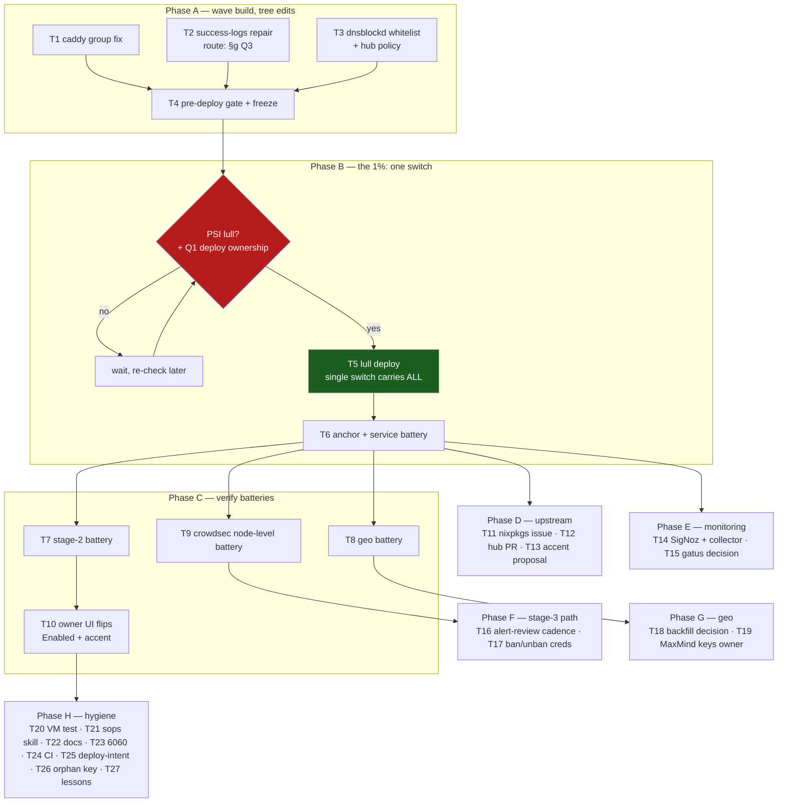

# Pareto Execution Plan — CrowdSec Detection Wave + GeoMetrikks Hardening

**Created:** 2026-10-16 04:28 CEST · **Scope:** every open item from `docs/status/2026-10-16_04-16_crowdsec-verify-stage2-declarative-geo-oauth-retention-sshd-retraction.md` §f (44 items) + the directly-noticed pre-existing rows it references.
**Method:** pareto-planning skill — 1%/4%/20% tiers → 27 medium tasks (30–100 min) → micro-tasks (≤12 min). **Format:** `.md` + mermaid per the owner's explicit demand (skill's HTML default overridden once; not propagated into the skill).
**Verschlimmbessern guards:** single-switch doctrine (all tree edits land in ONE deploy, never one deploy per fix); deploy gates (PSI lull, pre-deploy-check, anchor discipline); no history rewrites; no touching the parallel session's in-flight files (`flake.nix`, `bank-sync.nix`, pin-audit — mid-edit at plan time); corrections only ever land after re-verification (this session's §d lesson).

---

## 0. Freshness verification (Step-0 errata)

Every ranked item was live-verified THIS session (2026-10-16 00:45–04:16); no stale-backlog re-dispatch:

- Stage-2 declarative + geo OAuth-only/retention: in tree, gated, **not deployed** (running system: password auth on, 180d retention, no bouncer).
- Caddy acquis: confirmed DARK live (glob warning + zero file-source hits + rendered-unit PrivateUsers read).
- sshd leg: healthy (retraction verified at node level); `sshd-success-logs` filter gap verified in hub source; the old "100% parse-ko" premise RETRACTED on all surfaces — do not re-dispatch it.
- Hub-update TLS flap: two failed starts + one success in journal; reachability currently intermittent (00:54 download succeeded) — the live probe is part of T3.
- CHANGELOG row + crowdsec.nix comment truth-sync + runbook node-metrics note: **already landed** this session (report §f items 5/6/37) — not re-planned.

**External dependencies NOT plannable here:** PBX-feed decision (parallel session's `[decision]` row), InboxClean re-consent, docker reclaim, vendored-python ratification (all owner `[blocked:user]`/`[decision]` rows — listed in §5 as riders/waits, not tasks).

**Open owner gates (from report §g):** Q1 deploy ownership (default: this session drives the lull switch), Q2 theme route (default: owner picks `green` in-browser; upstream/patch work only on request), Q3 success-logs route (default: upstream-first with local-override fallback only if a safe mechanism exists).

---

## 1. Pareto tiers

### The 1% that delivers 51% — **ONE lull deploy that switches everything already in the tree**
Nothing from this session produces value until a switch runs: stage-2 bouncer identity, geo OAuth-only, 100y retention. One deploy + two verify batteries converts ~all landed work into live value. Everything else in this plan is worthless without it. (Micro-tasks 5.x–9.x.)

### The 4% that delivers 64% (1% + detection repair wave)
The engine is up but effectively blind on HTTP and deaf on successful SSH logins: **caddy acquis fix** (caddy group), **sshd-success-logs repair**, **dnsblockd whitelist + hub-update fatality decision**. These three tree edits ride the SAME deploy as the 1% (single-switch doctrine) — after which CrowdSec actually detects what stage 1 promised. (Micro-tasks 1.x–4.x merged into the same switch.)

### The 20% that delivers 80% (4% + memory and upstream)
Post-deploy **node-level metrics battery** (proves the repairs with the §d lesson applied), **upstream issues** (nixpkgs module, hub parser — stop re-solving upstream bugs locally), **SigNoz rules + textfile collector** (make the next silent failure loud), **stage-3 alert-review cadence** (turns detection into enforcement readiness), **geo UI flips + owner secrets** (map un-degrades). (Micro-tasks in T10–T19.)

### The remaining 80% of work (to 100%)
VM test, upstream default-accent proposal, sops-skill example fix, CI un-red, deploy-intent convention, 6060 pprof taming, docs passes, orphan-key cleanup, AGENTS lesson harvest, bump-drill doc. (T20–T27.)

---

## 2. Comprehensive plan — 27 medium tasks (30–100 min each)

Sort key: impact ▾ / effort ▴ / customer-value ▾. **Phases:** A = wave build (tree edits, pre-deploy) · B = switch · C = verify · D = upstream · E = monitoring · F = stage-3 path · G = geo · H = hygiene.

| # | Ph | Task (30–100 min each) | Impact | Effort | Value | Gate/Note |
|---|----|------------------------|--------|--------|-------|-----------|
| T1 | A | **Caddy acquis fix**: crowdsec → `caddy` group in `crowdsec.nix` (auxiliary gids map through the userns; DAC group check needs no capability), comment sync, eval gate | Critical | M | High | Report §f2 |
| T2 | A | **sshd-success-logs repair**: verify hub master status → upstream-first route; local override ONLY if a hub-safe mechanism exists (hub state is runtime-mutable — runbook gotcha) | Critical | M | High | Gated on §g Q3 (default: upstream-first) |
| T3 | A | **dnsblockd whitelist** cdn-hub.crowdsec.net + hub-data.crowdsec.net (`platforms/common/dns-blocklists.nix`, ipify precedent) + live reachability probe + hub-update fatality decision written into the row | Critical | M | High | Report §f4/f9/f12 |
| T4 | A | **Pre-deploy gate** for the whole wave (`pre-deploy-check.sh` incl. §11 FOD preview) + wave-content freeze (no further tree edits once green) | Critical | S | High | Single-switch doctrine |
| T5 | B | **LULL DEPLOY of the stacked wave** (PSI-quiet window; carries stage-2 + geo + T1–T3 + any parked riders the owner wants, e.g. hot-db CAP_DAC_OVERRIDE row) | Critical | L | High | Gated on §g Q1 + PSI |
| T6 | B | **Post-deploy anchor + service battery**: `readlink /run/current-system` == latest `system-N-link`, crowdsec/geo/postgres-family green, no regressions | Critical | S | High | Anchor discipline |
| T7 | C | **Stage-2 verify battery**: bouncer-register "converged" log line, `sudo cscli bouncers list` shows geometrikks, second-boot/restart no-op | Critical | S | High | Report §f1 |
| T8 | C | **Geo battery**: `password_login_disabled` at boot, OIDC login works + password form rejected, `ANALYTICS_*` in unit, TSDB retention jobs = 36500, compression-interaction sanity, LOGPARSER 76/76 recheck | Critical | M | High | Report §f23/f39 |
| T9 | C | **CrowdSec node-level metrics battery**: caddy file-source hits > 0, `sshd-success-logs` node ok-counter (post-T2), synthetic probe lines, sshd-los noise ratio sane; watch the 00:59-style transient | Critical | M | High | §d lesson applied |
| T10 | C | **Owner UI flips**: geo settings → Enabled; accent → green in browser (prep exact click-path for the owner) | High | S | High | §g Q2 default |
| T11 | D | **nixpkgs crowdsec-module issue**: re-verify against pinned module, draft (rootDir tmpfiles gap, PrivateUsers×cap trap, non-idempotent machine add — our fixes as proposal), verify-before-filing gate, file | High | L | High | Report §f11 |
| T12 | D | **Hub upstream**: check master for success-logs fix → issue or PR (feeds T2's route) | High | M | Medium | Report §f10 |
| T13 | D | **Geometrikks default-accent upstream proposal** (`DEFAULT_ACCENT` env) | Medium | M | Medium | Gated on §g Q2=(b) |
| T14 | E | **SigNoz crowdsec coverage**: agent-down rule + parse-error-rate rule + textfile collector (`crowdsec_decisions`/`alerts` count) | High | L | High | Report §f17/f18 |
| T15 | E | **Gatus bouncer-register liveness**: decide + implement (only after T7 shows the unit behaves) | Medium | S | Medium | Report §f38 |
| T16 | F | **Stage-3 alert-review cadence**: define the concrete weekly review (what to read, where to log the verdict) that gates the firewall bouncer | High | S | High | Report §f14 |
| T17 | F | **Ban/unban creds prep**: `machines add geometrikks --auto` flow + sops staging shape (owner-interactive parts marked) | Medium | M | Medium | Report §f15 |
| T18 | G | **Rotated-log backfill decision**: `import-logs` timer vs documented non-goal (36500 retention strengthens the case FOR backfill) | Medium | M | Medium | Report §f26 |
| T19 | G | **MaxMind/CARTO keys** (owner paste) + map-pin verification — un-degrades the map | High | S | High | `[blocked:user]` row 179 |
| T20 | H | **VM test for the crowdsec module** (co-import catalog+integration; assert unit order, acquis files, bouncer-register render) | Medium | L | Medium | Report §f16 |
| T21 | H | **sops-skill example fix** in the crush-config repo (inline-literal example violates the fish_history rule → runtime-expansion pattern) | Medium | S | Medium | Report §e5/f29; commit THERE |
| T22 | H | **Docs pass**: FEATURES/README service-entry check; prune the retracted/corrected sshd rows to CHANGELOG at the next todo pass | Low | M | Low | Report §f41/f44 |
| T23 | H | **6060 pprof taming**: root inventory → bind loopback or kill → register port | High | M | High | `[decision]` security.md; root needed |
| T24 | H | **CI un-red**: VM-test tarball auth + statix leg | Medium | L | Medium | `TODO_LIST:1339` |
| T25 | H | **Deploy-intent convention**: jitter + pressure-aware backoff + quiet-tree precondition for concurrent agent loops | Medium | L | Medium | `pipeline.md`; hit twice today |
| T26 | H | **sops orphan key cleanup** (`geometrikks_admin_password`) at next natural rotation | Low | S | Low | Report §f28 |
| T27 | H | **AGENTS.md lesson harvest**: node-level-metrics-before-conclusions + retraction-hygiene (crush-config lessons.md via commit for the cross-project part) | Medium | S | Medium | Report §d/e |

Coverage check: all 44 report-§f items map to T1–T27 or are listed as owner-gated externals in §5 below (console enrollment decision, PBX decision, InboxClean, docker reclaim, vendored-python, cscli-alerts-snapshot → ROADMAP).

---

## 3. Micro-task breakdown (≤12 min each, ALL todos)

### Phase A — wave build (tree edits)

| ID | Micro-task (≤12 min) | Task |
|----|----------------------|------|
| 1.1 | Read `crowdsec.nix` user/group wiring + confirm `users.users.crowdsec`/group shape from upstream module (aux-group attach point) | T1 |
| 1.2 | Edit module: add `crowdsec` to `caddy` group (and decide keep-vs-drop of the now-inert ambient cap — KEEP until 9.x proves the group suffices) | T1 |
| 1.3 | Comment sync: module cap comment + runbook acquis bullet + queue row (fix-landed, verify-pending) | T1 |
| 1.4 | `nix flake check --no-build` gate | T1 |
| 2.1 | Fetch hub master `sshd-success-logs.yaml` + check filter for `sshd-session` (fix already upstream?) | T2 |
| 2.2 | Read hub-loading semantics: can a local `/etc/crowdsec/parsers/` file override without duplicate-node conflicts? (decides route per §g Q3) | T2 |
| 2.3 | Route (a) upstream-fixed: document "arrives on next successful hub update" + note the circular dependency with T3 | T2 |
| 2.4 | Route (b) not fixed upstream: draft local override OR file hub PR per Q3 default; land chosen artifact + queue-row update | T2 |
| 3.1 | Live probe: resolve + TLS-handshake cdn-hub.crowdsec.net via the openssl trick (evidence for the whitelist) | T3 |
| 3.2 | Edit `platforms/common/dns-blocklists.nix`: whitelist entries + comment (ipify precedent, crowdsec journal timestamps as evidence) | T3 |
| 3.3 | Write the hub-update fatality decision into the queue row (recommend: keep update fatal + whitelist makes it reliable; revisit only on recurrence) | T3 |
| 3.4 | Eval gate + dnsblockd runbook cross-link | T3 |
| 4.1 | `scripts/pre-deploy-check.sh` full run (incl. §11 FOD preview) on the wave tree | T4 |
| 4.2 | Freeze declaration: post findings to the session surface; no further tree edits until the switch completes | T4 |

### Phase B — the switch (the 1%)

| ID | Micro-task | Task |
|----|-----------|------|
| 5.1 | Check PSI lull (`iostat`/PSI avg10 < threshold per deploy discipline) + confirm no parallel switch in flight (`git log` freshness + lock files) | T5 |
| 5.2 | `git status` freshness + content-pin; note the 13+ unpushed commits state | T5 |
| 5.3 | `nix run .#deploy` (or the session's vetted retry loop with jitter) | T5 |
| 5.4 | If blocked: `--keep-going` toplevel build, enumerate ALL roots, fix, single retry (no domino loop) | T5 |
| 6.1 | `readlink /run/current-system` == latest `system-N-link` (anchor; repair via the standard profile-repair command if UNANCHORED) | T6 |
| 6.2 | `ss -ltn` spot battery: 8082/6061 + geo port + postgres family; journal scan for new failures | T6 |
| 6.3 | Report the wave as live (or roll back per R1 card if red) | T6 |

### Phase C — verify batteries

| ID | Micro-task | Task |
|----|-----------|------|
| 7.1 | Journal: `crowdsec-bouncer-register` "converged from sops" line (NOT the skip warning) | T7 |
| 7.2 | `sudo cscli bouncers list` shows `geometrikks` (agent runs the repo's cscli wrapper pattern) | T7 |
| 7.3 | Restart the register unit once: second run no-ops cleanly (delete+add idempotence) | T7 |
| 7.4 | Close the stage-2 `[watch]` rows on both surfaces | T7 |
| 8.1 | Geo journal: `password_login_disabled (APP_ADMIN_PASSWORD unset, OIDC enabled)` present | T8 |
| 8.2 | `ANALYTICS_*` present in rendered unit env; `geometrikks-env` template diff clean | T8 |
| 8.3 | psql (unit-env reconstruction): `timescaledb_information.jobs` retention configs = 36500 days | T8 |
| 8.4 | OIDC login still works (owner or session probe via the runbook recipe) + password form rejected | T8 |
| 8.5 | Compression-vs-retention sanity: chunk intervals ≤ retention; no `drop_chunks` errors in journal | T8 |
| 8.6 | LOGPARSER list-vs-streamed recheck (76/76 invariant) | T8 |
| 8.7 | Close the geo `[watch]` row; leave the Enabled flip item open for T10 | T8 |
| 9.1 | Scrape :6061 metrics; `cs_filesource`/file-acquisition counters > 0 (caddy fix live) | T9 |
| 9.2 | Synthetic caddy request via loopback → line lands as parsed event | T9 |
| 9.3 | sshd-success-logs node counter status (if T2 landed a fix: ok > 0 on a synthetic Accepted line; else: queued note stands) | T9 |
| 9.4 | Noise-ratio sanity: ko ≈ session/pam share (the retraction math) — no new alarm | T9 |
| 9.5 | Close/annotate the acquis queue rows with live evidence | T9 |
| 10.1 | Write the owner click-path (geo settings → Enabled; browser accent toggle → green) into the geo runbook | T10 |
| 10.2 | Hand the two clicks to the owner (message; no agent UI driving) | T10 |

### Phase D — upstream (20%)

| ID | Micro-task | Task |
|----|-----------|------|
| 11.1 | Re-read pinned nixpkgs crowdsec module: confirm the three gaps still exist at this rev (rootDir tmpfiles, PrivateUsers, non-idempotent machine add) | T11 |
| 11.2 | Draft issue in the house voice (github-voice skill): repro, upstream-shape analysis, our three fixes as the proposal | T11 |
| 11.3 | verify-before-filing gate: every claim in the draft re-derived against the pinned source | T11 |
| 11.4 | File + cross-link our queue rows | T11 |
| 12.1 | Hub master check for success-logs filter (already done in 2.1 — port the answer into the issue/PR decision) | T12 |
| 12.2 | File hub issue/PR (route per T2 outcome) | T12 |
| 13.1 | If Q2=(b): read geometrikks settings loading for an env hook feasibility note → upstream issue/PR draft | T13 |

### Phase E — monitoring (20%)

| ID | Micro-task | Task |
|----|-----------|------|
| 14.1 | SigNoz: crowdsec agent-down rule (metrics-absent class) | T14 |
| 14.2 | SigNoz: parse-error-rate rule (thresholds from the live noise ratio) | T14 |
| 14.3 | Textfile collector: `crowdsec_decisions`/`crowdsec_alerts` counts (read via the repo's cscli wrapper pattern) + gatus-phantom-metric rule check | T14 |
| 14.4 | Wire collector into the monitored set + verify scrape | T14 |
| 15.1 | Gatus decision row: register-unit liveness check shape (oneshot result-based) → implement or record non-goal | T15 |

### Phase F — stage-3 path (20%)

| ID | Micro-task | Task |
|----|-----------|------|
| 16.1 | Define the weekly alert-review checklist (what: alerts list + decisions + scenario hit rates; where: a dated review log) | T16 |
| 16.2 | Start the 7-day window (first review entry today; stage-3 enablement gate = 7 clean-informed days) | T16 |
| 17.1 | Draft machine-creds staging: `machines add geometrikks --auto -f -` + sops key names (owner-interactive parts flagged) | T17 |
| 17.2 | Wire-ready note into the stage-3 runbook section | T17 |

### Phase G — geo (20%)

| ID | Micro-task | Task |
|----|-----------|------|
| 18.1 | Backfill decision: owner intent check (36500 retention ⇒ keep-forever ⇒ timer for rotated `.gz` import?) → implement timer or write the non-goal | T18 |
| 19.1 | Owner: MaxMind signup + sops paste (exact keys + sops-editor one-liner from the runbook) | T19 |
| 19.2 | Restart geo; verify GeoLite2 loads + map pins appear (gatus traffic = immediate events) | T19 |

### Phase H — hygiene (to 100%)

| ID | Micro-task | Task |
|----|-----------|------|
| 20.1 | VM test skeleton: co-import crowdsec + catalog + integration; assert unit order (prereq → crowdsec → bouncer-register → geometrikks) | T20 |
| 20.2 | Assert acquis.yaml contents + bouncer-register EnvironmentFile path + graceful-skip script presence | T20 |
| 20.3 | Wire into `flake/parts/checks/` + run | T20 |
| 21.1 | crush-config repo: fix the sops skill example to the runtime-expansion pattern + commit THERE | T21 |
| 22.1 | FEATURES/README: check whether services get entries; add/update crowdsec + geo rows if the convention says yes | T22 |
| 22.2 | Todo-pass: prune the retracted/corrected sshd rows to CHANGELOG (routine lifecycle) | T22 |
| 23.1 | Root inventory of the `*:6060` listener (cgroup/proc via owner-approved sudo path) | T23 |
| 23.2 | Bind loopback or kill + register port if it stays | T23 |
| 24.1 | CI: VM-test private-tarball auth (token or pushed-rev strategy) + statix leg triage | T24 |
| 25.1 | Draft the deploy-intent convention (jitter ∝ last gate refusal, PSI backoff, quiet-tree precondition, shared lock file) | T25 |
| 25.2 | Land in `docs/CONTRIBUTING.md` + the retry-loop tooling | T25 |
| 26.1 | At next sops touch: `sops --unset` the orphan `geometrikks_admin_password` | T26 |
| 27.1 | SystemNix AGENTS.md: add the node-level-metrics verification note (if not already covered by the runbook) | T27 |
| 27.2 | crush-config `references/lessons.md` (commit there): retraction-hygiene + finest-grain-metric lessons | T27 |
| 27.3 | Bump-drill note: when nixpkgs crowdsec > 1.8.1 lands, re-audit our mitigations + bouncer-register against the new module | T27 |

*(98 micro-tasks; each ≤12 min; all 27 medium tasks and all 44 report-§f items covered.)*

---

## 4. Execution graph

**Critical path:** T1→T2→T3→T4→(gate)→T5→T6→T7/T8/T9. Everything in D–H is parallelizable after T6 and none of it blocks user value.

---

## 5. Explicitly NOT planned (owner-gated externals — no task without a decision)

| Item | Why not a task |
|------|----------------|
| CrowdSec console enrollment | Requires enabling CAPI (privacy-decision, owner-only) — ROADMAP fuel |
| PBX traffic feed | Parallel session's `[decision]` row — owner picks the route |
| InboxClean OAuth re-consent | Owner-only interactive |
| `/data/docker` reclaim | Owner sudo execution (queued steps exist) |
| Vendored systemd-audit.py ratify/port | Owner `[decision]` |
| `cscli alerts` snapshot into post-deploy checks | Needs design thought — ROADMAP fuel |

## 6. Errata vs the backlog (Step-0 corrections)

- None of the ranked items was stale: every §f item was live-verified in the authoring session (2026-10-16 00:45–04:16). The one retraction of the session (sshd "100% parse-ko") is recorded on all surfaces it touched — this plan deliberately does NOT contain that item as a fix task; only its two REAL by-products (success-logs gap, no-backfill note) appear (T2, runbook).
- "76/76 files streaming" supersedes the report-stage "~77 vs 76" off-by-one suspicion — counted precisely at plan time, diff empty.
