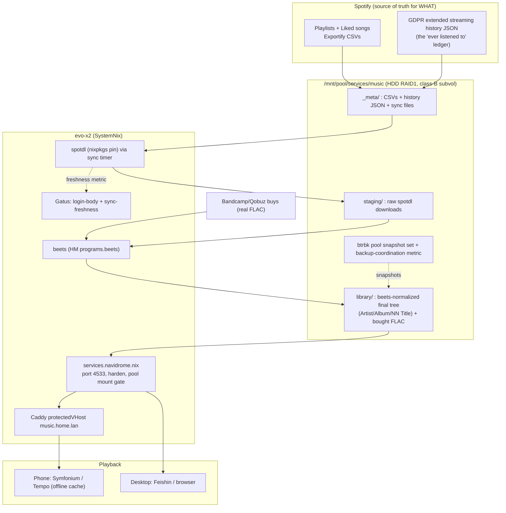
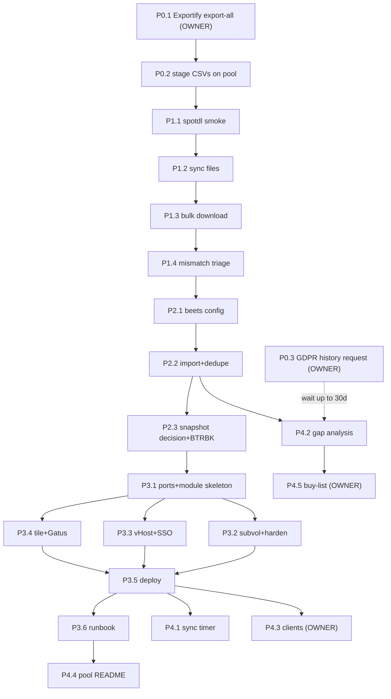

# Spotify Music Backup Pipeline — Pareto Execution Plan

**Date:** 2026-10-16 06:39 · **Status:** PLAN, awaiting owner approval before execution waves
**Mission:** Backup every song Lars ever listened to + every playlist onto the HDD pool (`/mnt/pool`), so music survives ISP outages, Spotify account loss, and DRM — and is served from home (ISP-outage-resilient local cache).

---

## 0. Ground truth inherited (read BEFORE executing — Step 0 prior-art)

A fresh design was drafted only after reading prior plans; these facts outrank any new idea:

| Fact | Source |
| ---- | ------ |
| **Navidrome is DECIDED over Jellyfin** for the audio server; the module sketch already exists: FLAC+tags (Navidrome is tags-only), `modules/nixos/services/navidrome.nix`, port registry, harden + ioTier.background, pool MusicFolder + RequiresMountsFor, `protectedVHost "music"`, homepage tile, Gatus login-body check, clients Tempo/Symfonium/Feishin | `TODO_LIST.md:924` -> `docs/todo/pixel6.md` (`[ready]` row) |
| Spotify desktop client landed on evo-x2 2026-10-01 (`platforms/nixos/users/home.nix:675`, unfree) | `docs/status/2026-10-01_20-13_spotify-add-deploy-race-session.md` |
| Pool = BTRFS RAID1 HDDs at `/mnt/pool`, ~16T headroom; per-service state precedent = own subvol + own btrbk entry (`services/{immich,paperless,...}`); per-service snapshot-set doctrine (A/B/C decision, one set per service) | `docs/agents/storage.md` -> "HDD Backup Pool & DAS Topology", "Per-service subvolume doctrine" |
| `/data` is at 86% (watch row live) and root `@` had space incidents: **library bytes NEVER land on `/data` or `@`** | `TODO_LIST.md` storage watch rows, `docs/agents/storage.md` |
| This plan CONVERGES with the pixel6 media-archive project (same MusicFolder, same Navidrome instance) | `docs/todo/pixel6.md` |

## 1. What Spotify can and cannot give (verified claims ledger)

Verified against primary sources 2026-10-16 (this session). Unverified rows are explicitly labeled and carry a verify-at-runtime task.

| Claim | Status | Source |
| ----- | ------ | ------ |
| Spotify audio = Ogg Vorbis (96/160/320) behind AES-128-CTR with a FIXED IV + per-track key fetched per session over a Shannon-cipher session; CDN files are unplayable garbage without the key | VERIFIED | librespot `audio/src/decrypt.rs`, `docs/connection.md`, `core/src/audio_key.rs` (raw fetch, 2026-10-16) |
| Lossless tier = FLAC "up to 24-bit/44.1kHz", Premium only, desktop/mobile/tablet apps only; web player caps at AAC 256; free tier at 160 | VERIFIED | support.spotify.com `/us/article/audio-quality/` (raw fetch, 2026-10-16) |
| Rippers cannot reach lossless: zotify is hardwired to `VorbisOnlyAudioQuality` (96/160/320); librespot models FLAC formats (16/17/22/24) but no capture path is wired | VERIFIED (source) + INFERENCE (no capture path) | zotify-dev/zotify `zotify.py`, `app.py`; librespot `metadata/src/audio/file.rs`, `protocol/proto/audio_format.proto` (sourcegraph, 2026-10-16) |
| spotDL downloads from YouTube (never Spotify), 128 kbps regular / 256 kbps for YT Music Premium users; operations `download` (default), `save`, `sync` (creates `.spotdl` sync file; re-run adds new + deletes gone), `meta`; needs FFmpeg; recommends Deno for some yt-dlp downloads | VERIFIED | github.com/spotDL/spotify-downloader README (raw fetch, 2026-10-16) |
| spotdl 4.5.2 packaged in nixpkgs (`pkgs/by-name/sp/spotdl`), ffmpeg wrapped in; Deno NOT wrapped by the package | VERIFIED | nixpkgs sourcegraph (2026-10-16) |
| Exportify (exportify.app) = browser-only app, read-only Spotify OAuth, "Export All" = zip of one CSV per playlist (Track URI, artists, album, ISRC, added-at...); liked-songs export supported | VERIFIED | github.com/watsonbox/exportify README (raw fetch, 2026-10-16) |
| nixpkgs `services.navidrome` module: default port 4533, `settings.MusicFolder` (BindReadOnlyPaths), `StateDirectory`, `environmentFile` for ND_ secrets, plugins via `pkgs.pkgsCross.wasi32.navidromePlugins` | VERIFIED | nixpkgs `nixos/modules/services/audio/navidrome.{nix,md}` (sourcegraph, 2026-10-16) |
| home-manager `programs.beets` module exists (config.yaml generation, package pluginOverrides) | VERIFIED | nix-community/home-manager `modules/programs/beets.nix` (sourcegraph, 2026-10-16) |
| GDPR "extended streaming history" JSON export via account privacy settings; can take up to ~30 days | UNVERIFIED (reported, not confirmed this session; confirm exact flow + window in the Spotify UI when doing task P0.3) | Spotify account privacy settings |
| spotdl can consume a plain text list of track URLs (drive it from Exportify CSV URIs) | UNVERIFIED flag detail (verify `spotdl -h` at runtime; worst case: trivially script CSV -> URL lines) | - |
| beets duplicates workflow specifics (plugin flags) | UNVERIFIED detail (verify at `beet` runtime; core `beet import` is standard) | - |
| Client offline-cache quality (Symfonium/Tempo/Feishin) | UNVERIFIED (named in the ratified pixel6 row; confirm when configuring clients) | `docs/todo/pixel6.md` |

**Consequence chain:** true lossless only via purchase/rip; everything sourced through the pipeline is 128-256 kbps AAC (YouTube). Do NOT transcode those into FLAC (fake lossless). Bought albums (Bandcamp/Qobuz) land as real FLAC in the same library.

## 2. Architecture

Storage math (10k tracks): AAC 128 ~40 GB, AAC 256 ~77 GB, true 16/44.1 FLAC ~250-300 GB. Trivial for a 16T-headroom pool.

## 3. Pareto breakdown

| Tier | Delivers | Content |
| ---- | -------- | ------- |
| **1% (51%)** | The only IRREPLACEABLE data leaves Spotify before anything can happen to it | Exportify export-all (every playlist + liked songs as CSVs) + start the GDPR streaming-history request (time-gated, up to ~30d) + stage both on the pool. ~45 min, owner hands, day 1. |
| **4% (64%)** | The audio itself is on YOUR disks (outage-proof) | spotDL bulk download of the whole playlist catalog into pool staging via `.spotdl` sync files. Mostly unattended. |
| **20% (80%)** | Library is clean, tagged, deduped, snapshotted | beets normalize into final `library/` tree + snapshot-set decision wired (btrbk + backup-coordination metric). |
| **100%** | Served, monitored, self-updating, documented | Navidrome module (port/harden/mount-gate/vHost/tile/Gatus/runbook/tests), clients, recurring sync timer + freshness metric, gap analysis vs history, pool README, buy-list for true-FLAC favorites. |

## 4. Comprehensive phase plan (30-100 min tasks, sorted by impact/effort/value)

| # | Task | Est | Hands | Impact | Depends on |
| - | ---- | --- | ----- | ------ | ---------- |
| P0.1 | Exportify: "Export All" (every playlist + liked songs) -> zip of CSVs | 30m | OWNER (browser) | CRITICAL: irreplaceable catalog | - |
| P0.2 | Stage CSVs -> `/mnt/pool/services/music/_meta/playlists/`; verify track counts vs Spotify app | 30m | OWNER+agent | CRITICAL | P0.1 |
| P0.3 | Start GDPR "extended streaming history" download request in Spotify account settings | 15m | OWNER (browser) | CRITICAL: the "ever listened" ledger; time-gated | - |
| P0.4 | **Continuous metadata collector (WAVE 1 - starts the ledger clock, owner's stated starting point 2026-10-16)**: `multi-scrobbler` (nixpkgs 0.16.5, Spotify source OAuth via web UI :9078) -> ListenBrainz offsite mirror; optional self-hosted Maloja later (imports the GDPR zip directly as backfill); weekly playlist/liked JSON snapshot timer into `_meta/snapshots/` | 100m | agent | CRITICAL: Spotify's recently-played API window is shallow - every day without the collector loses history permanently | - |
| P1.1 | spotdl smoke test: nix-shell spotdl, download 1 playlist (first 5 tracks), inspect tags/art | 30m | agent | HIGH | P0.2 |
| P1.2 | Script CSV -> track-URI lists; create one `.spotdl` sync file per playlist in `_meta/sync/` | 45m | agent | HIGH | P1.1 |
| P1.3 | Bulk download all playlists -> `staging/` (unattended; rate-limit friendly; monitor) | 100m+ | agent (unattended) | HIGH | P1.2 |
| P1.4 | Mismatch triage report: failures, wrong matches, lives/remixes; owner arbitrates ambiguous rows | 60m | agent+OWNER | MED | P1.3 |
| P2.1 | beets config via HM `programs.beets` (library dir, import modes, paths template) | 45m | agent | HIGH | P1.3 |
| P2.2 | beets import + tag + dedupe pass -> `library/`; report unresolved duplicates | 100m | agent (unattended) | HIGH | P2.1 |
| P2.3 | Snapshot-set decision (recommend B: own subvol + btrbk entry; irreplaceable data) + wire btrbk + backup-coordination metric | 60m | OWNER decides, agent wires | HIGH | P2.2 |
| P3.1 | Add `music`/navidrome port to `lib/ports.nix` (verify 4533 free) + `modules/nixos/services/navidrome.nix` skeleton on nixpkgs module | 60m | agent | HIGH | P2.3 |
| P3.2 | Pool subvol provisioning (converger oneshot per `services/*` precedent) + RequiresMountsFor + harden + ioTier.background | 100m | agent | HIGH | P3.1 |
| P3.3 | `protectedVHost "music"` (Caddy) + auth layer per SSO doctrine (Pocket ID/oauth2-proxy) | 60m | agent | MED | P3.1 |
| P3.4 | Homepage tile + Gatus login-body check + pool-recovery restartUnits membership | 45m | agent | MED | P3.1 |
| P3.5 | `deploy.sh` inclusion + VM test + `nix flake check` green + deploy | 100m | agent | HIGH | P3.2-3.4 |
| P3.6 | `docs/services/navidrome.md` runbook (ports, secrets via sops envFile, traps) | 45m | agent | MED | P3.5 |
| P4.1 | Recurring sync: systemd timer -> `spotdl sync *.spotdl` -> beets import; freshness textfile metric + Gatus rule | 100m | agent | MED | P3.5 |
| P4.2 | Gap analysis: GDPR history vs library (listened-but-missing report -> buy-list/ripper candidates) | 60m | agent | MED | P0.3 done, P2.2 |
| P4.3 | Client setup: Symfonium/Tempo on phone (offline cache), Feishin on desktop; verify offline playback | 45m | OWNER | MED | P3.5 |
| P4.4 | Pool README day-2 update + close the pixel6 "Pool README" row + pixel6 Navidrome row progress | 30m | agent | LOW | P3.6 |
| P4.5 | Buy-list: top-N most-played albums worth real FLAC (Bandcamp/Qobuz) -> import as FLAC | 100m | OWNER | LOW | P4.2 |

## 5. Micro-tasks (max 12 min each, sorted by importance/impact/effort/value)

| # | Micro-task | Est | From | Hands |
| - | ---------- | --- | ---- | ----- |
| M1 | Owner: open exportify.app, Get Started, OAuth read-only grant | 5m | P0.1 | OWNER |
| M2 | Owner: Export All -> zip; save to Downloads | 10m | P0.1 | OWNER |
| M3 | Create `/mnt/pool/services/music/{_meta,library,staging}` dirs on pool | 5m | P0.2 | OWNER (sudo mkdir) |
| M4 | Copy zip -> `_meta/playlists/`, unzip, count CSV rows | 10m | P0.2 | agent |
| M5 | Owner: spot-check 3 playlist track counts vs Spotify app; record deltas | 10m | P0.2 | OWNER |
| M6 | Owner: Spotify account -> privacy/data export request; note request date in `_meta/HISTORY_REQUEST.md` | 10m | P0.3 | OWNER |
| M7 | Agent: `nix shell nixpkgs#spotdl` smoke: `spotdl -h` (verify sync/--list flags for the ledger) | 10m | P1.1 | agent |
| M8 | Agent: download 5-track test playlist -> `/tmp`; ffprobe bitrate; open tags | 10m | P1.1 | agent |
| M9 | Agent: verify Deno gap (does nixpkgs spotdl wrapper need deno on PATH? note finding in ledger) | 10m | P1.1 | agent |
| M10 | Agent: write `scripts/` helper: Exportify CSV -> deduped URI list per playlist | 12m | P1.2 | agent |
| M11 | Agent: generate `.spotdl` sync files for all playlists into `_meta/sync/` | 10m | P1.2 | agent |
| M12 | Agent: dry-run one sync file (spotdl sync, no download) -> review planned track list | 10m | P1.2 | agent |
| M13 | Agent: launch bulk download wave 1 (largest 3 playlists) in tmux, log to `_meta/logs/` | 12m | P1.3 | agent |
| M14 | Agent: launch bulk download wave 2..N (sequential, rate-limit pauses) | 12m | P1.3 | agent |
| M15 | Agent: reconcile: files vs CSV row counts per playlist; write `_meta/RECONCILE.md` | 12m | P1.4 | agent |
| M16 | Agent: list failed/ambiguous matches with candidates -> owner arbitration list | 12m | P1.4 | agent |
| M17 | Owner: arbitrate mismatches (keep/replace/skip) | 10m | P1.4 | OWNER |
| M18 | Agent: HM `programs.beets.enable` + settings (directory, paths, import quiet/duplicate guard) in platforms/nixos users config | 12m | P2.1 | agent |
| M19 | Agent: `nix flake check --no-build` + HM build for beets config | 10m | P2.1 | agent |
| M20 | Agent: `beet import -A` first-pass (as-is) census: how many files, total size | 10m | P2.2 | agent |
| M21 | Agent: full `beet import` (tag-all) run, unattended | 12m | P2.2 | agent |
| M22 | Agent: duplicates report (same MBID/title+artist) -> `_meta/DUPLICATES.md` | 12m | P2.2 | agent |
| M23 | Agent: write snapshot-set decision memo (A vs B vs C) into `docs/todo/storage.md` `[decision]` row | 10m | P2.3 | agent |
| M24 | Owner: ratify snapshot set (expected: B) | 5m | P2.3 | OWNER |
| M25 | Agent: create library subvol + move library in + add btrbk instance + backup-coordination metric | 12m | P2.3 | agent |
| M26 | Agent: grep `lib/ports.nix` for 4533 collisions; add `music = 4533` (or next free) with comment | 10m | P3.1 | agent |
| M27 | Agent: `modules/nixos/services/navidrome.nix` skeleton: enable, settings.MusicFolder, port from registry | 12m | P3.1 | agent |
| M28 | Agent: sops entry for `navidrome_env` (ND secrets; NO values in repo) + environmentFile wiring | 12m | P3.1 | agent |
| M29 | Agent: converger oneshot `music-dirs` (pool subvol creation + ownership) per services/* precedent | 12m | P3.2 | agent |
| M30 | Agent: harden {} + ioTier.background + RequiresMountsFor /mnt/pool path + mount-gating assertions | 12m | P3.2 | agent |
| M31 | Agent: deploy.sh converger list entry + restart list entry | 10m | P3.5 | agent |
| M32 | Agent: `protectedVHost "music"` block in Caddy config (reverse_proxy :4533) | 12m | P3.3 | agent |
| M33 | Agent: auth wiring per docs/agents/sso-dns.md doctrine (oauth2-proxy/Pocket ID) | 12m | P3.3 | agent |
| M34 | Agent: homepage tile entry + Gatus `music.home.lan` login-body check | 12m | P3.4 | agent |
| M35 | Agent: pool-recovery restartUnits membership + memory-watermark sanity (no MemoryMax game here) | 10m | P3.4 | agent |
| M36 | Agent: VM test step (service boots, port listens, MusicFolder scanned) | 12m | P3.5 | agent |
| M37 | Agent: `nix flake check --no-build` green + `nix run .#pre-deploy-check` + deploy evo-x2 | 12m | P3.5 | agent |
| M38 | Agent: post-deploy: Navidrome admin setup wizard via browser (owner) + first scan | 12m | P3.5 | OWNER |
| M39 | Agent: write `docs/services/navidrome.md` (runbook: port, secrets, scan, traps) | 12m | P3.6 | agent |
| M40 | Agent: sync-timer unit + `on-calendar` weekly; ExecStart: spotdl sync all + beet import -q | 12m | P4.1 | agent |
| M41 | Agent: textfile collector `music_sync_last_success_timestamp` + Gatus staleness rule | 12m | P4.1 | agent |
| M42 | Agent: gap analysis script: history JSON artist+title set vs beets list export -> missing report | 12m | P4.2 | agent |
| M43 | Agent: pool README day-2 update; tick pixel6 Navidrome/README rows + queue mirror rows | 12m | P4.4 | agent |
| M44 | Owner: install Symfonium/Tempo, log into music.home.lan, enable offline cache for a playlist | 12m | P4.3 | OWNER |
| M45 | Owner: verify airplane-mode playback from offline cache | 5m | P4.3 | OWNER |
| M46 | Owner: draft buy-list top-20 from history replay counts | 12m | P4.5 | OWNER |
| M47 | Agent: grep `lib/ports.nix` for 9078 collisions; add `multi-scrobbler = 9078` + module skeleton (nixpkgs pkg, systemd, harden) | 12m | P0.4 | agent |
| M48 | Agent: sops `multi_scrobbler` env template (Spotify dev-app id/secret + ListenBrainz token as PLACEHOLDERS; no values in repo) | 12m | P0.4 | agent |
| M49 | Owner: create Spotify developer app in dashboard; enter secrets via `sops` editor, never CLI | 10m | P0.4 | OWNER |
| M50 | Agent: deploy; owner completes Spotify OAuth via web UI :9078; verify first scrobble lands in ListenBrainz | 12m | P0.4 | agent+OWNER |
| M51 | Agent: playlist/liked weekly snapshot oneshot+timer (Web API JSON -> `_meta/snapshots/`) + Gatus staleness check | 12m | P0.4 | agent |
| M52 | Owner decision: self-host Maloja (own derivation; imports GDPR zip as backfill) vs ListenBrainz-only v1 | 10m | P0.4 | OWNER |
| M53 | Agent: when GDPR zip arrives, run the backfill import (Maloja import folder or scripted JSON conversion) - feeds P4.2 | 12m | P0.4 | agent |

## 6. Sequencing / execution graph

Critical path: **P0.4 (collector - wave 1, starts immediately)** -> P0.1 -> P1.x -> P2.x -> P3.5 (first served song). P0.3 runs in parallel (Spotify prepares the export asynchronously).

## 7. Do-not-Verschlimmbessern guardrails

1. **No library bytes on `/data` (86% watch) or root `@`.** Pool only.
2. **One snapshot set per service state** (per-service doctrine): the ratification of B (own subvol + btrbk) is an owner decision BEFORE large data lands, not after.
3. **Service-module work follows every prevention layer**: `lib/ports.nix` entry (eval-enforced), `harden{}` (no lifecycle keys inside), mount gating for `/mnt/pool`, `deploy.sh` converger inclusion (inert-trigger audit catches it otherwise), Gatus coverage for any new probed port, pool-recovery `restartUnits`, sops for secrets (values never in repo, never on CLI).
4. **Pinned tooling only**: spotdl/beets from nixpkgs; no ad-hoc `pip install` on the box; if the sync job needs deno, declare it, never curl-pipe installs.
5. **No DRM ripping** (account-ban + ToS): the pipeline sources YouTube via spotDL, purchases via Bandcamp/Qobuz.
6. **No fake lossless**: never transcode 128/256 AAC into FLAC; FLAC reserved for bought/ripped audio.
7. Repo hygiene: `trash` not `rm`, `git mv`, pathspec commits (shared tree + auto-commit daemon), no secret values in commands (fish_history lesson), `nix fmt` via treefmt only.
8. The pixel6 Navidrome row owns the module; when P3 lands, UPDATE that row + this plan's errata instead of creating a parallel spec (split-brain guard).

## 8. Open owner decisions

| Decision | Default recommendation |
| -------- | ---------------------- |
| Snapshot set A/B/C for the library | B (own pool subvol + btrbk, generous retention; data is irreplaceable) |
| Auth for music.home.lan | Follow existing SSO doctrine (protectedVHost + Pocket ID/oauth2-proxy) |
| Where bought FLAC lands | Same `library/` tree (beets-managed), flagged `media_format=flac` in tags |
| Sync cadence | Weekly timer; manual trigger after big Spotify sessions |
| Audio source default for P1 (UPDATED 2026-10-16) | RECOMMENDATION: **Zotify primary** (batched moderate pacing, 320k Ogg, correct track lists - best archival fidelity; owner consciously accepts the Sec.10 account-risk tradeoff), spotDL as fallback for gap-filling, buy-list for favorites |
| Offsite 3-2-1 for the library | Once the library exists, include it in the dormant offsite-Borg job at go-live (owner-held inputs pending, `docs/services/offsite-borg.md`) - irreplaceable data deserves the third copy; same-chassis pool survives NVMe death, not the house |
| What happens to Spotify account afterward | Out of scope; the library removes the hostage situation |

## 9. Errata / corrections to prior session claims

- Earlier chat answers said spotDL pulls "256 kbps AAC": only with YT Music Premium; regular YouTube = 128 kbps (README-verified 2026-10-16). Storage math above updated accordingly.
- Earlier chat suggested Jellyfin for serving; the repo decision (TODO_LIST.md:924) is Navidrome. This plan follows the ratified decision.

## 10. Appendix: gray-zone capture ideas (owner-curated, not executed by default)

Options that trade ToS/DRM-circumvention exposure for source fidelity. All are PRIVATE-USE captures on the owner's own accounts. The plan's hard line: **never distribute or share captured audio** (enforcement history targets distribution, not possession). Not legal advice: in Germany, §95a UrhG prohibits circumventing effective technical protection measures regardless of private-use intent, and §53 Privatkopie covers CD rips, not DRM circumvention.

### 10.1 Zotify protocol capture (the primary gray path)

Capture Spotify's own decrypted transcodes with your own Premium account via librespot-lineage tooling.

| Aspect | Detail | Status |
| ------ | ------ | ------ |
| Tool | Fork `Googolplexed0/zotify` (actively maintained per its repo title; original zotify-dev stale; nixpkgs removed `zotify` 2025-09-26 "lack of upstream maintenance") | VERIFIED (fork README + nixpkgs aliases, fetched 2026-10-16) |
| Output ceiling | 320 kbps Ogg Vorbis (`DOWNLOAD_QUALITY=very_high`, Premium-only; free = 160), codec `copy` = no remux, real Spotify track lists/tags/art/lyrics (no YouTube mismatch problem) | VERIFIED (fork README) |
| Pacing flags | Old `--download-real-time` (zotify-dev) is GONE in the fork: now `--download-rate-limiter <0..1>` (1.0 = real-time, default 0 = off) + `--bulk-wait-time` (FAQ: 30s negates audio-key denials, citing the zotify-dev#186 analysis) | VERIFIED (fork README) |
| Ban reality | Fork FAQ: two reported suspensions ever, both after days of non-stop use; recommended posture = reasonable batches (+ optionally a burner account) | VERIFIED as the fork's OWN CLAIM (not independently confirmed) |
| Auth | OAuth login flow (no password on CLI); `credentials.json` lands in `~/.local/share/zotify/` and must stay out of any repo (fish_history rule) | VERIFIED (fork README) |
| Packaging | Pin the fork by rev in a small `buildPythonApplication` derivation or flake input; no ad-hoc pip drift | plan decision |
| Practical math | 10k tracks at limiter 1.0 = ~580h (~24 days continuous) -> use limiter ~0.3-0.5 + batched evenings = days instead of weeks, risk still small | derived |

**Plan delta if adopted:** replaces phases P1.1-P1.4 (spotDL waves + mismatch triage); beets shrinks to optional cleanup (output is already structured/tagged; `SKIP_PREVIOUSLY_DOWNLOADED` + `SKIP_BY_ISRC` give resume/dedupe); P0, P2.3, P3, P4 unchanged. Navidrome plays Ogg Vorbis.

### 10.2 Other gray ideas (ranked by usefulness)

| Idea | What / why | Risk / cost | Status |
| ---- | ---------- | ----------- | ------ |
| **Burner-account sharding** | Run capture on a dedicated (or Family-plan spare) account so the MAIN account (playlists, history) is insulated from any flag; also spreads bulk volume | Extra subscription cost; ToS household clauses | common practice, effectiveness unverified |
| **Loopback capture ("analog hole", digital)** | Record the audio device (PipeWire monitor) during normal playback; defeats ANY DRM including lossless clients, survives all tool breakage | Quality ceiling = client output (resampled); no tags (rebuild from the metadata ledger); clunky at scale; circumvention-adjacent legally | generic technique, no specific tool endorsed |
| **Desktop-cache forensics** | Historical tooling decrypted the client's local cache blobs using keys dumped from process memory | Believed obsolete against current clients | UNVERIFIED, likely dead - do not rely on it |
| **Lossless watch** | librespot models FLAC formats (16/17/22/24) but no capture path is wired; if someone wires it, real-FLAC capture becomes possible | None today | VERIFIED absence (sourcegraph, 2026-10-16); keep as watch item |
| **Pacing camouflage hygiene** | Human-pattern usage: batched sessions, nonzero fetch delays, no continuous day-long runs, don't hammer from parallel accounts on one IP | Convenience cost only | fork FAQ guidance |

### 10.3 What the plan deliberately does NOT do

- No distribution/sharing/upload of captured audio (the actual enforcement surface).
- No shared/stolen credentials; capture only ever uses the owner's own accounts.
- No torrent seeding of copyrighted audio (torrent infra stays out of scope entirely).
- No gray tool running unattended as a systemd service with the MAIN account: gray capture is owner-initiated, batched, supervised. The automated recurring pipeline (P4.1) stays spotDL/owned-files backup only.

Decision gate: gray-path adoption is an OWNER call per run, not a queue-harvestable `[ready]` item - it carries account risk, so it stays `[blocked:user]` by convention.

### 10.4 Revision log

- **v2 (2026-10-16, this session):** plan re-audited against the owner's stated goals after the gray-appendix and metadata-collector discussion. Added P0.4 continuous metadata collector as WAVE 1 (multi-scrobbler -> ListenBrainz, playlist snapshot timer, GDPR backfill), M47-M53 micro-tasks, the offsite 3-2-1 tie-in for the library, and flipped the P1 audio-source recommendation to Zotify-primary (Sec. 8) - archival fidelity plus correct track matching outweigh YouTube-sourcing convenience now that the owner has surfaced the tradeoff deliberately.
