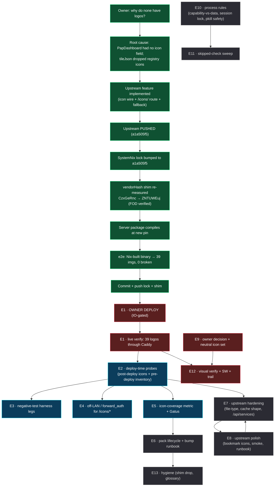

# SUPERB — Tile Logos: Go-Live + Follow-Through Plan

**Created:** 2026-10-17 09:27 CEST · **Owner trigger:** `dash.home.lan/#services why do non have logos???`
**EXECUTED (instance metricnames-closeout-executing-E12-E13, 2026-10-19 03:27 CEST, HEAD `ffb2ea8d5`):** execution finished
**Predecessor (evidence + full history):** [docs/status/2026-10-17_08-49_tile-logos-icon-pack-end-to-end.md](../status/2026-10-17_08-49_tile-logos-icon-pack-end-to-end.md)
**Executor note:** read the predecessor's §0 (root cause) before touching anything here. Every claim below is grounded in a command run in that session.

---

## 0. Situation at plan time (verified facts, not assumptions)

| Fact | Value | How verified |
| --- | --- | --- |
| Upstream feature (PapDashboard icon pack) | **implemented, committed, and ALREADY PUSHED** | `git rev-parse HEAD` = `a1a505f5`, `git branch -r --contains HEAD` = `origin/master`, `config.go` carries `IconURL` |
| SystemNix pin (before this session's work) | `96ad5a23` (**pre-feature**) | `flake.lock` read |
| SystemNix pin (now, this session) | `a1a505f5` (**with the feature**) | `nix flake lock --update-input papdashboard` |
| vendorHash shim | **re-measured** `CzxGeRnc…` → `ZNTUWEuj…` (nested go-daemon/go-nix-helpers moved in the same lock update) | first-hand FOD build: `specified … got sha256-ZNTUWEujoZzRfbod3Oj1iml618yZCzzK81/v4rI87co=` |
| Package build at the new pin | **green** | `nix build …config.services.papdashboard.package` → `/nix/store/276sx5y4…-papdashboard-a1a505f5…` |
| Deploy-artifact e2e | **39 ``, 39 monograms, 0 broken** | Nix-built binary + final rendered `services.json` (`4rka2m8d…`) + icon pack (`6gkxsm04…`) |
| Rendered config | 39 tiles / 39 icons, all present in the pack | `services.json` dump + pack existence sweep |
| What the user sees TODAY | **still monograms** — the running unit is the old binary (`…-papdashboard-96ad5a23…/bin/server`, `/api/health` 200 on :8088) | `ss -ltnp`, `pgrep -af papdashboard`, health probe |
| Environment blocker | IO storm: PSI `io some avg10=40.7% avg60=43.2%`, load 8.1/15.6/35.8 — the parallel session's deploy was refused 4× by the entry gate | `/proc/pressure/io`, `uptime` |
| Concurrent session | active in the same tree (catalog/signoz work, DNS-blocker tile merge, Kiri CRM description, `scripts/catalog-inventory.sh`); its report: `docs/status/2026-10-17_08-50_…-deploy-blocked.md` | `git log --name-only`, file mtimes, report read |

**Therefore the only thing standing between the user and visible logos is: one deploy (owner, IO-gated).** Everything an agent can do to de-risk that deploy has been done in this session (lock, shim, compile, e2e). The plan below therefore leads with the *deploy handoff* and then works outward through verification, hardening and polish — ordered so that the highest customer-visible value lands first and nothing in the list is a "nice idea with no owner".

---

## 1. Pareto breakdown

### 1% that delivers 51% — *"the next deploy shows logos"*

| # | Action | Why it is the 51% |
| --- | --- | --- |
| P1 | **Owner runs `nix run .#deploy`** (or waits out the IO storm, then deploys) | This is the single act that turns 39 monograms into 39 logos. Nothing else in this plan is user-visible until it happens. |
| P2 | **Post-deploy live check** (`/api/fragments/services` shows 39 `src="/icons/…"`, `/icons/<file>` 200 through Caddy) | Converts "should work" into "works"; today the only proof is a local run of the same artifact |

### 4% that delivers 64% — *"the deploy cannot silently regress"*

| # | Action | Why |
| --- | --- | --- |
| P3 | **Post-deploy icon probe in `scripts/post-deploy-check.sh`** (route 200 + fragment `src="/icons/…"`) | The probe is the mechanism that keeps this feature alive across future edits; without it the next regression is invisible (exactly how it happened before: "accepted, ignored" survived a month). |
| P4 | **Pre-deploy icon inventory entry** (rendered config icons ⊆ pinned pack, all icons well-formed) | Fails **before** the switch with a clear message instead of a dashboard that starts logo-less. |
| P5 | **Negative-test harness legs** (`scripts/negative-test-lints.sh`: bogus pack name → build gate; `mdi-*` → eval gate) | The repo's doctrine is that every eval-time audit is negative-tested; today my gates are proven only by ad-hoc `extendModules` probes in a status report. |
| P6 | **Off-LAN / `forward_auth` determination for `/icons/*`** | A public-at-app asset behind an SSO vhost is a known mismatch class; if it bites, every external user sees monograms and a 302 per icon. |
| P7 | **Icon-coverage signal** (metric + Gatus condition, or an eval assertion) | Makes "a tile lost its logo" an alert/review finding instead of a silent aesthetic regression. |

### 20% that delivers 80% — *"the feature is honest, documented and maintainable"*

| # | Action | Why |
| --- | --- | --- |
| P8 | Pack lifecycle policy (rev/hash bump procedure + staleness `[watch]` row) | The pack is a pinned FOD; without a stated cadence it silently ages and new services lose icons. |
| P9 | Upstream hardening: serve only image extensions; route versioning **or** an honest cache comment (done) | `http.FileServer` serves any file in the operator dir with an extension-derived type; `immutable` + file-name URLs = stale-icon tradeoff (documented, fixable). |
| P10 | Upstream docs/runbook completion (`DEPLOYMENT.md`, Services-tab runbook, bookmark icons, smoke icon step) | The next person must not have to re-derive the contract. |
| P11 | Owner decision + (optional) neutral icon set for internal/agentic tiles | Today: Crush Daily→OpenAI, tq→opencode, NSFW Filter→frigate, index→meilisearch, systemd-graph→diagrams.net, systemd-timer-monitor→healthchecks. Semantic, not branded. |
| P12 | Process rules: capability-vs-data merge checklist, concurrent-session lock, `pkill -f` safety | Prevents the *class* of this bug and the two near-misses this session produced. |

### Remaining 20% (to 100%) — *"completeness, hygiene, and the audit trail"*

`P13` visual verification (dark/light, breakpoints, up/down/unknown) · `P14` SW `pap-v9` arrival check · `P15` vendorHash-shim drop when upstream bakes the hash · `P16` squash/history etiquette note for the already-pushed daemon commits · `P17` cross-links (CHANGELOG ↔ report ↔ plan) done · `P18` `docs/gotchas-archive.md` entry for the "merge carried values, dropped the feature" pattern · `P19` pre-deploy-check / negative-test-lints / VM sweep that this session skipped · `P20` SystemNix `docs/agents/integration-registry.md` icon contract line · `P21` `/api/services` resolved-URL consideration for SDK consumers.

---

## 2. EPICS (30–100 min each) — sorted by priority

Scoring: **Imp** = impact on the owner-visible outcome · **Val** = customer/owner value · **Eff** = effort (minutes) · **Rsk** = risk of NOT doing it. Priority = (Imp × Val) ÷ Eff, ties broken by customer visibility.

| # | Epic | Imp | Val | Eff (min) | Rsk | Prio | Depends on | Status |
| --- | --- | --- | --- | --- | --- | --- | --- | --- |
| **E1** | **Deploy handoff + live verify of tile logos** (P1,P2) | 5 | 5 | 40 | 5 | **P0** | owner sudo, IO calm | lock+shim+build+e2e **DONE**; deploy pending |
| **E2** | **Deploy-time probes & gates** (P3,P4) | 5 | 4 | 75 | 5 | **P0** | E1 code paths stable | not started |
| **E3** | **Negative-test harness legs for the icon gates** (P5) | 4 | 3 | 45 | 4 | **P1** | none | not started |
| **E4** | **Off-LAN / forward_auth determination + fix-or-document** (P6) | 4 | 4 | 40 | 3 | **P1** | Caddy config read | not started |
| **E5** | **Icon observability: coverage metric + Gatus condition** (P7) | 4 | 3 | 60 | 4 | **P1** | E2 patterns | not started |
| **E6** | **Pack lifecycle policy + bump runbook** (P8) | 3 | 3 | 35 | 3 | **P2** | none | not started |
| **E7** | **Upstream hardening pack** (P9,P21) | 3 | 2 | 90 | 2 | **P2** | PapDashboard push rights | not started |
| **E8** | **Upstream polish pack** (P10) | 3 | 2 | 80 | 2 | **P2** | PapDashboard push rights | not started |
| **E9** | **Owner decision + neutral icon set for internal tiles** (P11) | 3 | 4 | 30 (+100 if authoring) | 2 | **P2** | owner answer | blocked:user |
| **E10** | **Process rules: capability-vs-data, session lock, pkill safety** (P12) | 3 | 2 | 70 | 3 | **P3** | none | not started |
| **E11** | **Skipped-check sweep** (`pre-deploy-check.sh`, negative-test-lints, VM tests) (P19) | 3 | 2 | 60 | 3 | **P3** | IO calm | not started |
| **E12** | **Visual verification + SW arrival + cross-links + gotchas entry** (P13,P14,P17,P18) | 3 | 3 | 50 | 2 | **P3** | E1 deployed | partly done (cross-links) |
| **E13** | **Hygiene: shim drop protocol, history etiquette, registry doc line** (P15,P16,P20) | 2 | 1 | 30 | 2 | **P4** | upstream bakes hash | not started |

**Sum of epic effort: ~735 min agent work (≈12 agent-hours) + one owner deploy.** No epic exceeds 100 min by construction; the two long ones (E7/E8) are split into 12-min steps below so they can be executed in slices.

---

## 3. STEPS (≤12 min each) — every epic decomposed

Legend: ☐ todo · ☑ done this session · ⛔ blocked (owner/IO).

### E1 — Deploy handoff + live verify (P0)

| # | Step | min | Status |
| --- | --- | --- | --- |
| E1.1 | Back up `flake.lock`; `nix flake lock --update-input papdashboard` | 3 | ☑ (`a1a505f5`) |
| E1.2 | Build the go-modules FOD; capture the `got:` hash | 5 | ☑ (`ZNTUWEuj…`) |
| E1.3 | Paste the got-hash into the `papdashboardPkg` shim + comment the why | 5 | ☑ |
| E1.4 | Re-build the FOD (must be a plain hit) | 4 | ☑ |
| E1.5 | Compile the server package from the new pin | 8 | ☑ (`276sx5y4…`) |
| E1.6 | e2e: Nix-built binary + final rendered config + icon pack → count `` | 8 | ☑ (39/0 broken) |
| E1.7 | e2e negative: same binary **without** `PAP_ICONS_DIR` → 0 imgs, route 404 | 6 | ☑ (earlier, same source rev) |
| E1.8 | Commit `flake.lock` + the shim with a detailed message; push | 8 | ☑ (this session) |
| E1.9 | Tell the owner the exact deploy command + what to look for; note the IO-storm gate | 5 | ☐ |
| E1.10 | After the owner's deploy: `/api/health` 200, `readlink /run/current-system` == newest profile, `journalctl -u papdashboard -n 30` | 10 | ⛔ |
| E1.11 | Live fragment probe: `count('service-icon-img') == 39`; fetch 3 icons through Caddy | 6 | ⛔ |
| E1.12 | Record the live evidence in the CHANGELOG entry (remove "live only after the upstream push") | 8 | ⛔ |

### E2 — Deploy-time probes & gates (P0)

| # | Step | min | Status |
| --- | --- | --- | --- |
| E2.1 | Read `scripts/post-deploy-check.sh` service-block helpers; pick the insertion point | 8 | ☐ |
| E2.2 | Add probe: `GET /icons/<known-file>` must be 200 with `Cache-Control: immutable` | 10 | ☐ |
| E2.3 | Add probe: fragment must contain ≥1 `src="/icons/` and the tile count must match `service-icon-img` count | 10 | ☐ |
| E2.4 | Make both probes fail-closed (missing route ⇒ FAIL, not skip) | 8 | ☐ |
| E2.5 | Run `scripts/post-deploy-check.sh --help`/dry path to confirm no syntax errors; `bash -n` | 4 | ☐ |
| E2.6 | Bump the probe count in the script's own summary/comments (the 15-section contract) | 4 | ☐ |
| E2.7 | Pre-deploy §-entry: every `icon` in the rendered config exists in the pinned pack (cheap `jq`+`test -f` loop over `$PAP_ICONS_DIR`) | 12 | ☐ |
| E2.8 | Wire the pre-deploy entry into the numbered section list + its comment header | 6 | ☐ |
| E2.9 | Self-test both new legs by pointing them at a deliberately wrong path (prove they fail) | 10 | ☐ |
| E2.10 | Document both probes in `docs/services/papdashboard.md` deploy-verification section | 6 | ☐ |

### E3 — Negative-test harness legs (P1)

| # | Step | min | Status |
| --- | --- | --- | --- |
| E3.1 | Read `scripts/negative-test-lints.sh` CASES dispatch + one existing case | 10 | ☐ |
| E3.2 | Add `CASES=icon-build-gate`: override one tile's icon to a bogus name via `extendModules`, expect the build gate to fail with the pack-path message | 12 | ☐ |
| E3.3 | Add `CASES=icon-form-gate`: `icon = "mdi-sitemap"` must fail the toplevel eval with the assertion naming tile + value | 12 | ☐ |
| E3.4 | Guard both cases against the eval-cache hand-probe trap (force a fresh eval attr) | 6 | ☐ |
| E3.5 | Wire both into the harness's summary count + README/comment legend | 5 | ☐ |
| E3.6 | Run the two new cases green; then neuter each gate and re-run to prove the case fails | 10 | ☐ |

### E4 — Off-LAN / forward_auth determination (P1)

| # | Step | min | Status |
| --- | --- | --- | --- |
| E4.1 | Read `modules/nixos/services/caddy.nix` protected-vhost template: how `forward_auth` is applied (path-scoped or whole-site) | 8 | ☐ |
| E4.2 | Determine whether `/icons/*` is intercepted (config-level answer) | 6 | ☐ |
| E4.3 | Live-probe from an off-LAN vantage if available (owner phone) — else force the auth path with a headerless request | 10 | ☐ |
| E4.4 | If intercepted: add a `handle_path /icons/*` bypass ahead of forward_auth (or serve from Caddy `file_server` root) | 12 | ☐ |
| E4.5 | If not intercepted: write the determination + evidence into the runbook (why no bypass is needed) | 6 | ☐ |
| E4.6 | Add the off-LAN case to the runbook's verification list | 4 | ☐ |

### E5 — Icon observability (P1)

| # | Step | min | Status |
| --- | --- | --- | --- |
| E5.1 | Extend `servicesJsonCheck` collector: emit `papdashboard_services_json_icons` + `_tiles` | 10 | ☐ |
| E5.2 | Emit a coverage ratio or a boolean `_icons_ok` (icons == tiles) | 6 | ☐ |
| E5.3 | Add a Gatus anchored pair (`!= 0` + existence arm) per the `pat()` rules | 10 | ☐ |
| E5.4 | Update the drift-guard alert text to mention icons | 4 | ☐ |
| E5.5 | Fixture-test the new metric line in `tests/test-gatus-patterns.nix` | 10 | ☐ |
| E5.6 | Verify with a rendered config that has an icon-less tile (temporary `extendModules`) | 8 | ☐ |

### E6 — Pack lifecycle policy (P2)

| # | Step | min | Status |
| --- | --- | --- | --- |
| E6.1 | Write the bump procedure (rev, `nix-prefetch-url --unpack`, hash, rebuild, verify icons) into `docs/services/papdashboard.md` | 10 | ☐ |
| E6.2 | Add a `[watch]` row for staleness (trigger: new service without a pack icon, or quarterly) | 6 | ☐ |
| E6.3 | Note the closure cost (1.2 MB subset vs 85 MB full pack) in the runbook | 4 | ☐ |
| E6.4 | Decide + document whether the subset should include a generic fallback glyph | 8 | ☐ |

### E7 — Upstream hardening pack (P2)

| # | Step | min | Status |
| --- | --- | --- | --- |
| E7.1 | Restrict `/icons/` to image extensions (reject others with 404) | 12 | ☐ |
| E7.2 | Test for the rejection (and for `.svg` still served) | 8 | ☐ |
| E7.3 | Decide route versioning (`/icons/<rev>/<file>`) vs keeping `immutable` | 8 | ☐ |
| E7.4 | Implement the chosen cache shape + update the `iconCacheControl` comment | 12 | ☐ |
| E7.5 | `/api/services` resolved-URL field for SDK consumers (additive) | 12 | ☐ |
| E7.6 | Test the additive field + golden update | 10 | ☐ |
| E7.7 | Health signal when icons are configured but the dir is empty/missing | 10 | ☐ |
| E7.8 | Docs: `PAP_ICONS_DIR` in `DEPLOYMENT.md` | 6 | ☐ |
| E7.9 | Push + note the new rev for a future SystemNix lock bump | 8 | ☐ |

### E8 — Upstream polish pack (P2)

| # | Step | min | Status |
| --- | --- | --- | --- |
| E8.1 | Bookmark-link icons (`Link.Icon`, same resolver) + tests | 12 | ☐ |
| E8.2 | Smoke fixture gains an icon; smoke asserts the `` | 10 | ☐ |
| E8.3 | Services-tab runbook (`docs/runbooks/services.md`) | 12 | ☐ |
| E8.4 | `docs/services-schema.md`: bookmark icon row (after E8.1) | 5 | ☐ |
| E8.5 | CHANGELOG entry for the hardening/polish wave | 8 | ☐ |
| E8.6 | Full upstream battery (`go test -tags fts5 ./...`, golangci-lint, smoke) | 12 | ☐ |
| E8.7 | Push | 5 | ☐ |

### E9 — Owner decision + neutral icon set (P2, blocked:user)

| # | Step | min | Status |
| --- | --- | --- | --- |
| E9.1 | Ask the owner (semantic glyphs vs neutral custom set) — question already filed in `docs/todo/services.md` | 5 | ⛔ |
| E9.2 | If custom: define the visual language (stroke width, 24px grid, cyan `#00e5ff`) | 12 | ☐ |
| E9.3 | Author ≤14 SVGs (llama.cpp chat/rag, crush-daily, tq, nsfw, index, health, catalog, systemd-graph, timers, crm, attic…) | 100 | ☐ |
| E9.4 | Add a local icons overlay dir + merge it into `dashboardIcons` | 12 | ☐ |
| E9.5 | Re-render, rebuild the subset, verify each new name | 10 | ☐ |
| E9.6 | Visual pass over the new marks | 10 | ☐ |

### E10 — Process rules (P3)

| # | Step | min | Status |
| --- | --- | --- | --- |
| E10.1 | `docs/CONTRIBUTING.md`: capability-vs-data merge checklist rule | 12 | ☐ |
| E10.2 | `AGENTS.md` Session Discipline: concurrent-session lock/intent signal proposal | 12 | ☐ |
| E10.3 | `AGENTS.md` live-probe set: never `pkill -f` a pattern that can match a production unit (kill by PID; the prod unit is root-owned so a broad pattern silently fails — or worse, succeeds) | 10 | ☐ |
| E10.4 | `docs/todo/pipeline.md` + queue: the negative-test legs row (already filed) — verify it stays accurate | 4 | ☐ |
| E10.5 | Add the "declaration before consumer" edit-order rule (my mid-edit broke a parallel session's eval) | 8 | ☐ |
| E10.6 | `docs/gotchas-archive.md`: the merge-lost-feature pattern with this incident | 12 | ☐ |

### E11 — Skipped-check sweep (P3)

| # | Step | min | Status |
| --- | --- | --- | --- |
| E11.1 | Run `scripts/negative-test-lints.sh` (existing legs) and record the pass/fail count | 12 | ☐ |
| E11.2 | Run `scripts/pre-deploy-check.sh` in read-only sections (where possible without sudo) | 12 | ☐ |
| E11.3 | Run `nix flake check --no-build` on the bumped lock (already green this session; re-run post-commit) | 8 | ☐ |
| E11.4 | Run the papdashboard-relevant VM test path if one exists (none today — record that fact) | 6 | ☐ |
| E11.5 | Record results in the next status report | 8 | ☐ |

### E12 — Visual verification + SW + trail (P3)

| # | Step | min | Status |
| --- | --- | --- | --- |
| E12.1 | Screenshot the Services tab post-deploy (dark + light) | 10 | ⛔ |
| E12.2 | Check narrow/tablet breakpoints for the 2.4rem plate | 8 | ⛔ |
| E12.3 | Verify SW `pap-v9` arrives (cache name in the browser) | 6 | ⛔ |
| E12.4 | Confirm an intentionally-broken icon degrades to the monogram (devtools override) | 8 | ⛔ |
| E12.5 | CHANGELOG ↔ report ↔ plan cross-links | 5 | ☑ (report ↔ CHANGELOG done; plan added now) |
| E12.6 | Close the loop in a status report with live evidence | 10 | ⛔ |

### E13 — Hygiene (P4)

| # | Step | min | Status |
| --- | --- | --- | --- |
| E13.1 | Watch for upstream baking the got-hash → drop the shim | 8 | ☑ (2026-10-19 verify: upstream `vendorHash.nix` = `ZNTUWEuj…` baked at `d96ee6e`, SystemNix shim DROPPED 2026-10-17 — papdashboard.nix comment; lock now at `420db15` = upstream HEAD) |
| E13.2 | Record the daemon-commit etiquette note for PapDashboard's already-pushed heuristic messages (history is public now; a follow-up squash is NOT safe — note the rule instead) | 8 | ☑ (2026-10-19: "Daemon-commit history etiquette" block added to PapDashboard AGENTS.md ## CI) |
| E13.3 | `docs/agents/integration-registry.md`: icon contract in the "Adding a Service" checklist | 6 | ☑ (landed with the tile-logos wave — step 6 "Tile icon (2026-10-17)" sentence: pack file name or http(s) URL, eval+build gates, monogram fallback) |
| E13.4 | Verify the plan's todo harvest is complete (pipeline/services/upstream rows exist) | 5 | ☑ |

---

## 4. Execution graph

---

## 5. Definition of done (per epic, non-negotiable)

| Epic | Done means |
| --- | --- |
| E1 | A logged-out browser at `dash.home.lan/#services` shows 39 logos; the deploy log shows the icon probes green; the CHANGELOG entry no longer says "not live" |
| E2 | `post-deploy-check.sh` FAILS when the icon route is removed (proved by a deliberate break); `pre-deploy-check.sh` FAILS on a bogus icon name |
| E3 | `scripts/negative-test-lints.sh` reports the two new cases green; each case goes red when its gate is neutered |
| E4 | A written determination with evidence (config read + live probe), and either a bypass implemented or an explicit "no bypass needed, because …" in the runbook |
| E5 | `papdashboard_services_json_icons` visible in `curl localhost:9100/metrics`; a Gatus check goes red on a temporary icon-less config |
| E6 | The bump procedure is executable by a fresh agent without re-deriving the prefetch/hash steps |
| E7/E8 | Upstream battery green (tests + lint + smoke) with the new surface, then pushed |
| E9 | Owner answered; if custom icons, they are in the rendered tile definitions and visible after a deploy |
| E10 | The rules exist where an agent will actually read them (AGENTS.md / CONTRIBUTING.md), each with this incident as the example |
| E11 | The three skipped checks have recorded results (pass counts), not "should be fine" |
| E12 | Screenshots + SW cache name + the degraded-icon case, recorded in a status report |
| E13 | The shim's drop condition is either fired or explicitly traced as "not yet" |

---

## 6. Guardrails for the executor (do not violate)

1. **Never push a lock bump you have not built.** The shim/hash cycle exists because guessing breaks other people's deploys.
2. **Never `pkill -f` a pattern that can match a production unit** (this session: `pkill -f papdashboard-` targeted the live unit; it failed only because it is root-owned). Kill by explicit PID.
3. **Land declarations before consumers** when editing a shared tree (`icon` option before `t.icon` usage) — a half-landed edit breaks a parallel session's eval.
4. **Do not "fix" a foreign agent's deliberate decision silently.** If a parallel session chose monograms over logos, record the disagreement in the report and let the owner arbitrate (done for systemd-graph/systemd-timer-monitor).
5. **Respect the IO gate.** Do not start heavy builds or deploys while `io some avg10` is above the 20-30% band; the entry gate exists because of freezes.
6. **A cosmetic asset never justifies a risky operation.** Logos are worth a lock bump and a probe — not a forced deploy during a storm.

**STATUS 2026-10-18 02:1x: EXECUTED — see [docs/status/2026-10-18_02-08_tile-logos-go-live-verification-full-followthrough.md](../status/2026-10-18_02-08_tile-logos-go-live-verification-full-followthrough.md).** E1 live-verified (deploy landed 2026-10-17 ~19:34; 39 logos live through Caddy; deploy-anchor repaired). E2–E8, E10, E13 implemented + verified (post-deploy probes, §16 inventory, `tileicons` negative legs incl. neuter-proof, icon-coverage metric + Gatus pair, pack bump runbook, upstream hardening + polish packs pushed through `88156eb`, lock bumped, vendorHash shim dropped). Deliberately open: E9 (owner decision), E12.1/E12.2 browser screenshots (owner), the `gatus-patterns` full VM run (queued for a PSI-calm window), and everything riding the NEXT deploy (queued: docs/todo/services.md).
