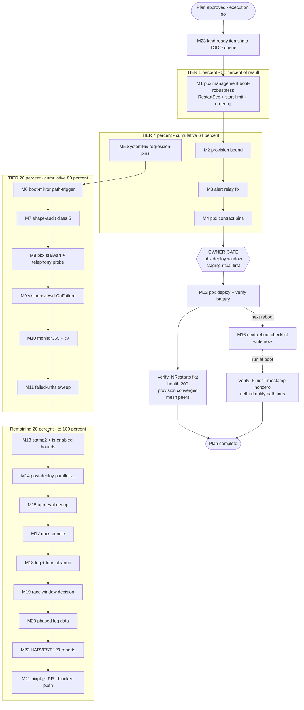

# NetBird Control-Plane Resilience + Deploy Hardening — Master Execution Plan

**Date:** 2026-10-17 19:52 CEST
**Format:** Markdown + mermaid.js execution graph (explicit user instruction; pareto-planning skill's HTML default overridden and flagged).
**Source inventory:** status report `docs/status/2026-10-17_19-44_deploy-pipeline-optimization-netbird-outage-incident.md` §f (all 20 items verified open as of writing), pbx-artmann recon (hosts/pbx/netbird.nix, netbird-provision.nix, tests/netbird-contract.nix read 2026-10-17 19:45–19:52), the two in-session-harvested rows in `docs/todo/services.md`, and the parallel session's two `[ready]` rows (systemd-shape-audit class 5, visionreviewd OnFailure). Errata: none — no inventory item was found already shipped.

## Why this plan exists (one paragraph)

2026-10-17: the pbx rebooted at 09:07 UTC and `netbird-management` exhausted its 5-restart start-limit **within one second** (boot-time DNS + Pocket-ID not yet up → OIDC config fetch hard-exits). Result: mesh control plane dead 8h behind an nginx 502, the outage **never paged** (the `pbx-alert@netbird-management` relay itself failed), evo-x2's unbounded login oneshot wedged a deploy for 27 min, and the same unit class had already held a boot transaction open 55+ min. Client-side hardening landed today (evo-x2, deployed in system-925); the server side and the protection gaps (no regression pins for today's deploy.sh/pre-deploy-check.sh changes) are what this plan closes. Anti-goal: **verschlimmbessern forbidden** — every change is a minimal config overlay pinned by a test; no rewrites.

---

## 1. Pareto breakdown

### The 1% that delivers 51%

**M1 — pbx `netbird-management` boot-robustness** (one unit-config overlay). It is the root cause of the 8h mesh outage, the 27-min deploy hang trigger, and the remote-access loss. Everything else in this plan either protects, verifies, or cleans up around this fix.

### The 4% that deliver 64% (cumulative)

| + | Why |
| --- | --- |
| M1 | (above) |
| M2 netbird-provision finite bound | the same unbounded-wait class, still live on the pbx (sat `activating` for hours today) |
| M3 pbx-alert@ relay fix | an outage that doesn't page is 8h of silent degradation — the pager path is half the incident cost |
| M4 pbx contract-test pins | makes M1–M3 regression-proof against nixpkgs drift (the repo already has the harness) |
| M5 SystemNix regression pins | today's shipped fixes (deploy_restart, stamp, manifest, probe batch) have ZERO persisted tests — one silent regression reintroduces the hang/stale-verdict classes |

### The 20% that deliver 80% (cumulative)

| + | Why |
| --- | --- |
| M6 boot-mirror-sync path-trigger | kills the stale-Samsung-ESP boot class (this morning's actual gen-922 stale boot) for ANY gen-install path, not just deploy.sh |
| M7 systemd-shape-audit class 5 | makes the boot-blocking-unbounded-oneshot class unrepresentable repo-wide (already queued `[ready]` by the parallel session) |
| M8 pbx stalwart + telephony-health investigation | failed since the same 09:07 reboot; telephony-health failing on a PBX is potentially live telephony degradation nobody noticed |
| M9 visionreviewd OnFailure fix | same wrong-section no-op class, already diagnosed, queued `[ready]` |
| M10 monitor365 + cv endpoints down | observability truth (both dead all session; every deploy pays warnings) |
| M11 failed-units sweep (9 units) | the deploy log's health section is permanently amber — real failures hide in the noise |

### The remaining 20% to reach 100%

M12 (gated pbx deploy + verification), M13 stamp-#2 + is-enabled bounds, M14 post-deploy-check parallelization, M15 app-eval dedup, M16 next-reboot checklist, M17 docs bundle (CHANGELOG/AGENTS.md//tmp), M18 aborted-deploy-log + stale metric loan, M19 race-detector window decision, M20 phased-log collection, M21 upstream nixpkgs PR (blocked:push), M22 HARVEST of 129 unharvested §f reports, M23 TODO-queue landing on execution-go.

---

## 2. Comprehensive plan — macro tasks (30–100 min each)

Sorted by importance / impact / effort / customer-value. Tier column = Pareto tier. Gate = requires owner action.

| # | Task | Repo | Impact | Effort | Tier | Gate |
| --- | --- | --- | --- | --- | --- | --- |
| M1 | netbird-management boot-robustness: `RestartSec=10`, `StartLimitBurst=10`/`StartLimitIntervalSec=600`, `after/wants network-online.target`, `after pocket-id.service` + dated incident comment | pbx-artmann | Critical | 45m | 1% | — |
| M2 | netbird-provision: finite `TimeoutStartSec=10min` + verify the live unit completed after the 17:19 management start | pbx-artmann | High | 30m | 4% | — |
| M3 | pbx-alert@ relay: diagnose the failed relay invocation (journal), fix ordering/retry, shape-verify (NO live page test without owner) | pbx-artmann | High | 45m | 4% | — |
| M4 | tests/netbird-contract.nix: pin management RestartSec/start-limit/ordering + provision TimeoutStartSec | pbx-artmann | Critical | 45m | 4% | — |
| M5 | SystemNix regression pins: manifest sed parse (3 cases), stamp key/expiry, `deploy_restart` rc-124 path, probe-batch state-var semantics → new selftest + flake check wiring | SystemNix | Critical | 60m | 4% | — |
| M6 | boot-mirror-sync trigger on `/boot/loader/entries` changes (path unit or restartTriggers) + selftest covering the raw-stc bypass | SystemNix | High | 60m | 20% | — |
| M7 | systemd-shape-audit class 5: boot-blocking oneshots must carry finite TimeoutStartSec (+ allowlist option, negative test) — parallel session's `[ready]` row | SystemNix | High | 90m | 20% | — |
| M8 | pbx: stalwart-provision + telephony-health journals, live sofia/gateway state, fix or queue per findings | pbx-artmann | High | 60m | 20% | — |
| M9 | visionreviewd OnFailure → [Unit] section + repo-wide `serviceConfig.OnFailure` sweep | SystemNix | Medium | 30m | 20% | — |
| M10 | monitor365 :9191 + cv :8098: journals, live probes, fix or queue | SystemNix | Medium | 30m | 20% | — |
| M11 | failed-units sweep: 9 units from the deploy log, batched journal triage, fix/reset/queue each | SystemNix | Medium | 90m | 20% | — |
| M12 | **GATED — pbx deploy** via pbx ritual (stage toplevel first) + full verification battery (NRestarts flat, `/api/health` 200, provision converged, alert path, evo-x2 mesh) | pbx-artmann | Critical | 60m | gate | **owner deploy window** |
| M13 | stamp pattern extended to check #2 toplevel eval + `timeout 10` on provisioner-loop `is-enabled` calls | SystemNix | Medium | 45m | tail | — |
| M14 | post-deploy-check.sh: read structure, parallelize sequential probe sections, verify + timing comparison | SystemNix | Medium | 60m | tail | — |
| M15 | app-eval dedup: ONE eval resolving pre/post-deploy-check program paths, direct exec + `nix run` fallback | SystemNix | Medium | 90m | tail | — |
| M16 | next-reboot observational checklist (FinishTimestamp ≠ 0, netbird login notify-failure path, boot-mirror entry = newest gen) — write now, run at next boot | SystemNix | Medium | 30m | tail | next reboot |
| M17 | docs bundle: CHANGELOG entries for today, prune `[x]` rows, AGENTS.md Build & Deploy levers (stamp/manifest/phase timers/eval floor), /tmp debris sweep | SystemNix | Low | 45m | tail | — |
| M18 | inspect aborted 19:33-45 deploy log + retire stale `signoz_logs_pipeline_stale` KNOWN_NEW_METRICS loan | SystemNix | Low | 30m | tail | — |
| M19 | race-detector 15-min window vs daemon cadence: quantify fire rate from deploy logs, decision note (tune or accept) | SystemNix | Low | 30m | tail | — |
| M20 | collect 3–5 phased deploy logs → per-phase cost table → re-rank remaining perf items from data | SystemNix | Medium | 30m | tail | — |
| M21 | upstream nixpkgs PR: bound the netbird login poll loop (verify-before-filing protocol; hold for owner push) | nixpkgs | Low | 90m | tail | **blocked:push** |
| M22 | docs-health HARVEST: the 129 unharvested §f-bearing reports, batched (~30/batch), route summary | SystemNix | Medium | 100m | tail | — |
| M23 | on execution-go: land `[ready]` items from this plan into TODO_LIST.md + domain libraries per queue rules | SystemNix | High | 30m | gate-prep | execution-go |

Total: 23 macros, ~16.6h.

---

## 3. Detailed breakdown — micro tasks (≤12 min each)

Sorted by macro order (macros are already impact-sorted). `→ M#` = parent macro.

| # | Micro task | Est | → |
| --- | --- | --- | --- |
| 1.1 | Read pbx-artmann AGENTS.md (deploy/staging/push-secrets rules) | 10m | M1 |
| 1.2 | Overlay `serviceConfig.RestartSec = 10` on netbird-management | 10m | M1 |
| 1.3 | Overlay `unitConfig.StartLimitBurst = 10` + `StartLimitIntervalSec = 600` | 10m | M1 |
| 1.4 | Add `after = [ "network-online.target" "pocket-id.service" ]` + `wants = [ "network-online.target" ]` | 10m | M1 |
| 1.5 | Dated incident comment (09:07 UTC start-limit evidence, why burst-not-disabled: alert preservation) | 5m | M1 |
| 1.6 | `nix eval` pbx toplevel | 5m | M1 |
| 2.1 | Read provision ExecStart/wait shape in netbird-provision.nix + unit render | 8m | M2 |
| 2.2 | Add `TimeoutStartSec = "10min"` + comment (timer re-runs; hung reconcile costs nothing) | 8m | M2 |
| 2.3 | Live-verify via ssh journal: did provision complete after 17:19 management start? | 8m | M2 |
| 2.4 | eval | 5m | M2 |
| 3.1 | ssh journalctl `pbx-alert@netbird-management.service` — root-cause the relay failure | 10m | M3 |
| 3.2 | Read the `pbx-alert@.service` template definition | 8m | M3 |
| 3.3 | Fix (ordering after network-online / retry) + comment | 12m | M3 |
| 3.4 | Shape-verify rendered unit — NO live page trigger without owner | 10m | M3 |
| 3.5 | eval | 5m | M3 |
| 4.1 | Read tests/netbird-contract.nix structure + existing assertions | 10m | M4 |
| 4.2 | Assert management: RestartSec / start-limit / After set | 12m | M4 |
| 4.3 | Assert provision: finite TimeoutStartSec | 8m | M4 |
| 4.4 | Run the selftest check green | 10m | M4 |
| 5.1 | Design `scripts/test-pre-deploy-manifest.sh` (3-case sed harness: normal/empty/single) | 12m | M5 |
| 5.2 | Implement + run green | 12m | M5 |
| 5.3 | Stamp test: same tree → same key; mutation → new key; expiry respected | 12m | M5 |
| 5.4 | `deploy_restart` rc-124 harness: PATH-shim fake `systemctl`/`sudo`, assert warn line + rc 0 | 12m | M5 |
| 5.5 | Probe-batch semantics test: fixture PROBE_DIR → state vars + output order | 12m | M5 |
| 5.6 | Wire all into flake checks / selftest family + full run | 10m | M5 |
| 6.1 | Choose trigger shape (systemd path unit on /boot/loader/entries vs restartTriggers) from boot-mirror.nix constraints | 12m | M6 |
| 6.2 | Implement trigger + comment (raw-stc class: this morning's gen-922 stale boot) | 12m | M6 |
| 6.3 | Selftest: new entry under /boot → sync runs (VM or fixture harness per repo pattern) | 12m | M6 |
| 6.4 | Negative test: unmounted mirror must not fail the trigger (wants-not-requires preserved) | 12m | M6 |
| 6.5 | eval + flake check | 10m | M6 |
| 7.1 | Read systemd-shape-audit.nix rule structure | 12m | M7 |
| 7.2 | Implement class 5 (Type=oneshot ∧ no/infinite TimeoutStartSec ∧ wantedBy multi-user/graphical → throw) | 10m | M7 |
| 7.3 | Allowlist option (house pattern: allowTimerRestart) | 10m | M7 |
| 7.4 | Extend scripts/negative-test-lints.sh (neuter/restore ATOMIC single command) | 12m | M7 |
| 7.5 | Selftest check + `nix flake check --no-build` green | 12m | M7 |
| 7.6 | Fix any false positives surfaced on the current tree | 12m | M7 |
| 8.1 | ssh journalctl stalwart-provision — failure cause since 09:07 | 10m | M8 |
| 8.2 | ssh journalctl telephony-health — failure cause | 10m | M8 |
| 8.3 | Live sofia/gateway state (fs_cli) — is telephony actually degraded? | 12m | M8 |
| 8.4 | Fix in-repo or queue with evidence; reset-failed benign residue via script | 12m | M8 |
| 8.5 | Report telephony verdict to owner | 8m | M8 |
| 9.1 | Move visionreviewd OnFailure to unit level | 8m | M9 |
| 9.2 | Repo sweep: `rg 'serviceConfig.*OnFailure'` — fix every same-class no-op | 10m | M9 |
| 9.3 | eval + comment referencing the [Unit]-section rule | 7m | M9 |
| 10.1 | monitor365 :9191 — pgrep + journal + why down | 10m | M10 |
| 10.2 | cv :8098 — journal + probe (note: metrics endpoint auth-gated; service itself was serving requests today) | 10m | M10 |
| 10.3 | Fix or queue per findings | 10m | M10 |
| 11.1 | Triage batch 1: architecture-catalog-sync + ci-watchdog journals | 12m | M11 |
| 11.2 | Triage batch 2: forgejo-github-sync + geometrikks-log-pull | 12m | M11 |
| 11.3 | Triage batch 3: inboxclean-sync + pbx-backup-pull | 12m | M11 |
| 11.4 | Triage batch 4: nix-build-cleanup + service-health-check | 12m | M11 |
| 11.5 | Triage batch 5: systemd-tmpfiles-clean | 12m | M11 |
| 11.6 | Summarize root causes; fix-in-session where trivial, queue the rest with evidence | 12m | M11 |
| 11.7 | reset-failed the benign residue via script (stale one-shot failures) | 10m | M11 |
| 12.1 | Stage pbx toplevel per ritual (`nix build -o /tmp/pbx-toplevel-root`, verify symlink exists) | 10m | M12 |
| 12.2 | Deploy in the owner window (pbx switch) | 10m | M12 |
| 12.3 | Verify: management NRestarts flat, `/api/health` reachable, provision converged | 12m | M12 |
| 12.4 | Verify: alert relay path shape (no live page) + netbird-pbx-login state | 12m | M12 |
| 12.5 | Verify: evo-x2 mesh re-connect + peers list | 12m | M12 |
| 13.1 | Extend stamp to check #2 toplevel eval (identical-tree re-run skips ~25–30s) | 12m | M13 |
| 13.2 | `timeout 10` around provisioner-loop `systemctl is-enabled` calls | 12m | M13 |
| 13.3 | Tests + battery re-run timing | 10m | M13 |
| 14.1 | Read post-deploy-check.sh end-to-end (structure + probe sections) | 12m | M14 |
| 14.2 | Parallelize sequential probe sections (same PROBE_DIR pattern) | 12m | M14 |
| 14.3 | Live verification run | 12m | M14 |
| 14.4 | Timing comparison recorded | 10m | M14 |
| 15.1 | Design one-eval program resolution (pre+post apps) + existence-check fallback contract | 12m | M15 |
| 15.2 | Implement in deploy.sh | 12m | M15 |
| 15.3 | Verify fallback path (missing store path → `nix run`) | 12m | M15 |
| 15.4 | Measure saved eval; record in plan errata | 10m | M15 |
| 16.1 | Write the next-reboot checklist section (into docs/services/netbird.md runbook, avoid parallel-session race by re-reading first) | 12m | M16 |
| 16.2 | At next boot: run checklist, record outcomes | 12m | M16 |
| 17.1 | CHANGELOG entries for today's session (pipeline optimizations + incident) | 12m | M17 |
| 17.2 | Prune `[x]` rows to CHANGELOG per TODO rules | 10m | M17 |
| 17.3 | AGENTS.md Build & Deploy: stamp/manifest/phase-timer semantics + ~4-eval floor | 12m | M17 |
| 17.4 | /tmp debris sweep (test manifests, run logs, throwaway scripts) | 5m | M17 |
| 18.1 | Inspect aborted 19:33-45 deploy log (lock-guard abort? failure?) | 10m | M18 |
| 18.2 | Retire `signoz_logs_pipeline_stale` KNOWN_NEW_METRICS loan | 10m | M18 |
| 18.3 | Gatus config eval after loan removal | 10m | M18 |
| 19.1 | Quantify race-detector fire rate across recent deploy logs | 12m | M19 |
| 19.2 | Decision note: tune threshold vs accept-by-design (daemon cadence) | 10m | M19 |
| 20.1 | Collect 3–5 phased deploy logs into a per-phase cost table | 12m | M20 |
| 20.2 | Re-rank remaining perf items (M13–M15) from data; annotate this plan's errata | 12m | M20 |
| 21.1 | Locate upstream nixpkgs netbird login module; reproduce the unbounded poll | 12m | M21 |
| 21.2 | Patch (bounded retries / explicit timeout) + test | 12m | M21 |
| 21.3 | PR draft per verify-before-filing + github-voice; hold for owner push | 12m | M21 |
| 22.1 | HARVEST batch 1 (~30 reports) | 12m | M22 |
| 22.2 | HARVEST batch 2 | 12m | M22 |
| 22.3 | HARVEST batch 3 | 12m | M22 |
| 22.4 | HARVEST batch 4 | 12m | M22 |
| 22.5 | Route summary + queue/library diff check | 10m | M22 |
| 23.1 | Draft queue one-liners for the `[ready]` subset of this plan | 12m | M23 |
| 23.2 | Append to TODO_LIST.md + matching domain libraries; run check-todo-system | 12m | M23 |

Total: 85 micros.

---

## 4. Execution graph

**Gates (hard):** M12 waits for the owner's pbx deploy window (production telephony+mail host; staging ritual mandatory). M21 stops before push (blocked:push). M16's run-half waits for the next natural reboot — do NOT reboot the box for a test.

**Parallelizable:** M5/M6/M7 (SystemNix) run independent of M1–M4 (pbx-artmann) — different repos, no shared files. M10/M11 independent of M6/M7.

---

## 5. Guardrails (the no-verschlimmbessern contract)

1. Every unit change is a minimal overlay with a dated comment citing today's journal evidence — no rewrites, no "while I'm here" refactors on the pbx.
2. Every fix ships WITH its pin (M4 for pbx, M5 for SystemNix) in the same pass — untested fixes don't count as done.
3. Start-limit is widened (burst 10 / 10 min), NOT disabled — a permanently-broken management must still reach `failed` so `OnFailure` pages.
4. No live alert-relay trigger, no reboot, no pbx deploy without the owner — verification uses rendered-unit shape checks and journals only.
5. Parallel-session discipline: re-read every target file immediately before editing (net-vpn docs and netbird.nix were under active edit earlier today).
6. On execution-go, `[ready]` items land in TODO_LIST.md + domain libraries BEFORE work starts (M23 first), per the queue contract.

## 6. Routing note (TODO system contract)

This plan is a snapshot; the living source stays TODO_LIST.md + `docs/todo/*.md`. M23 executes the landing. The pbx-side items live in pbx-artmann's own TODO (§11 lineage) once implemented; SystemNix keeps only cross-repo observation rows (already present: the `[blocked:user]` pbx fragility row).
