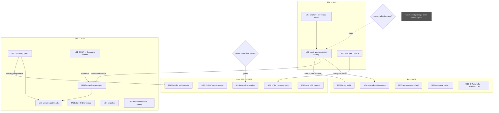

# BOOT / IO-PRIORITY / INFINITE-BOOT AFTERMATH — PARETO EXECUTION PLAN

**Date:** 2026-10-17 20:25 CEST
**Scope:** the open cluster from the 2026-10-17 evening session (`docs/status/2026-10-17_20-15_netbird-infinite-boot-llama-chat-degate-io-prio-session.md` §f, 24 items) + the 4 pre-existing rows it advanced + the 3 open owner questions. Repo-wide planning is OUT of scope for this pass (the morning 10:44 report's 50-item list owns the broader backlog).
**Inputs read (Step 0):** this evening's report (20:15), the parallel deploy-pipeline report (19:44), the morning boot-order/io-tiers report (10:44), stability.md/services.md open rows, live git state at `bddadc25`.
**Errata / verification (Step 0):** all 24 rows grep-verified open at 20:20; no CHANGELOG entries exist for this session's 3 closes (the dirty-tree CHANGELOG entry belongs to the PARALLEL session's dnsblockd work — not counted); "Push SystemNix master" [blocked:push] is satisfied by this plan's commit+push pass; the wedged-login 2-min-timeout leg is [watch]-class (passive — needs a real outage), not a schedulable task.

---

## Pareto breakdown

### The 1% that deliver 51%
1. **Anchor check for the ~20:10 `rm56zlza` deploy** (5 min) — the exit-14 reboot-revert class hit twice on 2026-10-14; an unanchored deploy silently reverts on the next reboot. Everything below assumes the deployed fixes STAY deployed.
2. **The quiet-window reboot battery** (owner window, ~30 min active) — one planned reboot validates BOTH deployed fixes (userspace floor, llama-chat post-multi-user ordering, netbird post-boot start), takes the calm-boot re-measure the 10:44 report still owes, and clears the gatus Boot-Userspace RED. Unlocks the verification legs of half the remaining rows.
3. **systemd-shape-audit class 5** (boot-blocking oneshots must carry a finite TimeoutStartSec) — today proved this class costs owner-visible "infinite boot" incidents; one eval rule + negative test kills it permanently, nixpkgs-generated units included.

### The 4% that deliver 64% (the above plus)
4. **network-online sweep** — ~20 modules carry the gate; the loopback-only binders turn every wifi-failover window into boot latency for zero benefit.
5. **Family audit** (multi-user wantedBy × blame join, >30 s) — finds ALL remaining boot-blockers in one sweep instead of per-incident archaeology.
6. **hermes-perms-heal audit** (7m52s, the #2 bar) + **compsize battery** (6m37s, row exists) — the recovery-window readers.
7. **visionreviewd OnFailure fix + CHANGELOG hygiene** — alerting integrity (failures currently invisible) + history.

### The 20% that deliver 80% (the above plus)
8. **llama-chat streaming pre-warm** (fault-paging → sequential stream).
9. **PSI entry gates for cold loads** (refuse-style for boot units, waiting-style for socket-activated).
10. **Serialization of concurrent cold loads** (one QLC stream at a time).
11. **Active GGUF set → Samsung hot-tier** (the structural fix: 620 → 35k QD1 IOPS).
12. **Store-GC anomaly forensics** (daemon-restart landmine while the wrapper path is missing).
13. **btrbk tier at definition site** + **transaction_open gauge** (the class becomes measured, not inferred).

### The other 80% to reach 100%
14. fastflowlm/llama-vlm waiting-gate design; FinishTimestamp 19:19→19:43 gap; ioTier coverage eval gate (morning row 17); user.slice tiering scoping (owner Q2); crush DBs off QLC (blocked:user assist); gatus RED expectation note (folded into M02); wedged-login watch leg.

---

## Comprehensive plan — medium granularity (30–100 min each, 20 tasks, sorted)

Sort key: importance (freeze/incident prevention > boot speed > hygiene), then impact ÷ effort, then owner-value.

| ID | Task | Tier | Impact (1–5) | Effort | Customer value | Depends on | Row state |
|----|------|------|--------------|--------|----------------|------------|-----------|
| M01 | Anchor verification for `rm56zlza` + `nix run .#pre-reboot-check` | 1% | 5 | 30 m | Deployed fixes cannot silently revert on reboot | — | [ready] new |
| M02 | Quiet-window reboot + calm-boot battery (userspace ≤40 s verdict, llama-chat/netbird post-boot ordering, gatus RED clears, boot-metrics prom) | 1% | 5 | 60 m | Boot speed finally measured calm; both fixes proven live | M01; owner window (§g Q3) | [ready] + §g.2 |
| M03 | systemd-shape-audit class 5: boot-blocking oneshot needs finite TimeoutStartSec + allowlist option + negative-test-lints selftest | 1% | 5 | 100 m | The infinite-boot class becomes impossible to ship | — | [ready] services.md |
| M04 | network-online sweep: classify ~20 modules, drop the gate on loopback-only binders, keep fetch/outbound/LAN units | 4% | 4 | 90 m | No boot latency from failover windows; correct semantics | — | [ready] services.md |
| M05 | Family audit: all multi-user wantedBy units × recent blame, flag >30 s, fix or justify | 4% | 4 | 60 m | Whole boot-critical-path visibility in one artifact | M02 (calm blame) | [ready] stability.md:245 |
| M06 | hermes-perms-heal boot-window audit: trigger cadence, tier, defer-past-settle? | 4% | 3 | 30 m | #2 boot bar explained + bounded | — | [ready] stability.md |
| M07 | compsize battery: what scheduled the 23:57 run, PSI entry gate, idle tier | 4% | 3 | 45 m | #3 boot bar bounded; no full-dataset reads into storms | — | [ready] stability.md:246 |
| M08 | visionreviewd OnFailure [Unit]-section fix + CHANGELOG entries for today's 3 closes | 4% | 3 | 30 m | Failures alert again; history accurate | — | [ready] services.md ×2 |
| M09 | llama-chat streaming pre-warm ExecStartPre + blame-delta measurement | 20% | 4 | 45 m | 10m49s → ~3–4 min model readiness | M02 (baseline) | [ready] stability.md |
| M10 | PSI entry gates for cold loads (refuse-style boot units; waiting-style socket-activated) | 20% | 4 | 90 m | No cold load ever stacks into a recovery storm (freeze #3/#6 class) | — | [ready] stability.md |
| M11 | Serialize concurrent cold loads (heavy-job slot or After= chain) | 20% | 4 | 45 m | One QLC stream at a time; 50–60 G boot reads stop stacking | M09–M10 shapes | [ready] stability.md |
| M12 | Active GGUF set → Samsung hot-tier +C subvol: space check, migrate, repoint modelPaths, verify serving | 20% | 5 | 100 m | Model loads stop being QLC storms at all (structural) | — | [ready] stability.md |
| M13 | Store-GC anomaly forensics: why a1awc19d vanished while in both closures; rebuild confirmation; restart-landmine audit | 20% | 4 | 45 m | No silent break-on-restart of the VPN daemon | — | [ready] stability.md |
| M14 | btrbk tier at its DEFINITION site (not filename glob) + eval | 20% | 2 | 30 m | Nightly sends yield correctly under load | — | [ready] services.md |
| M15 | `transaction_open_seconds_past_graphical` gauge in boot-metrics.nix | 20% | 3 | 45 m | The unfinished-boot class becomes MEASURED (gatus-able) | — | [ready] stability.md:244 |
| M16 | fastflowlm/llama-vlm waiting-gate design + impl (first-request cold load into recovery window) | 80% | 3 | 60 m | Interactive NPU path stops risking the recovery window | M10 pattern | [ready] stability.md |
| M17 | FinishTimestamp 19:19→19:43 gap: journal the actual closer | 80% | 2 | 30 m | Attribution discipline; closes report §b.2 | — | [ready] stability.md |
| M18 | ioTier coverage eval gate (boot-gated units must carry a tier; user.slice documented out) | 80% | 3 | 90 m | Tier coverage cannot regress silently | owner Q2 (scope) | [ready] morning row 17 |
| M19 | user.slice tiering scoping design (HM IOSchedulingClass defaults + agent slice) | 80% | 4 | 60 m | The 92.8%-stall half of the box finally governed | owner Q2 | [decision] §g.3 |
| M20 | Crush-session-DBs-off-QLC support pass (verify migration state, wire follow-ups for the blocked:user row) | 80% | 4 | 30 m | The structural user.slice storm fix advances | — | [blocked:user] storage.md |

**Watch (not schedulable):** wedged-login 2-min timeout + notify-failure path — fires on the next real netbird outage; verify then.

---

## Fine breakdown — max 12 min per task (ALL TODOs)

### M01 — anchor + boot-safety (3 tasks)
| ID | Task | Est |
|----|------|-----|
| F01.1 | `readlink /run/current-system` vs latest `system-N-link` vs `/run/booted-system`; record triple | 5 m |
| F01.2 | If unanchored: `sudo nix build --no-link --profile /nix/var/nix/profiles/system <current>` + `boot` switch leg (owner-run) | 10 m |
| F01.3 | `nix run .#pre-reboot-check` (16-gate battery; exit 0 required before M02's reboot) | 10 m |

### M02 — reboot battery (5)
| ID | Task | Est |
|----|------|-----|
| F02.1 | Owner picks the quiet window; confirm io PSI avg10 <10 for 10 min (pre-deploy gate style) | 5 m |
| F02.2 | Reboot; on return: `systemd-analyze` verdict (firmware/loader/initrd/userspace) + blame snapshot saved to docs/status | 10 m |
| F02.3 | Verify ordering: llama-chat `Starting` AFTER multi-user `Reached`; netbird-login post-boot start | 10 m |
| F02.4 | boot-metrics.prom: userspace value + storm-context marker; gatus Boot-Userspace check state (expect GREEN now) | 10 m |
| F02.5 | Fold verdict into the calm-boot re-measure row (stability.md) + close §g.2 of the 10:44 report | 10 m |

### M03 — eval gate class 5 (8)
| ID | Task | Est |
|----|------|-----|
| F03.1 | Read systemd-shape-audit.nix end-to-end; map where classes 1–4 assert | 10 m |
| F03.2 | Implement class 5 predicate: Type=oneshot ∧ wantedBy ∩ {multi-user, graphical} ∧ (no TimeoutStartSec ∨ "infinity") | 12 m |
| F03.3 | `allowOneshotBootTimeout` option with justification-comment convention (allowTimerRestart pattern) | 10 m |
| F03.4 | Survey live offenders on evo-x2 eval; classify real vs stock-nixpkgs-deliberate; allowlist the deliberate | 12 m |
| F03.5 | Wire assertion message naming unit + incident pointer (2026-10-17 netbird) | 8 m |
| F03.6 | Negative test in scripts/negative-test-lints.sh: neuter a fixture unit's timeout → gate must throw; restore atomically | 12 m |
| F03.7 | `nix eval` evo-x2 + flake check --no-build green | 10 m |
| F03.8 | Close the services.md row both surfaces + CHANGELOG line | 8 m |

### M04 — network-online sweep (7)
| ID | Task | Est |
|----|------|-----|
| F04.1 | Enumerate the ~20 referencing modules; build the classify table (bind host, assets, outbound, fetch units) | 12 m |
| F04.2 | Classify each: loopback-only+local (drop) / outbound consumer (keep) / LAN binder (keep or network.target) / fetch unit (keep) | 12 m |
| F04.3 | Drop wants/after network-online on the loopback-only set, one commit per module group | 12 m |
| F04.4 | llama-rag special case: gate only the model-fetch unit, never the servers | 10 m |
| F04.5 | Eval evo-x2 + darwin + rpi3 (three hosts) green | 10 m |
| F04.6 | Boot-order sanity: no new ordering cycles (journal scan on next boot — pairs with M02 if sequenced) | 5 m |
| F04.7 | Close the sweep row both surfaces + CHANGELOG | 8 m |

### M05 — family audit (5)
| ID | Task | Est |
|----|------|-----|
| F05.1 | Eval-dump every multi-user/graphical wantedBy unit on evo-x2 | 10 m |
| F05.2 | Join with M02's calm-boot blame; flag >30 s activations | 10 m |
| F05.3 | Per flagged unit: fix (After=multi-user / timer / defer) or write the justification | 12 m |
| F05.4 | Eval green + deploy note | 8 m |
| F05.5 | Close stability.md:245 both surfaces | 5 m |

### M06 — hermes-perms-heal (3)
| ID | Task | Est |
|----|------|-----|
| F06.1 | Read hermes.nix perms-heal unit: trigger, cadence, walk size, current tier | 10 m |
| F06.2 | Decide: idle tier + defer past boot-settle, or justified-keep; implement | 12 m |
| F06.3 | Eval + close row | 8 m |

### M07 — compsize battery (4)
| ID | Task | Est |
|----|------|-----|
| F07.1 | What scheduled the 23:57 run (boot fire vs OnUnitActiveSec); read the 2026-10-12 fix's deployed state | 12 m |
| F07.2 | Add maintenance-entry-gate ExecStartPre (PSI refuse pattern) | 10 m |
| F07.3 | ioTier.maintenance (idle) on the unit | 5 m |
| F07.4 | Eval + close stability.md:246 | 8 m |

### M08 — OnFailure fix + CHANGELOG (3)
| ID | Task | Est |
|----|------|-----|
| F08.1 | visionreviewd.nix: move `serviceConfig.OnFailure` → unit-level `onFailure`; keep the reference comment | 8 m |
| F08.2 | CHANGELOG entries: netbird boot-block fix, llama-chat de-gate+BE/5+network-online, visionreviewd fix | 12 m |
| F08.3 | Eval + close both rows | 10 m |

### M09 — llama-chat pre-warm (5)
| ID | Task | Est |
|----|------|-----|
| F09.1 | Pre-warm script: streaming read of cfg.modelPath to /dev/null (cat), same cgroup/tier | 10 m |
| F09.2 | Wire as ExecStartPre (`+`-prefix not needed; user-readable model) + ConditionPathExists guard | 10 m |
| F09.3 | Keep TimeoutStartSec budget coherent (warm + map + probe ≤ 15 min) | 8 m |
| F09.4 | Deploy + measure blame delta across one reboot (needs window; can pair with M02's next reboot) | 12 m |
| F09.5 | Close row with the measured number | 5 m |

### M10 — PSI entry gates (6)
| ID | Task | Est |
|----|------|-----|
| F10.1 | Refactor tqPoolPsiGate into a reusable lib gate (refuse-style, exit nonzero + reason) | 12 m |
| F10.2 | Wire into llama-chat pre-warm ExecStartPre + llama-rag server starts | 10 m |
| F10.3 | Waiting-gate variant (flock loop with PSI check, never refuse) for socket-activated units | 12 m |
| F10.4 | Unit tests: gate refuses at PSI ≥ threshold (fixture /proc/pressure stub) | 12 m |
| F10.5 | Eval + deploy note | 8 m |
| F10.6 | Close row | 4 m |

### M11 — serialization (4)
| ID | Task | Est |
|----|------|-----|
| F11.1 | Pick mechanism: shared flock slot via heavy-job pattern vs After= chain (llama-chat → flm → vlm → rag) | 10 m |
| F11.2 | Implement chosen mechanism across the four cold-load units | 12 m |
| F11.3 | VM or eval verification (no cycles; socket-activation semantics preserved) | 10 m |
| F11.4 | Eval + close row | 8 m |

### M12 — GGUF hot-tier move (8)
| ID | Task | Est |
|----|------|-----|
| F12.1 | Samsung free-space audit: /nix + hot tier usage vs active model set size (~50 G) | 10 m |
| F12.2 | Owner gate if space is tight (what to evict / whether /nix shrinks first) | 5 m |
| F12.3 | Create +C subvol `/mnt/hot/models` (chattr explicit — fresh subvols do NOT inherit) | 8 m |
| F12.4 | PSI-gated migrate script (ionice -c3 rsync, verify sizes + sha on first) | 12 m |
| F12.5 | Repoint modelPath/llama-vlm/rag paths + eval | 10 m |
| F12.6 | Deploy + cold-load measurement (blame delta) | 12 m |
| F12.7 | fstab/nofail/5s-device-timeout + wants-not-requires wiring per hot-tier doctrine | 10 m |
| F12.8 | Close row + runbook note in storage.md | 8 m |

### M13 — store-GC forensics (5)
| ID | Task | Est |
|----|------|-----|
| F13.1 | Did the wrapper path come back? (store ls + closure rebuild check) | 5 m |
| F13.2 | Journal the GC event: which nix command ran auto-GC ~19:07; gcroot rotation window reconstruction | 12 m |
| F13.3 | Check the daemon-restart landmine: current gen units vs on-disk paths for ALL netbird units | 10 m |
| F13.4 | Write the verdict + (if systemic) queue a nix-gc-vs-running-system guard row | 10 m |
| F13.5 | Close row | 4 m |

### M14 — btrbk tier (3)
| ID | Task | Est |
|----|------|-----|
| F14.1 | Locate the DEFINING module (not the services/ glob miss); read current serviceConfig | 10 m |
| F14.2 | Add the tier (background or maintenance per doctrine); eval | 10 m |
| F14.3 | Close row both surfaces | 5 m |

### M15 — transaction-open gauge (4)
| ID | Task | Est |
|----|------|-----|
| F15.1 | boot-metrics.nix: compute seconds past graphical from job timestamps (graphical active vs FinishTimestamp) | 12 m |
| F15.2 | Emit `transaction_open_seconds_past_graphical` (+ open/closed state) to boot-metrics.prom | 10 m |
| F15.3 | Gatus/SigNoz rule stub if thresholds wanted (owner call — keep observe-only first) | 8 m |
| F15.4 | Selftest fixture + close stability.md:244 | 12 m |

### M16 — flm/vlm waiting-gate (4)
| ID | Task | Est |
|----|------|-----|
| F16.1 | Design note: where the wait lives (ExecStartPre of the @-instance? socket Accept=false pre-accept?) | 12 m |
| F16.2 | Implement on top of M10.3's waiting-gate | 12 m |
| F16.3 | Verify socket semantics: client connections queue, never error, during the wait | 10 m |
| F16.4 | Eval + close row | 8 m |

### M17 — FinishTimestamp gap (3)
| ID | Task | Est |
|----|------|-----|
| F17.1 | Journal 19:15–19:45: every Stopping/Starting/Finished for netbird-login + any other late settler | 10 m |
| F17.2 | Name the closer; reconcile 19:19:18 (parallel report) vs monotonic 5371 s (≈19:43:20) | 10 m |
| F17.3 | Correct report §b.2 if needed + close row | 5 m |

### M18 — ioTier coverage eval gate (5)
| ID | Task | Est |
|----|------|-----|
| F18.1 | Predicate: boot-gated units must set an ioTier field (allowlist for exempt stock units) | 12 m |
| F18.2 | Survey live offenders; fix the real ones (most already tiered — census said 70 uses) | 12 m |
| F18.3 | Allowlist + justification comments | 10 m |
| F18.4 | Negative test + eval green | 12 m |
| F18.5 | Close morning row 17 | 5 m |

### M19 — user.slice scoping (4) — owner-gated
| ID | Task | Est |
|----|------|-----|
| F19.1 | Owner answers §g Q2 (scope in/out) | — |
| F19.2 | If in: HM unit defaults (IOSchedulingClass for churner units) design | 12 m |
| F19.3 | Dedicated agent-session slice proposal (systemd-run --slice for agent shells) | 12 m |
| F19.4 | Implement + close §g.3 | (next plan) |

### M20 — crush-DB off-QLC support (3)
| ID | Task | Est |
|----|------|-----|
| F20.1 | Verify crush-hot-db-migrate convergence state (2/3-done class; journal) | 10 m |
| F20.2 | List what remains for the blocked:user row (sudo steps only owner can run) | 10 m |
| F20.3 | Update storage.md row with the exact handoff checklist | 8 m |

**Totals:** 20 medium tasks (≈14.5 h) · 88 fine tasks (≈12.9 h) · 1 watch item · 3 owner gates (M02 window, M12.2 space, M19.1 scope).

---

## Execution graph

Parallelizable: M03/M04/M06/M07/M08/M13/M14/M17 carry no interdependencies — dispatch freely against the tq pool.

## Anti-verschlimmbesser guards

1. Every fix is verify-first: read the DEFINING module before claiming absence (the btrbk-glob lesson); eval-green before commit; deploy via `nix run .#deploy` only.
2. No idle-class tier on anything that must finish (borg precedent); no io.latency pilots while BFQ is the strategy.
3. M12's migrate script is PSI-gated + ionice -c3 + verified copy before any path repoint (the split-brain doctrine); subvol created BEFORE the deploy carrying the mount.
4. Gates REFUSE only where a retry path exists (ensure-timer / converger); socket-activated units get WAITING gates, never refuse.
5. Shared tree: pathspec commits, content-pin per write batch, never sweep parallel sessions' dirty files (CHANGELOG/dnsblockd/deploy scripts are theirs right now).

## Sequencing recommendation

**Tonight/next window:** M01 → (owner window) M02 → then fire M03+M04+M08 in parallel (pure repo work, no deploy dependency). **Next deploy:** carries M03–M08 output; M09–M12 land as one model-load train after the M02 baseline exists.
