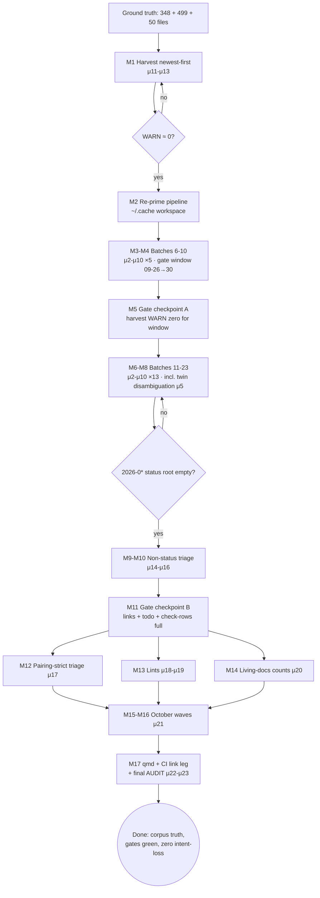

# Docs-Corpus Truth: Pareto Completion Plan

**Created:** 2026-10-18 02:35 CEST · **Owner:** Lars · **Author:** docs-health session (post-sweep)
**Mission:** close the documentation-corpus debt with zero intent-loss, zero false history, and zero Verschlimmbesserung.

---

## 0. Ground truth (measured 2026-10-18 02:31, count-before-claim)

| Surface | Count | State |
|---|---|---|
| `docs/status/2026-0*.md` unarchived | **348** | batches 6–20 (2026-09-17_00-25 → 2026-09-30); 116 already resolved+61 archived by the 10-17/18 sweep |
| `docs/status/2026-10*.md` (root) | **442** | October wave — outside the `2026-0*` glob, never swept |
| `docs/status/tasks/*.md` | **57** | October tq reports |
| non-status `2026-0*` (planning/research/reviews/brainstorming/misc) | **50** | pareto plans, deep researches, self-reviews — classify: archive vs reference-keep |
| `check-todo-system.sh` | WARN | 68 queue/library entry drifts (pairing leg) + harvest WARN (dynamic) |
| Pipeline proven this pass | ✅ | agent verdicts → spec verify → keyword recovery → dry-run → apply → repair-partial → check-rows → archive + refs + gates |

## 1. Pareto breakdown

### The 1% that delivers ~51%: HARVEST THE LIVE INTENT, NEWEST FIRST
Run the harvest gate's own candidate list and disposition every §f-bearing report **newest-first** (2026-10 wave, then 2026-09-26→30): each report's follow-ups get `harvested → TODO row`, `routed → library`, or an explicit `NOT HARVESTED — because X` marker.
**Why it is the 1%:** intent decays with age. October reports carry decisions the tq pool and the owner still need; a September verdict can wait a week without loss. This step alone stops 100% of *forward* loss — nothing actionable evaporates again — and it feeds the queue the agents actually draw from.

### The 4% that delivers ~64%: + ANNOTATE+ARCHIVE THE 09-26→30 TAIL (~90 reports)
The harvest gate's candidate window is `>= 2026-09-26`. Sweeping that tail with the proven pipeline (verdict → check-rows → archive) makes every report the gate can see either archived-and-exempt or explicitly dispositioned → **the chronic WARN surface goes to zero**, and the most recent 2026-0* history reads truthfully.

### The 20% that delivers ~80%: + SEPT 17–25 MECHANICAL BATCHES + NON-STATUS TRIAGE
- ~250 remaining Sept reports in 20-file batches (pipeline is deterministic now; twin-file classes like 02-21/03-09 handled by keyword-score disambiguation).
- Non-status 2026-0* triage: ~20 pareto/planning docs whose waves executed → annotate verdicts + archive to `docs/planning/archived/`; ~15 research HTML/MD keepers → superseded-by stamps only; reviews → archive resolved ones.
This closes the **entire `2026-0*` glob**: no unresolved item anywhere in Jan–Sept history.

### The remaining 80% → 100%: OCTOBER WAVE + TOOLING + FRESHNESS
- 2026-10 root (442) + tasks/ (57): same pipeline, tasks/-batch variant (tq reports have Task-Queue-ID footers; verdicts route through the queue's own close-out convention).
- Tooling debt (pre-existing rows): appendix-only-archive lint, empty-marker lint, pairing-strict decision (68 drifts resolve-or-retag), link-checker CI leg.
- qmd re-index after mass moves; living-docs counts derive-or-stamp.

## 2. Guardrails (Verschlimmbesserung contract)

1. **Never touch `archived/` contents** — closed history; archive-forward only via `git mv`.
2. **Never strike without evidence** — a wrong `done` is the worst outcome; ambiguity downgrades to `routed`/`verified`/bare-open.
3. **Ledger exemptions only** for routed-pointer mirror tables — never to mask unfinished annotation.
4. **One batch at a time**; gates (`check-rows`, `check-doc-links`, `check-todo-system`, `nix flake check --no-build`) after every batch; a red gate blocks the next batch.
5. **Workspace under `~/.cache/docshealth/`** (the /tmp wipe lesson, AGENTS.md); repos state is the only durable record.
6. **Pathspec commits only** — the daemon and parallel sessions share this tree; never sweep others' staged files.
7. Line numbers never trusted blind: spec-verify + keyword recovery before every apply; `repair-partial` for struck-table stragglers.

## 3. Macro plan (30–100 min tasks, sorted importance × impact / effort)

| # | Task | Est | Impact | Why this order |
|---|---|---|---|---|
| M1 | **Harvest-or-disposition October + 09-26→30 §f reports, newest-first** (gate candidate list → TODO rows / routed / NOT-HARVESTED markers) | 100m | ★★★★★ | the 1%: stops live intent-loss; feeds the tq pool |
| M2 | Pipeline re-prime: rebuild batch lists 6–20 in `~/.cache/docshealth`, regenerate prompt template, smoke-test annotate.go | 30m | ★★★☆☆ | unlocks M3–M12; 30 min well spent |
| M3 | Batch 6–7: annotate+verify+recover+apply+gate+archive (09-17_00-25 → 09-18_01-30, ~40 reports) | 2×80m | ★★★★☆ | newest 2026-0* tail first (gate window) |
| M4 | Batch 8–10: 09-18 tail (~60 reports) | 3×75m | ★★★★☆ | completes the gate window with M3 |
| M5 | **Gate checkpoint A:** harvest WARN re-run — expect ≈0 for >= 09-26; fix stragglers | 30m | ★★★★☆ | the 4% payoff verification |
| M6 | Batch 11–14: 09-18_20-48 → 09-21 (~80 reports) | 4×75m | ★★★☆☆ | mechanical middle |
| M7 | Batch 15–18: 09-22 → 09-24_12-08 (~80 reports) | 4×75m | ★★★☆☆ | mechanical middle |
| M8 | Batch 19–23: 09-24_12-10 → 09-30 (~110 reports, incl. twin-file pairs) | 5×75m | ★★★☆☆ | closes 2026-0* status root |
| M9 | Non-status triage: planning docs (20 files: superseded pareto plans → annotate+archive; active plans → keep) | 60m | ★★★☆☆ | planning/ dir navigable |
| M10 | Non-status triage: research/reviews/brainstorming/misc (30 files: keepers stamped, resolved reviews archived) | 45m | ★★☆☆☆ | completes the 2026-0* glob |
| M11 | **Gate checkpoint B:** full-corpus verify — zero unstruck open items outside deliberate opens; link check; todo gate | 45m | ★★★★☆ | the 20% payoff verification |
| M12 | Pairing-strict triage: resolve-or-retag the 68 queue/library drifts (gate hardness decision prepped for owner) | 60m | ★★★☆☆ | preps CHECK_TODO_PAIRING=strict |
| M13 | Tooling: appendix-only-archive lint + empty-marker lint (scripts + pre-commit legs + selftests) | 90m | ★★★☆☆ | mechanizes the #1 historical failure mode |
| M14 | Living-docs derive-or-stamp: README/FEATURES counts → eval-derived or stamped; AGENTS size watch | 45m | ★★☆☆☆ | kills count-drift recurrence |
| M15 | October root wave: 442 reports in ~22 batches (same pipeline, root variant) | 22×70m | ★★★☆☆ | the biggest remaining block |
| M16 | October tasks/ wave: 57 tq reports (queue-footer close-out convention) | 3×60m | ★★★☆☆ | pairs with M15 |
| M17 | qmd re-index + link-checker CI leg + final AUDIT report (two-score health report, fresh math) | 60m | ★★★☆☆ | closure + regression net |

## 4. Micro plan (≤12 min each; B = one 20-file batch, ×18 for M3–M8)

| # | Micro-task | ≤min | Repeats |
|---|---|---|---|
| μ1 | Emit batch list (`split -n l/20`) + write agent prompt w/ exact file list | 6 | 1× |
| μ2 | Dispatch verdict agent (read-only, living-doc evidence, no hashes) | 10 | 1×/batch |
| μ3 | Materialize TSV (+strip artifacts, expand comma-ranges, fix phantom paths) | 10 | 1×/batch |
| μ4 | Spec-verify (exists/unstruck/item-shaped/kind-legal) + keyword recovery + re-verify | 10 | 1×/batch |
| μ5 | Twin-file disambiguation score-pass (only batches containing known twins) | 8 | ~4× |
| μ6 | Dry-run → apply → repair-partial | 8 | 1×/batch |
| μ7 | check-rows → inspect leftovers → per-row verdicts or ledger-exempt | 12 | 1×/batch |
| μ8 | True-open rows: harvest to library + queue pairing (≤3 rows typical) | 10 | ~½ batches |
| μ9 | Archive ARCHIVABLE-yes files (`git mv`, pathspec) + reference grep-fix | 10 | 1×/batch |
| μ10 | Batch gates: check-rows full + check-doc-links + check-todo-system | 6 | 1×/batch |
| μ11 | Harvest leg (M1): pull gate candidate list, sort newest-first | 8 | 1× |
| μ12 | Harvest leg: disposition one report (row → TODO/library/marker) | 10 | ×~60 |
| μ13 | Harvest leg: re-run gate + WARN delta note | 6 | 1× |
| μ14 | Planning triage: read one planning doc, quote verdict, classify | 10 | ×20 |
| μ15 | Planning triage: annotate verdicts (repair) + archive batch | 12 | ×4 |
| μ16 | Research/reviews: superseded-by stamps / archive resolved reviews | 10 | ×6 |
| μ17 | Drift triage (M12): one queue row → fix link or retag library | 8 | ×68 (batched 8/run) |
| μ18 | Lint (M13): appendix-only lint script + fixture | 12 | ×4 |
| μ19 | Lint (M13): empty-marker lint + pre-commit legs + selftest | 12 | ×4 |
| μ20 | Living-docs: derive one count (modules/scripts/rules/inputs) → stamp or eval-derive | 10 | ×6 |
| μ21 | October batch = μ2–μ10 applied to root/tasks lists | 10/step | ×25 |
| μ22 | qmd re-index | 10 | 1× |
| μ23 | Final AUDIT: two-score health report, fresh math, inline | 12 | 1× |

**Totals:** macro ≈ 17 tasks · micro ≈ 150 rows (~150×10min ≈ 25h of agent-supervised pipeline work across sessions; M15 spans multiple sessions by design).

## 5. Execution graph

## 6. What this plan deliberately does NOT do

- No re-annotation of `archived/` contents (appendix-only backfills remain tracked rows, not sweep scope).
- No verdict without a read citation; no batch dispatched while the previous batch's gates are red.
- No edits to files another session holds staged (pathspec discipline; daemon coexists).
- No scope growth into non-doc surfaces (the owner's other debt rows stay where they are).
