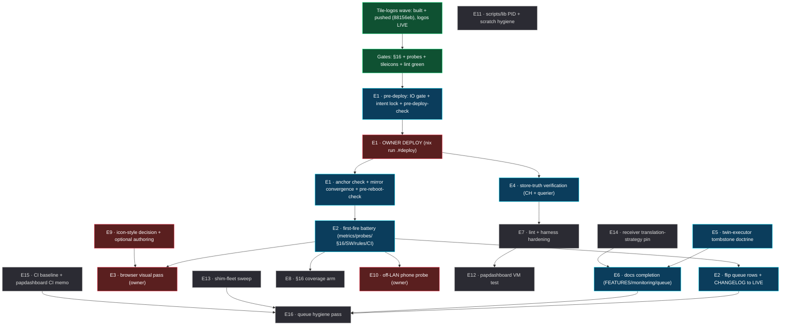

# SUPERB — Tile-Logos Wave: Deploy, Closure, and Fleet Hygiene

**Created:** 2026-10-18 02:36 CEST · **Owner trigger:** "execute the whole plan; then plan what we should REALLY do (Pareto)"
**EXECUTED (instance 1, 2026-10-18 04:47 CEST):** E4–E8, E11, E14–E16 done and verified (report: docs/status/2026-10-18_04-5x_superb-closure-execution-and-store-truth-correction.md — includes the store-truth REVERSAL of the wave's dotted-query fixes). E12/E13 IO-GATE-BLOCKED (PSI avg10 75 at decision time). E1/E2/E3/E9/E10 remain owner-gated.
**Predecessors:** [execution report](../status/2026-10-18_02-08_tile-logos-go-live-verification-full-followthrough.md) (§g instance 2, §h instance 1) · [closeout audit](../status/2026-10-18_02-32_tile-logos-wave-closeout-and-twin-executor-audit.md) · [go-live plan](2026-10-17_09-27_SUPERB-tile-logos-go-live.md)
**Scope:** everything pending from the tile-logos wave + the directly-related fleet hygiene it surfaced. The wider backlog domains (services.md 429 rows, pipeline.md 464, monitoring.md 113, upstream.md 154) are explicitly OUT of scope except where they intersect items below.

---

## 0. Situation at plan time (verified facts, not assumptions)

| Fact | Value | How verified |
| --- | --- | --- |
| Logos live on dash.home.lan | 39 `src="/icons/…"` imgs, 200+immutable through Caddy, SW pap-v9 | fragment probe + openssl probes, 23:2x |
| Deploy-anchor | gen 927 = running toplevel f703wg5; mirror converged (50 entries, counters carried); `pre-reboot-check` **16/0 SAFE TO REBOOT** | repair chain this session, 02:4x |
| Hardening wave built + pushed, awaiting deploy | SystemNix lock `88156eb`; upstream `origin/master` = `88156eb`; package builds hermetically (`yd1d0308…`, checkPhase incl.) | FOD build + battery |
| Queued on that deploy | icons collector metrics + Gatus pair, §16 inventory, post-deploy probes, tileicons legs, SW pap-v10, image-only route, iconUrls, startup WARN, bookmark chip icons | TODO_LIST.md:1518 + services.md mirror row |
| signoz-query-lint trips | FIXED on sight (dotted store form); lint green; one alert (`forgejo-mirror-backlog`) had matched zero series since 2026-10-16 — becomes able to fire with this deploy | ai-meter.json + _signoz-alerts.nix diffs |
| Known fake-green risk class | OTel receiver stores histogram suffixes DOTTED; exporter-side underscore names are real. Working precedent: caddy.json `.sum` queries | caddy.json + lint-static.nix + live :8108 probe |
| Store-truth probing | documented one-liners: `signoz_metrics.distributed_time_series_v4` (existence) + `:8080/api/v1/query` (PromQL visibility); PromQL is DELTA-BLIND for delta-temporality metrics | docs/services/signoz.md |
| Concurrent-execution hazard | TWO instances of this conversation executed the previous plan in parallel (~3 h undetected); a THIRD session ran monitor365/ai-meter and briefly broke toplevel evals mid-edit (consumer-before-declaration) | execution report §g/§h |
| Boot-mirror sync unit | in-tree fix (`ProtectSystem=false`) for the EROFS class is DEPLOY PENDING; the running unit still fails renames (worked around by direct script run) | boot-mirror.nix + journal |
| Backlog census | TODO_LIST 1224 open rows; services 429; pipeline 464; upstream 154; monitoring 113 | grep census 02:36 |
| IO environment | PSI io some avg10 40–58% all evening; heavy builds serialized; VM test ran green anyway | /proc/pressure/io |

**Therefore:** the only act that converts the queue into value is ONE deploy (owner, IO-gated). Everything an agent can pre-verify is verified. The plan leads with that handoff, then works outward through verification, doctrine, and hygiene.

---

## 1. Pareto breakdown

### 1% that delivers 51% — *"the next deploy ships the whole wave"*

| # | Action | Why it is the 51% |
| --- | --- | --- |
| P1 | **Owner runs `nix run .#deploy`** (IO-gated) | Converts ALL of it: icon metrics + Gatus pair, §16 inventory, post-deploy probes, image-only route, iconUrls, startup WARN, chip icons, SW pap-v10, dotted-query fixes (the forgejo backlog alert fires for the first time since 2026-10-16), lint-green CI, the boot-mirror EROFS unit fix. Nothing else in this plan is user-visible until it happens. |

### 4% that delivers 64% — *"the deploy is proven, not assumed"*

| # | Action | Why |
| --- | --- | --- |
| P2 | **First-fire battery** (E2): metrics on :9100, §16 PASS + icon probes PASS in the deploy log, SW pap-v10 arrival, forgejo rule provisioned dotted, CI nightly green | Converts "built" into "verified live"; the 2026-10-17 outage class died precisely because nobody re-checked after the merge. |
| P3 | **Browser visual pass** (E3): dark/light screenshots, breakpoint check, deliberately-broken-icon monogram fallback | The owner-facing half of the feature; the fallback path has never been seen by a human. |

### 20% that delivers 80% — *"the system learns from this wave"*

| # | Action | Why |
| --- | --- | --- |
| P4 | **Store-truth verification** (E4): run the documented phantom-metric probes for every metric name this wave touched | Turns the dotted-fix from precedent-based to fact-based; catches any OTHER phantom query mechanically. |
| P5 | **Twin-executor tombstone** (E5): plan-execution marker rule + check step | The ~3 h duplication cost is pure process; the cheapest fix is a written marker convention. |
| P6 | **Docs completion** (E6): FEATURES row, monitoring.md pat() worked example + exporter-vs-store naming section, queue-row wording refresh | The next person must not re-derive the exporter/store layering or hunt for the feature row. |
| P7 | **§16 coverage arm** (E8): pre-deploy icons == tiles | Mirrors the runtime `icons_ok` at the deploy gate; a logo-less config then fails TWICE before it can ship. |
| P8 | **E9 decision** (owner): semantic glyphs vs neutral cyan set (+ authoring if custom) | The last user-visible quality gap on the Services tab. |

### Remaining 20% (to 100%) — *"hygiene, tooling, and the long tail"*

Lint/harness hardening (E7) · PID-kill helper + /tmp hygiene (E11) · papdashboard VM test (E12) · shim-fleet sweep (E13) · receiver translation-strategy pin check (E14) · CI baseline-diff idea + PapDashboard CI revival decision (E15) · queue hygiene pass (E16) · off-LAN phone probe (E10) · pack staleness calendarization (inside E6) · post-deploy E2E re-run (folded into E2).

---

## 2. EPICS (30–100 min each) — sorted by priority

Scoring: **Imp** = impact on owner-visible outcome · **Val** = customer/owner value · **Eff** = minutes · **Rsk** = risk of NOT doing it. Priority = (Imp × Val) ÷ Eff, ties broken by customer visibility.

| # | Epic | Imp | Val | Eff (min) | Rsk | Prio | Depends on | Status |
| --- | --- | --- | --- | --- | --- | --- | --- | --- |
| **E1** | **Deploy handoff + live verify** (owner sudo; IO-gated) | 5 | 5 | 45 | 5 | **P0** | IO calm | pending |
| **E2** | **First-fire verification battery** (metrics, probes, §16, SW, lint provisioned, CI nightly) | 5 | 5 | 40 | 5 | **P0** | E1 | pending |
| **E3** | **Browser visual pass** (screenshots dark/light, breakpoints, broken-icon fallback) — owner browser | 4 | 4 | 30 | 4 | **P1** | E1 | pending |
| **E4** | **Store-truth verification** (phantom sweep for every touched metric name; querier + CH one-liners) | 4 | 3 | 40 | 4 | **P1** | none | pending |
| **E5** | **Twin-executor tombstone** (doctrine + marker convention; optional flock helper) | 3 | 4 | 35 | 4 | **P1** | none | pending |
| **E6** | **Docs completion** (FEATURES row, monitoring.md worked example + exporter-vs-store section, queue wording) | 3 | 3 | 40 | 3 | **P1** | none | pending |
| **E7** | **Lint + harness hardening** (dead-metric entries for the retired underscore forms; `*)` expect guard; per-case log file) | 3 | 2 | 45 | 3 | **P2** | none | pending |
| **E8** | **§16 coverage arm** (pre-deploy icons == tiles) | 3 | 3 | 30 | 3 | **P2** | none | pending |
| **E9** | **E9-decision execution** (accept glyphs — close row; OR author ≤14 neutral SVGs + overlay dir + merge + verify) | 3 | 4 | 30 (+100) | 3 | **P2** | owner answer | blocked:user |
| **E10** | **Off-LAN phone probe** (cellular load of dash.home.lan; logos ride SSO cookie) + runbook completion | 2 | 3 | 15 | 2 | **P2** | none | pending |
| **E11** | **scripts/lib hygiene** (`pid_of_port` + `kill_pid` helpers; harness scratch-dir convention) | 2 | 2 | 40 | 2 | **P3** | none | pending |
| **E12** | **papdashboard minimal VM test** (boot with a pack dir; probe /icons/ + fragment) | 3 | 2 | 90 | 2 | **P3** | none | pending |
| **E13** | **Shim-fleet sweep** (erraudit/crm/golangci: refresh upstream vendorHashes, drop shims whose condition fired) | 3 | 2 | 60 | 3 | **P3** | upstream pushes | pending |
| **E14** | **Receiver translation-strategy pin check** (is the dotted-store behavior pinned in signoz config, or can it silently change?) | 3 | 2 | 30 | 3 | **P3** | none | pending |
| **E15** | **CI baseline-diff proposal + PapDashboard CI revival decision research** | 2 | 2 | 45 | 2 | **P4** | none | pending |
| **E16** | **Queue hygiene pass** (twin-row dedupe, premise-drift sweep over instance 2's rows, retired-row closures) | 2 | 2 | 30 | 2 | **P4** | none | pending |

**Sum of epic effort: ~685 min agent work (≈11.5 h) + one owner deploy + one owner browser session.** No epic exceeds 100 min by construction.

---

## 3. STEPS (≤12 min each) — every epic decomposed

Legend: ☐ todo · ☑ done in a previous session · ⛔ blocked (owner/IO).

### E1 — Deploy handoff + live verify (P0)

| # | Step | min | Status |
| --- | --- | --- | --- |
| E1.1 | Pre-flight: `/proc/pressure/io` some avg10 < 30; deploy-intent lock written (`/tmp/systemnix-deploy-intent`); `git status --short` shows no foreign files | 5 | ☐ |
| E1.2 | `nix run .#pre-deploy-check` — expect §16 PASS ("all 40 pack-relative tile icons exist") and 0 failures | 10 | ☐ |
| E1.3 | Owner: `nix run .#deploy` (self-gates on pressure + trip recency) | 12 | ⛔ |
| E1.4 | Anchor check: `readlink /run/current-system` == newest `system-N-link`; deploy.sh self-repair fires on mismatch | 5 | ☐ |
| E1.5 | Journal: `journalctl -u papdashboard -n 30` — listener bind, NO pack WARN, no startup errors | 5 | ☐ |
| E1.6 | boot-mirror: the new unit (ProtectSystem=false) converges on its own — verify `boot-mirror-sync` OK line in journal | 4 | ☐ |
| E1.7 | `nix run .#pre-reboot-check` — expect mirror leg green, 0 failures | 4 | ☐ |

### E2 — First-fire verification battery (P0)

| # | Step | min | Status |
| --- | --- | --- | --- |
| E2.1 | Fragment probe: `service-icon-img` count == tile count on `/api/fragments/services` | 4 | ☐ |
| E2.2 | `curl -s localhost:9100/metrics \| grep papdashboard_services_json` → `_ok 1`, `_icons 40`, `_icons_ok 1` | 4 | ☐ |
| E2.3 | Icon route: `/icons/<first-fragment-icon>` 200 + `Cache-Control: …immutable`; a non-image (`README.txt`-class) → 404 | 6 | ☐ |
| E2.4 | Gatus UI/API: "PapDashboard Services JSON" check green with BOTH anchored pairs (ok + icons_ok) | 6 | ☐ |
| E2.5 | `/api/services` JSON carries `iconUrls` with 40 entries; browser SW registers `pap-v10` | 6 | ☐ |
| E2.6 | Forgejo backlog rule: provisioned query is the DOTTED form (`system_forgejo_mirror_sync_stale.count`) via `/api/v1/rules` | 5 | ☐ |
| E2.7 | Startup WARN absence: `journalctl -u papdashboard --grep "fall back to monograms"` → empty | 3 | ☐ |
| E2.8 | Full `scripts/post-deploy-check.sh` run: zero NEW-baseline regressions; the two new icon probes PASS | 6 | ☐ |
| E2.9 | CI: next `negative-tests.yml` nightly green (lint trips fixed); `nix-check` green | 6 | ☐ |
| E2.10 | Flip the queue rows: TODO_LIST:1518 + services.md mirror row → DONE with first-fire evidence | 6 | ☐ |
| E2.11 | Flip CHANGELOG "deploy pending" → LIVE; papdashboard.md "Deploy evidence" gains the wave line | 5 | ☐ |

### E3 — Browser visual pass (P1, owner browser)

| # | Step | min | Status |
| --- | --- | --- | --- |
| E3.1 | Dark-mode screenshots of `dash.home.lan/#services` (full tab, scroll) | 8 | ⛔ |
| E3.2 | Light-mode screenshots (theme toggle) | 5 | ⛔ |
| E3.3 | Narrow/tablet breakpoint: icon plate + chip layout hold | 6 | ⛔ |
| E3.4 | Devtools: override one icon URL to 404 → monogram fallback renders, no broken-image glyph; chip degrades to name | 6 | ⛔ |
| E3.5 | Devtools → Application → Service Workers: `pap-v10` active; second load serves icons from cache | 5 | ⛔ |

### E4 — Store-truth verification (P1)

| # | Step | min | Status |
| --- | --- | --- | --- |
| E4.1 | CH existence sweep: `distributed_time_series_v4` for `ai_meter_ttft_seconds%` — expect `.sum`/`.count` cumulative series | 6 | ☐ |
| E4.2 | PromQL visibility: `count(ai_meter_ttft_seconds.sum)` ≥ 1 via `:8080/api/v1/query`; same for `.count` | 5 | ☐ |
| E4.3 | Same two probes for `system_forgejo_mirror_sync_stale.count` (expect 1 series; note current value vs target 20) | 5 | ☐ |
| E4.4 | Negative control: `count(ai_meter_ttft_seconds_sum)` → 0 series in the STORE (proves the phantom was at the query layer) | 4 | ☐ |
| E4.5 | Sweep ALL dashboard+alert metric names through the existence probe; list any additional zero-series queries | 12 | ☐ |
| E4.6 | Record results in papdashboard.md/monitoring.md (one line each) + file fixes for any new phantoms found | 8 | ☐ |

### E5 — Twin-executor tombstone (P1)

| # | Step | min | Status |
| --- | --- | --- | --- |
| E5.1 | AGENTS.md Session Discipline: the rule — before executing a plan file, grep `docs/status/` + `git log --since 1 day` for an execution marker; write `**EXECUTING (instance, timestamp):** …` into the plan header FIRST | 10 | ☐ |
| E5.2 | Add the marker to THIS plan's header as the worked example | 3 | ☐ |
| E5.3 | CONTRIBUTING.md: cross-link the rule from "Concurrent-edit discipline" (the deploy-intent lock covers switches; this covers plan execution) | 8 | ☐ |
| E5.4 | Optional helper: `scripts/plan-marker.sh <plan-file> start\|done` (appends/updates the marker line; git-commit it) | 12 | ☐ |
| E5.5 | Negative case in prose: what the 2026-10-18 duplication cost (3 h overlap) — the rule's "why" paragraph | 5 | ☐ |

### E6 — Docs completion (P1)

| # | Step | min | Status |
| --- | --- | --- | --- |
| E6.1 | FEATURES.md: tile-logo capability row (pack, probes, gates, metrics) under the dashboard section | 8 | ☐ |
| E6.2 | monitoring.md pat() section: add the icons_ok anchored pair as a second worked example (link the RED non-vacuousness leg) | 8 | ☐ |
| E6.3 | monitoring.md new subsection: "Exporter names vs store names" (underscore exporter convention; dotted suffixes in the store; query-layer translation; the ai-meter case) | 10 | ☐ |
| E6.4 | papdashboard.md: link monitoring.md's new section from the icon pack bullet | 3 | ☐ |
| E6.5 | Refresh the `[blocked:deploy]` wave row wording to include the two dotted-query fixes | 4 | ☐ |
| E6.6 | Pack staleness: convert the `[watch]` row's "quarterly" into a dated review line (next review date) | 3 | ☐ |
| E6.7 | Runbook papdashboard.md: the off-LAN wording gains "verified by phone probe" placeholder → filled by E10 | 4 | ☐ |

### E7 — Lint + harness hardening (P2)

| # | Step | min | Status |
| --- | --- | --- | --- |
| E7.1 | lint-static.nix: add the two retired underscore forms to the dead-metric list (`ai_meter_ttft_seconds_sum`, `ai_meter_ttft_seconds_count`, `system_forgejo_mirror_sync_stale_count`) so regressions fail with the exact lesson | 10 | ☐ |
| E7.2 | negative-test-lints.sh: `*)` branch on unknown expect values (the silent fall-through class) | 6 | ☐ |
| E7.3 | negative-test-lints.sh: per-case line logging to `$WORK/cases.log` so failures survive output truncation | 10 | ☐ |
| E7.4 | Add a harness case for the NEW dead-metric entries (mutation re-adds an underscore query → lint fails with the dead-metric marker) | 12 | ☐ |
| E7.5 | Run `CASES=signoz,tileicons` + the new case green; neuter-check one | 8 | ☐ |

### E8 — §16 coverage arm (P2)

| # | Step | min | Status |
| --- | --- | --- | --- |
| E8.1 | pre-deploy-check.sh §16: count tiles (groups+extraTiles) alongside icons; `icons != tiles` → FAIL with both numbers | 8 | ☐ |
| E8.2 | Negative test: a config with one icon-less tile → §16 FAIL (extendModules hand-probe) | 8 | ☐ |
| E8.3 | Positive re-run: 40/40 → PASS line unchanged in shape | 4 | ☐ |
| E8.4 | Update the AGENTS.md §16 cell + papdashboard.md runbook sentence (coverage, not just existence) | 6 | ☐ |

### E9 — E9-decision execution (P2, blocked:user)

| # | Step | min | Status |
| --- | --- | --- | --- |
| E9.1 | Owner answers: accept semantic glyphs, or neutral set | 5 | ⛔ |
| E9.2 | IF accept: close the `[decision]` row + monitoring note; DONE | 5 | ⛔ |
| E9.3 | IF custom: define the visual language (24px grid, stroke width, cyan `#00e5ff`) | 10 | ☐ |
| E9.4 | Author ≤14 SVGs (llama.cpp chat/rag, crush-daily, tq, nsfw, index, health, catalog, systemd-graph, timers, crm, attic, filebot-slot, taskwarrior-slot) | 12×n | ☐ |
| E9.5 | Local overlay dir + `dashboardIcons` merge (pack subset gains the overlay; names verified) | 12 | ☐ |
| E9.6 | Re-render, rebuild subset, visual pass, deploy rides the next wave | 10 | ☐ |

### E10 — Off-LAN phone probe (P2, owner)

| # | Step | min | Status |
| --- | --- | --- | --- |
| E10.1 | Cellular (Wi-Fi off): load dash.home.lan → SSO login → Services tab: logos render (cookie rides ``s) | 8 | ⛔ |
| E10.2 | Log out (or incognito): the page itself redirects to SSO — confirm no logo-less state is ever visible | 4 | ⛔ |
| E10.3 | Fill the runbook's off-LAN verification placeholder with the probe result | 3 | ☐ |

### E11 — scripts/lib hygiene (P3)

| # | Step | min | Status |
| --- | --- | --- | --- |
| E11.1 | `scripts/lib/process.sh`: `pid_of_port <port>` (ss-based) + `kill_pid <pid>` (TERM→wait→KILL) with shellcheck-clean bodies | 10 | ☐ |
| E11.2 | Refactor the two harnesses that ad-hoc kill by PID to source it | 8 | ☐ |
| E11.3 | Harness scratch convention: `mktemp -d` under `${XDG_RUNTIME_DIR:-/tmp}` with trap-cleanup; migrate the three offenders | 12 | ☐ |
| E11.4 | Flake check (`scripts-verify` / selftests) green after the refactor | 6 | ☐ |

### E12 — papdashboard minimal VM test (P3)

| # | Step | min | Status |
| --- | --- | --- | --- |
| E12.1 | Skeleton: tests/test-papdashboard.nix (module co-import pattern per integration docs; enable + rendered config + icons dir from the pack subset) | 12 | ☐ |
| E12.2 | Assert unit active, `/api/health` 200, fragment carries `src="/icons/…`, `/icons/<file>` 200+immutable | 12 | ☐ |
| E12.3 | Negative leg: without PAP_ICONS_DIR → no ``, route 404 | 10 | ☐ |
| E12.4 | Wire into flake checks; run green; record runtime | 12 | ☐ |

### E13 — Shim-fleet sweep (P3)

| # | Step | min | Status |
| --- | --- | --- | --- |
| E13.1 | Census: which consumer shims remain (erraudit/crm/golangci + any new) — grep lars-packages.nix + crm.nix | 8 | ☐ |
| E13.2 | Per repo: upstream master hash probe (buildflow -s nix-hash-fix or FOD build) → paste upstream-side → push | 12×3 | ☐ |
| E13.3 | `nix flake lock --update-input <name> --refresh` per repo; FOD + package green; drop each shim whose condition fired | 12 | ☐ |
| E13.4 | Toplevel eval + flake check green; close the row with per-repo evidence | 6 | ☐ |

### E14 — Receiver translation-strategy pin check (P3)

| # | Step | min | Status |
| --- | --- | --- | --- |
| E14.1 | Find the OTel receiver config in signoz provisioning: is `translation_strategy` (or equivalent) explicit? | 10 | ☐ |
| E14.2 | If implicit: pin it (or document the upgrade-risk + add the existence probe to a CI check) | 12 | ☐ |
| E14.3 | Record the finding in monitoring.md's exporter-vs-store section | 4 | ☐ |

### E15 — CI baseline-diff + PapDashboard CI revival (P4)

| # | Step | min | Status |
| --- | --- | --- | --- |
| E15.1 | Proposal doc: weekly job diffing signoz-query-lint/gatus-pattern-lint findings vs a stored baseline (catch new trips in ≤7 d) | 12 | ☐ |
| E15.2 | PapDashboard CI: gather the repair-vs-retire facts (runner minutes, nix gate correctness, probe-before-lock doctrine) from the queued row | 12 | ☐ |
| E15.3 | Write the decision memo into the upstream repo's TODO (owner decides) | 8 | ☐ |
| E15.4 | Queue any approved follow-up rows | 6 | ☐ |

### E16 — Queue hygiene pass (P4)

| # | Step | min | Status |
| --- | --- | --- | --- |
| E16.1 | Dedupe pass: grep the wave's key phrases across TODO_LIST + domain files; merge/kill duplicates | 8 | ☐ |
| E16.2 | Premise-drift sweep over instance 2's rows (the lint row class): verify each against current state | 10 | ☐ |
| E16.3 | Close retired rows citing this wave (overlay-removal leftovers, stale SW pap-v9 wording) | 6 | ☐ |
| E16.4 | `check-todo-system.sh` + `bash .githooks/pre-commit` green | 6 | ☐ |

---

## 4. Execution graph

---

## 5. Definition of done (per epic, non-negotiable)

| Epic | Done means |
| --- | --- |
| E1 | Deploy log green end-to-end; anchor intact; mirror converged by the FIXED unit; pre-reboot-check 0 failures |
| E2 | Every first-fire check has a recorded value (not "should"); queue rows + CHANGELOG flipped with evidence |
| E3 | Screenshots exist (dark/light/breakpoint); the fallback behavior is human-verified; SW pap-v10 active |
| E4 | Every touched metric name has an existence + visibility verdict from the store; zero unexplained phantoms |
| E5 | The rule exists where an agent starts (AGENTS.md Session Discipline) and THIS plan carries the marker |
| E6 | FEATURES/monitoring/papdashboard docs carry the new content; zero drift between queue rows and reality |
| E7 | Lint fails on a re-introduced underscore query with the dead-metric marker; harness cannot silently skip |
| E8 | §16 fails on icons < tiles (hand-proven) and passes 40/40 |
| E9 | Owner answered; either the row is closed or the custom set is rendered and verified |
| E10 | Off-LAN behavior recorded from a real phone (both authenticated and incognito) |
| E11 | Helpers exist, are sourced by the harnesses, and checks stay green |
| E12 | VM test in flake checks, green, runtime recorded |
| E13 | Each shim either dropped with green evidence or explicitly traced "not yet" |
| E14 | The dotted-store behavior is pinned or its upgrade risk is documented with a tripwire |
| E15 | Baseline-diff proposal written; PapDashboard CI memo awaiting owner decision |
| E16 | Zero duplicate/drifted rows for this wave; `check-todo-system.sh` green |

---

## 6. Guardrails for the executor (VERSCHLIMMBESSER-protection — do not violate)

1. **Tombstone FIRST.** Before starting, write the EXECUTING marker into this plan header (E5's own rule) and re-check `git log --since 1 day` — two instances already duplicated a plan once.
2. **Never push a lock bump / hash you have not built.** The shim/hash cycle exists because guessing breaks other people's deploys.
3. **Respect the IO gate.** No deploys or heavy builds while `io some avg10 > 30`; serialize the heavy checks; VM tests wait for calm.
4. **Never `pkill -f` a production-matching pattern** — kill by explicit PID from `ss -ltnp`/`pgrep -af` (or the E11 helper once it exists).
5. **Land declarations before consumers** on the shared tree; re-read before every edit; the auto-commit daemon sweeps continuously.
6. **Do not "fix" a foreign session's in-flight work silently.** monitor365/boot-mirror/status-archive files were actively edited at plan time — coordinate or leave.
7. **A cosmetic asset never justifies a risky operation.** Logos were worth a lock bump and probes — not a forced deploy during a storm; the same holds for the neutral icon set.
8. **Fix lint FPs in the SCANNER, real trips at the QUERY/producer** — always with store-truth evidence first (E4's probes), never by suppressing the lint at the call site.
9. **A verification close-out answers the question ASKED** — "built" is not "deployed", "deployed" is not "verified live"; name which depth each claim has.
