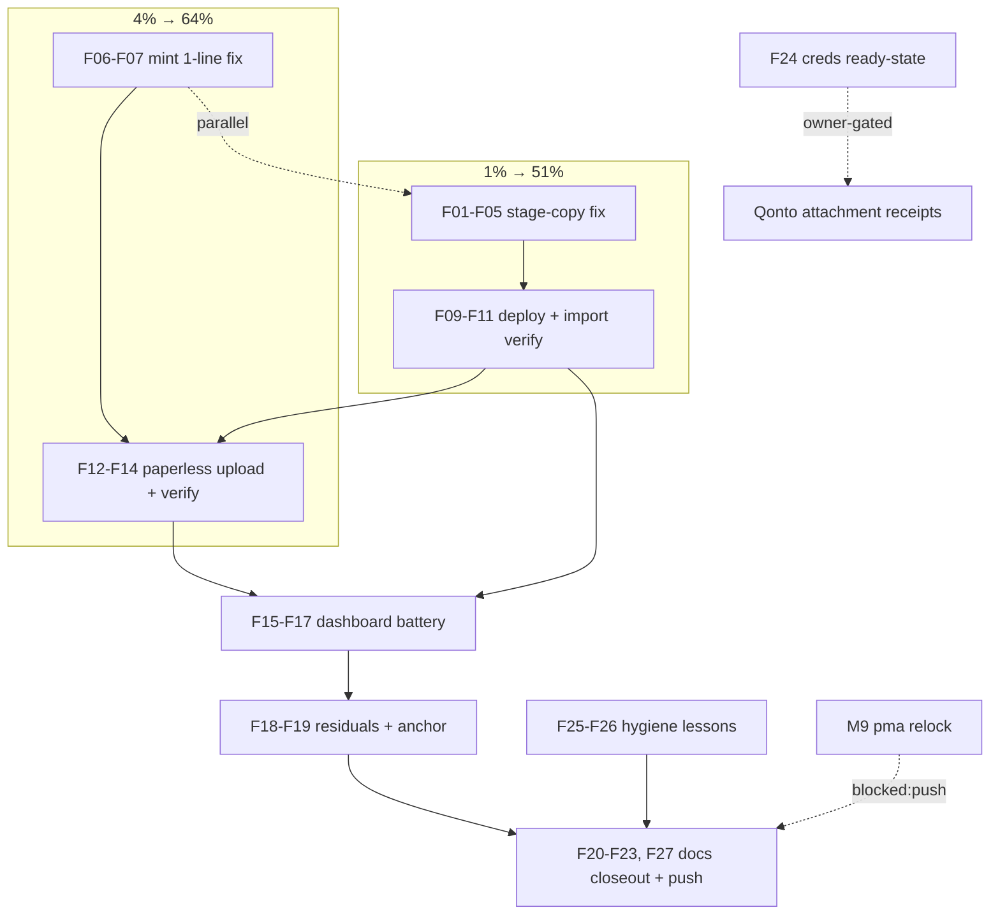

# SUPERB — Qonto Serving Completion: import fix, paperless archival, verification closeout (2026-10-19 03:18)

**Goal:** finish the owner directive — "the live deployment serves the old Qonto statements, and Paperless-ngx has all files with correct metadata."

**Premise verification (docs-health step 0):** all inputs are first-hand from this session (status report `2026-10-19_qonto-statements-import-and-paperless-archival.md`, 30 min old). TODO_LIST rows for the arc exist ([blocked:user] qonto creds, [blocked:push] pma relock). Nothing in the plan re-dispatches shipped work. Foreign items (Monitor365 smoke, drive-ingest-fixture) are pointers, not owned tasks.

## Current state (facts)

- Deploy system-929+ activated; daemon healthy (`ready 200`); anchor self-repaired (verify task below).
- `bank-sync-qonto-import.service` FAILED: CSV under `/home/lars` is DAC-unreachable for user bank-sync (ProtectHome=false lifts only the sandbox layer). No data written.
- `bank-sync-paperless-token.service` FAILED: `/run/bank-sync-paperless/env` exists **bank-sync:bank-sync 0400** (from the Oct 18 03:17 first successful mint + root ExecStartPost handover) — the next mint runs as paperless and cannot open(O_TRUNC) a foreign-owned 0400 file. First-run-works/every-later-run-fails design bug; tonight was run #2. **Fix is 1 line:** the mint script unlinks the stale file first (unlink needs only directory-write, and paperless owns the 0711 dir).
- `bank-sync-qonto-paperless.service` never ran (Requires= the failed mint). Marker absent, archive untouched.
- Weekly archival timer fires Sun 03:00 + 30m jitter — it may fire and fail on the same mint bug while we work; the redeploy + Persistent timer converge it afterward.

## Pareto breakdown

### The 1% that delivers 51%
**Fix the import's file access (stage-copy) and land 132 rows in the live DB.** The dashboard serving the statements IS the primary user-visible result. Everything else is reinforcement.

### The 4% that delivers 64% (cumulative)
**Plus the 1-line mint fix → qonto-paperless runs → 2 documents in Paperless-ngx with correct metadata.** Completes "all files incl. correct metadata" for everything we possess.

### The 20% that delivers 80% (cumulative)
**Plus the full verification battery + coexistence checks + docs closeout:** dashboard row-level verification, weekly-archival coexistence, anchor/post-deploy residuals, runbook/TODO/status finalization. Durable correctness, no silent regressions, knowledge captured.

### The other 20% (→ 100%)
Owner-gated and supersession tails: Qonto Business API credentials for ATTACHMENT receipts (owner mints; wiring recipe ready), pma forward relock (parallel session's upstream fix), vendorHash shim drops (watch protocol), agent-docs lessons, foreign arcs (Monitor365 smoke, drive-ingest gate, chronic-storm root cause).

## Comprehensive plan (medium granularity, 30–100 min each)

| # | Task | Why (customer value) | Impact | Effort | Depends |
|---|------|----------------------|--------|--------|---------|
| M1 | Stage-copy fix: root `bank-sync-qonto-stage` oneshot copies both CSVs → `<dataDir>/qonto-import/` (0640 bank-sync), import ExecStarts re-pointed to staged paths, ConditionPathExists chain preserved | Unblocks the entire serving half | 🔴 | 45min | — |
| M2 | Mint fix: unlink-before-write in the token-mint script (root-caused: stale bank-sync-owned env blocks O_TRUNC as paperless; unlink succeeds via dir ownership) + regression comment | Unblocks the entire archival half | 🔴 | 30min | — |
| M3 | Redeploy + import verification: activation clean, journal `imported=104 errors=1(junk row)` + `imported=28`, daemon health, exit-code audit | Lands the 51% | 🔴 | 45min | M1 |
| M4 | Paperless archival run + verification: qonto-paperless executes, 2 docs queryable, metadata assertions (Qonto correspondent, Bank Statement type, tags bank-sync+qonto, created 2023-03-20/2023-05-18), marker written; weekly-timer coexistence confirmed | Lands the 64% | 🔴 | 45min | M2, M3 |
| M5 | Dashboard serving battery: qonto profiles/balances render, 132 rows served + amounts sane, first-paint selection, provider filter, sync-state counters (known cosmetic: counter vs read model after non-daemon imports) | Proves "serves them well" | 🟠 | 30min | M3 |
| M6 | Post-deploy residuals: profile anchor vs /run/current-system, failed-unit cleanup, Monitor365 NEW-smoke triage pointer (foreign arc), rev-drift tripwire green | No silent damage | 🟠 | 30min | M3 |
| M7 | Docs closeout: runbook §Qonto marked executed with numbers, TODO strikes/harvest, status report finalized (d/f sections updated with verdicts) | Knowledge captured | 🟡 | 45min | M4, M5 |
| M8 | Qonto creds ready-state: commented sops skeleton + exact env/unit diff prepared so owner-minted creds go live in one small change | Removes all friction from the owner step | 🟡 | 30min | — |
| M9 | pma forward relock when upstream lands (supersedes 849573de rollback; probe-build) | Un-stick the parked input | ⚪ | 30min | blocked:push |
| M10 | Shim-drop watch entries for the 12 re-pinned vendorHashes (drop-conditions row in the ledger comment already present; add the dated watch row) | Ledger hygiene | ⚪ | 15min | — |
| M11 | Agent-docs lessons: jq-shim/absolute-path rule, pre-deploy unit-rehearsal ritual, dependency-verification rule → docs/agents/systemd.md + shell-devtools.md | Future sessions don't repeat d.1 | ⚡ | 30min | — |
| M12 | Push + report: commit the plan and each green step; push (owner-authorized this session); final table report back | The report IS a deliverable | ⚡ | 15min | M7 |

## Fine breakdown (max 12 min each)

| # | Micro-task | Parent | Est |
|---|------------|--------|-----|
| F01 | Read bank-sync.nix current unit block fresh; design exact stage-unit text | M1 | 6min |
| F02 | Write `bank-sync-qonto-stage` root oneshot (cp both CSVs, install -m 0640 -o bank-sync, RequiresMountsFor dataDir, ConditionPathExists sources, harden CAP_DAC_OVERRIDE + ProtectHome=false, serviceOneshotDefaults, no ioTier violation) | M1 | 12min |
| F03 | Re-point import unit: ExecStarts → staged paths; after/wants stage unit; ConditionPathExists → staged files; keep after bank-sync.service | M1 | 8min |
| F04 | Update module header comment (stage rationale: DAC-private /home/lars) | M1 | 4min |
| F05 | `nix run .#validate` (toplevel eval) green | M1 | 6min |
| F06 | Mint script fix: add `[ -e "$MINT_OUT" ] && rm -f "$MINT_OUT"` before printf + root-cause comment (unlink via dir-ownership semantics) | M2 | 6min |
| F07 | Re-verify mint eval + rendered script text (nix eval the unit's script) | M2 | 6min |
| F08 | Commit fixes (M1+M2) with detailed message (or confirm daemon sweep, message via plan) | M3 | 6min |
| F09 | Deploy: gate-check PSI; if blocked, force per the documented escape (case-by-case, additive reversible, prebuilt) | M3 | 12min |
| F10 | Verify activation: exit status, new units started clean, bank-sync.service restarted healthy, ready 200 | M3 | 8min |
| F11 | Journal audit import unit: imported=104 errors=1, imported=28, exit 0 | M3 | 6min |
| F12 | Journal audit mint + qonto-paperless: mint OK, 2 uploads, count=2, marker written | M4 | 8min |
| F13 | Cross-check archive state: doc count by correspondent via unit log; failure → diagnose (dedup/AI enrichment interactions) and fix | M4 | 12min |
| F14 | Confirm weekly archival timer state + next fire healthy (coexistence; Persistent catch-up if it failed during the window) | M4 | 8min |
| F15 | Dashboard probes: balances fragment (qonto profile), transactions totals (132), amounts/categories render | M5 | 10min |
| F16 | First-paint selection + provider filter behavior check | M5 | 6min |
| F17 | Sync-state counter note (expected cosmetic) + any NEW anomaly triage | M5 | 8min |
| F18 | Anchor check: readlink profile vs current-system; reset-failed any dead units; rev-drift OK | M6 | 6min |
| F19 | Monitor365 NEW-smoke: capture state for the foreign arc (no fix here) | M6 | 6min |
| F20 | Runbook §Qonto: mark executed, add live numbers + mint-bug postmortem line | M7 | 10min |
| F21 | TODO strikes: my two harvested rows updated (creds stays open, pma stays open) | M7 | 6min |
| F22 | Status report finalization: verdict + a/b sections + f-table statuses updated | M7 | 10min |
| F23 | Commit docs; push everything (authorized) | M12 | 8min |
| F24 | M8 skeleton: commented sops-template keys + archival-unit diff in the runbook's qonto section | M8 | 12min |
| F25 | M10 ledger watch row for the 12 shims | M10 | 6min |
| F26 | M11 lessons into docs/agents/systemd.md + shell-devtools.md | M11 | 12min |
| F27 | Post-everything self-review vs verschlimmbessern guard: no behavior changed beyond the arc; daemon/other services untouched semantically | M7 | 8min |

## Execution graph (mermaid)

## Guardrails (no verschlimmbessern)

- No changes outside `modules/nixos/services/bank-sync.nix` semantics for M1/M2 beyond the two surgical edits; every other unit byte-identical.
- The mint fix must preserve the token-in-tmpfs-only design and the root handover.
- The stage copy is convergent (`install`), never deletes anything, and the source CSVs stay untouched.
- Re-verify daemon health + ready 200 after every activation; rollback path = previous generation (standard).
- Foreign arcs (Monitor365, drive-ingest, chronic storm) are recorded, not touched.

## Owner-gated / external

1. Qonto Business API credentials (org/secret/IBAN) → attachment receipts archival (M8 prepares the one-change wiring).
2. pma upstream push (parallel session) → M9 forward relock.
3. DEPLOY_FORCE_PRESSURE policy stays case-by-case with on-record justification until the storm rows land.
