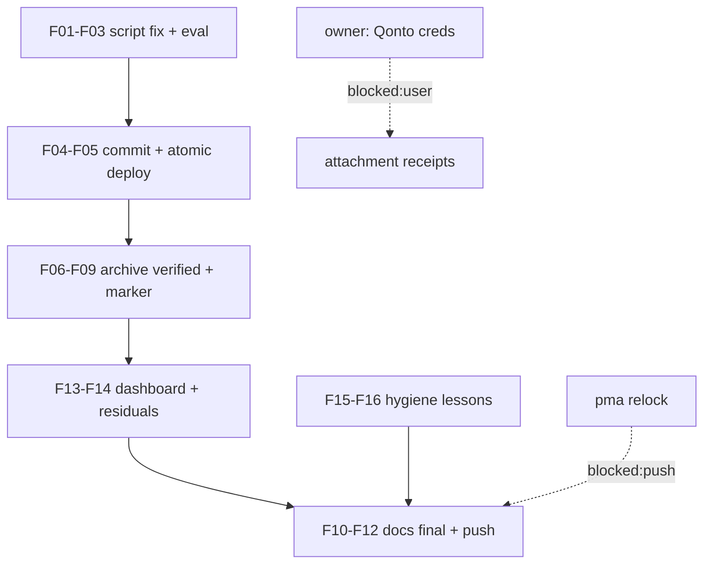

# SUPERB — Qonto Paperless Closeout: stderr fix → verified archive → docs final (2026-10-19 04:20)

**Context:** the 04:03 deploy landed the serving half LIVE (132 Qonto rows verified on the dashboard) and healed the token mint. The single remaining failure is `bank-sync-qonto-paperless` HTTP 400 on upload, root-caused: `ensure_named`'s create-diagnostic echoes to stdout, the `$(...)` capture pollutes the correspondent/tag IDs on first-run creation (journal evidence: the multiline `correspondent=…created correspondents 'Qonto' (id 1000009)` leak + bare `1000009` line), paperless rejects the malformed form value. Marker NOT written → re-run safe, no partial archive.

**Premise check:** unit state read from the live journal (04:03–04:04); dashboard probe verified rows; nothing else moved in this arc's files since commit 395f99c09 + the selftest fix.

## Pareto breakdown

- **1% → 51% of remaining value:** the two-token script fix (`>&2` + numeric id guard + `--fail-with-body`) + redeploy → the two statement CSVs land in Paperless-ngx with canonical metadata. This completes the owner's original directive end-to-end.
- **4% → 64%:** metadata + marker verification (2 docs queryable, correspondent/type/tags/created asserted from the journal), weekly-archival coexistence confirmed.
- **20% → 80%:** full closeout — runbook executed-state with live numbers, TODO strikes, status report finalized, dashboard detail battery (amounts/counters/provider UX), anchor + residual checks, push.
- **Other 20%:** owner-gated attachment receipts (creds), pma forward relock (blocked:push), shim-drop watch, agent-docs lessons (stderr-in-helpers, fail-with-body, atomic gate→build→deploy on multi-session trees).

## Comprehensive plan (30–100 min each — ALL remaining TODOs)

| # | Task | Customer value | Impact | Effort |
|---|------|----------------|--------|--------|
| M1 | Fix `ensure_named` (stderr diagnostics + numeric guard) + `--fail-with-body` in `api()`; eval rendered script | Unblocks the archive | 🔴 | 30min |
| M2 | Redeploy (atomic gate→build→switch) + activation verify | Lands the fix | 🔴 | 45min |
| M3 | Verify archival: uploads OK, poll count=2, metadata assertions, marker written, re-run no-op | "paperless has all files + correct metadata" | 🔴 | 30min |
| M4 | Closeout docs: runbook §Qonto executed-state, TODO strikes, status final, commit + push | Knowledge, reviewability | 🟡 | 45min |
| M5 | Dashboard detail battery + residuals (anchor, failed-unit cleanup, counter cosmetic note) | Confidence in serving | 🟠 | 30min |
| M6 | Watch/hygiene rows: shim-drop watch, agent-docs lessons | Future-session leverage | ⚪ | 30min |
| M7 | Owner-gated tails: Qonto creds recipe (ready-state), pma relock (external) | Attachment receipts + input health | 🟠 | owner/push |

## Fine breakdown (max 12 min each)

| # | Micro-task | Parent | Est |
|---|------------|--------|-----|
| F01 | Edit ensure_named: `>&2` on create-echo + numeric case-guard exiting 1 | M1 | 6min |
| F02 | api(): add `--fail-with-body` | M1 | 2min |
| F03 | Eval rendered script + flake check --no-build in same breath | M1 | 8min |
| F04 | Commit with detailed message | M1 | 4min |
| F05 | Toplevel build (mostly cached) + deploy force-if-gated | M2 | 12min |
| F06 | Activation verify: only expected unit restarts; anchor; no new failed units | M2 | 8min |
| F07 | Journal: uploads OK + poll count=2 + marker line | M3 | 6min |
| F08 | Metadata assertions from unit log (created ids, title lines) | M3 | 6min |
| F09 | Re-run no-op check (marker skip line) via unit restart result | M3 | 6min |
| F10 | Runbook §Qonto: executed-state + numbers + mint postmortem pointer | M4 | 10min |
| F11 | TODO strikes/updates for the arc rows | M4 | 6min |
| F12 | Status report final verdict + commit + push (authorized) | M4 | 10min |
| F13 | Dashboard detail: amounts render, counter cosmetic confirmed, provider filter | M5 | 10min |
| F14 | Residuals: reset-failed dead units, rev-drift OK, anchor final | M5 | 6min |
| F15 | Watch row: 12 shim drops | M6 | 6min |
| F16 | Agent-docs lessons (stderr helpers, fail-with-body, atomic deploy) | M6 | 12min |

## Execution graph (mermaid)

## Guardrails (no verschlimmbessern)

- Only the paperless unit's script changes; every other unit byte-identical to the deployed 04:03 generation.
- The fix adds no behavior beyond diagnostics routing + input validation; upload logic, metadata, marker semantics unchanged.
- Verify from the journal (the unit's own output), never by hand-curling with the token.
- If the 400 persists with a self-describing body, STOP and report — no speculative API guessing.
