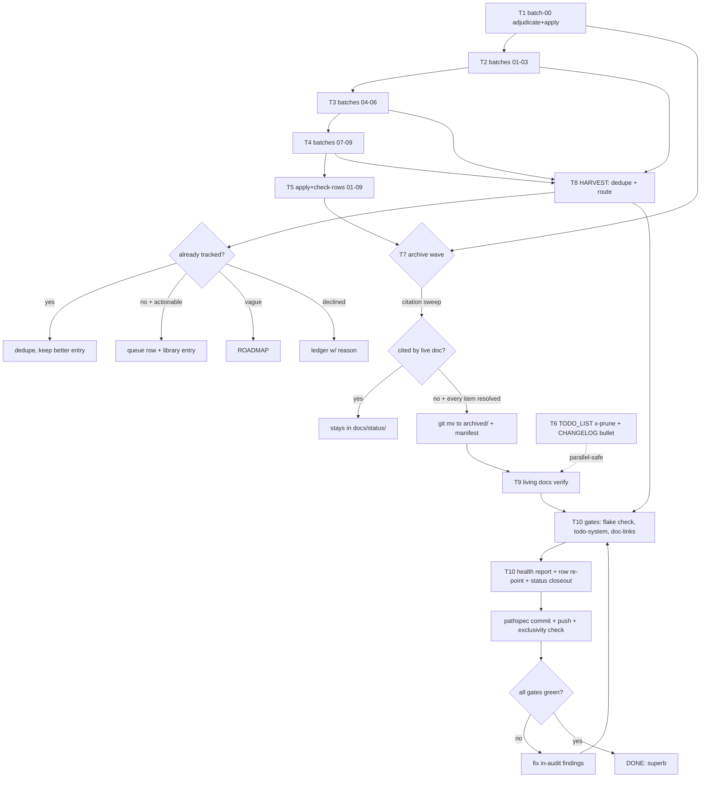

# SUPERB — Docs-Health Batch 6-20 Completion Plan

**Created:** 2026-10-19 05:06 CEST · **Status:** PLANNED (executing)
**EXECUTING (instance docs-health redispatch-1024, 2026-10-24 07:29 CEST, HEAD `e9627a7bd`):** executing (see AGENTS.md plan-execution tombstone)
**Trigger:** user dispatch — "View ALL `**/2026-0*` files! Execute the docs-health SKILL! SUPERBLY" + this planning directive (Pareto → task tables → ≤12min breakdown → mermaid graph → commit+push)
**Mission:** finish the tracked docs-health 2026-0* corpus sweep (batches 6-20 of 21) AND make the six living docs (TODO_LIST, CHANGELOG, AGENTS, README, ROADMAP, FEATURES) superb, with every gate green. This plan covers ALL remaining TODOs of THIS dispatch — nothing else (the repo's wider backlog stays in TODO_LIST/docs/todo).

## Context (what a fresh executor must know)

- **Owning row:** TODO_LIST:704 → docs/todo/pipeline.md:581 ("Finish the docs-health 2026-0* corpus sweep (batches 6-20 of 21)").
- **Corpus:** 294 reports in `docs/status/` matching 2026-09-17_00-25 → 2026-09-30 (`~/.cache/docshealth/batch6-20-files.txt`). The 2026-10 wave is OUT OF SCOPE (stays queued).
- **Predecessors:** batches 0-5 done 2026-10-17/18 (116 reports annotated, 61 archived — manifest: `docs/status/2026-10-18_01-33_docs-health-corpus-sweep-status-and-archive-manifest.md`). Groundwork status for THIS session: `docs/status/2026-10-19_05-00_docs-health-batch6-20-groundwork-status.md`.
- **Toolchain:** `annotate.go repair [--dry-run] <spec.tsv>` (spec: `path<TAB>line<TAB>kind<TAB>value`; kinds v/w/n/r; only numbered items + table data rows mutate; already-annotated lines skipped; headings/metadata no-op). `check-rows` gates uniformity. Self-test green 2026-10-19.
- **Verdict convention (reverse-engineered from batches 0-5 landed output — DO NOT "fix" it backwards):**
  - §a FULLY-DONE ledgers stay BARE (the section is the resolution).
  - Open-but-tracked rows stay BARE (tracking lives in TODO_LIST/libraries; no routed arrows in this corpus).
  - Strikes: `~~item~~ done — <evidence>` / `**Won't implement — <reason>.**` / `**NOT-DO — dup of X.**`; tables strike per-cell, verdict in first cell; `~~~~` is the canonical empty struck cell.
  - Stale time-boxed one-shots → `Won't implement — one-shot; window passed` (aggressive form, corpus-consistent; owner default pending §g3).
- **Hard guards:** dry-run before every apply; wrong-done is the WORST failure (ambiguity → leave bare); `check-rows` BEFORE any `git mv`; citation sweep before every archive move; workspaces under `~/.cache/docshealth/` (never /tmp); agents dispatched ONE AT A TIME (rate limits); pathspec commits only (parallel session active on modules/*.nix); banner+manifest+CHANGELOG are the durable surfaces (a sweep without them is invisible history).

## Pareto decomposition

| Layer | Share of work | Share of result | What it is |
| --- | --- | --- | --- |
| **1% → 51%** | the verdict convention + spec pipeline + 3 durable surfaces (CHANGELOG entry, archive manifest, continuation-row close) | correctness and auditability of EVERYTHING | one rule-set decides whether ~4k verdicts are signal or garbage; the 3 surfaces make the sweep history-readable |
| **4% → 64%** | the repeatable loop: classify (sequential agent) → normalize → dry-run → apply → check-rows | corpus coverage scales mechanically | batch-00 template already built; batches 01-09 are 9× the same loop |
| **20% → 80%** | annotate+archive over 294 files + TODO_LIST `[x]` prune (208 rows) | the two corpus-scale fitness wins the user sees | "archive fully-done files" + "TODO_LIST superb" |
| **other 20% → 100%** | harvest routing, README/FEATURES computed counts, ROADMAP/AGENTS pass, dangling-ref fixes, gates, reports, commit+push | long-tail superbness + durability | without it: 80% done forever, gates amber, drift returns next week |

## Level 1 — task plan (30–100 min each, ALL mission TODOs, sorted by importance/impact/effort/customer-value)

| # | Task | Window | Impact | Effort | Customer value | Depends on |
| --- | --- | --- | --- | --- | --- | --- |
| T1 | Batch-00 adjudication → dry-run → apply → check-rows (31 files, 527 specs) | 40m | CRITICAL (first mutation; proves pipeline) | M | corpus truth begins | — |
| T2 | Batches 01-03 classification + normalize (3 sequential agents, ~79 files) | 45m | HIGH | M | coverage | T1 (template proven) |
| T3 | Batches 04-06 classification + normalize (~88 files) | 45m | HIGH | M | coverage | T2 |
| T4 | Batches 07-09 classification + normalize (~76 files) | 45m | HIGH | M | coverage | T3 |
| T5 | Apply + check-rows batches 01-09 (staged per batch) | 40m | HIGH | M | corpus truth | T2-T4 |
| T6 | TODO_LIST prune: 208 `[x]` rows → CHANGELOG consolidated bullet (content verbatim; contract default) | 30m | HIGH (queue contract restored) | S | TODO_LIST superb | — (parallel-safe) |
| T7 | Archive wave: candidates → citation sweep → banner → `git mv` → manifest → dangling-ref fix → check-doc-links | 60m | HIGH (user ask #4) | M | archive fully-done files | T1, T5 |
| T8 | HARVEST: merge open-ask inventories → dedupe vs queue/libraries → route (queue+library / ROADMAP / decline) → ledger | 60m | MED-HIGH (future sessions eat here) | M | nothing rots in snapshots | T2-T4 |
| T9 | Living docs verify: README/FEATURES computed counts; ROADMAP Theme-1; AGENTS spot pass; CHANGELOG sweep entry | 45m | MED-HIGH (drift debt from 2026-10-06 §f.5) | M | superb living docs | T7 (final counts) |
| T10 | Gates + close: flake check --no-build, check-todo-system, check-doc-links, annotate self-test, inline health report, continuation row re-point/close, status report closeout, pathspec commit + push | 40m | CRITICAL (durability leg of the 1%) | S | green + shipped | all |

## Level 2 — micro-tasks (≤12 min each, ALL mission TODOs, same sort)

**T1 (batch-00):** T1.1 review v-full verdicts vs asks, part 1 (12m) · T1.2 part 2 (12m) · T1.3 review w/n verdicts (8m) · T1.4 demote wrong-evidence rows to bare/r in spec (10m) · T1.5 split 08-38's wholesale 83-257 into item-precise specs (12m) · T1.6 confirm 03-56 lines 38-50 suspect against TODO rows (12m) · T1.7 dry-run repair + review hit counts (5m) · T1.8 apply + `git diff` spot-check (6m) · T1.9 check-rows over touched files + repair-partial (12m) · T1.10 append batch-00 ledger note (6m)

**T2-T4 (per batch NN ∈ 01..09, repeated):** TN.1 dispatch ONE classifier agent (amended prompt: snippet citations, not TODO line numbers) (12m) · TN.2 save TSV + normalize + path-validate (4m) · TN.3 verify-print + wrong-evidence eyeball (6m)

**T5:** T5.1-T5.9 per batch: dry-run (4m) → apply (4m) → check-rows/repair-partial (8m) — three 12m windows per two batches where waits allow

**T6:** T6.1 extract 208 rows w/ titles + line numbers (6m) · T6.2 write CHANGELOG consolidated bullet, titles verbatim (12m) · T6.3 remove rows from TODO_LIST (12m) · T6.4 re-run check-todo-system (4m)

**T7:** T7.1 assemble archive-candidate list from classifications (6m) · T7.2 citation grep per candidate across TODO_LIST/docs/todo/living docs (12m ×2) · T7.3 banner any file lacking one (8m) · T7.4 `git mv` batch + completeness grep (`grep -L '~~'` over moved files) (6m) · T7.5 manifest + counts to `docs/status/archived/README.md` (12m) · T7.6 dangling-reference grep + repoint (12m) · T7.7 `check-doc-links.sh` (4m)

**T8:** T8.1 merge batch open-ask lists (6m) · T8.2-T8.5 dedupe greps vs TODO_LIST + libraries, batched by domain (12m ×4) · T8.6 append queue rows + paired library entries (12m ×2) · T8.7 write harvest ledger (disposition per item incl. declined w/ reason) (8m)

**T9:** T9.1 compute counts from repo (Gatus checks, service modules, alert rules, ports; grep+wc) (12m) · T9.2 README service table + claims update (12m) · T9.3 FEATURES statuses + stamp (12m) · T9.4 ROADMAP Theme-1 stale framing annotate (10m) · T9.5 AGENTS spot pass (size/paths/gotchas current) (8m) · T9.6 CHANGELOG sweep entry (count-before-claim) (10m)

**T10:** T10.1 `nix flake check --no-build` (12m) · T10.2 check-todo-system + check-doc-links (4m) · T10.3 inline docs-health report (Accuracy/Fitness, as-found math) (12m) · T10.4 continuation row re-point/close on BOTH surfaces (6m) · T10.5 status report closeout §-append (12m) · T10.6 pathspec commit(s) with detailed message + push + exclusivity check (8m)

## Execution graph

## Defaults for unanswered owner questions (from groundwork §g; change on answer)

1. **Scope:** stop at the 2026-10 boundary (tracked row scope); the wave stays queued.
2. **Prune:** prune ALL 208 `[x]` rows (header contract: "a `[x]` row must never persist"), titles verbatim in CHANGELOG — zero data loss, 2026-10-06 precedent.
3. **Stale one-shots:** aggressive `Won't implement — one-shot; window passed` (corpus consistency with batches 0-5).

## Verschlimmbesserung guards (explicit)

- No reformatting of any file (no `nix fmt` outside need; alejandra churn is the known trap).
- No edits to files another session owns (modules/*.nix currently dirty — untouchable).
- No renumbering/rewriting of historical report content — annotations only, per the skill.
- No "improvements" to the convention mid-sweep (bare §a / bare routed stay).
- Every mutation reversible-in-principle: specs are data; applies are diffable; moves are `git mv`.
