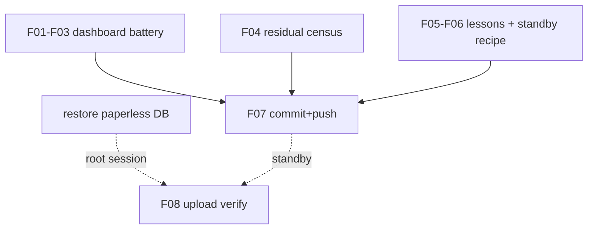

# SUPERB — Qonto Arc Final: complete my-owned verification + closeout; standby on the Wave-6 restore (2026-10-19 05:06)

**Context:** serving half DONE (132 rows live, verified). Upload half code-complete + deployed, blocked by the foreign Wave-6 empty-paperless-DB incident (root-only restore from `/mnt/pool/backups/paperless/paperless-db-2026-10-19.dump`; no recovery in flight as of 05:00; P0 row queued with the full recipe). This round completes every remaining ME-owned item and stages the post-restore verification.

**Premise check:** paperless web still 500 (72 UndefinedTable/15min), no pg_restore/rsync running, hot-db session inactive, tree clean of recovery work.

## Pareto breakdown (of what remains executable by me)

- **1% → 51%:** the dashboard detail battery + residual census — proving the serving half is fully correct (amounts, counters, provider UX, rev-drift) closes the owner's "serves them well" with evidence, not vibes.
- **4% → 64%:** agent-docs lessons (stderr-in-helpers, fail-with-body, atomic gate→build→deploy, pre-deploy unit-diff read) — they prevent the four failure classes this arc actually hit.
- **20% → 80%:** final commit/push hygiene + the standby-verification runbook (exact post-restore steps so ANY session can fire the upload check in 5 minutes).
- **Other 20%:** the restore itself + root-cause (root/hot-db session), Qonto creds (owner), pma relock (push) — all queued with owners.

## Comprehensive plan (ALL remaining TODOs)

| # | Task | Value | Impact | Effort | Owner |
|---|------|-------|--------|--------|-------|
| M1 | Dashboard detail battery: amounts/format render, totals panel numbers, provider filter, counter-cosmetic confirm | Serving proof | 🟠 | 30min | me |
| M2 | Residual census: rev-drift tripwire, failed-unit list, anchor, gatus Bank-Sync checks | No silent damage | 🟠 | 30min | me |
| M3 | Agent-docs lessons (4 classes from this arc) into docs/agents/systemd.md | Future leverage | 🟡 | 30min | me |
| M4 | Standby runbook: post-restore verification recipe (deploy-or-timer, journal checks, metadata asserts) | Unblocks any session | 🟡 | 30min | me |
| M5 | Commit + push everything (authorized) | Reviewability | ⚡ | 15min | me |
| M6 | Paperless DB restore + root-cause | P0 incident | 🔴 | 30-60min | root session |
| M7 | Post-restore: fire + verify my upload (2 docs, metadata, marker) | Directive completion | 🔴 | 15min | me (after M6) |
| M8 | Qonto attachment creds wiring / pma relock | Tails | 🟠 | owner / push | external |

## Fine breakdown (max 12 min each)

| # | Micro-task | Parent | Est |
|---|------------|--------|-----|
| F01 | Probe transactions fragment: amounts with currency, category chips, dates | M1 | 8min |
| F02 | Totals/counters vs 132 (+130 wise) — record the cosmetic note | M1 | 6min |
| F03 | Provider filter + profile selector behavior | M1 | 6min |
| F04 | journalctl census: failed units, rev-drift last run, gatus checks state | M2 | 10min |
| F05 | Write agent-docs lessons (4 bullets) | M3 | 12min |
| F06 | Standby recipe into docs/services/bank-sync.md §Qonto | M4 | 10min |
| F07 | Final status verdict update + commit + push | M5 | 10min |
| F08 | (post-restore) one activation → upload journal verify → marker → metadata asserts | M7 | 12min |

## Execution graph (mermaid)

## Guardrails

Read-only probes and docs only this round; no unit or module changes; the standby recipe must not encourage hand-curling with the token (journal-only verification).
