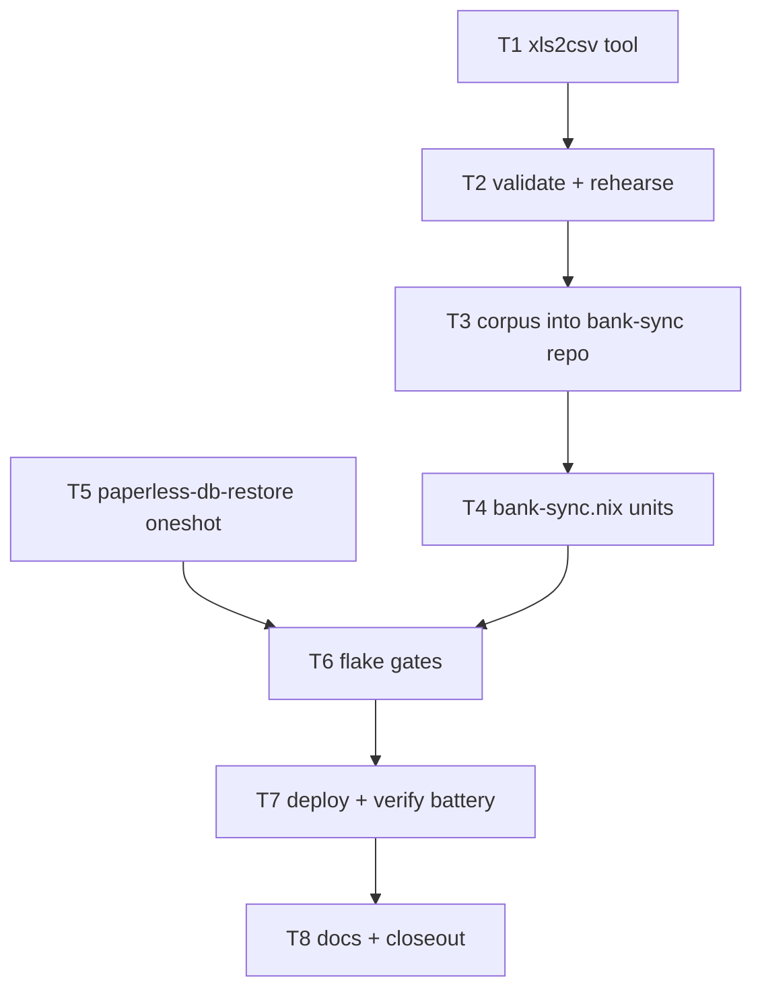

# SUPERB — Drive Corpus: full-history import + statement PDFs to Paperless + Wave-6 DB restore (2026-10-19 06:15)

**Trigger:** owner dropped the Google-Drive zip (`/home/lars/Downloads/drive-download-20261019T031901Z-1-001.zip`, 230MB, 1222 files) + the standing directive "keep going until everything works". This plan covers the remaining mission: the exported old Qonto statements served by the live deployment AND archived in paperless-ngx with correct metadata.

## Corpus facts (verified by extraction 06:03)

- **Statement PDFs (the real archival artifacts): 40** — Holding 26 (2023-01…2025-02) + Technologies 14 (2024…2025). Filenames carry `YYYY-MM` + org + IBAN-suffix + account.
- **Full-history transaction exports (2025-02-24, both orgs):** real OLE2 `.xls` (Tech 1.1MB, Holding 110KB) + `.ofx`/`.qif`/`.sta` siblings + `qonto_archive/` attachment PDFs/PNGs (~1000 files). No Qonto CSVs in the Drive set.
- **Out of scope (queued as follow-ups):** qonto_archive attachments, Wise 2024 statements (mt940+PDF — the wise importer exists), Sparkasse/wise receipts, Wolt timesheets, the stray `preuve-*.pdf` + mail-agreement PDF.
- **Duplicate-safety (verified in code):** `NewTransactionID(txIDStr)` derives the branded ID from the Qonto UUID string alone (`internal/importer/qonto/importer.go:252`), and import skips existing IDs — overlap between the fragment CSVs (132 rows live) and the full exports cannot duplicate.

## Blocking incident (still live at 06:02)

Paperless DB schema-empty after the foreign hot-db Wave 6 flip (web 500 on `paperless_applicationconfiguration`). Recovery recipe (P0 row, docs/todo/services.md:641): stop units → drop/recreate `paperless` DB → `pg_restore /mnt/pool/backups/paperless/paperless-db-2026-10-19.dump` (PGDMP magic verified, 2,004,419 bytes, 02:01 today) → start. This session's only root path is a deployed oneshot — same class as `bank-sync-qonto-stage` (root, activation-convergent, marker-gated).

## Pareto breakdown

- **1% → 51%:** the XLS→Qonto-CSV conversion fidelity rule (exact header + amount/date/UUID rendering) + the restore unit's guards (schema-missing check, dump sanity, marker). These two decide correctness of everything downstream.
- **4% → 64%:** the module extension pattern — stage/import/upload units generalized to the full corpus (4 CSVs, 40 PDFs) while staying idempotent, capture-safe, marker-gated.
- **20% → 80%:** one deploy that lands restore + full import + 40-PDF archival, and its verification battery (journal, paperless API count, dashboard totals).
- **other 20% → 100%:** docs (runbook, todo rows: close P0, queue attachments/Wise), status report, commits, push.

## Task plan (sorted by impact)

| # | Task | Impact | Effort | Owner |
|---|------|--------|--------|-------|
| T1 | Scratch Go tool: read both XLS, emit Qonto-format CSVs; inspect cell formats first | 🔴 prerequisite | M | me |
| T2 | Validate CSVs (counts, UUID overlap vs fragments, formats) + rehearse import on throwaway DB with locally built binary | 🔴 no bad data in prod | M | me |
| T3 | Land corpus in bank-sync repo: 2 full CSVs + 40 statement PDFs under `data/historical/qonto/`; commit (+push, authorized) | 🔴 | S | me |
| T4 | SystemNix bank-sync.nix: stage/import absorb the full CSVs; paperless unit uploads the 40 statement PDFs (per-file title/org/month metadata, count≥40 gate, marker) | 🔴 | M | me |
| T5 | SystemNix paperless.nix: opt-in `paperless-db-restore` oneshot (guards + marker), flag set at host config; remove-after-verify note | 🔴 unblocks upload | S-M | me |
| T6 | Gates: `nix flake check --no-build`, toplevel eval `--keep-going` | 🟠 | S | me |
| T7 | Deploy (DEPLOY_FORCE_PRESSURE=1 escape, on record) → verify restore, import, 40-doc archival, dashboard full-history totals | 🔴 | M | me |
| T8 | Docs: close P0 row, queue attachments/Wise follow-ups, update bank-sync runbook, status report, commits + push | 🟠 | S-M | me |

## Execution graph

## Verification gates

1. Rehearsal DB: full import exits 0, row counts == XLS row counts, fragment UUIDs ⊆ full UUIDs, no parse rejections.
2. Restore unit: journal shows schema-missing → restore → start; paperless `/api/` returns 401 (not 500); doc count queryable.
3. Upload unit: `verified 40 Qonto statement documents` + marker line in journal; per-doc title/created/correspondent/tags spot-checked via API.
4. Dashboard: totals panel reflects full history (both orgs, 2022-12→2025-02); provider filter still exact; zero daemon errors.

## Decisions (on record)

- **Monthly PDFs are the archival representation** (owner question c mooted by the real corpus): 40 statement PDFs uploaded as type "Bank Statement", correspondent "Qonto", tags bank-sync+qonto, `created=YYYY-MM-01`, title `Qonto Statement - <org> - YYYY-MM`. The two span CSV extracts are NOT archived as statements (they are data extracts; the real statements supersede the stand-in design).
- **Full-history CSVs land as NEW files** next to the fragments (fragments stay: imported provenance); import idempotence absorbs the overlap by UUID.
- **Attachments/Wise/receipts = follow-up rows**, not this mission (Pareto; the statement corpus is the owner's named artifact).
