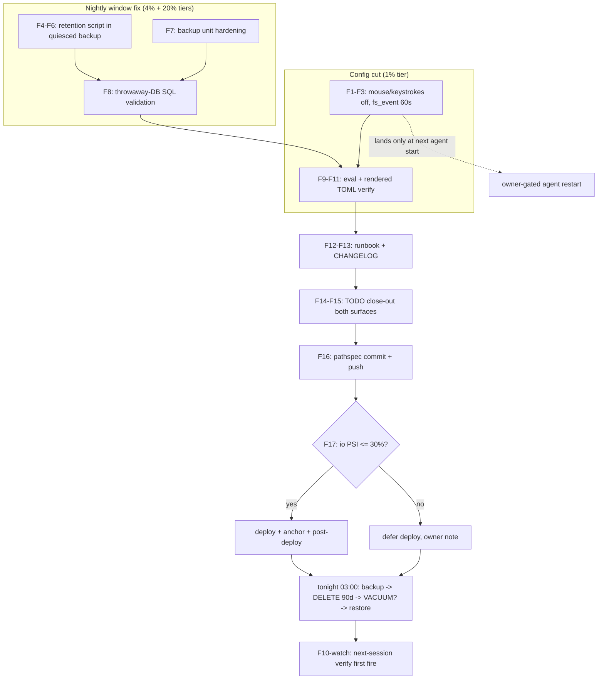

# SUPERB: Monitor365 Event-Volume Fix — Retention + Volume-Engine Cutoff

**EXECUTING (instance crush glm-5.3 session, executing full batch now, 2026-10-23 01:43 CEST, HEAD `310220e20`):** executing (see AGENTS.md plan-execution tombstone)

- **Author session:** 2026-10-23 01:42 CEST (follows docs/status/2026-10-23_01-09_monitor365-db-io-diagnosis-self-review.md + owner "Go fix it")
- **Workstream:** monitor365 produces ~5.3M events/day (597M accumulated Apr 21→Oct 18 into a 25.1 GB DuckDB) with zero retention; the current IO storm era made the cost visible.
- **Ground truth pinned this session** (corrections to the 01:09 report in §Errata):
  - Live agent config = upstream module's DEFAULT collector set (`/nix/store/h97k1y47…-monitor365-config.toml`, world-readable): **mouse = enabled (realtime)**, **keystrokes = enabled (realtime)**, **fs_event = enabled, interval_seconds = 1**, process = enabled, clipboard/app_usage/afk/network/notifications/location/battery/system_info(60s) = enabled, screenshots(300s)/camera(3600s) = enabled, bluetooth = disabled.
  - The four count-drivers: **mouse movement** (10–100 ev/s while active), **keystrokes** (~2–10 ev/s while typing), **fs_event** (flat 86,400 ev/day at 1 s), **process start/exit** (1 event each, unbounded on a build/agent box; cmdline+environ payloads).
  - Upstream has NO retention (grep server-module.nix/admin_cmd: only a by-type `purge-events` admin cmd with `--before` + dry-run) and an unused Parquet `archival` crate — successor path, not this batch.
  - Events table: `events(id, event_type, timestamp, tenant_id, device_id, sequence, payload, integrity_hash, version)` (db-crate test INSERTs). Column type of `timestamp` unverified → SQL must be validated against BOTH TIMESTAMP and ISO-VARCHAR forms (T4).
  - Nightly backup window (03:00, server deliberately STOPPED by the quiesce wrapper) is the ONLY lawful single-writer window for DELETE/VACUUM.

## Pareto breakdown

| Tier | Lever | Effect |
|---|---|---|
| **1% → 51%** | Disable mouse + keystrokes, fs_event 1 s → 60 s (config-only, 3 lines) | Kills the two personal-input firehoses + 98.6% of fs_event at the SOURCE; zero deletion risk; effect lands at next agent start (owner-gated — agent is deliberately stopped) |
| **4% → 64%** | Nightly retention DELETE (90 d) inside the existing quiesced backup window, AFTER the export (backup-first = rollback path) | Bounds the DB forever; first fires delete ~3 months of Apr–Jul events |
| **20% → 80%** | Weekly VACUUM (stamp-gated, disk-headroom-guarded) + backup-unit hardening (MemoryMax/High, ioTier.background, Timeout 30min) + docs/close-out/commit/push/PSI-gated deploy | Reclaims the ~15 GB file bloat, stops the 8–20 GB 03:00 memory spikes, makes the whole thing durable in docs + queue |
| **other 20% → 100%** | NOT this batch (recorded): upstream gen_app fix, upstream JWT-arg fix, upstream archive-then-delete (Parquet) as the proper retention successor, hot-tier DB move, owner-gated agent restart + buffer-backlog measurement | Listed so nobody thinks they were forgotten |

## Medium-granularity plan (30–100 min tasks, sorted by impact/effort)

| # | Task | Impact | Effort | Value | Tier |
|---|---|---|---|---|---|
| M1 | Disable volume-engine collectors in SystemNix agent settings (mouse, keystrokes; fs_event → 60 s) with rationale comments | Very high (source-level ~70–90% new-event cut) | Low (~30 min) | Stops the firehose | 1% |
| M2 | Retention script: nightly DELETE (>90 d) + weekly stamp-gated VACUUM with df headroom guard + before/after count logging, wired into quiesced backup AFTER export, BEFORE server restore | Very high (bounds DB permanently) | Med (~60 min) | The actual fix | 4% |
| M3 | Backup unit hardening: MemoryMax=12G, MemoryHigh=8G (watermark ≥50% ✓), ioTier.background, TimeoutStartSec=30min | Med (protects 03:00 window on a 128 GB box) | Low (~15 min) | Storm resilience | 20% |
| M4 | Validate the exact SQL + guard logic on a throwaway DuckDB (TIMESTAMP AND VARCHAR column forms, VACUUM, count queries) | High (correctness proof before it touches prod at 03:00 unattended) | Med (~30 min) | No 03:00 surprise | 20% |
| M5 | Eval verification: `nix flake check --no-build`, evo-x2 toplevel eval, rendered-TOML check (mouse/keystrokes off, fs_event=60, other defaults intact) | High (proof the merge didn't nuke the other 14 collector defaults) | Med (~30 min) | Anti-regression | 20% |
| M6 | Docs: runbook (volume engines, retention design, first-fire expectations, rollback path), CHANGELOG entry | Med | Med (~30 min) | Durable knowledge | 20% |
| M7 | TODO close-out: tick f.3/f.4/f.5 rows on BOTH surfaces (queue + library), add done-marker for collector cut, correct stale premises | Med | Low (~20 min) | Queue hygiene (rule: edit both) | 20% |
| M8 | Commit (pathspec-scoped, detailed message) + PUSH (owner-ordered this session) | Required | Low (~15 min) | Landed work | 20% |
| M9 | Deploy — PSI-GATED (skip if io PSI some avg10 > 30%): `nix run .#deploy`, anchor check, pre/post-deploy checks. Agent units stay stopped (inactive units are not restarted by stc; restart is owner-gated) | High (activates tonight 03:00) | Med (~45 min) | Go-live | 20% |
| M10 | [watch, next fire] Verify first retention fire ~03:00 next calm night: journal counts, DB size drop, backup size drop; NOT this session | High | — | Close-out evidence | 20% |

## Fine-granularity breakdown (≤15 min each)

| # | Task | Est | Depends |
|---|---|---|---|
| F1 | Read current monitor365.nix settings block; add `settings.collectors.mouse.enabled = false` + comment | 10m | — |
| F2 | Add `settings.collectors.keystrokes.enabled = false` + comment (volume + capture_content-default-true privacy note) | 8m | F1 |
| F3 | Add `settings.collectors.fs_event = { enabled = true; interval_seconds = 60; }` + comment | 8m | F1 |
| F4 | Write retention SQL constants (retentionDays=90) + DELETE statement w/ count-before query | 12m | — |
| F5 | VACUUM leg: stamp-file (stateDir, 604800s epoch math) + df headroom guard (skip if avail < dbsize+5G, WARN loudly) | 12m | F4 |
| F6 | Wire into monitor365BackupScript: export FIRST, then retention, before EXIT-trap restore; echo counts | 12m | F4,F5 |
| F7 | Backup unit serviceConfig: MemoryMax/MemoryHigh/ioTier.background/TimeoutStartSec | 10m | — |
| F8 | Throwaway duckdb harness: build test DB (both column types), run script's SQL verbatim, assert row counts + shrink | 15m | F4,F5 |
| F9 | `nix flake check --no-build` | 5m | F1–F7 |
| F10 | evo-x2 toplevel eval | 5m | F9 |
| F11 | Rendered-TOML verification (eval the config-file text or store path; diff collectors section vs current store TOML) | 15m | F10 |
| F12 | Runbook docs/services/monitor365.md: state + design + first-fire + rollback section | 15m | M2 shape final |
| F13 | CHANGELOG entry | 8m | F12 |
| F14 | TODO_LIST.md: tick f.3/f.4/f.5 queue rows + new done row for collector cut | 10m | F9 |
| F15 | docs/todo/services.md: matching library ticks + annotation | 10m | F14 |
| F16 | git add (pathspec) + commit detailed + push | 15m | F9–F15 |
| F17 | PSI gate check → deploy (or defer with explicit note) + anchor check + post-deploy | 15m+ | F16 |
| F18 | Status-report addendum or §f self-harvest check (report protocol) | 10m | F17 |

## Execution graph

## Vershclimmbessern guards (explicit)

1. **DELETE is irreversible** → export runs BEFORE delete each night (that backup = rollback copy); 90 d window is generous; counts logged before/after.
2. **VACUUM rewrites the whole file** → stamp-gated weekly + df-headroom guard (the btrfs-gc-guard lesson: never gate on a condition the action can't restore; never ENOSPC the root at 03:00). On guard-skip: WARN, retry next window.
3. **Config-only agent changes** take effect at next agent start; agent is owner-stopped → no silent "fixed" claims; runbook says "effective on restart".
4. **Merge risk**: setting 3 collectors must not reset the other module defaults → F11 rendered-TOML diff is mandatory, not optional.
5. **No deploy under storm**: F17 PSI gate (some avg10 > 30% → defer). The 2026-10-20/21 storm reports exist for a reason.
6. **Backup restore-trap ordering**: retention must never run while the server is up (single-writer); it runs strictly inside the existing stop window, before the trap fires.

## Errata (corrections pinned during plan research)

- 01:09 report said "SystemNix sets NO collectors section" (true) but left the default-on mechanism vague ("CLI defaults" suspicion) — ground truth: the upstream nix module's settings.nix renders the default 16-collector TOML; `register_simple_collector!`-gating analysis was about the internal config crate, not the effective set.
- "What events do we have" now has a source-verified inventory (the four volume engines), not just registry inference.
- 597M ÷ 113 d ≈ 61 ev/s average is now consistent with mouse+keystroke+fs_event+process firing concurrently on an active desktop.

## Out-of-batch successors (deliberately NOT executed here)

- Upstream (~/projects/monitor365): gen_app migration fix; JWT-secret-off-cmdline; server-native retention; **archive-to-Parquet then delete** (the archival crate) as the proper successor to raw DELETE.
- SystemNix: DuckDB hot-tier move (supersedes backup-destination question); agent restart decision + buffer-backlog measurement (owner sudo).
- Already-queued rows for all of the above exist (docs/todo/{services,upstream}.md, added 2026-10-23 01:0x).
