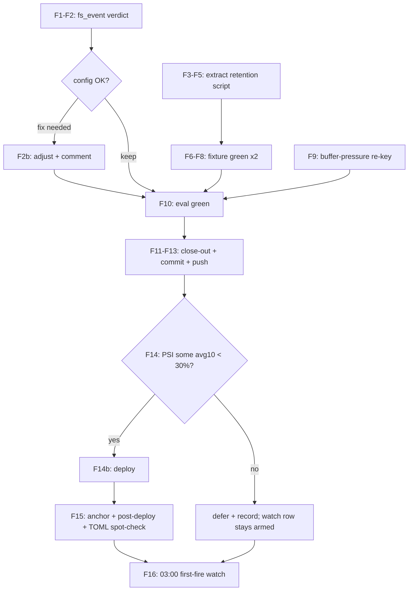

# SUPERB: Monitor365 Closeout Hardening — Verify, Fixture, Deploy

**EXECUTED (instance all M1-M7 executed + pushed (daemon-swept 5737cdc02..846c03478); deploy DEFERRED again by PSI gate (avg60 back to 74% at 02:49 after a transient 32% lull - the sustained-30% gate held); first-fire watch row stays armed, 2026-10-23 02:49 CEST, HEAD `846c03478`):** execution finished

- **Author session:** 2026-10-23 02:26 CEST (follows the executed volume-fix batch `0ab1e42e0` + self-review docs/status/2026-10-23_02-00)
- **Owner questions g.1–g.3 unanswered → standing defaults:** 90 d retention window stands (one-liner to change, queue row open); deploy proceeds at the plan's PSI gate (NOT immediately); agent stays stopped (owner-gated).
- **Universe:** the monitor365 follow-up rows harvested at 02:00 that are AGENT-ACTIONABLE. Out of batch (recorded): upstream repo work (~/projects/monitor365 — parallel sessions active, twice-warned in existing rows), agent restart / buffer measure / window confirm (owner).

## Pareto breakdown

| Tier | Lever | Effect |
|---|---|---|
| **1% → 51%** | **Deploy the landed batch** at the PSI gate (fs_event semantics verified FIRST so the deployed generation is correct) | Everything landed is inert until deploy; first 03:00 fire afterwards bounds the DB and reclaims ~15 GB |
| **4% → 64%** | **Rendered-script fixture** — extract retention into `scripts/monitor365-retention.sh` (env-parameterized, shellcheck-covered) called by the backup script; checks leg executes the REAL script against a toy DB | Closes the eval-blind Nix-interpolation class permanently; the 03:00 window stops being the script's first execution |
| **20% → 80%** | Buffer-pressure metric semantics (file-size → memory signal, name byte-stable), foreign-hunk inspection, post-deploy rendered-TOML spot-check, close-out + commit + push | Honest alerting, owner visibility, deployed-generation proof |
| **other 20% → 100%** | Upstream (gen_app, JWT, Parquet-archive successor), owner gates (agent restart, 90 d confirm, buffer measure) | Already queued; deliberately not here |

## Medium-granularity plan (30–100 min, sorted by impact/effort)

| # | Task | Impact | Effort | Tier |
|---|---|---|---|---|
| M1 | fs_event semantics: read the collector source (poll vs debounce; what 60 s means) — keep or fix the landed 60 s | High (deployed-config correctness) | Low (30 min) | 1% |
| M2 | Extract retention to `scripts/monitor365-retention.sh` (env: STATE_DIR, RETENTION_DAYS, VACUUM_INTERVAL_S, VACUUM_HEADROOM_B) + backup script calls it; constants stay in Nix | Med-high (testability, pre-commit shellcheck) | Med (45 min) | 4% |
| M3 | Fixture `checks.monitor365-retention-fixture`: run the script against toy DBs (delete-branch, stamp-fresh skip, stamp-stale vacuum, WARN paths) | High (class closure) | Med-high (90 min) | 4% |
| M4 | Buffer-pressure flag re-key: cgroup memory signal, metric name byte-stable, threshold-comment fix (1.6 GB was keyed to the dead 2G MemoryMax) | Med | Med (45 min) | 20% |
| M5 | Foreign-hunk inspection (`git show 308f01052 -- docs/todo/storage.md`) + owner report line | Low-med | Low (10 min) | 20% |
| M6 | **Deploy** at PSI gate (some avg10 < 30% for ~5 min) + readlink anchor + post-deploy-check + rendered-TOML spot-check | Very high (activation) | Med (45 min) | 1% |
| M7 | Close-out: queue ticks both surfaces, runbook touch-ups, CHANGELOG, commit + push | Med | Low (30 min) | 20% |
| M8 | [watch] First post-deploy 03:00 fire (tonight if deployed; else next) — journal lines + size deltas | High | — | 1% |

## Fine-granularity breakdown (≤12 min each)

| # | Task | Est | Depends |
|---|---|---|---|
| F1 | Locate fs_event collector source in ~/projects/monitor365; read interval handling | 10m | — |
| F2 | Verdict: keep 60 s / adjust / disable; comment update in configuration.nix if verdict changes semantics | 10m | F1 |
| F3 | Write scripts/monitor365-retention.sh (env-parameterized, set -euo pipefail, WARN-not-die semantics) | 12m | — |
| F4 | Swap the inline retention block in monitor365BackupScript for the script call (env-forwarded constants) | 10m | F3 |
| F5 | shellcheck the new script (pre-commit leg covers it; run standalone once) | 5m | F3 |
| F6 | Fixture harness: toy duckdb DBs (old/new/malformed rows), fake STATE_DIR, stamp matrix | 12m | F3 |
| F7 | Wire checks.monitor365-retention-fixture in flake (pattern: existing fixture checks) | 12m | F6 |
| F8 | Run the fixture; fix findings until green ×2 | 12m | F7 |
| F9 | Buffer-pressure stanza edit in system-health.nix (memory.events/RSS key, name stable) | 12m | — |
| F10 | Eval: flake check --no-build + evo-x2 toplevel | 8m | F2–F9 |
| F11 | Foreign-hunk diff + report line in close-out | 5m | — |
| F12 | Close-out edits (queue ticks, runbook, CHANGELOG) | 12m | F10 |
| F13 | Pathspec commit + push | 10m | F12 |
| F14 | PSI probe loop → deploy when gate passes (or defer + record) | 12m+ | F13 |
| F15 | Anchor check + post-deploy-check + rendered-TOML spot-check | 12m | F14 |
| F16 | 03:00 watch (same-night if deployed) | — | F15 |

## Execution graph

## Verschlimmbessern guards

1. **M2 moves working, validated code** — the fixture (M3) must be GREEN before the extraction is committed; if the fixture fights the script shape, prefer reverting the extraction over weakening the script's WARN-not-die semantics.
2. **system-health.nix is metric-name-sensitive** — `system_monitor365_buffer_pressure` name stays byte-stable (gatus pat() + phantom-metric gate); only the VALUE semantics change. No other stanza touched.
3. **Deploy gate stays hard** — no "it's probably calm enough"; avg10 < 30% sustained. A deferred deploy costs one day; a storm deploy can cost a wedged switch.
4. **No upstream-repo edits** — parallel sessions own ~/projects/monitor365 right now; every upstream fix stays queued.
5. **The 03:00 window is sacred** — nothing in this batch touches the quiesce ordering (stop watchdog → stop server → export → retention → restore trap).

## Errata / standing assumptions

- 90 d window stands (owner question open, row queued).
- First-fire expectations per runbook: DELETE boundary ≈ Apr–Jul events; VACUUM 25.1 GB → ~7–10 GB; window runs long ONCE.
- PSI at planning: some avg10 57% / avg60 47% — trending down from 66% at 02:00.
