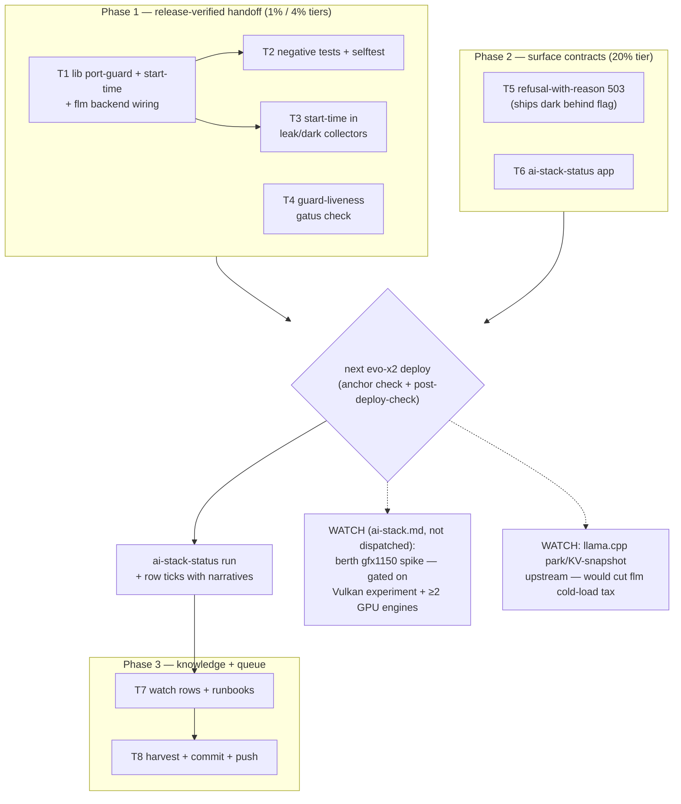

# Berth-Patterns Adoption — Release-Verified AI-Stack Handoffs

**Status: EXECUTED 2026-10-23 — all tasks closed.** Rows ticked in `TODO_LIST.md`; narrative: docs/status/2026-10-23_08-05_berth-patterns-execution.md

**Created:** 2026-10-23 06:59 CEST · **Trigger:** owner question "What can we learn from [T-Crypt/berth](https://github.com/T-Crypt/berth) for our AI deployments?"
**EXECUTED (instance crush, all T1-T8 closed, 2026-10-23 08:06 CEST, HEAD `09108bf55`):** execution finished

---

## 1. Context — what berth is, what we take from it

Berth (v0.3.4, alpha, Apache-2.0) brokers GPU leases on discrete NVIDIA/Windows workstations: engines request the card via `berth run`, the holder drains at a job boundary, and the next engine starts **only after the driver confirms the memory is actually free**. Its AMD support is experimental (RDNA3/4 + Phoenix APUs via amdgpu sysfs); Strix Halo gfx1150 is unlisted.

**Adoption verdict (from the analysis session):** do NOT run the daemon here. The GPU stack it would broker is dark (llama-rag disabled since freeze #5; llama-chat/llama-vlm run CPU), and on this GTT-first APU the real contention broker is cgroup `MemoryMax` + memory-emergency-guard — a second broker would be a split brain. **What we adopt are the patterns**, mapped to incident classes this repo has already paid for:

| Berth rule | Our incident class | Pattern adopted |
| --- | --- | --- |
| Driver-confirmed release — never grant because a process *exited* | flm zombie pinning :52626 forever; orphan ESTABLISHED pairs blocking binds (2026-09-30); restart → `start-limit-hit` → exit-4 cascades | Pre-start release verification (port guard) at EVERY engine boundary, not just llama-rag |
| PID + start-time identity — a reused PID never inherits a lease | portGuardScript + leak collectors match on PID alone | `/proc/<pid>/stat` field 22 in every kill/count decision |
| Refuse with a named reason, never a crash | consumers see dead sockets during flm cold-load (2–5 min) / guard sacrifice | 503 + JSON `{reason, holder}` at the engine boundary instead of silence |
| Fail-open, never silent — daemon down ⇒ engines start, flagged *unprotected* | NO gatus check exists on `system_memory_guard_metrics_fresh` (verified, §5) | fail-closed liveness check on the guard's own metric |
| `berth status` — "who holds it, who waits, and why" | AI-stack state scattered across 6 runbooks + post-deploy probes | one `ai-stack-status` app aggregating units/ports/guard/leaks |
| Park-in-RAM / KV snapshots | flm 2–5 min cold-loads | upstream WATCH only (llama.cpp has no offload call today) |

## 2. Verified premises (queue-author premise-check, 2026-10-23 ~06:57)

| # | Premise | Evidence (live grep this session) |
| --- | --- | --- |
| P1 | portGuardScript exists ONLY in llama-rag; kills foreign-cgroup listeners by PID, no start-time | `modules/nixos/services/llama-rag.nix:174-192` |
| P2 | fastflowlm backend has NO ExecStartPre port guard | `rg ExecStartPre modules/nixos/services/fastflowlm.nix` → 0 matches |
| P3 | flm EADDRINUSE has two classes; only the ephemeral class is mitigated (port reservation, live 2026-10-16) | `fastflowlm.nix` sysctl `ip_local_reserved_ports` comment; corpse/orphan class unguarded |
| P4 | No gatus check on `system_memory_guard_metrics_fresh` (only adjacent scrub/backup checks) | `rg memory_guard modules/nixos/services/gatus-config.nix` → no freshness hit; the niri collector HAS this pattern (gatus-config.nix:1057-1073) — reuse it |
| P5 | Leak + dark-guard collectors identify processes by PID only | `llama-rag.nix:202-236` (pgrep + ss pid match) |
| P6 | No prior berth/lease plan exists in planning/brainstorming layers | `rg -il 'berth|gpu.?lease' docs/planning docs/brainstorming docs/todo TODO_LIST.md` → 0 |
| P7 | llama-vlm already implements planned-stop-as-success (SuccessExitStatus 143) and idle TTL | `llama-vlm.nix:239-244, 290-307` — berth's min_turn/park analogs already exist; NOT re-planned |

**Errata:** none — no stale-backlog corrections were needed (P6: topic is new). P4 carries an execution-time re-verify note (a SigNoz unit-state rule may exist; the implementing agent must confirm before adding, see T4 subtask 1).

## 3. Pareto breakdown

- **1% → 51%:** the portGuardScript is PROVEN live code (since 2026-09-18). Parameterizing it into a lib helper and wiring it into the fastflowlm backend = two ExecStartPre lines — the single highest-leverage edit, because :52625/:52626 is the surface where the EADDRINUSE class recurred 5× (09-04, 09-05, 09-07, 09-18, 09-30) with no automated defense. Reuse, don't rewrite.
- **4% → 64%:** + the guard's own liveness check (P4 gap — the "unprotected" state is currently unobservable) + start-time identity in the existing collectors (cheap hardening of the same kill/count decisions).
- **20% → 80%:** + refusal-with-reason at the engine boundary + the unified `ai-stack-status` surface — the consumer-facing and operator-facing contracts.
- **Other 80% (rest to 100%):** watch rows (berth gfx1150 spike trigger tied to the Vulkan experiment row; llama.cpp park/KV upstream watch), runbook updates, negative tests for every new guard (repo doctrine — they are first-class tasks, not afterthoughts), TODO harvest, deploy-gated verification.

## 4. Comprehensive plan — tasks of 30–100 min

Sorted by importance → impact → effort → customer-value (customer = Lars + every future agent session operating this stack).

| # | Task | Why (incident/value) | Impact | Effort | Tier | Depends |
| --- | --- | --- | --- | --- | --- | --- |
| T1 | **Shared release-verified port guard**: extract llama-rag's portGuardScript into `lib/` as `mkPortGuard { port, ownerUnits }`; add PID **start-time** check (stat field 22) before any kill; wire as `+`-privileged ExecStartPre on the fastflowlm backend (:52625/:52626, ports from `lib/ports.nix`); refactor llama-rag to consume the shared helper | Kills the EADDRINUSE restart-loop/cascade class at its last unguarded surface; berth's driver-confirmed-release lesson | **High** | ~90 min | 1% | — |
| T2 | **Negative-test legs for T1**: foreign listener killed / own-cgroup spared / start-time mismatch (PID reuse) → NO kill / inert when port free; wire into `scripts/negative-test-lints.sh` + a selftest | Repo doctrine: every new guard ships with a negative test; the 09-18 rogue class was invisible for 8h | **High** | ~45 min | 1% | T1 |
| T3 | **Start-time identity in collectors**: leak + dark-guard collectors snapshot `/proc/<pid>/stat` field 22 so a recycled PID can't false-green/false-red the count | PID-reuse hardening of existing kill/count decisions | **Medium** | ~45 min | 4% | T1 (lib helper if shared) |
| T4 | **Guard-liveness gatus check (fail-closed)**: re-verify no existing unit-state rule covers memory-emergency-guard liveness, then add a metrics_fresh body-pattern check (niri pattern, gatus-config.nix:1057-1073) + Discord alert "RAM broker unprotected" | Berth's fail-open-never-silent; today a silently dead guard = unobservable | **High** | ~30–60 min | 4% | — |
| T5 | **Refusal-with-reason contract**: bridge/llama-chat answer 503 + JSON `{reason: cold-loading\|sacrificed\|bind-blocked}` instead of silent dead socket; design note first, prototype behind a config flag | Consumers (paperless-gpt, inboxclean) can distinguish transient vs dead; berth's exit-75-with-named-holder | **Medium** | ~90 min | 20% | T1 |
| T6 | **`ai-stack-status` app**: `scripts/ai-stack-status.sh` + flake app (flake/parts/apps.nix) aggregating unit states, port bind ownership (foreign-listener check), guard zone state + freshness, leak/dark gauges → one table + exit code; ports from `lib/ports.nix` | berth's "who holds it, who waits, why" as one command; today: 6 runbooks | **Medium** | ~90 min | 20% | — |
| T7 | **Watch rows + runbooks**: ai-stack.md watch rows (berth gfx1150 spike trigger — fires only if the Vulkan experiment proves out AND ≥2 GPU engines share GTT; llama.cpp park/KV-snapshot upstream watch for flm cold-load tax); fastflowlm.md + llama-rag.md runbook additions | Keeps the deferred-value half of the berth analysis alive without dispatching it | **Low-Med** | ~30 min | tail | — |
| T8 | **Harvest + ship**: queue rows → TODO_LIST.md + domain libraries (this plan's §6), commit pathspec, push | TODO-system discipline: plan is snapshot, queue is source of truth | **Hygiene** | ~30 min | tail | T1–T7 queued |

All module changes are **deploy-gated**: they land inert until the next evo-x2 switch; post-deploy verification per each unit's runbook + anchor check per AGENTS.md.

## 5. Fine breakdown — every task ≤ 12 min

Sorted by execution order within dependency phases; Importance I★–I★★★, Effort in minutes.

| Sub | Work | ≤ min | Imp | Parent |
| --- | --- | --- | --- | --- |
| 1.1 | Read llama-rag.nix:160-260 + fastflowlm.nix backend unit block; confirm owner-unit cgroup names | 10 | ★★★ | T1 |
| 1.2 | Create `lib/port-guard.nix`: `mkPortGuard { port, ownerUnits }` wrapping the proven script shape | 12 | ★★★ | T1 |
| 1.3 | Add start-time read (`/proc/<pid>/stat` f22) into guard: snapshot at enumeration, re-check immediately before each signal | 12 | ★★★ | T1 |
| 1.4 | Export via `lib/default.nix` single import point; `nix eval` the helper renders | 10 | ★★ | T1 |
| 1.5 | Wire flm backend unit: `ExecStartPre = "+${mkPortGuard …}"` for :52626 (backend) — ports from `lib/ports.nix` | 12 | ★★★ | T1 |
| 1.6 | Decide :52625 (socket unit): document why the guard does NOT apply there (systemd owns the socket; foreign binds impossible while unit active — verify + write the comment) | 10 | ★★ | T1 |
| 1.7 | Refactor llama-rag.nix portGuardScript to consume the shared helper; byte-compare rendered scripts | 12 | ★★★ | T1 |
| 1.8 | `nix flake check --no-build` + evo-x2 toplevel eval (quiescent-moment rule) | 10 | ★★★ | T1 |
| 2.1 | Write negative fixture: fake foreign listener (systemd-run scope) on a scratch port → guard kills it | 12 | ★★★ | T2 |
| 2.2 | Negative fixture: listener inside owner unit cgroup → spared | 10 | ★★★ | T2 |
| 2.3 | Negative fixture: PID-reuse simulation (start-time mismatch) → NO kill, log-only | 12 | ★★ | T2 |
| 2.4 | Wire legs into `scripts/negative-test-lints.sh` neuter/restore ATOMIC (single shell command per cycle) | 12 | ★★ | T2 |
| 2.5 | Add selftest to flake/parts/checks (pattern: existing selftests); `nix flake check --no-build` | 12 | ★★ | T2 |
| 3.1 | Extend lib helper (or local fn) to expose `pidStartTime` for reuse by collectors | 10 | ★★ | T3 |
| 3.2 | Patch leak collector: pgrep → (pid, starttime) pairs; ss match requires BOTH pid and listener presence | 12 | ★★ | T3 |
| 3.3 | Patch dark-guard collector identically | 10 | ★★ | T3 |
| 3.4 | Collector smoke: run script directly against live state; verify .prom values unchanged (0 leaks expected) | 10 | ★★ | T3 |
| 4.1 | Re-verify P4: grep SigNoz rules + gatus for any memory-emergency-guard unit-state/freshness coverage; record finding | 10 | ★★★ | T4 |
| 4.2 | If covered → tick with pointer (re-dispatch protocol); if not: add gatus check on guard .prom via niri body-pattern (fresh==0 fails, absence fails) | 12 | ★★★ | T4 |
| 4.3 | Discord alert text: "RAM broker unprotected — memory-emergency-guard metrics stale; services run unguarded (berth fail-open lesson)" | 8 | ★★ | T4 |
| 4.4 | Deploy-restart-audit + gatus-coverage-audit passes (check may need registry wiring for the textfile endpoint) | 12 | ★★ | T4 |
| 5.1 | Design note (in plan §7 or fastflowlm.md): reason vocabulary, HTTP shape, which surfaces (bridge cold-load, llama-chat down, bind-blocked) | 12 | ★★ | T5 |
| 5.2 | Prototype in flm proxyConn script: on backend-not-listening → immediate 503 JSON `{reason:"cold-loading",retry_after}`; behind `cfg.refusalReason` flag, default off | 12 | ★★ | T5 |
| 5.3 | llama-chat: gatus/health already covers; add 503-reason only if cheap (nginx-style intercept not available — document if skipped) | 10 | ★ | T5 |
| 5.4 | Consumer docs: one paragraph in paperless-gpt + inboxclean runbooks on interpreting 503 reasons | 8 | ★ | T5 |
| 6.1 | `scripts/ai-stack-status.sh`: enumerate units (flm socket/backend, llama-chat, llama-rag, vlm instances) via systemctl show, loopback-safe | 12 | ★★ | T6 |
| 6.2 | Port ownership leg: ss -ltnp per expected port; flag foreign/missing listeners (P2/P5 classes at a glance) | 12 | ★★ | T6 |
| 6.3 | Guard leg: parse guard .prom (zone state, freshness, restore_capped) + leak/dark gauges | 12 | ★★ | T6 |
| 6.4 | Output: aligned table + non-zero exit on any red; `--format json` for agents (berth interface discipline: stdout results, stderr diagnostics) | 12 | ★★ | T6 |
| 6.5 | flake/parts/apps.nix: `ai-stack-status` app (one imports-adjacent entry) + eval check | 10 | ★★ | T6 |
| 6.6 | Shellcheck + nullglob audit legs pass (pre-commit filetype legs) | 8 | ★ | T6 |
| 7.1 | ai-stack.md watch rows: berth gfx1150 spike trigger (gated on Vulkan row outcome + ≥2 GPU engines); llama.cpp park/KV upstream watch | 10 | ★★ | T7 |
| 7.2 | fastflowlm.md: port-guard contract + refusal-reason paragraphs | 10 | ★★ | T7 |
| 7.3 | llama-rag.md: shared-helper note (single source of the guard pattern now lib/) | 8 | ★ | T7 |
| 8.1 | Queue rows → TODO_LIST.md; library entries → services.md / monitoring.md / ai-stack.md (edit both surfaces, no drift) | 12 | ★★★ | T8 |
| 8.2 | Pathspec commit of plan + todo edits; detailed message; push | 10 | ★★★ | T8 |
| 8.3 | Post-commit verify: `git show --stat HEAD` (no foreign-session files swept), push confirmed | 8 | ★★★ | T8 |

**Deploy-window closeout (not a subtask — the gate after T1–T6 land):** next evo-x2 switch → anchor check (`readlink /run/current-system` = latest `system-N-link`) → post-deploy-check → one `ai-stack-status` run → tick rows with verification narratives in the executing session's status report.

## 6. Harvest (landed in the same commit as this plan)

| Queue row (TODO_LIST.md) | Library entry |
| --- | --- |
| [ready] Shared port-guard lib + flm wiring + negative tests (T1+T2) | docs/todo/services.md |
| [ready] Start-time identity in leak/dark collectors (T3) | docs/todo/services.md |
| [ready] Guard-liveness gatus check, fail-closed (T4) | docs/todo/monitoring.md |
| [ready] Refusal-with-reason 503 contract (T5) | docs/todo/services.md |
| [ready] ai-stack-status aggregator app (T6) | docs/todo/services.md |
| — (watch: berth gfx1150 spike trigger, llama.cpp park/KV) | docs/todo/ai-stack.md |

## 7. Anti-verschlimmbessern constraints (binding on every subtask)

1. **Reuse the proven script** — the lib helper is an extraction of live code, not a rewrite; rendered bytes should differ only by parameterization + start-time addition.
2. **Every new guard ships its negative test in the same change** (T2 blocks T1's close-out).
3. **No port literals** — everything through `lib/ports.nix` (port-registry-audit).
4. **Textfile doctrine** — mktemp+trap, fail-closed omission on scrape failure.
5. **Do NOT touch guard zones, flm crash handling, or the Vulkan row** — those are owner-gated stability surfaces; this plan adds observation and pre-start verification only.
6. **Quiescent-moment evals** for shared surfaces (evo-x2, flake check) — concurrent-session rule.
7. **Refusal-with-reason ships dark** (flag default off) until its consumer story is reviewed — a proxy that lies about reasons is worse than silence.
8. **No daemon, no second broker** — berth stays a pattern library; if its gfx1150 spike ever fires, that is a NEW plan with its own tombstone.

## 8. Mermaid execution graph

