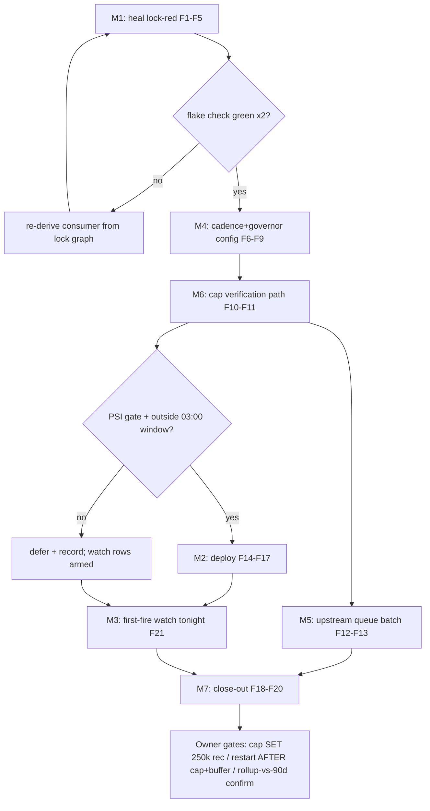

# SUPERB: Monitor365 IO/s-First Data Governance — Governor, Cadence, Activation

**Created:** 2026-10-23 07:05 CEST
**EXECUTING (instance session 1, executing M1-M7 immediately; M2 deploy is PSI-gated; M3 first fire tonight 03:00, 2026-10-23 07:02 CEST, HEAD `707f0b0c9`):** executing (see AGENTS.md plan-execution tombstone)

**Author session:** 2026-10-23 07:05 CEST. Owner steer (verbatim intent): *"we need to get better with storing the right kind of data in the right intervals in the first place, then come up with stupid retention windows … I care about IO/s not as much total storage."* Ratified direction from the 04:2x design exchange.

**Universe:** the monitor365 data-governance arc that is AGENT-ACTIONABLE in THIS tree. Out of batch (recorded below): owner gates, upstream-repo edits (parallel sessions own `~/projects/monitor365`), the DB hot-tier move (one storage generation at a time — never stack a migration into the volume batch's activation deploy).

## Grounded design (source-verified this session)

| Fact | Source | Consequence |
|---|---|---|
| `interval_seconds: null/0` = REALTIME per collector | `crates/config/src/collector/types.rs:175` | Cadence knobs exist; we inherit mostly-realtime module defaults today |
| Upload already batched: sync 60 s / batch 100 | `nix/lib/settings.nix:603` | Insert IO is chunky — storms come from VOLUME, not granularity |
| Tenant daily event cap, upstream default 10,000/day | `crates/api-types/src/tenant.rs` | THE IO/s governor. Collection era ran 61 ev/s = ~50,000× design point; drain lifted cap to 1B, live DB value unverified (permission-blind) |
| Process events carry cmdline + FULL environ per start/exit | `crates/collectors/linux/src/process.rs:20` | Biggest surviving per-row bulk + a secrets-in-DB smell; no upstream knob |
| Cap without bounded buffer = balloon | 113-day/597M backlog mechanism | The 10k-era cap + realtime collectors CAUSED the backlog; volume-correct collectors are what make the cap safe |

**Design in one line:** the tenant cap is the IO/s governor; collector cadence makes volume correct so the cap never binds; rollups (upstream, later) make retention trivial. Retention-as-landed stays as the backstop + one-time 15 GB reclaim (a 25→7 GB file also cuts every nightly export's read ~2.5× — pure IO/s win).

**Standing defaults (owner questions open):** tenant cap recommendation **250,000/day** (≈3 ev/s ceiling; ~2.5× a worst-case build-day's process churn; 30× below storm class) — owner sets the number via admin API/sudo, never me; agent stays owner-stopped; 90 d retention stands until the rollup era makes it moot; deploy proceeds at the hard PSI gate.

## Pareto breakdown

| Tier | Lever | Effect |
|---|---|---|
| **1% → 51%** | **Heal master eval-red** (gate-prescribed treefmt-nix follows line; blocks CI, checks, AND the deploy) **+ deploy the landed batch at the gate** | Everything inert becomes live: collector cuts, retention, caps, metric re-key; first fire reclaims ~15 GB and shrinks every future nightly export |
| **4% → 64%** | **Cadence+governor config commit** (explicit intervals per collector, pinned sync/batch, restart-preconditions) **+ tenant-cap verification path** | The agent that eventually restarts is volume-correct BY CONFIG, not by luck; the governor becomes verifiable |
| **20% → 80%** | **Upstream queue batch** (bounded offline queue, environ opt-in, rollups) **+ runbook governor doctrine + close-out/harvest** | The structural fixes get owned upstream; the repo's docs stop implying retention is the strategy |
| **other 20% → 100%** | Owner gates (cap SET at 250k rec, agent restart AFTER cap+buffer check, rollup/90d confirm), upstream execution, DB hot-tier move (row :455, next batch), first-fire watch (tonight 03:00) | Already queued or deliberately deferred — nothing silently dropped |

## Medium-granularity plan (30–100 min, sorted by impact/effort)

| # | Task | Impact | Effort | Tier |
|---|---|---|---|---|
| M1 | Heal master lock-audit RED: add the prescribed `treefmt-nix` follows override (consumer resolved from the lock graph); NEVER touch flake.lock; flake check green ×2 | Very high (unblocks CI/deploy/all checks) | Low-Med (30-45m) | 1% |
| M2 | Deploy at the hard gate (PSI some avg10 < 30% sustained ~5 min, outside 03:00±15 min) + readlink anchor + post-deploy-check + rendered-TOML spot-check (expect keystrokes/mouse `false`, fs_event `60`, NEW store path) | Very high (activation) | Med (45-90m) | 1% |
| M3 | First post-deploy 03:00 fire watch (tonight): `monitor365-retention:` journal lines, DELETE boundary ≈ Apr–Jul, VACUUM 25.1 GB → ~7–10 GB, WARN sweep; tick rows :444/:445 both surfaces | High (bounds the DB; proves the window) | Watch | 1% |
| M4 | Cadence+governor config: explicit `interval_seconds` for every enabled collector (process 5 s scan; periodic collectors 60–300 s explicit; clipboard/notifications/afk realtime BY DECISION with comment), pin `cloud.sync` 60 s/100, restart-preconditions block (cap 250k rec + buffer measure first) | High (volume-correct by construction; inert until restart) | Med (45-60m) | 4% |
| M5 | Upstream queue batch: bounded offline queue (drop-oldest + dropped-counter), environ opt-in/once-per-app (+ secrets rationale), rollup tables endgame, tenant-cap admin path — library rows, no upstream-repo edits | Med-high (structural fixes get owned) | Low-Med (30m) | 20% |
| M6 | Tenant-cap verification path: probe the server API for a limits-readable endpoint (verified openssl/LAN-IP probe set, NO JWT access); verdict row [ready] vs owner-gated | Med (makes the governor verifiable) | Low (30m) | 4% |
| M7 | Close-out: runbook governor section, CHANGELOG, status report with self-harvested §f, plan-marker done, pathspec commit + push | Med | Low-Med (45m) | 20% |

## Fine-granularity breakdown (≤12 min each)

| # | Task | Est | Depends |
|---|---|---|---|
| F1 | Locate the infra-follows group in flake.nix; read 3 existing entries for form | 5m | — |
| F2 | Resolve the consumer pulling `go-nix-helpers_8` from flake.lock (stdin-jq per the DIRENV trap); identify exact follows path | 12m | F1 |
| F3 | Add the follows override(s) — flake.nix ONLY; `git diff` asserts flake.lock byte-identical | 8m | F2 |
| F4 | `nix flake check --no-build` green ×2 (quiescent moment — parallel sessions active) | 10m | F3 |
| F5 | Pathspec commit `flake.nix` only + push | 5m | F4 |
| F6 | Cadence map: every enabled collector → interval decision + comment (decision table into configuration.nix) | 20m | — |
| F7 | Pin `cloud.sync.sync_interval_seconds = 60`, `batch_size = 100` explicitly + restart-preconditions comment block | 10m | F6 |
| F8 | Eval green + collect-level `nix eval` spot-check of the new settings | 10m | F7 |
| F9 | Pathspec commit configuration.nix + push | 5m | F8 |
| F10 | Probe server API for limits-readable endpoint (openssl s_client, LAN IP, no JWT) | 12m | — |
| F11 | Verdict: [ready] verification row vs owner-gated admin-API row (with the one-liner) | 10m | F10 |
| F12 | Upstream rows drafted (bounded buffer / environ / rollups / cap path) → docs/todo/upstream.md + queue one-liners | 12m | — |
| F13 | TODO gate green after all row edits | 5m | F12 |
| F14 | PSI probe loop; deploy when gate passes (else defer + record readings) | 12m+ | F5, F9 |
| F15 | `nix run .#deploy`; monitor output; post-deploy checks run by deploy.sh | 30-60m | F14 |
| F16 | Anchor: `readlink /run/current-system` == latest `system-N-link` | 5m | F15 |
| F17 | Rendered-TOML spot-check (false/false/60 at a NEW store path) | 10m | F16 |
| F18 | Runbook governor section + CHANGELOG entry | 15m | F17 or defer |
| F19 | Status report (self-harvesting §f) + rows ticked both surfaces | 15m | F18 |
| F20 | plan-marker done + final pathspec commit + push | 10m | F19 |
| F21 | First-fire watch tonight 03:00 (journal + sizes + WARN sweep) + row ticks | 12m | F15 |

## Execution graph

## Verschlimmbessern guards

1. **flake.lock is FOREIGN AND SACRED this batch** — the follows fix touches flake.nix's infra-follows group ONLY; `git diff` must show flake.lock byte-identical; if the fix wants a lock regen, STOP and re-plan (the bump-owning session owns lock movement).
2. **One storage generation at a time** — no hot-tier migration, no backup-cadence change, no retention-window change stacked into the activation deploy.
3. **The tenant cap is NEVER set by an agent** — admin API/sudo is owner-only; I recommend (250k/day), queue, and verify. Setting it wrong (or leaving 1B) is the difference between a governor and a balloon.
4. **No agent start, no upstream-repo edits** — both owner-gated/owned; cadence config ships inert and stays inert.
5. **Deploy gate stays hard** — sustained some avg10 < 30%, never "probably calm"; the storm (three ghostty batteries) has run 61–87 avg10 tonight; a deferred deploy costs a day, a storm deploy can cost a wedged switch.
6. **Parallel sessions are LIVE** (inboxclean session committed at ~06:xx, tree dirty on todo/status files) — re-read before every edit, pathspec commits, shared-surface evals only at quiescent moments.
7. **The 03:00 window is sacred** — nothing in this batch touches the quiesce ordering; no deploy inside 03:00±15 min.

## Errata / standing assumptions

- Master eval-red verified STILL RED at 07:0x (two foreign lock bumps since 77f3a8e50 did not follow the edge; nobody else owns the fix).
- PSI at planning: some avg10 57.8 / avg60 69.6 — deploy likely defers again; the plan executes everything else regardless.
- Next 03:00 fire = 2026-10-24 03:00 (tonight's ran the OLD script, verified clean).
- Tenant-cap live value unknown (DB permission-blind); if F10 finds no readable endpoint, verification is owner-gated.
