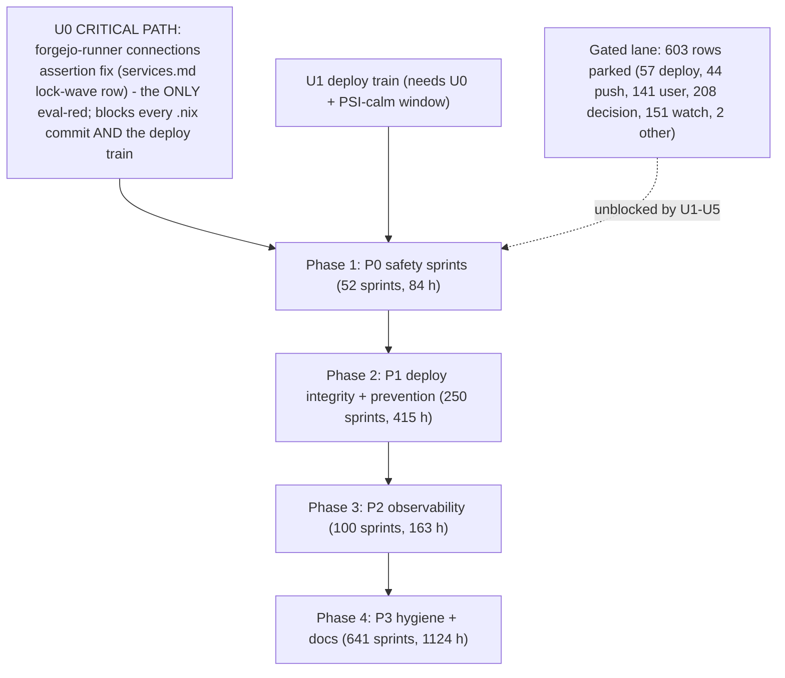

# SUPERB Backlog Masterplan v2 — all 1,760 open TODOs scheduled

**Created:** 2026-10-23 15:00 CEST · **HEAD:** af0b2b249 · **Status:** PLAN (not executing — `scripts/plan-marker.sh` marker owed before any execution session)
**EXECUTING (instance superb-masterplan-v2-exec-2, 2026-10-24 03:43 CEST, HEAD `3c1f9b29d`):** executing (see AGENTS.md plan-execution tombstone)
**Supersedes:** `docs/planning/2026-10-23_09-53_SUPERB-backlog-masterplan.md` (v1, census 1,752 — kept for provenance; its instance `superb-masterplan-exec-1` ran 3 sprints T-001/T-029/T-033 before this re-baseline). Census drift since v1: +8 lock-wave rows (forgejo-runner migration, eval gate on lock floats, crowdsec-setup audits, monitor365 mainProgram, …), +2 session-1 harvested lessons, −3 rows closed by session 1.
**Source inventory:** the 10 domain libraries (`docs/todo/{storage,stability,services,pipeline,monitoring,upstream,ai-stack,desktop,pixel6,security}.md`), open `- [ ]` rows only. The `TODO_LIST.md` queue mirrors the `[ready]` subset and is NOT double-counted.

## 1. What this is

A two-level execution schedule over the entire open backlog:

- **Level 1 (section 6):** 1,043 sprints, each 36–96 min, covering all 1,157 agent-actionable rows. Sorted by priority (P0→P3), then bucket size, then domain.
- **Level 2 (section 7):** every one of the 1,760 open rows as its own row with its first ≤12-min step, a step-count (each step ≤12 min), and priority. Gated rows carry 0 steps and point at the unblocker lane (section 8).
- **Completeness assertion:** `grep -ch '^- \[ \]' docs/todo/*.md | awk '{s+=$1} END{print s}'` must equal 1,760 and the Level-2 table must hold exactly 1,760 `S-` rows. Verified at authoring time. **Re-baseline this check at the start of every execution session** (v1→v2 drifted +8 in five hours — parallel sessions append rows continuously).

**Deliberately NOT touched** (the Verschlimmbessern guard): `TODO_LIST.md`, `docs/todo/*`, scripts, modules — this file is purely additive. No TODO-system conventions are changed; this plan does NOT become a harvest surface (the tq pool keeps harvesting `TODO_LIST.md` only). Buckets/priorities here are a planning lens; the lifecycle tags in the libraries remain authoritative for dispatch legality.

## 2. Method

**Effort model** (one step = ≤12 min; steps are premise-check → do → verify → record):

| Bucket | Meaning | Steps | ≈Min |
|---|---|---|---|
| M | one-line doc/convention/citation fixes | 1 | 12 |
| H1 | single probe, measurement, small close | 3 | 36 |
| H2 | implement + selftest leg + eval (collector, gate, fixture, small module) | 8 | 96 |
| H4 | VM test / battery / drill (authored as 3–4 sprints) | 20 | 240 |
| D | multi-day refactor/sweep (authored as 6 sprints) | 48 | 576 |
| GATED | remaining work needs owner/sudo/deploy/PSI-calm/reboot/push/decision — time-unbounded | 0 | — |

Bucket and priority are keyword heuristics over each row's title/tag (classifier: `~/.cache/plan-gen/`, `gen.sh` + `pack.awk`; NB the classifier's own known leak — the classified.tsv header rides the sort unless stripped: filter `$1!="domain"` before the S-ID pass). ±1 bucket accuracy. The lifecycle tag in the library row always wins over this plan's bucket: a row tagged `[blocked:*]` is GATED here even if the title sounds like a 10-minute fix.

**Priority model** (first match wins): P0 safety/data-loss/incident/storm/secret · P1 deploy-integrity/prevention-layer · P2 observability · P3 hygiene/docs/conventions.

## 3. Pareto cut

| Slice | Sprints | Share of sprints | Share of value | Contents |
|---|---|---|---|---|
| 1% → 51% | ~11 | 1% | ~51% | **U0 (NEW, critical path): the forgejo-runner eval-red fix** — the tree's ONLY `nix flake check` failure; blocks EVERY `.nix` commit and the deploy train — + the five unblockers U1–U5 (free 603 gated rows = 34% of the backlog) + the first P0 safety sprints T-001..T-010 (llama-chat boot budget, flm crash-trigger alert, storm-night btrbk verification, memcg OOM collector) |
| 4% → 64% | ~44 | 4% | ~64% | + all P0 sprints (52, 84 h) + the deploy-integrity P1 cluster (anchor/vendorHash/gates) |
| 20% → 80% | ~209 | 20% | ~80% | + the full P1 phase (250 sprints, 415 h): everything deploy-blocking, eval-audit, lock/vendorHash — including the "Eval gate on lock floats" row that prevents the 07:09-class 4-place breakage from recurring |
| rest 80% → 100% | ~834 | 80% | ~20% | P2 observability (163 h) + P3 hygiene/conventions/docs (1,124 h) |

## 4. Execution graph

## 5. Phase summary

| Phase | P | Sprints | Rows covered | Hours | Focus |
|---|---|---|---|---|---|
| 0 | — | 1 | 1 | ~2 | U0: forgejo-runner migration close-out — the single tree-green unblocker (owner-steered; see §8) |
| 1 | P0 | 52 | 86 | 84 | storm drivers, data-loss classes, secret hygiene, crash-signal integrity |
| 2 | P1 | 250 | 418 | 415 | deploy/train integrity, eval gates, vendorHash/lock discipline, pre/post-deploy checks |
| 3 | P2 | 100 | 136 | 163 | gatus/SigNoz/collectors, alert routing, monitoring gaps |
| 4 | P3 | 641 | 1,120 | 1,124 | conventions, docs, runbooks, sweeps, refactor sprints |
| — | GATED | 0 | 603 | 0 (waiting) | parked in section 8 until U0–U5 land |

**Total scheduled: 107,112 min ≈ 1,785 h ≈ 223 × 8h days across 1,043 sprints.**

## 6. Level 1 — the 1,043 sprints (36–96 min each)

Members reference Level-2 IDs (`S-nnnn`); single-member sprints carry the `domain:line` ref directly. NOTE: session 1 (v1 IDs T-001/T-029/T-033) already closed the tmp-orphan sweep, the freeze-#7 entry, and the freeze-taxonomy rows — the v1 → v2 ID shift reflects those closures plus the lock-wave additions.

### Sprints P0
| T-001 | P0 | ai-stack | Raise llama-chat's start budget vs IO-storm cold ... | S-035 (ai-stack:38) | 96 |
| T-002 | P0 | monitoring | flm crash-trigger composite alert (PMA 30s-band f... | S-036 (monitoring:31) | 96 |
| T-003 | P0 | monitoring | Verify the storm-night btrbk sends actually ran (... | S-037 (monitoring:128) | 96 |
| T-004 | P0 | monitoring | memcg OOM textfile collector | S-038 (monitoring:148) | 96 |
| T-005 | P0 | monitoring | Pre-crash per-process heat attribution (SigNoz/no... | S-039 (monitoring:154) | 96 |
| T-006 | P0 | monitoring | Truncated-journal row corroboration: crash-bounda... | S-040 (monitoring:156) | 96 |
| T-007 | P0 | monitoring | Gatus boot/restart alert-storm + flap suppression | S-041 (monitoring:198) | 96 |
| T-008 | P0 | monitoring | Root-cause the ghostty interactive-scope IO storm... | S-042 (monitoring:203) | 96 |
| T-009 | P0 | pipeline | Allowlist the secret-history scanner's own canaries | S-043 (pipeline:37) | 96 |
| T-010 | P0 | pipeline | sops manifest check-mode in pre-deploy-check (sop... | S-044 (pipeline:94) | 96 |
| T-011 | P0 | pipeline | Eval-guard follow-ups (from the 17-49 session's P... | S-045 (pipeline:165) | 96 |
| T-012 | P0 | pipeline | gitleaks-coverage-selftest: ULID-user_id FP fixtu... | S-046 (pipeline:385) | 96 |
| T-013 | P0 | pipeline | §18 CPU leg: storm-aware downgrade or longer conf... | S-047 (pipeline:474) | 96 |
| T-014 | P0 | pipeline | Pre-commit hook's full --all-systems flake check:... | S-048 (pipeline:607) | 96 |
| T-015 | P0 | security | ROOT: settle the /run/secrets/sops-nix-age-key ghost | S-049 (security:20) | 96 |
| T-016 | P0 | security | Add a Slack-token rule + fixture to gitleaks-cove... | S-050 (security:36) | 96 |
| T-017 | P0 | services | Paperless DRF-token age metric + Gatus check (poc... | S-051 (services:179) | 96 |
| T-018 | P0 | services | pbx secrets-preflight: derive expected-local name... | S-052 (services:251) | 96 |
| T-019 | P0 | services | Trace the false "Oct 10/11 enrollment" + phantom ... | S-053 (services:260) | 96 |
| T-020 | P0 | services | Clean up the 5 leaked bank-sync demo test instances | S-054 (services:433) | 96 |
| T-021 | P0 | services | Verify dnsblockd CA parity: security.pki.certific... | S-055 (services:448) | 96 |
| T-022 | P0 | services | Make the bank-sync readiness gate storm-tolerant:... | S-056 (services:514) | 96 |
| T-023 | P0 | services | monitor365-server: IO-storm SQLite pool wedge + s... | S-057 (services:720) | 96 |
| T-024 | P0 | services | InboxClean storm-driver follow-ups (agent legs) | S-058 (services:740) | 96 |
| T-025 | P0 | stability | Automated post-hard-reset check (scripts/post-cra... | S-059 (stability:58) | 96 |
| T-026 | P0 | stability | Guard/crash-forensics follow-ups (crash2 + freeze... | S-060 (stability:63) | 96 |
| T-027 | P0 | stability | Post-freeze storm drain verification + remaining ... | S-061 (stability:90) | 96 |
| T-028 | P0 | stability | llama-rag dark-guard collector DEAD + leaked inst... | S-062 (stability:99) | 96 |
| T-029 | P0 | stability | Split the bundled "Guard/crash-forensics follow-u... | S-063 (stability:113) | 96 |
| T-030 | P0 | stability | Freeze-#28 post-crash hardware checks (still open... | S-064 (stability:120) | 96 |
| T-031 | P0 | stability | sev1-escalation chronic-storm latch: implement th... | S-065 (stability:122) | 96 |
| T-032 | P0 | stability | Freeze-#11 post-crash protocol on boot 0: flm soc... | S-066 (stability:127) | 96 |
| T-033 | P0 | stability | Identify the 06:00–09:00 CEST thermal-ceiling com... | S-067 (stability:128) | 96 |
| T-034 | P0 | stability | stability.md freeze-family discriminator fork (in... | S-068 (stability:145) | 96 |
| T-035 | P0 | stability | scripts/crash-autopsy.sh (boot gaps, journal-cut ... | S-069 (stability:146) | 96 |
| T-036 | P0 | stability | Identify the freeze-14 death-minute nix eval/buil... | S-070 (stability:163) | 96 |
| T-037 | P0 | stability | Post-crash resumable-reader pause automation (fre... | S-071 (stability:190) | 96 |
| T-038 | P0 | stability | inboxclean-web IO storm hardening | S-072 (stability:198) | 96 |
| T-039 | P0 | stability | Desktop-state snapshot collector for freeze autop... | S-073 (stability:199) | 96 |
| T-040 | P0 | stability | Pin freeze-#27 session-1386 to its crush session(s) | S-074 (stability:201) | 96 |
| T-041 | P0 | stability | freeze-#28 tq-memcg-vs-guard cross-check | S-075 (stability:202) | 96 |
| T-042 | P0 | stability | Complete freeze-20 driver attribution: sdb writeb... | S-076 (stability:213) | 96 |
| T-043 | P0 | stability | Autopsy the daecca67 freeze (2026-10-18 03:03:38) | S-077 (stability:221) | 96 |
| T-044 | P0 | stability | Attribute the sustained IO storm (~50% some avg10... | S-078 (stability:233) | 96 |
| T-045 | P0 | stability | Quantify the crash-class boot cadence (freeze-clu... | S-079 (stability:252) | 96 |
| T-046 | P0 | storage | Pre-deploy gate for the PG-cluster-shadow-split c... | S-080 (storage:13) | 96 |
| T-047 | P0 | storage | Locate the EIO /data inode's path + Borg go-live ... | S-081 (storage:168) | 96 |
| T-048 | P0 | storage | Boot IO storm: relocate SignOz ClickHouse state o... | S-082 (storage:247) | 96 |
| T-049 | P0 | storage | Hot-db shadow-split guard: make the module/script... | S-083 (storage:250) | 96 |
| T-050 | P0 | upstream | tq preflight corrupted-repo lane: on git status f... | S-084 (upstream:84) | 96 |
| T-051 | P0 | upstream | crm: prove the internal/httpapi 30s-timeout storm... | S-085 (upstream:214) | 96 |
| T-052 | P0 | upstream | monitor365 upstream: stop passing the JWT secret ... | S-086 (upstream:228) | 96 |

### Sprints P1
| T-053 | P1 | services | RAG over the forgejo mirror corpus (resource-gated) part 1/6 | S-087 (services:577) | 96 |
| T-054 | P1 | desktop | Live-verify KeePassXC passkeys in Helium (deploye... | S-226 (desktop:61) | 132 |
| T-055 | P1 | monitoring | Gatus lint residuals + synthetic ingest probe + s... | S-227..S-228 (2x monitoring) | 72 |
| T-056 | P1 | monitoring | Wire census-ring freshness into scripts/post-depl... | S-229..S-230 (2x monitoring) | 72 |
| T-057 | P1 | pipeline | Pre-deploy: verify the NESTED art-dupl consumers ... | S-231..S-232 (2x pipeline) | 72 |
| T-058 | P1 | pipeline | Consolidated "next deploy must verify" checklist ... | S-233..S-234 (2x pipeline) | 72 |
| T-059 | P1 | pipeline | deploy.sh: anchor verify-and-heal loop + neutral ... | S-235..S-236 (2x pipeline) | 72 |
| T-060 | P1 | pipeline | Unblock the dispatch verify gate (hermes-agent re... | S-237..S-238 (2x pipeline) | 72 |
| T-061 | P1 | pipeline | Add the re-lock-then-verify ordering sentence to ... | S-239..S-240 (2x pipeline) | 72 |
| T-062 | P1 | services | nsfw-classifier: local --all boot probe BEFORE th... | S-241..S-242 (2x services) | 72 |
| T-063 | P1 | services | geometrikks post-deploy smoke probe | S-243..S-244 (2x services) | 72 |
| T-064 | P1 | services | bank-sync post-deploy smoke: assert SCA send/veri... | S-245..S-246 (2x services) | 72 |
| T-065 | P1 | services | Document the deploy-smoke probe budget in docs/se... | S-247..S-248 (2x services) | 72 |
| T-066 | P1 | services | bank-sync: identify rev c220c0b4 (deployed daemon... | S-249..S-250 (2x services) | 72 |
| T-067 | P1 | services | Live spot-verify the 2026-10-21 condition-gate sw... | S-251 (services:718) | 36 |
| T-068 | P1 | stability | Post-deploy gate re-measure + residual in-transac... | S-252..S-253 (2x stability) | 72 |
| T-069 | P1 | storage | Add a grep-gate (flake check or pre-commit) that ... | S-254 (storage:178) | 36 |
| T-070 | P1 | upstream | browser-history gate-count gap: read-model Count(... | S-255..S-256 (2x upstream) | 72 |
| T-071 | P1 | ai-stack | ai-meter BLOCKER: client-key permission design fi... | S-257 (ai-stack:43) | 96 |
| T-072 | P1 | desktop | Close the suspend lock race: make dms-lock wait f... | S-258 (desktop:21) | 96 |
| T-073 | P1 | desktop | Identify the DMS weather IP-geo endpoint and chec... | S-259 (desktop:41) | 96 |
| T-074 | P1 | desktop | Stale deploy lock removal | S-260 (desktop:89) | 96 |
| T-075 | P1 | desktop | Attribute modified scripts/post-deploy-check.sh | S-261 (desktop:90) | 96 |
| T-076 | P1 | desktop | niri-session-manager restore gate | S-262 (desktop:94) | 96 |
| T-077 | P1 | desktop | deploy.sh lock staleness — lock outlives dead dep... | S-263 (desktop:102) | 96 |
| T-078 | P1 | desktop | dms-paste CI workflow — nix flake check on push; ... | S-264 (desktop:134) | 96 |
| T-079 | P1 | desktop | Persist a 3-branch dms-wallpaper-init regression ... | S-265 (desktop:136) | 96 |
| T-080 | P1 | monitoring | Commit the dashboard generator + eval-time dashbo... | S-266 (monitoring:40) | 96 |
| T-081 | P1 | monitoring | Investigate the live "SigNoz Traces Coverage" Gat... | S-267 (monitoring:55) | 96 |
| T-082 | P1 | monitoring | signoz-collector-config-lint flake check | S-268 (monitoring:80) | 96 |
| T-083 | P1 | monitoring | Fix tq-agent-pool post-deploy-check detection | S-269 (monitoring:117) | 96 |
| T-084 | P1 | monitoring | Triage node-exporter's sustained ~356 journal lin... | S-270 (monitoring:142) | 96 |
| T-085 | P1 | monitoring | post-deploy-check §20: pin the crm -passkeys=fals... | S-271 (monitoring:152) | 96 |
| T-086 | P1 | monitoring | gatus boot-userspace regression alert retune post... | S-272 (monitoring:159) | 96 |
| T-087 | P1 | monitoring | FastFlowLM post-deploy leg: pat the socket's Acti... | S-273 (monitoring:167) | 96 |
| T-088 | P1 | pipeline | post-deploy-check.sh: assert the managed resolv.c... | S-274 (pipeline:16) | 96 |
| T-089 | P1 | pipeline | Re-pin the hermes-agent flake input to the last e... | S-275 (pipeline:24) | 96 |
| T-090 | P1 | pipeline | AGENTS.md "Agent shells block common ops binaries... | S-276 (pipeline:25) | 96 |
| T-091 | P1 | pipeline | Determine whether nixpkgs-compat.yml's nightly ni... | S-277 (pipeline:43) | 96 |
| T-092 | P1 | pipeline | deploy.sh --when-calm mode | S-278 (pipeline:49) | 96 |
| T-093 | P1 | pipeline | Wire check-cv-oidc-gate.sh as a flake check (chec... | S-279 (pipeline:51) | 96 |
| T-094 | P1 | pipeline | Flake-update bot: rollback-on-red for single-inpu... | S-280 (pipeline:56) | 96 |
| T-095 | P1 | pipeline | Pre-deploy batch build of mkLarsPackages + cv + h... | S-281 (pipeline:63) | 96 |
| T-096 | P1 | pipeline | Known-outage classification in post-deploy-check | S-282 (pipeline:64) | 96 |
| T-097 | P1 | pipeline | Surprise bulk nix flake update validation gate | S-283 (pipeline:66) | 96 |
| T-098 | P1 | pipeline | §11 vendorHash gate is blind to flakePkg-imported... | S-284 (pipeline:69) | 96 |
| T-099 | P1 | pipeline | corpse-pile gate branch: self-attribution + foren... | S-285 (pipeline:71) | 96 |
| T-100 | P1 | pipeline | Service-completeness manifest audit (eval-time or... | S-286 (pipeline:72) | 96 |
| T-101 | P1 | pipeline | deploy.sh: lock-wait on activation contention | S-287 (pipeline:77) | 96 |
| T-102 | P1 | pipeline | deploy.sh lock-guard selftest: pattern-anchored e... | S-288 (pipeline:78) | 96 |
| T-103 | P1 | pipeline | deploy.sh exit-13 abort: append a gate-state summ... | S-289 (pipeline:79) | 96 |
| T-104 | P1 | pipeline | Derive AUTH_VHOSTS from caddy.nix (or eval-time a... | S-290 (pipeline:82) | 96 |
| T-105 | P1 | pipeline | Identify residual post-deploy WARNs (null-byte li... | S-291 (pipeline:84) | 96 |
| T-106 | P1 | pipeline | post-deploy-check: poll browser-history /health +... | S-292 (pipeline:85) | 96 |
| T-107 | P1 | pipeline | Post-deploy-check failure semantics + escalation | S-293 (pipeline:88) | 96 |
| T-108 | P1 | pipeline | Add --force flag to deploy.sh for phantom metrics... | S-294 (pipeline:91) | 96 |
| T-109 | P1 | pipeline | Refactor discordsync to use a shared HTTP gate he... | S-295 (pipeline:92) | 96 |
| T-110 | P1 | pipeline | deploy-window journal anchoring + retry/backoff o... | S-296 (pipeline:95) | 96 |
| T-111 | P1 | pipeline | Pre-deploy §11 FOD preview for the three 2026-10-... | S-297 (pipeline:104) | 96 |
| T-112 | P1 | pipeline | Sweep remaining TODO rows phrased "red on every d... | S-298 (pipeline:131) | 96 |
| T-113 | P1 | pipeline | AGENTS.md pin-claim gate: any "the lock pinned X ... | S-299 (pipeline:142) | 96 |
| T-114 | P1 | pipeline | Standardize the "goes live with the next deploy" ... | S-300 (pipeline:147) | 96 |
| T-115 | P1 | pipeline | Run the FULL nix flake check (all 63 checks, with... | S-301 (pipeline:148) | 96 |
| T-116 | P1 | pipeline | Annotate the 02-52 signoz-flip report with the dn... | S-302 (pipeline:151) | 96 |
| T-117 | P1 | pipeline | deploy.sh generic "stopped-for-containment" post-... | S-303 (pipeline:164) | 96 |
| T-118 | P1 | pipeline | Eval-guard additions (extends the 17-49 eval-guar... | S-304 (pipeline:171) | 96 |
| T-119 | P1 | pipeline | Extend deploy-restart-audit.nix: any unit named i... | S-305 (pipeline:178) | 96 |
| T-120 | P1 | pipeline | Wire the find-based symlink sweep into post-deplo... | S-306 (pipeline:180) | 96 |
| T-121 | P1 | pipeline | Pre-deploy §10: WARN when memory_emergency_guard_... | S-307 (pipeline:186) | 96 |
| T-122 | P1 | pipeline | Add an eval-time/check assertion pinning the buil... | S-308 (pipeline:187) | 96 |
| T-123 | P1 | pipeline | Pre-commit: classify path ... is not valid eval f... | S-309 (pipeline:196) | 96 |
| T-124 | P1 | pipeline | Investigate how parallel-session files landed unf... | S-310 (pipeline:199) | 96 |
| T-125 | P1 | pipeline | FOWNER-chmod eval lint — flag hardened root units... | S-311 (pipeline:203) | 96 |
| T-126 | P1 | pipeline | Exposition-syntax validator as a flake check or s... | S-312 (pipeline:204) | 96 |
| T-127 | P1 | pipeline | deploy-queue as a systemd user unit/timer | S-313 (pipeline:210) | 96 |
| T-128 | P1 | pipeline | deploy.sh pressure gate rebound race | S-314 (pipeline:211) | 96 |
| T-129 | P1 | pipeline | Enumerate the 2026-09-22/23 nixpkgs-move FOD casu... | S-315 (pipeline:213) | 96 |
| T-130 | P1 | pipeline | Survey .githooks/pre-commit gate legs for fixture... | S-316 (pipeline:232) | 96 |
| T-131 | P1 | pipeline | Input-graph diet audit (420 lock nodes) | S-317 (pipeline:240) | 96 |
| T-132 | P1 | pipeline | Pressure-gate disk-busy classifier: multi-sample ... | S-318 (pipeline:250) | 96 |
| T-133 | P1 | pipeline | AGENTS.md gotcha: deep-forcing config.assertions ... | S-319 (pipeline:253) | 96 |
| T-134 | P1 | pipeline | Task-ID dedup gate in the queue harvest/dispatch | S-320 (pipeline:262) | 96 |
| T-135 | P1 | pipeline | Provenance anchor-quote hygiene | S-321 (pipeline:264) | 96 |
| T-136 | P1 | pipeline | Test the smoke's FALLBACK auth branch before the ... | S-322 (pipeline:278) | 96 |
| T-137 | P1 | pipeline | Build the pre/post-deploy-check apps in nix flake... | S-323 (pipeline:306) | 96 |
| T-138 | P1 | pipeline | Pin CI's statix to the flake lock | S-324 (pipeline:308) | 96 |
| T-139 | P1 | pipeline | Full toplevel build to clear the nix-build kill v... | S-325 (pipeline:316) | 96 |
| T-140 | P1 | pipeline | Pre-deploy eval-failure leg must surface the root... | S-326 (pipeline:325) | 96 |
| T-141 | P1 | pipeline | Deploy-time quiescence gate | S-327 (pipeline:326) | 96 |
| T-142 | P1 | pipeline | Pre-deploy build-set enumeration leg | S-328 (pipeline:356) | 96 |
| T-143 | P1 | pipeline | Characterize the <out>.lock residue class | S-329 (pipeline:358) | 96 |
| T-144 | P1 | pipeline | docs/agents/go-ecosystem.md: refresh the vendorHa... | S-330 (pipeline:365) | 96 |
| T-145 | P1 | pipeline | Per-host §11 vendorHash gate (rpi3-dns + darwin p... | S-331 (pipeline:368) | 96 |
| T-146 | P1 | pipeline | pre-deploy-check: mutual-exclusion error for --se... | S-332 (pipeline:370) | 96 |
| T-147 | P1 | pipeline | Suppress nix trusted-setting notices in gate capt... | S-333 (pipeline:371) | 96 |
| T-148 | P1 | pipeline | post-deploy-check polkit leg: assert an agent OWN... | S-334 (pipeline:374) | 96 |
| T-149 | P1 | pipeline | Re-baseline the deploy-exit-3 smoke baseline afte... | S-335 (pipeline:375) | 96 |
| T-150 | P1 | pipeline | Root-cause the devshell-vs-FOD module-graph diver... | S-336 (pipeline:382) | 96 |
| T-151 | P1 | pipeline | Encode the post-lock-wave enumeration gate: no de... | S-337 (pipeline:384) | 96 |
| T-152 | P1 | pipeline | Investigate buildflow format not applying rustfmt... | S-338 (pipeline:390) | 96 |
| T-153 | P1 | pipeline | deploy.sh --wait-for-pressure <minutes>: first-cl... | S-339 (pipeline:392) | 96 |
| T-154 | P1 | pipeline | Investigate the tq queue's re-fire of completed t... | S-340 (pipeline:394) | 96 |
| T-155 | P1 | pipeline | Scoped locked-formatter pass over wave4's 8 edite... | S-341 (pipeline:401) | 96 |
| T-156 | P1 | pipeline | Root-cause the 2026-10-07 ~16:2x UNANCHORED first... | S-342 (pipeline:407) | 96 |
| T-157 | P1 | pipeline | I/O-pressure gate: add per-device signals so mult... | S-343 (pipeline:409) | 96 |
| T-158 | P1 | pipeline | post-deploy smoke: name the 4 re-baselined adviso... | S-344 (pipeline:410) | 96 |
| T-159 | P1 | pipeline | post-deploy-check: name NEW failing checks when t... | S-345 (pipeline:411) | 96 |
| T-160 | P1 | pipeline | Extend the tq harvest gate: skip items whose ONLY... | S-346 (pipeline:416) | 96 |
| T-161 | P1 | pipeline | Add a machine-readable gate field to queue rows (... | S-347 (pipeline:419) | 96 |
| T-162 | P1 | pipeline | Audit every [blocked:deploy] queue row for the su... | S-348 (pipeline:422) | 96 |
| T-163 | P1 | pipeline | Post-gate-fix regression test: after the sudo pre... | S-349 (pipeline:428) | 96 |
| T-164 | P1 | pipeline | CI: build the toplevel on lock-bump commits | S-350 (pipeline:435) | 96 |
| T-165 | P1 | pipeline | Pre-deploy co-travel enumeration | S-351 (pipeline:442) | 96 |
| T-166 | P1 | pipeline | Deploy-concurrency guard in pre-deploy-check: det... | S-352 (pipeline:450) | 96 |
| T-167 | P1 | pipeline | FOD rev-staleness guard in pre-deploy-check: flag... | S-353 (pipeline:456) | 96 |
| T-168 | P1 | pipeline | gotchas-archive entries: "mid-deploy tree mutatio... | S-354 (pipeline:459) | 96 |
| T-169 | P1 | pipeline | Probe ALL plain vHosts in post-deploy-check, not ... | S-355 (pipeline:461) | 96 |
| T-170 | P1 | pipeline | Clear the two stale-cap DRIFT rows flagged by the... | S-356 (pipeline:482) | 96 |
| T-171 | P1 | pipeline | lars-packages.nix selftest: FAIL any overrideAttr... | S-357 (pipeline:489) | 96 |
| T-172 | P1 | pipeline | Record the "user directive overrides [blocked:pus... | S-358 (pipeline:491) | 96 |
| T-173 | P1 | pipeline | Deploy pressure gate: PSI pre-check BEFORE the 72... | S-359 (pipeline:498) | 96 |
| T-174 | P1 | pipeline | deploy.sh anchor gap: an nh abort BEFORE its prof... | S-360 (pipeline:501) | 96 |
| T-175 | P1 | pipeline | Root-cause the UNANCHORED-profile mechanism | S-361 (pipeline:504) | 96 |
| T-176 | P1 | pipeline | Verify the storage-collector lock bump content be... | S-362 (pipeline:508) | 96 |
| T-177 | P1 | pipeline | Catch writeShellApplication script breakage at co... | S-363 (pipeline:510) | 96 |
| T-178 | P1 | pipeline | Guard the bank-sync lock input at 67dd64526e5a55d... | S-364 (pipeline:514) | 96 |
| T-179 | P1 | pipeline | Verify why dnsblockd check-lockstep did not fire ... | S-365 (pipeline:516) | 96 |
| T-180 | P1 | pipeline | Review the parallel session's staged deploy.sh + ... | S-366 (pipeline:517) | 96 |
| T-181 | P1 | pipeline | deploy.sh anchor self-heal on exit-14 | S-367 (pipeline:522) | 96 |
| T-182 | P1 | pipeline | Pre-deploy build-class smoke for flake app deriva... | S-368 (pipeline:523) | 96 |
| T-183 | P1 | pipeline | HaGeZi FOD hash churn: stabilize the mirror fetch... | S-369 (pipeline:526) | 96 |
| T-184 | P1 | pipeline | Verify post-lift lock consistency for the three 2... | S-370 (pipeline:528) | 96 |
| T-185 | P1 | pipeline | Un-red the CI Nix-flake-check workflow (two failu... | S-371 (pipeline:541) | 96 |
| T-186 | P1 | pipeline | Add a tracked-*.py allowlist gate so absolute "ze... | S-372 (pipeline:542) | 96 |
| T-187 | P1 | pipeline | Broken-toplevel build signal | S-373 (pipeline:546) | 96 |
| T-188 | P1 | pipeline | deploy.sh: move the deploy lock from /tmp to /run... | S-374 (pipeline:556) | 96 |
| T-189 | P1 | pipeline | Regression pins for the 2026-10-17 deploy.sh/pre-... | S-375 (pipeline:557) | 96 |
| T-190 | P1 | pipeline | Extend the content-addressed stamp to pre-deploy-... | S-376 (pipeline:558) | 96 |
| T-191 | P1 | pipeline | App-eval dedup in deploy.sh: ONE eval resolving p... | S-377 (pipeline:561) | 96 |
| T-192 | P1 | pipeline | Inspect the aborted 19:33-45 deploy log + retire ... | S-378 (pipeline:562) | 96 |
| T-193 | P1 | pipeline | Collect 3-5 phased deploy logs → per-phase cost t... | S-379 (pipeline:564) | 96 |
| T-194 | P1 | pipeline | Selftests: anchor self-repair + boot-mirror -ef n... | S-380 (pipeline:567) | 96 |
| T-195 | P1 | pipeline | deploy.sh hardenings: bash -n pre-flight for gene... | S-381 (pipeline:568) | 96 |
| T-196 | P1 | pipeline | Lock-staleness CI check for ?ref=master inputs | S-382 (pipeline:580) | 96 |
| T-197 | P1 | pipeline | Retry the go-1.27.2-wave deploy AFTER the concurr... | S-383 (pipeline:585) | 96 |
| T-198 | P1 | pipeline | deploy.sh --wait-for-lock (or documented flock -n... | S-384 (pipeline:591) | 96 |
| T-199 | P1 | pipeline | AGENTS.md anchor-discipline caveat: phased activa... | S-385 (pipeline:592) | 96 |
| T-200 | P1 | pipeline | Port-squat detection leg for post-deploy-check: r... | S-386 (pipeline:595) | 96 |
| T-201 | P1 | pipeline | Post-deploy-check proxy-staleness sweep: legs ali... | S-387 (pipeline:596) | 96 |
| T-202 | P1 | pipeline | Close the pre-deploy-check.sh §3 shellcheck gap: ... | S-388 (pipeline:605) | 96 |
| T-203 | P1 | pipeline | Harden pre-deploy §3 against eval failure + add a... | S-389 (pipeline:606) | 96 |
| T-204 | P1 | pipeline | Eval gate on lock floats — the 2026-10-23 07:09 b... | S-390 (pipeline:614) | 96 |
| T-205 | P1 | services | indexer-web post-deploy smoke + live bring-up ver... | S-391 (services:43) | 96 |
| T-206 | P1 | services | Runner job-lifecycle observability (forgejo.nix, ... | S-392 (services:52) | 96 |
| T-207 | P1 | services | Label-semantics eval selftest (forgejo.nix) | S-393 (services:55) | 96 |
| T-208 | P1 | services | Re-enable (or rebuild tag-gated) the paperless-gp... | S-394 (services:71) | 96 |
| T-209 | P1 | services | Nightly dns-blocklist drift automation | S-395 (services:100) | 96 |
| T-210 | P1 | services | Investigate Pocket ID SQLITE_BUSY restart bursts | S-396 (services:111) | 96 |
| T-211 | P1 | services | dnsblockd: persist the permanent allowlist (quick... | S-397 (services:123) | 96 |
| T-212 | P1 | services | dnsblockd: lock bump → v0.9.3+ | S-398 (services:124) | 96 |
| T-213 | P1 | services | dnsblockd: delete the dead extraDomains option | S-399 (services:125) | 96 |
| T-214 | P1 | services | dnsblockd: enable csrf_enabled | S-400 (services:126) | 96 |
| T-215 | P1 | services | dnsblockd: devices + users wrapper options + LAN ... | S-401 (services:127) | 96 |
| T-216 | P1 | services | HaGeZi blocklist refresh workflow | S-402 (services:134) | 96 |
| T-217 | P1 | services | Re-audit TODO row 40 (dnsblockd /health wedge) ag... | S-403 (services:166) | 96 |
| T-218 | P1 | services | DNS-blocker h2 block-page coverage + ALPN gotcha | S-404 (services:172) | 96 |
| T-219 | P1 | services | G1 gate evidence VOID, not incomplete: the "4+ gr... | S-405 (services:184) | 96 |
| T-220 | P1 | services | __Identify the /tmp/pbx-toplevel-_ deletion actor... | S-406 (services:248) | 96 |
| T-221 | P1 | services | pbx docs-gates: aggregate ALL 5 gates, never shor... | S-407 (services:253) | 96 |
| T-222 | P1 | services | sopsFile git-visibility gate | S-408 (services:262) | 96 |
| T-223 | P1 | services | nsfw-classifier: negative-test the two new eval c... | S-409 (services:294) | 96 |
| T-224 | P1 | services | nsfw-classifier: pre-deploy model-sanity gate leg | S-410 (services:295) | 96 |
| T-225 | P1 | services | Persist the geometrikks OIDC scripts fixture as a... | S-411 (services:307) | 96 |
| T-226 | P1 | services | Eval-time forgejo-family gate assertion | S-412 (services:364) | 96 |
| T-227 | P1 | services | Refresh the "13 smoke FAILs" figure on the G1-blo... | S-413 (services:367) | 96 |
| T-228 | P1 | services | bank-sync fix-locus verification (deploy-blocker)... | S-414 (services:444) | 96 |
| T-229 | P1 | services | Add rpi3-dns render variant to the dns-blocker re... | S-415 (services:446) | 96 |
| T-230 | P1 | services | Confirm the 5 buildflow error findings pre-date t... | S-416 (services:451) | 96 |
| T-231 | P1 | services | crm: regression test for the ungated /static/ mount | S-417 (services:455) | 96 |
| T-232 | P1 | services | Fix the catalog integration-subdomains eval warning | S-418 (services:459) | 96 |
| T-233 | P1 | services | Verify the three no-block migrations finished cle... | S-419 (services:460) | 96 |
| T-234 | P1 | services | Resolve the eval warning: 19 catalog integration ... | S-420 (services:469) | 96 |
| T-235 | P1 | services | Pocket ID auto-rotation: eval-time consumer-map c... | S-421 (services:481) | 96 |
| T-236 | P1 | services | Post-deploy §21 auto-rotation smoke | S-422 (services:483) | 96 |
| T-237 | P1 | services | dnsblockd OTel 4318-refused journal spam | S-423 (services:494) | 96 |
| T-238 | P1 | services | WAL-gate discordsync-db-heal's integrity_check | S-424 (services:501) | 96 |
| T-239 | P1 | services | Verify the pocket-id "Hot Tier" anchored Gatus ch... | S-425 (services:531) | 96 |
| T-240 | P1 | services | tq-agent-pool: gate refusals must not consume the... | S-426 (services:572) | 96 |
| T-241 | P1 | services | post-deploy-check: assert changed units are actua... | S-427 (services:584) | 96 |
| T-242 | P1 | services | Triage the 9 zero-deploy catalog entries for regi... | S-428 (services:599) | 96 |
| T-243 | P1 | services | Port device-truth crosscheck into the tq-agent-po... | S-429 (services:628) | 96 |
| T-244 | P1 | services | Triage the catalog-DNS eval warning (21 subdomains) | S-430 (services:635) | 96 |
| T-245 | P1 | services | Negative-test the LIVE forgejo-family-condition gate | S-431 (services:644) | 96 |
| T-246 | P1 | services | Deploy the forgejo batch (family-gate assertions ... | S-432 (services:645) | 96 |
| T-247 | P1 | services | Eval-audit: ConditionPathExists gates must declar... | S-433 (services:717) | 96 |
| T-248 | P1 | services | Land the forgejo-runner option migration (lock-wa... | S-434 (services:741) | 96 |
| T-249 | P1 | stability | Root-cause the phantom-PSI deploy gate | S-435 (stability:19) | 96 |
| T-250 | P1 | stability | Pre-deploy §17 negative-path fixture selftest (zo... | S-436 (stability:30) | 96 |
| T-251 | P1 | stability | Disambiguate pre-deploy §17 (zombie mounts) vs po... | S-437 (stability:33) | 96 |
| T-252 | P1 | stability | Deploy the login-gate fixes at the first PSI-calm... | S-438 (stability:39) | 96 |
| T-253 | P1 | stability | Verify deploy.sh's post-switch reset-failed cover... | S-439 (stability:55) | 96 |
| T-254 | P1 | stability | Wire io-psi-forensics into deploy.sh's IO-pressur... | S-440 (stability:59) | 96 |
| T-255 | P1 | stability | project-discovery-daemon into ioChurnUnits (or he... | S-441 (stability:91) | 96 |
| T-256 | P1 | stability | deploy-queue: auto-retry deploy on PSI-calm | S-442 (stability:108) | 96 |
| T-257 | P1 | stability | Deploy-gate corpse-scan upgrade: kernel threads +... | S-443 (stability:172) | 96 |
| T-258 | P1 | stability | Exercise the pre-vacuum evidence gate live on evo-x2 | S-444 (stability:265) | 96 |
| T-259 | P1 | stability | Fixture-test deploy.sh's extracted entry gates be... | S-445 (stability:279) | 96 |
| T-260 | P1 | stability | PSI entry gate for model-load units | S-446 (stability:303) | 96 |
| T-261 | P1 | storage | Pre-deploy §10 fixture: prove the auto-loan handl... | S-447 (storage:156) | 96 |
| T-262 | P1 | storage | Verify the Rust Cache Gatus checks live-evaluate ... | S-448 (storage:161) | 96 |
| T-263 | P1 | storage | Pin the pre-deploy §13 classifier's eval shapes i... | S-449 (storage:165) | 96 |
| T-264 | P1 | storage | Fix §16's enable-blind SKIP (ob_post_deploy) | S-450 (storage:167) | 96 |
| T-265 | P1 | storage | Wrapper↔lib parity flake check for the offsite-bo... | S-451 (storage:170) | 96 |
| T-266 | P1 | storage | Persist the under-hot/toplevelMount guard case in... | S-452 (storage:194) | 96 |
| T-267 | P1 | storage | Batch the two owner-gated reclaim steps into ONE ... | S-453 (storage:214) | 96 |
| T-268 | P1 | storage | Deploy-gate assertion: live evo-x2 btrbk retentio... | S-454 (storage:218) | 96 |
| T-269 | P1 | storage | Tighten the /data watch self-gate clause (library... | S-455 (storage:240) | 96 |
| T-270 | P1 | storage | Verify btrbk snapshot coverage actually includes ... | S-456 (storage:256) | 96 |
| T-271 | P1 | storage | post-deploy-check: assert findmnt /home/hermes ca... | S-457 (storage:262) | 96 |
| T-272 | P1 | upstream | PapDashboard icon-hardening wave: lock bump a1a50... | S-458 (upstream:15) | 96 |
| T-273 | P1 | upstream | go-commit: add a build gate | S-459 (upstream:37) | 96 |
| T-274 | P1 | upstream | PMA upstream: CI guard against go-commit pin regr... | S-460 (upstream:39) | 96 |
| T-275 | P1 | upstream | jscpd lockfile PR; XRT boost 1.87+ compat (nix-am... | S-461 (upstream:53) | 96 |
| T-276 | P1 | upstream | PMA daemon: stop committing broken flake.lock | S-462 (upstream:54) | 96 |
| T-277 | P1 | upstream | BuildFlow: root-cause the flake.lock flip-flopper | S-463 (upstream:57) | 96 |
| T-278 | P1 | upstream | Verify the dnsblockd /health cached-response regr... | S-464 (upstream:74) | 96 |
| T-279 | P1 | upstream | Repo-generic CI do-analyzer across all LarsArtman... | S-465 (upstream:80) | 96 |
| T-280 | P1 | upstream | go-nix-helpers lock bump: dynamic go-toolchain au... | S-466 (upstream:98) | 96 |
| T-281 | P1 | upstream | Investigate the go-standard.proxyVendor = true is... | S-467 (upstream:99) | 96 |
| T-282 | P1 | upstream | Sweep the b4fd65b1 → c59305ba lock window for OTH... | S-468 (upstream:112) | 96 |
| T-283 | P1 | upstream | Verify upstream CI green for the two 2026-10-07 v... | S-469 (upstream:143) | 96 |
| T-284 | P1 | upstream | dnsblockd: check whether upstream validates proxy... | S-470 (upstream:156) | 96 |
| T-285 | P1 | upstream | md-go-validator: confirm its own CI is green with... | S-471 (upstream:170) | 96 |
| T-286 | P1 | upstream | clickhouseVersionPinOverlay: run its documented d... | S-472 (upstream:172) | 96 |
| T-287 | P1 | upstream | File the dnsblockd test-suite data race upstream ... | S-473 (upstream:176) | 96 |
| T-288 | P1 | upstream | Root-cause the DiscordSync goModules FOD hash inv... | S-474 (upstream:183) | 96 |
| T-289 | P1 | upstream | Port a check-lockstep-style gate to DiscordSync; ... | S-475 (upstream:184) | 96 |
| T-290 | P1 | monitoring | Restore-drill continuity gate: catch mid-history ... part 1/3 | S-476 (monitoring:107) | 96 |
| T-291 | P1 | monitoring | Post-deploy verification battery for the 2026-10-... part 1/3 | S-477 (monitoring:132) | 96 |
| T-292 | P1 | pipeline | Sweep the flake checks.* VM tests for authored-bu... part 1/3 | S-478 (pipeline:245) | 96 |
| T-293 | P1 | services | browser-history: read the 01:45 deploy log's post... part 1/3 | S-479 (services:403) | 96 |
| T-294 | P1 | services | browser-history: run the VM test at lock 87c6d4a ... part 1/3 | S-480 (services:404) | 96 |
| T-295 | P1 | services | Re-run the full pre-deploy battery + nix flake ch... part 1/3 | S-481 (services:630) | 96 |
| T-296 | P1 | stability | Post-deploy verification battery for the 2026-10-... part 1/3 | S-482 (stability:29) | 96 |
| T-297 | P1 | storage | Make the drill's real-mode mountpoint gate fixtur... part 1/3 | S-483 (storage:171) | 96 |
| T-298 | P1 | pipeline | Annotate the T13 concurrent-deploy guard docs wit... | S-484 (pipeline:80) | 60 |
| T-299 | P1 | pipeline | tq runbook: minimum verification gate for no-code... | S-485..S-489 (5x pipeline) | 60 |
| T-300 | P1 | pipeline | Verify the vendorHash shims cited by the lifted p... | S-490..S-493 (4x pipeline) | 48 |
| T-301 | P1 | services | dnsblockd runbook: pointer sentence for the delib... | S-494..S-498 (5x services) | 60 |
| T-302 | P1 | services | Sweep dns-blocker-config.nix for comments contrad... | S-499..S-503 (5x services) | 60 |

### Sprints P2
| T-303 | P2 | upstream | monitor365 upstream: rollup tables part 1/6 | S-505 (upstream:232) | 96 |
| T-304 | P2 | desktop | DMS/quickshell RSS + restart-count metric via the... | S-535 (desktop:24) | 132 |
| T-305 | P2 | monitoring | Add crush_hot_db_* textfile metrics (migrated/ski... | S-536..S-537 (2x monitoring) | 72 |
| T-306 | P2 | monitoring | Fold the python-urllib+gunzip /metrics probe reci... | S-538..S-539 (2x monitoring) | 72 |
| T-307 | P2 | monitoring | Gatus textfile-staleness check for census-memory-... | S-540 (monitoring:136) | 36 |
| T-308 | P2 | pipeline | Extend queue verify-output telemetry (go-taskqueu... | S-541 (pipeline:335) | 36 |
| T-309 | P2 | services | Live-verify forgejo_mirror_* metric flow + both G... | S-542..S-543 (2x services) | 72 |
| T-310 | P2 | services | Annotate the papdashboard.md tile census: mr-sync... | S-544..S-545 (2x services) | 72 |
| T-311 | P2 | stability | scripts/journal-census.sh: standard boot alert/tr... | S-546 (stability:119) | 36 |
| T-312 | P2 | ai-stack | Premise-check the NPU-telemetry decision row befo... | S-548 (ai-stack:37) | 96 |
| T-313 | P2 | desktop | Gatus zombie alert: agent-executable recovery text | S-549 (desktop:99) | 96 |
| T-314 | P2 | monitoring | Textfile-collector exit-0/empty-value class audit | S-550 (monitoring:25) | 96 |
| T-315 | P2 | monitoring | Textfile-collector fixed-name .tmp audit (the nir... | S-551 (monitoring:29) | 96 |
| T-316 | P2 | monitoring | fan-telemetry gap (sustained-Tctl ALERT half LAND... | S-552 (monitoring:30) | 96 |
| T-317 | P2 | monitoring | Zone-6 guard trip-RATE alert | S-553 (monitoring:32) | 96 |
| T-318 | P2 | monitoring | system-health-metrics worst-case section sum (≈50... | S-554 (monitoring:33) | 96 |
| T-319 | P2 | monitoring | btrbk receive-freshness + pool-snapshot-freshness... | S-555 (monitoring:35) | 96 |
| T-320 | P2 | monitoring | Extend the user-unit monitoring pattern to remain... | S-556 (monitoring:39) | 96 |
| T-321 | P2 | monitoring | SigNoz migrator-gap guard | S-557 (monitoring:42) | 96 |
| T-322 | P2 | monitoring | buildcache-gc observability | S-558 (monitoring:45) | 96 |
| T-323 | P2 | monitoring | System-health collector hardening | S-559 (monitoring:47) | 96 |
| T-324 | P2 | monitoring | Consider gatus alerting dedup (N endpoints, one r... | S-560 (monitoring:49) | 96 |
| T-325 | P2 | monitoring | Persisted regression tests for the pool-smart col... | S-561 (monitoring:54) | 96 |
| T-326 | P2 | monitoring | Verify no SigNoz alert rule hardcodes the old max... | S-562 (monitoring:57) | 96 |
| T-327 | P2 | monitoring | Gatus "SigNoz Traces Coverage" check body pattern... | S-563 (monitoring:60) | 96 |
| T-328 | P2 | monitoring | Signoz-coverage/observability test+panel additions | S-564 (monitoring:63) | 96 |
| T-329 | P2 | monitoring | Build the generic displaced-cache detector: textf... | S-565 (monitoring:68) | 96 |
| T-330 | P2 | monitoring | Gatus check for node_textfile_scrape_error (monit... | S-566 (monitoring:71) | 96 |
| T-331 | P2 | monitoring | GCP Fleet dashboard live-label verification + qua... | S-567 (monitoring:73) | 96 |
| T-332 | P2 | monitoring | GCP data-freshness alerting | S-568 (monitoring:74) | 96 |
| T-333 | P2 | monitoring | SigNoz GCP integration hardening batch | S-569 (monitoring:75) | 96 |
| T-334 | P2 | monitoring | Gap-check /nix (Samsung tlc) usage monitoring; ad... | S-570 (monitoring:76) | 96 |
| T-335 | P2 | monitoring | ClickHouse fill-velocity gauge + projected time-t... | S-571 (monitoring:79) | 96 |
| T-336 | P2 | monitoring | Runbook: the live-fire collector-config validatio... | S-572 (monitoring:81) | 96 |
| T-337 | P2 | monitoring | Gatus flm-port audit + the gatus↔pocket-id :52626... | S-573 (monitoring:84) | 96 |
| T-338 | P2 | monitoring | Gatus canary: system_health series presence in no... | S-574 (monitoring:90) | 96 |
| T-339 | P2 | monitoring | Bound the system_health blind window + confirm th... | S-575 (monitoring:91) | 96 |
| T-340 | P2 | monitoring | Thermal alerting coverage: GPU edge (CPU/k10temp ... | S-576 (monitoring:93) | 96 |
| T-341 | P2 | monitoring | SigNoz time_series_v2 is EMPTY | S-577 (monitoring:94) | 96 |
| T-342 | P2 | monitoring | Durable hwmon fingerprint→chip mapping table in d... | S-578 (monitoring:96) | 96 |
| T-343 | P2 | monitoring | node_exporter error encoding and sending metric f... | S-579 (monitoring:99) | 96 |
| T-344 | P2 | monitoring | Confirm the "Caddy Catch-All 404" gatus check sur... | S-580 (monitoring:102) | 96 |
| T-345 | P2 | monitoring | Push-lag tripwire: alert when master runs far ahe... | S-581 (monitoring:106) | 96 |
| T-346 | P2 | monitoring | Fix the mislabeled system_service_memory_events_h... | S-582 (monitoring:111) | 96 |
| T-347 | P2 | monitoring | Confirm gatus shows forgejo red | S-583 (monitoring:118) | 96 |
| T-348 | P2 | monitoring | Root-cause the standing node_textfile_scrape_erro... | S-584 (monitoring:129) | 96 |
| T-349 | P2 | monitoring | Generalize the never-.prom textfile lint repo-wid... | S-585 (monitoring:138) | 96 |
| T-350 | P2 | monitoring | SigNoz dashboards inventory check | S-586 (monitoring:145) | 96 |
| T-351 | P2 | monitoring | nvme-health-monitor module default is still the f... | S-587 (monitoring:147) | 96 |
| T-352 | P2 | monitoring | monitor365/monitor365-server emit DUPLICATE textf... | S-588 (monitoring:164) | 96 |
| T-353 | P2 | monitoring | Verify the monitor365 buffer-pressure gatus check... | S-589 (monitoring:165) | 96 |
| T-354 | P2 | monitoring | monitor365-server observability: find a stats/met... | S-590 (monitoring:166) | 96 |
| T-355 | P2 | monitoring | Audit alerting for paperless-family producer death | S-591 (monitoring:169) | 96 |
| T-356 | P2 | monitoring | Generalize the "metric that cannot move" self-che... | S-592 (monitoring:177) | 96 |
| T-357 | P2 | monitoring | Confirm the gatus-config-parse check actually gua... | S-593 (monitoring:181) | 96 |
| T-358 | P2 | monitoring | Verify gatus accepts client.timeout at config par... | S-594 (monitoring:194) | 96 |
| T-359 | P2 | monitoring | Batch client.timeout across ALL node_exporter /me... | S-595 (monitoring:195) | 96 |
| T-360 | P2 | monitoring | Emit per-endpoint gatus failure NAMES from the ga... | S-596 (monitoring:197) | 96 |
| T-361 | P2 | monitoring | Inspect scripts/status-report.sh for an existing ... | S-597 (monitoring:200) | 96 |
| T-362 | P2 | pipeline | Structural §10 fix: URL-aware phantom-metric extr... | S-598 (pipeline:67) | 96 |
| T-363 | P2 | pipeline | Extend audit-textfile-tmp.sh class B to scripts/*... | S-599 (pipeline:214) | 96 |
| T-364 | P2 | pipeline | Remove the dead duckdb env attr in monitor365-ret... | S-600 (pipeline:611) | 96 |
| T-365 | P2 | pipeline | Negative mutation leg for checks.monitor365-reten... | S-601 (pipeline:612) | 96 |
| T-366 | P2 | services | paperless-tasks-collector fixture test | S-602 (services:39) | 96 |
| T-367 | P2 | services | DMARC fleet follow-ups (collector = dmarc@larsart... | S-603 (services:63) | 96 |
| T-368 | P2 | services | Paperless encrypted-tag consistency alert (compan... | S-604 (services:64) | 96 |
| T-369 | P2 | services | postfix status=bounced journal-rate textfile metr... | S-605 (services:144) | 96 |
| T-370 | P2 | services | Forgejo mirror monitoring depth | S-606 (services:173) | 96 |
| T-371 | P2 | services | Verify gatus live state for the 4 bank-sync checks | S-607 (services:431) | 96 |
| T-372 | P2 | services | Eval/VM assertion pairing the SCA gatus checks wi... | S-608 (services:437) | 96 |
| T-373 | P2 | services | Decompose system-health's monolithic collector be... | S-609 (services:534) | 96 |
| T-374 | P2 | services | audit-textfile-tmp.sh gap: mktemp-0600-into-textf... | S-610 (services:580) | 96 |
| T-375 | P2 | services | papdashboard journal flood (§18 class): server[19... | S-611 (services:627) | 96 |
| T-376 | P2 | services | monitor365-backup collector phantom-red (frozen ~... | S-612 (services:721) | 96 |
| T-377 | P2 | services | Move the monitor365 DuckDB to the Samsung hot tier | S-613 (services:728) | 96 |
| T-378 | P2 | services | Runbook state refresh (docs/services/monitor365.md) | S-614 (services:729) | 96 |
| T-379 | P2 | services | nsfw-classifier + mr-sync-dashboard state check | S-615 (services:730) | 96 |
| T-380 | P2 | stability | usb-flap-metrics collector fixture test (state re... | S-616 (stability:31) | 96 |
| T-381 | P2 | stability | Zone 6 alert fatigue — 14 trips paged Discord ~ev... | S-617 (stability:47) | 96 |
| T-382 | P2 | stability | Add per-unit churn_units_rearmed{unit=…} metric f... | S-618 (stability:70) | 96 |
| T-383 | P2 | stability | btrfs_scrub_last_completed metric per fs + Gatus ... | S-619 (stability:93) | 96 |
| T-384 | P2 | stability | Standing fixture/negative leg for the boot-metric... | S-620 (stability:220) | 96 |
| T-385 | P2 | stability | boot-metrics emitter: widen the boot_reset_reason... | S-621 (stability:296) | 96 |
| T-386 | P2 | storage | PSI collector gap: node_psi_io_some_avg60 has NEV... | S-622 (storage:130) | 96 |
| T-387 | P2 | storage | Three-numbers textfile collector for the discords... | S-623 (storage:200) | 96 |
| T-388 | P2 | storage | rust-cache-metrics first-scrape race | S-624 (storage:227) | 96 |
| T-389 | P2 | storage | Make parked-trash size observable: emit a trash_s... | S-625 (storage:230) | 96 |
| T-390 | P2 | upstream | InboxClean dashboard query cost: cache/index/limi... | S-626 (upstream:17) | 96 |
| T-391 | P2 | upstream | monitor365 upstream: server-side backup (HTTP adm... | S-627 (upstream:34) | 96 |
| T-392 | P2 | upstream | storage-collector: durable UMask fix upstream | S-628 (upstream:95) | 96 |
| T-393 | P2 | upstream | papdashboard OTel span instrumentation upstream | S-629 (upstream:103) | 96 |
| T-394 | P2 | upstream | monitor365 upstream: fix the app_usage_refresh Bi... | S-630 (upstream:227) | 96 |
| T-395 | P2 | upstream | monitor365 upstream: archive-to-Parquet-then-dele... | S-631 (upstream:229) | 96 |
| T-396 | P2 | upstream | monitor365 upstream: bounded offline queue (drop-... | S-632 (upstream:230) | 96 |
| T-397 | P2 | upstream | monitor365 upstream: process events must stop emb... | S-633 (upstream:231) | 96 |
| T-398 | P2 | upstream | monitor365 upstream: surface the tenant event-cap... | S-634 (upstream:233) | 96 |
| T-399 | P2 | upstream | monitor365 upstream: set meta.mainProgram on moni... | S-635 (upstream:234) | 96 |
| T-400 | P2 | monitoring | Deferred-scrub observability + scrub-guard VM test part 1/3 | S-636 (monitoring:36) | 96 |
| T-401 | P2 | monitoring | monitoring.md conventions note: absence-proof rul... | S-637 (monitoring:121) | 60 |
| T-402 | P2 | monitoring | docs/agents/monitoring.md pointer: census-gap for... | S-638..S-639 (2x monitoring) | 24 |

### Sprints P3
| T-403 | P3 | pipeline | AGENTS.md size diet: split per-service runbooks f... part 1/6 | S-641 (pipeline:118) | 96 |
| T-404 | P3 | pipeline | Consolidate docs/status/archived/ (571 files, Jan... part 1/6 | S-642 (pipeline:135) | 96 |
| T-405 | P3 | pipeline | When annotating existing reports, prefer ONE cons... part 1/6 | S-643 (pipeline:155) | 96 |
| T-406 | P3 | pipeline | Finish the docs-health 2026-0* status-corpus swee... part 1/6 | S-644 (pipeline:581) | 96 |
| T-407 | P3 | services | configuration.nix diet: prose → docs/services own... part 1/6 | S-645 (services:535) | 96 |
| T-408 | P3 | services | Signoz family → per-service directory via one-mod... part 1/6 | S-646 (services:536) | 96 |
| T-409 | P3 | upstream | Satellite GOEXPERIMENT sweep (21 repos) part 1/6 | S-647 (upstream:40) | 96 |
| T-410 | P3 | upstream | go-nix-helpers: default GOEXPERIMENT=jsonv2 in te... part 1/6 | S-648 (upstream:41) | 96 |
| T-411 | P3 | upstream | InboxClean repo hygiene + engineering follow-ups ... part 1/6 | S-649 (upstream:59) | 96 |
| T-412 | P3 | upstream | File upstream InboxClean: year-2611 corpus date-p... part 1/6 | S-650 (upstream:174) | 96 |
| T-413 | P3 | desktop | ssh-suspend-guard: verify any sleep inhibitor act... | S-1054 (desktop:27) | 132 |
| T-414 | P3 | desktop | GPU-side trigger chase — identify pid 4433 (amdgp... | S-1055..S-1056 (2x desktop) | 72 |
| T-415 | P3 | desktop | Real-build probe of the composed DMS package (pat... | S-1057 (desktop:132) | 36 |
| T-416 | P3 | monitoring | Hot-tier mount-degradation probe | S-1058..S-1059 (2x monitoring) | 72 |
| T-417 | P3 | monitoring | bank-sync error counter: proper re-verify + windo... | S-1060..S-1061 (2x monitoring) | 72 |
| T-418 | P3 | monitoring | btrfs-compression.prom ownership + cadence verify | S-1062 (monitoring:199) | 36 |
| T-419 | P3 | pipeline | Sanctioned read-only host-state probe for agent s... | S-1063..S-1064 (2x pipeline) | 72 |
| T-420 | P3 | pipeline | Audit recent --no-verify commits for skipped-guar... | S-1065..S-1066 (2x pipeline) | 72 |
| T-421 | P3 | pipeline | Duplicate-dispatch detection: grep docs/status/ f... | S-1067..S-1068 (2x pipeline) | 72 |
| T-422 | P3 | pipeline | systemd-analyze verify sweep over ALL unit files | S-1069..S-1070 (2x pipeline) | 72 |
| T-423 | P3 | pipeline | Surface re-fire counts in tq verify output (go-ta... | S-1071..S-1072 (2x pipeline) | 72 |
| T-424 | P3 | pipeline | Spot-verify the 00-42 report's §f.21–50 carried-r... | S-1073..S-1074 (2x pipeline) | 72 |
| T-425 | P3 | pipeline | Codify store-hit identity as sufficient re-dispat... | S-1075..S-1076 (2x pipeline) | 72 |
| T-426 | P3 | pipeline | Add a findmnt//proc/self/mounts subvol mount-stat... | S-1077..S-1078 (2x pipeline) | 72 |
| T-427 | P3 | pipeline | Auto-queue "re-probe upstream, drop shim if conve... | S-1079..S-1080 (2x pipeline) | 72 |
| T-428 | P3 | pipeline | Derive the vHost probe timeout per-vhost from int... | S-1081..S-1082 (2x pipeline) | 72 |
| T-429 | P3 | pipeline | Storm-downgrade the ss/ss-parse smoke probes (pap... | S-1083..S-1084 (2x pipeline) | 72 |
| T-430 | P3 | pipeline | §f-harvest backlog triage | S-1085..S-1086 (2x pipeline) | 72 |
| T-431 | P3 | pipeline | Daemon-race countermeasure for docs-only sprint c... | S-1087 (pipeline:616) | 36 |
| T-432 | P3 | pixel6 | Full ffprobe sweep over all 591 UCR WAVs (5 spot-... | S-1088 (pixel6:18) | 36 |
| T-433 | P3 | services | hermes: verify ROCm env + runtime llama-server VR... | S-1089..S-1090 (2x services) | 72 |
| T-434 | P3 | services | Mirror script per-org repo counts in the summary | S-1091..S-1092 (2x services) | 72 |
| T-435 | P3 | services | geometrikks pbx-feed freshness signal (probe-first) | S-1093..S-1094 (2x services) | 72 |
| T-436 | P3 | services | nsfw-classifier verdicts.db: count + classify the... | S-1095..S-1096 (2x services) | 72 |
| T-437 | P3 | services | Install the NoRedirect opener in .crush/live-veri... | S-1097..S-1098 (2x services) | 72 |
| T-438 | P3 | services | browser-history: census legacy WebAuthn credentia... | S-1099..S-1100 (2x services) | 72 |
| T-439 | P3 | services | crush-daily: reconcile the templ-components LOCKS... | S-1101..S-1102 (2x services) | 72 |
| T-440 | P3 | services | Deploy the discordsync db-heal fix wave + verify,... | S-1103..S-1104 (2x services) | 72 |
| T-441 | P3 | services | BLEVE code-index queryability probe + EXCLUDE glo... | S-1105..S-1106 (2x services) | 72 |
| T-442 | P3 | services | bank-sync: document + verify the CLI-backfill-vs-... | S-1107..S-1108 (2x services) | 72 |
| T-443 | P3 | services | forgejo→GitHub: verify full branch/tag mirror par... | S-1109..S-1110 (2x services) | 72 |
| T-444 | P3 | services | Run the training milestone, then verify the hourl... | S-1111 (services:693) | 36 |
| T-445 | P3 | stability | Deploy the P2 attribution batch + re-verify live | S-1112..S-1113 (2x stability) | 72 |
| T-446 | P3 | storage | check-probe dirs on the buildcache SSD (.cache-wr... | S-1114..S-1115 (2x storage) | 72 |
| T-447 | P3 | storage | Promote the /data watch du -sb baseline from pros... | S-1116..S-1117 (2x storage) | 72 |
| T-448 | P3 | storage | Attribute the 2026-10-10 /data/ai growth (+76G in... | S-1118..S-1119 (2x storage) | 72 |
| T-449 | P3 | storage | Explain the ~175G df-vs-du gap on /data (867G use... | S-1120 (storage:245) | 36 |
| T-450 | P3 | upstream | Kernovia: reconcile pkg/eventsourcing/shared with... | S-1121..S-1122 (2x upstream) | 72 |
| T-451 | P3 | ai-stack | Better-model bench for llama-chat (abliterated fa... | S-1124 (ai-stack:20) | 96 |
| T-452 | P3 | ai-stack | ai-meter: native-gemini adapter | S-1125 (ai-stack:39) | 96 |
| T-453 | P3 | ai-stack | ai-meter: wire hermes through the proxy | S-1126 (ai-stack:40) | 96 |
| T-454 | P3 | ai-stack | FLM embedding requests over the 512-token physica... | S-1127 (ai-stack:45) | 96 |
| T-455 | P3 | desktop | crush-debug: add Gatus-failing-checks as a picker... | S-1128 (desktop:20) | 96 |
| T-456 | P3 | desktop | Adopt iNiR's mandatory QML patterns for pkgs/dms-... | S-1129 (desktop:22) | 96 |
| T-457 | P3 | desktop | Add "known-harmless desktop journal noise" sectio... | S-1130 (desktop:23) | 96 |
| T-458 | P3 | desktop | niri tty early import: Error::DeviceMissing per-s... | S-1131 (desktop:26) | 96 |
| T-459 | P3 | desktop | Document DMS config surfaces in docs/agents/deskt... | S-1132 (desktop:39) | 96 |
| T-460 | P3 | desktop | Eval guard: declared DMS settings keys ⊆ pinned S... | S-1133 (desktop:40) | 96 |
| T-461 | P3 | desktop | Deploy evo-x2 carrying Spotify (38e146ab) once th... | S-1134 (desktop:44) | 96 |
| T-462 | P3 | desktop | Dead-app-reference audit: niri window-rule app-id... | S-1135 (desktop:46) | 96 |
| T-463 | P3 | desktop | Trace the 10:48 session-restore helium non-spawn ... | S-1136 (desktop:49) | 96 |
| T-464 | P3 | desktop | Verify the managed-storage key names against prim... | S-1137 (desktop:63) | 96 |
| T-465 | P3 | desktop | Eval-check pinning the 3rdparty passkey policy | S-1138 (desktop:64) | 96 |
| T-466 | P3 | desktop | Single-source the KeePassXC extension ID (3-way s... | S-1139 (desktop:65) | 96 |
| T-467 | P3 | desktop | Check conditional UI (autofill webauthn) support ... | S-1140 (desktop:66) | 96 |
| T-468 | P3 | desktop | Identify the Oct 3 14:36–16:12 polkit requester | S-1141 (desktop:73) | 96 |
| T-469 | P3 | desktop | Create docs/services/dms.md | S-1142 (desktop:74) | 96 |
| T-470 | P3 | desktop | Enable programs.nix-index + services.plocate | S-1143 (desktop:84) | 96 |
| T-471 | P3 | desktop | Zombie auto-stop remediation | S-1144 (desktop:91) | 96 |
| T-472 | P3 | desktop | Seat-session-truth guards | S-1145 (desktop:92) | 96 |
| T-473 | P3 | desktop | niri-session abort cleanup | S-1146 (desktop:93) | 96 |
| T-474 | P3 | desktop | niri.service stop hardening | S-1147 (desktop:95) | 96 |
| T-475 | P3 | desktop | session-boot-audit: new negative classes | S-1148 (desktop:96) | 96 |
| T-476 | P3 | desktop | scripts/session-doctor.sh | S-1149 (desktop:98) | 96 |
| T-477 | P3 | desktop | Docs: three additions — desktop.md: headless-zero... | S-1150 (desktop:101) | 96 |
| T-478 | P3 | desktop | swayidle live-unit drift check | S-1151 (desktop:103) | 96 |
| T-479 | P3 | desktop | offline-banner consumer-side env-contract pin | S-1152 (desktop:119) | 96 |
| T-480 | P3 | desktop | Deploy the PasteBot follow-up batch | S-1153 (desktop:127) | 96 |
| T-481 | P3 | desktop | niri zombie: Restart=on-failure resurrects oomd-k... | S-1154 (desktop:129) | 96 |
| T-482 | P3 | desktop | Content-review the co-edited dms-paste docs | S-1155 (desktop:131) | 96 |
| T-483 | P3 | monitoring | check_user_service in scheduled-tasks.nix is defi... | S-1156 (monitoring:21) | 96 |
| T-484 | P3 | monitoring | scripts/backup-catchup-report.sh (backup-catchup ... | S-1157 (monitoring:34) | 96 |
| T-485 | P3 | monitoring | Zero-series sweep automation + provisioner-Result... | S-1158 (monitoring:37) | 96 |
| T-486 | P3 | monitoring | Test-fire "Telemetry Export Failures" → Discord | S-1159 (monitoring:41) | 96 |
| T-487 | P3 | monitoring | file_storage cursor persistence for the journald ... | S-1160 (monitoring:43) | 96 |
| T-488 | P3 | monitoring | Caddy access.log ingestion (filelog receiver) + l... | S-1161 (monitoring:44) | 96 |
| T-489 | P3 | monitoring | Declarative health-check — criticalSystemServices... | S-1162 (monitoring:46) | 96 |
| T-490 | P3 | monitoring | Split signoz_traces_missing semantics into never-... | S-1163 (monitoring:56) | 96 |
| T-491 | P3 | monitoring | Shorter freshness budget design for dense always-... | S-1164 (monitoring:58) | 96 |
| T-492 | P3 | monitoring | After the 4 remaining trace-gap flips: add each s... | S-1165 (monitoring:59) | 96 |
| T-493 | P3 | monitoring | Enabled-but-inactive consumer detection net | S-1166 (monitoring:61) | 96 |
| T-494 | P3 | monitoring | Gatus "I/O Stall Rate" permanently-red review | S-1167 (monitoring:62) | 96 |
| T-495 | P3 | monitoring | Pool-usage Gatus thresholds | S-1168 (monitoring:64) | 96 |
| T-496 | P3 | monitoring | Wire memory_emergency_guard_churn_rearms_total in... | S-1169 (monitoring:67) | 96 |
| T-497 | P3 | monitoring | Gatus→Discord delivery E2E audit + chronic-red es... | S-1170 (monitoring:87) | 96 |
| T-498 | P3 | monitoring | Sanctioned agent-readable Gatus recorded-verdict ... | S-1171 (monitoring:103) | 96 |
| T-499 | P3 | monitoring | Smoke guard: per-service journal-rate + sustained... | S-1172 (monitoring:108) | 96 |
| T-500 | P3 | monitoring | HM runtime sweep leg (user.slice) | S-1173 (monitoring:113) | 96 |
| T-501 | P3 | monitoring | Log→trace correlation for the span-emitting Go fleet | S-1174 (monitoring:114) | 96 |
| T-502 | P3 | monitoring | PSI kernel-percent fixture selftest | S-1175 (monitoring:119) | 96 |
| T-503 | P3 | monitoring | Dashboard selector-freshness guard (the stranded ... | S-1176 (monitoring:125) | 96 |
| T-504 | P3 | monitoring | §14 gap: assert the integration-registry backup r... | S-1177 (monitoring:126) | 96 |
| T-505 | P3 | monitoring | Did the "CPU Thermal Ceiling (>=95°C sustained 30... | S-1178 (monitoring:153) | 96 |
| T-506 | P3 | monitoring | Alert on stuck-throttled state: "THERMAL THROTTLE... | S-1179 (monitoring:155) | 96 |
| T-507 | P3 | monitoring | Persist a regression fixture for the io-psi-foren... | S-1180 (monitoring:157) | 96 |
| T-508 | P3 | monitoring | Gatus pat audit for btrfs_compression_ratio_pct | S-1181 (monitoring:158) | 96 |
| T-509 | P3 | monitoring | Freshness-composite fixture legs for system-health | S-1182 (monitoring:160) | 96 |
| T-510 | P3 | monitoring | Draft the shodan-audit oneshot+timer unit for evo... | S-1183 (monitoring:162) | 96 |
| T-511 | P3 | monitoring | IPv6 exposure inventory, both sites | S-1184 (monitoring:163) | 96 |
| T-512 | P3 | monitoring | paperless_llmindex_last_success_age_seconds contr... | S-1185 (monitoring:171) | 96 |
| T-513 | P3 | monitoring | Alert on the paperless FAILED-task backlog actual... | S-1186 (monitoring:173) | 96 |
| T-514 | P3 | monitoring | Probe the paperless consume directory for stalene... | S-1187 (monitoring:175) | 96 |
| T-515 | P3 | pipeline | CI: weekly lint-findings baseline-diff job (catch... | S-1188 (pipeline:13) | 96 |
| T-516 | P3 | pipeline | CONTRIBUTING daemon-race policy: immediate attrib... | S-1189 (pipeline:18) | 96 |
| T-517 | P3 | pipeline | Done-preflight deliverable-touch check | S-1190 (pipeline:22) | 96 |
| T-518 | P3 | pipeline | pre-commit nixpkgs fast-guard honesty: distinguis... | S-1191 (pipeline:23) | 96 |
| T-519 | P3 | pipeline | dead-guard-lint v2: cover non--z/-n guard forms | S-1192 (pipeline:39) | 96 |
| T-520 | P3 | pipeline | Run actionlint (or equivalent YAML-schema lint) o... | S-1193 (pipeline:44) | 96 |
| T-521 | P3 | pipeline | TODO_LIST [x] prune pass | S-1194 (pipeline:52) | 96 |
| T-522 | P3 | pipeline | Gate-waiting watcher scripts must re-sync their w... | S-1195 (pipeline:62) | 96 |
| T-523 | P3 | pipeline | Eval-time audits for unit-shape contracts (the cv... | S-1196 (pipeline:65) | 96 |
| T-524 | P3 | pipeline | crush-config phase 2: serve AGENTS.md + reference... | S-1197 (pipeline:76) | 96 |
| T-525 | P3 | pipeline | Flake-check guard: HTML pat() needles must start ... | S-1198 (pipeline:81) | 96 |
| T-526 | P3 | pipeline | Centralize curl in scripts/lib.sh fetch() helper.... | S-1199 (pipeline:83) | 96 |
| T-527 | P3 | pipeline | Extend mkOidcGate with optional diagnostic output... | S-1200 (pipeline:87) | 96 |
| T-528 | P3 | pipeline | Retire stale ZFS-VM scripts/workflow remnants (sc... | S-1201 (pipeline:93) | 96 |
| T-529 | P3 | pipeline | Annotate appendix-only ARCHIVED reports | S-1202 (pipeline:97) | 96 |
| T-530 | P3 | pipeline | AGENTS.md compression session | S-1203 (pipeline:98) | 96 |
| T-531 | P3 | pipeline | Triage docs/planning/ remaining UNDATED files (go... | S-1204 (pipeline:100) | 96 |
| T-532 | P3 | pipeline | gotchas-archive narratives missing | S-1205 (pipeline:101) | 96 |
| T-533 | P3 | pipeline | Verify docs/CONTRIBUTING + docs/DOMAIN_LANGUAGE f... | S-1206 (pipeline:102) | 96 |
| T-534 | P3 | pipeline | Deploy.sh backup retention | S-1207 (pipeline:103) | 96 |
| T-535 | P3 | pipeline | Verify the flake-input-pin-audit fixture test is ... | S-1208 (pipeline:106) | 96 |
| T-536 | P3 | pipeline | Record the templ allowlist precedent (codegen-com... | S-1209 (pipeline:110) | 96 |
| T-537 | P3 | pipeline | Add "commit-cadence occupancy check" to docs/CONT... | S-1210 (pipeline:111) | 96 |
| T-538 | P3 | pipeline | Auto-commit daemon vs queue-task commit race: ado... | S-1211 (pipeline:115) | 96 |
| T-539 | P3 | pipeline | Fresh uncached checks.x86_64-linux.hermes VM run ... | S-1212 (pipeline:120) | 96 |
| T-540 | P3 | pipeline | Verify-before-harvest rule in docs-health HARVEST | S-1213 (pipeline:121) | 96 |
| T-541 | P3 | pipeline | Pre-commit fast path for docs-only diffs | S-1214 (pipeline:123) | 96 |
| T-542 | P3 | pipeline | Human-capability tag at task enqueue | S-1215 (pipeline:125) | 96 |
| T-543 | P3 | pipeline | Document the amend-on-daemon-race repair as the s... | S-1216 (pipeline:127) | 96 |
| T-544 | P3 | pipeline | Task reports: "verified live this pass: yes/no" c... | S-1217 (pipeline:129) | 96 |
| T-545 | P3 | pipeline | __Archive-sweep continuation: reference-check the... | S-1218 (pipeline:136) | 96 |
| T-546 | P3 | pipeline | Document agent-safe verification patterns in docs... | S-1219 (pipeline:137) | 96 |
| T-547 | P3 | pipeline | AGENTS.md daemon-race commit protocol: write → co... | S-1220 (pipeline:143) | 96 |
| T-548 | P3 | pipeline | Record the nix derivation show JSON shape facts f... | S-1221 (pipeline:157) | 96 |
| T-549 | P3 | pipeline | AGENTS prevention-table sweep | S-1222 (pipeline:166) | 96 |
| T-550 | P3 | pipeline | tmp-cleanup prevention depth | S-1223 (pipeline:170) | 96 |
| T-551 | P3 | pipeline | Extend mount-gating-audit.nix (or new audit): rej... | S-1224 (pipeline:179) | 96 |
| T-552 | P3 | pipeline | Add to CONTRIBUTING.md: the same-task-ID report-d... | S-1225 (pipeline:182) | 96 |
| T-553 | P3 | pipeline | Eval-time assertion: every btrfs send-carrying un... | S-1226 (pipeline:185) | 96 |
| T-554 | P3 | pipeline | Harden the re-dispatch verification protocol with... | S-1227 (pipeline:188) | 96 |
| T-555 | P3 | pipeline | Fix the AGENTS.md sev1 section zone1..5_trips_tot... | S-1228 (pipeline:191) | 96 |
| T-556 | P3 | pipeline | Annotate docs/status/2026-09-17_01-37_task-000001... | S-1229 (pipeline:192) | 96 |
| T-557 | P3 | pipeline | Daemon-vs-precommit incident filing: the auto-dae... | S-1230 (pipeline:200) | 96 |
| T-558 | P3 | pipeline | Deploy wrapper: refuse early with a clear message... | S-1231 (pipeline:201) | 96 |
| T-559 | P3 | pipeline | Smoke-baseline staleness stamps | S-1232 (pipeline:202) | 96 |
| T-560 | P3 | pipeline | Repo regression test for the system-health nresta... | S-1233 (pipeline:205) | 96 |
| T-561 | P3 | pipeline | Formatter-exclusion regression guard | S-1234 (pipeline:206) | 96 |
| T-562 | P3 | pipeline | Abstraction helpers from the 2026-05 abstraction ... | S-1235 (pipeline:207) | 96 |
| T-563 | P3 | pipeline | User-env single-source enforcement checks | S-1236 (pipeline:209) | 96 |
| T-564 | P3 | pipeline | Queue dedup preflight so closeout/review-fix disp... | S-1237 (pipeline:218) | 96 |
| T-565 | P3 | pipeline | PMA upstream: cap the heuristic commit subject at... | S-1238 (pipeline:231) | 96 |
| T-566 | P3 | pipeline | Duplicate-row lint in check-todo-system.sh | S-1239 (pipeline:233) | 96 |
| T-567 | P3 | pipeline | Land the GOTOOLCHAIN shell-removal follow-ups (20... | S-1240 (pipeline:236) | 96 |
| T-568 | P3 | pipeline | Extract the pre-mount-unit test scaffolding pattern | S-1241 (pipeline:242) | 96 |
| T-569 | P3 | pipeline | Extend scripts/check-todo-system.sh with an entry... | S-1242 (pipeline:247) | 96 |
| T-570 | P3 | pipeline | Fix the currently-firing DRIFT rows from scripts/... | S-1243 (pipeline:248) | 96 |
| T-571 | P3 | pipeline | Guard against agent one-shot scripts running unbo... | S-1244 (pipeline:249) | 96 |
| T-572 | P3 | pipeline | go-nix-helpers own-pinned consumer sweep | S-1245 (pipeline:251) | 96 |
| T-573 | P3 | pipeline | Annotate the 04-34 nsfw report's false "HEALED by... | S-1246 (pipeline:252) | 96 |
| T-574 | P3 | pipeline | Extend checks.precommit-docs-skip-selftest with a... | S-1247 (pipeline:254) | 96 |
| T-575 | P3 | pipeline | Sweep TODO_LIST [x] rows whose fix landed in foot... | S-1248 (pipeline:257) | 96 |
| T-576 | P3 | pipeline | Restore the ~19 open docs/todo/pipeline.md backlo... | S-1249 (pipeline:258) | 96 |
| T-577 | P3 | pipeline | Disposition the 2026-09-29_01-45 memory-guard Sou... | S-1250 (pipeline:259) | 96 |
| T-578 | P3 | pipeline | Annotate the 23-20 scrub-stop report with post-au... | S-1251 (pipeline:260) | 96 |
| T-579 | P3 | pipeline | No-op re-fire report compaction | S-1252 (pipeline:263) | 96 |
| T-580 | P3 | pipeline | Consolidate the three 2026-09-30 reports for the ... | S-1253 (pipeline:266) | 96 |
| T-581 | P3 | pipeline | Allowlist read-only systemctl status/is-active in... | S-1254 (pipeline:267) | 96 |
| T-582 | P3 | pipeline | Extend scripts/check-todo-system.sh (or a sibling... | S-1255 (pipeline:275) | 96 |
| T-583 | P3 | pipeline | check-todo-system.sh v2: DONE-state pairing + sta... | S-1256 (pipeline:277) | 96 |
| T-584 | P3 | pipeline | Add (or de-reference) the caddy-mutant negative-t... | S-1257 (pipeline:280) | 96 |
| T-585 | P3 | pipeline | Refresh the SSO-layer table in docs/agents/sso-dn... | S-1258 (pipeline:281) | 96 |
| T-586 | P3 | pipeline | Textfile-dir mktemp-leftover retention | S-1259 (pipeline:282) | 96 |
| T-587 | P3 | pipeline | Daemon-past-failing-hooks guard (2nd confirmed in... | S-1260 (pipeline:286) | 96 |
| T-588 | P3 | pipeline | E2E the serviceconfig-merge v2 audit through the ... | S-1261 (pipeline:288) | 96 |
| T-589 | P3 | pipeline | Eval-time "never-enabled unit" audit | S-1262 (pipeline:294) | 96 |
| T-590 | P3 | pipeline | Fix the 63 queue↔library entry drifts surfaced by... | S-1263 (pipeline:295) | 96 |
| T-591 | P3 | pipeline | Close the unharvested-report backlog surfaced by ... | S-1264 (pipeline:296) | 96 |
| T-592 | P3 | pipeline | T11 remainder: superseded-chain cleanup in 5 docs... | S-1265 (pipeline:297) | 96 |
| T-593 | P3 | pipeline | Extend check-image-updates.sh: semver-currency fo... | S-1266 (pipeline:301) | 96 |
| T-594 | P3 | pipeline | Fixture smoke test for das-link-recovery-check.sh... | S-1267 (pipeline:303) | 96 |
| T-595 | P3 | pipeline | Sweep scripts/ for the multi-row findmnt → readli... | S-1268 (pipeline:304) | 96 |
| T-596 | P3 | pipeline | Probe accuracy: expected-down shapes in the smoke... | S-1269 (pipeline:307) | 96 |
| T-597 | P3 | pipeline | Eval-warning cleanup batch | S-1270 (pipeline:309) | 96 |
| T-598 | P3 | pipeline | Rerun BuildFlow's lychee step with a >=15m budget... | S-1271 (pipeline:315) | 96 |
| T-599 | P3 | pipeline | Add the 9 dep-less BuildFlow tools to devShells.d... | S-1272 (pipeline:317) | 96 |
| T-600 | P3 | pipeline | Give nix-checker an ignore/exclude surface | S-1273 (pipeline:318) | 96 |
| T-601 | P3 | pipeline | Diagnose gomod-freshness doctor kill | S-1274 (pipeline:320) | 96 |
| T-602 | P3 | pipeline | Master-plan P3 remaining ~42 rows (post-crosswalk... | S-1275 (pipeline:322) | 96 |
| T-603 | P3 | pipeline | Pointer hygiene lint: exactly one # Runbook: line... | S-1276 (pipeline:324) | 96 |
| T-604 | P3 | pipeline | Codify the correction-surface sibling sweep in CO... | S-1277 (pipeline:329) | 96 |
| T-605 | P3 | pipeline | Precision-pass the negative-provenance-claim scan... | S-1278 (pipeline:331) | 96 |
| T-606 | P3 | pipeline | Diagnose the task-queue re-fire loop: one closed ... | S-1279 (pipeline:332) | 96 |
| T-607 | P3 | pipeline | Codify the fix-ticket disposition protocol in CON... | S-1280 (pipeline:333) | 96 |
| T-608 | P3 | pipeline | Reconcile the fix-ticket lifecycle vocabulary: fi... | S-1281 (pipeline:334) | 96 |
| T-609 | P3 | pipeline | Annotate the 2026-10-01 06-27 task-000001a0f58abc... | S-1282 (pipeline:336) | 96 |
| T-610 | P3 | pipeline | Wrap the GC-class flake-check flap: a path '…' is... | S-1283 (pipeline:340) | 96 |
| T-611 | P3 | pipeline | Sweep the other re-fired task IDs (2026-09-23/24 ... | S-1284 (pipeline:341) | 96 |
| T-612 | P3 | pipeline | Give the re-fire protocol's step 4 a canonical la... | S-1285 (pipeline:343) | 96 |
| T-613 | P3 | pipeline | Guard the pre-commit docs-only skip premise: asse... | S-1286 (pipeline:344) | 96 |
| T-614 | P3 | pipeline | Re-home the sandbox-debug technique for nix build... | S-1287 (pipeline:345) | 96 |
| T-615 | P3 | pipeline | Run-on evidence-row splice guard in check-todo-sy... | S-1288 (pipeline:349) | 96 |
| T-616 | P3 | pipeline | Rows-after-closing-footer guard in check-todo-sys... | S-1289 (pipeline:350) | 96 |
| T-617 | P3 | pipeline | alejandra-format platforms/nixos/desktop/niri-wra... | S-1290 (pipeline:354) | 96 |
| T-618 | P3 | pipeline | Giant-package cache-miss sweep | S-1291 (pipeline:359) | 96 |
| T-619 | P3 | pipeline | Daemon commit-discard forensics + policy entry | S-1292 (pipeline:363) | 96 |
| T-620 | P3 | pipeline | check-todo-system.sh: DONE-stamp hash reachabilit... | S-1293 (pipeline:364) | 96 |
| T-621 | P3 | pipeline | Annotate the historical §11 “unable to determine ... | S-1294 (pipeline:366) | 96 |
| T-622 | P3 | pipeline | §11 got-hash handoff file | S-1295 (pipeline:367) | 96 |
| T-623 | P3 | pipeline | vendor-freshness flow-level stub-nix selftest | S-1296 (pipeline:369) | 96 |
| T-624 | P3 | pipeline | Nix-output-shape drift canary for the §11 parser ... | S-1297 (pipeline:372) | 96 |
| T-625 | P3 | pipeline | reset-failed sweep after niri-flake-polkit unit r... | S-1298 (pipeline:377) | 96 |
| T-626 | P3 | pipeline | Pre-commit lint leg flagging bare line-number cit... | S-1299 (pipeline:378) | 96 |
| T-627 | P3 | pipeline | Gate reviewer findings on git-state premise check... | S-1300 (pipeline:379) | 96 |
| T-628 | P3 | pipeline | Queue-row verdict-stamp compaction for re-fired i... | S-1301 (pipeline:380) | 96 |
| T-629 | P3 | pipeline | Gate flake input hygiene on override warnings | S-1302 (pipeline:381) | 96 |
| T-630 | P3 | pipeline | gotchas-archive: chromedp pseudo-version semver-s... | S-1303 (pipeline:383) | 96 |
| T-631 | P3 | pipeline | Extend the MEASURED-filenames rule to task IDs in... | S-1304 (pipeline:395) | 96 |
| T-632 | P3 | pipeline | Document the formatter rule in CONTRIBUTING.md: n... | S-1305 (pipeline:397) | 96 |
| T-633 | P3 | pipeline | Rebuild + reinstall the BuildFlow CLI (stale binary) | S-1306 (pipeline:398) | 96 |
| T-634 | P3 | pipeline | Trial buildflow -s nix-hash-fix on SystemNix's sh... | S-1307 (pipeline:402) | 96 |
| T-635 | P3 | pipeline | Document the re-pin-triple rule in the nix-flakes... | S-1308 (pipeline:403) | 96 |
| T-636 | P3 | pipeline | Persist wave enumeration evidence durably | S-1309 (pipeline:404) | 96 |
| T-637 | P3 | pipeline | Document the extendModules assertion-forcing gotc... | S-1310 (pipeline:412) | 96 |
| T-638 | P3 | pipeline | Codify the "partially landed re-dispatch" branch ... | S-1311 (pipeline:415) | 96 |
| T-639 | P3 | pipeline | Retire the 3×-fired tmp-reclaim item out of the h... | S-1312 (pipeline:417) | 96 |
| T-640 | P3 | pipeline | Codify footer-in-template discipline for task-dis... | S-1313 (pipeline:421) | 96 |
| T-641 | P3 | pipeline | Add a sudo -n true pre-flight to the tq harness | S-1314 (pipeline:423) | 96 |
| T-642 | P3 | pipeline | Add an explicit RETIRE outcome to the CONTRIBUTIN... | S-1315 (pipeline:424) | 96 |
| T-643 | P3 | pipeline | Retag the tmp-reclaim queue row to a non-harvesta... | S-1316 (pipeline:426) | 96 |
| T-644 | P3 | pipeline | Fold the tmp-reclaim 8-fire history into a single... | S-1317 (pipeline:431) | 96 |
| T-645 | P3 | pipeline | Clarify in CONTRIBUTING's re-dispatch protocol: t... | S-1318 (pipeline:432) | 96 |
| T-646 | P3 | pipeline | Batch-harvest the 88 unharvested §f-bearing reports | S-1319 (pipeline:436) | 96 |
| T-647 | P3 | pipeline | Standardize the report harvest marker + teach it ... | S-1320 (pipeline:439) | 96 |
| T-648 | P3 | pipeline | Consumer-CSS class-coverage guard: every class on... | S-1321 (pipeline:440) | 96 |
| T-649 | P3 | pipeline | Agent-shell kill builtin is unsupported | S-1322 (pipeline:441) | 96 |
| T-650 | P3 | pipeline | Close the re-dispatch protocol step-4 footer gap:... | S-1323 (pipeline:444) | 96 |
| T-651 | P3 | pipeline | Trial buildflow -s nix-hash-fix on a green tree a... | S-1324 (pipeline:446) | 96 |
| T-652 | P3 | pipeline | Persist each smoke run's NEW-regression flags (ex... | S-1325 (pipeline:448) | 96 |
| T-653 | P3 | pipeline | Window the Pocket ID smoke SQLITE_BUSY check by s... | S-1326 (pipeline:449) | 96 |
| T-654 | P3 | pipeline | Add the wave5 treadmill half-life datapoint to do... | S-1327 (pipeline:451) | 96 |
| T-655 | P3 | pipeline | Re-dispatch protocol step 2 amendment (docs/CONTR... | S-1328 (pipeline:460) | 96 |
| T-656 | P3 | pipeline | Give /etc/caddy/vhost-layers protected rows their... | S-1329 (pipeline:462) | 96 |
| T-657 | P3 | pipeline | Harvest or marker-close the standing 96-97 unharv... | S-1330 (pipeline:468) | 96 |
| T-658 | P3 | pipeline | Give footer-only (--allow-empty) commits a define... | S-1331 (pipeline:469) | 96 |
| T-659 | P3 | pipeline | Pathspec-commit task edits immediately after edit... | S-1332 (pipeline:471) | 96 |
| T-660 | P3 | pipeline | Assert §18 output VISIBILITY at the integration s... | S-1333 (pipeline:475) | 96 |
| T-661 | P3 | pipeline | Fix the queue harvest feeding stale row snapshots... | S-1334 (pipeline:478) | 96 |
| T-662 | P3 | pipeline | Run a dedicated unharvested-§f-report sweep (libr... | S-1335 (pipeline:479) | 96 |
| T-663 | P3 | pipeline | Add a first-class "log-only" disposition to the d... | S-1336 (pipeline:481) | 96 |
| T-664 | P3 | pipeline | Codify the empty/pathspec-commit pattern for shar... | S-1337 (pipeline:483) | 96 |
| T-665 | P3 | pipeline | Grep-guard/fixture-leg for setup-forgejo.sh-class... | S-1338 (pipeline:484) | 96 |
| T-666 | P3 | pipeline | Harvest checker: accept basename-prefix globs + a... | S-1339 (pipeline:485) | 96 |
| T-667 | P3 | pipeline | Survey the fleet for chromedp pins (v0.19 migrati... | S-1340 (pipeline:493) | 96 |
| T-668 | P3 | pipeline | Harvester filter: never dispatch [x]+CLOSED rows | S-1341 (pipeline:496) | 96 |
| T-669 | P3 | pipeline | Re-fire stamp on closed rows after no-op re-dispatch | S-1342 (pipeline:497) | 96 |
| T-670 | P3 | pipeline | Smoke baseline should match FAIL lines by unit na... | S-1343 (pipeline:506) | 96 |
| T-671 | P3 | pipeline | Document the Nix indented-string quote-rendering ... | S-1344 (pipeline:512) | 96 |
| T-672 | P3 | pipeline | Attribute the 2026-10-13 ~17:34 bank-sync ceiling... | S-1345 (pipeline:518) | 96 |
| T-673 | P3 | pipeline | Footer-record commit for the canary item-1 close | S-1346 (pipeline:520) | 96 |
| T-674 | P3 | pipeline | Sweep docs/INTERIM-INPUT-PINS.md §A for dead git+... | S-1347 (pipeline:530) | 96 |
| T-675 | P3 | pipeline | Sweep the 8 remaining with pkgs; sites in flake/p... | S-1348 (pipeline:533) | 96 |
| T-676 | P3 | pipeline | Expired-shim sweep in overlays/shared.nix | S-1349 (pipeline:534) | 96 |
| T-677 | P3 | pipeline | pkgs/ meta-completeness audit | S-1350 (pipeline:535) | 96 |
| T-678 | P3 | pipeline | Verdict-durability rule: write $TQ_RESULT_FILE im... | S-1351 (pipeline:539) | 96 |
| T-679 | P3 | pipeline | Permanent negative-test case for the signoz one-q... | S-1352 (pipeline:543) | 96 |
| T-680 | P3 | pipeline | Attribute the false "already-finished" dispatch p... | S-1353 (pipeline:548) | 96 |
| T-681 | P3 | pipeline | Queue premise-provenance + verification-failed lane | S-1354 (pipeline:549) | 96 |
| T-682 | P3 | pipeline | check-todo-system.sh surface-pair consistency leg | S-1355 (pipeline:550) | 96 |
| T-683 | P3 | pipeline | Codify footer-discipline for verification-only di... | S-1356 (pipeline:552) | 96 |
| T-684 | P3 | pipeline | Lint-guard the ExecStart = pkgs.writeShellApplica... | S-1357 (pipeline:553) | 96 |
| T-685 | P3 | pipeline | Conflict-marker pre-commit guard for the daemon path | S-1358 (pipeline:554) | 96 |
| T-686 | P3 | pipeline | Verify whether scoped nix fmt . <path> actually s... | S-1359 (pipeline:555) | 96 |
| T-687 | P3 | pipeline | Bound the provisioner-loop systemctl is-enabled c... | S-1360 (pipeline:559) | 96 |
| T-688 | P3 | pipeline | Race-detector 15-min window vs daemon cadence: qu... | S-1361 (pipeline:563) | 96 |
| T-689 | P3 | pipeline | nh profile-write loss: controlled repro (quiescen... | S-1362 (pipeline:569) | 96 |
| T-690 | P3 | pipeline | Codify report-currency pre-pass + rev-stamped ver... | S-1363 (pipeline:571) | 96 |
| T-691 | P3 | pipeline | jq stdin-form discipline at the shell root: alias... | S-1364 (pipeline:577) | 96 |
| T-692 | P3 | pipeline | Agent-shell jq wrapper: alias/wrap jq to env -u D... | S-1365 (pipeline:579) | 96 |
| T-693 | P3 | pipeline | Twin-session tombstone for af13f5aa3 | S-1366 (pipeline:582) | 96 |
| T-694 | P3 | pipeline | actionlint/YAML-parse leg for .github/workflows/ ... | S-1367 (pipeline:590) | 96 |
| T-695 | P3 | pipeline | Standalone lint re-run for daemon-swept batch files | S-1368 (pipeline:597) | 96 |
| T-696 | P3 | pipeline | Eval-time lint for chmod/chown in non-+ preStarts... | S-1369 (pipeline:599) | 96 |
| T-697 | P3 | pipeline | Selftest/fixture for the scan-to-paperless guards... | S-1370 (pipeline:601) | 96 |
| T-698 | P3 | pipeline | Audit scripts/ for exit inside while true, and fo... | S-1371 (pipeline:603) | 96 |
| T-699 | P3 | pipeline | Ship a commit-preflight helper (subject ≤72 + pip... | S-1372 (pipeline:613) | 96 |
| T-700 | P3 | pipeline | One-line TODO rows must be matched FULL-LINE in e... | S-1373 (pipeline:615) | 96 |
| T-701 | P3 | pixel6 | Udev rule for Google USB vendor 18d1 (adb access) | S-1374 (pixel6:13) | 96 |
| T-702 | P3 | pixel6 | Enrich universal-call-recorder/index.csv with cal... | S-1375 (pixel6:16) | 96 |
| T-703 | P3 | pixel6 | SHA256SUMS for Signal + WhatsApp + Cube ACR sets ... | S-1376 (pixel6:17) | 96 |
| T-704 | P3 | pixel6 | Add backups/pixel6 to btrbk-pool snapshot set + b... | S-1377 (pixel6:19) | 96 |
| T-705 | P3 | pixel6 | Recover /tmp/pixel6-*.sh transfer scripts into sc... | S-1378 (pixel6:22) | 96 |
| T-706 | P3 | pixel6 | WAV→FLAC mirror of UCR archive (54 GB → ~18 GB; t... | S-1379 (pixel6:23) | 96 |
| T-707 | P3 | pixel6 | Navidrome audio-archive server (DECIDED over Jell... | S-1380 (pixel6:24) | 96 |
| T-708 | P3 | pixel6 | Whisper transcription batch (GPU) over the 591 calls | S-1381 (pixel6:25) | 96 |
| T-709 | P3 | pixel6 | Call analytics + prefix decode (0/1/3/5 = directi... | S-1382 (pixel6:26) | 96 |
| T-710 | P3 | pixel6 | Immich ingestion of DCIM + WhatsApp media | S-1383 (pixel6:27) | 96 |
| T-711 | P3 | pixel6 | Pool README day-2 update (signal key, pending XML... | S-1384 (pixel6:30) | 96 |
| T-712 | P3 | security | Crush key-hygiene leftovers | S-1385 (security:24) | 96 |
| T-713 | P3 | security | ~~Identify + tame the Go pprof listener on *:6060... | S-1386 (security:33) | 96 |
| T-714 | P3 | services | bank-sync sentinel go-live | S-1387 (services:33) | 96 |
| T-715 | P3 | services | paperless postgres collation refresh | S-1388 (services:36) | 96 |
| T-716 | P3 | services | indexer-web ioTier assignment | S-1389 (services:44) | 96 |
| T-717 | P3 | services | setup-forgejo.sh: loud-fail on empty FJ_SHA after... | S-1390 (services:49) | 96 |
| T-718 | P3 | services | Fixture-from-live discipline for setup-forgejo.sh... | S-1391 (services:51) | 96 |
| T-719 | P3 | services | Close the Forgejo-side feature-request search dir... | S-1392 (services:57) | 96 |
| T-720 | P3 | services | Verify the first REAL push-triggered Actions runs... | S-1393 (services:58) | 96 |
| T-721 | P3 | services | hermes config.yaml duplicate key provider | S-1394 (services:59) | 96 |
| T-722 | P3 | services | indexer-web [RESPONSE_TIME] condition on the UI G... | S-1395 (services:60) | 96 |
| T-723 | P3 | services | indexer-web VM regression test | S-1396 (services:62) | 96 |
| T-724 | P3 | services | Wire the native "Apply AI suggestions" workflow o... | S-1397 (services:65) | 96 |
| T-725 | P3 | services | Audit ALL flm consumers' client timeouts against ... | S-1398 (services:66) | 96 |
| T-726 | P3 | services | Explain the 16:03 post-cap fastflowlm.socket listen | S-1399 (services:67) | 96 |
| T-727 | P3 | services | Attic-class follow-ups from the exit-4 fix | S-1400 (services:82) | 96 |
| T-728 | P3 | services | Caddy reload root-cause fix | S-1401 (services:112) | 96 |
| T-729 | P3 | services | Hermes periodic bump workflow | S-1402 (services:113) | 96 |
| T-730 | P3 | services | Hermes: classify live tools.registry journal warn... | S-1403 (services:114) | 96 |
| T-731 | P3 | services | Hermes build-time import smoke test (hermes --ver... | S-1404 (services:115) | 96 |
| T-732 | P3 | services | SearXNG streaming exploration | S-1405 (services:117) | 96 |
| T-733 | P3 | services | PMA: commit-failure + journald-staleness Gatus ch... | S-1406 (services:120) | 96 |
| T-734 | P3 | services | drive-ingest fixture hardening: immich preflight-... | S-1407 (services:142) | 96 |
| T-735 | P3 | services | drive-paperless journal + walk scalability pass (... | S-1408 (services:143) | 96 |
| T-736 | P3 | services | Self-document the deliberately-red Turso Gatus check | S-1409 (services:145) | 96 |
| T-737 | P3 | services | DiscordSync Immich upstream Tier-3 (fix-at-source) | S-1410 (services:147) | 96 |
| T-738 | P3 | services | Root-cause the InboxClean→Paperless gmail tag dem... | S-1411 (services:151) | 96 |
| T-739 | P3 | services | Add the mail-wiring PASS-since-2026-09-05 status ... | S-1412 (services:159) | 96 |
| T-740 | P3 | services | projects-management-automation Environment= split... | S-1413 (services:169) | 96 |
| T-741 | P3 | services | project-discovery-daemon IO taming | S-1414 (services:170) | 96 |
| T-742 | P3 | services | Hermes deferred-cleanups cluster (partly PAST DUE) | S-1415 (services:171) | 96 |
| T-743 | P3 | services | Annotate the 16-45 report's §g1-3 questions RESOL... | S-1416 (services:185) | 96 |
| T-744 | P3 | services | btrbk forgejo-subvol snapshot CONTENT sanity | S-1417 (services:187) | 96 |
| T-745 | P3 | services | Diagnose (then fix or consciously tolerate) the l... | S-1418 (services:195) | 96 |
| T-746 | P3 | services | Extend forgejo-mirror-health with a prune-notice ... | S-1419 (services:196) | 96 |
| T-747 | P3 | services | geometrikks logPulls/extraLogFiles render selftest | S-1420 (services:206) | 96 |
| T-748 | P3 | services | FEATURES row: geometrikks multi-source remote feeds | S-1421 (services:209) | 96 |
| T-749 | P3 | services | Expose hub cadence/timeout as module options | S-1422 (services:211) | 96 |
| T-750 | P3 | services | Chroma-exact Catppuccin syntax highlighting | S-1423 (services:224) | 96 |
| T-751 | P3 | services | Forgejo auto-theme dark-mode body fix | S-1424 (services:227) | 96 |
| T-752 | P3 | services | Codify the theme shadowed-var cascade guard + smo... | S-1425 (services:228) | 96 |
| T-753 | P3 | services | Commit or stash CV TODO_LIST.md to unstick tq tas... | S-1426 (services:232) | 96 |
| T-754 | P3 | services | pbx AGENTS: add the staging-ritual gotchas paid f... | S-1427 (services:247) | 96 |
| T-755 | P3 | services | Deploy the netbird login-unit dependency fix (in-... | S-1428 (services:257) | 96 |
| T-756 | P3 | services | Pin the netbird login-unit dependency render in t... | S-1429 (services:258) | 96 |
| T-757 | P3 | services | pbx AGENTS: mock-fidelity doctrine | S-1430 (services:263) | 96 |
| T-758 | P3 | services | Parameterize the netbird client module for multi-... | S-1431 (services:271) | 96 |
| T-759 | P3 | services | nsfw-classifier module: fix the stale "signoz-cov... | S-1432 (services:286) | 96 |
| T-760 | P3 | services | nsfw-classifier unit: TimeoutStartSec renders int... | S-1433 (services:297) | 96 |
| T-761 | P3 | services | GeoMetrikks ingestion data-plane Gatus check | S-1434 (services:306) | 96 |
| T-762 | P3 | services | CV render smoke IO-pressure-aware | S-1435 (services:308) | 96 |
| T-763 | P3 | services | Resolve the catalog integration-subdomain warning... | S-1436 (services:315) | 96 |
| T-764 | P3 | services | Editorial pass: fold "Agent Notes (migrated from ... | S-1437 (services:325) | 96 |
| T-765 | P3 | services | systemnix-camera widget parity with the upstream ... | S-1438 (services:338) | 96 |
| T-766 | P3 | services | tmp-cleanup cannot remove foreign-owned /tmp entries | S-1439 (services:341) | 96 |
| T-767 | P3 | services | sysctl vm.overcommit_memory=1 for redis | S-1440 (services:345) | 96 |
| T-768 | P3 | services | Free port 3000 for forgejo | S-1441 (services:365) | 96 |
| T-769 | P3 | services | Verify/correct the knowledge-graph :3000 squat pr... | S-1442 (services:366) | 96 |
| T-770 | P3 | services | Document the Miniflux feed-management procedure i... | S-1443 (services:370) | 96 |
| T-771 | P3 | services | InboxClean upstream: dedicated gmail-verdict-cach... | S-1444 (services:373) | 96 |
| T-772 | P3 | services | Identify the 30s /health poller on :8099 | S-1445 (services:374) | 96 |
| T-773 | P3 | services | InboxClean upstream: pin templ CLI ≥ go.mod templ... | S-1446 (services:375) | 96 |
| T-774 | P3 | services | Name the backend that compresses media responses | S-1447 (services:378) | 96 |
| T-775 | P3 | services | Caddy Server-Timing: test >+ deferred-add semanti... | S-1448 (services:379) | 96 |
| T-776 | P3 | services | Eval-assert the catch-all ↔ wildcard-DNS pairing | S-1449 (services:384) | 96 |
| T-777 | P3 | services | Smoke the :80 non-subdomain branch | S-1450 (services:390) | 96 |
| T-778 | P3 | services | Persist the capability-audit 4-leg negative/posit... | S-1451 (services:425) | 96 |
| T-779 | P3 | services | bank-sync: classify verdict-only SCA 403s (no OTT... | S-1452 (services:430) | 96 |
| T-780 | P3 | services | Record the wrong-phone incident + resolution in d... | S-1453 (services:432) | 96 |
| T-781 | P3 | services | [decision→DECIDED 2026-10-08: FULL history] Backf... | S-1454 (services:435) | 96 |
| T-782 | P3 | services | Verify nsfw-classifier actually serves /inject/fi... | S-1455 (services:447) | 96 |
| T-783 | P3 | services | crm: fix the two pre-existing test failures (prov... | S-1456 (services:454) | 96 |
| T-784 | P3 | services | Triage the 4 loaded failed oneshots from the 01:5... | S-1457 (services:461) | 96 |
| T-785 | P3 | services | Bank-sync wise failures: analyze one captured trace | S-1458 (services:462) | 96 |
| T-786 | P3 | services | Deploy the staged three-check fixes at the first ... | S-1459 (services:470) | 96 |
| T-787 | P3 | services | crush-daily: run the full TestUI_ suite inside a ... | S-1460 (services:474) | 96 |
| T-788 | P3 | services | Pocket ID auto-rotation: unknown never-active con... | S-1461 (services:482) | 96 |
| T-789 | P3 | services | Auto-rotation write_prom selftest leg | S-1462 (services:484) | 96 |
| T-790 | P3 | services | Auto-rotation state file: replace source with rea... | S-1463 (services:486) | 96 |
| T-791 | P3 | services | Successful-rotation INFO ping | S-1464 (services:487) | 96 |
| T-792 | P3 | services | Auto-rotation cap>1 ordering guard | S-1465 (services:488) | 96 |
| T-793 | P3 | services | Re-interval N-strike de-escalation | S-1466 (services:491) | 96 |
| T-794 | P3 | services | Zombie-mirror detector — the 2026-10-12 zombie (l... | S-1467 (services:492) | 96 |
| T-795 | P3 | services | 24h mirror-freshness sweep | S-1468 (services:493) | 96 |
| T-796 | P3 | services | Audit ALL Pocket ID consumers for the one-shot-di... | S-1469 (services:495) | 96 |
| T-797 | P3 | services | inboxclean-canary scrape_errors gauge is dead cod... | S-1470 (services:505) | 96 |
| T-798 | P3 | services | Migrate discordsync.nix:86-87 case patterns '''/*... | S-1471 (services:507) | 96 |
| T-799 | P3 | services | Verify bank-sync sync-streak restart semantics: d... | S-1472 (services:509) | 96 |
| T-800 | P3 | services | browser-history: fix the vendored cqrs-htmx drift... | S-1473 (services:511) | 96 |
| T-801 | P3 | services | Verify tq-agent-pool start-limit 40/1800 under fire | S-1474 (services:521) | 96 |
| T-802 | P3 | services | Codify the combined-window hot-db wave variant in... | S-1475 (services:526) | 96 |
| T-803 | P3 | services | Pocket ID provisioner hardening: after ANY client... | S-1476 (services:527) | 96 |
| T-804 | P3 | services | migrate-hot-db.sh: preflight action + per-step mo... | S-1477 (services:533) | 96 |
| T-805 | P3 | services | Optionify the 6 hardcoded /home/lars module sites | S-1478 (services:537) | 96 |
| T-806 | P3 | services | Sweep docs/services/*.md for stale rev references... | S-1479 (services:538) | 96 |
| T-807 | P3 | services | migrate-hot-db: pre-stop sqlite WAL checkpoint st... | S-1480 (services:547) | 96 |
| T-808 | P3 | services | Deploy the hot-db bootstrap CAP_DAC_OVERRIDE fix ... | S-1481 (services:550) | 96 |
| T-809 | P3 | services | Wire scripts/inboxclean-paperless.sh as a flake a... | S-1482 (services:559) | 96 |
| T-810 | P3 | services | Fixture-test the wrapper's unit-env extraction (7... | S-1483 (services:560) | 96 |
| T-811 | P3 | services | Harden every $STATE_DIRECTORY consumer against th... | S-1484 (services:563) | 96 |
| T-812 | P3 | services | Selftest for scripts/mutation-smoke.sh | S-1485 (services:565) | 96 |
| T-813 | P3 | services | docs-health ANNOTATE pass on docs/2026-10-15_brow... | S-1486 (services:566) | 96 |
| T-814 | P3 | services | gitea-runner follow-ups: first-boot CREDENTIALS p... | S-1487 (services:568) | 96 |
| T-815 | P3 | services | searxng: boot-time ClearURLs fetch is fatal | S-1488 (services:569) | 96 |
| T-816 | P3 | services | Eval-time lint: volatile credential sources | S-1489 (services:573) | 96 |
| T-817 | P3 | services | GeoMetrikks rotated-log backfill timer | S-1490 (services:575) | 96 |
| T-818 | P3 | services | Two-way GitHub↔Forgejo issue sync | S-1491 (services:578) | 96 |
| T-819 | P3 | services | Gatus render-location verification for the 2026-1... | S-1492 (services:581) | 96 |
| T-820 | P3 | services | package-dependency-graph CLI onto the runner PATH | S-1493 (services:585) | 96 |
| T-821 | P3 | services | Verify the dist serving-side picked up 604ce4d | S-1494 (services:586) | 96 |
| T-822 | P3 | services | Drop the inert AmbientCapabilities/CapabilityBoun... | S-1495 (services:589) | 96 |
| T-823 | P3 | services | bank-sync-sca.md: Wise single-active-OTT semantic... | S-1496 (services:592) | 96 |
| T-824 | P3 | services | Clean up the two new stray bank-sync demo instanc... | S-1497 (services:595) | 96 |
| T-825 | P3 | services | Verify the frozen bank-sync-pre-keybump-20261016 ... | S-1498 (services:596) | 96 |
| T-826 | P3 | services | domains ci-watchdog upstream: pass -R "$repo" to ... | S-1499 (services:615) | 96 |
| T-827 | P3 | services | pbx-backup-pull verbatim-sync tripwire | S-1500 (services:616) | 96 |
| T-828 | P3 | services | Observe the first real sync_on_commit round-trip ... | S-1501 (services:621) | 96 |
| T-829 | P3 | services | Verify the next weekly forgejo dump includes the ... | S-1502 (services:622) | 96 |
| T-830 | P3 | services | fine-tune checkout has no origin remote | S-1503 (services:626) | 96 |
| T-831 | P3 | services | Archive the Drive qonto_archive attachment sets i... | S-1504 (services:649) | 96 |
| T-832 | P3 | services | Import the Wise XLS activity exports (Drive, both... | S-1505 (services:651) | 96 |
| T-833 | P3 | services | User-namespace push-mirror attacher (scripts/forg... | S-1506 (services:655) | 96 |
| T-834 | P3 | services | Automate the push-mirror round-trip proof as a sc... | S-1507 (services:657) | 96 |
| T-835 | P3 | services | Reserved-native skip list in forgejo-mirror-github | S-1508 (services:658) | 96 |
| T-836 | P3 | services | Consume-dir readability guard for non-wrapper pro... | S-1509 (services:669) | 96 |
| T-837 | P3 | services | Make scanner watch a systemd unit (Restart=always... | S-1510 (services:677) | 96 |
| T-838 | P3 | services | Paperless token-mint boot resilience (repeatable ... | S-1511 (services:679) | 96 |
| T-839 | P3 | services | Diagnose the failing bank-sync-paperless unit | S-1512 (services:681) | 96 |
| T-840 | P3 | services | Post-restore SSO login round-trip verification | S-1513 (services:683) | 96 |
| T-841 | P3 | services | Evaluate pol in OCR_LANGUAGE for the Polish recei... | S-1514 (services:685) | 96 |
| T-842 | P3 | services | Verify paperless auto-rotation/deskew behavioural... | S-1515 (services:695) | 96 |
| T-843 | P3 | services | First-batch content checks: DATE_ORDER=DMY date e... | S-1516 (services:697) | 96 |
| T-844 | P3 | services | Canon PIXMA provenance check | S-1517 (services:703) | 96 |
| T-845 | P3 | services | Watch-loop rc explanation must be conditional on ... | S-1518 (services:705) | 96 |
| T-846 | P3 | services | Surface watch events to the operator (desktop not... | S-1519 (services:707) | 96 |
| T-847 | P3 | services | Assert PNG products structurally in receipts mode | S-1520 (services:709) | 96 |
| T-848 | P3 | services | Batch manifest as the ledger substrate (one JSON ... | S-1521 (services:713) | 96 |
| T-849 | P3 | services | status should print a campaign line | S-1522 (services:715) | 96 |
| T-850 | P3 | services | catalog-inventory-sync: bash: command not found a... | S-1523 (services:719) | 96 |
| T-851 | P3 | services | Explain the +0.8 GB live-data growth between the ... | S-1524 (services:731) | 96 |
| T-852 | P3 | services | Backup retention vs QLC root space | S-1525 (services:732) | 96 |
| T-853 | P3 | services | DuckDB memory tuning review | S-1526 (services:733) | 96 |
| T-854 | P3 | services | Check/cap the agent flight-recorder diagnostics/ ... | S-1527 (services:739) | 96 |
| T-855 | P3 | services | Wire the new upstream crowdsec-setup oneshot thro... | S-1528 (services:742) | 96 |
| T-856 | P3 | stability | Per-unit io.stat top-consumer sampler | S-1529 (stability:17) | 96 |
| T-857 | P3 | stability | Zram recompression live study per ADR-009 gating | S-1530 (stability:28) | 96 |
| T-858 | P3 | stability | Harden usb_flap_scrape_errors to wrap the event-q... | S-1531 (stability:32) | 96 |
| T-859 | P3 | stability | Boot-time catch-up stampede control | S-1532 (stability:36) | 96 |
| T-860 | P3 | stability | Root-cause the 13:36:13 mnt-pool.mount same-secon... | S-1533 (stability:44) | 96 |
| T-861 | P3 | stability | Evaluate systemd Upholds= as the declarative auto... | S-1534 (stability:45) | 96 |
| T-862 | P3 | stability | Negative-test the btrfs-scrub@ SuccessExitStatus ... | S-1535 (stability:51) | 96 |
| T-863 | P3 | stability | Fleet-wide sweep: oneshots that can exit non-zero... | S-1536 (stability:53) | 96 |
| T-864 | P3 | stability | Live clean-stop proof for the bridge SuccessExitS... | S-1537 (stability:56) | 96 |
| T-865 | P3 | stability | sev1-bridge emitter for booted≠newest (currently ... | S-1538 (stability:60) | 96 |
| T-866 | P3 | stability | journald SystemMaxUse cap (7.7G on the QLC root, ... | S-1539 (stability:61) | 96 |
| T-867 | P3 | stability | pool-recovery residual wiring | S-1540 (stability:64) | 96 |
| T-868 | P3 | stability | Read the guard's own journal (memory-emergency-gu... | S-1541 (stability:68) | 96 |
| T-869 | P3 | stability | Document the "re-arm races a manual stop" caveat ... | S-1542 (stability:71) | 96 |
| T-870 | P3 | stability | python3 3.13.15 vs 3.14.7 both on the system path | S-1543 (stability:74) | 96 |
| T-871 | P3 | stability | Root-cause IO PSI with idle disks and ZERO D-stat... | S-1544 (stability:75) | 96 |
| T-872 | P3 | stability | Break the hot-user-caches-nix-bootstrap ↔ systemd... | S-1545 (stability:76) | 96 |
| T-873 | P3 | stability | Scrub timers Persistent = false + serialize the t... | S-1546 (stability:87) | 96 |
| T-874 | P3 | stability | Root-cause guard silence in the 09:56 boot | S-1547 (stability:89) | 96 |
| T-875 | P3 | stability | Backup-starvation audit Sep 27-29 | S-1548 (stability:92) | 96 |
| T-876 | P3 | stability | Guard trip-rate escalation | S-1549 (stability:94) | 96 |
| T-877 | P3 | stability | Eval-time stray-unit lint: flag a systemd.service... | S-1550 (stability:95) | 96 |
| T-878 | P3 | stability | Sep 27 afternoon archaeology | S-1551 (stability:96) | 96 |
| T-879 | P3 | stability | Quickshell Qt-fatal coredump at 09:51 death (init... | S-1552 (stability:97) | 96 |
| T-880 | P3 | stability | Guard forensics: per-trip top-8 SERVICE io snapsh... | S-1553 (stability:98) | 96 |
| T-881 | P3 | stability | Boot-entry inventory verb: extend pre-reboot-chec... | S-1554 (stability:103) | 96 |
| T-882 | P3 | stability | IO admission for tq pool + parallel build slices | S-1555 (stability:107) | 96 |
| T-883 | P3 | stability | Pre-bind port forensics ExecStartPre on fastflowl... | S-1556 (stability:109) | 96 |
| T-884 | P3 | stability | Guard cooldown disclosure line: journal when a tr... | S-1557 (stability:111) | 96 |
| T-885 | P3 | stability | Audit-label btrfs scrub cancel invocations (the h... | S-1558 (stability:112) | 96 |
| T-886 | P3 | stability | Journal vacuum schedule audit | S-1559 (stability:118) | 96 |
| T-887 | P3 | stability | Midnight 85 GB system.slice IO attribution + nix-... | S-1560 (stability:129) | 96 |
| T-888 | P3 | stability | Guard trip-log line: add load average | S-1561 (stability:132) | 96 |
| T-889 | P3 | stability | btrfs device-stats pre/post-#11 baseline comparison | S-1562 (stability:133) | 96 |
| T-890 | P3 | stability | Boot -1 thermal series forensics 10:00→14:14 (sam... | S-1563 (stability:144) | 96 |
| T-891 | P3 | stability | tq-agent-pool harvest tick full-state rescan | S-1564 (stability:197) | 96 |
| T-892 | P3 | stability | systemd-bless-boot loses a same-second race to bo... | S-1565 (stability:219) | 96 |
| T-893 | P3 | stability | Identify the consumer re-waking FastFlowLM after ... | S-1566 (stability:234) | 96 |
| T-894 | P3 | stability | Boot-fix verification boot + warm-reboot repro + ... | S-1567 (stability:251) | 96 |
| T-895 | P3 | stability | Audit the initrd 31s outliers | S-1568 (stability:259) | 96 |
| T-896 | P3 | stability | Freeze-#27 death-minute ranking verdict | S-1569 (stability:263) | 96 |
| T-897 | P3 | stability | Extend memory-guard trip lines to top-5 child-uni... | S-1570 (stability:264) | 96 |
| T-898 | P3 | stability | Document the three-line PSI doctrine | S-1571 (stability:269) | 96 |
| T-899 | P3 | stability | Fixture selftest for btrfs-gc-guard itself (space... | S-1572 (stability:278) | 96 |
| T-900 | P3 | stability | Identify the /mnt/buildcache (sdb) no-waiter ~100... | S-1573 (stability:293) | 96 |
| T-901 | P3 | stability | Identify the chromium-inside-tq-agent-pool-memcg ... | S-1574 (stability:298) | 96 |
| T-902 | P3 | stability | Journald truncated-file warnings (system@…journal... | S-1575 (stability:301) | 96 |
| T-903 | P3 | stability | llama-chat streaming pre-warm: ExecStartPre cat-s... | S-1576 (stability:302) | 96 |
| T-904 | P3 | stability | Serialize concurrent cold model loads (one heavy-... | S-1577 (stability:304) | 96 |
| T-905 | P3 | stability | Active GGUF set → Samsung hot-tier +C subvol (spa... | S-1578 (stability:305) | 96 |
| T-906 | P3 | stability | transaction_open gauge OPEN-path has never execut... | S-1579 (stability:309) | 96 |
| T-907 | P3 | stability | Commit the ee085387 boot-evidence file + re-run s... | S-1580 (stability:311) | 96 |
| T-908 | P3 | stability | thermal-pstate-guard: shed-load escalation rung f... | S-1581 (stability:312) | 96 |
| T-909 | P3 | stability | thermal-pstate-guard: fix restore hysteresis | S-1582 (stability:313) | 96 |
| T-910 | P3 | stability | flm-real libqwen2_npu.so GPF (boot ee085387, 19:06) | S-1583 (stability:315) | 96 |
| T-911 | P3 | stability | Identify the full-disk readers behind memory-guar... | S-1584 (stability:316) | 96 |
| T-912 | P3 | stability | Wrap dev-shell builds in heavy-job admission | S-1585 (stability:317) | 96 |
| T-913 | P3 | stability | Attribute the 15:48:13 stability.md touch | S-1586 (stability:321) | 96 |
| T-914 | P3 | stability | Boot -1 (pre-03:05, watchdog-expiry) formal evide... | S-1587 (stability:322) | 96 |
| T-915 | P3 | stability | Diagnose systemd-tmpfiles-clean CANTCREAT (exit 73) | S-1588 (stability:324) | 96 |
| T-916 | P3 | stability | Guard zone-6 action set blind to the actual reader | S-1589 (stability:326) | 96 |
| T-917 | P3 | storage | .migrate-state forensics for wave 6 | S-1590 (storage:14) | 96 |
| T-918 | P3 | storage | Close-out discipline line for hot-tier waves in d... | S-1591 (storage:15) | 96 |
| T-919 | P3 | storage | Quiet-window Samsung live-FS re-bench for baselin... | S-1592 (storage:41) | 96 |
| T-920 | P3 | storage | Shared PATH-stub scaffolding for script fixture t... | S-1593 (storage:47) | 96 |
| T-921 | P3 | storage | Pool + disk-domain quality (2026-08-28 review) | S-1594 (storage:51) | 96 |
| T-922 | P3 | storage | Identify the process recreating /mnt/buildcache/g... | S-1595 (storage:142) | 96 |
| T-923 | P3 | storage | Triage the ACTIVE NVMe fallback regrowth seen 202... | S-1596 (storage:146) | 96 |
| T-924 | P3 | storage | Generate the home.file buildcache symlinks from t... | S-1597 (storage:147) | 96 |
| T-925 | P3 | storage | Eval-time guard for the mountPoint-vs-HM-symlink ... | S-1598 (storage:153) | 96 |
| T-926 | P3 | storage | Stub-fixture test for discordsync-attachments-mig... | S-1599 (storage:154) | 96 |
| T-927 | P3 | storage | dbBackup-ON-path VM coverage in tests/test-browse... | S-1600 (storage:155) | 96 |
| T-928 | P3 | storage | Post-migration performance proofs for the rust-ca... | S-1601 (storage:159) | 96 |
| T-929 | P3 | storage | Delete the buildcache-resident migration debris +... | S-1602 (storage:160) | 96 |
| T-930 | P3 | storage | Extract the offsite-borg positive-render guard in... | S-1603 (storage:164) | 96 |
| T-931 | P3 | storage | Assert the BORG_RSH shape in §13 + §16 | S-1604 (storage:169) | 96 |
| T-932 | P3 | storage | Verify no root-fs shadowed originals straggle fro... | S-1605 (storage:180) | 96 |
| T-933 | P3 | storage | Failure catch-up for the dump legs (Persistent mi... | S-1606 (storage:195) | 96 |
| T-934 | P3 | storage | Add a trash-prune mechanism (weekly trash-empty 3... | S-1607 (storage:212) | 96 |
| T-935 | P3 | storage | Document the tool-level sudo ban in docs/agents/s... | S-1608 (storage:213) | 96 |
| T-936 | P3 | storage | Co-change guard: snapshot_preserve edits must tou... | S-1609 (storage:219) | 96 |
| T-937 | P3 | storage | Parity guard: rustCacheDirs ↔ KNOWN_RUSTCACHE_ENT... | S-1610 (storage:224) | 96 |
| T-938 | P3 | storage | rust-cache-gc needs its own highWatermarkPercent | S-1611 (storage:225) | 96 |
| T-939 | P3 | storage | Sweep stale "frozen spare / SSD 2 / spare SSDs" r... | S-1612 (storage:226) | 96 |
| T-940 | P3 | storage | Check btrbk/snapshot configs for a stale @cache-h... | S-1613 (storage:231) | 96 |
| T-941 | P3 | storage | Reconcile the go-lint numbers between the trashed... | S-1614 (storage:232) | 96 |
| T-942 | P3 | storage | Measure whether the 55G Trash (~/.local/share/Tra... | S-1615 (storage:233) | 96 |
| T-943 | P3 | storage | Post-gc drain proof for the ~/tmp/go-lint reclama... | S-1616 (storage:237) | 96 |
| T-944 | P3 | storage | crush-hot-db-migrate: 10min wall for 0 relocations | S-1617 (storage:248) | 96 |
| T-945 | P3 | storage | bench-disk.sh's hardcoded fio store path is GC-able | S-1618 (storage:258) | 96 |
| T-946 | P3 | storage | Identify the day-scale buildcache refill source (... | S-1619 (storage:266) | 96 |
| T-947 | P3 | upstream | Audit the other four 618d4593 wave inputs against... | S-1620 (upstream:22) | 96 |
| T-948 | P3 | upstream | Upstream cqrs-htmx usermgmt: an ES-registered use... | S-1621 (upstream:33) | 96 |
| T-949 | P3 | upstream | PMA discovery daemon starvation | S-1622 (upstream:36) | 96 |
| T-950 | P3 | upstream | Verify go-codec floor vs nixpkgs go (1.26.7) | S-1623 (upstream:42) | 96 |
| T-951 | P3 | upstream | Hermes upstream: propose projectsDir RO-bind patt... | S-1624 (upstream:43) | 96 |
| T-952 | P3 | upstream | Pin go-cqrs-lite benchstat rev = "master" (floati... | S-1625 (upstream:45) | 96 |
| T-953 | P3 | upstream | Switch root go-cqrs-lite flake input from git+ssh... | S-1626 (upstream:46) | 96 |
| T-954 | P3 | upstream | DiscordSync: rebase the nix/aa56b582-vendorhash b... | S-1627 (upstream:47) | 96 |
| T-955 | P3 | upstream | aw-watcher-utilization poetry-core migration | S-1628 (upstream:48) | 96 |
| T-956 | P3 | upstream | valkey / aiocache / timm / xformers broken tests | S-1629 (upstream:49) | 96 |
| T-957 | P3 | upstream | taskwarrior3 build flags | S-1630 (upstream:50) | 96 |
| T-958 | P3 | upstream | Kitty GC resilience patch; KeePassXC Chromium man... | S-1631 (upstream:51) | 96 |
| T-959 | P3 | upstream | Darwin user definition requirement (issue #6036) | S-1632 (upstream:52) | 96 |
| T-960 | P3 | upstream | paperless-ngx upstream: empty-vocabulary classifi... | S-1633 (upstream:60) | 96 |
| T-961 | P3 | upstream | Migrate overview + project-dependency-graph off t... | S-1634 (upstream:61) | 96 |
| T-962 | P3 | upstream | BuildFlow: materialize the pre-commit hook on evo-x2 | S-1635 (upstream:62) | 96 |
| T-963 | P3 | upstream | Overview upstream: retry discovery (one-shot at s... | S-1636 (upstream:64) | 96 |
| T-964 | P3 | upstream | __Queue preflight vs parallel-session churn: unco... | S-1637 (upstream:65) | 96 |
| T-965 | P3 | upstream | PMA upstream: root-cause the fleet-wide auto-comm... | S-1638 (upstream:66) | 96 |
| T-966 | P3 | upstream | Queue: done-filter / same-ID idempotency short-ci... | S-1639 (upstream:70) | 96 |
| T-967 | P3 | upstream | Queue-side: stable item ID across re-enqueues + r... | S-1640 (upstream:73) | 96 |
| T-968 | P3 | upstream | Fix the website repo's builtAt stamping (larsartm... | S-1641 (upstream:78) | 96 |
| T-969 | P3 | upstream | go-taskqueue: queue-level work-claiming/dedup | S-1642 (upstream:81) | 96 |
| T-970 | P3 | upstream | go-taskqueue: decide whether FailureEvidence.Tail... | S-1643 (upstream:87) | 96 |
| T-971 | P3 | upstream | Root-cause WHY BuildFlow minted gobuild/gocache/g... | S-1644 (upstream:88) | 96 |
| T-972 | P3 | upstream | Queue hygiene: auto-skip dispatch of items alread... | S-1645 (upstream:90) | 96 |
| T-973 | P3 | upstream | Queue intake freshness rule: items asserting live... | S-1646 (upstream:93) | 96 |
| T-974 | P3 | upstream | go-taskqueue / tq pool: dispatch-time item-state ... | S-1647 (upstream:100) | 96 |
| T-975 | P3 | upstream | PMA OTel span instrumentation upstream | S-1648 (upstream:102) | 96 |
| T-976 | P3 | upstream | Sweep LarsArtmann repos for the _local_deps tree-... | S-1649 (upstream:105) | 96 |
| T-977 | P3 | upstream | nixpkgs: guard the oci-containers rootless-podman... | S-1650 (upstream:108) | 96 |
| T-978 | P3 | upstream | Root-cause the clickhouse drv diff fzq1ngjk → x1c... | S-1651 (upstream:111) | 96 |
| T-979 | P3 | upstream | Upstream nixpkgs: clickhouse 26.8 absent from cac... | S-1652 (upstream:115) | 96 |
| T-980 | P3 | upstream | Upstream nixpkgs hygiene: cc-wrapper --target x86... | S-1653 (upstream:116) | 96 |
| T-981 | P3 | upstream | hermes-agent (NousResearch) upstream: migrate std... | S-1654 (upstream:118) | 96 |
| T-982 | P3 | upstream | DMS upstream: PolkitService never retries a faile... | S-1655 (upstream:121) | 96 |
| T-983 | P3 | upstream | nixpkgs upstream: polkit-kde-agent-1 aborts "modu... | S-1656 (upstream:122) | 96 |
| T-984 | P3 | upstream | nsfw-classifier upstream: sd_notify support + LAN... | S-1657 (upstream:145) | 96 |
| T-985 | P3 | upstream | cqrs-htmx: cut a push/tag round so sibling local ... | S-1658 (upstream:159) | 96 |
| T-986 | P3 | upstream | templ-components upstream: document the nested-mo... | S-1659 (upstream:161) | 96 |
| T-987 | P3 | upstream | Drop or fix the go-structure-linter treefmt-nix o... | S-1660 (upstream:163) | 96 |
| T-988 | P3 | upstream | Revive scripts/extract-twenty for the post-Docker... | S-1661 (upstream:165) | 96 |
| T-989 | P3 | upstream | go-cqrs-lite: classify the 164-file origin/master... | S-1662 (upstream:169) | 96 |
| T-990 | P3 | upstream | niri libdisplay-info shim (overlays/linux.nix): r... | S-1663 (upstream:171) | 96 |
| T-991 | P3 | upstream | CI-watch the 2026-10-13 eight-repo upstream push ... | S-1664 (upstream:182) | 96 |
| T-992 | P3 | upstream | Fix the two PRE-EXISTING DiscordSync test failures | S-1665 (upstream:185) | 96 |
| T-993 | P3 | upstream | templ-components v1.23.0 post-push verification | S-1666 (upstream:186) | 96 |
| T-994 | P3 | upstream | Sweep LarsArtmann repos for .gitignore rules shad... | S-1667 (upstream:187) | 96 |
| T-995 | P3 | upstream | go-taskqueue harvest tick log: add duration + ite... | S-1668 (upstream:188) | 96 |
| T-996 | P3 | upstream | go-taskqueue upstream: move StartLimitBurst/Inter... | S-1669 (upstream:189) | 96 |
| T-997 | P3 | upstream | File the geometrikks malformed-capture filter sug... | S-1670 (upstream:193) | 96 |
| T-998 | P3 | upstream | Determine the browser-history downloads firefox=0... | S-1671 (upstream:196) | 96 |
| T-999 | P3 | upstream | Fix the browser-history behavioural sync marshal ... | S-1672 (upstream:200) | 96 |
| T-1000 | P3 | upstream | Add Firefox search-query extraction to browser-hi... | S-1673 (upstream:202) | 96 |
| T-1001 | P3 | upstream | CI-restoration sweep: give every private repo con... | S-1674 (upstream:204) | 96 |
| T-1002 | P3 | upstream | browser-history: agent-token auth for the MV3 dwe... | S-1675 (upstream:205) | 96 |
| T-1003 | P3 | upstream | Bump DMS input past 2026-10-11 + restore paste-sn... | S-1676 (upstream:207) | 96 |
| T-1004 | P3 | upstream | crm docs/ops/PASSKEY-RECOVERY.md: refresh for the... | S-1677 (upstream:215) | 96 |
| T-1005 | P3 | upstream | crm: stop logging inert rpid/origin in the auth e... | S-1678 (upstream:216) | 96 |
| T-1006 | P3 | upstream | crm README/screenshots: check for a stale both-bu... | S-1679 (upstream:217) | 96 |
| T-1007 | P3 | pipeline | PSI-aware pre-commit fast-path: defer the flake-c... part 1/3 | S-1680 (pipeline:61) | 96 |
| T-1008 | P3 | pipeline | VM tests for the 2026-08-14 Gatus patterns + test... part 1/3 | S-1681 (pipeline:89) | 96 |
| T-1009 | P3 | services | drive-paperless end-to-end VM test (real DRF, not... part 1/3 | S-1682 (services:140) | 96 |
| T-1010 | P3 | services | Miniflux VM test extension part 1/3 | S-1683 (services:156) | 96 |
| T-1011 | P3 | services | architecture-catalog VM test (tests/test-architec... part 1/3 | S-1684 (services:219) | 96 |
| T-1012 | P3 | services | Execute the two VM tests touched by the manifest ... part 1/3 | S-1685 (services:321) | 96 |
| T-1013 | P3 | services | VM test for the mr-sync module part 1/3 | S-1686 (services:330) | 96 |
| T-1014 | P3 | services | Mock Pocket ID API in the paperless VM test to as... part 1/3 | S-1687 (services:332) | 96 |
| T-1015 | P3 | services | VM test the auto-rotation apply path part 1/3 | S-1688 (services:485) | 96 |
| T-1016 | P3 | services | bank-sync: negative preflight rehearsal on the ne... part 1/3 | S-1689 (services:512) | 96 |
| T-1017 | P3 | services | Forgejo GitHub-outage fire drill part 1/3 | S-1690 (services:576) | 96 |
| T-1018 | P3 | services | Mirror-recovery drill: scripts/forgejo-attach-org... part 1/3 | S-1691 (services:623) | 96 |
| T-1019 | P3 | stability | Schedule the calm-window verification battery as ... part 1/3 | S-1692 (stability:14) | 96 |
| T-1020 | P3 | stability | Guard VM-test extensions — stop-assert a second c... part 1/3 | S-1693 (stability:62) | 96 |
| T-1021 | P3 | stability | VM tests for the re-arm: drain→relapse→drain (cou... part 1/3 | S-1694 (stability:69) | 96 |
| T-1022 | P3 | stability | Encode the cross-session battery SIGSTOP license ... part 1/3 | S-1695 (stability:192) | 96 |
| T-1023 | P3 | storage | ClickHouse native-BACKUP restore drill part 1/3 | S-1696 (storage:82) | 96 |
| T-1024 | P3 | storage | Rebuild the hot-db + crush-hot-db VM tests green ... part 1/3 | S-1697 (storage:116) | 96 |
| T-1025 | P3 | storage | VM rehearsal of offsite-borg runtime FAIL shapes part 1/3 | S-1698 (storage:166) | 96 |
| T-1026 | P3 | storage | Automate the weekly restore-drill for discordsync... part 1/3 | S-1699 (storage:196) | 96 |
| T-1027 | P3 | storage | VM-test leg for the boot-mirror path trigger (run... part 1/3 | S-1700 (storage:260) | 96 |
| T-1028 | P3 | ai-stack | Ollama-removal doc tail — two remaining residues:... | S-1701 (ai-stack:25) | 60 |
| T-1029 | P3 | desktop | CHANGELOG row for the empty-workspace cleanup | S-1702 (desktop:57) | 12 |
| T-1030 | P3 | pipeline | Land the agent-doc pointer: depgraph is on PATH v... | S-1703..S-1707 (5x pipeline) | 60 |
| T-1031 | P3 | pipeline | Task-queue dispatcher guard: grep newer status do... | S-1708..S-1712 (5x pipeline) | 60 |
| T-1032 | P3 | pipeline | Codify the "verification-only close" evidence-cla... | S-1713..S-1717 (5x pipeline) | 60 |
| T-1033 | P3 | pipeline | Degenerate-artifact verification guard convention | S-1718..S-1722 (5x pipeline) | 60 |
| T-1034 | P3 | pipeline | Verify or strip the taskchampion runbook's client... | S-1723..S-1727 (5x pipeline) | 60 |
| T-1035 | P3 | pipeline | Add a queue-header "dispatchability" hint documen... | S-1728..S-1732 (5x pipeline) | 60 |
| T-1036 | P3 | pipeline | Compact the lars-packages.nix + linux.nix drop-co... | S-1733..S-1737 (5x pipeline) | 60 |
| T-1037 | P3 | pixel6 | Human-friendly renamed mirror tree (hardlink mirr... | S-1738 (pixel6:28) | 12 |
| T-1038 | P3 | services | Verify the Forgejo issues/comments API contract a... | S-1739..S-1743 (5x services) | 60 |
| T-1039 | P3 | services | net-vpn.md polish: mesh probes + peer table + his... | S-1744..S-1748 (5x services) | 60 |
| T-1040 | P3 | services | Write the CHANGELOG row for the 2026-10-15 wave2 | S-1749..S-1752 (4x services) | 48 |
| T-1041 | P3 | stability | Sweep docs/services/*.md runbooks for manual-heal... | S-1753..S-1754 (2x stability) | 24 |
| T-1042 | P3 | storage | DR-runbook provenance checklist line in docs/CONT... | S-1755..S-1758 (4x storage) | 48 |
| T-1043 | P3 | upstream | Consider a lightweight queue "claim" step (one-li... | S-1759..S-1760 (2x upstream) | 24 |

## 7. Level 2 — all 1,760 rows (first ≤12-min step each)

| ID | Ref | Open TODO | Bucket | First 12-min step | Steps | P |
|---|---|---|---|---|---|---|
| S-001 | ai-stack:46 | FastFlowLM: disable-or-pin until the crash class is fixed | GATED | GATED: no agent work; see unblocker lane (section 7) | 0 | P0 |
| S-002 | desktop:17 | btop privileges + terminal-restore policy (user, niri-storm session) | GATED | GATED: no agent work; see unblocker lane (section 7) | 0 | P0 |
| S-003 | desktop:31 | Post-storm live confirmation on evo-x2: one login/restart cycle, jour... | GATED | GATED: no agent work; see unblocker lane (section 7) | 0 | P0 |
| S-004 | desktop:123 | snippets-vs-snapshots secret exposure decision | GATED | GATED: no agent work; see unblocker lane (section 7) | 0 | P0 |
| S-005 | monitoring:120 | P0-batch deploy + close-out battery | GATED | GATED: no agent work; see unblocker lane (section 7) | 0 | P0 |
| S-006 | pipeline:545 | Re-run post-deploy-check on a calm box and refresh the storm-contamin... | GATED | GATED: no agent work; see unblocker lane (section 7) | 0 | P0 |
| S-007 | security:13 | 🔑 PERSISTENT NAG: rotate leaked/stale API keys | GATED | GATED: no agent work; see unblocker lane (section 7) | 0 | P0 |
| S-008 | security:21 | Scrub the full plaintext leaked-key values from AGENTS' purge-runbook... | GATED | GATED: no agent work; see unblocker lane (section 7) | 0 | P0 |
| S-009 | security:23 | OWNER QUESTION: gitleaks policy for SHA-shaped strings in tracked docs | GATED | GATED: no agent work; see unblocker lane (section 7) | 0 | P0 |
| S-010 | security:30 | security.lockKernelModules | GATED | GATED: no agent work; see unblocker lane (section 7) | 0 | P0 |
| S-011 | security:34 | Owner decision: scrub leaked games-org repo names from tracked files | GATED | GATED: no agent work; see unblocker lane (section 7) | 0 | P0 |
| S-012 | security:35 | Pre-push new-blob secret scanner hook | GATED | GATED: no agent work; see unblocker lane (section 7) | 0 | P0 |
| S-013 | services:47 | Delete 4 orphaned all-scope Forgejo setup PATs (silent-cleanup leak c... | GATED | GATED: no agent work; see unblocker lane (section 7) | 0 | P0 |
| S-014 | services:148 | Turso plan decision (user billing call; the only live branch of the c... | GATED | GATED: no agent work; see unblocker lane (section 7) | 0 | P0 |
| S-015 | services:192 | Q2 GitHub Issues post-flip policy: freeze read-only (rec: reversible,... | GATED | GATED: no agent work; see unblocker lane (section 7) | 0 | P0 |
| S-016 | services:265 | IO storm aftermath check — once the Rust train ends, confirm PSI avg3... | GATED | GATED: no agent work; see unblocker lane (section 7) | 0 | P0 |
| S-017 | services:369 | home-manager-lars activation time post-storm | GATED | GATED: no agent work; see unblocker lane (section 7) | 0 | P0 |
| S-018 | services:377 | Post-crash catch-up writers: discordsync 12.3 GB + inboxclean 9.2 GB ... | GATED | GATED: no agent work; see unblocker lane (section 7) | 0 | P0 |
| S-019 | services:456 | CV browser render smoke FAILed once under the 2026-10-09 I/O storm, t... | GATED | GATED: no agent work; see unblocker lane (section 7) | 0 | P0 |
| S-020 | services:517 | DiscordSync Oct 2–14 01:01 data-loss recovery | GATED | GATED: no agent work; see unblocker lane (section 7) | 0 | P0 |
| S-021 | services:647 | P0 INCIDENT: paperless DB empty after hot-db Wave 6 flip (2026-10-19 ... | GATED | GATED: no agent work; see unblocker lane (section 7) | 0 | P0 |
| S-022 | services:722 | ci-watchdog failing on GitHub Actions billing | GATED | GATED: no agent work; see unblocker lane (section 7) | 0 | P0 |
| S-023 | stability:50 | btrfs-scrub@data re-FAILs weekly on exit 3 while the known csum error... | GATED | GATED: no agent work; see unblocker lane (section 7) | 0 | P0 |
| S-024 | stability:101 | nix-daemon build admission during storms | GATED | GATED: no agent work; see unblocker lane (section 7) | 0 | P0 |
| S-025 | stability:130 | kdump dump-dir missing: /var/crash does not exist | GATED | GATED: no agent work; see unblocker lane (section 7) | 0 | P0 |
| S-026 | stability:142 | URGENT physical cooling inspection (dust/fans/paste/vents | GATED | GATED: no agent work; see unblocker lane (section 7) | 0 | P0 |
| S-027 | stability:150 | pool-usb-recovery storm-triggered false-stale remount | GATED | GATED: no agent work; see unblocker lane (section 7) | 0 | P0 |
| S-028 | storage:16 | Reclaim the shadow-split residue (post-recovery, after a few green days) | GATED | GATED: no agent work; see unblocker lane (section 7) | 0 | P0 |
| S-029 | storage:31 | /data corruption repair (1.3MB, 22 extents, 3 windows ~595G + ~627-639G) | GATED | GATED: no agent work; see unblocker lane (section 7) | 0 | P0 |
| S-030 | storage:134 | Extend btrbk-root + btrbk-pool services with the same MemoryHigh/OOMS... | GATED | GATED: no agent work; see unblocker lane (section 7) | 0 | P0 |
| S-031 | storage:150 | Post-EIO-repair first send: check btrbk-data cgroup memory.peak ≤ ~4G... | GATED | GATED: no agent work; see unblocker lane (section 7) | 0 | P0 |
| S-032 | upstream:79 | OWNER QUESTION: is the cv VM failure (oidc.client_secret is required ... | GATED | GATED: no agent work; see unblocker lane (section 7) | 0 | P0 |
| S-033 | upstream:152 | bank-sync: test-harness teardown for leaked demo instances | GATED | GATED: no agent work; see unblocker lane (section 7) | 0 | P0 |
| S-034 | stability:280 | Codify the live io-PSI storm attribution probes into docs/agents/stab... | H1 | 1 premise-check + live probe, 2 fix/measure, 3 record + tick + commit | 3 | P0 |
| S-035 | ai-stack:38 | Raise llama-chat's start budget vs IO-storm cold loads | H2 | 1 premise + design, 2-6 implement + selftest legs, 7 eval/flake-check, 8 docs/rows/commit | 8 | P0 |
| S-036 | monitoring:31 | flm crash-trigger composite alert (PMA 30s-band fallbacks × flm cored... | H2 | 1 premise + design, 2-6 implement + selftest legs, 7 eval/flake-check, 8 docs/rows/commit | 8 | P0 |
| S-037 | monitoring:128 | Verify the storm-night btrbk sends actually ran (2026-10-11/12 io-sto... | H2 | 1 premise + design, 2-6 implement + selftest legs, 7 eval/flake-check, 8 docs/rows/commit | 8 | P0 |
| S-038 | monitoring:148 | memcg OOM textfile collector | H2 | 1 premise + design, 2-6 implement + selftest legs, 7 eval/flake-check, 8 docs/rows/commit | 8 | P0 |
| S-039 | monitoring:154 | Pre-crash per-process heat attribution (SigNoz/node_exporter, ee08538... | H2 | 1 premise + design, 2-6 implement + selftest legs, 7 eval/flake-check, 8 docs/rows/commit | 8 | P0 |
| S-040 | monitoring:156 | Truncated-journal row corroboration: crash-boundary evidence loss? | H2 | 1 premise + design, 2-6 implement + selftest legs, 7 eval/flake-check, 8 docs/rows/commit | 8 | P0 |
| S-041 | monitoring:198 | Gatus boot/restart alert-storm + flap suppression | H2 | 1 premise + design, 2-6 implement + selftest legs, 7 eval/flake-check, 8 docs/rows/commit | 8 | P0 |
| S-042 | monitoring:203 | Root-cause the ghostty interactive-scope IO storm as a first-class row | H2 | 1 premise + design, 2-6 implement + selftest legs, 7 eval/flake-check, 8 docs/rows/commit | 8 | P0 |
| S-043 | pipeline:37 | Allowlist the secret-history scanner's own canaries | H2 | 1 premise + design, 2-6 implement + selftest legs, 7 eval/flake-check, 8 docs/rows/commit | 8 | P0 |
| S-044 | pipeline:94 | sops manifest check-mode in pre-deploy-check (sops-install-secrets -c... | H2 | 1 premise + design, 2-6 implement + selftest legs, 7 eval/flake-check, 8 docs/rows/commit | 8 | P0 |
| S-045 | pipeline:165 | Eval-guard follow-ups (from the 17-49 session's P0/P1) | H2 | 1 premise + design, 2-6 implement + selftest legs, 7 eval/flake-check, 8 docs/rows/commit | 8 | P0 |
| S-046 | pipeline:385 | gitleaks-coverage-selftest: ULID-user_id FP fixture + allowlist-regex... | H2 | 1 premise + design, 2-6 implement + selftest legs, 7 eval/flake-check, 8 docs/rows/commit | 8 | P0 |
| S-047 | pipeline:474 | §18 CPU leg: storm-aware downgrade or longer confirmation window | H2 | 1 premise + design, 2-6 implement + selftest legs, 7 eval/flake-check, 8 docs/rows/commit | 8 | P0 |
| S-048 | pipeline:607 | Pre-commit hook's full --all-systems flake check: OOM-kill risk + ~4-... | H2 | 1 premise + design, 2-6 implement + selftest legs, 7 eval/flake-check, 8 docs/rows/commit | 8 | P0 |
| S-049 | security:20 | ROOT: settle the /run/secrets/sops-nix-age-key ghost | H2 | 1 premise + design, 2-6 implement + selftest legs, 7 eval/flake-check, 8 docs/rows/commit | 8 | P0 |
| S-050 | security:36 | Add a Slack-token rule + fixture to gitleaks-coverage-selftest | H2 | 1 premise + design, 2-6 implement + selftest legs, 7 eval/flake-check, 8 docs/rows/commit | 8 | P0 |
| S-051 | services:179 | Paperless DRF-token age metric + Gatus check (pocket-id-secret-rotati... | H2 | 1 premise + design, 2-6 implement + selftest legs, 7 eval/flake-check, 8 docs/rows/commit | 8 | P0 |
| S-052 | services:251 | pbx secrets-preflight: derive expected-local names from generate.sh, ... | H2 | 1 premise + design, 2-6 implement + selftest legs, 7 eval/flake-check, 8 docs/rows/commit | 8 | P0 |
| S-053 | services:260 | Trace the false "Oct 10/11 enrollment" + phantom ln-install-secrets c... | H2 | 1 premise + design, 2-6 implement + selftest legs, 7 eval/flake-check, 8 docs/rows/commit | 8 | P0 |
| S-054 | services:433 | Clean up the 5 leaked bank-sync demo test instances | H2 | 1 premise + design, 2-6 implement + selftest legs, 7 eval/flake-check, 8 docs/rows/commit | 8 | P0 |
| S-055 | services:448 | Verify dnsblockd CA parity: security.pki.certificates cert == the sop... | H2 | 1 premise + design, 2-6 implement + selftest legs, 7 eval/flake-check, 8 docs/rows/commit | 8 | P0 |
| S-056 | services:514 | Make the bank-sync readiness gate storm-tolerant: PSI-aware budget or... | H2 | 1 premise + design, 2-6 implement + selftest legs, 7 eval/flake-check, 8 docs/rows/commit | 8 | P0 |
| S-057 | services:720 | monitor365-server: IO-storm SQLite pool wedge + shutdown-path hang | H2 | 1 premise + design, 2-6 implement + selftest legs, 7 eval/flake-check, 8 docs/rows/commit | 8 | P0 |
| S-058 | services:740 | InboxClean storm-driver follow-ups (agent legs) | H2 | 1 premise + design, 2-6 implement + selftest legs, 7 eval/flake-check, 8 docs/rows/commit | 8 | P0 |
| S-059 | stability:58 | Automated post-hard-reset check (scripts/post-crash-check.sh, sibling... | H2 | 1 premise + design, 2-6 implement + selftest legs, 7 eval/flake-check, 8 docs/rows/commit | 8 | P0 |
| S-060 | stability:63 | Guard/crash-forensics follow-ups (crash2 + freeze-3 reviews) | H2 | 1 premise + design, 2-6 implement + selftest legs, 7 eval/flake-check, 8 docs/rows/commit | 8 | P0 |
| S-061 | stability:90 | Post-freeze storm drain verification + remaining drivers | H2 | 1 premise + design, 2-6 implement + selftest legs, 7 eval/flake-check, 8 docs/rows/commit | 8 | P0 |
| S-062 | stability:99 | llama-rag dark-guard collector DEAD + leaked instances unreaped (exte... | H2 | 1 premise + design, 2-6 implement + selftest legs, 7 eval/flake-check, 8 docs/rows/commit | 8 | P0 |
| S-063 | stability:113 | Split the bundled "Guard/crash-forensics follow-ups" row into atomic ... | H2 | 1 premise + design, 2-6 implement + selftest legs, 7 eval/flake-check, 8 docs/rows/commit | 8 | P0 |
| S-064 | stability:120 | Freeze-#28 post-crash hardware checks (still open from the report §c)... | H2 | 1 premise + design, 2-6 implement + selftest legs, 7 eval/flake-check, 8 docs/rows/commit | 8 | P0 |
| S-065 | stability:122 | sev1-escalation chronic-storm latch: implement the steady-state/escal... | H2 | 1 premise + design, 2-6 implement + selftest legs, 7 eval/flake-check, 8 docs/rows/commit | 8 | P0 |
| S-066 | stability:127 | Freeze-#11 post-crash protocol on boot 0: flm socket + recovery readers | H2 | 1 premise + design, 2-6 implement + selftest legs, 7 eval/flake-check, 8 docs/rows/commit | 8 | P0 |
| S-067 | stability:128 | Identify the 06:00–09:00 CEST thermal-ceiling compute driver (freeze ... | H2 | 1 premise + design, 2-6 implement + selftest legs, 7 eval/flake-check, 8 docs/rows/commit | 8 | P0 |
| S-068 | stability:145 | stability.md freeze-family discriminator fork (instant-cut thermal vs... | H2 | 1 premise + design, 2-6 implement + selftest legs, 7 eval/flake-check, 8 docs/rows/commit | 8 | P0 |
| S-069 | stability:146 | scripts/crash-autopsy.sh (boot gaps, journal-cut discriminator, freez... | H2 | 1 premise + design, 2-6 implement + selftest legs, 7 eval/flake-check, 8 docs/rows/commit | 8 | P0 |
| S-070 | stability:163 | Identify the freeze-14 death-minute nix eval/build driver + give the ... | H2 | 1 premise + design, 2-6 implement + selftest legs, 7 eval/flake-check, 8 docs/rows/commit | 8 | P0 |
| S-071 | stability:190 | Post-crash resumable-reader pause automation (freeze-6 rule (a)) | H2 | 1 premise + design, 2-6 implement + selftest legs, 7 eval/flake-check, 8 docs/rows/commit | 8 | P0 |
| S-072 | stability:198 | inboxclean-web IO storm hardening | H2 | 1 premise + design, 2-6 implement + selftest legs, 7 eval/flake-check, 8 docs/rows/commit | 8 | P0 |
| S-073 | stability:199 | Desktop-state snapshot collector for freeze autopsies | H2 | 1 premise + design, 2-6 implement + selftest legs, 7 eval/flake-check, 8 docs/rows/commit | 8 | P0 |
| S-074 | stability:201 | Pin freeze-#27 session-1386 to its crush session(s) | H2 | 1 premise + design, 2-6 implement + selftest legs, 7 eval/flake-check, 8 docs/rows/commit | 8 | P0 |
| S-075 | stability:202 | freeze-#28 tq-memcg-vs-guard cross-check | H2 | 1 premise + design, 2-6 implement + selftest legs, 7 eval/flake-check, 8 docs/rows/commit | 8 | P0 |
| S-076 | stability:213 | Complete freeze-20 driver attribution: sdb writeback writer + boot-0 ... | H2 | 1 premise + design, 2-6 implement + selftest legs, 7 eval/flake-check, 8 docs/rows/commit | 8 | P0 |
| S-077 | stability:221 | Autopsy the daecca67 freeze (2026-10-18 03:03:38) | H2 | 1 premise + design, 2-6 implement + selftest legs, 7 eval/flake-check, 8 docs/rows/commit | 8 | P0 |
| S-078 | stability:233 | Attribute the sustained IO storm (~50% some avg10 for 4+ h overnight ... | H2 | 1 premise + design, 2-6 implement + selftest legs, 7 eval/flake-check, 8 docs/rows/commit | 8 | P0 |
| S-079 | stability:252 | Quantify the crash-class boot cadence (freeze-cluster evidence) | H2 | 1 premise + design, 2-6 implement + selftest legs, 7 eval/flake-check, 8 docs/rows/commit | 8 | P0 |
| S-080 | storage:13 | Pre-deploy gate for the PG-cluster-shadow-split class | H2 | 1 premise + design, 2-6 implement + selftest legs, 7 eval/flake-check, 8 docs/rows/commit | 8 | P0 |
| S-081 | storage:168 | Locate the EIO /data inode's path + Borg go-live gate | H2 | 1 premise + design, 2-6 implement + selftest legs, 7 eval/flake-check, 8 docs/rows/commit | 8 | P0 |
| S-082 | storage:247 | Boot IO storm: relocate SignOz ClickHouse state onto the Samsung | H2 | 1 premise + design, 2-6 implement + selftest legs, 7 eval/flake-check, 8 docs/rows/commit | 8 | P0 |
| S-083 | storage:250 | Hot-db shadow-split guard: make the module/script detect "mounted but... | H2 | 1 premise + design, 2-6 implement + selftest legs, 7 eval/flake-check, 8 docs/rows/commit | 8 | P0 |
| S-084 | upstream:84 | tq preflight corrupted-repo lane: on git status failing with empty/mi... | H2 | 1 premise + design, 2-6 implement + selftest legs, 7 eval/flake-check, 8 docs/rows/commit | 8 | P0 |
| S-085 | upstream:214 | crm: prove the internal/httpapi 30s-timeout storm class pre-existing | H2 | 1 premise + design, 2-6 implement + selftest legs, 7 eval/flake-check, 8 docs/rows/commit | 8 | P0 |
| S-086 | upstream:228 | monitor365 upstream: stop passing the JWT secret as a CLI arg | H2 | 1 premise + design, 2-6 implement + selftest legs, 7 eval/flake-check, 8 docs/rows/commit | 8 | P0 |
| S-087 | services:577 | RAG over the forgejo mirror corpus (resource-gated) | D | 6 sprints, one subsystem per sprint (each <=96 min) | 48 | P1 |
| S-088 | ai-stack:21 | Vulkan llama.cpp experiment: the wedge-free iGPU path (owner-gated GP... | GATED | GATED: no agent work; see unblocker lane (section 7) | 0 | P1 |
| S-089 | ai-stack:23 | Post-deploy verification chain: ollama removal + llama.home.lan exposure | GATED | GATED: no agent work; see unblocker lane (section 7) | 0 | P1 |
| S-090 | ai-stack:31 | Post-deploy llama-rag verification chain: /health 200 on :8848/:8849,... | GATED | GATED: no agent work; see unblocker lane (section 7) | 0 | P1 |
| S-091 | desktop:13 | Verify AccountsService avatar re-link + DMS render post-deploy | GATED | GATED: no agent work; see unblocker lane (section 7) | 0 | P1 |
| S-092 | desktop:35 | Superfile: deploy + live TUI verification | GATED | GATED: no agent work; see unblocker lane (section 7) | 0 | P1 |
| S-093 | desktop:42 | DMS desktop settings (13 keys + weather accent patch): deploy + post-... | GATED | GATED: no agent work; see unblocker lane (section 7) | 0 | P1 |
| S-094 | desktop:45 | Post-deploy Spotify window-rule + session-manager verification | GATED | GATED: no agent work; see unblocker lane (section 7) | 0 | P1 |
| S-095 | desktop:72 | Post-deploy polkit verification (deploy → restart dms → one real prompt) | GATED | GATED: no agent work; see unblocker lane (section 7) | 0 | P1 |
| S-096 | desktop:77 | Post-deploy Unhook install probe | GATED | GATED: no agent work; see unblocker lane (section 7) | 0 | P1 |
| S-097 | desktop:83 | kanata/keyd system-level key remapping evaluation | GATED | GATED: no agent work; see unblocker lane (section 7) | 0 | P1 |
| S-098 | monitoring:53 | Post-deploy pool-smart validation | GATED | GATED: no agent work; see unblocker lane (section 7) | 0 | P1 |
| S-099 | monitoring:104 | Run post-deploy-check.sh after the vendorHash-wave switch | GATED | GATED: no agent work; see unblocker lane (section 7) | 0 | P1 |
| S-100 | monitoring:110 | Runtime throttle finding: hard deploy gate or advisory? | GATED | GATED: no agent work; see unblocker lane (section 7) | 0 | P1 |
| S-101 | monitoring:135 | Post-deploy live verify of the census durability ring on evo-x2 | GATED | GATED: no agent work; see unblocker lane (section 7) | 0 | P1 |
| S-102 | monitoring:141 | Verify inboxclean-canary collector LIVE post-deploy | GATED | GATED: no agent work; see unblocker lane (section 7) | 0 | P1 |
| S-103 | monitoring:184 | Gatus OIDC start-gate fail-open | GATED | GATED: no agent work; see unblocker lane (section 7) | 0 | P1 |
| S-104 | pipeline:41 | Drop the project-dependency-graph vendorHash shim in lib/lars-package... | GATED | GATED: no agent work; see unblocker lane (section 7) | 0 | P1 |
| S-105 | pipeline:73 | Deploy to macOS — darwin registry override written, NOT deployed | GATED | GATED: no agent work; see unblocker lane (section 7) | 0 | P1 |
| S-106 | pipeline:74 | CI read-only GitHub PAT (user, 1 step) | GATED | GATED: no agent work; see unblocker lane (section 7) | 0 | P1 |
| S-107 | pipeline:75 | Deploy policy for foreign undeployed tree changes (user/team contract) | GATED | GATED: no agent work; see unblocker lane (section 7) | 0 | P1 |
| S-108 | pipeline:86 | Create Attic cache + CI token | GATED | GATED: no agent work; see unblocker lane (section 7) | 0 | P1 |
| S-109 | pipeline:105 | Deploy evo-x2 with the master-tracked pins + shims, then post-deploy ... | GATED | GATED: no agent work; see unblocker lane (section 7) | 0 | P1 |
| S-110 | pipeline:107 | Lock-node orphan watch after the 2026-10-14 pin-flip re-locks | GATED | GATED: no agent work; see unblocker lane (section 7) | 0 | P1 |
| S-111 | pipeline:109 | Root-nixpkgs bump wave → re-probe erraudit FOD FIRST | GATED | GATED: no agent work; see unblocker lane (section 7) | 0 | P1 |
| S-112 | pipeline:119 | Run the next deploy — three verified-but-un deployed changes are stac... | GATED | GATED: no agent work; see unblocker lane (section 7) | 0 | P1 |
| S-113 | pipeline:133 | One FULL post-deploy-check run as the new green baseline after the ow... | GATED | GATED: no agent work; see unblocker lane (section 7) | 0 | P1 |
| S-114 | pipeline:140 | Deploy the stacked verified work (signoz-coverage dnsblockd flip + ra... | GATED | GATED: no agent work; see unblocker lane (section 7) | 0 | P1 |
| S-115 | pipeline:159 | Deploy (nix run .#deploy) so the fixed website-deploy-monitor + disk-... | GATED | GATED: no agent work; see unblocker lane (section 7) | 0 | P1 |
| S-116 | pipeline:161 | E2E-verify the §10 auto-derived loan on the next real deploy (confirm... | GATED | GATED: no agent work; see unblocker lane (section 7) | 0 | P1 |
| S-117 | pipeline:169 | OWNER QUESTIONS (batch): (1) deploy now or batch (eval-time guards ar... | GATED | GATED: no agent work; see unblocker lane (section 7) | 0 | P1 |
| S-118 | pipeline:174 | Deploy Zone 6 + post-deploy metric probe NOW, or hold for the /nix so... | GATED | GATED: no agent work; see unblocker lane (section 7) | 0 | P1 |
| S-119 | pipeline:181 | Pre-deploy §10: confirm the new crush/niri metrics' auto-loans retire... | GATED | GATED: no agent work; see unblocker lane (section 7) | 0 | P1 |
| S-120 | pipeline:208 | Post-deploy finish of the user-env single-source cleanup | GATED | GATED: no agent work; see unblocker lane (section 7) | 0 | P1 |
| S-121 | pipeline:216 | Fix the pre-existing checks.disko-layout eval failure | GATED | GATED: no agent work; see unblocker lane (section 7) | 0 | P1 |
| S-122 | pipeline:235 | Monitoring evidence standard for "deployed AND monitored | GATED | GATED: no agent work; see unblocker lane (section 7) | 0 | P1 |
| S-123 | pipeline:241 | Lix migration research (the structural eval-latency fix) | GATED | GATED: no agent work; see unblocker lane (section 7) | 0 | P1 |
| S-124 | pipeline:285 | Unattended self-firing deploy policy | GATED | GATED: no agent work; see unblocker lane (section 7) | 0 | P1 |
| S-125 | pipeline:347 | Deploy evo-x2 carrying samber-linter v0.4.0 (input re-locked @ 7d7646... | GATED | GATED: no agent work; see unblocker lane (section 7) | 0 | P1 |
| S-126 | pipeline:373 | Set system.stateVersion explicitly on synthetic eval systems (×81 eva... | GATED | GATED: no agent work; see unblocker lane (section 7) | 0 | P1 |
| S-127 | pipeline:386 | Archive completeness-gate shape: relax to "banner OR strikethrough" v... | GATED | GATED: no agent work; see unblocker lane (section 7) | 0 | P1 |
| S-128 | pipeline:405 | §11-after-any-lock-wave enforcement point | GATED | GATED: no agent work; see unblocker lane (section 7) | 0 | P1 |
| S-129 | pipeline:453 | Verify CI green on the flake/parts split push | GATED | GATED: no agent work; see unblocker lane (section 7) | 0 | P1 |
| S-130 | pipeline:454 | evo-x2 toplevel deploy-cache warm build after the flake/parts split | GATED | GATED: no agent work; see unblocker lane (section 7) | 0 | P1 |
| S-131 | pipeline:466 | Watch the first real post-deploy-check run over the 20s/rc-classified... | GATED | GATED: no agent work; see unblocker lane (section 7) | 0 | P1 |
| S-132 | pipeline:480 | Owner: should the tq pool enforce the 24h watch self-gate queue-side?... | GATED | GATED: no agent work; see unblocker lane (section 7) | 0 | P1 |
| S-133 | pipeline:525 | Root-cause the UNANCHORED mechanism (not just auto-repair it) | GATED | GATED: no agent work; see unblocker lane (section 7) | 0 | P1 |
| S-134 | pipeline:531 | CI first-run of negative-tests group inputpin (2 new eval_case legs, ... | GATED | GATED: no agent work; see unblocker lane (section 7) | 0 | P1 |
| S-135 | pipeline:532 | nix eval-cache SQLite busy warnings under concurrent agent sessions | GATED | GATED: no agent work; see unblocker lane (section 7) | 0 | P1 |
| S-136 | pipeline:565 | Anchor repair + exit-14 recurrence: 2026-10-17 20:0x four gate-forced... | GATED | GATED: no agent work; see unblocker lane (section 7) | 0 | P1 |
| S-137 | pipeline:610 | Heal master eval-red: papdashboard edge FIXED (4cf457561, 2026-10-23 ... | GATED | GATED: no agent work; see unblocker lane (section 7) | 0 | P1 |
| S-138 | services:29 | ci-watchdog timer activation + first-fire verification (eval landed 2... | GATED | GATED: no agent work; see unblocker lane (section 7) | 0 | P1 |
| S-139 | services:53 | Scoped read-only Forgejo token (sops) for agent CI post-mortems | GATED | GATED: no agent work; see unblocker lane (section 7) | 0 | P1 |
| S-140 | services:73 | Paperless 3.2.x ride post-deploy verification (locked nixpkgs carries... | GATED | GATED: no agent work; see unblocker lane (section 7) | 0 | P1 |
| S-141 | services:74 | Verify the huggingface embedding-backend FOD builds before relying on... | GATED | GATED: no agent work; see unblocker lane (section 7) | 0 | P1 |
| S-142 | services:97 | Verify dnsblockd dashboard auth | GATED | GATED: no agent work; see unblocker lane (section 7) | 0 | P1 |
| S-143 | services:99 | Clean up orphaned dnsblockd tracking DB | GATED | GATED: no agent work; see unblocker lane (section 7) | 0 | P1 |
| S-144 | services:105 | Paperless T13: block REST-API password auth at Caddy (one user answer... | GATED | GATED: no agent work; see unblocker lane (section 7) | 0 | P1 |
| S-145 | services:118 | Migrate dns-blocker.nix to the upstream dnsblockd module (split-brain... | GATED | GATED: no agent work; see unblocker lane (section 7) | 0 | P1 |
| S-146 | services:128 | dnsblockd: tracking dial — METADATA_ONLY vs METADATA_AND_DNS (OWNER) ... | GATED | GATED: no agent work; see unblocker lane (section 7) | 0 | P1 |
| S-147 | services:129 | dnsblockd: deploy + live-verify the adoption wave | GATED | GATED: no agent work; see unblocker lane (section 7) | 0 | P1 |
| S-148 | services:130 | dnsblockd second-wave capabilities (paced AFTER the devices wave depl... | GATED | GATED: no agent work; see unblocker lane (section 7) | 0 | P1 |
| S-149 | services:146 | DiscordSync Immich cross-archive wiring: deploy + go-live chain (land... | GATED | GATED: no agent work; see unblocker lane (section 7) | 0 | P1 |
| S-150 | services:150 | Post-deploy Hermes cron verification bundle | GATED | GATED: no agent work; see unblocker lane (section 7) | 0 | P1 |
| S-151 | services:165 | Post-deploy: live-verify the dnsblockd cached /health behavior (fix r... | GATED | GATED: no agent work; see unblocker lane (section 7) | 0 | P1 |
| S-152 | services:167 | dnsblockd bank-sync tagging: bank-sync has ZERO tags | GATED | GATED: no agent work; see unblocker lane (section 7) | 0 | P1 |
| S-153 | services:174 | commit-graph.lock stale-lock removal (user sudo, forgejo repo) | GATED | GATED: no agent work; see unblocker lane (section 7) | 0 | P1 |
| S-154 | services:176 | Live runtime probe of the deployed dnsblockd cached /health (cache-hi... | GATED | GATED: no agent work; see unblocker lane (section 7) | 0 | P1 |
| S-155 | services:177 | Confirm GOTRACEBACK=all is set on the deployed dnsblockd unit and scr... | GATED | GATED: no agent work; see unblocker lane (section 7) | 0 | P1 |
| S-156 | services:178 | Mail-relay non-owner delivery probe in post-deploy-check (paperless s... | GATED | GATED: no agent work; see unblocker lane (section 7) | 0 | P1 |
| S-157 | services:199 | Post-deploy hermes -v verification bundle | GATED | GATED: no agent work; see unblocker lane (section 7) | 0 | P1 |
| S-158 | services:202 | Browser-history gate acceptance re-run timing: wait for the upstream ... | GATED | GATED: no agent work; see unblocker lane (section 7) | 0 | P1 |
| S-159 | services:210 | Health Hub post-deploy verification chain (module enabled, deploy blo... | GATED | GATED: no agent work; see unblocker lane (section 7) | 0 | P1 |
| S-160 | services:218 | Re-paste the architecture-catalog serving sync token (deployed sops s... | GATED | GATED: no agent work; see unblocker lane (section 7) | 0 | P1 |
| S-161 | services:264 | evo-x2 eval warning "integration subdomain(s) without catalog entries... | GATED | GATED: no agent work; see unblocker lane (section 7) | 0 | P1 |
| S-162 | services:278 | nsfw-classifier post-deploy verify | GATED | GATED: no agent work; see unblocker lane (section 7) | 0 | P1 |
| S-163 | services:296 | nsfw-classifier: post-deploy battery for the full-ensemble posture | GATED | GATED: no agent work; see unblocker lane (section 7) | 0 | P1 |
| S-164 | services:301 | templ-cli's nested nixpkgs_5 lock node | GATED | GATED: no agent work; see unblocker lane (section 7) | 0 | P1 |
| S-165 | services:303 | bank-sync→Paperless archival post-deploy verify (AUTOMATED 2026-10-01 | GATED | GATED: no agent work; see unblocker lane (section 7) | 0 | P1 |
| S-166 | services:310 | Post-deploy caddy batch verification (2026-09-30 fix batch) | GATED | GATED: no agent work; see unblocker lane (section 7) | 0 | P1 |
| S-167 | services:322 | Manifest residue prune after the removal deploys | GATED | GATED: no agent work; see unblocker lane (section 7) | 0 | P1 |
| S-168 | services:337 | Deploy the emeet-pixyd 1535ddf lock bump + /api/status live chain | GATED | GATED: no agent work; see unblocker lane (section 7) | 0 | P1 |
| S-169 | services:362 | Post-deploy wave-fix service battery (first deploy after the a7868a7 ... | GATED | GATED: no agent work; see unblocker lane (section 7) | 0 | P1 |
| S-170 | services:363 | Un-follow bank-sync's nixpkgs input (let it consume its own lock) to ... | GATED | GATED: no agent work; see unblocker lane (section 7) | 0 | P1 |
| S-171 | services:457 | kith-crm first-night watch (deployed live 2026-10-09 20:31, generatio... | GATED | GATED: no agent work; see unblocker lane (section 7) | 0 | P1 |
| S-172 | services:458 | PMA 96fd9304 + browser-history d2a7126 24h post-deploy tick | GATED | GATED: no agent work; see unblocker lane (section 7) | 0 | P1 |
| S-173 | services:478 | Pocket ID auto-rotation: deploy + dry-run window | GATED | GATED: no agent work; see unblocker lane (section 7) | 0 | P1 |
| S-174 | services:480 | Auto-rotation deploy-time side effect ruling | GATED | GATED: no agent work; see unblocker lane (section 7) | 0 | P1 |
| S-175 | services:500 | Re-run post-deploy smoke when the box is calm | GATED | GATED: no agent work; see unblocker lane (section 7) | 0 | P1 |
| S-176 | services:513 | bank-sync fresh-start post-deploy verification battery | GATED | GATED: no agent work; see unblocker lane (section 7) | 0 | P1 |
| S-177 | services:612 | Post-deploy verification battery for the 2026-10-17 evening batch (ne... | GATED | GATED: no agent work; see unblocker lane (section 7) | 0 | P1 |
| S-178 | services:617 | pbx deploy window: land the netbird-management hardening via the stag... | GATED | GATED: no agent work; see unblocker lane (section 7) | 0 | P1 |
| S-179 | services:632 | Deploy the tile-logo hardening wave (lock 88156eb) + first-fire verif... | GATED | GATED: no agent work; see unblocker lane (section 7) | 0 | P1 |
| S-180 | services:640 | journal darwin inclusion: keep auto-both-hosts or gate NixOS-only | GATED | GATED: no agent work; see unblocker lane (section 7) | 0 | P1 |
| S-181 | services:735 | First post-deploy 03:00 fire verification | GATED | GATED: no agent work; see unblocker lane (section 7) | 0 | P1 |
| S-182 | services:743 | Post-deploy: verify the runner identity carry-over actually fired | GATED | GATED: no agent work; see unblocker lane (section 7) | 0 | P1 |
| S-183 | stability:35 | USER: powered USB hub / enclosure swap + UPS evaluation (one JMS567 l... | GATED | GATED: no agent work; see unblocker lane (section 7) | 0 | P1 |
| S-184 | stability:40 | Re-evaluate oomd thresholds | GATED | GATED: no agent work; see unblocker lane (section 7) | 0 | P1 |
| S-185 | stability:66 | Post-deploy: verify the guard .prom carries memory_emergency_guard_ch... | GATED | GATED: no agent work; see unblocker lane (section 7) | 0 | P1 |
| S-186 | stability:67 | After the first real post-deploy Zone 6 trip: verify the re-arm journ... | GATED | GATED: no agent work; see unblocker lane (section 7) | 0 | P1 |
| S-187 | stability:171 | Session-gating policy during deploy windows | GATED | GATED: no agent work; see unblocker lane (section 7) | 0 | P1 |
| S-188 | stability:215 | Re-measure boot on the first calm post-deploy boot | GATED | GATED: no agent work; see unblocker lane (section 7) | 0 | P1 |
| S-189 | stability:216 | Re-measure addendum (WAL-gate falsification, 2026-10-06 21:58) | GATED | GATED: no agent work; see unblocker lane (section 7) | 0 | P1 |
| S-190 | stability:227 | Deploy IO-PSI gate: advisory or hard? | GATED | GATED: no agent work; see unblocker lane (section 7) | 0 | P1 |
| S-191 | stability:294 | Deploy PSI gate shape: device-scoped or waiter-aware | GATED | GATED: no agent work; see unblocker lane (section 7) | 0 | P1 |
| S-192 | stability:300 | §15 pre-vacuum gate behavior after the Freeze-#28 cross-check row closes | GATED | GATED: no agent work; see unblocker lane (section 7) | 0 | P1 |
| S-193 | stability:314 | sev1-bridge thermal parity: evaluate system_thermal_guard_metrics_fre... | GATED | GATED: no agent work; see unblocker lane (section 7) | 0 | P1 |
| S-194 | storage:27 | Explicit snapshot_preserve on the @home-hermes block vs documented in... | GATED | GATED: no agent work; see unblocker lane (section 7) | 0 | P1 |
| S-195 | storage:50 | Verify the discordsync-db-backup reschedule fix post-deploy (clears t... | GATED | GATED: no agent work; see unblocker lane (section 7) | 0 | P1 |
| S-196 | storage:98 | When the flm bump lands: verify the OLD weights' pin clock started + ... | GATED | GATED: no agent work; see unblocker lane (section 7) | 0 | P1 |
| S-197 | storage:100 | flm re-pull headroom gate (owner threshold call) | GATED | GATED: no agent work; see unblocker lane (section 7) | 0 | P1 |
| S-198 | storage:121 | Post-deploy confirmations: migrate timer visible on timers.home.lan; ... | GATED | GATED: no agent work; see unblocker lane (section 7) | 0 | P1 |
| S-199 | storage:127 | legal-cases migration blocked by a ROOT-OWNED EMPTY target (retagged ... | GATED | GATED: no agent work; see unblocker lane (section 7) | 0 | P1 |
| S-200 | storage:185 | Journal-hot go-live — EXECUTED 2026-09-30 (prepare + deploy + finaliz... | GATED | GATED: no agent work; see unblocker lane (section 7) | 0 | P1 |
| S-201 | storage:220 | Post-deploy: live .snapshots inventory converges to ~4 dailies under 3d | GATED | GATED: no agent work; see unblocker lane (section 7) | 0 | P1 |
| S-202 | storage:251 | Soak gate + reclaim for the gatus/browser-history hot-db shadows | GATED | GATED: no agent work; see unblocker lane (section 7) | 0 | P1 |
| S-203 | storage:254 | Live-cycle btrbk landmine confirmation for hot/dnsblockd | GATED | GATED: no agent work; see unblocker lane (section 7) | 0 | P1 |
| S-204 | storage:255 | Soak-end reclaim of the dnsblockd QLC shadow | GATED | GATED: no agent work; see unblocker lane (section 7) | 0 | P1 |
| S-205 | upstream:24 | Fleet-wide infra follows in the LarsArtmann tool repos (deep lock-dup... | GATED | GATED: no agent work; see unblocker lane (section 7) | 0 | P1 |
| S-206 | upstream:25 | Push go-taskqueue master (ahead 7, incl. the verify-gate classificati... | GATED | GATED: no agent work; see unblocker lane (section 7) | 0 | P1 |
| S-207 | upstream:58 | InboxClean deploy: dead-grant honesty chain (1540a56 + d23c48a, unpus... | GATED | GATED: no agent work; see unblocker lane (section 7) | 0 | P1 |
| S-208 | upstream:72 | dnsblockd upstream housekeeping: push or discard the 2 unpushed daemo... | GATED | GATED: no agent work; see unblocker lane (section 7) | 0 | P1 |
| S-209 | upstream:89 | Cut a dnsblockd release tag carrying the cached-/health + OTLP-scheme... | GATED | GATED: no agent work; see unblocker lane (section 7) | 0 | P1 |
| S-210 | upstream:91 | Queue policy decisions: schedule time-gated tasks at trigger time or ... | GATED | GATED: no agent work; see unblocker lane (section 7) | 0 | P1 |
| S-211 | upstream:94 | Hermes logging posture: is global -v (INFO for the WHOLE gateway) acc... | GATED | GATED: no agent work; see unblocker lane (section 7) | 0 | P1 |
| S-212 | upstream:97 | BuildFlow master repair → SystemNix lock forward-move + shim drop | GATED | GATED: no agent work; see unblocker lane (section 7) | 0 | P1 |
| S-213 | upstream:109 | Upstream the 11+ stale self-vendorHashes from the 2026-10-01 12:13 bl... | GATED | GATED: no agent work; see unblocker lane (section 7) | 0 | P1 |
| S-214 | upstream:114 | GC anchor for 1rb0…-clickhouse-26.8.7.19-lts | GATED | GATED: no agent work; see unblocker lane (section 7) | 0 | P1 |
| S-215 | upstream:137 | Push the domains repo so CI reconciles with live CAA zone state | GATED | GATED: no agent work; see unblocker lane (section 7) | 0 | P1 |
| S-216 | upstream:142 | overview: un-follow root nixpkgs (lock-audit deliberate pattern) to k... | GATED | GATED: no agent work; see unblocker lane (section 7) | 0 | P1 |
| S-217 | upstream:147 | CV: fix their red pre-commit go-vet gate (career-pipeline go.sum rot)... | GATED | GATED: no agent work; see unblocker lane (section 7) | 0 | P1 |
| S-218 | upstream:155 | hermes-agent: move the lock forward once upstream fixes the web TS148... | GATED | GATED: no agent work; see unblocker lane (section 7) | 0 | P1 |
| S-219 | upstream:160 | crm: Kith rebrand push + relock + deploy chain (owner decision 2026-1... | GATED | GATED: no agent work; see unblocker lane (section 7) | 0 | P1 |
| S-220 | upstream:166 | InboxClean: SDK plan-approval gate vs direct execution for /chat | GATED | GATED: no agent work; see unblocker lane (section 7) | 0 | P1 |
| S-221 | upstream:168 | Re-check the vendorHash-refresher fleet after the NEXT root nixpkgs wave | GATED | GATED: no agent work; see unblocker lane (section 7) | 0 | P1 |
| S-222 | upstream:179 | File dnsblockd startup-hang upstream (init stalls before server_init/... | GATED | GATED: no agent work; see unblocker lane (section 7) | 0 | P1 |
| S-223 | upstream:180 | crm upstream: OIDC init retry (SystemNix DNS-wait gate covers evo-x2;... | GATED | GATED: no agent work; see unblocker lane (section 7) | 0 | P1 |
| S-224 | upstream:225 | pma forward relock supersedes the emergency lock rollback (1a5813174,... | GATED | GATED: no agent work; see unblocker lane (section 7) | 0 | P1 |
| S-225 | upstream:226 | PapDashboard: push the 15-commit local backlog (CI retirement + AGENT... | GATED | GATED: no agent work; see unblocker lane (section 7) | 0 | P1 |
| S-226 | desktop:61 | Live-verify KeePassXC passkeys in Helium (deployed 2026-10-06) | H1 | 1 premise-check + live probe, 2 fix/measure, 3 record + tick + commit | 3 | P1 |
| S-227 | monitoring:48 | Gatus lint residuals + synthetic ingest probe + smoke enable-gate sweep | H1 | 1 premise-check + live probe, 2 fix/measure, 3 record + tick + commit | 3 | P1 |
| S-228 | monitoring:98 | Deploy + post-deploy verify the batched user-manager scan fix (2026-1... | H1 | 1 premise-check + live probe, 2 fix/measure, 3 record + tick + commit | 3 | P1 |
| S-229 | monitoring:137 | Wire census-ring freshness into scripts/post-deploy-check.sh | H1 | 1 premise-check + live probe, 2 fix/measure, 3 record + tick + commit | 3 | P1 |
| S-230 | monitoring:202 | Post-deploy rendered-TOML spot-check for the collector cuts | H1 | 1 premise-check + live probe, 2 fix/measure, 3 record + tick + commit | 3 | P1 |
| S-231 | pipeline:70 | Pre-deploy: verify the NESTED art-dupl consumers can't pull the stale... | H1 | 1 premise-check + live probe, 2 fix/measure, 3 record + tick + commit | 3 | P1 |
| S-232 | pipeline:134 | Eval-time assertion: every smoke-grep target path in post-deploy-chec... | H1 | 1 premise-check + live probe, 2 fix/measure, 3 record + tick + commit | 3 | P1 |
| S-233 | pipeline:194 | Consolidated "next deploy must verify" checklist section in TODO_LIST | H1 | 1 premise-check + live probe, 2 fix/measure, 3 record + tick + commit | 3 | P1 |
| S-234 | pipeline:327 | pre-deploy-check: probe store-path DB-validity before declaring 203/E... | H1 | 1 premise-check + live probe, 2 fix/measure, 3 record + tick + commit | 3 | P1 |
| S-235 | pipeline:408 | deploy.sh: anchor verify-and-heal loop + neutral UNANCHORED message | H1 | 1 premise-check + live probe, 2 fix/measure, 3 record + tick + commit | 3 | P1 |
| S-236 | pipeline:438 | Same-rev FOD drift probe: pre-deploy re-verification for pinned FOD i... | H1 | 1 premise-check + live probe, 2 fix/measure, 3 record + tick + commit | 3 | P1 |
| S-237 | pipeline:538 | Unblock the dispatch verify gate (hermes-agent re-pin + docs-scoped .... | H1 | 1 premise-check + live probe, 2 fix/measure, 3 record + tick + commit | 3 | P1 |
| S-238 | pipeline:560 | Parallelize post-deploy-check.sh sequential probe sections | H1 | 1 premise-check + live probe, 2 fix/measure, 3 record + tick + commit | 3 | P1 |
| S-239 | pipeline:575 | Add the re-lock-then-verify ordering sentence to go-ecosystem.md | H1 | 1 premise-check + live probe, 2 fix/measure, 3 record + tick + commit | 3 | P1 |
| S-240 | pipeline:584 | Build checks.hermes-migrate-fixture + eval-verify the 2026-10-19 stab... | H1 | 1 premise-check + live probe, 2 fix/measure, 3 record + tick + commit | 3 | P1 |
| S-241 | services:293 | nsfw-classifier: local --all boot probe BEFORE the full-ensemble deploy | H1 | 1 premise-check + live probe, 2 fix/measure, 3 record + tick + commit | 3 | P1 |
| S-242 | services:304 | bank-sync-paperless post-deploy smoke probe | H1 | 1 premise-check + live probe, 2 fix/measure, 3 record + tick + commit | 3 | P1 |
| S-243 | services:305 | geometrikks post-deploy smoke probe | H1 | 1 premise-check + live probe, 2 fix/measure, 3 record + tick + commit | 3 | P1 |
| S-244 | services:336 | Post-deploy live-verify the emeet-pixyd registry wiring | H1 | 1 premise-check + live probe, 2 fix/measure, 3 record + tick + commit | 3 | P1 |
| S-245 | services:436 | bank-sync post-deploy smoke: assert SCA send/verify + statement journ... | H1 | 1 premise-check + live probe, 2 fix/measure, 3 record + tick + commit | 3 | P1 |
| S-246 | services:445 | dnsblockd post-deploy probe: filter-proxy keys + clean restart | H1 | 1 premise-check + live probe, 2 fix/measure, 3 record + tick + commit | 3 | P1 |
| S-247 | services:464 | Document the deploy-smoke probe budget in docs/services/mr-sync.md | H1 | 1 premise-check + live probe, 2 fix/measure, 3 record + tick + commit | 3 | P1 |
| S-248 | services:477 | crush-daily: CI leg against throwaway probes | H1 | 1 premise-check + live probe, 2 fix/measure, 3 record + tick + commit | 3 | P1 |
| S-249 | services:593 | bank-sync: identify rev c220c0b4 (deployed daemon) vs rehearsed 8e384... | H1 | 1 premise-check + live probe, 2 fix/measure, 3 record + tick + commit | 3 | P1 |
| S-250 | services:716 | dnsblockd-wait-listener: verify the 60s ExecStartPost budget against ... | H1 | 1 premise-check + live probe, 2 fix/measure, 3 record + tick + commit | 3 | P1 |
| S-251 | services:718 | Live spot-verify the 2026-10-21 condition-gate sweep classifications | H1 | 1 premise-check + live probe, 2 fix/measure, 3 record + tick + commit | 3 | P1 |
| S-252 | stability:256 | Post-deploy gate re-measure + residual in-transaction gate set (famil... | H1 | 1 premise-check + live probe, 2 fix/measure, 3 record + tick + commit | 3 | P1 |
| S-253 | stability:320 | Deploy the 2026-10-18 boot-gate batch + verify the oidc-setup converger | H1 | 1 premise-check + live probe, 2 fix/measure, 3 record + tick + commit | 3 | P1 |
| S-254 | storage:178 | Add a grep-gate (flake check or pre-commit) that fails on stale root-... | H1 | 1 premise-check + live probe, 2 fix/measure, 3 record + tick + commit | 3 | P1 |
| S-255 | upstream:32 | browser-history gate-count gap: read-model Count() = 0 despite existi... | H1 | 1 premise-check + live probe, 2 fix/measure, 3 record + tick + commit | 3 | P1 |
| S-256 | upstream:104 | papdashboard post-push chain: lock update → probe → deploy → smoke | H1 | 1 premise-check + live probe, 2 fix/measure, 3 record + tick + commit | 3 | P1 |
| S-257 | ai-stack:43 | ai-meter BLOCKER: client-key permission design fix + deploy chain | H2 | 1 premise + design, 2-6 implement + selftest legs, 7 eval/flake-check, 8 docs/rows/commit | 8 | P1 |
| S-258 | desktop:21 | Close the suspend lock race: make dms-lock wait for compositor-confir... | H2 | 1 premise + design, 2-6 implement + selftest legs, 7 eval/flake-check, 8 docs/rows/commit | 8 | P1 |
| S-259 | desktop:41 | Identify the DMS weather IP-geo endpoint and check dnsblockd classifi... | H2 | 1 premise + design, 2-6 implement + selftest legs, 7 eval/flake-check, 8 docs/rows/commit | 8 | P1 |
| S-260 | desktop:89 | Stale deploy lock removal | H2 | 1 premise + design, 2-6 implement + selftest legs, 7 eval/flake-check, 8 docs/rows/commit | 8 | P1 |
| S-261 | desktop:90 | Attribute modified scripts/post-deploy-check.sh | H2 | 1 premise + design, 2-6 implement + selftest legs, 7 eval/flake-check, 8 docs/rows/commit | 8 | P1 |
| S-262 | desktop:94 | niri-session-manager restore gate | H2 | 1 premise + design, 2-6 implement + selftest legs, 7 eval/flake-check, 8 docs/rows/commit | 8 | P1 |
| S-263 | desktop:102 | deploy.sh lock staleness — lock outlives dead deploy; add owner-pid l... | H2 | 1 premise + design, 2-6 implement + selftest legs, 7 eval/flake-check, 8 docs/rows/commit | 8 | P1 |
| S-264 | desktop:134 | dms-paste CI workflow — nix flake check on push; action versions must... | H2 | 1 premise + design, 2-6 implement + selftest legs, 7 eval/flake-check, 8 docs/rows/commit | 8 | P1 |
| S-265 | desktop:136 | Persist a 3-branch dms-wallpaper-init regression fixture (HM eval tes... | H2 | 1 premise + design, 2-6 implement + selftest legs, 7 eval/flake-check, 8 docs/rows/commit | 8 | P1 |
| S-266 | monitoring:40 | Commit the dashboard generator + eval-time dashboard JSON lint | H2 | 1 premise + design, 2-6 implement + selftest legs, 7 eval/flake-check, 8 docs/rows/commit | 8 | P1 |
| S-267 | monitoring:55 | Investigate the live "SigNoz Traces Coverage" Gatus red (signoz_trace... | H2 | 1 premise + design, 2-6 implement + selftest legs, 7 eval/flake-check, 8 docs/rows/commit | 8 | P1 |
| S-268 | monitoring:80 | signoz-collector-config-lint flake check | H2 | 1 premise + design, 2-6 implement + selftest legs, 7 eval/flake-check, 8 docs/rows/commit | 8 | P1 |
| S-269 | monitoring:117 | Fix tq-agent-pool post-deploy-check detection | H2 | 1 premise + design, 2-6 implement + selftest legs, 7 eval/flake-check, 8 docs/rows/commit | 8 | P1 |
| S-270 | monitoring:142 | Triage node-exporter's sustained ~356 journal lines/min (post-deploy ... | H2 | 1 premise + design, 2-6 implement + selftest legs, 7 eval/flake-check, 8 docs/rows/commit | 8 | P1 |
| S-271 | monitoring:152 | post-deploy-check §20: pin the crm -passkeys=false UNIT posture | H2 | 1 premise + design, 2-6 implement + selftest legs, 7 eval/flake-check, 8 docs/rows/commit | 8 | P1 |
| S-272 | monitoring:159 | gatus boot-userspace regression alert retune post-boot-gate-deploy | H2 | 1 premise + design, 2-6 implement + selftest legs, 7 eval/flake-check, 8 docs/rows/commit | 8 | P1 |
| S-273 | monitoring:167 | FastFlowLM post-deploy leg: pat the socket's ActiveState, not the raw... | H2 | 1 premise + design, 2-6 implement + selftest legs, 7 eval/flake-check, 8 docs/rows/commit | 8 | P1 |
| S-274 | pipeline:16 | post-deploy-check.sh: assert the managed resolv.conf carries NO searc... | H2 | 1 premise + design, 2-6 implement + selftest legs, 7 eval/flake-check, 8 docs/rows/commit | 8 | P1 |
| S-275 | pipeline:24 | Re-pin the hermes-agent flake input to the last eval-green rev | H2 | 1 premise + design, 2-6 implement + selftest legs, 7 eval/flake-check, 8 docs/rows/commit | 8 | P1 |
| S-276 | pipeline:25 | AGENTS.md "Agent shells block common ops binaries" section: add the s... | H2 | 1 premise + design, 2-6 implement + selftest legs, 7 eval/flake-check, 8 docs/rows/commit | 8 | P1 |
| S-277 | pipeline:43 | Determine whether nixpkgs-compat.yml's nightly nix flake check --no-b... | H2 | 1 premise + design, 2-6 implement + selftest legs, 7 eval/flake-check, 8 docs/rows/commit | 8 | P1 |
| S-278 | pipeline:49 | deploy.sh --when-calm mode | H2 | 1 premise + design, 2-6 implement + selftest legs, 7 eval/flake-check, 8 docs/rows/commit | 8 | P1 |
| S-279 | pipeline:51 | Wire check-cv-oidc-gate.sh as a flake check (checks.x86_64-linux.cv-o... | H2 | 1 premise + design, 2-6 implement + selftest legs, 7 eval/flake-check, 8 docs/rows/commit | 8 | P1 |
| S-280 | pipeline:56 | Flake-update bot: rollback-on-red for single-input eval breaks | H2 | 1 premise + design, 2-6 implement + selftest legs, 7 eval/flake-check, 8 docs/rows/commit | 8 | P1 |
| S-281 | pipeline:63 | Pre-deploy batch build of mkLarsPackages + cv + hermes inputs | H2 | 1 premise + design, 2-6 implement + selftest legs, 7 eval/flake-check, 8 docs/rows/commit | 8 | P1 |
| S-282 | pipeline:64 | Known-outage classification in post-deploy-check | H2 | 1 premise + design, 2-6 implement + selftest legs, 7 eval/flake-check, 8 docs/rows/commit | 8 | P1 |
| S-283 | pipeline:66 | Surprise bulk nix flake update validation gate | H2 | 1 premise + design, 2-6 implement + selftest legs, 7 eval/flake-check, 8 docs/rows/commit | 8 | P1 |
| S-284 | pipeline:69 | §11 vendorHash gate is blind to flakePkg-imported tools' FODs | H2 | 1 premise + design, 2-6 implement + selftest legs, 7 eval/flake-check, 8 docs/rows/commit | 8 | P1 |
| S-285 | pipeline:71 | corpse-pile gate branch: self-attribution + forensics into the deploy... | H2 | 1 premise + design, 2-6 implement + selftest legs, 7 eval/flake-check, 8 docs/rows/commit | 8 | P1 |
| S-286 | pipeline:72 | Service-completeness manifest audit (eval-time or CI): every enabled ... | H2 | 1 premise + design, 2-6 implement + selftest legs, 7 eval/flake-check, 8 docs/rows/commit | 8 | P1 |
| S-287 | pipeline:77 | deploy.sh: lock-wait on activation contention | H2 | 1 premise + design, 2-6 implement + selftest legs, 7 eval/flake-check, 8 docs/rows/commit | 8 | P1 |
| S-288 | pipeline:78 | deploy.sh lock-guard selftest: pattern-anchored extraction of the LIV... | H2 | 1 premise + design, 2-6 implement + selftest legs, 7 eval/flake-check, 8 docs/rows/commit | 8 | P1 |
| S-289 | pipeline:79 | deploy.sh exit-13 abort: append a gate-state summary line (PSI mem/io... | H2 | 1 premise + design, 2-6 implement + selftest legs, 7 eval/flake-check, 8 docs/rows/commit | 8 | P1 |
| S-290 | pipeline:82 | Derive AUTH_VHOSTS from caddy.nix (or eval-time assert) | H2 | 1 premise + design, 2-6 implement + selftest legs, 7 eval/flake-check, 8 docs/rows/commit | 8 | P1 |
| S-291 | pipeline:84 | Identify residual post-deploy WARNs (null-byte line ~233; quickshell ... | H2 | 1 premise + design, 2-6 implement + selftest legs, 7 eval/flake-check, 8 docs/rows/commit | 8 | P1 |
| S-292 | pipeline:85 | post-deploy-check: poll browser-history /health + drop deploy.sh expl... | H2 | 1 premise + design, 2-6 implement + selftest legs, 7 eval/flake-check, 8 docs/rows/commit | 8 | P1 |
| S-293 | pipeline:88 | Post-deploy-check failure semantics + escalation | H2 | 1 premise + design, 2-6 implement + selftest legs, 7 eval/flake-check, 8 docs/rows/commit | 8 | P1 |
| S-294 | pipeline:91 | Add --force flag to deploy.sh for phantom metrics (documented escape ... | H2 | 1 premise + design, 2-6 implement + selftest legs, 7 eval/flake-check, 8 docs/rows/commit | 8 | P1 |
| S-295 | pipeline:92 | Refactor discordsync to use a shared HTTP gate helper (mkHttpGate) or... | H2 | 1 premise + design, 2-6 implement + selftest legs, 7 eval/flake-check, 8 docs/rows/commit | 8 | P1 |
| S-296 | pipeline:95 | deploy-window journal anchoring + retry/backoff on external HTTP chec... | H2 | 1 premise + design, 2-6 implement + selftest legs, 7 eval/flake-check, 8 docs/rows/commit | 8 | P1 |
| S-297 | pipeline:104 | Pre-deploy §11 FOD preview for the three 2026-10-14 master-flipped in... | H2 | 1 premise + design, 2-6 implement + selftest legs, 7 eval/flake-check, 8 docs/rows/commit | 8 | P1 |
| S-298 | pipeline:131 | Sweep remaining TODO rows phrased "red on every deploy"/"red since DA... | H2 | 1 premise + design, 2-6 implement + selftest legs, 7 eval/flake-check, 8 docs/rows/commit | 8 | P1 |
| S-299 | pipeline:142 | AGENTS.md pin-claim gate: any "the lock pinned X at time T" sentence ... | H2 | 1 premise + design, 2-6 implement + selftest legs, 7 eval/flake-check, 8 docs/rows/commit | 8 | P1 |
| S-300 | pipeline:147 | Standardize the "goes live with the next deploy" suffix on every conf... | H2 | 1 premise + design, 2-6 implement + selftest legs, 7 eval/flake-check, 8 docs/rows/commit | 8 | P1 |
| S-301 | pipeline:148 | Run the FULL nix flake check (all 63 checks, with builds) once off-peak | H2 | 1 premise + design, 2-6 implement + selftest legs, 7 eval/flake-check, 8 docs/rows/commit | 8 | P1 |
| S-302 | pipeline:151 | Annotate the 02-52 signoz-flip report with the dnsblockd /health reso... | H2 | 1 premise + design, 2-6 implement + selftest legs, 7 eval/flake-check, 8 docs/rows/commit | 8 | P1 |
| S-303 | pipeline:164 | deploy.sh generic "stopped-for-containment" post-switch stop-list | H2 | 1 premise + design, 2-6 implement + selftest legs, 7 eval/flake-check, 8 docs/rows/commit | 8 | P1 |
| S-304 | pipeline:171 | Eval-guard additions (extends the 17-49 eval-guard row above) | H2 | 1 premise + design, 2-6 implement + selftest legs, 7 eval/flake-check, 8 docs/rows/commit | 8 | P1 |
| S-305 | pipeline:178 | Extend deploy-restart-audit.nix: any unit named in deploy.sh's provis... | H2 | 1 premise + design, 2-6 implement + selftest legs, 7 eval/flake-check, 8 docs/rows/commit | 8 | P1 |
| S-306 | pipeline:180 | Wire the find-based symlink sweep into post-deploy-check.sh so the ch... | H2 | 1 premise + design, 2-6 implement + selftest legs, 7 eval/flake-check, 8 docs/rows/commit | 8 | P1 |
| S-307 | pipeline:186 | Pre-deploy §10: WARN when memory_emergency_guard_churn_units_stopped ... | H2 | 1 premise + design, 2-6 implement + selftest legs, 7 eval/flake-check, 8 docs/rows/commit | 8 | P1 |
| S-308 | pipeline:187 | Add an eval-time/check assertion pinning the buildcache reap-list con... | H2 | 1 premise + design, 2-6 implement + selftest legs, 7 eval/flake-check, 8 docs/rows/commit | 8 | P1 |
| S-309 | pipeline:196 | Pre-commit: classify path ... is not valid eval failures as a loud WA... | H2 | 1 premise + design, 2-6 implement + selftest legs, 7 eval/flake-check, 8 docs/rows/commit | 8 | P1 |
| S-310 | pipeline:199 | Investigate how parallel-session files landed unformatted (geometrikk... | H2 | 1 premise + design, 2-6 implement + selftest legs, 7 eval/flake-check, 8 docs/rows/commit | 8 | P1 |
| S-311 | pipeline:203 | FOWNER-chmod eval lint — flag hardened root units whose Exec*/script ... | H2 | 1 premise + design, 2-6 implement + selftest legs, 7 eval/flake-check, 8 docs/rows/commit | 8 | P1 |
| S-312 | pipeline:204 | Exposition-syntax validator as a flake check or smoke step | H2 | 1 premise + design, 2-6 implement + selftest legs, 7 eval/flake-check, 8 docs/rows/commit | 8 | P1 |
| S-313 | pipeline:210 | deploy-queue as a systemd user unit/timer | H2 | 1 premise + design, 2-6 implement + selftest legs, 7 eval/flake-check, 8 docs/rows/commit | 8 | P1 |
| S-314 | pipeline:211 | deploy.sh pressure gate rebound race | H2 | 1 premise + design, 2-6 implement + selftest legs, 7 eval/flake-check, 8 docs/rows/commit | 8 | P1 |
| S-315 | pipeline:213 | Enumerate the 2026-09-22/23 nixpkgs-move FOD casualties via the exist... | H2 | 1 premise + design, 2-6 implement + selftest legs, 7 eval/flake-check, 8 docs/rows/commit | 8 | P1 |
| S-316 | pipeline:232 | Survey .githooks/pre-commit gate legs for fixture/shellcheck coverage... | H2 | 1 premise + design, 2-6 implement + selftest legs, 7 eval/flake-check, 8 docs/rows/commit | 8 | P1 |
| S-317 | pipeline:240 | Input-graph diet audit (420 lock nodes) | H2 | 1 premise + design, 2-6 implement + selftest legs, 7 eval/flake-check, 8 docs/rows/commit | 8 | P1 |
| S-318 | pipeline:250 | Pressure-gate disk-busy classifier: multi-sample window before the "c... | H2 | 1 premise + design, 2-6 implement + selftest legs, 7 eval/flake-check, 8 docs/rows/commit | 8 | P1 |
| S-319 | pipeline:253 | AGENTS.md gotcha: deep-forcing config.assertions ≠ toplevel green | H2 | 1 premise + design, 2-6 implement + selftest legs, 7 eval/flake-check, 8 docs/rows/commit | 8 | P1 |
| S-320 | pipeline:262 | Task-ID dedup gate in the queue harvest/dispatch | H2 | 1 premise + design, 2-6 implement + selftest legs, 7 eval/flake-check, 8 docs/rows/commit | 8 | P1 |
| S-321 | pipeline:264 | Provenance anchor-quote hygiene | H2 | 1 premise + design, 2-6 implement + selftest legs, 7 eval/flake-check, 8 docs/rows/commit | 8 | P1 |
| S-322 | pipeline:278 | Test the smoke's FALLBACK auth branch before the next deploy rides it | H2 | 1 premise + design, 2-6 implement + selftest legs, 7 eval/flake-check, 8 docs/rows/commit | 8 | P1 |
| S-323 | pipeline:306 | Build the pre/post-deploy-check apps in nix flake check (or CI) | H2 | 1 premise + design, 2-6 implement + selftest legs, 7 eval/flake-check, 8 docs/rows/commit | 8 | P1 |
| S-324 | pipeline:308 | Pin CI's statix to the flake lock | H2 | 1 premise + design, 2-6 implement + selftest legs, 7 eval/flake-check, 8 docs/rows/commit | 8 | P1 |
| S-325 | pipeline:316 | Full toplevel build to clear the nix-build kill verdict | H2 | 1 premise + design, 2-6 implement + selftest legs, 7 eval/flake-check, 8 docs/rows/commit | 8 | P1 |
| S-326 | pipeline:325 | Pre-deploy eval-failure leg must surface the root cause | H2 | 1 premise + design, 2-6 implement + selftest legs, 7 eval/flake-check, 8 docs/rows/commit | 8 | P1 |
| S-327 | pipeline:326 | Deploy-time quiescence gate | H2 | 1 premise + design, 2-6 implement + selftest legs, 7 eval/flake-check, 8 docs/rows/commit | 8 | P1 |
| S-328 | pipeline:356 | Pre-deploy build-set enumeration leg | H2 | 1 premise + design, 2-6 implement + selftest legs, 7 eval/flake-check, 8 docs/rows/commit | 8 | P1 |
| S-329 | pipeline:358 | Characterize the <out>.lock residue class | H2 | 1 premise + design, 2-6 implement + selftest legs, 7 eval/flake-check, 8 docs/rows/commit | 8 | P1 |
| S-330 | pipeline:365 | docs/agents/go-ecosystem.md: refresh the vendorHash-freshness guidanc... | H2 | 1 premise + design, 2-6 implement + selftest legs, 7 eval/flake-check, 8 docs/rows/commit | 8 | P1 |
| S-331 | pipeline:368 | Per-host §11 vendorHash gate (rpi3-dns + darwin parity) | H2 | 1 premise + design, 2-6 implement + selftest legs, 7 eval/flake-check, 8 docs/rows/commit | 8 | P1 |
| S-332 | pipeline:370 | pre-deploy-check: mutual-exclusion error for --section-10-only + --se... | H2 | 1 premise + design, 2-6 implement + selftest legs, 7 eval/flake-check, 8 docs/rows/commit | 8 | P1 |
| S-333 | pipeline:371 | Suppress nix trusted-setting notices in gate captures | H2 | 1 premise + design, 2-6 implement + selftest legs, 7 eval/flake-check, 8 docs/rows/commit | 8 | P1 |
| S-334 | pipeline:374 | post-deploy-check polkit leg: assert an agent OWNS the polkit slot | H2 | 1 premise + design, 2-6 implement + selftest legs, 7 eval/flake-check, 8 docs/rows/commit | 8 | P1 |
| S-335 | pipeline:375 | Re-baseline the deploy-exit-3 smoke baseline after the polkit deploy | H2 | 1 premise + design, 2-6 implement + selftest legs, 7 eval/flake-check, 8 docs/rows/commit | 8 | P1 |
| S-336 | pipeline:382 | Root-cause the devshell-vs-FOD module-graph divergence (crush-daily c... | H2 | 1 premise + design, 2-6 implement + selftest legs, 7 eval/flake-check, 8 docs/rows/commit | 8 | P1 |
| S-337 | pipeline:384 | Encode the post-lock-wave enumeration gate: no deploy handoff after a... | H2 | 1 premise + design, 2-6 implement + selftest legs, 7 eval/flake-check, 8 docs/rows/commit | 8 | P1 |
| S-338 | pipeline:390 | Investigate buildflow format not applying rustfmt in monitor365 | H2 | 1 premise + design, 2-6 implement + selftest legs, 7 eval/flake-check, 8 docs/rows/commit | 8 | P1 |
| S-339 | pipeline:392 | deploy.sh --wait-for-pressure <minutes>: first-class bounded pressure... | H2 | 1 premise + design, 2-6 implement + selftest legs, 7 eval/flake-check, 8 docs/rows/commit | 8 | P1 |
| S-340 | pipeline:394 | Investigate the tq queue's re-fire of completed task 000001a114260b6e... | H2 | 1 premise + design, 2-6 implement + selftest legs, 7 eval/flake-check, 8 docs/rows/commit | 8 | P1 |
| S-341 | pipeline:401 | Scoped locked-formatter pass over wave4's 8 edited files before the n... | H2 | 1 premise + design, 2-6 implement + selftest legs, 7 eval/flake-check, 8 docs/rows/commit | 8 | P1 |
| S-342 | pipeline:407 | Root-cause the 2026-10-07 ~16:2x UNANCHORED first switch | H2 | 1 premise + design, 2-6 implement + selftest legs, 7 eval/flake-check, 8 docs/rows/commit | 8 | P1 |
| S-343 | pipeline:409 | I/O-pressure gate: add per-device signals so multi-session PSI noise ... | H2 | 1 premise + design, 2-6 implement + selftest legs, 7 eval/flake-check, 8 docs/rows/commit | 8 | P1 |
| S-344 | pipeline:410 | post-deploy smoke: name the 4 re-baselined advisory FAILs and stop si... | H2 | 1 premise + design, 2-6 implement + selftest legs, 7 eval/flake-check, 8 docs/rows/commit | 8 | P1 |
| S-345 | pipeline:411 | post-deploy-check: name NEW failing checks when the advisory-fail cou... | H2 | 1 premise + design, 2-6 implement + selftest legs, 7 eval/flake-check, 8 docs/rows/commit | 8 | P1 |
| S-346 | pipeline:416 | Extend the tq harvest gate: skip items whose ONLY remaining work requ... | H2 | 1 premise + design, 2-6 implement + selftest legs, 7 eval/flake-check, 8 docs/rows/commit | 8 | P1 |
| S-347 | pipeline:419 | Add a machine-readable gate field to queue rows (gate:sudo / gate:own... | H2 | 1 premise + design, 2-6 implement + selftest legs, 7 eval/flake-check, 8 docs/rows/commit | 8 | P1 |
| S-348 | pipeline:422 | Audit every [blocked:deploy] queue row for the sudo-only-remainder mi... | H2 | 1 premise + design, 2-6 implement + selftest legs, 7 eval/flake-check, 8 docs/rows/commit | 8 | P1 |
| S-349 | pipeline:428 | Post-gate-fix regression test: after the sudo pre-flight/gate rows la... | H2 | 1 premise + design, 2-6 implement + selftest legs, 7 eval/flake-check, 8 docs/rows/commit | 8 | P1 |
| S-350 | pipeline:435 | CI: build the toplevel on lock-bump commits | H2 | 1 premise + design, 2-6 implement + selftest legs, 7 eval/flake-check, 8 docs/rows/commit | 8 | P1 |
| S-351 | pipeline:442 | Pre-deploy co-travel enumeration | H2 | 1 premise + design, 2-6 implement + selftest legs, 7 eval/flake-check, 8 docs/rows/commit | 8 | P1 |
| S-352 | pipeline:450 | Deploy-concurrency guard in pre-deploy-check: detect a live nh / swit... | H2 | 1 premise + design, 2-6 implement + selftest legs, 7 eval/flake-check, 8 docs/rows/commit | 8 | P1 |
| S-353 | pipeline:456 | FOD rev-staleness guard in pre-deploy-check: flag a hash-mismatch who... | H2 | 1 premise + design, 2-6 implement + selftest legs, 7 eval/flake-check, 8 docs/rows/commit | 8 | P1 |
| S-354 | pipeline:459 | gotchas-archive entries: "mid-deploy tree mutation invalidates §11" +... | H2 | 1 premise + design, 2-6 implement + selftest legs, 7 eval/flake-check, 8 docs/rows/commit | 8 | P1 |
| S-355 | pipeline:461 | Probe ALL plain vHosts in post-deploy-check, not only PLAIN_VHOSTS[0] | H2 | 1 premise + design, 2-6 implement + selftest legs, 7 eval/flake-check, 8 docs/rows/commit | 8 | P1 |
| S-356 | pipeline:482 | Clear the two stale-cap DRIFT rows flagged by the TODO gate (library ... | H2 | 1 premise + design, 2-6 implement + selftest legs, 7 eval/flake-check, 8 docs/rows/commit | 8 | P1 |
| S-357 | pipeline:489 | lars-packages.nix selftest: FAIL any overrideAttrs { vendorHash whose... | H2 | 1 premise + design, 2-6 implement + selftest legs, 7 eval/flake-check, 8 docs/rows/commit | 8 | P1 |
| S-358 | pipeline:491 | Record the "user directive overrides [blocked:push]" case in the queu... | H2 | 1 premise + design, 2-6 implement + selftest legs, 7 eval/flake-check, 8 docs/rows/commit | 8 | P1 |
| S-359 | pipeline:498 | Deploy pressure gate: PSI pre-check BEFORE the 72-check pre-deploy su... | H2 | 1 premise + design, 2-6 implement + selftest legs, 7 eval/flake-check, 8 docs/rows/commit | 8 | P1 |
| S-360 | pipeline:501 | deploy.sh anchor gap: an nh abort BEFORE its profile bump leaves the ... | H2 | 1 premise + design, 2-6 implement + selftest legs, 7 eval/flake-check, 8 docs/rows/commit | 8 | P1 |
| S-361 | pipeline:504 | Root-cause the UNANCHORED-profile mechanism | H2 | 1 premise + design, 2-6 implement + selftest legs, 7 eval/flake-check, 8 docs/rows/commit | 8 | P1 |
| S-362 | pipeline:508 | Verify the storage-collector lock bump content before/at the next deploy | H2 | 1 premise + design, 2-6 implement + selftest legs, 7 eval/flake-check, 8 docs/rows/commit | 8 | P1 |
| S-363 | pipeline:510 | Catch writeShellApplication script breakage at commit/CI time, not bu... | H2 | 1 premise + design, 2-6 implement + selftest legs, 7 eval/flake-check, 8 docs/rows/commit | 8 | P1 |
| S-364 | pipeline:514 | Guard the bank-sync lock input at 67dd64526e5a55d86ff40ab49ce4a077949... | H2 | 1 premise + design, 2-6 implement + selftest legs, 7 eval/flake-check, 8 docs/rows/commit | 8 | P1 |
| S-365 | pipeline:516 | Verify why dnsblockd check-lockstep did not fire before the dep-sweep... | H2 | 1 premise + design, 2-6 implement + selftest legs, 7 eval/flake-check, 8 docs/rows/commit | 8 | P1 |
| S-366 | pipeline:517 | Review the parallel session's staged deploy.sh + scripts/io-psi-cross... | H2 | 1 premise + design, 2-6 implement + selftest legs, 7 eval/flake-check, 8 docs/rows/commit | 8 | P1 |
| S-367 | pipeline:522 | deploy.sh anchor self-heal on exit-14 | H2 | 1 premise + design, 2-6 implement + selftest legs, 7 eval/flake-check, 8 docs/rows/commit | 8 | P1 |
| S-368 | pipeline:523 | Pre-deploy build-class smoke for flake app derivations | H2 | 1 premise + design, 2-6 implement + selftest legs, 7 eval/flake-check, 8 docs/rows/commit | 8 | P1 |
| S-369 | pipeline:526 | HaGeZi FOD hash churn: stabilize the mirror fetch or document the re-... | H2 | 1 premise + design, 2-6 implement + selftest legs, 7 eval/flake-check, 8 docs/rows/commit | 8 | P1 |
| S-370 | pipeline:528 | Verify post-lift lock consistency for the three 2026-10-14 lifted pin... | H2 | 1 premise + design, 2-6 implement + selftest legs, 7 eval/flake-check, 8 docs/rows/commit | 8 | P1 |
| S-371 | pipeline:541 | Un-red the CI Nix-flake-check workflow (two failure classes, both pre... | H2 | 1 premise + design, 2-6 implement + selftest legs, 7 eval/flake-check, 8 docs/rows/commit | 8 | P1 |
| S-372 | pipeline:542 | Add a tracked-*.py allowlist gate so absolute "zero Python" claims ca... | H2 | 1 premise + design, 2-6 implement + selftest legs, 7 eval/flake-check, 8 docs/rows/commit | 8 | P1 |
| S-373 | pipeline:546 | Broken-toplevel build signal | H2 | 1 premise + design, 2-6 implement + selftest legs, 7 eval/flake-check, 8 docs/rows/commit | 8 | P1 |
| S-374 | pipeline:556 | deploy.sh: move the deploy lock from /tmp to /run (root-ownership wed... | H2 | 1 premise + design, 2-6 implement + selftest legs, 7 eval/flake-check, 8 docs/rows/commit | 8 | P1 |
| S-375 | pipeline:557 | Regression pins for the 2026-10-17 deploy.sh/pre-deploy-check.sh opti... | H2 | 1 premise + design, 2-6 implement + selftest legs, 7 eval/flake-check, 8 docs/rows/commit | 8 | P1 |
| S-376 | pipeline:558 | Extend the content-addressed stamp to pre-deploy-check #2 (toplevel e... | H2 | 1 premise + design, 2-6 implement + selftest legs, 7 eval/flake-check, 8 docs/rows/commit | 8 | P1 |
| S-377 | pipeline:561 | App-eval dedup in deploy.sh: ONE eval resolving pre/post-deploy-check... | H2 | 1 premise + design, 2-6 implement + selftest legs, 7 eval/flake-check, 8 docs/rows/commit | 8 | P1 |
| S-378 | pipeline:562 | Inspect the aborted 19:33-45 deploy log + retire the stale signoz_log... | H2 | 1 premise + design, 2-6 implement + selftest legs, 7 eval/flake-check, 8 docs/rows/commit | 8 | P1 |
| S-379 | pipeline:564 | Collect 3-5 phased deploy logs → per-phase cost table → re-rank remai... | H2 | 1 premise + design, 2-6 implement + selftest legs, 7 eval/flake-check, 8 docs/rows/commit | 8 | P1 |
| S-380 | pipeline:567 | Selftests: anchor self-repair + boot-mirror -ef no-op + health-check ... | H2 | 1 premise + design, 2-6 implement + selftest legs, 7 eval/flake-check, 8 docs/rows/commit | 8 | P1 |
| S-381 | pipeline:568 | deploy.sh hardenings: bash -n pre-flight for generated scripts + pre-... | H2 | 1 premise + design, 2-6 implement + selftest legs, 7 eval/flake-check, 8 docs/rows/commit | 8 | P1 |
| S-382 | pipeline:580 | Lock-staleness CI check for ?ref=master inputs | H2 | 1 premise + design, 2-6 implement + selftest legs, 7 eval/flake-check, 8 docs/rows/commit | 8 | P1 |
| S-383 | pipeline:585 | Retry the go-1.27.2-wave deploy AFTER the concurrent session quiesces | H2 | 1 premise + design, 2-6 implement + selftest legs, 7 eval/flake-check, 8 docs/rows/commit | 8 | P1 |
| S-384 | pipeline:591 | deploy.sh --wait-for-lock (or documented flock -n /tmp/.systemnix-dep... | H2 | 1 premise + design, 2-6 implement + selftest legs, 7 eval/flake-check, 8 docs/rows/commit | 8 | P1 |
| S-385 | pipeline:592 | AGENTS.md anchor-discipline caveat: phased activation ordering | H2 | 1 premise + design, 2-6 implement + selftest legs, 7 eval/flake-check, 8 docs/rows/commit | 8 | P1 |
| S-386 | pipeline:595 | Port-squat detection leg for post-deploy-check: registry-port socket ... | H2 | 1 premise + design, 2-6 implement + selftest legs, 7 eval/flake-check, 8 docs/rows/commit | 8 | P1 |
| S-387 | pipeline:596 | Post-deploy-check proxy-staleness sweep: legs aliasing "recently ran"... | H2 | 1 premise + design, 2-6 implement + selftest legs, 7 eval/flake-check, 8 docs/rows/commit | 8 | P1 |
| S-388 | pipeline:605 | Close the pre-deploy-check.sh §3 shellcheck gap: standalone shellchec... | H2 | 1 premise + design, 2-6 implement + selftest legs, 7 eval/flake-check, 8 docs/rows/commit | 8 | P1 |
| S-389 | pipeline:606 | Harden pre-deploy §3 against eval failure + add a negative test | H2 | 1 premise + design, 2-6 implement + selftest legs, 7 eval/flake-check, 8 docs/rows/commit | 8 | P1 |
| S-390 | pipeline:614 | Eval gate on lock floats — the 2026-10-23 07:09 blanket wave (auto-co... | H2 | 1 premise + design, 2-6 implement + selftest legs, 7 eval/flake-check, 8 docs/rows/commit | 8 | P1 |
| S-391 | services:43 | indexer-web post-deploy smoke + live bring-up verification | H2 | 1 premise + design, 2-6 implement + selftest legs, 7 eval/flake-check, 8 docs/rows/commit | 8 | P1 |
| S-392 | services:52 | Runner job-lifecycle observability (forgejo.nix, deploy-gated) | H2 | 1 premise + design, 2-6 implement + selftest legs, 7 eval/flake-check, 8 docs/rows/commit | 8 | P1 |
| S-393 | services:55 | Label-semantics eval selftest (forgejo.nix) | H2 | 1 premise + design, 2-6 implement + selftest legs, 7 eval/flake-check, 8 docs/rows/commit | 8 | P1 |
| S-394 | services:71 | Re-enable (or rebuild tag-gated) the paperless-gpt-auto consumption w... | H2 | 1 premise + design, 2-6 implement + selftest legs, 7 eval/flake-check, 8 docs/rows/commit | 8 | P1 |
| S-395 | services:100 | Nightly dns-blocklist drift automation | H2 | 1 premise + design, 2-6 implement + selftest legs, 7 eval/flake-check, 8 docs/rows/commit | 8 | P1 |
| S-396 | services:111 | Investigate Pocket ID SQLITE_BUSY restart bursts | H2 | 1 premise + design, 2-6 implement + selftest legs, 7 eval/flake-check, 8 docs/rows/commit | 8 | P1 |
| S-397 | services:123 | dnsblockd: persist the permanent allowlist (quick-win wrapper batch) | H2 | 1 premise + design, 2-6 implement + selftest legs, 7 eval/flake-check, 8 docs/rows/commit | 8 | P1 |
| S-398 | services:124 | dnsblockd: lock bump → v0.9.3+ | H2 | 1 premise + design, 2-6 implement + selftest legs, 7 eval/flake-check, 8 docs/rows/commit | 8 | P1 |
| S-399 | services:125 | dnsblockd: delete the dead extraDomains option | H2 | 1 premise + design, 2-6 implement + selftest legs, 7 eval/flake-check, 8 docs/rows/commit | 8 | P1 |
| S-400 | services:126 | dnsblockd: enable csrf_enabled | H2 | 1 premise + design, 2-6 implement + selftest legs, 7 eval/flake-check, 8 docs/rows/commit | 8 | P1 |
| S-401 | services:127 | dnsblockd: devices + users wrapper options + LAN inventory | H2 | 1 premise + design, 2-6 implement + selftest legs, 7 eval/flake-check, 8 docs/rows/commit | 8 | P1 |
| S-402 | services:134 | HaGeZi blocklist refresh workflow | H2 | 1 premise + design, 2-6 implement + selftest legs, 7 eval/flake-check, 8 docs/rows/commit | 8 | P1 |
| S-403 | services:166 | Re-audit TODO row 40 (dnsblockd /health wedge) against the now-deploy... | H2 | 1 premise + design, 2-6 implement + selftest legs, 7 eval/flake-check, 8 docs/rows/commit | 8 | P1 |
| S-404 | services:172 | DNS-blocker h2 block-page coverage + ALPN gotcha | H2 | 1 premise + design, 2-6 implement + selftest legs, 7 eval/flake-check, 8 docs/rows/commit | 8 | P1 |
| S-405 | services:184 | G1 gate evidence VOID, not incomplete: the "4+ green 8h sends" snapsh... | H2 | 1 premise + design, 2-6 implement + selftest legs, 7 eval/flake-check, 8 docs/rows/commit | 8 | P1 |
| S-406 | services:248 | __Identify the /tmp/pbx-toplevel-_ deletion actor + harden the anchors_* | H2 | 1 premise + design, 2-6 implement + selftest legs, 7 eval/flake-check, 8 docs/rows/commit | 8 | P1 |
| S-407 | services:253 | pbx docs-gates: aggregate ALL 5 gates, never short-circuit at first D... | H2 | 1 premise + design, 2-6 implement + selftest legs, 7 eval/flake-check, 8 docs/rows/commit | 8 | P1 |
| S-408 | services:262 | sopsFile git-visibility gate | H2 | 1 premise + design, 2-6 implement + selftest legs, 7 eval/flake-check, 8 docs/rows/commit | 8 | P1 |
| S-409 | services:294 | nsfw-classifier: negative-test the two new eval cases | H2 | 1 premise + design, 2-6 implement + selftest legs, 7 eval/flake-check, 8 docs/rows/commit | 8 | P1 |
| S-410 | services:295 | nsfw-classifier: pre-deploy model-sanity gate leg | H2 | 1 premise + design, 2-6 implement + selftest legs, 7 eval/flake-check, 8 docs/rows/commit | 8 | P1 |
| S-411 | services:307 | Persist the geometrikks OIDC scripts fixture as a flake check | H2 | 1 premise + design, 2-6 implement + selftest legs, 7 eval/flake-check, 8 docs/rows/commit | 8 | P1 |
| S-412 | services:364 | Eval-time forgejo-family gate assertion | H2 | 1 premise + design, 2-6 implement + selftest legs, 7 eval/flake-check, 8 docs/rows/commit | 8 | P1 |
| S-413 | services:367 | Refresh the "13 smoke FAILs" figure on the G1-blocked surfaces (G1 fi... | H2 | 1 premise + design, 2-6 implement + selftest legs, 7 eval/flake-check, 8 docs/rows/commit | 8 | P1 |
| S-414 | services:444 | bank-sync fix-locus verification (deploy-blocker): upstream re-push v... | H2 | 1 premise + design, 2-6 implement + selftest legs, 7 eval/flake-check, 8 docs/rows/commit | 8 | P1 |
| S-415 | services:446 | Add rpi3-dns render variant to the dns-blocker render test | H2 | 1 premise + design, 2-6 implement + selftest legs, 7 eval/flake-check, 8 docs/rows/commit | 8 | P1 |
| S-416 | services:451 | Confirm the 5 buildflow error findings pre-date the 10-08 dnsblockd s... | H2 | 1 premise + design, 2-6 implement + selftest legs, 7 eval/flake-check, 8 docs/rows/commit | 8 | P1 |
| S-417 | services:455 | crm: regression test for the ungated /static/ mount | H2 | 1 premise + design, 2-6 implement + selftest legs, 7 eval/flake-check, 8 docs/rows/commit | 8 | P1 |
| S-418 | services:459 | Fix the catalog integration-subdomains eval warning | H2 | 1 premise + design, 2-6 implement + selftest legs, 7 eval/flake-check, 8 docs/rows/commit | 8 | P1 |
| S-419 | services:460 | Verify the three no-block migrations finished clean after the 01:58 s... | H2 | 1 premise + design, 2-6 implement + selftest legs, 7 eval/flake-check, 8 docs/rows/commit | 8 | P1 |
| S-420 | services:469 | Resolve the eval warning: 19 catalog integration subdomains have no c... | H2 | 1 premise + design, 2-6 implement + selftest legs, 7 eval/flake-check, 8 docs/rows/commit | 8 | P1 |
| S-421 | services:481 | Pocket ID auto-rotation: eval-time consumer-map cross-check | H2 | 1 premise + design, 2-6 implement + selftest legs, 7 eval/flake-check, 8 docs/rows/commit | 8 | P1 |
| S-422 | services:483 | Post-deploy §21 auto-rotation smoke | H2 | 1 premise + design, 2-6 implement + selftest legs, 7 eval/flake-check, 8 docs/rows/commit | 8 | P1 |
| S-423 | services:494 | dnsblockd OTel 4318-refused journal spam | H2 | 1 premise + design, 2-6 implement + selftest legs, 7 eval/flake-check, 8 docs/rows/commit | 8 | P1 |
| S-424 | services:501 | WAL-gate discordsync-db-heal's integrity_check | H2 | 1 premise + design, 2-6 implement + selftest legs, 7 eval/flake-check, 8 docs/rows/commit | 8 | P1 |
| S-425 | services:531 | Verify the pocket-id "Hot Tier" anchored Gatus check renders + pages ... | H2 | 1 premise + design, 2-6 implement + selftest legs, 7 eval/flake-check, 8 docs/rows/commit | 8 | P1 |
| S-426 | services:572 | tq-agent-pool: gate refusals must not consume the start budget | H2 | 1 premise + design, 2-6 implement + selftest legs, 7 eval/flake-check, 8 docs/rows/commit | 8 | P1 |
| S-427 | services:584 | post-deploy-check: assert changed units are actually RUNNING after sw... | H2 | 1 premise + design, 2-6 implement + selftest legs, 7 eval/flake-check, 8 docs/rows/commit | 8 | P1 |
| S-428 | services:599 | Triage the 9 zero-deploy catalog entries for registry drift | H2 | 1 premise + design, 2-6 implement + selftest legs, 7 eval/flake-check, 8 docs/rows/commit | 8 | P1 |
| S-429 | services:628 | Port device-truth crosscheck into the tq-agent-pool PSI gate | H2 | 1 premise + design, 2-6 implement + selftest legs, 7 eval/flake-check, 8 docs/rows/commit | 8 | P1 |
| S-430 | services:635 | Triage the catalog-DNS eval warning (21 subdomains) | H2 | 1 premise + design, 2-6 implement + selftest legs, 7 eval/flake-check, 8 docs/rows/commit | 8 | P1 |
| S-431 | services:644 | Negative-test the LIVE forgejo-family-condition gate | H2 | 1 premise + design, 2-6 implement + selftest legs, 7 eval/flake-check, 8 docs/rows/commit | 8 | P1 |
| S-432 | services:645 | Deploy the forgejo batch (family-gate assertions + stale container.ne... | H2 | 1 premise + design, 2-6 implement + selftest legs, 7 eval/flake-check, 8 docs/rows/commit | 8 | P1 |
| S-433 | services:717 | Eval-audit: ConditionPathExists gates must declare their gate-file cr... | H2 | 1 premise + design, 2-6 implement + selftest legs, 7 eval/flake-check, 8 docs/rows/commit | 8 | P1 |
| S-434 | services:741 | Land the forgejo-runner option migration (lock-wave eval blocker) | H2 | 1 premise + design, 2-6 implement + selftest legs, 7 eval/flake-check, 8 docs/rows/commit | 8 | P1 |
| S-435 | stability:19 | Root-cause the phantom-PSI deploy gate | H2 | 1 premise + design, 2-6 implement + selftest legs, 7 eval/flake-check, 8 docs/rows/commit | 8 | P1 |
| S-436 | stability:30 | Pre-deploy §17 negative-path fixture selftest (zombie-mount fixture →... | H2 | 1 premise + design, 2-6 implement + selftest legs, 7 eval/flake-check, 8 docs/rows/commit | 8 | P1 |
| S-437 | stability:33 | Disambiguate pre-deploy §17 (zombie mounts) vs post-deploy §17 (memor... | H2 | 1 premise + design, 2-6 implement + selftest legs, 7 eval/flake-check, 8 docs/rows/commit | 8 | P1 |
| S-438 | stability:39 | Deploy the login-gate fixes at the first PSI-calm window | H2 | 1 premise + design, 2-6 implement + selftest legs, 7 eval/flake-check, 8 docs/rows/commit | 8 | P1 |
| S-439 | stability:55 | Verify deploy.sh's post-switch reset-failed covers template instances... | H2 | 1 premise + design, 2-6 implement + selftest legs, 7 eval/flake-check, 8 docs/rows/commit | 8 | P1 |
| S-440 | stability:59 | Wire io-psi-forensics into deploy.sh's IO-pressure-gate block (run th... | H2 | 1 premise + design, 2-6 implement + selftest legs, 7 eval/flake-check, 8 docs/rows/commit | 8 | P1 |
| S-441 | stability:91 | project-discovery-daemon into ioChurnUnits (or heavy-job-gate its du-... | H2 | 1 premise + design, 2-6 implement + selftest legs, 7 eval/flake-check, 8 docs/rows/commit | 8 | P1 |
| S-442 | stability:108 | deploy-queue: auto-retry deploy on PSI-calm | H2 | 1 premise + design, 2-6 implement + selftest legs, 7 eval/flake-check, 8 docs/rows/commit | 8 | P1 |
| S-443 | stability:172 | Deploy-gate corpse-scan upgrade: kernel threads + major:minor→device ... | H2 | 1 premise + design, 2-6 implement + selftest legs, 7 eval/flake-check, 8 docs/rows/commit | 8 | P1 |
| S-444 | stability:265 | Exercise the pre-vacuum evidence gate live on evo-x2 | H2 | 1 premise + design, 2-6 implement + selftest legs, 7 eval/flake-check, 8 docs/rows/commit | 8 | P1 |
| S-445 | stability:279 | Fixture-test deploy.sh's extracted entry gates beyond the trip leg | H2 | 1 premise + design, 2-6 implement + selftest legs, 7 eval/flake-check, 8 docs/rows/commit | 8 | P1 |
| S-446 | stability:303 | PSI entry gate for model-load units | H2 | 1 premise + design, 2-6 implement + selftest legs, 7 eval/flake-check, 8 docs/rows/commit | 8 | P1 |
| S-447 | storage:156 | Pre-deploy §10 fixture: prove the auto-loan handles registry-gained b... | H2 | 1 premise + design, 2-6 implement + selftest legs, 7 eval/flake-check, 8 docs/rows/commit | 8 | P1 |
| S-448 | storage:161 | Verify the Rust Cache Gatus checks live-evaluate (prom freshness alon... | H2 | 1 premise + design, 2-6 implement + selftest legs, 7 eval/flake-check, 8 docs/rows/commit | 8 | P1 |
| S-449 | storage:165 | Pin the pre-deploy §13 classifier's eval shapes in a committed fixture | H2 | 1 premise + design, 2-6 implement + selftest legs, 7 eval/flake-check, 8 docs/rows/commit | 8 | P1 |
| S-450 | storage:167 | Fix §16's enable-blind SKIP (ob_post_deploy) | H2 | 1 premise + design, 2-6 implement + selftest legs, 7 eval/flake-check, 8 docs/rows/commit | 8 | P1 |
| S-451 | storage:170 | Wrapper↔lib parity flake check for the offsite-borg smoke lib | H2 | 1 premise + design, 2-6 implement + selftest legs, 7 eval/flake-check, 8 docs/rows/commit | 8 | P1 |
| S-452 | storage:194 | Persist the under-hot/toplevelMount guard case in tests/test-hot-db-a... | H2 | 1 premise + design, 2-6 implement + selftest legs, 7 eval/flake-check, 8 docs/rows/commit | 8 | P1 |
| S-453 | storage:214 | Batch the two owner-gated reclaim steps into ONE copy-paste owner run... | H2 | 1 premise + design, 2-6 implement + selftest legs, 7 eval/flake-check, 8 docs/rows/commit | 8 | P1 |
| S-454 | storage:218 | Deploy-gate assertion: live evo-x2 btrbk retention matches the flake | H2 | 1 premise + design, 2-6 implement + selftest legs, 7 eval/flake-check, 8 docs/rows/commit | 8 | P1 |
| S-455 | storage:240 | Tighten the /data watch self-gate clause (library mirror of the TODO_... | H2 | 1 premise + design, 2-6 implement + selftest legs, 7 eval/flake-check, 8 docs/rows/commit | 8 | P1 |
| S-456 | storage:256 | Verify btrbk snapshot coverage actually includes hot/dnsblockd + hot/... | H2 | 1 premise + design, 2-6 implement + selftest legs, 7 eval/flake-check, 8 docs/rows/commit | 8 | P1 |
| S-457 | storage:262 | post-deploy-check: assert findmnt /home/hermes carries subvol=/@home-... | H2 | 1 premise + design, 2-6 implement + selftest legs, 7 eval/flake-check, 8 docs/rows/commit | 8 | P1 |
| S-458 | upstream:15 | PapDashboard icon-hardening wave: lock bump a1a505f5 → 06296fb chain | H2 | 1 premise + design, 2-6 implement + selftest legs, 7 eval/flake-check, 8 docs/rows/commit | 8 | P1 |
| S-459 | upstream:37 | go-commit: add a build gate | H2 | 1 premise + design, 2-6 implement + selftest legs, 7 eval/flake-check, 8 docs/rows/commit | 8 | P1 |
| S-460 | upstream:39 | PMA upstream: CI guard against go-commit pin regression (recurred 202... | H2 | 1 premise + design, 2-6 implement + selftest legs, 7 eval/flake-check, 8 docs/rows/commit | 8 | P1 |
| S-461 | upstream:53 | jscpd lockfile PR; XRT boost 1.87+ compat (nix-amd-npu); upstream dir... | H2 | 1 premise + design, 2-6 implement + selftest legs, 7 eval/flake-check, 8 docs/rows/commit | 8 | P1 |
| S-462 | upstream:54 | PMA daemon: stop committing broken flake.lock | H2 | 1 premise + design, 2-6 implement + selftest legs, 7 eval/flake-check, 8 docs/rows/commit | 8 | P1 |
| S-463 | upstream:57 | BuildFlow: root-cause the flake.lock flip-flopper | H2 | 1 premise + design, 2-6 implement + selftest legs, 7 eval/flake-check, 8 docs/rows/commit | 8 | P1 |
| S-464 | upstream:74 | Verify the dnsblockd /health cached-response regression tests ship up... | H2 | 1 premise + design, 2-6 implement + selftest legs, 7 eval/flake-check, 8 docs/rows/commit | 8 | P1 |
| S-465 | upstream:80 | Repo-generic CI do-analyzer across all LarsArtmann Go repos | H2 | 1 premise + design, 2-6 implement + selftest legs, 7 eval/flake-check, 8 docs/rows/commit | 8 | P1 |
| S-466 | upstream:98 | go-nix-helpers lock bump: dynamic go-toolchain auto-select obsoletes ... | H2 | 1 premise + design, 2-6 implement + selftest legs, 7 eval/flake-check, 8 docs/rows/commit | 8 | P1 |
| S-467 | upstream:99 | Investigate the go-standard.proxyVendor = true is ignored when deps a... | H2 | 1 premise + design, 2-6 implement + selftest legs, 7 eval/flake-check, 8 docs/rows/commit | 8 | P1 |
| S-468 | upstream:112 | Sweep the b4fd65b1 → c59305ba lock window for OTHER same-version drv ... | H2 | 1 premise + design, 2-6 implement + selftest legs, 7 eval/flake-check, 8 docs/rows/commit | 8 | P1 |
| S-469 | upstream:143 | Verify upstream CI green for the two 2026-10-07 vendorHash paste pushes | H2 | 1 premise + design, 2-6 implement + selftest legs, 7 eval/flake-check, 8 docs/rows/commit | 8 | P1 |
| S-470 | upstream:156 | dnsblockd: check whether upstream validates proxy_inject_script_url s... | H2 | 1 premise + design, 2-6 implement + selftest legs, 7 eval/flake-check, 8 docs/rows/commit | 8 | P1 |
| S-471 | upstream:170 | md-go-validator: confirm its own CI is green with e+jOFi3m… under its... | H2 | 1 premise + design, 2-6 implement + selftest legs, 7 eval/flake-check, 8 docs/rows/commit | 8 | P1 |
| S-472 | upstream:172 | clickhouseVersionPinOverlay: run its documented drop check (nix eval ... | H2 | 1 premise + design, 2-6 implement + selftest legs, 7 eval/flake-check, 8 docs/rows/commit | 8 | P1 |
| S-473 | upstream:176 | File the dnsblockd test-suite data race upstream (sdns cache globals ... | H2 | 1 premise + design, 2-6 implement + selftest legs, 7 eval/flake-check, 8 docs/rows/commit | 8 | P1 |
| S-474 | upstream:183 | Root-cause the DiscordSync goModules FOD hash invariance | H2 | 1 premise + design, 2-6 implement + selftest legs, 7 eval/flake-check, 8 docs/rows/commit | 8 | P1 |
| S-475 | upstream:184 | Port a check-lockstep-style gate to DiscordSync; audit crm/index/papd... | H2 | 1 premise + design, 2-6 implement + selftest legs, 7 eval/flake-check, 8 docs/rows/commit | 8 | P1 |
| S-476 | monitoring:107 | Restore-drill continuity gate: catch mid-history holes, not just fres... | H4 | 4 sprints: author, build, execute, triage, close (each <=96 min) | 20 | P1 |
| S-477 | monitoring:132 | Post-deploy verification battery for the 2026-10-12 observability bat... | H4 | 4 sprints: author, build, execute, triage, close (each <=96 min) | 20 | P1 |
| S-478 | pipeline:245 | Sweep the flake checks.* VM tests for authored-but-never-executed sce... | H4 | 4 sprints: author, build, execute, triage, close (each <=96 min) | 20 | P1 |
| S-479 | services:403 | browser-history: read the 01:45 deploy log's post-deploy battery verdict | H4 | 4 sprints: author, build, execute, triage, close (each <=96 min) | 20 | P1 |
| S-480 | services:404 | browser-history: run the VM test at lock 87c6d4a (full build + boot, ... | H4 | 4 sprints: author, build, execute, triage, close (each <=96 min) | 20 | P1 |
| S-481 | services:630 | Re-run the full pre-deploy battery + nix flake check --no-build on th... | H4 | 4 sprints: author, build, execute, triage, close (each <=96 min) | 20 | P1 |
| S-482 | stability:29 | Post-deploy verification battery for the 2026-10-21 stability batch (... | H4 | 4 sprints: author, build, execute, triage, close (each <=96 min) | 20 | P1 |
| S-483 | storage:171 | Make the drill's real-mode mountpoint gate fixture-reachable | H4 | 4 sprints: author, build, execute, triage, close (each <=96 min) | 20 | P1 |
| S-484 | pipeline:80 | Annotate the T13 concurrent-deploy guard docs with the new abort-outp... | M | edit target at ref; grep-verify; tick rows + commit | 1 | P1 |
| S-485 | pipeline:128 | tq runbook: minimum verification gate for no-code-change closures | M | edit target at ref; grep-verify; tick rows + commit | 1 | P1 |
| S-486 | pipeline:265 | Fix the stale dedup-gate pointers in docs/status/2026-10-01_07-16 §f.1 | M | edit target at ref; grep-verify; tick rows + commit | 1 | P1 |
| S-487 | pipeline:357 | Store-hit-first reflex in the deploy runbook | M | edit target at ref; grep-verify; tick rows + commit | 1 | P1 |
| S-488 | pipeline:458 | Shim-drop-protocol amendment: drop-comment lock-rev stamp + §11 drop-... | M | edit target at ref; grep-verify; tick rows + commit | 1 | P1 |
| S-489 | pipeline:486 | Static check: FAIL a shim drop-comment whose cited lock rev doesn't m... | M | edit target at ref; grep-verify; tick rows + commit | 1 | P1 |
| S-490 | pipeline:529 | Verify the vendorHash shims cited by the lifted pins' comments exist ... | M | edit target at ref; grep-verify; tick rows + commit | 1 | P1 |
| S-491 | pipeline:536 | Shared deploy-intent convention for concurrent agent deploy loops | M | edit target at ref; grep-verify; tick rows + commit | 1 | P1 |
| S-492 | pipeline:547 | Build the deploy-intent tooling (convention landed in docs/CONTRIBUTI... | M | edit target at ref; grep-verify; tick rows + commit | 1 | P1 |
| S-493 | pipeline:551 | Negative-test marker convention: anchor on assertion text, never bare... | M | edit target at ref; grep-verify; tick rows + commit | 1 | P1 |
| S-494 | services:133 | dnsblockd runbook: pointer sentence for the deliberate /etc/hosts zon... | M | edit target at ref; grep-verify; tick rows + commit | 1 | P1 |
| S-495 | services:155 | Miniflux runbook gate-proof block | M | edit target at ref; grep-verify; tick rows + commit | 1 | P1 |
| S-496 | services:249 | pbx runbook: roots-restore one-liner into netbird-deploy.md's stage-f... | M | edit target at ref; grep-verify; tick rows + commit | 1 | P1 |
| S-497 | services:250 | pbx deploy-freshness exit-2 UX: print the restore one-liner | M | edit target at ref; grep-verify; tick rows + commit | 1 | P1 |
| S-498 | services:289 | nsfw-classifier runbook: post-deploy smoke rows for the new alerting ... | M | edit target at ref; grep-verify; tick rows + commit | 1 | P1 |
| S-499 | services:391 | Sweep dns-blocker-config.nix for comments contradicting adjacent config | M | edit target at ref; grep-verify; tick rows + commit | 1 | P1 |
| S-500 | services:392 | Write the CHANGELOG row for the 2026-10-07 vendorHash wave | M | edit target at ref; grep-verify; tick rows + commit | 1 | P1 |
| S-501 | services:449 | Sweep dns-blocker comments for other pre-T299 stale claims | M | edit target at ref; grep-verify; tick rows + commit | 1 | P1 |
| S-502 | services:450 | Add the 3-concept dnsblockd "proxy" disambiguation to docs/agents/sso... | M | edit target at ref; grep-verify; tick rows + commit | 1 | P1 |
| S-503 | services:602 | SystemNix CHANGELOG entry for the Kith CRM passkeys-off deploy | M | edit target at ref; grep-verify; tick rows + commit | 1 | P1 |
| S-504 | upstream:219 | file-and-image-renamer: re-pin upstream vendorHash at the current tip | M | edit target at ref; grep-verify; tick rows + commit | 1 | P1 |
| S-505 | upstream:232 | monitor365 upstream: rollup tables | D | 6 sprints, one subsystem per sprint (each <=96 min) | 48 | P2 |
| S-506 | ai-stack:19 | llama-chat gatus check live verification | GATED | GATED: no agent work; see unblocker lane (section 7) | 0 | P2 |
| S-507 | ai-stack:29 | llama-rag monitoring depth | GATED | GATED: no agent work; see unblocker lane (section 7) | 0 | P2 |
| S-508 | ai-stack:36 | NPU temp/power telemetry: chase kernel-side hwmon or accept blind | GATED | GATED: no agent work; see unblocker lane (section 7) | 0 | P2 |
| S-509 | ai-stack:41 | ai-meter: SigNoz dashboard + spend alert | GATED | GATED: no agent work; see unblocker lane (section 7) | 0 | P2 |
| S-510 | desktop:33 | Verify the niri gatus fix live: system_niri_metrics_fresh 1 in :9100/... | GATED | GATED: no agent work; see unblocker lane (section 7) | 0 | P2 |
| S-511 | monitoring:38 | Browser-test the SigNoz UI + eyeball the 5 systemnix-* dashboards | GATED | GATED: no agent work; see unblocker lane (section 7) | 0 | P2 |
| S-512 | monitoring:72 | SigNoz GCP integration: RE-ARM + DEPLOY the executed go-live | GATED | GATED: no agent work; see unblocker lane (section 7) | 0 | P2 |
| S-513 | monitoring:78 | Deploy the observability batch + verification battery | GATED | GATED: no agent work; see unblocker lane (section 7) | 0 | P2 |
| S-514 | monitoring:115 | GCP dashboard disposition while the receiver stays containment-disabled | GATED | GATED: no agent work; see unblocker lane (section 7) | 0 | P2 |
| S-515 | monitoring:130 | signoz-collector MemoryMax=1G adequacy after the hostmetrics addition | GATED | GATED: no agent work; see unblocker lane (section 7) | 0 | P2 |
| S-516 | pipeline:138 | Deploy-timing decision (user): the hermes cron fix, pool-smart metric... | GATED | GATED: no agent work; see unblocker lane (section 7) | 0 | P2 |
| S-517 | security:26 | Resend key identity + mail monitoring depth | GATED | GATED: no agent work; see unblocker lane (section 7) | 0 | P2 |
| S-518 | services:20 | dashboard-icons pack staleness | GATED | GATED: no agent work; see unblocker lane (section 7) | 0 | P2 |
| S-519 | services:104 | browser-history: revoke the 4 test bring-up users (user, dashboard → ... | GATED | GATED: no agent work; see unblocker lane (section 7) | 0 | P2 |
| S-520 | services:220 | SigNoz dashboard tile for catalog freshness (architecture_catalog_sta... | GATED | GATED: no agent work; see unblocker lane (section 7) | 0 | P2 |
| S-521 | services:246 | Reconciler drift semantics: create-if-missing (dashboard wins, curren... | GATED | GATED: no agent work; see unblocker lane (section 7) | 0 | P2 |
| S-522 | services:383 | Remove the Caddy monitor365 SPA noCache override once the server-owne... | GATED | GATED: no agent work; see unblocker lane (section 7) | 0 | P2 |
| S-523 | services:389 | First green gatus cycle for "Caddy Catch-All 404" + Discord resolve | GATED | GATED: no agent work; see unblocker lane (section 7) | 0 | P2 |
| S-524 | services:490 | First real rotation: two-collector consistency | GATED | GATED: no agent work; see unblocker lane (section 7) | 0 | P2 |
| S-525 | services:618 | At the next NATURAL reboot: run the netbird/boot observational checklist | GATED | GATED: no agent work; see unblocker lane (section 7) | 0 | P2 |
| S-526 | services:689 | Numbering ledger + ASN patching + sorting dashboard (owner end goal) | GATED | GATED: no agent work; see unblocker lane (section 7) | 0 | P2 |
| S-527 | services:723 | monitor365 owner fork: agent restart vs hold-until-trimmed vs retire | GATED | GATED: no agent work; see unblocker lane (section 7) | 0 | P2 |
| S-528 | services:724 | Measure the monitor365 agent buffer backlog BEFORE any restart | GATED | GATED: no agent work; see unblocker lane (section 7) | 0 | P2 |
| S-529 | services:734 | Deploy the monitor365 volume batch at the next PSI-calm window | GATED | GATED: no agent work; see unblocker lane (section 7) | 0 | P2 |
| S-530 | storage:64 | Wave 6 window: storage-collector → Samsung hot subvol (1 GiB) | GATED | GATED: no agent work; see unblocker lane (section 7) | 0 | P2 |
| S-531 | storage:69 | Offsite Borg retention/prune policy + archive-size monitoring with th... | GATED | GATED: no agent work; see unblocker lane (section 7) | 0 | P2 |
| S-532 | storage:252 | Live-cycle btrbk landmine confirmation for hot/gatus + hot/browser-hi... | GATED | GATED: no agent work; see unblocker lane (section 7) | 0 | P2 |
| S-533 | upstream:30 | SigNoz upstream trace-instrumentation gaps | GATED | GATED: no agent work; see unblocker lane (section 7) | 0 | P2 |
| S-534 | upstream:120 | storage-collector upstream: flake.nix:477 uses pkgs.system in the pac... | GATED | GATED: no agent work; see unblocker lane (section 7) | 0 | P2 |
| S-535 | desktop:24 | DMS/quickshell RSS + restart-count metric via the niri-health collector | H1 | 1 premise-check + live probe, 2 fix/measure, 3 record + tick + commit | 3 | P2 |
| S-536 | monitoring:65 | Add crush_hot_db_* textfile metrics (migrated/skipped/failed counters... | H1 | 1 premise-check + live probe, 2 fix/measure, 3 record + tick + commit | 3 | P2 |
| S-537 | monitoring:66 | Build a post-23:30 self-verifying receive-freshness probe (textfile m... | H1 | 1 premise-check + live probe, 2 fix/measure, 3 record + tick + commit | 3 | P2 |
| S-538 | monitoring:105 | Fold the python-urllib+gunzip /metrics probe recipe into the monitori... | H1 | 1 premise-check + live probe, 2 fix/measure, 3 record + tick + commit | 3 | P2 |
| S-539 | monitoring:112 | Continuous throttle observability: high-counter textfile metric + Sig... | H1 | 1 premise-check + live probe, 2 fix/measure, 3 record + tick + commit | 3 | P2 |
| S-540 | monitoring:136 | Gatus textfile-staleness check for census-memory-ring.log | H1 | 1 premise-check + live probe, 2 fix/measure, 3 record + tick + commit | 3 | P2 |
| S-541 | pipeline:335 | Extend queue verify-output telemetry (go-taskqueue upstream) with per... | H1 | 1 premise-check + live probe, 2 fix/measure, 3 record + tick + commit | 3 | P2 |
| S-542 | services:189 | Live-verify forgejo_mirror_* metric flow + both Gatus checks (Dead Mi... | H1 | 1 premise-check + live probe, 2 fix/measure, 3 record + tick + commit | 3 | P2 |
| S-543 | services:285 | nsfw-classifier: verify gatus green on the new superb-audit conditions | H1 | 1 premise-check + live probe, 2 fix/measure, 3 record + tick + commit | 3 | P2 |
| S-544 | services:463 | Annotate the papdashboard.md tile census: mr-sync "down 502" row is s... | H1 | 1 premise-check + live probe, 2 fix/measure, 3 record + tick + commit | 3 | P2 |
| S-545 | services:594 | bank-sync monitoring: add a read-model liveness probe (transactions f... | H1 | 1 premise-check + live probe, 2 fix/measure, 3 record + tick + commit | 3 | P2 |
| S-546 | stability:119 | scripts/journal-census.sh: standard boot alert/trip census helper | H1 | 1 premise-check + live probe, 2 fix/measure, 3 record + tick + commit | 3 | P2 |
| S-547 | upstream:173 | bunMemoryLimitOverlay + monitor365SwaggerUiFixOverlay: re-verify drop... | H1 | 1 premise-check + live probe, 2 fix/measure, 3 record + tick + commit | 3 | P2 |
| S-548 | ai-stack:37 | Premise-check the NPU-telemetry decision row before it reaches the owner | H2 | 1 premise + design, 2-6 implement + selftest legs, 7 eval/flake-check, 8 docs/rows/commit | 8 | P2 |
| S-549 | desktop:99 | Gatus zombie alert: agent-executable recovery text | H2 | 1 premise + design, 2-6 implement + selftest legs, 7 eval/flake-check, 8 docs/rows/commit | 8 | P2 |
| S-550 | monitoring:25 | Textfile-collector exit-0/empty-value class audit | H2 | 1 premise + design, 2-6 implement + selftest legs, 7 eval/flake-check, 8 docs/rows/commit | 8 | P2 |
| S-551 | monitoring:29 | Textfile-collector fixed-name .tmp audit (the niri EACCES class) + st... | H2 | 1 premise + design, 2-6 implement + selftest legs, 7 eval/flake-check, 8 docs/rows/commit | 8 | P2 |
| S-552 | monitoring:30 | fan-telemetry gap (sustained-Tctl ALERT half LANDED 2026-10-12) | H2 | 1 premise + design, 2-6 implement + selftest legs, 7 eval/flake-check, 8 docs/rows/commit | 8 | P2 |
| S-553 | monitoring:32 | Zone-6 guard trip-RATE alert | H2 | 1 premise + design, 2-6 implement + selftest legs, 7 eval/flake-check, 8 docs/rows/commit | 8 | P2 |
| S-554 | monitoring:33 | system-health-metrics worst-case section sum (≈500s) exceeds the 180s... | H2 | 1 premise + design, 2-6 implement + selftest legs, 7 eval/flake-check, 8 docs/rows/commit | 8 | P2 |
| S-555 | monitoring:35 | btrbk receive-freshness + pool-snapshot-freshness monitoring | H2 | 1 premise + design, 2-6 implement + selftest legs, 7 eval/flake-check, 8 docs/rows/commit | 8 | P2 |
| S-556 | monitoring:39 | Extend the user-unit monitoring pattern to remaining blind spots | H2 | 1 premise + design, 2-6 implement + selftest legs, 7 eval/flake-check, 8 docs/rows/commit | 8 | P2 |
| S-557 | monitoring:42 | SigNoz migrator-gap guard | H2 | 1 premise + design, 2-6 implement + selftest legs, 7 eval/flake-check, 8 docs/rows/commit | 8 | P2 |
| S-558 | monitoring:45 | buildcache-gc observability | H2 | 1 premise + design, 2-6 implement + selftest legs, 7 eval/flake-check, 8 docs/rows/commit | 8 | P2 |
| S-559 | monitoring:47 | System-health collector hardening | H2 | 1 premise + design, 2-6 implement + selftest legs, 7 eval/flake-check, 8 docs/rows/commit | 8 | P2 |
| S-560 | monitoring:49 | Consider gatus alerting dedup (N endpoints, one root cause, one messa... | H2 | 1 premise + design, 2-6 implement + selftest legs, 7 eval/flake-check, 8 docs/rows/commit | 8 | P2 |
| S-561 | monitoring:54 | Persisted regression tests for the pool-smart collector script | H2 | 1 premise + design, 2-6 implement + selftest legs, 7 eval/flake-check, 8 docs/rows/commit | 8 | P2 |
| S-562 | monitoring:57 | Verify no SigNoz alert rule hardcodes the old maxUpstreamGaps value o... | H2 | 1 premise + design, 2-6 implement + selftest legs, 7 eval/flake-check, 8 docs/rows/commit | 8 | P2 |
| S-563 | monitoring:60 | Gatus "SigNoz Traces Coverage" check body pattern uses [BODY] != pat(... | H2 | 1 premise + design, 2-6 implement + selftest legs, 7 eval/flake-check, 8 docs/rows/commit | 8 | P2 |
| S-564 | monitoring:63 | Signoz-coverage/observability test+panel additions | H2 | 1 premise + design, 2-6 implement + selftest legs, 7 eval/flake-check, 8 docs/rows/commit | 8 | P2 |
| S-565 | monitoring:68 | Build the generic displaced-cache detector: textfile collector flaggi... | H2 | 1 premise + design, 2-6 implement + selftest legs, 7 eval/flake-check, 8 docs/rows/commit | 8 | P2 |
| S-566 | monitoring:71 | Gatus check for node_textfile_scrape_error (monitor-of-monitor) | H2 | 1 premise + design, 2-6 implement + selftest legs, 7 eval/flake-check, 8 docs/rows/commit | 8 | P2 |
| S-567 | monitoring:73 | GCP Fleet dashboard live-label verification + quantile refinement | H2 | 1 premise + design, 2-6 implement + selftest legs, 7 eval/flake-check, 8 docs/rows/commit | 8 | P2 |
| S-568 | monitoring:74 | GCP data-freshness alerting | H2 | 1 premise + design, 2-6 implement + selftest legs, 7 eval/flake-check, 8 docs/rows/commit | 8 | P2 |
| S-569 | monitoring:75 | SigNoz GCP integration hardening batch | H2 | 1 premise + design, 2-6 implement + selftest legs, 7 eval/flake-check, 8 docs/rows/commit | 8 | P2 |
| S-570 | monitoring:76 | Gap-check /nix (Samsung tlc) usage monitoring; add a textfile metric ... | H2 | 1 premise + design, 2-6 implement + selftest legs, 7 eval/flake-check, 8 docs/rows/commit | 8 | P2 |
| S-571 | monitoring:79 | ClickHouse fill-velocity gauge + projected time-to-fill alert | H2 | 1 premise + design, 2-6 implement + selftest legs, 7 eval/flake-check, 8 docs/rows/commit | 8 | P2 |
| S-572 | monitoring:81 | Runbook: the live-fire collector-config validation procedure | H2 | 1 premise + design, 2-6 implement + selftest legs, 7 eval/flake-check, 8 docs/rows/commit | 8 | P2 |
| S-573 | monitoring:84 | Gatus flm-port audit + the gatus↔pocket-id :52626 mystery pair | H2 | 1 premise + design, 2-6 implement + selftest legs, 7 eval/flake-check, 8 docs/rows/commit | 8 | P2 |
| S-574 | monitoring:90 | Gatus canary: system_health series presence in node_exporter /metrics_* | H2 | 1 premise + design, 2-6 implement + selftest legs, 7 eval/flake-check, 8 docs/rows/commit | 8 | P2 |
| S-575 | monitoring:91 | Bound the system_health blind window + confirm the 93%-root-alert met... | H2 | 1 premise + design, 2-6 implement + selftest legs, 7 eval/flake-check, 8 docs/rows/commit | 8 | P2 |
| S-576 | monitoring:93 | Thermal alerting coverage: GPU edge (CPU/k10temp half LANDED 2026-10-12) | H2 | 1 premise + design, 2-6 implement + selftest legs, 7 eval/flake-check, 8 docs/rows/commit | 8 | P2 |
| S-577 | monitoring:94 | SigNoz time_series_v2 is EMPTY | H2 | 1 premise + design, 2-6 implement + selftest legs, 7 eval/flake-check, 8 docs/rows/commit | 8 | P2 |
| S-578 | monitoring:96 | Durable hwmon fingerprint→chip mapping table in docs/agents/monitorin... | H2 | 1 premise + design, 2-6 implement + selftest legs, 7 eval/flake-check, 8 docs/rows/commit | 8 | P2 |
| S-579 | monitoring:99 | node_exporter error encoding and sending metric family: write: connec... | H2 | 1 premise + design, 2-6 implement + selftest legs, 7 eval/flake-check, 8 docs/rows/commit | 8 | P2 |
| S-580 | monitoring:102 | Confirm the "Caddy Catch-All 404" gatus check surfaces in the SigNoz ... | H2 | 1 premise + design, 2-6 implement + selftest legs, 7 eval/flake-check, 8 docs/rows/commit | 8 | P2 |
| S-581 | monitoring:106 | Push-lag tripwire: alert when master runs far ahead of origin or last... | H2 | 1 premise + design, 2-6 implement + selftest legs, 7 eval/flake-check, 8 docs/rows/commit | 8 | P2 |
| S-582 | monitoring:111 | Fix the mislabeled system_service_memory_events_high textfile gauge | H2 | 1 premise + design, 2-6 implement + selftest legs, 7 eval/flake-check, 8 docs/rows/commit | 8 | P2 |
| S-583 | monitoring:118 | Confirm gatus shows forgejo red | H2 | 1 premise + design, 2-6 implement + selftest legs, 7 eval/flake-check, 8 docs/rows/commit | 8 | P2 |
| S-584 | monitoring:129 | Root-cause the standing node_textfile_scrape_error=1 (a .prom is reje... | H2 | 1 premise + design, 2-6 implement + selftest legs, 7 eval/flake-check, 8 docs/rows/commit | 8 | P2 |
| S-585 | monitoring:138 | Generalize the never-.prom textfile lint repo-wide + sweep other text... | H2 | 1 premise + design, 2-6 implement + selftest legs, 7 eval/flake-check, 8 docs/rows/commit | 8 | P2 |
| S-586 | monitoring:145 | SigNoz dashboards inventory check | H2 | 1 premise + design, 2-6 implement + selftest legs, 7 eval/flake-check, 8 docs/rows/commit | 8 | P2 |
| S-587 | monitoring:147 | nvme-health-monitor module default is still the flip-trap literal | H2 | 1 premise + design, 2-6 implement + selftest legs, 7 eval/flake-check, 8 docs/rows/commit | 8 | P2 |
| S-588 | monitoring:164 | monitor365/monitor365-server emit DUPLICATE textfile metrics | H2 | 1 premise + design, 2-6 implement + selftest legs, 7 eval/flake-check, 8 docs/rows/commit | 8 | P2 |
| S-589 | monitoring:165 | Verify the monitor365 buffer-pressure gatus check is red + decide age... | H2 | 1 premise + design, 2-6 implement + selftest legs, 7 eval/flake-check, 8 docs/rows/commit | 8 | P2 |
| S-590 | monitoring:166 | monitor365-server observability: find a stats/metrics endpoint, wire ... | H2 | 1 premise + design, 2-6 implement + selftest legs, 7 eval/flake-check, 8 docs/rows/commit | 8 | P2 |
| S-591 | monitoring:169 | Audit alerting for paperless-family producer death | H2 | 1 premise + design, 2-6 implement + selftest legs, 7 eval/flake-check, 8 docs/rows/commit | 8 | P2 |
| S-592 | monitoring:177 | Generalize the "metric that cannot move" self-check (phantom-metric d... | H2 | 1 premise + design, 2-6 implement + selftest legs, 7 eval/flake-check, 8 docs/rows/commit | 8 | P2 |
| S-593 | monitoring:181 | Confirm the gatus-config-parse check actually guards ui.buttons | H2 | 1 premise + design, 2-6 implement + selftest legs, 7 eval/flake-check, 8 docs/rows/commit | 8 | P2 |
| S-594 | monitoring:194 | Verify gatus accepts client.timeout at config parse, then the 15s PSI... | H2 | 1 premise + design, 2-6 implement + selftest legs, 7 eval/flake-check, 8 docs/rows/commit | 8 | P2 |
| S-595 | monitoring:195 | Batch client.timeout across ALL node_exporter /metrics gatus checks | H2 | 1 premise + design, 2-6 implement + selftest legs, 7 eval/flake-check, 8 docs/rows/commit | 8 | P2 |
| S-596 | monitoring:197 | Emit per-endpoint gatus failure NAMES from the gatus meta collector | H2 | 1 premise + design, 2-6 implement + selftest legs, 7 eval/flake-check, 8 docs/rows/commit | 8 | P2 |
| S-597 | monitoring:200 | Inspect scripts/status-report.sh for an existing gatus failing-endpoi... | H2 | 1 premise + design, 2-6 implement + selftest legs, 7 eval/flake-check, 8 docs/rows/commit | 8 | P2 |
| S-598 | pipeline:67 | Structural §10 fix: URL-aware phantom-metric extraction | H2 | 1 premise + design, 2-6 implement + selftest legs, 7 eval/flake-check, 8 docs/rows/commit | 8 | P2 |
| S-599 | pipeline:214 | Extend audit-textfile-tmp.sh class B to scripts/*.sh + docs//*.md | H2 | 1 premise + design, 2-6 implement + selftest legs, 7 eval/flake-check, 8 docs/rows/commit | 8 | P2 |
| S-600 | pipeline:611 | Remove the dead duckdb env attr in monitor365-retention-selftest | H2 | 1 premise + design, 2-6 implement + selftest legs, 7 eval/flake-check, 8 docs/rows/commit | 8 | P2 |
| S-601 | pipeline:612 | Negative mutation leg for checks.monitor365-retention-rendered | H2 | 1 premise + design, 2-6 implement + selftest legs, 7 eval/flake-check, 8 docs/rows/commit | 8 | P2 |
| S-602 | services:39 | paperless-tasks-collector fixture test | H2 | 1 premise + design, 2-6 implement + selftest legs, 7 eval/flake-check, 8 docs/rows/commit | 8 | P2 |
| S-603 | services:63 | DMARC fleet follow-ups (collector = dmarc@larsartmann.cloud, rollout ... | H2 | 1 premise + design, 2-6 implement + selftest legs, 7 eval/flake-check, 8 docs/rows/commit | 8 | P2 |
| S-604 | services:64 | Paperless encrypted-tag consistency alert (companion; the failed-task... | H2 | 1 premise + design, 2-6 implement + selftest legs, 7 eval/flake-check, 8 docs/rows/commit | 8 | P2 |
| S-605 | services:144 | postfix status=bounced journal-rate textfile metric + Gatus check | H2 | 1 premise + design, 2-6 implement + selftest legs, 7 eval/flake-check, 8 docs/rows/commit | 8 | P2 |
| S-606 | services:173 | Forgejo mirror monitoring depth | H2 | 1 premise + design, 2-6 implement + selftest legs, 7 eval/flake-check, 8 docs/rows/commit | 8 | P2 |
| S-607 | services:431 | Verify gatus live state for the 4 bank-sync checks | H2 | 1 premise + design, 2-6 implement + selftest legs, 7 eval/flake-check, 8 docs/rows/commit | 8 | P2 |
| S-608 | services:437 | Eval/VM assertion pairing the SCA gatus checks with the sentinel gauges | H2 | 1 premise + design, 2-6 implement + selftest legs, 7 eval/flake-check, 8 docs/rows/commit | 8 | P2 |
| S-609 | services:534 | Decompose system-health's monolithic collector behind an extraCollect... | H2 | 1 premise + design, 2-6 implement + selftest legs, 7 eval/flake-check, 8 docs/rows/commit | 8 | P2 |
| S-610 | services:580 | audit-textfile-tmp.sh gap: mktemp-0600-into-textfile-dir class not ca... | H2 | 1 premise + design, 2-6 implement + selftest legs, 7 eval/flake-check, 8 docs/rows/commit | 8 | P2 |
| S-611 | services:627 | papdashboard journal flood (§18 class): server[1998] logs ~664 lines/min | H2 | 1 premise + design, 2-6 implement + selftest legs, 7 eval/flake-check, 8 docs/rows/commit | 8 | P2 |
| S-612 | services:721 | monitor365-backup collector phantom-red (frozen ~80 days) | H2 | 1 premise + design, 2-6 implement + selftest legs, 7 eval/flake-check, 8 docs/rows/commit | 8 | P2 |
| S-613 | services:728 | Move the monitor365 DuckDB to the Samsung hot tier | H2 | 1 premise + design, 2-6 implement + selftest legs, 7 eval/flake-check, 8 docs/rows/commit | 8 | P2 |
| S-614 | services:729 | Runbook state refresh (docs/services/monitor365.md) | H2 | 1 premise + design, 2-6 implement + selftest legs, 7 eval/flake-check, 8 docs/rows/commit | 8 | P2 |
| S-615 | services:730 | nsfw-classifier + mr-sync-dashboard state check | H2 | 1 premise + design, 2-6 implement + selftest legs, 7 eval/flake-check, 8 docs/rows/commit | 8 | P2 |
| S-616 | stability:31 | usb-flap-metrics collector fixture test (state resume, delta math, wi... | H2 | 1 premise + design, 2-6 implement + selftest legs, 7 eval/flake-check, 8 docs/rows/commit | 8 | P2 |
| S-617 | stability:47 | Zone 6 alert fatigue — 14 trips paged Discord ~every 10 min all day; ... | H2 | 1 premise + design, 2-6 implement + selftest legs, 7 eval/flake-check, 8 docs/rows/commit | 8 | P2 |
| S-618 | stability:70 | Add per-unit churn_units_rearmed{unit=…} metric for forensics symmetr... | H2 | 1 premise + design, 2-6 implement + selftest legs, 7 eval/flake-check, 8 docs/rows/commit | 8 | P2 |
| S-619 | stability:93 | btrfs_scrub_last_completed metric per fs + Gatus staleness | H2 | 1 premise + design, 2-6 implement + selftest legs, 7 eval/flake-check, 8 docs/rows/commit | 8 | P2 |
| S-620 | stability:220 | Standing fixture/negative leg for the boot-metrics-emit open-transact... | H2 | 1 premise + design, 2-6 implement + selftest legs, 7 eval/flake-check, 8 docs/rows/commit | 8 | P2 |
| S-621 | stability:296 | boot-metrics emitter: widen the boot_reset_reason_watchdog boolean in... | H2 | 1 premise + design, 2-6 implement + selftest legs, 7 eval/flake-check, 8 docs/rows/commit | 8 | P2 |
| S-622 | storage:130 | PSI collector gap: node_psi_io_some_avg60 has NEVER existed in SigNoz | H2 | 1 premise + design, 2-6 implement + selftest legs, 7 eval/flake-check, 8 docs/rows/commit | 8 | P2 |
| S-623 | storage:200 | Three-numbers textfile collector for the discordsync backup chain (ba... | H2 | 1 premise + design, 2-6 implement + selftest legs, 7 eval/flake-check, 8 docs/rows/commit | 8 | P2 |
| S-624 | storage:227 | rust-cache-metrics first-scrape race | H2 | 1 premise + design, 2-6 implement + selftest legs, 7 eval/flake-check, 8 docs/rows/commit | 8 | P2 |
| S-625 | storage:230 | Make parked-trash size observable: emit a trash_size_bytes textfile m... | H2 | 1 premise + design, 2-6 implement + selftest legs, 7 eval/flake-check, 8 docs/rows/commit | 8 | P2 |
| S-626 | upstream:17 | InboxClean dashboard query cost: cache/index/limit "top senders all" ... | H2 | 1 premise + design, 2-6 implement + selftest legs, 7 eval/flake-check, 8 docs/rows/commit | 8 | P2 |
| S-627 | upstream:34 | monitor365 upstream: server-side backup (HTTP admin route) to retire ... | H2 | 1 premise + design, 2-6 implement + selftest legs, 7 eval/flake-check, 8 docs/rows/commit | 8 | P2 |
| S-628 | upstream:95 | storage-collector: durable UMask fix upstream | H2 | 1 premise + design, 2-6 implement + selftest legs, 7 eval/flake-check, 8 docs/rows/commit | 8 | P2 |
| S-629 | upstream:103 | papdashboard OTel span instrumentation upstream | H2 | 1 premise + design, 2-6 implement + selftest legs, 7 eval/flake-check, 8 docs/rows/commit | 8 | P2 |
| S-630 | upstream:227 | monitor365 upstream: fix the app_usage_refresh Binder Error (gen_app ... | H2 | 1 premise + design, 2-6 implement + selftest legs, 7 eval/flake-check, 8 docs/rows/commit | 8 | P2 |
| S-631 | upstream:229 | monitor365 upstream: archive-to-Parquet-then-delete as the retention ... | H2 | 1 premise + design, 2-6 implement + selftest legs, 7 eval/flake-check, 8 docs/rows/commit | 8 | P2 |
| S-632 | upstream:230 | monitor365 upstream: bounded offline queue (drop-oldest + dropped-cou... | H2 | 1 premise + design, 2-6 implement + selftest legs, 7 eval/flake-check, 8 docs/rows/commit | 8 | P2 |
| S-633 | upstream:231 | monitor365 upstream: process events must stop embedding full environ ... | H2 | 1 premise + design, 2-6 implement + selftest legs, 7 eval/flake-check, 8 docs/rows/commit | 8 | P2 |
| S-634 | upstream:233 | monitor365 upstream: surface the tenant event-cap + current daily usa... | H2 | 1 premise + design, 2-6 implement + selftest legs, 7 eval/flake-check, 8 docs/rows/commit | 8 | P2 |
| S-635 | upstream:234 | monitor365 upstream: set meta.mainProgram on monitor365-server | H2 | 1 premise + design, 2-6 implement + selftest legs, 7 eval/flake-check, 8 docs/rows/commit | 8 | P2 |
| S-636 | monitoring:36 | Deferred-scrub observability + scrub-guard VM test | H4 | 4 sprints: author, build, execute, triage, close (each <=96 min) | 20 | P2 |
| S-637 | monitoring:121 | monitoring.md conventions note: absence-proof rules + §10 canary conf... | M | edit target at ref; grep-verify; tick rows + commit | 1 | P2 |
| S-638 | monitoring:139 | docs/agents/monitoring.md pointer: census-gap forensics reads the rin... | M | edit target at ref; grep-verify; tick rows + commit | 1 | P2 |
| S-639 | monitoring:196 | Alert-description disambiguation pass over gatus-config.nix | M | edit target at ref; grep-verify; tick rows + commit | 1 | P2 |
| S-640 | upstream:139 | monitor365 cache-policy follow-ups: /ds/ + /ds-static/ headers + e2e ... | M | edit target at ref; grep-verify; tick rows + commit | 1 | P2 |
| S-641 | pipeline:118 | AGENTS.md size diet: split per-service runbooks fully into docs/servi... | D | 6 sprints, one subsystem per sprint (each <=96 min) | 48 | P3 |
| S-642 | pipeline:135 | Consolidate docs/status/archived/ (571 files, Jan-2026 era) into docs... | D | 6 sprints, one subsystem per sprint (each <=96 min) | 48 | P3 |
| S-643 | pipeline:155 | When annotating existing reports, prefer ONE consolidated annotation ... | D | 6 sprints, one subsystem per sprint (each <=96 min) | 48 | P3 |
| S-644 | pipeline:581 | Finish the docs-health 2026-0* status-corpus sweep (batches 6-20 of 21) | D | 6 sprints, one subsystem per sprint (each <=96 min) | 48 | P3 |
| S-645 | services:535 | configuration.nix diet: prose → docs/services owners, host-invariant ... | D | 6 sprints, one subsystem per sprint (each <=96 min) | 48 | P3 |
| S-646 | services:536 | Signoz family → per-service directory via one-module-per-dir discover... | D | 6 sprints, one subsystem per sprint (each <=96 min) | 48 | P3 |
| S-647 | upstream:40 | Satellite GOEXPERIMENT sweep (21 repos) | D | 6 sprints, one subsystem per sprint (each <=96 min) | 48 | P3 |
| S-648 | upstream:41 | go-nix-helpers: default GOEXPERIMENT=jsonv2 in template/devShell + re... | D | 6 sprints, one subsystem per sprint (each <=96 min) | 48 | P3 |
| S-649 | upstream:59 | InboxClean repo hygiene + engineering follow-ups (2026-09-30 session) | D | 6 sprints, one subsystem per sprint (each <=96 min) | 48 | P3 |
| S-650 | upstream:174 | File upstream InboxClean: year-2611 corpus date-parse | D | 6 sprints, one subsystem per sprint (each <=96 min) | 48 | P3 |
| S-651 | ai-stack:13 | LIVE hermes rogue reranker on :8849 | GATED | GATED: no agent work; see unblocker lane (section 7) | 0 | P3 |
| S-652 | ai-stack:14 | berth (github.com/T-Crypt/berth) gfx1150 spike trigger | GATED | GATED: no agent work; see unblocker lane (section 7) | 0 | P3 |
| S-653 | ai-stack:15 | llama.cpp park-in-RAM / KV-snapshot upstream watch | GATED | GATED: no agent work; see unblocker lane (section 7) | 0 | P3 |
| S-654 | ai-stack:17 | MiniMax quota decision (carried ×5) | GATED | GATED: no agent work; see unblocker lane (section 7) | 0 | P3 |
| S-655 | ai-stack:18 | flm upstream release watch (T3.4) | GATED | GATED: no agent work; see unblocker lane (section 7) | 0 | P3 |
| S-656 | ai-stack:24 | paperless-gpt vision route re-decision (post-ollama) | GATED | GATED: no agent work; see unblocker lane (section 7) | 0 | P3 |
| S-657 | ai-stack:32 | flm-dark history delivery proof (narrowed 2026-09-19) | GATED | GATED: no agent work; see unblocker lane (section 7) | 0 | P3 |
| S-658 | ai-stack:33 | Execute the llama-rag re-enable soak (harness SHIPPED 2026-09-19; exe... | GATED | GATED: no agent work; see unblocker lane (section 7) | 0 | P3 |
| S-659 | ai-stack:34 | FastFlowLM staged go-live: v1.0.2 → current upstream (v1.0.7 at last ... | GATED | GATED: no agent work; see unblocker lane (section 7) | 0 | P3 |
| S-660 | ai-stack:35 | llama-vlm live verification + soak | GATED | GATED: no agent work; see unblocker lane (section 7) | 0 | P3 |
| S-661 | ai-stack:42 | Agent Router (ex-Envoy AI Gateway) adoption triggers | GATED | GATED: no agent work; see unblocker lane (section 7) | 0 | P3 |
| S-662 | desktop:14 | Avatar HiDPI sizing: accept 256x199 or regenerate at 512x398 | GATED | GATED: no agent work; see unblocker lane (section 7) | 0 | P3 |
| S-663 | desktop:15 | Runtime-verify wf-recorder screen recording on niri | GATED | GATED: no agent work; see unblocker lane (section 7) | 0 | P3 |
| S-664 | desktop:16 | Smart-audio: verify audible output + reverse direction (incl. DP-2 cr... | GATED | GATED: no agent work; see unblocker lane (section 7) | 0 | P3 |
| S-665 | desktop:18 | Verify niri blur live (visual) | GATED | GATED: no agent work; see unblocker lane (section 7) | 0 | P3 |
| S-666 | desktop:19 | crush-debug live verification | GATED | GATED: no agent work; see unblocker lane (section 7) | 0 | P3 |
| S-667 | desktop:25 | Trial iNiR as a DMS alternative via their Home Manager module | GATED | GATED: no agent work; see unblocker lane (section 7) | 0 | P3 |
| S-668 | desktop:32 | Signal Desktop backlog (DECIDED scope: theme shipped; chat-color auto... | GATED | GATED: no agent work; see unblocker lane (section 7) | 0 | P3 |
| S-669 | desktop:34 | xdg-desktop-portal dependency-failure flaps while the graphical sessi... | GATED | GATED: no agent work; see unblocker lane (section 7) | 0 | P3 |
| S-670 | desktop:36 | Superfile ↔ yazi coexistence contract | GATED | GATED: no agent work; see unblocker lane (section 7) | 0 | P3 |
| S-671 | desktop:37 | Superfile macOS cd-on-quit live run | GATED | GATED: no agent work; see unblocker lane (section 7) | 0 | P3 |
| S-672 | desktop:38 | Superfile lower-priority follow-ups | GATED | GATED: no agent work; see unblocker lane (section 7) | 0 | P3 |
| S-673 | desktop:43 | DMS owner choices: font-scale surface, text render type, weather acce... | GATED | GATED: no agent work; see unblocker lane (section 7) | 0 | P3 |
| S-674 | desktop:50 | Next-login acceptance test: NO second password prompt + exactly ONE h... | GATED | GATED: no agent work; see unblocker lane (section 7) | 0 | P3 |
| S-675 | desktop:51 | Keyring endgame: complete the seahorse alignment | GATED | GATED: no agent work; see unblocker lane (section 7) | 0 | P3 |
| S-676 | desktop:53 | Purge trashed dp profile dirs + merge-backup retention | GATED | GATED: no agent work; see unblocker lane (section 7) | 0 | P3 |
| S-677 | desktop:55 | Visual sanity of the DMS bar with showOccupiedWorkspacesOnly | GATED | GATED: no agent work; see unblocker lane (section 7) | 0 | P3 |
| S-678 | desktop:56 | DP-2 reconnect: verify chat/media still pin to the TV after the works... | GATED | GATED: no agent work; see unblocker lane (section 7) | 0 | P3 |
| S-679 | desktop:67 | Register a second authenticator on Pocket ID (KeePassXC passkey + Yub... | GATED | GATED: no agent work; see unblocker lane (section 7) | 0 | P3 |
| S-680 | desktop:68 | Import/migrate existing passkeys into KeePassXC? | GATED | GATED: no agent work; see unblocker lane (section 7) | 0 | P3 |
| S-681 | desktop:69 | macOS passkey parity — extraChromiumPolicies is NixOS-only; the MacBo... | GATED | GATED: no agent work; see unblocker lane (section 7) | 0 | P3 |
| S-682 | desktop:75 | Deploy the helium launch-guard fix + live-verify | GATED | GATED: no agent work; see unblocker lane (section 7) | 0 | P3 |
| S-683 | desktop:78 | Unhook toggle ceremony + functional check | GATED | GATED: no agent work; see unblocker lane (section 7) | 0 | P3 |
| S-684 | desktop:79 | Unhook maintenance watch — closed-source (All Rights Reserved, no rep... | GATED | GATED: no agent work; see unblocker lane (section 7) | 0 | P3 |
| S-685 | desktop:80 | Darwin YT-extension parity | GATED | GATED: no agent work; see unblocker lane (section 7) | 0 | P3 |
| S-686 | desktop:81 | sunshine (Moonlight host) spec | GATED | GATED: no agent work; see unblocker lane (section 7) | 0 | P3 |
| S-687 | desktop:82 | Doctrine ruling: does the 2026-10-08 runtime removal extend to VM hos... | GATED | GATED: no agent work; see unblocker lane (section 7) | 0 | P3 |
| S-688 | desktop:88 | Incident close-out verification | GATED | GATED: no agent work; see unblocker lane (section 7) | 0 | P3 |
| S-689 | desktop:97 | Upstream niri filings — (1) niri survives SIGTERM while wedged in DRM... | GATED | GATED: no agent work; see unblocker lane (section 7) | 0 | P3 |
| S-690 | desktop:104 | DP-2 physical-layer check | GATED | GATED: no agent work; see unblocker lane (section 7) | 0 | P3 |
| S-691 | desktop:105 | Auto-remediation authorization | GATED | GATED: no agent work; see unblocker lane (section 7) | 0 | P3 |
| S-692 | desktop:106 | niri pin age — unstable-2026-08-02 (~10wk old); watch upstream for lo... | GATED | GATED: no agent work; see unblocker lane (section 7) | 0 | P3 |
| S-693 | desktop:118 | Deploy offline-banner v3 (bar push-down + last-online caption + click... | GATED | GATED: no agent work; see unblocker lane (section 7) | 0 | P3 |
| S-694 | desktop:122 | paste-snippets: delete action | GATED | GATED: no agent work; see unblocker lane (section 7) | 0 | P3 |
| S-695 | desktop:126 | paste-snippets: scan size cap | GATED | GATED: no agent work; see unblocker lane (section 7) | 0 | P3 |
| S-696 | desktop:133 | dms-paste: LICENSE + push-norm rulings | GATED | GATED: no agent work; see unblocker lane (section 7) | 0 | P3 |
| S-697 | desktop:135 | Orphaned systemnix-snippets keys in runtime plugin_settings.json | GATED | GATED: no agent work; see unblocker lane (section 7) | 0 | P3 |
| S-698 | monitoring:69 | Gatus double-page policy: hub federation check + per-service checks p... | GATED | GATED: no agent work; see unblocker lane (section 7) | 0 | P3 |
| S-699 | monitoring:70 | Enable HEALTH_HUB_METRICS + Signoz scrape wiring for the hub | GATED | GATED: no agent work; see unblocker lane (section 7) | 0 | P3 |
| S-700 | monitoring:83 | Ratchet maxUpstreamGaps after overview spans verified | GATED | GATED: no agent work; see unblocker lane (section 7) | 0 | P3 |
| S-701 | monitoring:85 | Verify 2026-09-30 guard notifies actually DELIVERED | GATED | GATED: no agent work; see unblocker lane (section 7) | 0 | P3 |
| S-702 | monitoring:97 | Gatus: polkit agent slot-ownership check | GATED | GATED: no agent work; see unblocker lane (section 7) | 0 | P3 |
| S-703 | monitoring:100 | Truncated journal segment ignored on every journalctl invocation | GATED | GATED: no agent work; see unblocker lane (section 7) | 0 | P3 |
| S-704 | monitoring:144 | browser-history render-p99 rule threshold calibration (after ~1 week ... | GATED | GATED: no agent work; see unblocker lane (section 7) | 0 | P3 |
| S-705 | monitoring:161 | Owner: Shodan Monitor signup + both IPs + triggers + notifier | GATED | GATED: no agent work; see unblocker lane (section 7) | 0 | P3 |
| S-706 | monitoring:179 | Deploy evo-x2 and live-verify the Gatus "Logs" header button | GATED | GATED: no agent work; see unblocker lane (section 7) | 0 | P3 |
| S-707 | monitoring:193 | rpi3-dns resolv.conf-drift watch: build it or accept the gap | GATED | GATED: no agent work; see unblocker lane (section 7) | 0 | P3 |
| S-708 | pipeline:29 | Concurrent-edit-loss policy note for CONTRIBUTING's daemon-race section | GATED | GATED: no agent work; see unblocker lane (section 7) | 0 | P3 |
| S-709 | pipeline:38 | branching-flow SSH input is unfetchable from Actions | GATED | GATED: no agent work; see unblocker lane (section 7) | 0 | P3 |
| S-710 | pipeline:40 | Triage the 5 remaining failing VM tests with provenance (log timestam... | GATED | GATED: no agent work; see unblocker lane (section 7) | 0 | P3 |
| S-711 | pipeline:42 | Watch the FIRST pushed nix-check run for the two new private-input fe... | GATED | GATED: no agent work; see unblocker lane (section 7) | 0 | P3 |
| S-712 | pipeline:46 | GOPRIVATE pattern: extend to the private SDK family (project-discover... | GATED | GATED: no agent work; see unblocker lane (section 7) | 0 | P3 |
| S-713 | pipeline:47 | Verify depgraph builds + runs natively on aarch64-darwin at the next ... | GATED | GATED: no agent work; see unblocker lane (section 7) | 0 | P3 |
| S-714 | pipeline:139 | Go-live evidence policy (user): is a store-cached VM-test green accep... | GATED | GATED: no agent work; see unblocker lane (section 7) | 0 | P3 |
| S-715 | pipeline:141 | Evidence durability for the attic closure: gcroot the two VM-test out... | GATED | GATED: no agent work; see unblocker lane (section 7) | 0 | P3 |
| S-716 | pipeline:149 | Re-run the verbatim old-drv attic rebuild (aqs52r76…) once on a quiet... | GATED | GATED: no agent work; see unblocker lane (section 7) | 0 | P3 |
| S-717 | pipeline:153 | Decide whether archived status reports may be HARVEST-carried without... | GATED | GATED: no agent work; see unblocker lane (section 7) | 0 | P3 |
| S-718 | pipeline:156 | Verify the attic falsification greens survive the next nixpkgs re-loc... | GATED | GATED: no agent work; see unblocker lane (section 7) | 0 | P3 |
| S-719 | pipeline:158 | OWNER QUESTION: correct-in-place vs append-only for published status ... | GATED | GATED: no agent work; see unblocker lane (section 7) | 0 | P3 |
| S-720 | pipeline:160 | Git-identity follow-through: user rewrite-vs-leave decision (recommen... | GATED | GATED: no agent work; see unblocker lane (section 7) | 0 | P3 |
| S-721 | pipeline:162 | OWNER QUESTION: git history disposition for the foreign-identity coho... | GATED | GATED: no agent work; see unblocker lane (section 7) | 0 | P3 |
| S-722 | pipeline:167 | Git remote-ref reconciliation (from the corpse-pile triage; user-owne... | GATED | GATED: no agent work; see unblocker lane (section 7) | 0 | P3 |
| S-723 | pipeline:173 | Adopt "Task-Queue-ID in DONE stamps" + a daemon footer convention so ... | GATED | GATED: no agent work; see unblocker lane (section 7) | 0 | P3 |
| S-724 | pipeline:176 | Redesign the services.integration declaration guard to survive an enc... | GATED | GATED: no agent work; see unblocker lane (section 7) | 0 | P3 |
| S-725 | pipeline:177 | If row 551 adopts the mkIf-survivable shape: retire the 12 test co-im... | GATED | GATED: no agent work; see unblocker lane (section 7) | 0 | P3 |
| S-726 | pipeline:183 | Auto-commit daemon: skip files modified within the last N seconds (it... | GATED | GATED: no agent work; see unblocker lane (section 7) | 0 | P3 |
| S-727 | pipeline:184 | Deploy the stacked window fixes (Zone 6 churn re-arm 2fc4db64 + btrbk... | GATED | GATED: no agent work; see unblocker lane (section 7) | 0 | P3 |
| S-728 | pipeline:193 | COMMIT MAPPING (2026-09-17 closeout): the auto-commit daemon swept th... | GATED | GATED: no agent work; see unblocker lane (section 7) | 0 | P3 |
| S-729 | pipeline:195 | Deploy window for the pending batch (llama-rag re-enable + hermes -v ... | GATED | GATED: no agent work; see unblocker lane (section 7) | 0 | P3 |
| S-730 | pipeline:234 | Enforcement vs norm for "status reports self-harvest §f at authoring ... | GATED | GATED: no agent work; see unblocker lane (section 7) | 0 | P3 |
| S-731 | pipeline:237 | Buildcache toolchain-key fork watch (shells now default GOTOOLCHAIN t... | GATED | GATED: no agent work; see unblocker lane (section 7) | 0 | P3 |
| S-732 | pipeline:238 | Pre-commit flake-check verdict cache | GATED | GATED: no agent work; see unblocker lane (section 7) | 0 | P3 |
| S-733 | pipeline:244 | Create NIX_GITHUB_RO_TOKEN (fine-grained PAT, Contents: Read-only) an... | GATED | GATED: no agent work; see unblocker lane (section 7) | 0 | P3 |
| S-734 | pipeline:255 | crush-config delivery chain: push 163b76e → bump SystemNix crush-conf... | GATED | GATED: no agent work; see unblocker lane (section 7) | 0 | P3 |
| S-735 | pipeline:271 | Make the pre-commit hook honest on an EMPTY staged set (print "nothin... | GATED | GATED: no agent work; see unblocker lane (section 7) | 0 | P3 |
| S-736 | pipeline:272 | Daemon worktree-regression guard decision: refuse/flag batches where ... | GATED | GATED: no agent work; see unblocker lane (section 7) | 0 | P3 |
| S-737 | pipeline:273 | Standing commit-time re-grep of the finding's premises in review-fix ... | GATED | GATED: no agent work; see unblocker lane (section 7) | 0 | P3 |
| S-738 | pipeline:298 | Owner questions standing from the durability plan (session 4 §g, re-a... | GATED | GATED: no agent work; see unblocker lane (section 7) | 0 | P3 |
| S-739 | pipeline:319 | BuildFlow budget policy for SystemNix | GATED | GATED: no agent work; see unblocker lane (section 7) | 0 | P3 |
| S-740 | pipeline:360 | Private binary cache (cachix/attic) for clickhouse-class uncached giants | GATED | GATED: no agent work; see unblocker lane (section 7) | 0 | P3 |
| S-741 | pipeline:387 | Does docs/research/ grow an archived/ convention? (the superseded 202... | GATED | GATED: no agent work; see unblocker lane (section 7) | 0 | P3 |
| S-742 | pipeline:388 | test-paperless-gpt flake wiring is red for the whole tree | GATED | GATED: no agent work; see unblocker lane (section 7) | 0 | P3 |
| S-743 | pipeline:391 | Repair the two heuristic daemon commit messages (3267b34e + 4fba14c3) | GATED | GATED: no agent work; see unblocker lane (section 7) | 0 | P3 |
| S-744 | pipeline:393 | builtins.toFile fixture paths can go INVALID in the store under GC/st... | GATED | GATED: no agent work; see unblocker lane (section 7) | 0 | P3 |
| S-745 | pipeline:414 | Ad-hoc bg watcher pattern vs systemd for session automation | GATED | GATED: no agent work; see unblocker lane (section 7) | 0 | P3 |
| S-746 | pipeline:420 | Auto-retire queue items after N verified no-op re-dispatches (e.g. 3)... | GATED | GATED: no agent work; see unblocker lane (section 7) | 0 | P3 |
| S-747 | pipeline:455 | paperless-gpt VM test head ownership | GATED | GATED: no agent work; see unblocker lane (section 7) | 0 | P3 |
| S-748 | pipeline:477 | Dispatch-contract template vs CONTRIBUTING re-dispatch protocol confl... | GATED | GATED: no agent work; see unblocker lane (section 7) | 0 | P3 |
| S-749 | pipeline:494 | Daemon commit-message quality: mechanism so heuristic commits don't w... | GATED | GATED: no agent work; see unblocker lane (section 7) | 0 | P3 |
| S-750 | pipeline:500 | Em-dash style ruling for source code | GATED | GATED: no agent work; see unblocker lane (section 7) | 0 | P3 |
| S-751 | pipeline:540 | Budget carve-out for done-prompt/verdict-recording dispatches | GATED | GATED: no agent work; see unblocker lane (section 7) | 0 | P3 |
| S-752 | pipeline:544 | Policy: what a session does when check-todo-system fails on a LIVE pa... | GATED | GATED: no agent work; see unblocker lane (section 7) | 0 | P3 |
| S-753 | pipeline:566 | Post-reboot verification battery (PSI-phantom kernel test + dbus dedu... | GATED | GATED: no agent work; see unblocker lane (section 7) | 0 | P3 |
| S-754 | pipeline:588 | pma forward-bump after the go-floor fix push: 3397f957 needs the owne... | GATED | GATED: no agent work; see unblocker lane (section 7) | 0 | P3 |
| S-755 | pipeline:593 | Owner push window: 7 commits ahead of origin (journal integration rid... | GATED | GATED: no agent work; see unblocker lane (section 7) | 0 | P3 |
| S-756 | pipeline:594 | journal integration: first CI/validation surfaces post-push | GATED | GATED: no agent work; see unblocker lane (section 7) | 0 | P3 |
| S-757 | pixel6:14 | User: install "SMS Backup & Restore" → export SMS/call logs/contacts ... | GATED | GATED: no agent work; see unblocker lane (section 7) | 0 | P3 |
| S-758 | pixel6:15 | User: WhatsApp "Back up now" → re-pull fresh msgstore | GATED | GATED: no agent work; see unblocker lane (section 7) | 0 | P3 |
| S-759 | pixel6:20 | Manual btrfs scrub on the pool (~66 GB of new data since last scrub) | GATED | GATED: no agent work; see unblocker lane (section 7) | 0 | P3 |
| S-760 | pixel6:21 | SIGNAL_RECOVERY_KEY.txt placement decision (USER) | GATED | GATED: no agent work; see unblocker lane (section 7) | 0 | P3 |
| S-761 | pixel6:29 | Phone care while primary (95% full, ≥50% charge) | GATED | GATED: no agent work; see unblocker lane (section 7) | 0 | P3 |
| S-762 | security:14 | Secret-history-scan stays red until 2 rotations (user) | GATED | GATED: no agent work; see unblocker lane (section 7) | 0 | P3 |
| S-763 | security:19 | ROOT: close the key-rotation orbit | GATED | GATED: no agent work; see unblocker lane (section 7) | 0 | P3 |
| S-764 | security:22 | Decide agent sops-write capability (user age key as an additional .so... | GATED | GATED: no agent work; see unblocker lane (section 7) | 0 | P3 |
| S-765 | security:25 | Execute the held purge runbook at the next push point (re-clone + re-... | GATED | GATED: no agent work; see unblocker lane (section 7) | 0 | P3 |
| S-766 | security:29 | nftables migration for the firewall | GATED | GATED: no agent work; see unblocker lane (section 7) | 0 | P3 |
| S-767 | services:17 | Berth-patterns live verification cluster | GATED | GATED: no agent work; see unblocker lane (section 7) | 0 | P3 |
| S-768 | services:18 | Review the semantic (non-brand) tile logos on dash.home.lan/#services | GATED | GATED: no agent work; see unblocker lane (section 7) | 0 | P3 |
| S-769 | services:28 | First canonical repo: flip domains to Forgejo-primary (owner decision... | GATED | GATED: no agent work; see unblocker lane (section 7) | 0 | P3 |
| S-770 | services:30 | /data/docker data reclaim (owner sudo execution; FILE-LEVEL since the... | GATED | GATED: no agent work; see unblocker lane (section 7) | 0 | P3 |
| S-771 | services:48 | Trash the stale /var/lib/forgejo/data/gitea.db fossil | GATED | GATED: no agent work; see unblocker lane (section 7) | 0 | P3 |
| S-772 | services:54 | Enable Forgejo Actions on a canonical-repo cohort (PRO/CONTRA answere... | GATED | GATED: no agent work; see unblocker lane (section 7) | 0 | P3 |
| S-773 | services:56 | Forgejo Actions log-transfer regression #14843 is LIVE on the instance | GATED | GATED: no agent work; see unblocker lane (section 7) | 0 | P3 |
| S-774 | services:70 | paperless-gpt custom fields + extraction go-live (A9) | GATED | GATED: no agent work; see unblocker lane (section 7) | 0 | P3 |
| S-775 | services:72 | Paperless app_config precedence probe (hygiene items 1+3 LANDED 2026-... | GATED | GATED: no agent work; see unblocker lane (section 7) | 0 | P3 |
| S-776 | services:76 | Local vision OCR via paperless-gpt (A16; llama-vlm ruled out as the b... | GATED | GATED: no agent work; see unblocker lane (section 7) | 0 | P3 |
| S-777 | services:77 | Pocket ID admin avatar: switch pocket-id.nix avatarFile default to th... | GATED | GATED: no agent work; see unblocker lane (section 7) | 0 | P3 |
| S-778 | services:78 | Live-verify Forgejo avatar parity sync (phase 4 of forgejo-github-syn... | GATED | GATED: no agent work; see unblocker lane (section 7) | 0 | P3 |
| S-779 | services:79 | InboxClean main OAuth — RE-CONSENT LANDED 2026-10-04 07:45 (grant pro... | GATED | GATED: no agent work; see unblocker lane (section 7) | 0 | P3 |
| S-780 | services:80 | Miniflux SSO-only flip (services.miniflux.disableLocalAuth) | GATED | GATED: no agent work; see unblocker lane (section 7) | 0 | P3 |
| S-781 | services:81 | Paperless statement decryption go-live + duplicate cleanup + retro-de... | GATED | GATED: no agent work; see unblocker lane (section 7) | 0 | P3 |
| S-782 | services:83 | Mail Relay go-live (user steps; module built + enabled with PLACEHOLD... | GATED | GATED: no agent work; see unblocker lane (section 7) | 0 | P3 |
| S-783 | services:84 | Rotate the InboxClean→Paperless API token (USER CHOSE NOW, 2026-09-03 | GATED | GATED: no agent work; see unblocker lane (section 7) | 0 | P3 |
| S-784 | services:85 | Verify Paperless AI actually USES the llama-rag embeddings end-to-end | GATED | GATED: no agent work; see unblocker lane (section 7) | 0 | P3 |
| S-785 | services:90 | Hermes PAT go-live (user) | GATED | GATED: no agent work; see unblocker lane (section 7) | 0 | P3 |
| S-786 | services:92 | Hermes workspace strategy: revisit trigger | GATED | GATED: no agent work; see unblocker lane (section 7) | 0 | P3 |
| S-787 | services:93 | Paperless admin password handover | GATED | GATED: no agent work; see unblocker lane (section 7) | 0 | P3 |
| S-788 | services:94 | Live-verify the browser-history OAuth2-first-login rejection (USER-RU... | GATED | GATED: no agent work; see unblocker lane (section 7) | 0 | P3 |
| S-789 | services:95 | Hermes: set fallback model (sudo -u hermes hermes config set fallback... | GATED | GATED: no agent work; see unblocker lane (section 7) | 0 | P3 |
| S-790 | services:96 | Test browser-history OAuth2 login end-to-end | GATED | GATED: no agent work; see unblocker lane (section 7) | 0 | P3 |
| S-791 | services:98 | WebAuthn .lan RP ID browser validation | GATED | GATED: no agent work; see unblocker lane (section 7) | 0 | P3 |
| S-792 | services:106 | Immich/paperless DB integrity checks post-pool-return | GATED | GATED: no agent work; see unblocker lane (section 7) | 0 | P3 |
| S-793 | services:109 | Remove stray /var/lib/paperless remnants (verify pool instance health... | GATED | GATED: no agent work; see unblocker lane (section 7) | 0 | P3 |
| S-794 | services:131 | LAN-clients search-domain policy (the non-NixOS half of the 2026-10-1... | GATED | GATED: no agent work; see unblocker lane (section 7) | 0 | P3 |
| S-795 | services:132 | Deploy the search-domain removal + 4-probe verify (evo-x2; rpi3 rides... | GATED | GATED: no agent work; see unblocker lane (section 7) | 0 | P3 |
| S-796 | services:139 | Google Drive → Paperless go-live (ONE flip since 2026-10-19) | GATED | GATED: no agent work; see unblocker lane (section 7) | 0 | P3 |
| S-797 | services:141 | Immich images routing go-live (OPTIONAL leg on top of the Drive go-li... | GATED | GATED: no agent work; see unblocker lane (section 7) | 0 | P3 |
| S-798 | services:149 | Google Sync go-live intent (user): whether to invest in the pre-work ... | GATED | GATED: no agent work; see unblocker lane (section 7) | 0 | P3 |
| S-799 | services:152 | Stale-historyId risk check after the main re-consent | GATED | GATED: no agent work; see unblocker lane (section 7) | 0 | P3 |
| S-800 | services:153 | Papersync blind-window coverage for main | GATED | GATED: no agent work; see unblocker lane (section 7) | 0 | P3 |
| S-801 | services:154 | Watch work for the 7-day token bomb while the Console may still be in... | GATED | GATED: no agent work; see unblocker lane (section 7) | 0 | P3 |
| S-802 | services:157 | Post-flip Miniflux verification drill | GATED | GATED: no agent work; see unblocker lane (section 7) | 0 | P3 |
| S-803 | services:158 | Add upstream unlink-refusal detail to the disableLocalAuth option des... | GATED | GATED: no agent work; see unblocker lane (section 7) | 0 | P3 |
| S-804 | services:163 | InboxClean work account history (user): work is alive 14 days past it... | GATED | GATED: no agent work; see unblocker lane (section 7) | 0 | P3 |
| S-805 | services:164 | InboxClean per-account auth_expired Gatus check | GATED | GATED: no agent work; see unblocker lane (section 7) | 0 | P3 |
| S-806 | services:168 | tq-serve/tq-agent-pool startLimit* placement bug | GATED | GATED: no agent work; see unblocker lane (section 7) | 0 | P3 |
| S-807 | services:191 | G2 execution: scratch-repo push-mirror POST 201 probe + forgejo-censu... | GATED | GATED: no agent work; see unblocker lane (section 7) | 0 | P3 |
| S-808 | services:193 | Q3 forgejo notices-table growth: periodic admin purge vs resolving th... | GATED | GATED: no agent work; see unblocker lane (section 7) | 0 | P3 |
| S-809 | services:194 | Deploy + live-verify the forgejo-mirror-health capability fix | GATED | GATED: no agent work; see unblocker lane (section 7) | 0 | P3 |
| S-810 | services:201 | Interim Caddy fence on /auth/register (loopback/LAN-only) until the c... | GATED | GATED: no agent work; see unblocker lane (section 7) | 0 | P3 |
| S-811 | services:204 | GeoMetrikks docker-era volume removal | GATED | GATED: no agent work; see unblocker lane (section 7) | 0 | P3 |
| S-812 | services:212 | Which remotes should the hub federate (and is CV the right flagship r... | GATED | GATED: no agent work; see unblocker lane (section 7) | 0 | P3 |
| S-813 | services:213 | Hub fetch cadence — 2s second-freshness vs ~43k requests/remote/day —... | GATED | GATED: no agent work; see unblocker lane (section 7) | 0 | P3 |
| S-814 | services:214 | Health Hub: protected (oauth2) or plain LAN vhost? | GATED | GATED: no agent work; see unblocker lane (section 7) | 0 | P3 |
| S-815 | services:215 | Hub hardening/feature toggles to wire | GATED | GATED: no agent work; see unblocker lane (section 7) | 0 | P3 |
| S-816 | services:216 | Rogue hermes llamas: kill + decide the spawner's future | GATED | GATED: no agent work; see unblocker lane (section 7) | 0 | P3 |
| S-817 | services:223 | Forgejo Phase 2 logo/favicon | GATED | GATED: no agent work; see unblocker lane (section 7) | 0 | P3 |
| S-818 | services:230 | Theme strategy: hand-rolled deltas vs official catppuccin/forgejo theme | GATED | GATED: no agent work; see unblocker lane (section 7) | 0 | P3 |
| S-819 | services:235 | NetBird exit node for the phone (post-burn-in) | GATED | GATED: no agent work; see unblocker lane (section 7) | 0 | P3 |
| S-820 | services:236 | Adopt ULA (fd00::/8) addressing for home infra names IF IPv6 ever lan... | GATED | GATED: no agent work; see unblocker lane (section 7) | 0 | P3 |
| S-821 | services:254 | Setup-key horizon: 30d vs 365d (API max 31536000 s) | GATED | GATED: no agent work; see unblocker lane (section 7) | 0 | P3 |
| S-822 | services:255 | pbx-tools rebuild trigger on CHANGELOG edits | GATED | GATED: no agent work; see unblocker lane (section 7) | 0 | P3 |
| S-823 | services:272 | HOW the MacBook enrolls: darwin netbird client runtime | GATED | GATED: no agent work; see unblocker lane (section 7) | 0 | P3 |
| S-824 | services:273 | Multi-peer setup keys + policy scoping BEFORE non-Lars devices enroll | GATED | GATED: no agent work; see unblocker lane (section 7) | 0 | P3 |
| S-825 | services:274 | nix-netbird extraction: trigger armed, not pulled | GATED | GATED: no agent work; see unblocker lane (section 7) | 0 | P3 |
| S-826 | services:281 | nsfw-classifier owner calls | GATED | GATED: no agent work; see unblocker lane (section 7) | 0 | P3 |
| S-827 | services:284 | nsfw-classifier /readyz serves the pairing token unauthenticated on 0... | GATED | GATED: no agent work; see unblocker lane (section 7) | 0 | P3 |
| S-828 | services:291 | nsfw-classifier de-dev-ification: dedicated system user + ProtectHome... | GATED | GATED: no agent work; see unblocker lane (section 7) | 0 | P3 |
| S-829 | services:299 | Caddy nsfw vHost: upstream response timeout so warmup-phase requests ... | GATED | GATED: no agent work; see unblocker lane (section 7) | 0 | P3 |
| S-830 | services:302 | Bank-Sync Wise SCA re-armed (2026-09-30) | GATED | GATED: no agent work; see unblocker lane (section 7) | 0 | P3 |
| S-831 | services:312 | Caddy file logs sit on the QLC root (/var/log/caddy, 1.7G and growing) | GATED | GATED: no agent work; see unblocker lane (section 7) | 0 | P3 |
| S-832 | services:313 | Per-vHost access-log roll bounds | GATED | GATED: no agent work; see unblocker lane (section 7) | 0 | P3 |
| S-833 | services:314 | voice/whisper dns-local exemption is conditional debt | GATED | GATED: no agent work; see unblocker lane (section 7) | 0 | P3 |
| S-834 | services:316 | Layer classification keys on the forward_auth substring | GATED | GATED: no agent work; see unblocker lane (section 7) | 0 | P3 |
| S-835 | services:317 | Explicit servers { protocols h1 h2 h3 } pin in caddy.nix | GATED | GATED: no agent work; see unblocker lane (section 7) | 0 | P3 |
| S-836 | services:326 | Crush-side context automation for docs/agents/ | GATED | GATED: no agent work; see unblocker lane (section 7) | 0 | P3 |
| S-837 | services:329 | Go-live the mr-sync GitHub token (paste real PAT) | GATED | GATED: no agent work; see unblocker lane (section 7) | 0 | P3 |
| S-838 | services:333 | Deploy + live-verify the Paperless SSO group→superuser mapping | GATED | GATED: no agent work; see unblocker lane (section 7) | 0 | P3 |
| S-839 | services:334 | Paperless first-login role gap: close it or accept two logins? | GATED | GATED: no agent work; see unblocker lane (section 7) | 0 | P3 |
| S-840 | services:335 | Paperless admin-group member identity + group reuse | GATED | GATED: no agent work; see unblocker lane (section 7) | 0 | P3 |
| S-841 | services:340 | Cut an emeet-pixyd release? | GATED | GATED: no agent work; see unblocker lane (section 7) | 0 | P3 |
| S-842 | services:351 | CRM dedupe ~10,489 duplicate opportunities | GATED | GATED: no agent work; see unblocker lane (section 7) | 0 | P3 |
| S-843 | services:355 | crm-server API token off ExecStart argv | GATED | GATED: no agent work; see unblocker lane (section 7) | 0 | P3 |
| S-844 | services:368 | bank-sync 55 s boot activation: diagnose the mechanism first, then de... | GATED | GATED: no agent work; see unblocker lane (section 7) | 0 | P3 |
| S-845 | services:371 | InboxClean /health green-when-calm probe (escape hatch, 2026-10-10 st... | GATED | GATED: no agent work; see unblocker lane (section 7) | 0 | P3 |
| S-846 | services:380 | Re-verify encode allowlist + duration placeholders on the next Caddy ... | GATED | GATED: no agent work; see unblocker lane (section 7) | 0 | P3 |
| S-847 | services:381 | Adopt total-time Server-Timing in commonConfig (all vHosts), per-vHos... | GATED | GATED: no agent work; see unblocker lane (section 7) | 0 | P3 |
| S-848 | services:382 | Suppress app-side media compression or accept it | GATED | GATED: no agent work; see unblocker lane (section 7) | 0 | P3 |
| S-849 | services:398 | browser-history second machine (macOS) agent | GATED | GATED: no agent work; see unblocker lane (section 7) | 0 | P3 |
| S-850 | services:402 | browser-history AI/chat first-use smoke (owner login) | GATED | GATED: no agent work; see unblocker lane (section 7) | 0 | P3 |
| S-851 | services:421 | CRM cutover residues (owner actions + cadence) | GATED | GATED: no agent work; see unblocker lane (section 7) | 0 | P3 |
| S-852 | services:427 | Capability audit scope: DAC-only vs also flagging non-DAC dead caps o... | GATED | GATED: no agent work; see unblocker lane (section 7) | 0 | P3 |
| S-853 | services:428 | bank-sync: re-arm Wise SCA after the phone-number change, then approv... | GATED | GATED: no agent work; see unblocker lane (section 7) | 0 | P3 |
| S-854 | services:434 | Systemd-ize the post-approval auto-backfill vs ad-hoc watchers | GATED | GATED: no agent work; see unblocker lane (section 7) | 0 | P3 |
| S-855 | services:441 | Next Wise SCA re-arm ≈ 90 days post-approval (~2027-01) | GATED | GATED: no agent work; see unblocker lane (section 7) | 0 | P3 |
| S-856 | services:442 | bank-sync input vs master drift on every bump | GATED | GATED: no agent work; see unblocker lane (section 7) | 0 | P3 |
| S-857 | services:443 | Confirm bank_sync_sca_challenges_total counter semantics after the ne... | GATED | GATED: no agent work; see unblocker lane (section 7) | 0 | P3 |
| S-858 | services:453 | Stray crm test servers: re-check ownership liveness, then clean | GATED | GATED: no agent work; see unblocker lane (section 7) | 0 | P3 |
| S-859 | services:465 | Land the Twenty→Kith people import (139 contacts staged) | GATED | GATED: no agent work; see unblocker lane (section 7) | 0 | P3 |
| S-860 | services:466 | CRM Google Contacts sync enablement ladder | GATED | GATED: no agent work; see unblocker lane (section 7) | 0 | P3 |
| S-861 | services:467 | InboxClean→CRM feed go-live: scope + wire | GATED | GATED: no agent work; see unblocker lane (section 7) | 0 | P3 |
| S-862 | services:471 | crush-daily: fix pre-existing red TestLegacySnapshotRow_DecodesUnderN... | GATED | GATED: no agent work; see unblocker lane (section 7) | 0 | P3 |
| S-863 | services:472 | crush-daily: fix pre-existing red TestGenerator_Generate_GoldenFile | GATED | GATED: no agent work; see unblocker lane (section 7) | 0 | P3 |
| S-864 | services:476 | crush-daily: unify the two golden-update mechanisms | GATED | GATED: no agent work; see unblocker lane (section 7) | 0 | P3 |
| S-865 | services:479 | Pocket ID auto-rotation: apply-flip mechanics + stale-drain strategy | GATED | GATED: no agent work; see unblocker lane (section 7) | 0 | P3 |
| S-866 | services:522 | FastFlowLM intended state on evo-x2 | GATED | GATED: no agent work; see unblocker lane (section 7) | 0 | P3 |
| S-867 | services:523 | bank-sync: human SCA re-approval | GATED | GATED: no agent work; see unblocker lane (section 7) | 0 | P3 |
| S-868 | services:524 | First browser-history-backup through the hot mount (tonight 02:15) | GATED | GATED: no agent work; see unblocker lane (section 7) | 0 | P3 |
| S-869 | services:528 | First pocket-id-backup through the hot mount (tonight 04:00) | GATED | GATED: no agent work; see unblocker lane (section 7) | 0 | P3 |
| S-870 | services:529 | Pocket ID SSO sessions from the 17:34→18:45 split window | GATED | GATED: no agent work; see unblocker lane (section 7) | 0 | P3 |
| S-871 | services:530 | InboxClean: Google OAuth re-consent | GATED | GATED: no agent work; see unblocker lane (section 7) | 0 | P3 |
| S-872 | services:544 | Re-consent the InboxClean Gmail OAuth | GATED | GATED: no agent work; see unblocker lane (section 7) | 0 | P3 |
| S-873 | services:548 | Owner-authorized stop-window re-attribution of the 217 zero-user BEHA... | GATED | GATED: no agent work; see unblocker lane (section 7) | 0 | P3 |
| S-874 | services:561 | Ratify or clean-room-port the vendored cappy-dev systemd-audit.py (th... | GATED | GATED: no agent work; see unblocker lane (section 7) | 0 | P3 |
| S-875 | services:570 | searx recovery (owner systemctl) | GATED | GATED: no agent work; see unblocker lane (section 7) | 0 | P3 |
| S-876 | services:571 | tq-agent-pool unstick (owner systemctl) | GATED | GATED: no agent work; see unblocker lane (section 7) | 0 | P3 |
| S-877 | services:579 | geometrikks pbx-feed identity leg: authorize root@evo-x2's pubkey on ... | GATED | GATED: no agent work; see unblocker lane (section 7) | 0 | P3 |
| S-878 | services:587 | Forgejo admin token rotation + fleet consumer grep | GATED | GATED: no agent work; see unblocker lane (section 7) | 0 | P3 |
| S-879 | services:588 | macOS clone origin switch for forgejo-canonical repos | GATED | GATED: no agent work; see unblocker lane (section 7) | 0 | P3 |
| S-880 | services:597 | bank-sync upstream: CLI backfill/sca approve vs a running daemon | GATED | GATED: no agent work; see unblocker lane (section 7) | 0 | P3 |
| S-881 | services:598 | Push the sources-autofill + platform-inventory wave; verify the first... | GATED | GATED: no agent work; see unblocker lane (section 7) | 0 | P3 |
| S-882 | services:601 | Deploy the catalog-inventory-sync timer generation | GATED | GATED: no agent work; see unblocker lane (section 7) | 0 | P3 |
| S-883 | services:603 | Push SystemNix master — 3 commits ahead of origin at report time (the... | GATED | GATED: no agent work; see unblocker lane (section 7) | 0 | P3 |
| S-884 | services:604 | Owner visual login click-through of the Pocket-ID-only page | GATED | GATED: no agent work; see unblocker lane (section 7) | 0 | P3 |
| S-885 | services:605 | Dormant passkey credentials in crm identity.db: purge or keep | GATED | GATED: no agent work; see unblocker lane (section 7) | 0 | P3 |
| S-886 | services:606 | crm.larsartmann.cloud: second OIDC callback vs retire the cloud vHost | GATED | GATED: no agent work; see unblocker lane (section 7) | 0 | P3 |
| S-887 | services:610 | pbx netbird-management start-limit fragility at boot (DNS race) | GATED | GATED: no agent work; see unblocker lane (section 7) | 0 | P3 |
| S-888 | services:614 | systemd-tmpfiles-clean sporadic 73/CANTCREAT | GATED | GATED: no agent work; see unblocker lane (section 7) | 0 | P3 |
| S-889 | services:625 | Declarative org-namespace push-mirror support in forgejo-github-sync | GATED | GATED: no agent work; see unblocker lane (section 7) | 0 | P3 |
| S-890 | services:634 | Qonto Business API credentials for bank-sync attachment-receipts arch... | GATED | GATED: no agent work; see unblocker lane (section 7) | 0 | P3 |
| S-891 | services:636 | Re-arm the fastflowlm public socket (sudo one-liner) after the 2026-1... | GATED | GATED: no agent work; see unblocker lane (section 7) | 0 | P3 |
| S-892 | services:638 | journal production home: which dir/host owns journal.db + journal.yaml | GATED | GATED: no agent work; see unblocker lane (section 7) | 0 | P3 |
| S-893 | services:639 | journal DB backup automation: nightly journal backup --out --verify t... | GATED | GATED: no agent work; see unblocker lane (section 7) | 0 | P3 |
| S-894 | services:641 | journal upstream movement: go-cqrs-lite frozen-rev pin (7142e43) forw... | GATED | GATED: no agent work; see unblocker lane (section 7) | 0 | P3 |
| S-895 | services:642 | journal first real usage: extend runbook Ops with the prod location +... | GATED | GATED: no agent work; see unblocker lane (section 7) | 0 | P3 |
| S-896 | services:643 | fastflowlm.socket silent-close mechanism unknown | GATED | GATED: no agent work; see unblocker lane (section 7) | 0 | P3 |
| S-897 | services:653 | Deploy so forgejo.canonicalRepos covers company-master-data and phase... | GATED | GATED: no agent work; see unblocker lane (section 7) | 0 | P3 |
| S-898 | services:654 | Agent-runnable, read-scoped Forgejo token (sops) | GATED | GATED: no agent work; see unblocker lane (section 7) | 0 | P3 |
| S-899 | services:659 | Authenticated verification of the company-master-data forgejo repo state | GATED | GATED: no agent work; see unblocker lane (section 7) | 0 | P3 |
| S-900 | services:660 | Enable branch protection on company-master-data's primary branch | GATED | GATED: no agent work; see unblocker lane (section 7) | 0 | P3 |
| S-901 | services:661 | company-master-data workflow-scope trap | GATED | GATED: no agent work; see unblocker lane (section 7) | 0 | P3 |
| S-902 | services:671 | Campaign scan profile: 300 dpi 24-bit color vs True Gray | GATED | GATED: no agent work; see unblocker lane (section 7) | 0 | P3 |
| S-903 | services:673 | ADS-1800W USB bus drop-off class (no recovery in-process or in-session) | GATED | GATED: no agent work; see unblocker lane (section 7) | 0 | P3 |
| S-904 | services:675 | ADS-1800W driver-level failure burst: rc=139 SIGSEGV + rc=1 device-op... | GATED | GATED: no agent work; see unblocker lane (section 7) | 0 | P3 |
| S-905 | services:699 | Carrier Sheet decision for sub-50.8 × 70 mm slips | GATED | GATED: no agent work; see unblocker lane (section 7) | 0 | P3 |
| S-906 | services:701 | Scanner transport: USB is the chosen path; the WiFi Scan-to-Network r... | GATED | GATED: no agent work; see unblocker lane (section 7) | 0 | P3 |
| S-907 | services:711 | Raw-frame retention policy (PNM evidence vs GC) | GATED | GATED: no agent work; see unblocker lane (section 7) | 0 | P3 |
| S-908 | services:738 | Retention window: confirm 90d | GATED | GATED: no agent work; see unblocker lane (section 7) | 0 | P3 |
| S-909 | services:744 | Fate of ~/projects/journal/dogfood.db | GATED | GATED: no agent work; see unblocker lane (section 7) | 0 | P3 |
| S-910 | services:745 | gitea-runner-cache group/tmpfiles naming now references a legacy unit... | GATED | GATED: no agent work; see unblocker lane (section 7) | 0 | P3 |
| S-911 | services:746 | First real month-end pass through ~/books | GATED | GATED: no agent work; see unblocker lane (section 7) | 0 | P3 |
| S-912 | stability:15 | fstrim.timer saturates the USB buildcache SSD → recurring corpse-pile... | GATED | GATED: no agent work; see unblocker lane (section 7) | 0 | P3 |
| S-913 | stability:16 | Guard coverage for tq-agent-pool | GATED | GATED: no agent work; see unblocker lane (section 7) | 0 | P3 |
| S-914 | stability:21 | Post-BIOS memory re-baseline (rides the kernel-7.2.2/flm-v1.0.3 reboo... | GATED | GATED: no agent work; see unblocker lane (section 7) | 0 | P3 |
| S-915 | stability:22 | Post-ollama-removal guard-trip re-baseline (48h) | GATED | GATED: no agent work; see unblocker lane (section 7) | 0 | P3 |
| S-916 | stability:23 | Boot-resilience test: DAS powered off | GATED | GATED: no agent work; see unblocker lane (section 7) | 0 | P3 |
| S-917 | stability:24 | BIOS fix for DAS boot hang | GATED | GATED: no agent work; see unblocker lane (section 7) | 0 | P3 |
| S-918 | stability:34 | Consider a second USB path for the two pool Toshibas (one bridge flap... | GATED | GATED: no agent work; see unblocker lane (section 7) | 0 | P3 |
| S-919 | stability:46 | Guard Zone 6 flm-exemption design (owner decision) | GATED | GATED: no agent work; see unblocker lane (section 7) | 0 | P3 |
| S-920 | stability:65 | Guard Zone 6 trip watch post-migration: target zero trips in 72h (was... | GATED | GATED: no agent work; see unblocker lane (section 7) | 0 | P3 |
| S-921 | stability:72 | Refresh docs/services/memory-emergency-guard.md calibration notes ("f... | GATED | GATED: no agent work; see unblocker lane (section 7) | 0 | P3 |
| S-922 | stability:73 | Zone 6 vs the nightly backup window | GATED | GATED: no agent work; see unblocker lane (section 7) | 0 | P3 |
| S-923 | stability:88 | Drop /mnt/pool from autoScrub entirely? | GATED | GATED: no agent work; see unblocker lane (section 7) | 0 | P3 |
| S-924 | stability:100 | Hermes cold-boot read audit (3.3 GB in first minutes | GATED | GATED: no agent work; see unblocker lane (section 7) | 0 | P3 |
| S-925 | stability:110 | Memory-guard restore-cap policy (3/day) review | GATED | GATED: no agent work; see unblocker lane (section 7) | 0 | P3 |
| S-926 | stability:114 | io PSI sustained avg300 ~66% under multi-session load (2026-10-01 09:57) | GATED | GATED: no agent work; see unblocker lane (section 7) | 0 | P3 |
| S-927 | stability:124 | Owner: should the FLM restore budget reset at boot? Budget is keyed p... | GATED | GATED: no agent work; see unblocker lane (section 7) | 0 | P3 |
| S-928 | stability:131 | Pstore post-#11/#12 read + EFI record retention verify | GATED | GATED: no agent work; see unblocker lane (section 7) | 0 | P3 |
| S-929 | stability:134 | Thermal ceiling policy for builds | GATED | GATED: no agent work; see unblocker lane (section 7) | 0 | P3 |
| S-930 | stability:143 | Toplevel attempt #5 relaunch window | GATED | GATED: no agent work; see unblocker lane (section 7) | 0 | P3 |
| S-931 | stability:147 | db.test provenance (writeback-stall task 14:13:25 = Go test-binary na... | GATED | GATED: no agent work; see unblocker lane (section 7) | 0 | P3 |
| S-932 | stability:149 | flm socket manual restore (2026-10-03) | GATED | GATED: no agent work; see unblocker lane (section 7) | 0 | P3 |
| S-933 | stability:191 | Zone-6 guard action split | GATED | GATED: no agent work; see unblocker lane (section 7) | 0 | P3 |
| S-934 | stability:194 | Freeze #27 owner question | GATED | GATED: no agent work; see unblocker lane (section 7) | 0 | P3 |
| S-935 | stability:205 | niri early-import Error::DeviceMissing: persistent failure + journal ... | GATED | GATED: no agent work; see unblocker lane (section 7) | 0 | P3 |
| S-936 | stability:207 | Pick up cached inboxclean-web /health into SystemNix | GATED | GATED: no agent work; see unblocker lane (section 7) | 0 | P3 |
| S-937 | stability:214 | BIOS boot-time walk on the GMKtec EVO-X2 | GATED | GATED: no agent work; see unblocker lane (section 7) | 0 | P3 |
| S-938 | stability:228 | Spec the scx (sched-ext) pilot: default-off module, scx_lavd first, S... | GATED | GATED: no agent work; see unblocker lane (section 7) | 0 | P3 |
| S-939 | stability:230 | systemd confinement pilot on ONE service | GATED | GATED: no agent work; see unblocker lane (section 7) | 0 | P3 |
| S-940 | stability:232 | Memory-watermark threshold policy: single 50% tripwire vs per-class b... | GATED | GATED: no agent work; see unblocker lane (section 7) | 0 | P3 |
| S-941 | stability:266 | Pin sev1 chronic-latch threshold/cadence/suppression breadth | GATED | GATED: no agent work; see unblocker lane (section 7) | 0 | P3 |
| S-942 | stability:267 | InboxClean master push permission | GATED | GATED: no agent work; see unblocker lane (section 7) | 0 | P3 |
| S-943 | stability:295 | Classify the 2026-10-15 22:30 / 22:36→22:59 / 23:29 reboots: owner-pl... | GATED | GATED: no agent work; see unblocker lane (section 7) | 0 | P3 |
| S-944 | stability:299 | Merge the Freeze-#28 tq-memcg-vs-guard cross-check row (above) with t... | GATED | GATED: no agent work; see unblocker lane (section 7) | 0 | P3 |
| S-945 | stability:310 | First night at btrbk BE/6 + compsize idle-tier | GATED | GATED: no agent work; see unblocker lane (section 7) | 0 | P3 |
| S-946 | stability:318 | zram swap pressure: 31.7G of 65G zram0 in use live (2026-10-18 01:48)... | GATED | GATED: no agent work; see unblocker lane (section 7) | 0 | P3 |
| S-947 | stability:319 | journal hygiene: one archived journal file is unreadable (system@0006... | GATED | GATED: no agent work; see unblocker lane (section 7) | 0 | P3 |
| S-948 | stability:325 | SEV1 escalation: should sustained guard-load-bearing state page fulls... | GATED | GATED: no agent work; see unblocker lane (section 7) | 0 | P3 |
| S-949 | stability:327 | InboxClean disposition: stop-and-hold vs io.max throttle | GATED | GATED: no agent work; see unblocker lane (section 7) | 0 | P3 |
| S-950 | storage:17 | Ollama-tree trash pin-window free verification (~2026-11-09 ± window) | GATED | GATED: no agent work; see unblocker lane (section 7) | 0 | P3 |
| S-951 | storage:22 | Confirm the predicted local prunes | GATED | GATED: no agent work; see unblocker lane (section 7) | 0 | P3 |
| S-952 | storage:23 | Emergency retention prune of the QLC root lingerers (100%-full incide... | GATED | GATED: no agent work; see unblocker lane (section 7) | 0 | P3 |
| S-953 | storage:24 | Verify the btrbk-pool-clean prune phase lands on the host (first fire... | GATED | GATED: no agent work; see unblocker lane (section 7) | 0 | P3 |
| S-954 | storage:25 | Pool-side continuity after the predicted local weekly prunes | GATED | GATED: no agent work; see unblocker lane (section 7) | 0 | P3 |
| S-955 | storage:26 | Fix the forgejo btrbk instance comment "(~9 snaps)" (snapshots.nix:339) | GATED | GATED: no agent work; see unblocker lane (section 7) | 0 | P3 |
| S-956 | storage:28 | Hermes restore drill — receive one @home-hermes.* snapshot into a scr... | GATED | GATED: no agent work; see unblocker lane (section 7) | 0 | P3 |
| S-957 | storage:29 | btrbk transaction_log persistence (retention-bounded) so prune/send f... | GATED | GATED: no agent work; see unblocker lane (section 7) | 0 | P3 |
| S-958 | storage:32 | Triage node_btrfs_device_errors_total{device="nvme0n1p8",type="corrup... | GATED | GATED: no agent work; see unblocker lane (section 7) | 0 | P3 |
| S-959 | storage:33 | Mystery snapshot data.20260905T2330 root-cause (root forensics) | GATED | GATED: no agent work; see unblocker lane (section 7) | 0 | P3 |
| S-960 | storage:35 | Post-DAS-recovery convergence watch (final leg) | GATED | GATED: no agent work; see unblocker lane (section 7) | 0 | P3 |
| S-961 | storage:36 | e2fsck -f /dev/sdc1 (buildcache) during the next unplug window | GATED | GATED: no agent work; see unblocker lane (section 7) | 0 | P3 |
| S-962 | storage:39 | snapshot_preserve widening (user decision) | GATED | GATED: no agent work; see unblocker lane (section 7) | 0 | P3 |
| S-963 | storage:40 | Phase 1: /nix → Samsung BTRFS | GATED | GATED: no agent work; see unblocker lane (section 7) | 0 | P3 |
| S-964 | storage:43 | Phase 2: hot DBs off the QLC root | GATED | GATED: no agent work; see unblocker lane (section 7) | 0 | P3 |
| S-965 | storage:54 | Own-tools NVMe→pool migrations: discordsync + browser-history | GATED | GATED: no agent work; see unblocker lane (section 7) | 0 | P3 |
| S-966 | storage:56 | BTRFS /data subvolume migration (@data) | GATED | GATED: no agent work; see unblocker lane (section 7) | 0 | P3 |
| S-967 | storage:62 | M12: GGUF model set → Samsung hot tier (/mnt/hot/models, +C subvol) | GATED | GATED: no agent work; see unblocker lane (section 7) | 0 | P3 |
| S-968 | storage:63 | restic-storage-history first-run verification | GATED | GATED: no agent work; see unblocker lane (section 7) | 0 | P3 |
| S-969 | storage:80 | Post-go-live restore-drill cadence | GATED | GATED: no agent work; see unblocker lane (section 7) | 0 | P3 |
| S-970 | storage:81 | After the first REAL offsite backup run | GATED | GATED: no agent work; see unblocker lane (section 7) | 0 | P3 |
| S-971 | storage:86 | ClickHouse dump third-copy placement | GATED | GATED: no agent work; see unblocker lane (section 7) | 0 | P3 |
| S-972 | storage:87 | Borg real-repo drill verify semantics | GATED | GATED: no agent work; see unblocker lane (section 7) | 0 | P3 |
| S-973 | storage:88 | Borg passphrase recovery copy | GATED | GATED: no agent work; see unblocker lane (section 7) | 0 | P3 |
| S-974 | storage:89 | Re-verify live BTRFS root chunk-unalloc | GATED | GATED: no agent work; see unblocker lane (section 7) | 0 | P3 |
| S-975 | storage:91 | Offsite Borg go-live inputs (user): StorageBox hostname + username (u... | GATED | GATED: no agent work; see unblocker lane (section 7) | 0 | P3 |
| S-976 | storage:97 | Post-Borg-go-live: add the offsite column to the snapshot-pinning doc... | GATED | GATED: no agent work; see unblocker lane (section 7) | 0 | P3 |
| S-977 | storage:99 | Free-space triage order in the doctrine (owner precedence call) | GATED | GATED: no agent work; see unblocker lane (section 7) | 0 | P3 |
| S-978 | storage:101 | Clean the /mnt/pool root-fs shadow directory (every boot warns "to mo... | GATED | GATED: no agent work; see unblocker lane (section 7) | 0 | P3 |
| S-979 | storage:104 | SSD-2 tenant decision (user) | GATED | GATED: no agent work; see unblocker lane (section 7) | 0 | P3 |
| S-980 | storage:105 | Buildcache capacity: weekly gc is losing the race (disk hit 100%/0-av... | GATED | GATED: no agent work; see unblocker lane (section 7) | 0 | P3 |
| S-981 | storage:106 | /mnt/buildcache/swapfile-emergency provenance | GATED | GATED: no agent work; see unblocker lane (section 7) | 0 | P3 |
| S-982 | storage:112 | Decide the dangling-symlink posture when the Samsung is absent post-m... | GATED | GATED: no agent work; see unblocker lane (section 7) | 0 | P3 |
| S-983 | storage:118 | Decide chattr +C (nodatacow) for /mnt/hot/crush dirs per the ratified... | GATED | GATED: no agent work; see unblocker lane (section 7) | 0 | P3 |
| S-984 | storage:119 | Fold crush-hot-db into the Phase-2 services.hot-db module when it lan... | GATED | GATED: no agent work; see unblocker lane (section 7) | 0 | P3 |
| S-985 | storage:122 | Watch btrbk root snapshot deltas shrink as ~42 GiB leaves @ (free ver... | GATED | GATED: no agent work; see unblocker lane (section 7) | 0 | P3 |
| S-986 | storage:125 | Decide whether archived/* (cold, ~1.8 GiB) should migrate eagerly on ... | GATED | GATED: no agent work; see unblocker lane (section 7) | 0 | P3 |
| S-987 | storage:126 | Is maxdepth 3 doctrine or just the current bound for .crush discovery... | GATED | GATED: no agent work; see unblocker lane (section 7) | 0 | P3 |
| S-988 | storage:131 | tq-agent-pool as a possible residual QLC driver: 937 GB cumulative cg... | GATED | GATED: no agent work; see unblocker lane (section 7) | 0 | P3 |
| S-989 | storage:132 | Root pool-receive freshness | GATED | GATED: no agent work; see unblocker lane (section 7) | 0 | P3 |
| S-990 | storage:135 | Add a WARN-tier boundary at 2 days to btrfs-verify-pool-backups (toda... | GATED | GATED: no agent work; see unblocker lane (section 7) | 0 | P3 |
| S-991 | storage:136 | Consider a second nightly btrbk-root window (e.g. 04:00 retry) so a s... | GATED | GATED: no agent work; see unblocker lane (section 7) | 0 | P3 |
| S-992 | storage:145 | Decide the disposition of the two deliberately-flagged buildcache SSD... | GATED | GATED: no agent work; see unblocker lane (section 7) | 0 | P3 |
| S-993 | storage:151 | Ratify or revert the QUARANTINE decision for the BuildFlow fallback c... | GATED | GATED: no agent work; see unblocker lane (section 7) | 0 | P3 |
| S-994 | storage:152 | hot-user-caches: relocate the go-build default cache entry to the Sam... | GATED | GATED: no agent work; see unblocker lane (section 7) | 0 | P3 |
| S-995 | storage:173 | borgbackup-job-hetzner in Zone-6 ioChurnUnits? | GATED | GATED: no agent work; see unblocker lane (section 7) | 0 | P3 |
| S-996 | storage:174 | Offsite repo append-only posture (ransomware resistance) | GATED | GATED: no agent work; see unblocker lane (section 7) | 0 | P3 |
| S-997 | storage:175 | Replacement-host borg_known_hosts re-pin derivation | GATED | GATED: no agent work; see unblocker lane (section 7) | 0 | P3 |
| S-998 | storage:177 | Trash-purge policy for /data/.Trash-1000 | GATED | GATED: no agent work; see unblocker lane (section 7) | 0 | P3 |
| S-999 | storage:183 | Measure /nix store growth after ~1 week of 7d retention | GATED | GATED: no agent work; see unblocker lane (section 7) | 0 | P3 |
| S-1000 | storage:184 | User/home-manager profile retention depth | GATED | GATED: no agent work; see unblocker lane (section 7) | 0 | P3 |
| S-1001 | storage:191 | Prune backlog + pool catch-up after the 2026-09-26..29 four-kill streak | GATED | GATED: no agent work; see unblocker lane (section 7) | 0 | P3 |
| S-1002 | storage:197 | Litestream v0.5.17 for the discordsync hot-tier event store (near-zer... | GATED | GATED: no agent work; see unblocker lane (section 7) | 0 | P3 |
| S-1003 | storage:198 | VACUUM INTO vs .backup for the nightly dump leg | GATED | GATED: no agent work; see unblocker lane (section 7) | 0 | P3 |
| S-1004 | storage:199 | sqlite3_rsync warm-standby leg (report §8.3) | GATED | GATED: no agent work; see unblocker lane (section 7) | 0 | P3 |
| S-1005 | storage:210 | Live-fire the guard once above threshold (safe: prune is fail-safe), ... | GATED | GATED: no agent work; see unblocker lane (section 7) | 0 | P3 |
| S-1006 | storage:211 | User-space reclaim: trash /home/lars/tmp Go caches (54G, DONE 2026-10-08 | GATED | GATED: no agent work; see unblocker lane (section 7) | 0 | P3 |
| S-1007 | storage:215 | Triage the residual ~17G scratch in /home/lars/tmp | GATED | GATED: no agent work; see unblocker lane (section 7) | 0 | P3 |
| S-1008 | storage:217 | Revisit root retention 3d→1w once hot-tier waves land | GATED | GATED: no agent work; see unblocker lane (section 7) | 0 | P3 |
| S-1009 | storage:221 | /data at 86% (868G used / 153G free of 1.1T; byte-precise 85.0%; 15 d... | GATED | GATED: no agent work; see unblocker lane (section 7) | 0 | P3 |
| S-1010 | storage:222 | RustFS / S3 layer: adopt, or close the question permanently | GATED | GATED: no agent work; see unblocker lane (section 7) | 0 | P3 |
| S-1011 | storage:228 | sdb1 /mnt/buildcache wedge disposition | GATED | GATED: no agent work; see unblocker lane (section 7) | 0 | P3 |
| S-1012 | storage:235 | Decide + document trash doctrine for this box (what belongs in Trash ... | GATED | GATED: no agent work; see unblocker lane (section 7) | 0 | P3 |
| S-1013 | storage:236 | bees (BTRFS dedup) feasibility | GATED | GATED: no agent work; see unblocker lane (section 7) | 0 | P3 |
| S-1014 | storage:246 | Decentralized offsite leg | GATED | GATED: no agent work; see unblocker lane (section 7) | 0 | P3 |
| S-1015 | storage:253 | Soak-end reclaim of the pocket-id hot-db shadow | GATED | GATED: no agent work; see unblocker lane (section 7) | 0 | P3 |
| S-1016 | storage:257 | Owner SMART check on the Samsung post-reseat/heatsink | GATED | GATED: no agent work; see unblocker lane (section 7) | 0 | P3 |
| S-1017 | storage:261 | crush-hot-db: retention/size policy for /mnt/hot/crush/<project> | GATED | GATED: no agent work; see unblocker lane (section 7) | 0 | P3 |
| S-1018 | storage:264 | Post-campaign aftermath: paperless exporter + restic windows + media ... | GATED | GATED: no agent work; see unblocker lane (section 7) | 0 | P3 |
| S-1019 | upstream:29 | INTERIM flake input pins + upstream fixes from the 2026-09-13 broken ... | GATED | GATED: no agent work; see unblocker lane (section 7) | 0 | P3 |
| S-1020 | upstream:31 | Forgejo upstream: file the 3 verified mirror-outage issues | GATED | GATED: no agent work; see unblocker lane (section 7) | 0 | P3 |
| S-1021 | upstream:38 | go-commit: release OPENAI_TIMEOUT support + PMA re-vendor (fixes the ... | GATED | GATED: no agent work; see unblocker lane (section 7) | 0 | P3 |
| S-1022 | upstream:44 | Hermes: migrate TERMINAL_CWD → generated config.yaml when upstream su... | GATED | GATED: no agent work; see unblocker lane (section 7) | 0 | P3 |
| S-1023 | upstream:56 | go-output: cut v0.37.1 and NEVER re-tag releases | GATED | GATED: no agent work; see unblocker lane (section 7) | 0 | P3 |
| S-1024 | upstream:76 | OWNER QUESTION: for the 4 remaining trace gaps (overview, PMA, papdas... | GATED | GATED: no agent work; see unblocker lane (section 7) | 0 | P3 |
| S-1025 | upstream:77 | Push ~/projects/niri-session-manager main + v0.5.0 tag (verified unpu... | GATED | GATED: no agent work; see unblocker lane (section 7) | 0 | P3 |
| S-1026 | upstream:82 | Should verification-only queue runs mint an empty footer commit so th... | GATED | GATED: no agent work; see unblocker lane (section 7) | 0 | P3 |
| S-1027 | upstream:83 | Allow docs-only queue tasks (status reporters, closeouts) to run with... | GATED | GATED: no agent work; see unblocker lane (section 7) | 0 | P3 |
| S-1028 | upstream:85 | Should repeated closeout runs of the same window be deduped/claimed/r... | GATED | GATED: no agent work; see unblocker lane (section 7) | 0 | P3 |
| S-1029 | upstream:92 | Queue dispatch privilege markers (a machine-readable [SUDO]/[USER-RUN... | GATED | GATED: no agent work; see unblocker lane (section 7) | 0 | P3 |
| S-1030 | upstream:96 | clean-wizard → evo-x2 wiring | GATED | GATED: no agent work; see unblocker lane (section 7) | 0 | P3 |
| S-1031 | upstream:106 | hermes tracing approach — external Python upstream: fork, patch queue... | GATED | GATED: no agent work; see unblocker lane (section 7) | 0 | P3 |
| S-1032 | upstream:107 | FastFlowLM upstream ask: backend-port bind resilience (SO_REUSEADDR /... | GATED | GATED: no agent work; see unblocker lane (section 7) | 0 | P3 |
| S-1033 | upstream:113 | Pin-drop cache check — nix path-info --store https://cache.nixos.org ... | GATED | GATED: no agent work; see unblocker lane (section 7) | 0 | P3 |
| S-1034 | upstream:117 | crm: carry the go-nix-helpers follows in crm's own flake | GATED | GATED: no agent work; see unblocker lane (section 7) | 0 | P3 |
| S-1035 | upstream:119 | index upstream: flake.nix:675 uses pkgs.system in the docs-archive-st... | GATED | GATED: no agent work; see unblocker lane (section 7) | 0 | P3 |
| S-1036 | upstream:124 | go-taskqueue: reconcile AGENTS.md with the repo's own size budget | GATED | GATED: no agent work; see unblocker lane (section 7) | 0 | P3 |
| S-1037 | upstream:126 | branching-flow: land the 0.6.4 version-sync wave | GATED | GATED: no agent work; see unblocker lane (section 7) | 0 | P3 |
| S-1038 | upstream:127 | a7868a7-wave upstream re-pin sweep | GATED | GATED: no agent work; see unblocker lane (section 7) | 0 | P3 |
| S-1039 | upstream:133 | go-cqrs-lite (cqrs-lint): paste the fresh got-hash upstream, push, re... | GATED | GATED: no agent work; see unblocker lane (section 7) | 0 | P3 |
| S-1040 | upstream:134 | DiscordSync GCS signed-URL refresh hot loop (a0db1e1, live since the ... | GATED | GATED: no agent work; see unblocker lane (section 7) | 0 | P3 |
| S-1041 | upstream:138 | nixpkgs upstream: services.netbird.clients.<name>.config with a strin... | GATED | GATED: no agent work; see unblocker lane (section 7) | 0 | P3 |
| S-1042 | upstream:148 | bank-sync: upstream pin+go.mod alignment for the schema.Compile era, ... | GATED | GATED: no agent work; see unblocker lane (section 7) | 0 | P3 |
| S-1043 | upstream:149 | Upstream geometrikks #301/#302 maintainer response | GATED | GATED: no agent work; see unblocker lane (section 7) | 0 | P3 |
| S-1044 | upstream:150 | bank-sync UX: deep-link the degraded_source_refused backfill error to... | GATED | GATED: no agent work; see unblocker lane (section 7) | 0 | P3 |
| S-1045 | upstream:151 | bank-sync UX: pre-send obfuscated phone hint on the approval panel | GATED | GATED: no agent work; see unblocker lane (section 7) | 0 | P3 |
| S-1046 | upstream:153 | bank-sync: undeliverable-OTP hint on the verify form | GATED | GATED: no agent work; see unblocker lane (section 7) | 0 | P3 |
| S-1047 | upstream:154 | Wise API: future public TOTP/PIN challenge flow | GATED | GATED: no agent work; see unblocker lane (section 7) | 0 | P3 |
| S-1048 | upstream:162 | systemd-appd (upstream draft PR systemd#43885, v263): per-user app-id... | GATED | GATED: no agent work; see unblocker lane (section 7) | 0 | P3 |
| S-1049 | upstream:164 | mr-sync upstream: move the cold du-walk off the request path (async f... | GATED | GATED: no agent work; see unblocker lane (section 7) | 0 | P3 |
| S-1050 | upstream:167 | InboxClean upstream: configurable sync run budget + resumable, per-ac... | GATED | GATED: no agent work; see unblocker lane (section 7) | 0 | P3 |
| S-1051 | upstream:178 | Decide whether to throttle/window the DiscordSync nightly GCS-URL rec... | GATED | GATED: no agent work; see unblocker lane (section 7) | 0 | P3 |
| S-1052 | upstream:198 | File the browser-history redirect-chain landing-page-loss discussion ... | GATED | GATED: no agent work; see unblocker lane (section 7) | 0 | P3 |
| S-1053 | upstream:218 | nixpkgs PR: bound the netbird login poll loop | GATED | GATED: no agent work; see unblocker lane (section 7) | 0 | P3 |
| S-1054 | desktop:27 | ssh-suspend-guard: verify any sleep inhibitor actually holds | H1 | 1 premise-check + live probe, 2 fix/measure, 3 record + tick + commit | 3 | P3 |
| S-1055 | desktop:100 | GPU-side trigger chase — identify pid 4433 (amdgpu "VM memory stats n... | H1 | 1 premise-check + live probe, 2 fix/measure, 3 record + tick + commit | 3 | P3 |
| S-1056 | desktop:130 | dms-paste formatter split brain: reconcile dprint vs treefmt | H1 | 1 premise-check + live probe, 2 fix/measure, 3 record + tick + commit | 3 | P3 |
| S-1057 | desktop:132 | Real-build probe of the composed DMS package (patchDms → weather chain) | H1 | 1 premise-check + live probe, 2 fix/measure, 3 record + tick + commit | 3 | P3 |
| S-1058 | monitoring:95 | Hot-tier mount-degradation probe | H1 | 1 premise-check + live probe, 2 fix/measure, 3 record + tick + commit | 3 | P3 |
| S-1059 | monitoring:122 | llama-chat depth health probe: /health is green while the brain is st... | H1 | 1 premise-check + live probe, 2 fix/measure, 3 record + tick + commit | 3 | P3 |
| S-1060 | monitoring:134 | bank-sync error counter: proper re-verify + window-based smoke semantics | H1 | 1 premise-check + live probe, 2 fix/measure, 3 record + tick + commit | 3 | P3 |
| S-1061 | monitoring:180 | Live-probe the logs.home.lan redirect itself | H1 | 1 premise-check + live probe, 2 fix/measure, 3 record + tick + commit | 3 | P3 |
| S-1062 | monitoring:199 | btrfs-compression.prom ownership + cadence verify | H1 | 1 premise-check + live probe, 2 fix/measure, 3 record + tick + commit | 3 | P3 |
| S-1063 | pipeline:117 | Sanctioned read-only host-state probe for agent sessions (e.g. an all... | H1 | 1 premise-check + live probe, 2 fix/measure, 3 record + tick + commit | 3 | P3 |
| S-1064 | pipeline:122 | Harvest resolution-grep — before dispatching/re-queuing any item, gre... | H1 | 1 premise-check + live probe, 2 fix/measure, 3 record + tick + commit | 3 | P3 |
| S-1065 | pipeline:124 | Audit recent --no-verify commits for skipped-guard exposure | H1 | 1 premise-check + live probe, 2 fix/measure, 3 record + tick + commit | 3 | P3 |
| S-1066 | pipeline:132 | Reword smoke FAIL strings to name the probed artifact | H1 | 1 premise-check + live probe, 2 fix/measure, 3 record + tick + commit | 3 | P3 |
| S-1067 | pipeline:146 | Duplicate-dispatch detection: grep docs/status/ for the finding's dis... | H1 | 1 premise-check + live probe, 2 fix/measure, 3 record + tick + commit | 3 | P3 |
| S-1068 | pipeline:150 | tq dlq triage of the dead-lettered CV (cmd/cv build verify) and go-ta... | H1 | 1 premise-check + live probe, 2 fix/measure, 3 record + tick + commit | 3 | P3 |
| S-1069 | pipeline:163 | systemd-analyze verify sweep over ALL unit files | H1 | 1 premise-check + live probe, 2 fix/measure, 3 record + tick + commit | 3 | P3 |
| S-1070 | pipeline:168 | Stop flm/guard /tmp/z6* probe leftovers + probe-file hygiene conventi... | H1 | 1 premise-check + live probe, 2 fix/measure, 3 record + tick + commit | 3 | P3 |
| S-1071 | pipeline:229 | Surface re-fire counts in tq verify output (go-taskqueue upstream) | H1 | 1 premise-check + live probe, 2 fix/measure, 3 record + tick + commit | 3 | P3 |
| S-1072 | pipeline:246 | Queue↔library entry drift sweep: for every TODO_LIST queue row, grep ... | H1 | 1 premise-check + live probe, 2 fix/measure, 3 record + tick + commit | 3 | P3 |
| S-1073 | pipeline:274 | Spot-verify the 00-42 report's §f.21–50 carried-radar rows against cu... | H1 | 1 premise-check + live probe, 2 fix/measure, 3 record + tick + commit | 3 | P3 |
| S-1074 | pipeline:287 | Spot-verify the remaining 14:32-closeout queued rows' premises | H1 | 1 premise-check + live probe, 2 fix/measure, 3 record + tick + commit | 3 | P3 |
| S-1075 | pipeline:396 | Codify store-hit identity as sufficient re-dispatch step-2 spot-check... | H1 | 1 premise-check + live probe, 2 fix/measure, 3 record + tick + commit | 3 | P3 |
| S-1076 | pipeline:413 | Document the systemctl-banned agent probe set in shell-devtools docs | H1 | 1 premise-check + live probe, 2 fix/measure, 3 record + tick + commit | 3 | P3 |
| S-1077 | pipeline:427 | Add a findmnt//proc/self/mounts subvol mount-state probe to the re-di... | H1 | 1 premise-check + live probe, 2 fix/measure, 3 record + tick + commit | 3 | P3 |
| S-1078 | pipeline:443 | Promote the vHost CSS-coverage probe to a reusable script (scripts/pr... | H1 | 1 premise-check + live probe, 2 fix/measure, 3 record + tick + commit | 3 | P3 |
| S-1079 | pipeline:445 | Auto-queue "re-probe upstream, drop shim if converged" whenever a NON... | H1 | 1 premise-check + live probe, 2 fix/measure, 3 record + tick + commit | 3 | P3 |
| S-1080 | pipeline:463 | Extract the vHost probe verdict into one function + fixture-test ALL ... | H1 | 1 premise-check + live probe, 2 fix/measure, 3 record + tick + commit | 3 | P3 |
| S-1081 | pipeline:464 | Derive the vHost probe timeout per-vhost from integration checks' cli... | H1 | 1 premise-check + live probe, 2 fix/measure, 3 record + tick + commit | 3 | P3 |
| S-1082 | pipeline:465 | Storm-aware vHost probe verdict: rc 28 (timeout) under active systemn... | H1 | 1 premise-check + live probe, 2 fix/measure, 3 record + tick + commit | 3 | P3 |
| S-1083 | pipeline:473 | Storm-downgrade the ss/ss-parse smoke probes (paperless-gpt :8106 loo... | H1 | 1 premise-check + live probe, 2 fix/measure, 3 record + tick + commit | 3 | P3 |
| S-1084 | pipeline:476 | Codify the --no-verify own-terms proof (CONTRIBUTING dispatch convent... | H1 | 1 premise-check + live probe, 2 fix/measure, 3 record + tick + commit | 3 | P3 |
| S-1085 | pipeline:499 | §f-harvest backlog triage | H1 | 1 premise-check + live probe, 2 fix/measure, 3 record + tick + commit | 3 | P3 |
| S-1086 | pipeline:505 | Eval audit: ExecStartPost/ExecStartPre probe budgets vs TimeoutStartSec | H1 | 1 premise-check + live probe, 2 fix/measure, 3 record + tick + commit | 3 | P3 |
| S-1087 | pipeline:616 | Daemon-race countermeasure for docs-only sprint commits: commit per-s... | H1 | 1 premise-check + live probe, 2 fix/measure, 3 record + tick + commit | 3 | P3 |
| S-1088 | pixel6:18 | Full ffprobe sweep over all 591 UCR WAVs (5 spot-checked only) | H1 | 1 premise-check + live probe, 2 fix/measure, 3 record + tick + commit | 3 | P3 |
| S-1089 | services:121 | hermes: verify ROCm env + runtime llama-server VRAM verify. Source: 0... | H1 | 1 premise-check + live probe, 2 fix/measure, 3 record + tick + commit | 3 | P3 |
| S-1090 | services:186 | forgejo.md reconcile-detail section update | H1 | 1 premise-check + live probe, 2 fix/measure, 3 record + tick + commit | 3 | P3 |
| S-1091 | services:188 | Mirror script per-org repo counts in the summary | H1 | 1 premise-check + live probe, 2 fix/measure, 3 record + tick + commit | 3 | P3 |
| S-1092 | services:190 | Predecessor-debt re-check trio: (a) fixture-assert reconcile known-st... | H1 | 1 premise-check + live probe, 2 fix/measure, 3 record + tick + commit | 3 | P3 |
| S-1093 | services:207 | geometrikks pbx-feed freshness signal (probe-first) | H1 | 1 premise-check + live probe, 2 fix/measure, 3 record + tick + commit | 3 | P3 |
| S-1094 | services:288 | Env-shape sweep probe on rpi3-dns | H1 | 1 premise-check + live probe, 2 fix/measure, 3 record + tick + commit | 3 | P3 |
| S-1095 | services:298 | nsfw-classifier verdicts.db: count + classify the cbor-unreadable jou... | H1 | 1 premise-check + live probe, 2 fix/measure, 3 record + tick + commit | 3 | P3 |
| S-1096 | services:309 | bank-sync smoke counter windowing | H1 | 1 premise-check + live probe, 2 fix/measure, 3 record + tick + commit | 3 | P3 |
| S-1097 | services:388 | Install the NoRedirect opener in .crush/live-verify-404.py | H1 | 1 premise-check + live probe, 2 fix/measure, 3 record + tick + commit | 3 | P3 |
| S-1098 | services:405 | browser-history: live-probe /register renders OAuth-only | H1 | 1 premise-check + live probe, 2 fix/measure, 3 record + tick + commit | 3 | P3 |
| S-1099 | services:406 | browser-history: census legacy WebAuthn credentials via the pool backup | H1 | 1 premise-check + live probe, 2 fix/measure, 3 record + tick + commit | 3 | P3 |
| S-1100 | services:426 | Bump geometrikks to upstream v0.20.0 and re-verify the two filed beha... | H1 | 1 premise-check + live probe, 2 fix/measure, 3 record + tick + commit | 3 | P3 |
| S-1101 | services:473 | crush-daily: reconcile the templ-components LOCKSTEP pin | H1 | 1 premise-check + live probe, 2 fix/measure, 3 record + tick + commit | 3 | P3 |
| S-1102 | services:475 | crush-daily: re-enable + verify doCheck end-to-end from SystemNix once | H1 | 1 premise-check + live probe, 2 fix/measure, 3 record + tick + commit | 3 | P3 |
| S-1103 | services:516 | Deploy the discordsync db-heal fix wave + verify, and fold the incide... | H1 | 1 premise-check + live probe, 2 fix/measure, 3 record + tick + commit | 3 | P3 |
| S-1104 | services:574 | discordsync hotloop triage (§18 journal-rate class) | H1 | 1 premise-check + live probe, 2 fix/measure, 3 record + tick + commit | 3 | P3 |
| S-1105 | services:582 | BLEVE code-index queryability probe + EXCLUDE glob audit | H1 | 1 premise-check + live probe, 2 fix/measure, 3 record + tick + commit | 3 | P3 |
| S-1106 | services:583 | Runner dispatch run-accounting: explain 97/98 double-fire + 101–103 i... | H1 | 1 premise-check + live probe, 2 fix/measure, 3 record + tick + commit | 3 | P3 |
| S-1107 | services:590 | bank-sync: document + verify the CLI-backfill-vs-daemon projection sp... | H1 | 1 premise-check + live probe, 2 fix/measure, 3 record + tick + commit | 3 | P3 |
| S-1108 | services:619 | forgejo: verify games-org repo visibility=private via API | H1 | 1 premise-check + live probe, 2 fix/measure, 3 record + tick + commit | 3 | P3 |
| S-1109 | services:620 | forgejo→GitHub: verify full branch/tag mirror parity for the 17 games... | H1 | 1 premise-check + live probe, 2 fix/measure, 3 record + tick + commit | 3 | P3 |
| S-1110 | services:691 | Clean + triage the 75 unacknowledged FAILED paperless tasks before th... | H1 | 1 premise-check + live probe, 2 fix/measure, 3 record + tick + commit | 3 | P3 |
| S-1111 | services:693 | Run the training milestone, then verify the hourly train-classifier t... | H1 | 1 premise-check + live probe, 2 fix/measure, 3 record + tick + commit | 3 | P3 |
| S-1112 | stability:116 | Deploy the P2 attribution batch + re-verify live | H1 | 1 premise-check + live probe, 2 fix/measure, 3 record + tick + commit | 3 | P3 |
| S-1113 | stability:260 | Verify census timer cadence vs ring keep=720 "≈24h" claim; resize if ... | H1 | 1 premise-check + live probe, 2 fix/measure, 3 record + tick + commit | 3 | P3 |
| S-1114 | storage:144 | check-probe dirs on the buildcache SSD (.cache-write-probe/.checks-pr... | H1 | 1 premise-check + live probe, 2 fix/measure, 3 record + tick + commit | 3 | P3 |
| S-1115 | storage:234 | Measure realized reclaim after trash-empty runs (df before/after on t... | H1 | 1 premise-check + live probe, 2 fix/measure, 3 record + tick + commit | 3 | P3 |
| S-1116 | storage:241 | Promote the /data watch du -sb baseline from prose figures to a machi... | H1 | 1 premise-check + live probe, 2 fix/measure, 3 record + tick + commit | 3 | P3 |
| S-1117 | storage:242 | du --max-depth=2 /data/ai breakdown (library mirror of the TODO_LIST ... | H1 | 1 premise-check + live probe, 2 fix/measure, 3 record + tick + commit | 3 | P3 |
| S-1118 | storage:243 | Attribute the 2026-10-10 /data/ai growth (+76G in ~17h: 459→535G; df ... | H1 | 1 premise-check + live probe, 2 fix/measure, 3 record + tick + commit | 3 | P3 |
| S-1119 | storage:244 | Re-verify the /data du -sb baseline at MB grain (library mirror of th... | H1 | 1 premise-check + live probe, 2 fix/measure, 3 record + tick + commit | 3 | P3 |
| S-1120 | storage:245 | Explain the ~175G df-vs-du gap on /data (867G used vs 692G du-visible... | H1 | 1 premise-check + live probe, 2 fix/measure, 3 record + tick + commit | 3 | P3 |
| S-1121 | upstream:55 | Kernovia: reconcile pkg/eventsourcing/shared with TypeSpec-generated ... | H1 | 1 premise-check + live probe, 2 fix/measure, 3 record + tick + commit | 3 | P3 |
| S-1122 | upstream:63 | picoclaw: triage the latent test failures exposed by the sqlite v1.56... | H1 | 1 premise-check + live probe, 2 fix/measure, 3 record + tick + commit | 3 | P3 |
| S-1123 | upstream:191 | File the geometrikks os.access availability-probe issue upstream (Gil... | H1 | 1 premise-check + live probe, 2 fix/measure, 3 record + tick + commit | 3 | P3 |
| S-1124 | ai-stack:20 | Better-model bench for llama-chat (abliterated family ONLY | H2 | 1 premise + design, 2-6 implement + selftest legs, 7 eval/flake-check, 8 docs/rows/commit | 8 | P3 |
| S-1125 | ai-stack:39 | ai-meter: native-gemini adapter | H2 | 1 premise + design, 2-6 implement + selftest legs, 7 eval/flake-check, 8 docs/rows/commit | 8 | P3 |
| S-1126 | ai-stack:40 | ai-meter: wire hermes through the proxy | H2 | 1 premise + design, 2-6 implement + selftest legs, 7 eval/flake-check, 8 docs/rows/commit | 8 | P3 |
| S-1127 | ai-stack:45 | FLM embedding requests over the 512-token physical batch starve every... | H2 | 1 premise + design, 2-6 implement + selftest legs, 7 eval/flake-check, 8 docs/rows/commit | 8 | P3 |
| S-1128 | desktop:20 | crush-debug: add Gatus-failing-checks as a picker source | H2 | 1 premise + design, 2-6 implement + selftest legs, 7 eval/flake-check, 8 docs/rows/commit | 8 | P3 |
| S-1129 | desktop:22 | Adopt iNiR's mandatory QML patterns for pkgs/dms-plugins/ in docs/CON... | H2 | 1 premise + design, 2-6 implement + selftest legs, 7 eval/flake-check, 8 docs/rows/commit | 8 | P3 |
| S-1130 | desktop:23 | Add "known-harmless desktop journal noise" section to docs/agents/des... | H2 | 1 premise + design, 2-6 implement + selftest legs, 7 eval/flake-check, 8 docs/rows/commit | 8 | P3 |
| S-1131 | desktop:26 | niri tty early import: Error::DeviceMissing per-second journal flood | H2 | 1 premise + design, 2-6 implement + selftest legs, 7 eval/flake-check, 8 docs/rows/commit | 8 | P3 |
| S-1132 | desktop:39 | Document DMS config surfaces in docs/agents/desktop.md (moved out of ... | H2 | 1 premise + design, 2-6 implement + selftest legs, 7 eval/flake-check, 8 docs/rows/commit | 8 | P3 |
| S-1133 | desktop:40 | Eval guard: declared DMS settings keys ⊆ pinned SettingsSpec.js keys | H2 | 1 premise + design, 2-6 implement + selftest legs, 7 eval/flake-check, 8 docs/rows/commit | 8 | P3 |
| S-1134 | desktop:44 | Deploy evo-x2 carrying Spotify (38e146ab) once the tree is quiescent | H2 | 1 premise + design, 2-6 implement + selftest legs, 7 eval/flake-check, 8 docs/rows/commit | 8 | P3 |
| S-1135 | desktop:46 | Dead-app-reference audit: niri window-rule app-ids + session-manager ... | H2 | 1 premise + design, 2-6 implement + selftest legs, 7 eval/flake-check, 8 docs/rows/commit | 8 | P3 |
| S-1136 | desktop:49 | Trace the 10:48 session-restore helium non-spawn + journal-pin when t... | H2 | 1 premise + design, 2-6 implement + selftest legs, 7 eval/flake-check, 8 docs/rows/commit | 8 | P3 |
| S-1137 | desktop:63 | Verify the managed-storage key names against primary source | H2 | 1 premise + design, 2-6 implement + selftest legs, 7 eval/flake-check, 8 docs/rows/commit | 8 | P3 |
| S-1138 | desktop:64 | Eval-check pinning the 3rdparty passkey policy | H2 | 1 premise + design, 2-6 implement + selftest legs, 7 eval/flake-check, 8 docs/rows/commit | 8 | P3 |
| S-1139 | desktop:65 | Single-source the KeePassXC extension ID (3-way split brain) | H2 | 1 premise + design, 2-6 implement + selftest legs, 7 eval/flake-check, 8 docs/rows/commit | 8 | P3 |
| S-1140 | desktop:66 | Check conditional UI (autofill webauthn) support in KeePassXC-Browser... | H2 | 1 premise + design, 2-6 implement + selftest legs, 7 eval/flake-check, 8 docs/rows/commit | 8 | P3 |
| S-1141 | desktop:73 | Identify the Oct 3 14:36–16:12 polkit requester | H2 | 1 premise + design, 2-6 implement + selftest legs, 7 eval/flake-check, 8 docs/rows/commit | 8 | P3 |
| S-1142 | desktop:74 | Create docs/services/dms.md | H2 | 1 premise + design, 2-6 implement + selftest legs, 7 eval/flake-check, 8 docs/rows/commit | 8 | P3 |
| S-1143 | desktop:84 | Enable programs.nix-index + services.plocate | H2 | 1 premise + design, 2-6 implement + selftest legs, 7 eval/flake-check, 8 docs/rows/commit | 8 | P3 |
| S-1144 | desktop:91 | Zombie auto-stop remediation | H2 | 1 premise + design, 2-6 implement + selftest legs, 7 eval/flake-check, 8 docs/rows/commit | 8 | P3 |
| S-1145 | desktop:92 | Seat-session-truth guards | H2 | 1 premise + design, 2-6 implement + selftest legs, 7 eval/flake-check, 8 docs/rows/commit | 8 | P3 |
| S-1146 | desktop:93 | niri-session abort cleanup | H2 | 1 premise + design, 2-6 implement + selftest legs, 7 eval/flake-check, 8 docs/rows/commit | 8 | P3 |
| S-1147 | desktop:95 | niri.service stop hardening | H2 | 1 premise + design, 2-6 implement + selftest legs, 7 eval/flake-check, 8 docs/rows/commit | 8 | P3 |
| S-1148 | desktop:96 | session-boot-audit: new negative classes | H2 | 1 premise + design, 2-6 implement + selftest legs, 7 eval/flake-check, 8 docs/rows/commit | 8 | P3 |
| S-1149 | desktop:98 | scripts/session-doctor.sh | H2 | 1 premise + design, 2-6 implement + selftest legs, 7 eval/flake-check, 8 docs/rows/commit | 8 | P3 |
| S-1150 | desktop:101 | Docs: three additions — desktop.md: headless-zero-outputs signature (... | H2 | 1 premise + design, 2-6 implement + selftest legs, 7 eval/flake-check, 8 docs/rows/commit | 8 | P3 |
| S-1151 | desktop:103 | swayidle live-unit drift check | H2 | 1 premise + design, 2-6 implement + selftest legs, 7 eval/flake-check, 8 docs/rows/commit | 8 | P3 |
| S-1152 | desktop:119 | offline-banner consumer-side env-contract pin | H2 | 1 premise + design, 2-6 implement + selftest legs, 7 eval/flake-check, 8 docs/rows/commit | 8 | P3 |
| S-1153 | desktop:127 | Deploy the PasteBot follow-up batch | H2 | 1 premise + design, 2-6 implement + selftest legs, 7 eval/flake-check, 8 docs/rows/commit | 8 | P3 |
| S-1154 | desktop:129 | niri zombie: Restart=on-failure resurrects oomd-killed niri headless ... | H2 | 1 premise + design, 2-6 implement + selftest legs, 7 eval/flake-check, 8 docs/rows/commit | 8 | P3 |
| S-1155 | desktop:131 | Content-review the co-edited dms-paste docs | H2 | 1 premise + design, 2-6 implement + selftest legs, 7 eval/flake-check, 8 docs/rows/commit | 8 | P3 |
| S-1156 | monitoring:21 | check_user_service in scheduled-tasks.nix is defined-but-never-called... | H2 | 1 premise + design, 2-6 implement + selftest legs, 7 eval/flake-check, 8 docs/rows/commit | 8 | P3 |
| S-1157 | monitoring:34 | scripts/backup-catchup-report.sh (backup-catchup report) | H2 | 1 premise + design, 2-6 implement + selftest legs, 7 eval/flake-check, 8 docs/rows/commit | 8 | P3 |
| S-1158 | monitoring:37 | Zero-series sweep automation + provisioner-Result assertion generaliz... | H2 | 1 premise + design, 2-6 implement + selftest legs, 7 eval/flake-check, 8 docs/rows/commit | 8 | P3 |
| S-1159 | monitoring:41 | Test-fire "Telemetry Export Failures" → Discord | H2 | 1 premise + design, 2-6 implement + selftest legs, 7 eval/flake-check, 8 docs/rows/commit | 8 | P3 |
| S-1160 | monitoring:43 | file_storage cursor persistence for the journald receiver | H2 | 1 premise + design, 2-6 implement + selftest legs, 7 eval/flake-check, 8 docs/rows/commit | 8 | P3 |
| S-1161 | monitoring:44 | Caddy access.log ingestion (filelog receiver) + log-ingestion-volume ... | H2 | 1 premise + design, 2-6 implement + selftest legs, 7 eval/flake-check, 8 docs/rows/commit | 8 | P3 |
| S-1162 | monitoring:46 | Declarative health-check — criticalSystemServices is a hand-maintaine... | H2 | 1 premise + design, 2-6 implement + selftest legs, 7 eval/flake-check, 8 docs/rows/commit | 8 | P3 |
| S-1163 | monitoring:56 | Split signoz_traces_missing semantics into never-seen vs went-dark (s... | H2 | 1 premise + design, 2-6 implement + selftest legs, 7 eval/flake-check, 8 docs/rows/commit | 8 | P3 |
| S-1164 | monitoring:58 | Shorter freshness budget design for dense always-on emitters (dnsbloc... | H2 | 1 premise + design, 2-6 implement + selftest legs, 7 eval/flake-check, 8 docs/rows/commit | 8 | P3 |
| S-1165 | monitoring:59 | After the 4 remaining trace-gap flips: add each serviceName to the Si... | H2 | 1 premise + design, 2-6 implement + selftest legs, 7 eval/flake-check, 8 docs/rows/commit | 8 | P3 |
| S-1166 | monitoring:61 | Enabled-but-inactive consumer detection net | H2 | 1 premise + design, 2-6 implement + selftest legs, 7 eval/flake-check, 8 docs/rows/commit | 8 | P3 |
| S-1167 | monitoring:62 | Gatus "I/O Stall Rate" permanently-red review | H2 | 1 premise + design, 2-6 implement + selftest legs, 7 eval/flake-check, 8 docs/rows/commit | 8 | P3 |
| S-1168 | monitoring:64 | Pool-usage Gatus thresholds | H2 | 1 premise + design, 2-6 implement + selftest legs, 7 eval/flake-check, 8 docs/rows/commit | 8 | P3 |
| S-1169 | monitoring:67 | Wire memory_emergency_guard_churn_rearms_total into a Gatus check or ... | H2 | 1 premise + design, 2-6 implement + selftest legs, 7 eval/flake-check, 8 docs/rows/commit | 8 | P3 |
| S-1170 | monitoring:87 | Gatus→Discord delivery E2E audit + chronic-red escalation | H2 | 1 premise + design, 2-6 implement + selftest legs, 7 eval/flake-check, 8 docs/rows/commit | 8 | P3 |
| S-1171 | monitoring:103 | Sanctioned agent-readable Gatus recorded-verdict surface (read-only) | H2 | 1 premise + design, 2-6 implement + selftest legs, 7 eval/flake-check, 8 docs/rows/commit | 8 | P3 |
| S-1172 | monitoring:108 | Smoke guard: per-service journal-rate + sustained-CPU sanity check | H2 | 1 premise + design, 2-6 implement + selftest legs, 7 eval/flake-check, 8 docs/rows/commit | 8 | P3 |
| S-1173 | monitoring:113 | HM runtime sweep leg (user.slice) | H2 | 1 premise + design, 2-6 implement + selftest legs, 7 eval/flake-check, 8 docs/rows/commit | 8 | P3 |
| S-1174 | monitoring:114 | Log→trace correlation for the span-emitting Go fleet | H2 | 1 premise + design, 2-6 implement + selftest legs, 7 eval/flake-check, 8 docs/rows/commit | 8 | P3 |
| S-1175 | monitoring:119 | PSI kernel-percent fixture selftest | H2 | 1 premise + design, 2-6 implement + selftest legs, 7 eval/flake-check, 8 docs/rows/commit | 8 | P3 |
| S-1176 | monitoring:125 | Dashboard selector-freshness guard (the stranded .*c5:00_0 class) | H2 | 1 premise + design, 2-6 implement + selftest legs, 7 eval/flake-check, 8 docs/rows/commit | 8 | P3 |
| S-1177 | monitoring:126 | §14 gap: assert the integration-registry backup row config-side | H2 | 1 premise + design, 2-6 implement + selftest legs, 7 eval/flake-check, 8 docs/rows/commit | 8 | P3 |
| S-1178 | monitoring:153 | Did the "CPU Thermal Ceiling (>=95°C sustained 30m)" rule FIRE during... | H2 | 1 premise + design, 2-6 implement + selftest legs, 7 eval/flake-check, 8 docs/rows/commit | 8 | P3 |
| S-1179 | monitoring:155 | Alert on stuck-throttled state: "THERMAL THROTTLE ENTER without EXIT ... | H2 | 1 premise + design, 2-6 implement + selftest legs, 7 eval/flake-check, 8 docs/rows/commit | 8 | P3 |
| S-1180 | monitoring:157 | Persist a regression fixture for the io-psi-forensics empty-marker (f... | H2 | 1 premise + design, 2-6 implement + selftest legs, 7 eval/flake-check, 8 docs/rows/commit | 8 | P3 |
| S-1181 | monitoring:158 | Gatus pat audit for btrfs_compression_ratio_pct | H2 | 1 premise + design, 2-6 implement + selftest legs, 7 eval/flake-check, 8 docs/rows/commit | 8 | P3 |
| S-1182 | monitoring:160 | Freshness-composite fixture legs for system-health | H2 | 1 premise + design, 2-6 implement + selftest legs, 7 eval/flake-check, 8 docs/rows/commit | 8 | P3 |
| S-1183 | monitoring:162 | Draft the shodan-audit oneshot+timer unit for evo-x2 (homelab externa... | H2 | 1 premise + design, 2-6 implement + selftest legs, 7 eval/flake-check, 8 docs/rows/commit | 8 | P3 |
| S-1184 | monitoring:163 | IPv6 exposure inventory, both sites | H2 | 1 premise + design, 2-6 implement + selftest legs, 7 eval/flake-check, 8 docs/rows/commit | 8 | P3 |
| S-1185 | monitoring:171 | paperless_llmindex_last_success_age_seconds contradicts the task log | H2 | 1 premise + design, 2-6 implement + selftest legs, 7 eval/flake-check, 8 docs/rows/commit | 8 | P3 |
| S-1186 | monitoring:173 | Alert on the paperless FAILED-task backlog actually reaching a human | H2 | 1 premise + design, 2-6 implement + selftest legs, 7 eval/flake-check, 8 docs/rows/commit | 8 | P3 |
| S-1187 | monitoring:175 | Probe the paperless consume directory for staleness/depth (the ingest... | H2 | 1 premise + design, 2-6 implement + selftest legs, 7 eval/flake-check, 8 docs/rows/commit | 8 | P3 |
| S-1188 | pipeline:13 | CI: weekly lint-findings baseline-diff job (catch new signoz-query-li... | H2 | 1 premise + design, 2-6 implement + selftest legs, 7 eval/flake-check, 8 docs/rows/commit | 8 | P3 |
| S-1189 | pipeline:18 | CONTRIBUTING daemon-race policy: immediate attribution-settle clause ... | H2 | 1 premise + design, 2-6 implement + selftest legs, 7 eval/flake-check, 8 docs/rows/commit | 8 | P3 |
| S-1190 | pipeline:22 | Done-preflight deliverable-touch check | H2 | 1 premise + design, 2-6 implement + selftest legs, 7 eval/flake-check, 8 docs/rows/commit | 8 | P3 |
| S-1191 | pipeline:23 | pre-commit nixpkgs fast-guard honesty: distinguish nix-failure (nix u... | H2 | 1 premise + design, 2-6 implement + selftest legs, 7 eval/flake-check, 8 docs/rows/commit | 8 | P3 |
| S-1192 | pipeline:39 | dead-guard-lint v2: cover non--z/-n guard forms | H2 | 1 premise + design, 2-6 implement + selftest legs, 7 eval/flake-check, 8 docs/rows/commit | 8 | P3 |
| S-1193 | pipeline:44 | Run actionlint (or equivalent YAML-schema lint) over the 3 workflow f... | H2 | 1 premise + design, 2-6 implement + selftest legs, 7 eval/flake-check, 8 docs/rows/commit | 8 | P3 |
| S-1194 | pipeline:52 | TODO_LIST [x] prune pass | H2 | 1 premise + design, 2-6 implement + selftest legs, 7 eval/flake-check, 8 docs/rows/commit | 8 | P3 |
| S-1195 | pipeline:62 | Gate-waiting watcher scripts must re-sync their worktree from HEAD at... | H2 | 1 premise + design, 2-6 implement + selftest legs, 7 eval/flake-check, 8 docs/rows/commit | 8 | P3 |
| S-1196 | pipeline:65 | Eval-time audits for unit-shape contracts (the cv-226 class) | H2 | 1 premise + design, 2-6 implement + selftest legs, 7 eval/flake-check, 8 docs/rows/commit | 8 | P3 |
| S-1197 | pipeline:76 | crush-config phase 2: serve AGENTS.md + references from the module, r... | H2 | 1 premise + design, 2-6 implement + selftest legs, 7 eval/flake-check, 8 docs/rows/commit | 8 | P3 |
| S-1198 | pipeline:81 | Flake-check guard: HTML pat() needles must start with <. Source: 08-1... | H2 | 1 premise + design, 2-6 implement + selftest legs, 7 eval/flake-check, 8 docs/rows/commit | 8 | P3 |
| S-1199 | pipeline:83 | Centralize curl in scripts/lib.sh fetch() helper. Source: 08-16 22-00... | H2 | 1 premise + design, 2-6 implement + selftest legs, 7 eval/flake-check, 8 docs/rows/commit | 8 | P3 |
| S-1200 | pipeline:87 | Extend mkOidcGate with optional diagnostic output (lost TLS fingerpri... | H2 | 1 premise + design, 2-6 implement + selftest legs, 7 eval/flake-check, 8 docs/rows/commit | 8 | P3 |
| S-1201 | pipeline:93 | Retire stale ZFS-VM scripts/workflow remnants (scripts/zfs-vm-*.sh, s... | H2 | 1 premise + design, 2-6 implement + selftest legs, 7 eval/flake-check, 8 docs/rows/commit | 8 | P3 |
| S-1202 | pipeline:97 | Annotate appendix-only ARCHIVED reports | H2 | 1 premise + design, 2-6 implement + selftest legs, 7 eval/flake-check, 8 docs/rows/commit | 8 | P3 |
| S-1203 | pipeline:98 | AGENTS.md compression session | H2 | 1 premise + design, 2-6 implement + selftest legs, 7 eval/flake-check, 8 docs/rows/commit | 8 | P3 |
| S-1204 | pipeline:100 | Triage docs/planning/ remaining UNDATED files (go-flake-template-refe... | H2 | 1 premise + design, 2-6 implement + selftest legs, 7 eval/flake-check, 8 docs/rows/commit | 8 | P3 |
| S-1205 | pipeline:101 | gotchas-archive narratives missing | H2 | 1 premise + design, 2-6 implement + selftest legs, 7 eval/flake-check, 8 docs/rows/commit | 8 | P3 |
| S-1206 | pipeline:102 | Verify docs/CONTRIBUTING + docs/DOMAIN_LANGUAGE freshness (README + F... | H2 | 1 premise + design, 2-6 implement + selftest legs, 7 eval/flake-check, 8 docs/rows/commit | 8 | P3 |
| S-1207 | pipeline:103 | Deploy.sh backup retention | H2 | 1 premise + design, 2-6 implement + selftest legs, 7 eval/flake-check, 8 docs/rows/commit | 8 | P3 |
| S-1208 | pipeline:106 | Verify the flake-input-pin-audit fixture test is committed + CI-wired | H2 | 1 premise + design, 2-6 implement + selftest legs, 7 eval/flake-check, 8 docs/rows/commit | 8 | P3 |
| S-1209 | pipeline:110 | Record the templ allowlist precedent (codegen-compat pin class) in do... | H2 | 1 premise + design, 2-6 implement + selftest legs, 7 eval/flake-check, 8 docs/rows/commit | 8 | P3 |
| S-1210 | pipeline:111 | Add "commit-cadence occupancy check" to docs/CONTRIBUTING.md multi-ag... | H2 | 1 premise + design, 2-6 implement + selftest legs, 7 eval/flake-check, 8 docs/rows/commit | 8 | P3 |
| S-1211 | pipeline:115 | Auto-commit daemon vs queue-task commit race: adopt single-command pa... | H2 | 1 premise + design, 2-6 implement + selftest legs, 7 eval/flake-check, 8 docs/rows/commit | 8 | P3 |
| S-1212 | pipeline:120 | Fresh uncached checks.x86_64-linux.hermes VM run in a low-pressure wi... | H2 | 1 premise + design, 2-6 implement + selftest legs, 7 eval/flake-check, 8 docs/rows/commit | 8 | P3 |
| S-1213 | pipeline:121 | Verify-before-harvest rule in docs-health HARVEST | H2 | 1 premise + design, 2-6 implement + selftest legs, 7 eval/flake-check, 8 docs/rows/commit | 8 | P3 |
| S-1214 | pipeline:123 | Pre-commit fast path for docs-only diffs | H2 | 1 premise + design, 2-6 implement + selftest legs, 7 eval/flake-check, 8 docs/rows/commit | 8 | P3 |
| S-1215 | pipeline:125 | Human-capability tag at task enqueue | H2 | 1 premise + design, 2-6 implement + selftest legs, 7 eval/flake-check, 8 docs/rows/commit | 8 | P3 |
| S-1216 | pipeline:127 | Document the amend-on-daemon-race repair as the standard queue-worker... | H2 | 1 premise + design, 2-6 implement + selftest legs, 7 eval/flake-check, 8 docs/rows/commit | 8 | P3 |
| S-1217 | pipeline:129 | Task reports: "verified live this pass: yes/no" column per item | H2 | 1 premise + design, 2-6 implement + selftest legs, 7 eval/flake-check, 8 docs/rows/commit | 8 | P3 |
| S-1218 | pipeline:136 | __Archive-sweep continuation: reference-check the remaining docs/stat... | H2 | 1 premise + design, 2-6 implement + selftest legs, 7 eval/flake-check, 8 docs/rows/commit | 8 | P3 |
| S-1219 | pipeline:137 | Document agent-safe verification patterns in docs/CONTRIBUTING.md | H2 | 1 premise + design, 2-6 implement + selftest legs, 7 eval/flake-check, 8 docs/rows/commit | 8 | P3 |
| S-1220 | pipeline:143 | AGENTS.md daemon-race commit protocol: write → commit immediately pos... | H2 | 1 premise + design, 2-6 implement + selftest legs, 7 eval/flake-check, 8 docs/rows/commit | 8 | P3 |
| S-1221 | pipeline:157 | Record the nix derivation show JSON shape facts for this box (object ... | H2 | 1 premise + design, 2-6 implement + selftest legs, 7 eval/flake-check, 8 docs/rows/commit | 8 | P3 |
| S-1222 | pipeline:166 | AGENTS prevention-table sweep | H2 | 1 premise + design, 2-6 implement + selftest legs, 7 eval/flake-check, 8 docs/rows/commit | 8 | P3 |
| S-1223 | pipeline:170 | tmp-cleanup prevention depth | H2 | 1 premise + design, 2-6 implement + selftest legs, 7 eval/flake-check, 8 docs/rows/commit | 8 | P3 |
| S-1224 | pipeline:179 | Extend mount-gating-audit.nix (or new audit): reject ReadWritePaths e... | H2 | 1 premise + design, 2-6 implement + selftest legs, 7 eval/flake-check, 8 docs/rows/commit | 8 | P3 |
| S-1225 | pipeline:182 | Add to CONTRIBUTING.md: the same-task-ID report-discovery rule (ls do... | H2 | 1 premise + design, 2-6 implement + selftest legs, 7 eval/flake-check, 8 docs/rows/commit | 8 | P3 |
| S-1226 | pipeline:185 | Eval-time assertion: every btrfs send-carrying unit declares a Memory... | H2 | 1 premise + design, 2-6 implement + selftest legs, 7 eval/flake-check, 8 docs/rows/commit | 8 | P3 |
| S-1227 | pipeline:188 | Harden the re-dispatch verification protocol with two missing bullets... | H2 | 1 premise + design, 2-6 implement + selftest legs, 7 eval/flake-check, 8 docs/rows/commit | 8 | P3 |
| S-1228 | pipeline:191 | Fix the AGENTS.md sev1 section zone1..5_trips_total vs zone1..6 incon... | H2 | 1 premise + design, 2-6 implement + selftest legs, 7 eval/flake-check, 8 docs/rows/commit | 8 | P3 |
| S-1229 | pipeline:192 | Annotate docs/status/2026-09-17_01-37_task-000001a0ac8110e2* (duplica... | H2 | 1 premise + design, 2-6 implement + selftest legs, 7 eval/flake-check, 8 docs/rows/commit | 8 | P3 |
| S-1230 | pipeline:200 | Daemon-vs-precommit incident filing: the auto-daemon swept staged fil... | H2 | 1 premise + design, 2-6 implement + selftest legs, 7 eval/flake-check, 8 docs/rows/commit | 8 | P3 |
| S-1231 | pipeline:201 | Deploy wrapper: refuse early with a clear message when running inside... | H2 | 1 premise + design, 2-6 implement + selftest legs, 7 eval/flake-check, 8 docs/rows/commit | 8 | P3 |
| S-1232 | pipeline:202 | Smoke-baseline staleness stamps | H2 | 1 premise + design, 2-6 implement + selftest legs, 7 eval/flake-check, 8 docs/rows/commit | 8 | P3 |
| S-1233 | pipeline:205 | Repo regression test for the system-health nrestarts integer guards | H2 | 1 premise + design, 2-6 implement + selftest legs, 7 eval/flake-check, 8 docs/rows/commit | 8 | P3 |
| S-1234 | pipeline:206 | Formatter-exclusion regression guard | H2 | 1 premise + design, 2-6 implement + selftest legs, 7 eval/flake-check, 8 docs/rows/commit | 8 | P3 |
| S-1235 | pipeline:207 | Abstraction helpers from the 2026-05 abstraction review (4 survivors) | H2 | 1 premise + design, 2-6 implement + selftest legs, 7 eval/flake-check, 8 docs/rows/commit | 8 | P3 |
| S-1236 | pipeline:209 | User-env single-source enforcement checks | H2 | 1 premise + design, 2-6 implement + selftest legs, 7 eval/flake-check, 8 docs/rows/commit | 8 | P3 |
| S-1237 | pipeline:218 | Queue dedup preflight so closeout/review-fix dispatches stop re-firin... | H2 | 1 premise + design, 2-6 implement + selftest legs, 7 eval/flake-check, 8 docs/rows/commit | 8 | P3 |
| S-1238 | pipeline:231 | PMA upstream: cap the heuristic commit subject at the 72-char hook limit | H2 | 1 premise + design, 2-6 implement + selftest legs, 7 eval/flake-check, 8 docs/rows/commit | 8 | P3 |
| S-1239 | pipeline:233 | Duplicate-row lint in check-todo-system.sh | H2 | 1 premise + design, 2-6 implement + selftest legs, 7 eval/flake-check, 8 docs/rows/commit | 8 | P3 |
| S-1240 | pipeline:236 | Land the GOTOOLCHAIN shell-removal follow-ups (2026-09-29 session) | H2 | 1 premise + design, 2-6 implement + selftest legs, 7 eval/flake-check, 8 docs/rows/commit | 8 | P3 |
| S-1241 | pipeline:242 | Extract the pre-mount-unit test scaffolding pattern | H2 | 1 premise + design, 2-6 implement + selftest legs, 7 eval/flake-check, 8 docs/rows/commit | 8 | P3 |
| S-1242 | pipeline:247 | Extend scripts/check-todo-system.sh with an entry-pairing check | H2 | 1 premise + design, 2-6 implement + selftest legs, 7 eval/flake-check, 8 docs/rows/commit | 8 | P3 |
| S-1243 | pipeline:248 | Fix the currently-firing DRIFT rows from scripts/check-todo-system.sh... | H2 | 1 premise + design, 2-6 implement + selftest legs, 7 eval/flake-check, 8 docs/rows/commit | 8 | P3 |
| S-1244 | pipeline:249 | Guard against agent one-shot scripts running unbounded from /tmp | H2 | 1 premise + design, 2-6 implement + selftest legs, 7 eval/flake-check, 8 docs/rows/commit | 8 | P3 |
| S-1245 | pipeline:251 | go-nix-helpers own-pinned consumer sweep | H2 | 1 premise + design, 2-6 implement + selftest legs, 7 eval/flake-check, 8 docs/rows/commit | 8 | P3 |
| S-1246 | pipeline:252 | Annotate the 04-34 nsfw report's false "HEALED by ~05:00" premise inline | H2 | 1 premise + design, 2-6 implement + selftest legs, 7 eval/flake-check, 8 docs/rows/commit | 8 | P3 |
| S-1247 | pipeline:254 | Extend checks.precommit-docs-skip-selftest with a git-init commit --a... | H2 | 1 premise + design, 2-6 implement + selftest legs, 7 eval/flake-check, 8 docs/rows/commit | 8 | P3 |
| S-1248 | pipeline:257 | Sweep TODO_LIST [x] rows whose fix landed in footer-less daemon heuri... | H2 | 1 premise + design, 2-6 implement + selftest legs, 7 eval/flake-check, 8 docs/rows/commit | 8 | P3 |
| S-1249 | pipeline:258 | Restore the ~19 open docs/todo/pipeline.md backlog entries the daemon... | H2 | 1 premise + design, 2-6 implement + selftest legs, 7 eval/flake-check, 8 docs/rows/commit | 8 | P3 |
| S-1250 | pipeline:259 | Disposition the 2026-09-29_01-45 memory-guard Source report's unswept... | H2 | 1 premise + design, 2-6 implement + selftest legs, 7 eval/flake-check, 8 docs/rows/commit | 8 | P3 |
| S-1251 | pipeline:260 | Annotate the 23-20 scrub-stop report with post-authoring landings | H2 | 1 premise + design, 2-6 implement + selftest legs, 7 eval/flake-check, 8 docs/rows/commit | 8 | P3 |
| S-1252 | pipeline:263 | No-op re-fire report compaction | H2 | 1 premise + design, 2-6 implement + selftest legs, 7 eval/flake-check, 8 docs/rows/commit | 8 | P3 |
| S-1253 | pipeline:266 | Consolidate the three 2026-09-30 reports for the scrub exit-1 task-ID... | H2 | 1 premise + design, 2-6 implement + selftest legs, 7 eval/flake-check, 8 docs/rows/commit | 8 | P3 |
| S-1254 | pipeline:267 | Allowlist read-only systemctl status/is-active in agent sandboxes (wi... | H2 | 1 premise + design, 2-6 implement + selftest legs, 7 eval/flake-check, 8 docs/rows/commit | 8 | P3 |
| S-1255 | pipeline:275 | Extend scripts/check-todo-system.sh (or a sibling check) with report→... | H2 | 1 premise + design, 2-6 implement + selftest legs, 7 eval/flake-check, 8 docs/rows/commit | 8 | P3 |
| S-1256 | pipeline:277 | check-todo-system.sh v2: DONE-state pairing + stale-tag checks | H2 | 1 premise + design, 2-6 implement + selftest legs, 7 eval/flake-check, 8 docs/rows/commit | 8 | P3 |
| S-1257 | pipeline:280 | Add (or de-reference) the caddy-mutant negative-test case | H2 | 1 premise + design, 2-6 implement + selftest legs, 7 eval/flake-check, 8 docs/rows/commit | 8 | P3 |
| S-1258 | pipeline:281 | Refresh the SSO-layer table in docs/agents/sso-dns.md vs the registry... | H2 | 1 premise + design, 2-6 implement + selftest legs, 7 eval/flake-check, 8 docs/rows/commit | 8 | P3 |
| S-1259 | pipeline:282 | Textfile-dir mktemp-leftover retention | H2 | 1 premise + design, 2-6 implement + selftest legs, 7 eval/flake-check, 8 docs/rows/commit | 8 | P3 |
| S-1260 | pipeline:286 | Daemon-past-failing-hooks guard (2nd confirmed instance) | H2 | 1 premise + design, 2-6 implement + selftest legs, 7 eval/flake-check, 8 docs/rows/commit | 8 | P3 |
| S-1261 | pipeline:288 | E2E the serviceconfig-merge v2 audit through the real hook | H2 | 1 premise + design, 2-6 implement + selftest legs, 7 eval/flake-check, 8 docs/rows/commit | 8 | P3 |
| S-1262 | pipeline:294 | Eval-time "never-enabled unit" audit | H2 | 1 premise + design, 2-6 implement + selftest legs, 7 eval/flake-check, 8 docs/rows/commit | 8 | P3 |
| S-1263 | pipeline:295 | Fix the 63 queue↔library entry drifts surfaced by the new pairing check | H2 | 1 premise + design, 2-6 implement + selftest legs, 7 eval/flake-check, 8 docs/rows/commit | 8 | P3 |
| S-1264 | pipeline:296 | Close the unharvested-report backlog surfaced by the harvest-coverage... | H2 | 1 premise + design, 2-6 implement + selftest legs, 7 eval/flake-check, 8 docs/rows/commit | 8 | P3 |
| S-1265 | pipeline:297 | T11 remainder: superseded-chain cleanup in 5 docs/agents files (nix-f... | H2 | 1 premise + design, 2-6 implement + selftest legs, 7 eval/flake-check, 8 docs/rows/commit | 8 | P3 |
| S-1266 | pipeline:301 | Extend check-image-updates.sh: semver-currency for digest-pinned app ... | H2 | 1 premise + design, 2-6 implement + selftest legs, 7 eval/flake-check, 8 docs/rows/commit | 8 | P3 |
| S-1267 | pipeline:303 | Fixture smoke test for das-link-recovery-check.sh: assert the script ... | H2 | 1 premise + design, 2-6 implement + selftest legs, 7 eval/flake-check, 8 docs/rows/commit | 8 | P3 |
| S-1268 | pipeline:304 | Sweep scripts/ for the multi-row findmnt → readlink set -e silent-dea... | H2 | 1 premise + design, 2-6 implement + selftest legs, 7 eval/flake-check, 8 docs/rows/commit | 8 | P3 |
| S-1269 | pipeline:307 | Probe accuracy: expected-down shapes in the smoke baseline + pre-depl... | H2 | 1 premise + design, 2-6 implement + selftest legs, 7 eval/flake-check, 8 docs/rows/commit | 8 | P3 |
| S-1270 | pipeline:309 | Eval-warning cleanup batch | H2 | 1 premise + design, 2-6 implement + selftest legs, 7 eval/flake-check, 8 docs/rows/commit | 8 | P3 |
| S-1271 | pipeline:315 | Rerun BuildFlow's lychee step with a >=15m budget for a real verdict | H2 | 1 premise + design, 2-6 implement + selftest legs, 7 eval/flake-check, 8 docs/rows/commit | 8 | P3 |
| S-1272 | pipeline:317 | Add the 9 dep-less BuildFlow tools to devShells.default | H2 | 1 premise + design, 2-6 implement + selftest legs, 7 eval/flake-check, 8 docs/rows/commit | 8 | P3 |
| S-1273 | pipeline:318 | Give nix-checker an ignore/exclude surface | H2 | 1 premise + design, 2-6 implement + selftest legs, 7 eval/flake-check, 8 docs/rows/commit | 8 | P3 |
| S-1274 | pipeline:320 | Diagnose gomod-freshness doctor kill | H2 | 1 premise + design, 2-6 implement + selftest legs, 7 eval/flake-check, 8 docs/rows/commit | 8 | P3 |
| S-1275 | pipeline:322 | Master-plan P3 remaining ~42 rows (post-crosswalk), quiet-window batch | H2 | 1 premise + design, 2-6 implement + selftest legs, 7 eval/flake-check, 8 docs/rows/commit | 8 | P3 |
| S-1276 | pipeline:324 | Pointer hygiene lint: exactly one # Runbook: line per service module ... | H2 | 1 premise + design, 2-6 implement + selftest legs, 7 eval/flake-check, 8 docs/rows/commit | 8 | P3 |
| S-1277 | pipeline:329 | Codify the correction-surface sibling sweep in CONTRIBUTING.md | H2 | 1 premise + design, 2-6 implement + selftest legs, 7 eval/flake-check, 8 docs/rows/commit | 8 | P3 |
| S-1278 | pipeline:331 | Precision-pass the negative-provenance-claim scanner candidate, then ... | H2 | 1 premise + design, 2-6 implement + selftest legs, 7 eval/flake-check, 8 docs/rows/commit | 8 | P3 |
| S-1279 | pipeline:332 | Diagnose the task-queue re-fire loop: one closed item was dispatched ... | H2 | 1 premise + design, 2-6 implement + selftest legs, 7 eval/flake-check, 8 docs/rows/commit | 8 | P3 |
| S-1280 | pipeline:333 | Codify the fix-ticket disposition protocol in CONTRIBUTING.md, next t... | H2 | 1 premise + design, 2-6 implement + selftest legs, 7 eval/flake-check, 8 docs/rows/commit | 8 | P3 |
| S-1281 | pipeline:334 | Reconcile the fix-ticket lifecycle vocabulary: fire stamps call ticke... | H2 | 1 premise + design, 2-6 implement + selftest legs, 7 eval/flake-check, 8 docs/rows/commit | 8 | P3 |
| S-1282 | pipeline:336 | Annotate the 2026-10-01 06-27 task-000001a0f58abc5e source report §f ... | H2 | 1 premise + design, 2-6 implement + selftest legs, 7 eval/flake-check, 8 docs/rows/commit | 8 | P3 |
| S-1283 | pipeline:340 | Wrap the GC-class flake-check flap: a path '…' is not valid store-pat... | H2 | 1 premise + design, 2-6 implement + selftest legs, 7 eval/flake-check, 8 docs/rows/commit | 8 | P3 |
| S-1284 | pipeline:341 | Sweep the other re-fired task IDs (2026-09-23/24 window, 4 IDs / 7 fi... | H2 | 1 premise + design, 2-6 implement + selftest legs, 7 eval/flake-check, 8 docs/rows/commit | 8 | P3 |
| S-1285 | pipeline:343 | Give the re-fire protocol's step 4 a canonical landing spot | H2 | 1 premise + design, 2-6 implement + selftest legs, 7 eval/flake-check, 8 docs/rows/commit | 8 | P3 |
| S-1286 | pipeline:344 | Guard the pre-commit docs-only skip premise: assert no check derivati... | H2 | 1 premise + design, 2-6 implement + selftest legs, 7 eval/flake-check, 8 docs/rows/commit | 8 | P3 |
| S-1287 | pipeline:345 | Re-home the sandbox-debug technique for nix build-script fixtures: ni... | H2 | 1 premise + design, 2-6 implement + selftest legs, 7 eval/flake-check, 8 docs/rows/commit | 8 | P3 |
| S-1288 | pipeline:349 | Run-on evidence-row splice guard in check-todo-system.sh | H2 | 1 premise + design, 2-6 implement + selftest legs, 7 eval/flake-check, 8 docs/rows/commit | 8 | P3 |
| S-1289 | pipeline:350 | Rows-after-closing-footer guard in check-todo-system.sh | H2 | 1 premise + design, 2-6 implement + selftest legs, 7 eval/flake-check, 8 docs/rows/commit | 8 | P3 |
| S-1290 | pipeline:354 | alejandra-format platforms/nixos/desktop/niri-wrapped.nix | H2 | 1 premise + design, 2-6 implement + selftest legs, 7 eval/flake-check, 8 docs/rows/commit | 8 | P3 |
| S-1291 | pipeline:359 | Giant-package cache-miss sweep | H2 | 1 premise + design, 2-6 implement + selftest legs, 7 eval/flake-check, 8 docs/rows/commit | 8 | P3 |
| S-1292 | pipeline:363 | Daemon commit-discard forensics + policy entry | H2 | 1 premise + design, 2-6 implement + selftest legs, 7 eval/flake-check, 8 docs/rows/commit | 8 | P3 |
| S-1293 | pipeline:364 | check-todo-system.sh: DONE-stamp hash reachability leg | H2 | 1 premise + design, 2-6 implement + selftest legs, 7 eval/flake-check, 8 docs/rows/commit | 8 | P3 |
| S-1294 | pipeline:366 | Annotate the historical §11 “unable to determine status” reports with... | H2 | 1 premise + design, 2-6 implement + selftest legs, 7 eval/flake-check, 8 docs/rows/commit | 8 | P3 |
| S-1295 | pipeline:367 | §11 got-hash handoff file | H2 | 1 premise + design, 2-6 implement + selftest legs, 7 eval/flake-check, 8 docs/rows/commit | 8 | P3 |
| S-1296 | pipeline:369 | vendor-freshness flow-level stub-nix selftest | H2 | 1 premise + design, 2-6 implement + selftest legs, 7 eval/flake-check, 8 docs/rows/commit | 8 | P3 |
| S-1297 | pipeline:372 | Nix-output-shape drift canary for the §11 parser fixtures | H2 | 1 premise + design, 2-6 implement + selftest legs, 7 eval/flake-check, 8 docs/rows/commit | 8 | P3 |
| S-1298 | pipeline:377 | reset-failed sweep after niri-flake-polkit unit removal | H2 | 1 premise + design, 2-6 implement + selftest legs, 7 eval/flake-check, 8 docs/rows/commit | 8 | P3 |
| S-1299 | pipeline:378 | Pre-commit lint leg flagging bare line-number cites (file.md:<line>) ... | H2 | 1 premise + design, 2-6 implement + selftest legs, 7 eval/flake-check, 8 docs/rows/commit | 8 | P3 |
| S-1300 | pipeline:379 | Gate reviewer findings on git-state premise checks: a fixer executes ... | H2 | 1 premise + design, 2-6 implement + selftest legs, 7 eval/flake-check, 8 docs/rows/commit | 8 | P3 |
| S-1301 | pipeline:380 | Queue-row verdict-stamp compaction for re-fired items: cap inline RE-... | H2 | 1 premise + design, 2-6 implement + selftest legs, 7 eval/flake-check, 8 docs/rows/commit | 8 | P3 |
| S-1302 | pipeline:381 | Gate flake input hygiene on override warnings | H2 | 1 premise + design, 2-6 implement + selftest legs, 7 eval/flake-check, 8 docs/rows/commit | 8 | P3 |
| S-1303 | pipeline:383 | gotchas-archive: chromedp pseudo-version semver-shadowing entry | H2 | 1 premise + design, 2-6 implement + selftest legs, 7 eval/flake-check, 8 docs/rows/commit | 8 | P3 |
| S-1304 | pipeline:395 | Extend the MEASURED-filenames rule to task IDs in status-report filen... | H2 | 1 premise + design, 2-6 implement + selftest legs, 7 eval/flake-check, 8 docs/rows/commit | 8 | P3 |
| S-1305 | pipeline:397 | Document the formatter rule in CONTRIBUTING.md: never nix run nixpkgs... | H2 | 1 premise + design, 2-6 implement + selftest legs, 7 eval/flake-check, 8 docs/rows/commit | 8 | P3 |
| S-1306 | pipeline:398 | Rebuild + reinstall the BuildFlow CLI (stale binary) | H2 | 1 premise + design, 2-6 implement + selftest legs, 7 eval/flake-check, 8 docs/rows/commit | 8 | P3 |
| S-1307 | pipeline:402 | Trial buildflow -s nix-hash-fix on SystemNix's shim layout (dry-run f... | H2 | 1 premise + design, 2-6 implement + selftest legs, 7 eval/flake-check, 8 docs/rows/commit | 8 | P3 |
| S-1308 | pipeline:403 | Document the re-pin-triple rule in the nix-flakes.md drop-protocol bu... | H2 | 1 premise + design, 2-6 implement + selftest legs, 7 eval/flake-check, 8 docs/rows/commit | 8 | P3 |
| S-1309 | pipeline:404 | Persist wave enumeration evidence durably | H2 | 1 premise + design, 2-6 implement + selftest legs, 7 eval/flake-check, 8 docs/rows/commit | 8 | P3 |
| S-1310 | pipeline:412 | Document the extendModules assertion-forcing gotcha in nix-flakes.md | H2 | 1 premise + design, 2-6 implement + selftest legs, 7 eval/flake-check, 8 docs/rows/commit | 8 | P3 |
| S-1311 | pipeline:415 | Codify the "partially landed re-dispatch" branch in the re-dispatch v... | H2 | 1 premise + design, 2-6 implement + selftest legs, 7 eval/flake-check, 8 docs/rows/commit | 8 | P3 |
| S-1312 | pipeline:417 | Retire the 3×-fired tmp-reclaim item out of the harvest pool | H2 | 1 premise + design, 2-6 implement + selftest legs, 7 eval/flake-check, 8 docs/rows/commit | 8 | P3 |
| S-1313 | pipeline:421 | Codify footer-in-template discipline for task-dispatch commits (CONTR... | H2 | 1 premise + design, 2-6 implement + selftest legs, 7 eval/flake-check, 8 docs/rows/commit | 8 | P3 |
| S-1314 | pipeline:423 | Add a sudo -n true pre-flight to the tq harness | H2 | 1 premise + design, 2-6 implement + selftest legs, 7 eval/flake-check, 8 docs/rows/commit | 8 | P3 |
| S-1315 | pipeline:424 | Add an explicit RETIRE outcome to the CONTRIBUTING re-dispatch protocol | H2 | 1 premise + design, 2-6 implement + selftest legs, 7 eval/flake-check, 8 docs/rows/commit | 8 | P3 |
| S-1316 | pipeline:426 | Retag the tmp-reclaim queue row to a non-harvestable/skip tag now (on... | H2 | 1 premise + design, 2-6 implement + selftest legs, 7 eval/flake-check, 8 docs/rows/commit | 8 | P3 |
| S-1317 | pipeline:431 | Fold the tmp-reclaim 8-fire history into a single gotchas-archive ent... | H2 | 1 premise + design, 2-6 implement + selftest legs, 7 eval/flake-check, 8 docs/rows/commit | 8 | P3 |
| S-1318 | pipeline:432 | Clarify in CONTRIBUTING's re-dispatch protocol: tick the checkbox onl... | H2 | 1 premise + design, 2-6 implement + selftest legs, 7 eval/flake-check, 8 docs/rows/commit | 8 | P3 |
| S-1319 | pipeline:436 | Batch-harvest the 88 unharvested §f-bearing reports | H2 | 1 premise + design, 2-6 implement + selftest legs, 7 eval/flake-check, 8 docs/rows/commit | 8 | P3 |
| S-1320 | pipeline:439 | Standardize the report harvest marker + teach it to check-todo-system | H2 | 1 premise + design, 2-6 implement + selftest legs, 7 eval/flake-check, 8 docs/rows/commit | 8 | P3 |
| S-1321 | pipeline:440 | Consumer-CSS class-coverage guard: every class on a served page must ... | H2 | 1 premise + design, 2-6 implement + selftest legs, 7 eval/flake-check, 8 docs/rows/commit | 8 | P3 |
| S-1322 | pipeline:441 | Agent-shell kill builtin is unsupported | H2 | 1 premise + design, 2-6 implement + selftest legs, 7 eval/flake-check, 8 docs/rows/commit | 8 | P3 |
| S-1323 | pipeline:444 | Close the re-dispatch protocol step-4 footer gap: fires whose only la... | H2 | 1 premise + design, 2-6 implement + selftest legs, 7 eval/flake-check, 8 docs/rows/commit | 8 | P3 |
| S-1324 | pipeline:446 | Trial buildflow -s nix-hash-fix on a green tree against the lib/lars-... | H2 | 1 premise + design, 2-6 implement + selftest legs, 7 eval/flake-check, 8 docs/rows/commit | 8 | P3 |
| S-1325 | pipeline:448 | Persist each smoke run's NEW-regression flags (exit-3 list) to a need... | H2 | 1 premise + design, 2-6 implement + selftest legs, 7 eval/flake-check, 8 docs/rows/commit | 8 | P3 |
| S-1326 | pipeline:449 | Window the Pocket ID smoke SQLITE_BUSY check by since-last-restart/ra... | H2 | 1 premise + design, 2-6 implement + selftest legs, 7 eval/flake-check, 8 docs/rows/commit | 8 | P3 |
| S-1327 | pipeline:451 | Add the wave5 treadmill half-life datapoint to docs/agents/nix-flakes... | H2 | 1 premise + design, 2-6 implement + selftest legs, 7 eval/flake-check, 8 docs/rows/commit | 8 | P3 |
| S-1328 | pipeline:460 | Re-dispatch protocol step 2 amendment (docs/CONTRIBUTING.md): require... | H2 | 1 premise + design, 2-6 implement + selftest legs, 7 eval/flake-check, 8 docs/rows/commit | 8 | P3 |
| S-1329 | pipeline:462 | Give /etc/caddy/vhost-layers protected rows their REAL backend port | H2 | 1 premise + design, 2-6 implement + selftest legs, 7 eval/flake-check, 8 docs/rows/commit | 8 | P3 |
| S-1330 | pipeline:468 | Harvest or marker-close the standing 96-97 unharvested §f-bearing sta... | H2 | 1 premise + design, 2-6 implement + selftest legs, 7 eval/flake-check, 8 docs/rows/commit | 8 | P3 |
| S-1331 | pipeline:469 | Give footer-only (--allow-empty) commits a defined pre-commit path: s... | H2 | 1 premise + design, 2-6 implement + selftest legs, 7 eval/flake-check, 8 docs/rows/commit | 8 | P3 |
| S-1332 | pipeline:471 | Pathspec-commit task edits immediately after editing (before the ~10-... | H2 | 1 premise + design, 2-6 implement + selftest legs, 7 eval/flake-check, 8 docs/rows/commit | 8 | P3 |
| S-1333 | pipeline:475 | Assert §18 output VISIBILITY at the integration seam, not just callba... | H2 | 1 premise + design, 2-6 implement + selftest legs, 7 eval/flake-check, 8 docs/rows/commit | 8 | P3 |
| S-1334 | pipeline:478 | Fix the queue harvest feeding stale row snapshots into dispatch promp... | H2 | 1 premise + design, 2-6 implement + selftest legs, 7 eval/flake-check, 8 docs/rows/commit | 8 | P3 |
| S-1335 | pipeline:479 | Run a dedicated unharvested-§f-report sweep (library mirror of the TO... | H2 | 1 premise + design, 2-6 implement + selftest legs, 7 eval/flake-check, 8 docs/rows/commit | 8 | P3 |
| S-1336 | pipeline:481 | Add a first-class "log-only" disposition to the dispatch contract (li... | H2 | 1 premise + design, 2-6 implement + selftest legs, 7 eval/flake-check, 8 docs/rows/commit | 8 | P3 |
| S-1337 | pipeline:483 | Codify the empty/pathspec-commit pattern for shared-tree no-op record... | H2 | 1 premise + design, 2-6 implement + selftest legs, 7 eval/flake-check, 8 docs/rows/commit | 8 | P3 |
| S-1338 | pipeline:484 | Grep-guard/fixture-leg for setup-forgejo.sh-class scripts | H2 | 1 premise + design, 2-6 implement + selftest legs, 7 eval/flake-check, 8 docs/rows/commit | 8 | P3 |
| S-1339 | pipeline:485 | Harvest checker: accept basename-prefix globs + authoring-time harves... | H2 | 1 premise + design, 2-6 implement + selftest legs, 7 eval/flake-check, 8 docs/rows/commit | 8 | P3 |
| S-1340 | pipeline:493 | Survey the fleet for chromedp pins (v0.19 migration exposure) | H2 | 1 premise + design, 2-6 implement + selftest legs, 7 eval/flake-check, 8 docs/rows/commit | 8 | P3 |
| S-1341 | pipeline:496 | Harvester filter: never dispatch [x]+CLOSED rows | H2 | 1 premise + design, 2-6 implement + selftest legs, 7 eval/flake-check, 8 docs/rows/commit | 8 | P3 |
| S-1342 | pipeline:497 | Re-fire stamp on closed rows after no-op re-dispatch | H2 | 1 premise + design, 2-6 implement + selftest legs, 7 eval/flake-check, 8 docs/rows/commit | 8 | P3 |
| S-1343 | pipeline:506 | Smoke baseline should match FAIL lines by unit name, not line text | H2 | 1 premise + design, 2-6 implement + selftest legs, 7 eval/flake-check, 8 docs/rows/commit | 8 | P3 |
| S-1344 | pipeline:512 | Document the Nix indented-string quote-rendering table in docs/agents... | H2 | 1 premise + design, 2-6 implement + selftest legs, 7 eval/flake-check, 8 docs/rows/commit | 8 | P3 |
| S-1345 | pipeline:518 | Attribute the 2026-10-13 ~17:34 bank-sync ceiling float to its owning... | H2 | 1 premise + design, 2-6 implement + selftest legs, 7 eval/flake-check, 8 docs/rows/commit | 8 | P3 |
| S-1346 | pipeline:520 | Footer-record commit for the canary item-1 close | H2 | 1 premise + design, 2-6 implement + selftest legs, 7 eval/flake-check, 8 docs/rows/commit | 8 | P3 |
| S-1347 | pipeline:530 | Sweep docs/INTERIM-INPUT-PINS.md §A for dead git+file rows | H2 | 1 premise + design, 2-6 implement + selftest legs, 7 eval/flake-check, 8 docs/rows/commit | 8 | P3 |
| S-1348 | pipeline:533 | Sweep the 8 remaining with pkgs; sites in flake/parts + extend with-p... | H2 | 1 premise + design, 2-6 implement + selftest legs, 7 eval/flake-check, 8 docs/rows/commit | 8 | P3 |
| S-1349 | pipeline:534 | Expired-shim sweep in overlays/shared.nix | H2 | 1 premise + design, 2-6 implement + selftest legs, 7 eval/flake-check, 8 docs/rows/commit | 8 | P3 |
| S-1350 | pipeline:535 | pkgs/ meta-completeness audit | H2 | 1 premise + design, 2-6 implement + selftest legs, 7 eval/flake-check, 8 docs/rows/commit | 8 | P3 |
| S-1351 | pipeline:539 | Verdict-durability rule: write $TQ_RESULT_FILE immediately after the ... | H2 | 1 premise + design, 2-6 implement + selftest legs, 7 eval/flake-check, 8 docs/rows/commit | 8 | P3 |
| S-1352 | pipeline:543 | Permanent negative-test case for the signoz one-query-per-panel lint ... | H2 | 1 premise + design, 2-6 implement + selftest legs, 7 eval/flake-check, 8 docs/rows/commit | 8 | P3 |
| S-1353 | pipeline:548 | Attribute the false "already-finished" dispatch premise via .crush/cr... | H2 | 1 premise + design, 2-6 implement + selftest legs, 7 eval/flake-check, 8 docs/rows/commit | 8 | P3 |
| S-1354 | pipeline:549 | Queue premise-provenance + verification-failed lane | H2 | 1 premise + design, 2-6 implement + selftest legs, 7 eval/flake-check, 8 docs/rows/commit | 8 | P3 |
| S-1355 | pipeline:550 | check-todo-system.sh surface-pair consistency leg | H2 | 1 premise + design, 2-6 implement + selftest legs, 7 eval/flake-check, 8 docs/rows/commit | 8 | P3 |
| S-1356 | pipeline:552 | Codify footer-discipline for verification-only dispatches: the Task-Q... | H2 | 1 premise + design, 2-6 implement + selftest legs, 7 eval/flake-check, 8 docs/rows/commit | 8 | P3 |
| S-1357 | pipeline:553 | Lint-guard the ExecStart = pkgs.writeShellApplication {…} class (deri... | H2 | 1 premise + design, 2-6 implement + selftest legs, 7 eval/flake-check, 8 docs/rows/commit | 8 | P3 |
| S-1358 | pipeline:554 | Conflict-marker pre-commit guard for the daemon path | H2 | 1 premise + design, 2-6 implement + selftest legs, 7 eval/flake-check, 8 docs/rows/commit | 8 | P3 |
| S-1359 | pipeline:555 | Verify whether scoped nix fmt . <path> actually scopes; document in n... | H2 | 1 premise + design, 2-6 implement + selftest legs, 7 eval/flake-check, 8 docs/rows/commit | 8 | P3 |
| S-1360 | pipeline:559 | Bound the provisioner-loop systemctl is-enabled calls with timeout 10 | H2 | 1 premise + design, 2-6 implement + selftest legs, 7 eval/flake-check, 8 docs/rows/commit | 8 | P3 |
| S-1361 | pipeline:563 | Race-detector 15-min window vs daemon cadence: quantify the fire rate... | H2 | 1 premise + design, 2-6 implement + selftest legs, 7 eval/flake-check, 8 docs/rows/commit | 8 | P3 |
| S-1362 | pipeline:569 | nh profile-write loss: controlled repro (quiescent box, _COMM=sudo ca... | H2 | 1 premise + design, 2-6 implement + selftest legs, 7 eval/flake-check, 8 docs/rows/commit | 8 | P3 |
| S-1363 | pipeline:571 | Codify report-currency pre-pass + rev-stamped verdicts in the report ... | H2 | 1 premise + design, 2-6 implement + selftest legs, 7 eval/flake-check, 8 docs/rows/commit | 8 | P3 |
| S-1364 | pipeline:577 | jq stdin-form discipline at the shell root: alias/wrapper jq → env -u... | H2 | 1 premise + design, 2-6 implement + selftest legs, 7 eval/flake-check, 8 docs/rows/commit | 8 | P3 |
| S-1365 | pipeline:579 | Agent-shell jq wrapper: alias/wrap jq to env -u DIRENV_DIFF jq in eve... | H2 | 1 premise + design, 2-6 implement + selftest legs, 7 eval/flake-check, 8 docs/rows/commit | 8 | P3 |
| S-1366 | pipeline:582 | Twin-session tombstone for af13f5aa3 | H2 | 1 premise + design, 2-6 implement + selftest legs, 7 eval/flake-check, 8 docs/rows/commit | 8 | P3 |
| S-1367 | pipeline:590 | actionlint/YAML-parse leg for .github/workflows/ edits | H2 | 1 premise + design, 2-6 implement + selftest legs, 7 eval/flake-check, 8 docs/rows/commit | 8 | P3 |
| S-1368 | pipeline:597 | Standalone lint re-run for daemon-swept batch files | H2 | 1 premise + design, 2-6 implement + selftest legs, 7 eval/flake-check, 8 docs/rows/commit | 8 | P3 |
| S-1369 | pipeline:599 | Eval-time lint for chmod/chown in non-+ preStarts of hardened units | H2 | 1 premise + design, 2-6 implement + selftest legs, 7 eval/flake-check, 8 docs/rows/commit | 8 | P3 |
| S-1370 | pipeline:601 | Selftest/fixture for the scan-to-paperless guards (the bugs that cost... | H2 | 1 premise + design, 2-6 implement + selftest legs, 7 eval/flake-check, 8 docs/rows/commit | 8 | P3 |
| S-1371 | pipeline:603 | Audit scripts/ for exit inside while true, and for fatal cp in any lo... | H2 | 1 premise + design, 2-6 implement + selftest legs, 7 eval/flake-check, 8 docs/rows/commit | 8 | P3 |
| S-1372 | pipeline:613 | Ship a commit-preflight helper (subject ≤72 + pipefail-safe chaining)... | H2 | 1 premise + design, 2-6 implement + selftest legs, 7 eval/flake-check, 8 docs/rows/commit | 8 | P3 |
| S-1373 | pipeline:615 | One-line TODO rows must be matched FULL-LINE in edit-tool ticks | H2 | 1 premise + design, 2-6 implement + selftest legs, 7 eval/flake-check, 8 docs/rows/commit | 8 | P3 |
| S-1374 | pixel6:13 | Udev rule for Google USB vendor 18d1 (adb access) | H2 | 1 premise + design, 2-6 implement + selftest legs, 7 eval/flake-check, 8 docs/rows/commit | 8 | P3 |
| S-1375 | pixel6:16 | Enrich universal-call-recorder/index.csv with call-log contact names ... | H2 | 1 premise + design, 2-6 implement + selftest legs, 7 eval/flake-check, 8 docs/rows/commit | 8 | P3 |
| S-1376 | pixel6:17 | SHA256SUMS for Signal + WhatsApp + Cube ACR sets (only UCR WAVs have ... | H2 | 1 premise + design, 2-6 implement + selftest legs, 7 eval/flake-check, 8 docs/rows/commit | 8 | P3 |
| S-1377 | pixel6:19 | Add backups/pixel6 to btrbk-pool snapshot set + backup-coordination f... | H2 | 1 premise + design, 2-6 implement + selftest legs, 7 eval/flake-check, 8 docs/rows/commit | 8 | P3 |
| S-1378 | pixel6:22 | Recover /tmp/pixel6-*.sh transfer scripts into scripts/ (or reconstru... | H2 | 1 premise + design, 2-6 implement + selftest legs, 7 eval/flake-check, 8 docs/rows/commit | 8 | P3 |
| S-1379 | pixel6:23 | WAV→FLAC mirror of UCR archive (54 GB → ~18 GB; tag during conversion) | H2 | 1 premise + design, 2-6 implement + selftest legs, 7 eval/flake-check, 8 docs/rows/commit | 8 | P3 |
| S-1380 | pixel6:24 | Navidrome audio-archive server (DECIDED over Jellyfin) | H2 | 1 premise + design, 2-6 implement + selftest legs, 7 eval/flake-check, 8 docs/rows/commit | 8 | P3 |
| S-1381 | pixel6:25 | Whisper transcription batch (GPU) over the 591 calls | H2 | 1 premise + design, 2-6 implement + selftest legs, 7 eval/flake-check, 8 docs/rows/commit | 8 | P3 |
| S-1382 | pixel6:26 | Call analytics + prefix decode (0/1/3/5 = direction?) | H2 | 1 premise + design, 2-6 implement + selftest legs, 7 eval/flake-check, 8 docs/rows/commit | 8 | P3 |
| S-1383 | pixel6:27 | Immich ingestion of DCIM + WhatsApp media | H2 | 1 premise + design, 2-6 implement + selftest legs, 7 eval/flake-check, 8 docs/rows/commit | 8 | P3 |
| S-1384 | pixel6:30 | Pool README day-2 update (signal key, pending XMLs, Navidrome/FLAC pl... | H2 | 1 premise + design, 2-6 implement + selftest legs, 7 eval/flake-check, 8 docs/rows/commit | 8 | P3 |
| S-1385 | security:24 | Crush key-hygiene leftovers | H2 | 1 premise + design, 2-6 implement + selftest legs, 7 eval/flake-check, 8 docs/rows/commit | 8 | P3 |
| S-1386 | security:33 | ~~Identify + tame the Go pprof listener on *:6060~~ IDENTIFIED 2026-1... | H2 | 1 premise + design, 2-6 implement + selftest legs, 7 eval/flake-check, 8 docs/rows/commit | 8 | P3 |
| S-1387 | services:33 | bank-sync sentinel go-live | H2 | 1 premise + design, 2-6 implement + selftest legs, 7 eval/flake-check, 8 docs/rows/commit | 8 | P3 |
| S-1388 | services:36 | paperless postgres collation refresh | H2 | 1 premise + design, 2-6 implement + selftest legs, 7 eval/flake-check, 8 docs/rows/commit | 8 | P3 |
| S-1389 | services:44 | indexer-web ioTier assignment | H2 | 1 premise + design, 2-6 implement + selftest legs, 7 eval/flake-check, 8 docs/rows/commit | 8 | P3 |
| S-1390 | services:49 | setup-forgejo.sh: loud-fail on empty FJ_SHA after HTTP 200 | H2 | 1 premise + design, 2-6 implement + selftest legs, 7 eval/flake-check, 8 docs/rows/commit | 8 | P3 |
| S-1391 | services:51 | Fixture-from-live discipline for setup-forgejo.sh's jq | H2 | 1 premise + design, 2-6 implement + selftest legs, 7 eval/flake-check, 8 docs/rows/commit | 8 | P3 |
| S-1392 | services:57 | Close the Forgejo-side feature-request search directly on Codeberg (a... | H2 | 1 premise + design, 2-6 implement + selftest legs, 7 eval/flake-check, 8 docs/rows/commit | 8 | P3 |
| S-1393 | services:58 | Verify the first REAL push-triggered Actions runs on the G2-flipped r... | H2 | 1 premise + design, 2-6 implement + selftest legs, 7 eval/flake-check, 8 docs/rows/commit | 8 | P3 |
| S-1394 | services:59 | hermes config.yaml duplicate key provider | H2 | 1 premise + design, 2-6 implement + selftest legs, 7 eval/flake-check, 8 docs/rows/commit | 8 | P3 |
| S-1395 | services:60 | indexer-web [RESPONSE_TIME] condition on the UI Gatus check | H2 | 1 premise + design, 2-6 implement + selftest legs, 7 eval/flake-check, 8 docs/rows/commit | 8 | P3 |
| S-1396 | services:62 | indexer-web VM regression test | H2 | 1 premise + design, 2-6 implement + selftest legs, 7 eval/flake-check, 8 docs/rows/commit | 8 | P3 |
| S-1397 | services:65 | Wire the native "Apply AI suggestions" workflow on paperless consume | H2 | 1 premise + design, 2-6 implement + selftest legs, 7 eval/flake-check, 8 docs/rows/commit | 8 | P3 |
| S-1398 | services:66 | Audit ALL flm consumers' client timeouts against the cold-load budget | H2 | 1 premise + design, 2-6 implement + selftest legs, 7 eval/flake-check, 8 docs/rows/commit | 8 | P3 |
| S-1399 | services:67 | Explain the 16:03 post-cap fastflowlm.socket listen | H2 | 1 premise + design, 2-6 implement + selftest legs, 7 eval/flake-check, 8 docs/rows/commit | 8 | P3 |
| S-1400 | services:82 | Attic-class follow-ups from the exit-4 fix | H2 | 1 premise + design, 2-6 implement + selftest legs, 7 eval/flake-check, 8 docs/rows/commit | 8 | P3 |
| S-1401 | services:112 | Caddy reload root-cause fix | H2 | 1 premise + design, 2-6 implement + selftest legs, 7 eval/flake-check, 8 docs/rows/commit | 8 | P3 |
| S-1402 | services:113 | Hermes periodic bump workflow | H2 | 1 premise + design, 2-6 implement + selftest legs, 7 eval/flake-check, 8 docs/rows/commit | 8 | P3 |
| S-1403 | services:114 | Hermes: classify live tools.registry journal warnings. Source: hermes... | H2 | 1 premise + design, 2-6 implement + selftest legs, 7 eval/flake-check, 8 docs/rows/commit | 8 | P3 |
| S-1404 | services:115 | Hermes build-time import smoke test (hermes --version exec in the VM ... | H2 | 1 premise + design, 2-6 implement + selftest legs, 7 eval/flake-check, 8 docs/rows/commit | 8 | P3 |
| S-1405 | services:117 | SearXNG streaming exploration | H2 | 1 premise + design, 2-6 implement + selftest legs, 7 eval/flake-check, 8 docs/rows/commit | 8 | P3 |
| S-1406 | services:120 | PMA: commit-failure + journald-staleness Gatus checks (pma_commits_fa... | H2 | 1 premise + design, 2-6 implement + selftest legs, 7 eval/flake-check, 8 docs/rows/commit | 8 | P3 |
| S-1407 | services:142 | drive-ingest fixture hardening: immich preflight-fail + duplicate-200... | H2 | 1 premise + design, 2-6 implement + selftest legs, 7 eval/flake-check, 8 docs/rows/commit | 8 | P3 |
| S-1408 | services:143 | drive-paperless journal + walk scalability pass (2026-10-19) | H2 | 1 premise + design, 2-6 implement + selftest legs, 7 eval/flake-check, 8 docs/rows/commit | 8 | P3 |
| S-1409 | services:145 | Self-document the deliberately-red Turso Gatus check | H2 | 1 premise + design, 2-6 implement + selftest legs, 7 eval/flake-check, 8 docs/rows/commit | 8 | P3 |
| S-1410 | services:147 | DiscordSync Immich upstream Tier-3 (fix-at-source) | H2 | 1 premise + design, 2-6 implement + selftest legs, 7 eval/flake-check, 8 docs/rows/commit | 8 | P3 |
| S-1411 | services:151 | Root-cause the InboxClean→Paperless gmail tag demote PATCH rejection | H2 | 1 premise + design, 2-6 implement + selftest legs, 7 eval/flake-check, 8 docs/rows/commit | 8 | P3 |
| S-1412 | services:159 | Add the mail-wiring PASS-since-2026-09-05 status to the paperless run... | H2 | 1 premise + design, 2-6 implement + selftest legs, 7 eval/flake-check, 8 docs/rows/commit | 8 | P3 |
| S-1413 | services:169 | projects-management-automation Environment= splitting | H2 | 1 premise + design, 2-6 implement + selftest legs, 7 eval/flake-check, 8 docs/rows/commit | 8 | P3 |
| S-1414 | services:170 | project-discovery-daemon IO taming | H2 | 1 premise + design, 2-6 implement + selftest legs, 7 eval/flake-check, 8 docs/rows/commit | 8 | P3 |
| S-1415 | services:171 | Hermes deferred-cleanups cluster (partly PAST DUE) | H2 | 1 premise + design, 2-6 implement + selftest legs, 7 eval/flake-check, 8 docs/rows/commit | 8 | P3 |
| S-1416 | services:185 | Annotate the 16-45 report's §g1-3 questions RESOLVED (§g1 = org-inclu... | H2 | 1 premise + design, 2-6 implement + selftest legs, 7 eval/flake-check, 8 docs/rows/commit | 8 | P3 |
| S-1417 | services:187 | btrbk forgejo-subvol snapshot CONTENT sanity | H2 | 1 premise + design, 2-6 implement + selftest legs, 7 eval/flake-check, 8 docs/rows/commit | 8 | P3 |
| S-1418 | services:195 | Diagnose (then fix or consciously tolerate) the lars/auto-deduplicate... | H2 | 1 premise + design, 2-6 implement + selftest legs, 7 eval/flake-check, 8 docs/rows/commit | 8 | P3 |
| S-1419 | services:196 | Extend forgejo-mirror-health with a prune-notice signal | H2 | 1 premise + design, 2-6 implement + selftest legs, 7 eval/flake-check, 8 docs/rows/commit | 8 | P3 |
| S-1420 | services:206 | geometrikks logPulls/extraLogFiles render selftest | H2 | 1 premise + design, 2-6 implement + selftest legs, 7 eval/flake-check, 8 docs/rows/commit | 8 | P3 |
| S-1421 | services:209 | FEATURES row: geometrikks multi-source remote feeds | H2 | 1 premise + design, 2-6 implement + selftest legs, 7 eval/flake-check, 8 docs/rows/commit | 8 | P3 |
| S-1422 | services:211 | Expose hub cadence/timeout as module options | H2 | 1 premise + design, 2-6 implement + selftest legs, 7 eval/flake-check, 8 docs/rows/commit | 8 | P3 |
| S-1423 | services:224 | Chroma-exact Catppuccin syntax highlighting | H2 | 1 premise + design, 2-6 implement + selftest legs, 7 eval/flake-check, 8 docs/rows/commit | 8 | P3 |
| S-1424 | services:227 | Forgejo auto-theme dark-mode body fix | H2 | 1 premise + design, 2-6 implement + selftest legs, 7 eval/flake-check, 8 docs/rows/commit | 8 | P3 |
| S-1425 | services:228 | Codify the theme shadowed-var cascade guard + smoke assertion | H2 | 1 premise + design, 2-6 implement + selftest legs, 7 eval/flake-check, 8 docs/rows/commit | 8 | P3 |
| S-1426 | services:232 | Commit or stash CV TODO_LIST.md to unstick tq task 000001a0 | H2 | 1 premise + design, 2-6 implement + selftest legs, 7 eval/flake-check, 8 docs/rows/commit | 8 | P3 |
| S-1427 | services:247 | pbx AGENTS: add the staging-ritual gotchas paid for 2026-10-06 | H2 | 1 premise + design, 2-6 implement + selftest legs, 7 eval/flake-check, 8 docs/rows/commit | 8 | P3 |
| S-1428 | services:257 | Deploy the netbird login-unit dependency fix (in-tree 2026-10-15, eva... | H2 | 1 premise + design, 2-6 implement + selftest legs, 7 eval/flake-check, 8 docs/rows/commit | 8 | P3 |
| S-1429 | services:258 | Pin the netbird login-unit dependency render in tests/test-cloud-doma... | H2 | 1 premise + design, 2-6 implement + selftest legs, 7 eval/flake-check, 8 docs/rows/commit | 8 | P3 |
| S-1430 | services:263 | pbx AGENTS: mock-fidelity doctrine | H2 | 1 premise + design, 2-6 implement + selftest legs, 7 eval/flake-check, 8 docs/rows/commit | 8 | P3 |
| S-1431 | services:271 | Parameterize the netbird client module for multi-host (rpi3 next) | H2 | 1 premise + design, 2-6 implement + selftest legs, 7 eval/flake-check, 8 docs/rows/commit | 8 | P3 |
| S-1432 | services:286 | nsfw-classifier module: fix the stale "signoz-coverage walks Environm... | H2 | 1 premise + design, 2-6 implement + selftest legs, 7 eval/flake-check, 8 docs/rows/commit | 8 | P3 |
| S-1433 | services:297 | nsfw-classifier unit: TimeoutStartSec renders into [Unit] and is INERT | H2 | 1 premise + design, 2-6 implement + selftest legs, 7 eval/flake-check, 8 docs/rows/commit | 8 | P3 |
| S-1434 | services:306 | GeoMetrikks ingestion data-plane Gatus check | H2 | 1 premise + design, 2-6 implement + selftest legs, 7 eval/flake-check, 8 docs/rows/commit | 8 | P3 |
| S-1435 | services:308 | CV render smoke IO-pressure-aware | H2 | 1 premise + design, 2-6 implement + selftest legs, 7 eval/flake-check, 8 docs/rows/commit | 8 | P3 |
| S-1436 | services:315 | Resolve the catalog integration-subdomain warning (21 names) | H2 | 1 premise + design, 2-6 implement + selftest legs, 7 eval/flake-check, 8 docs/rows/commit | 8 | P3 |
| S-1437 | services:325 | Editorial pass: fold "Agent Notes (migrated from AGENTS.md 2026-10-01... | H2 | 1 premise + design, 2-6 implement + selftest legs, 7 eval/flake-check, 8 docs/rows/commit | 8 | P3 |
| S-1438 | services:338 | systemnix-camera widget parity with the upstream Quickshell guide | H2 | 1 premise + design, 2-6 implement + selftest legs, 7 eval/flake-check, 8 docs/rows/commit | 8 | P3 |
| S-1439 | services:341 | tmp-cleanup cannot remove foreign-owned /tmp entries | H2 | 1 premise + design, 2-6 implement + selftest legs, 7 eval/flake-check, 8 docs/rows/commit | 8 | P3 |
| S-1440 | services:345 | sysctl vm.overcommit_memory=1 for redis | H2 | 1 premise + design, 2-6 implement + selftest legs, 7 eval/flake-check, 8 docs/rows/commit | 8 | P3 |
| S-1441 | services:365 | Free port 3000 for forgejo | H2 | 1 premise + design, 2-6 implement + selftest legs, 7 eval/flake-check, 8 docs/rows/commit | 8 | P3 |
| S-1442 | services:366 | Verify/correct the knowledge-graph :3000 squat premise (row above) | H2 | 1 premise + design, 2-6 implement + selftest legs, 7 eval/flake-check, 8 docs/rows/commit | 8 | P3 |
| S-1443 | services:370 | Document the Miniflux feed-management procedure in docs/services/mini... | H2 | 1 premise + design, 2-6 implement + selftest legs, 7 eval/flake-check, 8 docs/rows/commit | 8 | P3 |
| S-1444 | services:373 | InboxClean upstream: dedicated gmail-verdict-cache regression test | H2 | 1 premise + design, 2-6 implement + selftest legs, 7 eval/flake-check, 8 docs/rows/commit | 8 | P3 |
| S-1445 | services:374 | Identify the 30s /health poller on :8099 | H2 | 1 premise + design, 2-6 implement + selftest legs, 7 eval/flake-check, 8 docs/rows/commit | 8 | P3 |
| S-1446 | services:375 | InboxClean upstream: pin templ CLI ≥ go.mod templ version | H2 | 1 premise + design, 2-6 implement + selftest legs, 7 eval/flake-check, 8 docs/rows/commit | 8 | P3 |
| S-1447 | services:378 | Name the backend that compresses media responses | H2 | 1 premise + design, 2-6 implement + selftest legs, 7 eval/flake-check, 8 docs/rows/commit | 8 | P3 |
| S-1448 | services:379 | Caddy Server-Timing: test >+ deferred-add semantics + complete runboo... | H2 | 1 premise + design, 2-6 implement + selftest legs, 7 eval/flake-check, 8 docs/rows/commit | 8 | P3 |
| S-1449 | services:384 | Eval-assert the catch-all ↔ wildcard-DNS pairing | H2 | 1 premise + design, 2-6 implement + selftest legs, 7 eval/flake-check, 8 docs/rows/commit | 8 | P3 |
| S-1450 | services:390 | Smoke the :80 non-subdomain branch | H2 | 1 premise + design, 2-6 implement + selftest legs, 7 eval/flake-check, 8 docs/rows/commit | 8 | P3 |
| S-1451 | services:425 | Persist the capability-audit 4-leg negative/positive matrix as checks... | H2 | 1 premise + design, 2-6 implement + selftest legs, 7 eval/flake-check, 8 docs/rows/commit | 8 | P3 |
| S-1452 | services:430 | bank-sync: classify verdict-only SCA 403s (no OTT issued) so they lig... | H2 | 1 premise + design, 2-6 implement + selftest legs, 7 eval/flake-check, 8 docs/rows/commit | 8 | P3 |
| S-1453 | services:432 | Record the wrong-phone incident + resolution in docs/services/bank-sy... | H2 | 1 premise + design, 2-6 implement + selftest legs, 7 eval/flake-check, 8 docs/rows/commit | 8 | P3 |
| S-1454 | services:435 | [decision→DECIDED 2026-10-08: FULL history] Backfill scope after SCA ... | H2 | 1 premise + design, 2-6 implement + selftest legs, 7 eval/flake-check, 8 docs/rows/commit | 8 | P3 |
| S-1455 | services:447 | Verify nsfw-classifier actually serves /inject/filter.js | H2 | 1 premise + design, 2-6 implement + selftest legs, 7 eval/flake-check, 8 docs/rows/commit | 8 | P3 |
| S-1456 | services:454 | crm: fix the two pre-existing test failures (proven NOT from the CSS-... | H2 | 1 premise + design, 2-6 implement + selftest legs, 7 eval/flake-check, 8 docs/rows/commit | 8 | P3 |
| S-1457 | services:461 | Triage the 4 loaded failed oneshots from the 01:5x reset listing | H2 | 1 premise + design, 2-6 implement + selftest legs, 7 eval/flake-check, 8 docs/rows/commit | 8 | P3 |
| S-1458 | services:462 | Bank-sync wise failures: analyze one captured trace | H2 | 1 premise + design, 2-6 implement + selftest legs, 7 eval/flake-check, 8 docs/rows/commit | 8 | P3 |
| S-1459 | services:470 | Deploy the staged three-check fixes at the first io some avg10 <20 wi... | H2 | 1 premise + design, 2-6 implement + selftest legs, 7 eval/flake-check, 8 docs/rows/commit | 8 | P3 |
| S-1460 | services:474 | crush-daily: run the full TestUI_ suite inside a nix check with chrom... | H2 | 1 premise + design, 2-6 implement + selftest legs, 7 eval/flake-check, 8 docs/rows/commit | 8 | P3 |
| S-1461 | services:482 | Pocket ID auto-rotation: unknown never-active consumer unit = run fai... | H2 | 1 premise + design, 2-6 implement + selftest legs, 7 eval/flake-check, 8 docs/rows/commit | 8 | P3 |
| S-1462 | services:484 | Auto-rotation write_prom selftest leg | H2 | 1 premise + design, 2-6 implement + selftest legs, 7 eval/flake-check, 8 docs/rows/commit | 8 | P3 |
| S-1463 | services:486 | Auto-rotation state file: replace source with read-based parse | H2 | 1 premise + design, 2-6 implement + selftest legs, 7 eval/flake-check, 8 docs/rows/commit | 8 | P3 |
| S-1464 | services:487 | Successful-rotation INFO ping | H2 | 1 premise + design, 2-6 implement + selftest legs, 7 eval/flake-check, 8 docs/rows/commit | 8 | P3 |
| S-1465 | services:488 | Auto-rotation cap>1 ordering guard | H2 | 1 premise + design, 2-6 implement + selftest legs, 7 eval/flake-check, 8 docs/rows/commit | 8 | P3 |
| S-1466 | services:491 | Re-interval N-strike de-escalation | H2 | 1 premise + design, 2-6 implement + selftest legs, 7 eval/flake-check, 8 docs/rows/commit | 8 | P3 |
| S-1467 | services:492 | Zombie-mirror detector — the 2026-10-12 zombie (lars/nix-internationa... | H2 | 1 premise + design, 2-6 implement + selftest legs, 7 eval/flake-check, 8 docs/rows/commit | 8 | P3 |
| S-1468 | services:493 | 24h mirror-freshness sweep | H2 | 1 premise + design, 2-6 implement + selftest legs, 7 eval/flake-check, 8 docs/rows/commit | 8 | P3 |
| S-1469 | services:495 | Audit ALL Pocket ID consumers for the one-shot-discovery degrade class | H2 | 1 premise + design, 2-6 implement + selftest legs, 7 eval/flake-check, 8 docs/rows/commit | 8 | P3 |
| S-1470 | services:505 | inboxclean-canary scrape_errors gauge is dead code (fail-open on jour... | H2 | 1 premise + design, 2-6 implement + selftest legs, 7 eval/flake-check, 8 docs/rows/commit | 8 | P3 |
| S-1471 | services:507 | Migrate discordsync.nix:86-87 case patterns '''/*[!0-9]* → ""/*[!0-9]* | H2 | 1 premise + design, 2-6 implement + selftest legs, 7 eval/flake-check, 8 docs/rows/commit | 8 | P3 |
| S-1472 | services:509 | Verify bank-sync sync-streak restart semantics: does bank_sync_sync_c... | H2 | 1 premise + design, 2-6 implement + selftest legs, 7 eval/flake-check, 8 docs/rows/commit | 8 | P3 |
| S-1473 | services:511 | browser-history: fix the vendored cqrs-htmx drift that breaks the evo... | H2 | 1 premise + design, 2-6 implement + selftest legs, 7 eval/flake-check, 8 docs/rows/commit | 8 | P3 |
| S-1474 | services:521 | Verify tq-agent-pool start-limit 40/1800 under fire | H2 | 1 premise + design, 2-6 implement + selftest legs, 7 eval/flake-check, 8 docs/rows/commit | 8 | P3 |
| S-1475 | services:526 | Codify the combined-window hot-db wave variant in docs/services/hot-d... | H2 | 1 premise + design, 2-6 implement + selftest legs, 7 eval/flake-check, 8 docs/rows/commit | 8 | P3 |
| S-1476 | services:527 | Pocket ID provisioner hardening: after ANY client CREATE, force-sync ... | H2 | 1 premise + design, 2-6 implement + selftest legs, 7 eval/flake-check, 8 docs/rows/commit | 8 | P3 |
| S-1477 | services:533 | migrate-hot-db.sh: preflight action + per-step mounted-guard + wave f... | H2 | 1 premise + design, 2-6 implement + selftest legs, 7 eval/flake-check, 8 docs/rows/commit | 8 | P3 |
| S-1478 | services:537 | Optionify the 6 hardcoded /home/lars module sites | H2 | 1 premise + design, 2-6 implement + selftest legs, 7 eval/flake-check, 8 docs/rows/commit | 8 | P3 |
| S-1479 | services:538 | Sweep docs/services/*.md for stale rev references to the three 2026-1... | H2 | 1 premise + design, 2-6 implement + selftest legs, 7 eval/flake-check, 8 docs/rows/commit | 8 | P3 |
| S-1480 | services:547 | migrate-hot-db: pre-stop sqlite WAL checkpoint step + outcome-aware w... | H2 | 1 premise + design, 2-6 implement + selftest legs, 7 eval/flake-check, 8 docs/rows/commit | 8 | P3 |
| S-1481 | services:550 | Deploy the hot-db bootstrap CAP_DAC_OVERRIDE fix in an IO lull, then ... | H2 | 1 premise + design, 2-6 implement + selftest legs, 7 eval/flake-check, 8 docs/rows/commit | 8 | P3 |
| S-1482 | services:559 | Wire scripts/inboxclean-paperless.sh as a flake app (nix run .#inboxc... | H2 | 1 premise + design, 2-6 implement + selftest legs, 7 eval/flake-check, 8 docs/rows/commit | 8 | P3 |
| S-1483 | services:560 | Fixture-test the wrapper's unit-env extraction (7 var names + PATH line) | H2 | 1 premise + design, 2-6 implement + selftest legs, 7 eval/flake-check, 8 docs/rows/commit | 8 | P3 |
| S-1484 | services:563 | Harden every $STATE_DIRECTORY consumer against the colon-joined-LIST ... | H2 | 1 premise + design, 2-6 implement + selftest legs, 7 eval/flake-check, 8 docs/rows/commit | 8 | P3 |
| S-1485 | services:565 | Selftest for scripts/mutation-smoke.sh | H2 | 1 premise + design, 2-6 implement + selftest legs, 7 eval/flake-check, 8 docs/rows/commit | 8 | P3 |
| S-1486 | services:566 | docs-health ANNOTATE pass on docs/2026-10-15_browser-history-deep-div... | H2 | 1 premise + design, 2-6 implement + selftest legs, 7 eval/flake-check, 8 docs/rows/commit | 8 | P3 |
| S-1487 | services:568 | gitea-runner follow-ups: first-boot CREDENTIALS proof + token chmod 6... | H2 | 1 premise + design, 2-6 implement + selftest legs, 7 eval/flake-check, 8 docs/rows/commit | 8 | P3 |
| S-1488 | services:569 | searxng: boot-time ClearURLs fetch is fatal | H2 | 1 premise + design, 2-6 implement + selftest legs, 7 eval/flake-check, 8 docs/rows/commit | 8 | P3 |
| S-1489 | services:573 | Eval-time lint: volatile credential sources | H2 | 1 premise + design, 2-6 implement + selftest legs, 7 eval/flake-check, 8 docs/rows/commit | 8 | P3 |
| S-1490 | services:575 | GeoMetrikks rotated-log backfill timer | H2 | 1 premise + design, 2-6 implement + selftest legs, 7 eval/flake-check, 8 docs/rows/commit | 8 | P3 |
| S-1491 | services:578 | Two-way GitHub↔Forgejo issue sync | H2 | 1 premise + design, 2-6 implement + selftest legs, 7 eval/flake-check, 8 docs/rows/commit | 8 | P3 |
| S-1492 | services:581 | Gatus render-location verification for the 2026-10-16 forgejo conditions | H2 | 1 premise + design, 2-6 implement + selftest legs, 7 eval/flake-check, 8 docs/rows/commit | 8 | P3 |
| S-1493 | services:585 | package-dependency-graph CLI onto the runner PATH | H2 | 1 premise + design, 2-6 implement + selftest legs, 7 eval/flake-check, 8 docs/rows/commit | 8 | P3 |
| S-1494 | services:586 | Verify the dist serving-side picked up 604ce4d | H2 | 1 premise + design, 2-6 implement + selftest legs, 7 eval/flake-check, 8 docs/rows/commit | 8 | P3 |
| S-1495 | services:589 | Drop the inert AmbientCapabilities/CapabilityBoundingSet = CAP_DAC_RE... | H2 | 1 premise + design, 2-6 implement + selftest legs, 7 eval/flake-check, 8 docs/rows/commit | 8 | P3 |
| S-1496 | services:592 | bank-sync-sca.md: Wise single-active-OTT semantics + re-arm field-val... | H2 | 1 premise + design, 2-6 implement + selftest legs, 7 eval/flake-check, 8 docs/rows/commit | 8 | P3 |
| S-1497 | services:595 | Clean up the two new stray bank-sync demo instances (:18777/:18778, /... | H2 | 1 premise + design, 2-6 implement + selftest legs, 7 eval/flake-check, 8 docs/rows/commit | 8 | P3 |
| S-1498 | services:596 | Verify the frozen bank-sync-pre-keybump-20261016 archive subvol is ex... | H2 | 1 premise + design, 2-6 implement + selftest legs, 7 eval/flake-check, 8 docs/rows/commit | 8 | P3 |
| S-1499 | services:615 | domains ci-watchdog upstream: pass -R "$repo" to gh run list | H2 | 1 premise + design, 2-6 implement + selftest legs, 7 eval/flake-check, 8 docs/rows/commit | 8 | P3 |
| S-1500 | services:616 | pbx-backup-pull verbatim-sync tripwire | H2 | 1 premise + design, 2-6 implement + selftest legs, 7 eval/flake-check, 8 docs/rows/commit | 8 | P3 |
| S-1501 | services:621 | Observe the first real sync_on_commit round-trip on a games-org repo | H2 | 1 premise + design, 2-6 implement + selftest legs, 7 eval/flake-check, 8 docs/rows/commit | 8 | P3 |
| S-1502 | services:622 | Verify the next weekly forgejo dump includes the 17 new games-org repos | H2 | 1 premise + design, 2-6 implement + selftest legs, 7 eval/flake-check, 8 docs/rows/commit | 8 | P3 |
| S-1503 | services:626 | fine-tune checkout has no origin remote | H2 | 1 premise + design, 2-6 implement + selftest legs, 7 eval/flake-check, 8 docs/rows/commit | 8 | P3 |
| S-1504 | services:649 | Archive the Drive qonto_archive attachment sets into Paperless (no cr... | H2 | 1 premise + design, 2-6 implement + selftest legs, 7 eval/flake-check, 8 docs/rows/commit | 8 | P3 |
| S-1505 | services:651 | Import the Wise XLS activity exports (Drive, both orgs, full history ... | H2 | 1 premise + design, 2-6 implement + selftest legs, 7 eval/flake-check, 8 docs/rows/commit | 8 | P3 |
| S-1506 | services:655 | User-namespace push-mirror attacher (scripts/forgejo-attach-user-push... | H2 | 1 premise + design, 2-6 implement + selftest legs, 7 eval/flake-check, 8 docs/rows/commit | 8 | P3 |
| S-1507 | services:657 | Automate the push-mirror round-trip proof as a script | H2 | 1 premise + design, 2-6 implement + selftest legs, 7 eval/flake-check, 8 docs/rows/commit | 8 | P3 |
| S-1508 | services:658 | Reserved-native skip list in forgejo-mirror-github | H2 | 1 premise + design, 2-6 implement + selftest legs, 7 eval/flake-check, 8 docs/rows/commit | 8 | P3 |
| S-1509 | services:669 | Consume-dir readability guard for non-wrapper producers | H2 | 1 premise + design, 2-6 implement + selftest legs, 7 eval/flake-check, 8 docs/rows/commit | 8 | P3 |
| S-1510 | services:677 | Make scanner watch a systemd unit (Restart=always, journal, boot-star... | H2 | 1 premise + design, 2-6 implement + selftest legs, 7 eval/flake-check, 8 docs/rows/commit | 8 | P3 |
| S-1511 | services:679 | Paperless token-mint boot resilience (repeatable failure class) | H2 | 1 premise + design, 2-6 implement + selftest legs, 7 eval/flake-check, 8 docs/rows/commit | 8 | P3 |
| S-1512 | services:681 | Diagnose the failing bank-sync-paperless unit | H2 | 1 premise + design, 2-6 implement + selftest legs, 7 eval/flake-check, 8 docs/rows/commit | 8 | P3 |
| S-1513 | services:683 | Post-restore SSO login round-trip verification | H2 | 1 premise + design, 2-6 implement + selftest legs, 7 eval/flake-check, 8 docs/rows/commit | 8 | P3 |
| S-1514 | services:685 | Evaluate pol in OCR_LANGUAGE for the Polish receipt stream | H2 | 1 premise + design, 2-6 implement + selftest legs, 7 eval/flake-check, 8 docs/rows/commit | 8 | P3 |
| S-1515 | services:695 | Verify paperless auto-rotation/deskew behaviourally, not just from th... | H2 | 1 premise + design, 2-6 implement + selftest legs, 7 eval/flake-check, 8 docs/rows/commit | 8 | P3 |
| S-1516 | services:697 | First-batch content checks: DATE_ORDER=DMY date extraction + FLM clas... | H2 | 1 premise + design, 2-6 implement + selftest legs, 7 eval/flake-check, 8 docs/rows/commit | 8 | P3 |
| S-1517 | services:703 | Canon PIXMA provenance check | H2 | 1 premise + design, 2-6 implement + selftest legs, 7 eval/flake-check, 8 docs/rows/commit | 8 | P3 |
| S-1518 | services:705 | Watch-loop rc explanation must be conditional on the actual code (rc=... | H2 | 1 premise + design, 2-6 implement + selftest legs, 7 eval/flake-check, 8 docs/rows/commit | 8 | P3 |
| S-1519 | services:707 | Surface watch events to the operator (desktop notification) | H2 | 1 premise + design, 2-6 implement + selftest legs, 7 eval/flake-check, 8 docs/rows/commit | 8 | P3 |
| S-1520 | services:709 | Assert PNG products structurally in receipts mode | H2 | 1 premise + design, 2-6 implement + selftest legs, 7 eval/flake-check, 8 docs/rows/commit | 8 | P3 |
| S-1521 | services:713 | Batch manifest as the ledger substrate (one JSON line per delivered d... | H2 | 1 premise + design, 2-6 implement + selftest legs, 7 eval/flake-check, 8 docs/rows/commit | 8 | P3 |
| S-1522 | services:715 | status should print a campaign line | H2 | 1 premise + design, 2-6 implement + selftest legs, 7 eval/flake-check, 8 docs/rows/commit | 8 | P3 |
| S-1523 | services:719 | catalog-inventory-sync: bash: command not found at generate-inventory... | H2 | 1 premise + design, 2-6 implement + selftest legs, 7 eval/flake-check, 8 docs/rows/commit | 8 | P3 |
| S-1524 | services:731 | Explain the +0.8 GB live-data growth between the Oct 21/22 backups | H2 | 1 premise + design, 2-6 implement + selftest legs, 7 eval/flake-check, 8 docs/rows/commit | 8 | P3 |
| S-1525 | services:732 | Backup retention vs QLC root space | H2 | 1 premise + design, 2-6 implement + selftest legs, 7 eval/flake-check, 8 docs/rows/commit | 8 | P3 |
| S-1526 | services:733 | DuckDB memory tuning review | H2 | 1 premise + design, 2-6 implement + selftest legs, 7 eval/flake-check, 8 docs/rows/commit | 8 | P3 |
| S-1527 | services:739 | Check/cap the agent flight-recorder diagnostics/ growth on the pool | H2 | 1 premise + design, 2-6 implement + selftest legs, 7 eval/flake-check, 8 docs/rows/commit | 8 | P3 |
| S-1528 | services:742 | Wire the new upstream crowdsec-setup oneshot through the house audits... | H2 | 1 premise + design, 2-6 implement + selftest legs, 7 eval/flake-check, 8 docs/rows/commit | 8 | P3 |
| S-1529 | stability:17 | Per-unit io.stat top-consumer sampler | H2 | 1 premise + design, 2-6 implement + selftest legs, 7 eval/flake-check, 8 docs/rows/commit | 8 | P3 |
| S-1530 | stability:28 | Zram recompression live study per ADR-009 gating | H2 | 1 premise + design, 2-6 implement + selftest legs, 7 eval/flake-check, 8 docs/rows/commit | 8 | P3 |
| S-1531 | stability:32 | Harden usb_flap_scrape_errors to wrap the event-query journalctl itself | H2 | 1 premise + design, 2-6 implement + selftest legs, 7 eval/flake-check, 8 docs/rows/commit | 8 | P3 |
| S-1532 | stability:36 | Boot-time catch-up stampede control | H2 | 1 premise + design, 2-6 implement + selftest legs, 7 eval/flake-check, 8 docs/rows/commit | 8 | P3 |
| S-1533 | stability:44 | Root-cause the 13:36:13 mnt-pool.mount same-second SIGTERM (which uni... | H2 | 1 premise + design, 2-6 implement + selftest legs, 7 eval/flake-check, 8 docs/rows/commit | 8 | P3 |
| S-1534 | stability:45 | Evaluate systemd Upholds= as the declarative auto-restart for mount-d... | H2 | 1 premise + design, 2-6 implement + selftest legs, 7 eval/flake-check, 8 docs/rows/commit | 8 | P3 |
| S-1535 | stability:51 | Negative-test the btrfs-scrub@ SuccessExitStatus override via an exte... | H2 | 1 premise + design, 2-6 implement + selftest legs, 7 eval/flake-check, 8 docs/rows/commit | 8 | P3 |
| S-1536 | stability:53 | Fleet-wide sweep: oneshots that can exit non-zero "legitimately" (can... | H2 | 1 premise + design, 2-6 implement + selftest legs, 7 eval/flake-check, 8 docs/rows/commit | 8 | P3 |
| S-1537 | stability:56 | Live clean-stop proof for the bridge SuccessExitStatus = [ 143 ] fix ... | H2 | 1 premise + design, 2-6 implement + selftest legs, 7 eval/flake-check, 8 docs/rows/commit | 8 | P3 |
| S-1538 | stability:60 | sev1-bridge emitter for booted≠newest (currently Gatus→Discord only v... | H2 | 1 premise + design, 2-6 implement + selftest legs, 7 eval/flake-check, 8 docs/rows/commit | 8 | P3 |
| S-1539 | stability:61 | journald SystemMaxUse cap (7.7G on the QLC root, proven ENOSPC-silenc... | H2 | 1 premise + design, 2-6 implement + selftest legs, 7 eval/flake-check, 8 docs/rows/commit | 8 | P3 |
| S-1540 | stability:64 | pool-recovery residual wiring | H2 | 1 premise + design, 2-6 implement + selftest legs, 7 eval/flake-check, 8 docs/rows/commit | 8 | P3 |
| S-1541 | stability:68 | Read the guard's own journal (memory-emergency-guard-check syslog id)... | H2 | 1 premise + design, 2-6 implement + selftest legs, 7 eval/flake-check, 8 docs/rows/commit | 8 | P3 |
| S-1542 | stability:71 | Document the "re-arm races a manual stop" caveat (a human systemctl s... | H2 | 1 premise + design, 2-6 implement + selftest legs, 7 eval/flake-check, 8 docs/rows/commit | 8 | P3 |
| S-1543 | stability:74 | python3 3.13.15 vs 3.14.7 both on the system path | H2 | 1 premise + design, 2-6 implement + selftest legs, 7 eval/flake-check, 8 docs/rows/commit | 8 | P3 |
| S-1544 | stability:75 | Root-cause IO PSI with idle disks and ZERO D-state processes | H2 | 1 premise + design, 2-6 implement + selftest legs, 7 eval/flake-check, 8 docs/rows/commit | 8 | P3 |
| S-1545 | stability:76 | Break the hot-user-caches-nix-bootstrap ↔ systemd-tmpfiles-setup boot... | H2 | 1 premise + design, 2-6 implement + selftest legs, 7 eval/flake-check, 8 docs/rows/commit | 8 | P3 |
| S-1546 | stability:87 | Scrub timers Persistent = false + serialize the three scrubs (After= ... | H2 | 1 premise + design, 2-6 implement + selftest legs, 7 eval/flake-check, 8 docs/rows/commit | 8 | P3 |
| S-1547 | stability:89 | Root-cause guard silence in the 09:56 boot | H2 | 1 premise + design, 2-6 implement + selftest legs, 7 eval/flake-check, 8 docs/rows/commit | 8 | P3 |
| S-1548 | stability:92 | Backup-starvation audit Sep 27-29 | H2 | 1 premise + design, 2-6 implement + selftest legs, 7 eval/flake-check, 8 docs/rows/commit | 8 | P3 |
| S-1549 | stability:94 | Guard trip-rate escalation | H2 | 1 premise + design, 2-6 implement + selftest legs, 7 eval/flake-check, 8 docs/rows/commit | 8 | P3 |
| S-1550 | stability:95 | Eval-time stray-unit lint: flag a systemd.services.<name> definition ... | H2 | 1 premise + design, 2-6 implement + selftest legs, 7 eval/flake-check, 8 docs/rows/commit | 8 | P3 |
| S-1551 | stability:96 | Sep 27 afternoon archaeology | H2 | 1 premise + design, 2-6 implement + selftest legs, 7 eval/flake-check, 8 docs/rows/commit | 8 | P3 |
| S-1552 | stability:97 | Quickshell Qt-fatal coredump at 09:51 death (init_platform failure mi... | H2 | 1 premise + design, 2-6 implement + selftest legs, 7 eval/flake-check, 8 docs/rows/commit | 8 | P3 |
| S-1553 | stability:98 | Guard forensics: per-trip top-8 SERVICE io snapshots persisted to sta... | H2 | 1 premise + design, 2-6 implement + selftest legs, 7 eval/flake-check, 8 docs/rows/commit | 8 | P3 |
| S-1554 | stability:103 | Boot-entry inventory verb: extend pre-reboot-check (or a small self-e... | H2 | 1 premise + design, 2-6 implement + selftest legs, 7 eval/flake-check, 8 docs/rows/commit | 8 | P3 |
| S-1555 | stability:107 | IO admission for tq pool + parallel build slices | H2 | 1 premise + design, 2-6 implement + selftest legs, 7 eval/flake-check, 8 docs/rows/commit | 8 | P3 |
| S-1556 | stability:109 | Pre-bind port forensics ExecStartPre on fastflowlm.service | H2 | 1 premise + design, 2-6 implement + selftest legs, 7 eval/flake-check, 8 docs/rows/commit | 8 | P3 |
| S-1557 | stability:111 | Guard cooldown disclosure line: journal when a trip's churn-stop is s... | H2 | 1 premise + design, 2-6 implement + selftest legs, 7 eval/flake-check, 8 docs/rows/commit | 8 | P3 |
| S-1558 | stability:112 | Audit-label btrfs scrub cancel invocations (the heal-breadcrumb patte... | H2 | 1 premise + design, 2-6 implement + selftest legs, 7 eval/flake-check, 8 docs/rows/commit | 8 | P3 |
| S-1559 | stability:118 | Journal vacuum schedule audit | H2 | 1 premise + design, 2-6 implement + selftest legs, 7 eval/flake-check, 8 docs/rows/commit | 8 | P3 |
| S-1560 | stability:129 | Midnight 85 GB system.slice IO attribution + nix-gc/QLC-full correlation | H2 | 1 premise + design, 2-6 implement + selftest legs, 7 eval/flake-check, 8 docs/rows/commit | 8 | P3 |
| S-1561 | stability:132 | Guard trip-log line: add load average | H2 | 1 premise + design, 2-6 implement + selftest legs, 7 eval/flake-check, 8 docs/rows/commit | 8 | P3 |
| S-1562 | stability:133 | btrfs device-stats pre/post-#11 baseline comparison | H2 | 1 premise + design, 2-6 implement + selftest legs, 7 eval/flake-check, 8 docs/rows/commit | 8 | P3 |
| S-1563 | stability:144 | Boot -1 thermal series forensics 10:00→14:14 (samples_v4 fingerprint-... | H2 | 1 premise + design, 2-6 implement + selftest legs, 7 eval/flake-check, 8 docs/rows/commit | 8 | P3 |
| S-1564 | stability:197 | tq-agent-pool harvest tick full-state rescan | H2 | 1 premise + design, 2-6 implement + selftest legs, 7 eval/flake-check, 8 docs/rows/commit | 8 | P3 |
| S-1565 | stability:219 | systemd-bless-boot loses a same-second race to boot-mirror-sync and f... | H2 | 1 premise + design, 2-6 implement + selftest legs, 7 eval/flake-check, 8 docs/rows/commit | 8 | P3 |
| S-1566 | stability:234 | Identify the consumer re-waking FastFlowLM after every guard restore | H2 | 1 premise + design, 2-6 implement + selftest legs, 7 eval/flake-check, 8 docs/rows/commit | 8 | P3 |
| S-1567 | stability:251 | Boot-fix verification boot + warm-reboot repro + per-boot reset-reaso... | H2 | 1 premise + design, 2-6 implement + selftest legs, 7 eval/flake-check, 8 docs/rows/commit | 8 | P3 |
| S-1568 | stability:259 | Audit the initrd 31s outliers | H2 | 1 premise + design, 2-6 implement + selftest legs, 7 eval/flake-check, 8 docs/rows/commit | 8 | P3 |
| S-1569 | stability:263 | Freeze-#27 death-minute ranking verdict | H2 | 1 premise + design, 2-6 implement + selftest legs, 7 eval/flake-check, 8 docs/rows/commit | 8 | P3 |
| S-1570 | stability:264 | Extend memory-guard trip lines to top-5 child-unit IO deltas | H2 | 1 premise + design, 2-6 implement + selftest legs, 7 eval/flake-check, 8 docs/rows/commit | 8 | P3 |
| S-1571 | stability:269 | Document the three-line PSI doctrine | H2 | 1 premise + design, 2-6 implement + selftest legs, 7 eval/flake-check, 8 docs/rows/commit | 8 | P3 |
| S-1572 | stability:278 | Fixture selftest for btrfs-gc-guard itself (space legs untested) | H2 | 1 premise + design, 2-6 implement + selftest legs, 7 eval/flake-check, 8 docs/rows/commit | 8 | P3 |
| S-1573 | stability:293 | Identify the /mnt/buildcache (sdb) no-waiter ~100%-busy churn | H2 | 1 premise + design, 2-6 implement + selftest legs, 7 eval/flake-check, 8 docs/rows/commit | 8 | P3 |
| S-1574 | stability:298 | Identify the chromium-inside-tq-agent-pool-memcg workflow | H2 | 1 premise + design, 2-6 implement + selftest legs, 7 eval/flake-check, 8 docs/rows/commit | 8 | P3 |
| S-1575 | stability:301 | Journald truncated-file warnings (system@…journal~ is truncated, igno... | H2 | 1 premise + design, 2-6 implement + selftest legs, 7 eval/flake-check, 8 docs/rows/commit | 8 | P3 |
| S-1576 | stability:302 | llama-chat streaming pre-warm: ExecStartPre cat-style sequential read... | H2 | 1 premise + design, 2-6 implement + selftest legs, 7 eval/flake-check, 8 docs/rows/commit | 8 | P3 |
| S-1577 | stability:304 | Serialize concurrent cold model loads (one heavy-job slot or After= c... | H2 | 1 premise + design, 2-6 implement + selftest legs, 7 eval/flake-check, 8 docs/rows/commit | 8 | P3 |
| S-1578 | stability:305 | Active GGUF set → Samsung hot-tier +C subvol (space-check first) | H2 | 1 premise + design, 2-6 implement + selftest legs, 7 eval/flake-check, 8 docs/rows/commit | 8 | P3 |
| S-1579 | stability:309 | transaction_open gauge OPEN-path has never executed anywhere | H2 | 1 premise + design, 2-6 implement + selftest legs, 7 eval/flake-check, 8 docs/rows/commit | 8 | P3 |
| S-1580 | stability:311 | Commit the ee085387 boot-evidence file + re-run scripts/pre-vacuum-ev... | H2 | 1 premise + design, 2-6 implement + selftest legs, 7 eval/flake-check, 8 docs/rows/commit | 8 | P3 |
| S-1581 | stability:312 | thermal-pstate-guard: shed-load escalation rung for sustained ceiling | H2 | 1 premise + design, 2-6 implement + selftest legs, 7 eval/flake-check, 8 docs/rows/commit | 8 | P3 |
| S-1582 | stability:313 | thermal-pstate-guard: fix restore hysteresis | H2 | 1 premise + design, 2-6 implement + selftest legs, 7 eval/flake-check, 8 docs/rows/commit | 8 | P3 |
| S-1583 | stability:315 | flm-real libqwen2_npu.so GPF (boot ee085387, 19:06) | H2 | 1 premise + design, 2-6 implement + selftest legs, 7 eval/flake-check, 8 docs/rows/commit | 8 | P3 |
| S-1584 | stability:316 | Identify the full-disk readers behind memory-guard trip #3445 (ee0853... | H2 | 1 premise + design, 2-6 implement + selftest legs, 7 eval/flake-check, 8 docs/rows/commit | 8 | P3 |
| S-1585 | stability:317 | Wrap dev-shell builds in heavy-job admission | H2 | 1 premise + design, 2-6 implement + selftest legs, 7 eval/flake-check, 8 docs/rows/commit | 8 | P3 |
| S-1586 | stability:321 | Attribute the 15:48:13 stability.md touch | H2 | 1 premise + design, 2-6 implement + selftest legs, 7 eval/flake-check, 8 docs/rows/commit | 8 | P3 |
| S-1587 | stability:322 | Boot -1 (pre-03:05, watchdog-expiry) formal evidence pull | H2 | 1 premise + design, 2-6 implement + selftest legs, 7 eval/flake-check, 8 docs/rows/commit | 8 | P3 |
| S-1588 | stability:324 | Diagnose systemd-tmpfiles-clean CANTCREAT (exit 73) | H2 | 1 premise + design, 2-6 implement + selftest legs, 7 eval/flake-check, 8 docs/rows/commit | 8 | P3 |
| S-1589 | stability:326 | Guard zone-6 action set blind to the actual reader | H2 | 1 premise + design, 2-6 implement + selftest legs, 7 eval/flake-check, 8 docs/rows/commit | 8 | P3 |
| S-1590 | storage:14 | .migrate-state forensics for wave 6 | H2 | 1 premise + design, 2-6 implement + selftest legs, 7 eval/flake-check, 8 docs/rows/commit | 8 | P3 |
| S-1591 | storage:15 | Close-out discipline line for hot-tier waves in docs/agents/storage.md | H2 | 1 premise + design, 2-6 implement + selftest legs, 7 eval/flake-check, 8 docs/rows/commit | 8 | P3 |
| S-1592 | storage:41 | Quiet-window Samsung live-FS re-bench for baseline parity | H2 | 1 premise + design, 2-6 implement + selftest legs, 7 eval/flake-check, 8 docs/rows/commit | 8 | P3 |
| S-1593 | storage:47 | Shared PATH-stub scaffolding for script fixture tests | H2 | 1 premise + design, 2-6 implement + selftest legs, 7 eval/flake-check, 8 docs/rows/commit | 8 | P3 |
| S-1594 | storage:51 | Pool + disk-domain quality (2026-08-28 review) | H2 | 1 premise + design, 2-6 implement + selftest legs, 7 eval/flake-check, 8 docs/rows/commit | 8 | P3 |
| S-1595 | storage:142 | Identify the process recreating /mnt/buildcache/golangci-lint-analysi... | H2 | 1 premise + design, 2-6 implement + selftest legs, 7 eval/flake-check, 8 docs/rows/commit | 8 | P3 |
| S-1596 | storage:146 | Triage the ACTIVE NVMe fallback regrowth seen 2026-10-02 06:07 (das-l... | H2 | 1 premise + design, 2-6 implement + selftest legs, 7 eval/flake-check, 8 docs/rows/commit | 8 | P3 |
| S-1597 | storage:147 | Generate the home.file buildcache symlinks from the same single list ... | H2 | 1 premise + design, 2-6 implement + selftest legs, 7 eval/flake-check, 8 docs/rows/commit | 8 | P3 |
| S-1598 | storage:153 | Eval-time guard for the mountPoint-vs-HM-symlink class | H2 | 1 premise + design, 2-6 implement + selftest legs, 7 eval/flake-check, 8 docs/rows/commit | 8 | P3 |
| S-1599 | storage:154 | Stub-fixture test for discordsync-attachments-migrate BEFORE the depl... | H2 | 1 premise + design, 2-6 implement + selftest legs, 7 eval/flake-check, 8 docs/rows/commit | 8 | P3 |
| S-1600 | storage:155 | dbBackup-ON-path VM coverage in tests/test-browser-history.nix | H2 | 1 premise + design, 2-6 implement + selftest legs, 7 eval/flake-check, 8 docs/rows/commit | 8 | P3 |
| S-1601 | storage:159 | Post-migration performance proofs for the rust-cache SSD | H2 | 1 premise + design, 2-6 implement + selftest legs, 7 eval/flake-check, 8 docs/rows/commit | 8 | P3 |
| S-1602 | storage:160 | Delete the buildcache-resident migration debris + add a cleanup leg s... | H2 | 1 premise + design, 2-6 implement + selftest legs, 7 eval/flake-check, 8 docs/rows/commit | 8 | P3 |
| S-1603 | storage:164 | Extract the offsite-borg positive-render guard into a shared pure lib... | H2 | 1 premise + design, 2-6 implement + selftest legs, 7 eval/flake-check, 8 docs/rows/commit | 8 | P3 |
| S-1604 | storage:169 | Assert the BORG_RSH shape in §13 + §16 | H2 | 1 premise + design, 2-6 implement + selftest legs, 7 eval/flake-check, 8 docs/rows/commit | 8 | P3 |
| S-1605 | storage:180 | Verify no root-fs shadowed originals straggle from the clickhouse XFS... | H2 | 1 premise + design, 2-6 implement + selftest legs, 7 eval/flake-check, 8 docs/rows/commit | 8 | P3 |
| S-1606 | storage:195 | Failure catch-up for the dump legs (Persistent misses ≠ failures) | H2 | 1 premise + design, 2-6 implement + selftest legs, 7 eval/flake-check, 8 docs/rows/commit | 8 | P3 |
| S-1607 | storage:212 | Add a trash-prune mechanism (weekly trash-empty 30d user timer or aut... | H2 | 1 premise + design, 2-6 implement + selftest legs, 7 eval/flake-check, 8 docs/rows/commit | 8 | P3 |
| S-1608 | storage:213 | Document the tool-level sudo ban in docs/agents/storage.md's sudo con... | H2 | 1 premise + design, 2-6 implement + selftest legs, 7 eval/flake-check, 8 docs/rows/commit | 8 | P3 |
| S-1609 | storage:219 | Co-change guard: snapshot_preserve edits must touch the freshness-ala... | H2 | 1 premise + design, 2-6 implement + selftest legs, 7 eval/flake-check, 8 docs/rows/commit | 8 | P3 |
| S-1610 | storage:224 | Parity guard: rustCacheDirs ↔ KNOWN_RUSTCACHE_ENTRIES | H2 | 1 premise + design, 2-6 implement + selftest legs, 7 eval/flake-check, 8 docs/rows/commit | 8 | P3 |
| S-1611 | storage:225 | rust-cache-gc needs its own highWatermarkPercent | H2 | 1 premise + design, 2-6 implement + selftest legs, 7 eval/flake-check, 8 docs/rows/commit | 8 | P3 |
| S-1612 | storage:226 | Sweep stale "frozen spare / SSD 2 / spare SSDs" references | H2 | 1 premise + design, 2-6 implement + selftest legs, 7 eval/flake-check, 8 docs/rows/commit | 8 | P3 |
| S-1613 | storage:231 | Check btrbk/snapshot configs for a stale @cache-home.regular-dir-bak ... | H2 | 1 premise + design, 2-6 implement + selftest legs, 7 eval/flake-check, 8 docs/rows/commit | 8 | P3 |
| S-1614 | storage:232 | Reconcile the go-lint numbers between the trashed copy (1.6G, this it... | H2 | 1 premise + design, 2-6 implement + selftest legs, 7 eval/flake-check, 8 docs/rows/commit | 8 | P3 |
| S-1615 | storage:233 | Measure whether the 55G Trash (~/.local/share/Trash, on the home subv... | H2 | 1 premise + design, 2-6 implement + selftest legs, 7 eval/flake-check, 8 docs/rows/commit | 8 | P3 |
| S-1616 | storage:237 | Post-gc drain proof for the ~/tmp/go-lint reclamation | H2 | 1 premise + design, 2-6 implement + selftest legs, 7 eval/flake-check, 8 docs/rows/commit | 8 | P3 |
| S-1617 | storage:248 | crush-hot-db-migrate: 10min wall for 0 relocations | H2 | 1 premise + design, 2-6 implement + selftest legs, 7 eval/flake-check, 8 docs/rows/commit | 8 | P3 |
| S-1618 | storage:258 | bench-disk.sh's hardcoded fio store path is GC-able | H2 | 1 premise + design, 2-6 implement + selftest legs, 7 eval/flake-check, 8 docs/rows/commit | 8 | P3 |
| S-1619 | storage:266 | Identify the day-scale buildcache refill source (ec-hub 54G) | H2 | 1 premise + design, 2-6 implement + selftest legs, 7 eval/flake-check, 8 docs/rows/commit | 8 | P3 |
| S-1620 | upstream:22 | Audit the other four 618d4593 wave inputs against documented ceilings | H2 | 1 premise + design, 2-6 implement + selftest legs, 7 eval/flake-check, 8 docs/rows/commit | 8 | P3 |
| S-1621 | upstream:33 | Upstream cqrs-htmx usermgmt: an ES-registered user was LOST across re... | H2 | 1 premise + design, 2-6 implement + selftest legs, 7 eval/flake-check, 8 docs/rows/commit | 8 | P3 |
| S-1622 | upstream:36 | PMA discovery daemon starvation | H2 | 1 premise + design, 2-6 implement + selftest legs, 7 eval/flake-check, 8 docs/rows/commit | 8 | P3 |
| S-1623 | upstream:42 | Verify go-codec floor vs nixpkgs go (1.26.7) | H2 | 1 premise + design, 2-6 implement + selftest legs, 7 eval/flake-check, 8 docs/rows/commit | 8 | P3 |
| S-1624 | upstream:43 | Hermes upstream: propose projectsDir RO-bind pattern for the NixOS mo... | H2 | 1 premise + design, 2-6 implement + selftest legs, 7 eval/flake-check, 8 docs/rows/commit | 8 | P3 |
| S-1625 | upstream:45 | Pin go-cqrs-lite benchstat rev = "master" (floating rev, hash drift) | H2 | 1 premise + design, 2-6 implement + selftest legs, 7 eval/flake-check, 8 docs/rows/commit | 8 | P3 |
| S-1626 | upstream:46 | Switch root go-cqrs-lite flake input from git+ssh:// to github: (last... | H2 | 1 premise + design, 2-6 implement + selftest legs, 7 eval/flake-check, 8 docs/rows/commit | 8 | P3 |
| S-1627 | upstream:47 | DiscordSync: rebase the nix/aa56b582-vendorhash branch into master no... | H2 | 1 premise + design, 2-6 implement + selftest legs, 7 eval/flake-check, 8 docs/rows/commit | 8 | P3 |
| S-1628 | upstream:48 | aw-watcher-utilization poetry-core migration | H2 | 1 premise + design, 2-6 implement + selftest legs, 7 eval/flake-check, 8 docs/rows/commit | 8 | P3 |
| S-1629 | upstream:49 | valkey / aiocache / timm / xformers broken tests | H2 | 1 premise + design, 2-6 implement + selftest legs, 7 eval/flake-check, 8 docs/rows/commit | 8 | P3 |
| S-1630 | upstream:50 | taskwarrior3 build flags | H2 | 1 premise + design, 2-6 implement + selftest legs, 7 eval/flake-check, 8 docs/rows/commit | 8 | P3 |
| S-1631 | upstream:51 | Kitty GC resilience patch; KeePassXC Chromium manifests | H2 | 1 premise + design, 2-6 implement + selftest legs, 7 eval/flake-check, 8 docs/rows/commit | 8 | P3 |
| S-1632 | upstream:52 | Darwin user definition requirement (issue #6036) | H2 | 1 premise + design, 2-6 implement + selftest legs, 7 eval/flake-check, 8 docs/rows/commit | 8 | P3 |
| S-1633 | upstream:60 | paperless-ngx upstream: empty-vocabulary classifier training should d... | H2 | 1 premise + design, 2-6 implement + selftest legs, 7 eval/flake-check, 8 docs/rows/commit | 8 | P3 |
| S-1634 | upstream:61 | Migrate overview + project-dependency-graph off the removed project-d... | H2 | 1 premise + design, 2-6 implement + selftest legs, 7 eval/flake-check, 8 docs/rows/commit | 8 | P3 |
| S-1635 | upstream:62 | BuildFlow: materialize the pre-commit hook on evo-x2 | H2 | 1 premise + design, 2-6 implement + selftest legs, 7 eval/flake-check, 8 docs/rows/commit | 8 | P3 |
| S-1636 | upstream:64 | Overview upstream: retry discovery (one-shot at startup → 503 when PM... | H2 | 1 premise + design, 2-6 implement + selftest legs, 7 eval/flake-check, 8 docs/rows/commit | 8 | P3 |
| S-1637 | upstream:65 | __Queue preflight vs parallel-session churn: uncommitted files from A... | H2 | 1 premise + design, 2-6 implement + selftest legs, 7 eval/flake-check, 8 docs/rows/commit | 8 | P3 |
| S-1638 | upstream:66 | PMA upstream: root-cause the fleet-wide auto-commit exit-128 window +... | H2 | 1 premise + design, 2-6 implement + selftest legs, 7 eval/flake-check, 8 docs/rows/commit | 8 | P3 |
| S-1639 | upstream:70 | Queue: done-filter / same-ID idempotency short-circuit | H2 | 1 premise + design, 2-6 implement + selftest legs, 7 eval/flake-check, 8 docs/rows/commit | 8 | P3 |
| S-1640 | upstream:73 | Queue-side: stable item ID across re-enqueues + record/re-attach TQ_R... | H2 | 1 premise + design, 2-6 implement + selftest legs, 7 eval/flake-check, 8 docs/rows/commit | 8 | P3 |
| S-1641 | upstream:78 | Fix the website repo's builtAt stamping (larsartmann.com serves the 1... | H2 | 1 premise + design, 2-6 implement + selftest legs, 7 eval/flake-check, 8 docs/rows/commit | 8 | P3 |
| S-1642 | upstream:81 | go-taskqueue: queue-level work-claiming/dedup | H2 | 1 premise + design, 2-6 implement + selftest legs, 7 eval/flake-check, 8 docs/rows/commit | 8 | P3 |
| S-1643 | upstream:87 | go-taskqueue: decide whether FailureEvidence.Tail (tq show/DLQ surfac... | H2 | 1 premise + design, 2-6 implement + selftest legs, 7 eval/flake-check, 8 docs/rows/commit | 8 | P3 |
| S-1644 | upstream:88 | Root-cause WHY BuildFlow minted gobuild/gocache/gomod instead of Go's... | H2 | 1 premise + design, 2-6 implement + selftest legs, 7 eval/flake-check, 8 docs/rows/commit | 8 | P3 |
| S-1645 | upstream:90 | Queue hygiene: auto-skip dispatch of items already [x] with a matchin... | H2 | 1 premise + design, 2-6 implement + selftest legs, 7 eval/flake-check, 8 docs/rows/commit | 8 | P3 |
| S-1646 | upstream:93 | Queue intake freshness rule: items asserting live system state ("X is... | H2 | 1 premise + design, 2-6 implement + selftest legs, 7 eval/flake-check, 8 docs/rows/commit | 8 | P3 |
| S-1647 | upstream:100 | go-taskqueue / tq pool: dispatch-time item-state re-check to kill the... | H2 | 1 premise + design, 2-6 implement + selftest legs, 7 eval/flake-check, 8 docs/rows/commit | 8 | P3 |
| S-1648 | upstream:102 | PMA OTel span instrumentation upstream | H2 | 1 premise + design, 2-6 implement + selftest legs, 7 eval/flake-check, 8 docs/rows/commit | 8 | P3 |
| S-1649 | upstream:105 | Sweep LarsArtmann repos for the _local_deps tree-walking-test breakag... | H2 | 1 premise + design, 2-6 implement + selftest legs, 7 eval/flake-check, 8 docs/rows/commit | 8 | P3 |
| S-1650 | upstream:108 | nixpkgs: guard the oci-containers rootless-podman assertion MESSAGE a... | H2 | 1 premise + design, 2-6 implement + selftest legs, 7 eval/flake-check, 8 docs/rows/commit | 8 | P3 |
| S-1651 | upstream:111 | Root-cause the clickhouse drv diff fzq1ngjk → x1c3z55 across nixpkgs ... | H2 | 1 premise + design, 2-6 implement + selftest legs, 7 eval/flake-check, 8 docs/rows/commit | 8 | P3 |
| S-1652 | upstream:115 | Upstream nixpkgs: clickhouse 26.8 absent from cache.nixos.org | H2 | 1 premise + design, 2-6 implement + selftest legs, 7 eval/flake-check, 8 docs/rows/commit | 8 | P3 |
| S-1653 | upstream:116 | Upstream nixpkgs hygiene: cc-wrapper --target x86_64-linux-gnu != x86... | H2 | 1 premise + design, 2-6 implement + selftest legs, 7 eval/flake-check, 8 docs/rows/commit | 8 | P3 |
| S-1654 | upstream:118 | hermes-agent (NousResearch) upstream: migrate stdenv.isLinux → stdenv... | H2 | 1 premise + design, 2-6 implement + selftest legs, 7 eval/flake-check, 8 docs/rows/commit | 8 | P3 |
| S-1655 | upstream:121 | DMS upstream: PolkitService never retries a failed registration | H2 | 1 premise + design, 2-6 implement + selftest legs, 7 eval/flake-check, 8 docs/rows/commit | 8 | P3 |
| S-1656 | upstream:122 | nixpkgs upstream: polkit-kde-agent-1 aborts "module fusion is not ins... | H2 | 1 premise + design, 2-6 implement + selftest legs, 7 eval/flake-check, 8 docs/rows/commit | 8 | P3 |
| S-1657 | upstream:145 | nsfw-classifier upstream: sd_notify support + LAN default --rate-limit | H2 | 1 premise + design, 2-6 implement + selftest legs, 7 eval/flake-check, 8 docs/rows/commit | 8 | P3 |
| S-1658 | upstream:159 | cqrs-htmx: cut a push/tag round so sibling local checkouts stop deman... | H2 | 1 premise + design, 2-6 implement + selftest legs, 7 eval/flake-check, 8 docs/rows/commit | 8 | P3 |
| S-1659 | upstream:161 | templ-components upstream: document the nested-module @source trap (o... | H2 | 1 premise + design, 2-6 implement + selftest legs, 7 eval/flake-check, 8 docs/rows/commit | 8 | P3 |
| S-1660 | upstream:163 | Drop or fix the go-structure-linter treefmt-nix override in flake.nix | H2 | 1 premise + design, 2-6 implement + selftest legs, 7 eval/flake-check, 8 docs/rows/commit | 8 | P3 |
| S-1661 | upstream:165 | Revive scripts/extract-twenty for the post-Docker world: add a SQL-du... | H2 | 1 premise + design, 2-6 implement + selftest legs, 7 eval/flake-check, 8 docs/rows/commit | 8 | P3 |
| S-1662 | upstream:169 | go-cqrs-lite: classify the 164-file origin/master commit wave (2026-1... | H2 | 1 premise + design, 2-6 implement + selftest legs, 7 eval/flake-check, 8 docs/rows/commit | 8 | P3 |
| S-1663 | upstream:171 | niri libdisplay-info shim (overlays/linux.nix): run its documented dr... | H2 | 1 premise + design, 2-6 implement + selftest legs, 7 eval/flake-check, 8 docs/rows/commit | 8 | P3 |
| S-1664 | upstream:182 | CI-watch the 2026-10-13 eight-repo upstream push wave | H2 | 1 premise + design, 2-6 implement + selftest legs, 7 eval/flake-check, 8 docs/rows/commit | 8 | P3 |
| S-1665 | upstream:185 | Fix the two PRE-EXISTING DiscordSync test failures | H2 | 1 premise + design, 2-6 implement + selftest legs, 7 eval/flake-check, 8 docs/rows/commit | 8 | P3 |
| S-1666 | upstream:186 | templ-components v1.23.0 post-push verification | H2 | 1 premise + design, 2-6 implement + selftest legs, 7 eval/flake-check, 8 docs/rows/commit | 8 | P3 |
| S-1667 | upstream:187 | Sweep LarsArtmann repos for .gitignore rules shadowing real packages | H2 | 1 premise + design, 2-6 implement + selftest legs, 7 eval/flake-check, 8 docs/rows/commit | 8 | P3 |
| S-1668 | upstream:188 | go-taskqueue harvest tick log: add duration + items-scanned | H2 | 1 premise + design, 2-6 implement + selftest legs, 7 eval/flake-check, 8 docs/rows/commit | 8 | P3 |
| S-1669 | upstream:189 | go-taskqueue upstream: move StartLimitBurst/IntervalSec out of servic... | H2 | 1 premise + design, 2-6 implement + selftest legs, 7 eval/flake-check, 8 docs/rows/commit | 8 | P3 |
| S-1670 | upstream:193 | File the geometrikks malformed-capture filter suggestion upstream (Gi... | H2 | 1 premise + design, 2-6 implement + selftest legs, 7 eval/flake-check, 8 docs/rows/commit | 8 | P3 |
| S-1671 | upstream:196 | Determine the browser-history downloads firefox=0 mechanism | H2 | 1 premise + design, 2-6 implement + selftest legs, 7 eval/flake-check, 8 docs/rows/commit | 8 | P3 |
| S-1672 | upstream:200 | Fix the browser-history behavioural sync marshal failure (engagement ... | H2 | 1 premise + design, 2-6 implement + selftest legs, 7 eval/flake-check, 8 docs/rows/commit | 8 | P3 |
| S-1673 | upstream:202 | Add Firefox search-query extraction to browser-history (searches surf... | H2 | 1 premise + design, 2-6 implement + selftest legs, 7 eval/flake-check, 8 docs/rows/commit | 8 | P3 |
| S-1674 | upstream:204 | CI-restoration sweep: give every private repo consumed via a master-t... | H2 | 1 premise + design, 2-6 implement + selftest legs, 7 eval/flake-check, 8 docs/rows/commit | 8 | P3 |
| S-1675 | upstream:205 | browser-history: agent-token auth for the MV3 dwell-time extension (t... | H2 | 1 premise + design, 2-6 implement + selftest legs, 7 eval/flake-check, 8 docs/rows/commit | 8 | P3 |
| S-1676 | upstream:207 | Bump DMS input past 2026-10-11 + restore paste-snippets recents persi... | H2 | 1 premise + design, 2-6 implement + selftest legs, 7 eval/flake-check, 8 docs/rows/commit | 8 | P3 |
| S-1677 | upstream:215 | crm docs/ops/PASSKEY-RECOVERY.md: refresh for the Pocket-ID-only defa... | H2 | 1 premise + design, 2-6 implement + selftest legs, 7 eval/flake-check, 8 docs/rows/commit | 8 | P3 |
| S-1678 | upstream:216 | crm: stop logging inert rpid/origin in the auth enabled line when -pa... | H2 | 1 premise + design, 2-6 implement + selftest legs, 7 eval/flake-check, 8 docs/rows/commit | 8 | P3 |
| S-1679 | upstream:217 | crm README/screenshots: check for a stale both-buttons login screenshot | H2 | 1 premise + design, 2-6 implement + selftest legs, 7 eval/flake-check, 8 docs/rows/commit | 8 | P3 |
| S-1680 | pipeline:61 | PSI-aware pre-commit fast-path: defer the flake-check battery leg wit... | H4 | 4 sprints: author, build, execute, triage, close (each <=96 min) | 20 | P3 |
| S-1681 | pipeline:89 | VM tests for the 2026-08-14 Gatus patterns + tests/test-buildcache.ni... | H4 | 4 sprints: author, build, execute, triage, close (each <=96 min) | 20 | P3 |
| S-1682 | services:140 | drive-paperless end-to-end VM test (real DRF, not stubs) | H4 | 4 sprints: author, build, execute, triage, close (each <=96 min) | 20 | P3 |
| S-1683 | services:156 | Miniflux VM test extension | H4 | 4 sprints: author, build, execute, triage, close (each <=96 min) | 20 | P3 |
| S-1684 | services:219 | architecture-catalog VM test (tests/test-architecture-catalog.nix) | H4 | 4 sprints: author, build, execute, triage, close (each <=96 min) | 20 | P3 |
| S-1685 | services:321 | Execute the two VM tests touched by the manifest removal | H4 | 4 sprints: author, build, execute, triage, close (each <=96 min) | 20 | P3 |
| S-1686 | services:330 | VM test for the mr-sync module | H4 | 4 sprints: author, build, execute, triage, close (each <=96 min) | 20 | P3 |
| S-1687 | services:332 | Mock Pocket ID API in the paperless VM test to assert provisioner Ste... | H4 | 4 sprints: author, build, execute, triage, close (each <=96 min) | 20 | P3 |
| S-1688 | services:485 | VM test the auto-rotation apply path | H4 | 4 sprints: author, build, execute, triage, close (each <=96 min) | 20 | P3 |
| S-1689 | services:512 | bank-sync: negative preflight rehearsal on the new binary before the ... | H4 | 4 sprints: author, build, execute, triage, close (each <=96 min) | 20 | P3 |
| S-1690 | services:576 | Forgejo GitHub-outage fire drill | H4 | 4 sprints: author, build, execute, triage, close (each <=96 min) | 20 | P3 |
| S-1691 | services:623 | Mirror-recovery drill: scripts/forgejo-attach-org-push-mirrors.sh aga... | H4 | 4 sprints: author, build, execute, triage, close (each <=96 min) | 20 | P3 |
| S-1692 | stability:14 | Schedule the calm-window verification battery as ONE owner-cooperativ... | H4 | 4 sprints: author, build, execute, triage, close (each <=96 min) | 20 | P3 |
| S-1693 | stability:62 | Guard VM-test extensions — stop-assert a second churn unit (full-list... | H4 | 4 sprints: author, build, execute, triage, close (each <=96 min) | 20 | P3 |
| S-1694 | stability:69 | VM tests for the re-arm: drain→relapse→drain (counter increments twic... | H4 | 4 sprints: author, build, execute, triage, close (each <=96 min) | 20 | P3 |
| S-1695 | stability:192 | Encode the cross-session battery SIGSTOP license as policy | H4 | 4 sprints: author, build, execute, triage, close (each <=96 min) | 20 | P3 |
| S-1696 | storage:82 | ClickHouse native-BACKUP restore drill | H4 | 4 sprints: author, build, execute, triage, close (each <=96 min) | 20 | P3 |
| S-1697 | storage:116 | Rebuild the hot-db + crush-hot-db VM tests green on the CURRENT tree | H4 | 4 sprints: author, build, execute, triage, close (each <=96 min) | 20 | P3 |
| S-1698 | storage:166 | VM rehearsal of offsite-borg runtime FAIL shapes | H4 | 4 sprints: author, build, execute, triage, close (each <=96 min) | 20 | P3 |
| S-1699 | storage:196 | Automate the weekly restore-drill for discordsync-db-backup (restore ... | H4 | 4 sprints: author, build, execute, triage, close (each <=96 min) | 20 | P3 |
| S-1700 | storage:260 | VM-test leg for the boot-mirror path trigger (runtime half) | H4 | 4 sprints: author, build, execute, triage, close (each <=96 min) | 20 | P3 |
| S-1701 | ai-stack:25 | Ollama-removal doc tail — two remaining residues: (1) llama-rag.nix's... | M | edit target at ref; grep-verify; tick rows + commit | 1 | P3 |
| S-1702 | desktop:57 | CHANGELOG row for the empty-workspace cleanup | M | edit target at ref; grep-verify; tick rows + commit | 1 | P3 |
| S-1703 | pipeline:45 | Land the agent-doc pointer: depgraph is on PATH via mkLarsPackages | M | edit target at ref; grep-verify; tick rows + commit | 1 | P3 |
| S-1704 | pipeline:54 | CONTRIBUTING: selftest-modes-exit-first convention + fall-through audit | M | edit target at ref; grep-verify; tick rows + commit | 1 | P3 |
| S-1705 | pipeline:99 | Second-pass annotation of the PARTIALLY-annotated August reports (~30... | M | edit target at ref; grep-verify; tick rows + commit | 1 | P3 |
| S-1706 | pipeline:108 | lars-packages.nix header: add the shim-form one-liner | M | edit target at ref; grep-verify; tick rows + commit | 1 | P3 |
| S-1707 | pipeline:116 | AGENTS DORMANT/DISABLED banner sweep + confirmation-wording convention | M | edit target at ref; grep-verify; tick rows + commit | 1 | P3 |
| S-1708 | pipeline:126 | Task-queue dispatcher guard: grep newer status docs before dispatchin... | M | edit target at ref; grep-verify; tick rows + commit | 1 | P3 |
| S-1709 | pipeline:144 | Evidence-provenance convention for closure reports: every identity/eq... | M | edit target at ref; grep-verify; tick rows + commit | 1 | P3 |
| S-1710 | pipeline:145 | Grep tripwire (pre-commit docs path or CI) for unprovenanced "byte-id... | M | edit target at ref; grep-verify; tick rows + commit | 1 | P3 |
| S-1711 | pipeline:152 | Sweep status docs for other memory-sourced pin claims ("pin at the re... | M | edit target at ref; grep-verify; tick rows + commit | 1 | P3 |
| S-1712 | pipeline:154 | NEVER-paste-full-SHA convention for evidence tables: abbreviated in t... | M | edit target at ref; grep-verify; tick rows + commit | 1 | P3 |
| S-1713 | pipeline:190 | Codify the "verification-only close" evidence-class convention (runti... | M | edit target at ref; grep-verify; tick rows + commit | 1 | P3 |
| S-1714 | pipeline:197 | docs/CONTRIBUTING.md convention: boot-scoped vs window-scoped journal... | M | edit target at ref; grep-verify; tick rows + commit | 1 | P3 |
| S-1715 | pipeline:230 | Automate TODO-citation rot detection | M | edit target at ref; grep-verify; tick rows + commit | 1 | P3 |
| S-1716 | pipeline:243 | Eval coalescing convention for parallel sessions | M | edit target at ref; grep-verify; tick rows + commit | 1 | P3 |
| S-1717 | pipeline:283 | Self-firing automation verdict persistence convention | M | edit target at ref; grep-verify; tick rows + commit | 1 | P3 |
| S-1718 | pipeline:284 | Degenerate-artifact verification guard convention | M | edit target at ref; grep-verify; tick rows + commit | 1 | P3 |
| S-1719 | pipeline:300 | Codify the re-fire evidence-appendix convention in CONTRIBUTING.md | M | edit target at ref; grep-verify; tick rows + commit | 1 | P3 |
| S-1720 | pipeline:305 | Codify the marker-commit convention for daemon-scattered queue work | M | edit target at ref; grep-verify; tick rows + commit | 1 | P3 |
| S-1721 | pipeline:311 | Nix --json deprecation sweep over scripts/ + docs call sites | M | edit target at ref; grep-verify; tick rows + commit | 1 | P3 |
| S-1722 | pipeline:313 | (restoration note) the auto-commit daemon batch d22ccd48 deleted 21 b... | M | edit target at ref; grep-verify; tick rows + commit | 1 | P3 |
| S-1723 | pipeline:323 | Verify or strip the taskchampion runbook's client-usage claims | M | edit target at ref; grep-verify; tick rows + commit | 1 | P3 |
| S-1724 | pipeline:337 | Codify the multi-stamp queue-row compaction convention (≥3 re-fire st... | M | edit target at ref; grep-verify; tick rows + commit | 1 | P3 |
| S-1725 | pipeline:353 | Amend docs/CONTRIBUTING.md's fix close-out convention: record fix-com... | M | edit target at ref; grep-verify; tick rows + commit | 1 | P3 |
| S-1726 | pipeline:376 | Session-bus debugging note for agent shells in docs/agents/shell-devt... | M | edit target at ref; grep-verify; tick rows + commit | 1 | P3 |
| S-1727 | pipeline:399 | Eval-enforce the Environment list-form convention | M | edit target at ref; grep-verify; tick rows + commit | 1 | P3 |
| S-1728 | pipeline:418 | Add a queue-header "dispatchability" hint documenting that items whos... | M | edit target at ref; grep-verify; tick rows + commit | 1 | P3 |
| S-1729 | pipeline:425 | Re-stamp notes carry a structured no-op-fires: N token so tooling par... | M | edit target at ref; grep-verify; tick rows + commit | 1 | P3 |
| S-1730 | pipeline:429 | Collapse the duplicated → docs/todo/services.md pointer on the crm-ba... | M | edit target at ref; grep-verify; tick rows + commit | 1 | P3 |
| S-1731 | pipeline:430 | Index the 8 tmp-reclaim fire reports (one-line pointer list on the it... | M | edit target at ref; grep-verify; tick rows + commit | 1 | P3 |
| S-1732 | pipeline:487 | Sweep status reports/docs for .nodes["<input>"]-style rev citations | M | edit target at ref; grep-verify; tick rows + commit | 1 | P3 |
| S-1733 | pipeline:488 | Compact the lars-packages.nix + linux.nix drop-comment graveyard | M | edit target at ref; grep-verify; tick rows + commit | 1 | P3 |
| S-1734 | pipeline:490 | Status-report convention: shim drop claims MUST cite root.inputs-reso... | M | edit target at ref; grep-verify; tick rows + commit | 1 | P3 |
| S-1735 | pipeline:519 | Resolve-or-correct the unresolvable "§f.30" citation in the closed se... | M | edit target at ref; grep-verify; tick rows + commit | 1 | P3 |
| S-1736 | pipeline:583 | Extend execution-marker convention to task-queue batches | M | edit target at ref; grep-verify; tick rows + commit | 1 | P3 |
| S-1737 | pipeline:586 | Update the stale toolchain comment flake.nix:335 | M | edit target at ref; grep-verify; tick rows + commit | 1 | P3 |
| S-1738 | pixel6:28 | Human-friendly renamed mirror tree (hardlink mirror, no extra space) | M | edit target at ref; grep-verify; tick rows + commit | 1 | P3 |
| S-1739 | services:27 | Verify the Forgejo issues/comments API contract against the DEPLOYED ... | M | edit target at ref; grep-verify; tick rows + commit | 1 | P3 |
| S-1740 | services:50 | Forgejo + architecture-catalog runbook capture (docs/services/forgejo... | M | edit target at ref; grep-verify; tick rows + commit | 1 | P3 |
| S-1741 | services:180 | Forgejo issue-filing one-liners + pinned upstream rev in docs/service... | M | edit target at ref; grep-verify; tick rows + commit | 1 | P3 |
| S-1742 | services:208 | geometrikks remote-feed docs truth pass | M | edit target at ref; grep-verify; tick rows + commit | 1 | P3 |
| S-1743 | services:229 | CHANGELOG row + forgejo.md runbook section for the theme cascade trap | M | edit target at ref; grep-verify; tick rows + commit | 1 | P3 |
| S-1744 | services:259 | net-vpn.md polish: mesh probes + peer table + historical CHANGELOG po... | M | edit target at ref; grep-verify; tick rows + commit | 1 | P3 |
| S-1745 | services:287 | integration-registry.md step 9: codify RESPONSE_TIME tiering | M | edit target at ref; grep-verify; tick rows + commit | 1 | P3 |
| S-1746 | services:292 | nsfw-classifier runbook + module comments lag the live server surface | M | edit target at ref; grep-verify; tick rows + commit | 1 | P3 |
| S-1747 | services:300 | nsfw-classifier runbook: add a "Startup timeline" section | M | edit target at ref; grep-verify; tick rows + commit | 1 | P3 |
| S-1748 | services:489 | sso-dns.md rotation pointer | M | edit target at ref; grep-verify; tick rows + commit | 1 | P3 |
| S-1749 | services:562 | Write the CHANGELOG row for the 2026-10-15 wave2 | M | edit target at ref; grep-verify; tick rows + commit | 1 | P3 |
| S-1750 | services:564 | CHANGELOG row for the session-3 execution batch | M | edit target at ref; grep-verify; tick rows + commit | 1 | P3 |
| S-1751 | services:591 | bank-sync runbook: add the CLI ops recipe (CWD + env sourcing + relat... | M | edit target at ref; grep-verify; tick rows + commit | 1 | P3 |
| S-1752 | services:687 | Scanner docs refresh (scanner.md + CHANGELOG + FEATURES) | M | edit target at ref; grep-verify; tick rows + commit | 1 | P3 |
| S-1753 | stability:80 | Sweep docs/services/*.md runbooks for manual-heal prescriptions and a... | M | edit target at ref; grep-verify; tick rows + commit | 1 | P3 |
| S-1754 | stability:82 | Check FEATURES.md for whether the heal-breadcrumb convention/helper w... | M | edit target at ref; grep-verify; tick rows + commit | 1 | P3 |
| S-1755 | storage:85 | DR-runbook provenance checklist line in docs/CONTRIBUTING.md | M | edit target at ref; grep-verify; tick rows + commit | 1 | P3 |
| S-1756 | storage:179 | Inventory docs/services/* runbooks for operational figures that drift... | M | edit target at ref; grep-verify; tick rows + commit | 1 | P3 |
| S-1757 | storage:229 | Write the owner runbook one-liner for the @cache-home.regular-dir-bak... | M | edit target at ref; grep-verify; tick rows + commit | 1 | P3 |
| S-1758 | storage:267 | Fix the stale AGENTS.md "currently Samsung = nvme1n1" note | M | edit target at ref; grep-verify; tick rows + commit | 1 | P3 |
| S-1759 | upstream:75 | Consider a lightweight queue "claim" step (one-line intent note early... | M | edit target at ref; grep-verify; tick rows + commit | 1 | P3 |
| S-1760 | upstream:86 | go-taskqueue: visibility surface for the citation check (journal fact... | M | edit target at ref; grep-verify; tick rows + commit | 1 | P3 |

## 8. Gated lane — 603 rows parked behind six unblockers

| Unblocker | What it is | Rows it frees (of) |
|---|---|---|
| U0 | **The forgejo-runner eval-red fix** (`services.forgejo-runner.instances.evo-x2.settings.server.connections requires at least one connection`) — the 2026-10-23 07:09 lock wave's ONLY remaining breakage; upstream module has no mute hatch and the repo's `.runner`-legacy token flow forbids a naive static entry. Queued [ready] by the lock-wave session (`docs/todo/services.md`); owner steers ownership. Blocks EVERY `.nix`-staging commit (pre-commit flake leg) and the deploy train. | 1 row directly + unblocks the entire `.nix` sprint lane + U1 |
| U1 | One PSI-calm deploy train (`nix run .#deploy`, needs U0 first) + the stacked post-deploy batteries | 57 blocked:deploy + the in-tree-fix verify rows |
| U2 | One 30-min io-calm window + 2–3 deliberate warm reboots (owner hands) | calm-window verification battery + reboot-gated rows |
| U3 | Owner sudo batch: trash-empty (55 G), subvol deletes, Samsung SMART, monitor365 restart | bulk of 141 blocked:user |
| U4 | One upstream push session (owner authorization) | 44 blocked:push |
| U5 | Owner decision batch (highest-leverage ~40 of 208) | 208 decision rows |

## 9. Dispatch protocol

1. Work sprints top-down inside a phase; never skip a P0 for a P3. U0 precedes everything that stages `.nix`.
2. Before any sprint on row `S-nnnn`: re-read the live library row at the ref — premise may have drifted since 2026-10-23 (census moved +8 in the five hours after v1).
3. Every sprint lands its own footer-bearing commit (CONTRIBUTING re-dispatch protocol step 4); tick the library row + queue mirror in the same commit. When a daemon batch beats you to it (shared tree, ~10-min cadence): verify HEAD content, re-run the bypassed pre-commit legs standalone, and do NOT amend a batch carrying foreign files.
4. Gated rows: do NOT dispatch; work their unblocker instead.
5. Before executing this plan, stamp it: `scripts/plan-marker.sh <this-file> start`.
6. **Red-tree play (session-1 lesson):** while a foreign eval-red blocks the flake leg, `.nix` sprints are undispensable-but-blocked — pivot to docs-only sprints (docs-only staged diffs skip the flake leg by design) and NEVER park `.nix` edits uncommitted in the working tree (unverifiable daemon sweeps).
7. **Per-surface immediate commits** shrink the daemon-race window (two hook-green commits lost it on 2026-10-23); one-line TODO rows must be full-line-matched in edit ticks — prefix edits corrupt (both lessons queued in `docs/todo/pipeline.md`).
