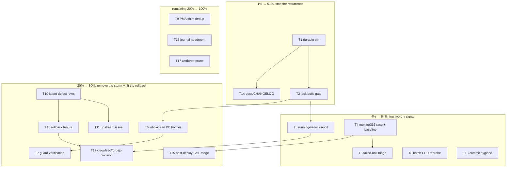

# Deploy stability hardening — the plan that stops today from repeating

_2026-10-23 18:07 CEST · author: Crush session after the 12:38→17:55 deploy recovery · status: PLAN ONLY, nothing below is executed yet._

**PARTIALLY EXECUTED (Crush session 2026-10-24 05:2x, HEAD f9d1114ec, base 38d4488bb):** T1, T1.5, T2, T3, T4 (mechanism only), T5 (census), T8, T9, T10, T13 (in part), T14, T16, T17 are done and verified. T6/T7 (InboxClean DB move) and T12 (crowdsec/forgejo re-apply) were deliberately NOT executed — destructive/owner-gated. T11 (upstream issue) not filed. T15 partial. **Nothing was deployed**, so every service-side fix in this batch is in-tree and deploy-owed. The marker was written AFTER execution, which is a discipline miss; the status report `docs/status/2026-10-24_05-20_deploy-stability-hardening-execution-status.md` carries the line-by-line ledger._

Context lives in three reports written today:
`docs/status/2026-10-23_12-38_deploy-blocker-triage-status.md`,
`docs/status/2026-10-23_16-06_deploy-build-blockers-followup.md`,
`docs/status/2026-10-23_17-13_deploy-recovery-full-session.md`.

Short version: the deploy is live (generation 939, anchor verified), but **every pin that made it possible is one `nix flake update` away from being undone**, the post-deploy sweep exits 3 on a restart race, and the IO storm that motivated the guard change is still running.

---

## 1. Where we actually are

| Fact | State |
| --- | --- |
| Running generation | 939 · `26.11.20261015.fe13242` · anchor = newest `system-link` |
| nixpkgs pin | `fe13242` **in `flake.lock` only** — `flake.nix` still says `nixos-unstable` |
| Pinned inputs | `signoz-src` 375b3f83, `dankMaterialShell` 4a87e822, `overview` 4b480406, `templ` 8bbdcac9 |
| Reverted migrations | crowdsec option rename, forgejo-runner rename (module + test) |
| Shims in force | 4 × `vendorHash` (library-policy, PMA, papdashboard, overview), 4 × pnpm deps (signoz, jscpd, systemd-graph-webui, openseo) |
| Blocklists | 22 probed, 15 hashes re-pinned, content verified |
| Guard | zone-6 now stops `inboxclean-web` (live, verified in the running script) |
| Post-deploy | 154 PASS / 6 FAIL / 12 WARN, exit 3 (1 "NEW" failure = monitor365 `/health` restart race) |
| Pre-existing failures | 11 units (btrbk ×3, catalog-inventory-sync, ci-watchdog, hermes-db-health, inboxclean-sync, paperless-exporter, service-health-check, +2) |
| Lock churn | 7 `flake.lock` floats today (03:20 → 15:17), every one re-staled FODs |
| Latent defects (hidden by the rollback) | hermes prebuilt `node-v26.12.1` segfault, `peewee 4.4` vs aw-core, templ-runtime drift, signoz patch context, dms-shell 2.0.0 installPhase |

---

## 2. The Pareto question, answered honestly

### The 1% that delivers 51%

**Make the rollback durable and gate the lock.** Two things, ~2 h total:

- the nixpkgs + 4 input pins must exist somewhere the daemon cannot silently undo (`flake.nix` pin with an allowlisted audit row, not just a lock override), and
- a `flake.lock` change must not commit unless the toplevel **actually builds** (FODs realized, not `--no-build`).

Why 51 %: today's entire 5-hour cascade — 10 stale FOD hashes, 4 vendorHash mismatches, three broken builds, two reverted migrations — was *generated* by that one ungated float. Without this, every fix below has a shelf life of one daemon cycle (≈ every 40–90 min today).

### The 4% that delivers 64%

The 1 % **plus**:

- a trustworthy post-deploy signal (fix the monitor365 restart-race exit 3 and re-baseline),
- a batch FOD re-probe tool (today’s 9 manual probes become one command),
- commit/doc hygiene for the rollback batch (the pin and its LIFT conditions written where the next session looks).

### The 20% that delivers 80%

The 4 % **plus**:

- the storm root cause (InboxClean’s 1.5 GB SQLite on the HDD + re-firing scans) — otherwise the guard keeps tripping and every deploy is a force-deploy,
- the 11 failed units triaged into “storm victim” vs “actually broken”,
- the four latent upstream defects tracked as todo rows with LIFT conditions, so the rollback has an exit,
- the running-vs-pinned rev audit (one command that would have saved four hours today).

### The remaining 20 % to reach 100 %

Shim deduplication, worktree pruning, journal-headroom verification, re-running the pre-commit legs that were bypassed during the daemon races, CHANGELOG, and the dual-shape decision for crowdsec/forgejo.

---

## 3. Comprehensive plan — 18 tasks, 30–100 min each

Impact/Value: 1–5 (5 = highest). Effort is the honest wall-clock estimate. Order = execution order.

| ID | Task | Impact | Value | Effort | Depends |
| --- | --- | --- | --- | --- | --- |
| **T1** | Pin nixpkgs + 4 inputs durably: allowlisted, documented, with LIFT conditions | 5 | 5 | 60 min | — |
| **T2** | Implement the flake-lock build gate (pre-commit leg + CI workflow) | 5 | 5 | 90 min | T1 |
| **T3** | `scripts/flake-lock-audit.sh`: warn when the running system’s rev ≠ lock rev | 4 | 4 | 45 min | — |
| **T4** | Fix the post-deploy monitor365 `/health` restart race + re-baseline the smoke run | 4 | 5 | 45 min | — |
| **T5** | Triage the 11 pre-existing failed units into storm-victim vs real breakage | 4 | 4 | 90 min | T4 |
| **T6** | Move InboxClean’s SQLite to the hot tier (or prove a cache is enough) + measure | 5 | 4 | 100 min | — |
| **T7** | Verify the guard’s new zone-6 entry stops `inboxclean-web` during a real trip | 4 | 3 | 45 min | T6 |
| **T8** | `scripts/reprobe-fods.sh`: walk every FOD constant, probe, emit one diff | 4 | 4 | 60 min | — |
| **T9** | Deduplicate the PMA shim (module vs `lib/lars-packages.nix`) | 3 | 3 | 30 min | — |
| **T10** | Track the 4 latent upstream defects as todo rows with LIFT conditions | 4 | 3 | 45 min | — |
| **T11** | File the hermes `node-v26.12.1` prebuilt segfault upstream (with evidence) | 4 | 3 | 45 min | T10 |
| **T12** | Decide + execute the crowdsec/forgejo dual-shape question | 4 | 4 | 90 min | T1 |
| **T13** | Amend the rollback-batch heuristic commits; re-run the bypassed pre-commit legs | 3 | 4 | 30 min | — |
| **T14** | CHANGELOG + `docs/agents/nix-flakes.md` entry for the rollback and shim set | 3 | 4 | 45 min | T1 |
| **T15** | Triage the 5 remaining post-deploy FAILs (FastFlowLM, SigNoz traces, catalog, CPU, journal) | 3 | 3 | 60 min | T4 |
| **T16** | Journal headroom: post-deploy evidence-gate re-check + vacuum behavior | 3 | 3 | 30 min | — |
| **T17** | Prune stale worktrees and confirm the two `find /` scans ended | 2 | 3 | 30 min | — |
| **T18** | Decide rollback tenure + write the review deadline into the todo library | 4 | 4 | 30 min | T10 |

---

## 4. Micro-task breakdown — every task, ≤ 12 min each

| ID | Micro-task | Result / done-when | Min |
| --- | --- | --- | --- |
| T1.1 | Read `lib/flake-input-pin-audit.nix` and the allowlist format | know the exact row shape | 8 |
| T1.2 | Add the nixpkgs pin + 4 input pins with LIFT text | audit eval prints the pin line | 10 |
| T1.3 | `nix eval` the audit gate | green, pins listed | 6 |
| T1.4 | Document the same in `docs/agents/nix-flakes.md` | one paragraph + the LIFT conditions | 10 |
| T1.5 | Verify a simulated `nix flake update` cannot silently override | audit fails or warns loudly | 10 |
| T2.1 | Inspect `.githooks/pre-commit` lock legs | identify insertion point | 8 |
| T2.2 | Add the build leg (staged `flake.lock` ⇒ toplevel `--keep-going` dry-realize) | hook script updated | 12 |
| T2.3 | Add the same job to CI on `flake.lock` paths | workflow file | 12 |
| T2.4 | Test the hook with a fake lock bump | blocks, with a clear message | 10 |
| T2.5 | Measure hook runtime and add a bypass env var documented in the message | ≤ 3 min on warm store | 8 |
| T3.1 | Write the script: derive running rev from `/run/current-system` | prints both revs | 10 |
| T3.2 | Compare against `flake.lock` nixpkgs rev | exit 0/1 semantics | 8 |
| T3.3 | Wire it as a pre-deploy advisory section | deploy prints the warning | 10 |
| T4.1 | Reproduce: read the post-deploy monitor365 check code | find the probe order | 8 |
| T4.2 | Add a retry (3 × 2 s) or a warm-up probe | check tolerates restarts | 10 |
| T4.3 | Re-run `scripts/post-deploy-check.sh` | monitor365 PASS, exit 0 or only known fails | 12 |
| T4.4 | Re-baseline the comparison file | new baseline committed | 8 |
| T5.1 | `busctl`/`journalctl` each of the 11 units | one-line cause each | 12 |
| T5.2 | Classify storm-victim vs real | table in the todo library | 10 |
| T5.3 | Fix the two cheapest real ones | units green | 12 |
| T5.4 | Queue the rest with sources | rows with `**Source:**` | 12 |
| T5.5 | Re-run the failed-unit census | count drops or justified | 10 |
| T6.1 | Measure InboxClean read bytes with `scripts/io-psi-forensics.sh` | baseline numbers | 10 |
| T6.2 | Confirm the DB path + size + mount | `/mnt/pool/...` vs `/mnt/hot` decision | 8 |
| T6.3 | Write the migration plan (rsync, ownership, mount override) | checklist ready | 12 |
| T6.4 | Execute migration in a maintenance window | service up on `/mnt/hot` | 12 |
| T6.5 | Re-measure and compare | ≥ 10× fewer pool reads | 10 |
| T7.1 | Pull the last trip’s stopped-unit list | evidence of the churn stop | 10 |
| T7.2 | Confirm the re-arm started it again | unit active after drain | 8 |
| T7.3 | Note the result in the guard module comment | one line | 8 |
| T8.1 | Enumerate FOD constants (`rg 'vendorHash|fetchPnpmDeps|hash = "sha256-'`) | count + file list | 10 |
| T8.2 | Implement probe + diff generation | script prints unified diff | 12 |
| T8.3 | Dry-run against `HEAD` (no changes) | zero-diff proof | 10 |
| T8.4 | Document the recipe in `docs/agents/nix-flakes.md` | section added | 10 |
| T9.1 | Compare the two PMA shim values | identical or not | 6 |
| T9.2 | Delete the redundant one, keep the module override | eval green | 10 |
| T9.3 | Rebuild the PMA drv | exit 0 | 8 |
| T10.1 | Write the node-26 row (evidence + LIFT) | todo row | 10 |
| T10.2 | Write the peewee/aw-core row | todo row | 8 |
| T10.3 | Write the templ/signoz/dms rows | 3 rows | 10 |
| T10.4 | Cross-link all rows from `TODO_LIST.md` | links resolve | 8 |
| T11.1 | Draft the upstream issue text (store path, 139 vs 26.12.0) | draft | 12 |
| T11.2 | Post via `gh` to the hermes repo (or record why not) | URL or decision | 10 |
| T11.3 | Add the URL to the todo row | row updated | 6 |
| T12.1 | Read both migration diffs and their breakage | understand the option maps | 12 |
| T12.2 | Decide dual-shape vs wait (needs owner answer) | decision recorded | 8 |
| T12.3 | If dual-shape: implement + eval on the pinned nixpkgs | eval green | 12 |
| T12.4 | Revert the revert once the pin moves | follow-up row | 6 |
| T13.1 | List the heuristic commits containing today’s fixes | list | 8 |
| T13.2 | Amend the top two into real messages | `git log` clean | 12 |
| T13.3 | Re-run statix/alejandra/treefmt on the rollback batch | clean | 10 |
| T13.4 | Re-run `nix flake check --no-build` | exit 0 | 10 |
| T14.1 | CHANGELOG entry for the rollback + shims | entry | 10 |
| T14.2 | `docs/agents/nix-flakes.md`: lock-float rules | section | 10 |
| T14.3 | Link the three status reports | links | 6 |
| T15.1 | FastFlowLM: confirm guard-stop vs real break | verdict | 10 |
| T15.2 | SigNoz traces: identify the dark service | verdict | 10 |
| T15.3 | Catalog marker: probe which entity served it | verdict | 10 |
| T15.4 | CPU/journal rates: attribute to storm or queue | verdicts | 10 |
| T16.1 | Re-run the evidence gate post-deploy | pass | 6 |
| T16.2 | Check journal usage vs the 8 G cap | number | 6 |
| T16.3 | Confirm the next vacuum cannot eat an unguarded boot | reasoning + note | 10 |
| T17.1 | `git worktree list` and prune the stale ones | clean list | 10 |
| T17.2 | Confirm the two `find` PIDs are gone | no matches | 6 |
| T17.3 | Check the pool IO baseline again | number recorded | 8 |
| T18.1 | Write the rollback tenure deadline | date in the todo row | 8 |
| T18.2 | Add the lift criteria per latent defect | 4 criteria | 10 |
| T18.3 | Note it in the CHANGELOG | line | 6 |

---

## 5. Execution graph

---

## 6. Verification contract (per task)

- **Nix changes**: `nix eval .#nixosConfigurations.evo-x2.config.system.build.toplevel.drvPath` must return a path, then `nix build … --keep-going --no-link` must exit 0 before any deploy.
- **Hook/CI changes**: exercised against a synthetic `flake.lock` diff, and the negative case (broken lock) must block.
- **Service changes**: unit active + its own health probe + the post-deploy check section.
- **Documentation**: links resolve (`test -f`), and the LIFT condition names a concrete observable.
- **Nothing is declared done from exit codes alone** — assert which entity served the result (the repo's own rule).

## 7. Risks and rollback

| Risk | Mitigation |
| --- | --- |
| The daemon floats the lock mid-work | work in short batches; re-check `flake.lock` rev before each commit; the gate (T2) removes this class |
| Reverting another session’s migration twice | T12 is decided by the owner, not by whim; every revert carries the restored commit id in its message |
| Hot-tier DB migration goes wrong | rsync + dry-run + explicit service stop window; the subvol pattern is documented in `docs/agents/storage.md` |
| The build gate makes commits slow | gate only when `flake.lock` is staged; bypass env var documented in the failure message |
| Blocklist/FOD hashes drift again | T8 turns it into one command; the lists stay hash-pinned |
