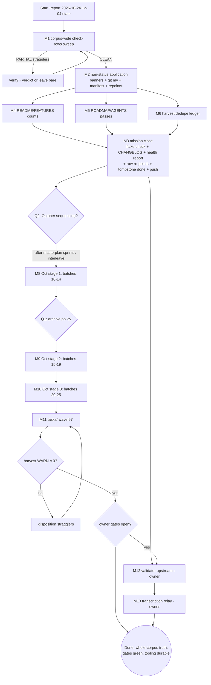

# SUPERB — Docs-Health Corpus Closeout & October Wave

**Created:** 2026-10-24 12:11 CEST · **Owner:** Lars · **Author:** docs-health redispatch session (batch 01–09 executor)
**Trigger:** user dispatch — Pareto decomposition + two-level task tables + execution graph, plan only.
**Mission:** finish the tracked docs-health 2026-0* corpus mission to a fully closed, gate-green state (closeout spine + living docs), then carry the SAME proven pipeline across the 2026-10 wave (442 root + 57 tasks reports) so the entire status corpus reaches truth. Zero intent-loss, zero false history, zero Verschlimmbesserung.

## Context (what a fresh executor must know)

- **Owning row:** TODO_LIST:783 → docs/todo/pipeline.md:582 ("Finish the docs-health 2026-0* corpus sweep"); owning plan `docs/planning/2026-10-19_05-06_SUPERB-docs-health-corpus-completion.md` — tombstone EXECUTING since `e37dde0c2` (2026-10-24 07:29). Groundwork status: `docs/status/2026-10-24_12-04_docs-health-corpus-sweep-batches-01-09-status.md` (READ FIRST — §f is this plan's seed).
- **State at plan time:** Sept corpus 294 tracked files → 292 annotated + 2 archived (`2026-09-19_16-16`, `2026-09-30_07-42`), 1,918 verdicts applied via 9 validated batches; TODO queue holds **0** `[x]` rows (249 pruned to CHANGELOG `36057309a`); 52 non-status 2026-0* files classified (17 EXECUTED / 8 SUPERSEDED / 24 REFERENCE-KEEP / 4 ACTIVE) but NOT yet applied; 82 unharvested §f WARNs — all 2026-10 wave.
- **Toolchain (proven this session):** classifier-agent prompt (in `~/.cache/docshealth/classify-prompt.txt`) → transcription → `~/.cache/docshealth/validate-verdicts.sh` (snippet relocation ±6, wrong-evidence noun-overlap filter) → prefix-retag v→w → `go run /home/lars/.config/crush/skills/docs-health/assets/annotate.go repair [--dry-run] <spec.tsv>` (run from repo root; relative paths) → `check-rows` per batch → pathspec commit. Batch file lists: `~/.cache/docshealth/batch-0[1-9].txt`.
- **Verdict canon (do NOT re-invent):** strike §b/§c/§f open asks only; §a ledgers + d/e/g stay bare; `v` → `done — <evidence answering THE ASK>`; `w` → moot/decided-against/superseded/one-shot-window-passed; `n` → `NOT-DO — dup`; open-but-tracked stays BARE (no routed arrows in this corpus).
- **Hard guards:** wrong-done is the WORST failure (ambiguity → bare); dry-run before every apply; `check-rows` BEFORE `git mv`; citation sweep matches FULL filenames (never prefixes — task-id twins collide); archived files need ≥1 `~~` strike (zero-strike closure files stay held pending §owner-gates Q3); pathspec commits only; workspaces under `~/.cache/docshealth/` (never /tmp); agents dispatched ONE AT A TIME; gates after every batch block the next.

## Ground truth (what remains, measured 2026-10-24 12:04)

| Surface | Count | State |
|---|---|---|
| Sept corpus final `check-rows` sweep | 294 files | per-batch gates green, corpus-wide enumeration NOT run |
| Non-status 2026-0* application | 17 EXECUTED + 8 SUPERSEDED + 4 ACTIVE + 24 KEEP | classification table in session report; nothing applied |
| Reports citing the 2 archived files | 4 status reports | stale paths, no moved-pointer notes |
| Harvest dedupe ledger (Sept OPENS inventories) | ~9 batch summaries | not reconciled against queue/libraries |
| Living docs verify | README, FEATURES, ROADMAP, AGENTS | not run this mission (2026-10-06 §f.5 debt) |
| Final gates | `nix flake check --no-build`, todo/link gates, health report | pending |
| Owning-row close-out | TODO_LIST:783 + pipeline.md:582 + tombstone | stale "remaining ~300" text |
| 2026-10 root wave | 442 reports | never swept; §f WARN surface (82) |
| 2026-10 tasks/ wave | 57 tq reports | never swept |
| Tooling upstream | validator + relay → docs-health skill | owner-gated (crush-config repo) |

## Pareto decomposition

### The 1% that delivers ~51%: THE CLOSEOUT SPINE
Final corpus-wide `check-rows` sweep + apply the 52-file non-status triage + gates + CHANGELOG entry + owning-row close + tombstone flip. This converts "90% done, invisible" into "DONE, history-readable, gates green" — it is what makes the entire 1,918-verdict investment durable and closes the tracked row.

### The 4% that delivers ~64%: + LIVING DOCS SUPERBNESS
README/FEATURES computed counts + ROADMAP Theme-1 + AGENTS endurance pass + health report. This is the user-visible half of the original dispatch ("TODO_LIST, CHANGELOG, AGENTS, README, ROADMAP, FEATURES must be all SUPERB") — the corpus was the invisible half.

### The 20% that delivers ~80%: + THE OCTOBER WAVE (owner-gated sequencing)
Same pipeline over 442 root + 57 tasks reports (≈25 batches). Stops 100% of forward intent-loss — every §f WARN (82) either harvested or dispositioned — and makes the whole status corpus truthful, not just Jan–Sep. Biggest remaining block by far.

### The remaining 20% → 100%: + TOOLING + DURABILITY
Validator/prompt upstreamed into the docs-health skill (crush-config), transcription relay to kill the hand-copy class, qmd re-index, harvest-ledger long tail, policy codification from §owner-gates answers. Without it: the October wave re-pays the same friction and drift returns next wave.

## Owner gates (block the marked tasks; from session report §g)

- **Q1 archive policy:** cited-but-fully-resolved reports — archive anyway vs keep-in-root (affects M9+ and ~500 files eventually).
- **Q2 October sequencing:** ride after SUPERB masterplan v2 sprints vs interleave now (affects M8–M10 start date).
- **Q3 zero-strike canon:** header-banner form for zero-numbered-item closure reports (unblocks holding 2 + future cases).

Defaults if unanswered: Q1 keep-in-root (predecessor-consistent), Q2 after current masterplan sprints, Q3 keep holding (canon unchanged).

## Level 1 — macro tasks (30–100 min each; ALL remaining TODOs; sorted importance × impact / effort)

| # | Task | Est | Impact | Effort | Customer value | Depends on | Gate |
|---|---|---|---|---|---|---|---|
| M1 | **Final corpus-wide check-rows enumeration** over all 294 Sept files; triage every PARTIAL beyond known-genuine opens (verify-then-verdict or leave bare) | 40m | ★★★★★ | S | corpus truth verified exhaustively, not sampled | — | — |
| M2 | **Non-status triage application**: SUPERSEDED banners on 8; `git mv` 17 EXECUTED planning docs → `docs/planning/archived/` (check existing banners first); 1-line-per-file manifest; full-filename dangling-ref sweep + repoint; moved-pointer notes into the 4 reports citing archived files | 75m | ★★★★★ | M | planning/ navigable; 2026-0* glob fully closed | M1 | — |
| M3 | **Mission close**: `nix flake check --no-build`; CHANGELOG sweep entry (count-before-claim: 1,918 verdicts / 294 files / counts per batch); two-score docs-health AUDIT inline (as-found math per health-report-format); re-point+close TODO_LIST:783 AND pipeline.md:582 (edit both); tombstone EXECUTING→EXECUTED; commit + push | 60m | ★★★★★ | S | tracked row closes once, history durable | M1, M2, M4–M7 | — |
| M4 | **README + FEATURES verify**: re-derive counts from repo (services, modules, checks, gatus, ports), update tables, stamp sweep date; status vocabulary check | 50m | ★★★★☆ | M | the "superb living docs" ask, user-visible | — | — |
| M5 | **ROADMAP + AGENTS passes**: Theme-1 stale framing; AGENTS size/paths/endurance + no-temporal-pollution grep; fix drift in place | 45m | ★★★★☆ | M | session-context fitness for every future agent | — | — |
| M6 | **Harvest dedupe ledger**: reconcile 9 batch OPENS inventories vs TODO_LIST/docs/todo (grep key nouns); route untracked actionable items (queue+library pair); ledger table with disposition per item | 45m | ★★★☆☆ | M | nothing rots in snapshots; no paid no-op re-dispatches | — | — |
| M7 | **qmd re-index + final link/todo/doc gates** | 15m | ★★☆☆☆ | S | searchability post-moves | M2 | — |
| M8 | **October root wave — stage 1** (batches 10–14, ~110 reports: split by date, 22–24/batch, full pipeline) | 5×75m | ★★★★☆ | L | intent-loss stops for the newest reports first | M3 | Q2 |
| M9 | **October root wave — stage 2** (batches 15–19, ~110) | 5×75m | ★★★☆☆ | L | coverage | M8 | Q1, Q2 |
| M10 | **October root wave — stage 3** (batches 20–25, ~115 incl. twin-file classes + archive wave per batch) | 5×75m | ★★★☆☆ | L | 2026-10 root closed | M9 | Q1 |
| M11 | **October tasks/ wave** (57 tq reports; queue-footer close-out convention; 3 batches) | 3×60m | ★★★☆☆ | M | corpus 100%: WARN surface to zero | M10 | — |
| M12 | **Validator upstream** → docs-health skill (crush-config): `validate-verdicts.sh` + prompt contract + retag-at-emission rule | 30m | ★★★☆☆ | S | every future sweep inherits the nets | M3 | owner |
| M13 | **Transcription relay** (crush-config): writable sub-agent writes agent output to disk directly; validator stays as net | 60m | ★★☆☆☆ | M | kills the hand-copy corruption class (~1/470 lines) | M12 | owner |

**Totals:** closeout spine M1–M7 ≈ 5.5 h · October M8–M11 ≈ 19 h (staged across sessions by design) · tooling M12–M13 ≈ 1.5 h owner-gated.

## Level 2 — micro tasks (≤12 min each; ALL TODOs; same sort)

**M1 (sweep):** μ1 build 294-file list from batch-0*.txt union (5m) · μ2 run check-rows over full list → log (6m) · μ3 count + classify PARTIAL/UNTOUCHED (6m) · μ4–μ7 triage PARTIAL stragglers in 4 slabs (12m ×4) · μ8 apply repair specs for newly-verdicted stragglers (dry-run→apply) (10m) · μ9 re-run gate until CLEAN-or-justified (8m)

**M2 (non-status):** μ10 write SUPERSEDED banners on 8 (12m) · μ11 pre-move check-rows/banner check on 17 EXECUTED (8m) · μ12–μ14 `git mv` 17 files in 3 slabs + manifest lines (10m ×3) · μ15 manifest → archived README or closeout report (8m) · μ16 full-filename dangling-ref grep across repo (8m) · μ17 repoint live-surface refs (10m) · μ18 moved-pointer notes into 4 citing reports (10m) · μ19 `check-doc-links.sh` (4m)

**M3 (close):** μ20 `nix flake check --no-build` (12m) · μ21 CHANGELOG entry draft w/ counts (12m) · μ22 health report: findings table + both scores, visible math (12m) · μ23 re-point TODO_LIST:783 (6m) · μ24 re-point pipeline.md:582 (6m) · μ25 tombstone flip via plan-marker.sh done (4m) · μ26 pathspec commit + push + exclusivity check (8m)

**M4 (README/FEATURES):** μ27 count services (ls modules + registry) (6m) · μ28 count modules/checks/ports from flake parts + lib/ports.nix (8m) · μ29 README service table update (10m) · μ30 FEATURES status refresh + vocabulary check (12m) · μ31 stamp sweep date both files (4m)

**M5 (ROADMAP/AGENTS):** μ32 ROADMAP Theme-1 read + annotate stale (10m) · μ33 ROADMAP graduated/shipped items prune (8m) · μ34 AGENTS `wc -c` + >30KB check (4m) · μ35 AGENTS temporal-pollution + commit-hash greps (8m) · μ36 AGENTS path-existence spot check (10m) · μ37 fix findings in place (10m)

**M6 (harvest ledger):** μ38 merge 9 OPENS inventories to one list (6m) · μ39–μ42 dedupe greps vs TODO_LIST + libraries by domain (12m ×4) · μ43 route untracked actionable → queue+library pairs (12m) · μ44 write ledger w/ dispositions (8m) · μ45 re-run check-todo-system, delta note (6m)

**M7:** μ46 qmd re-index (10m) · μ47 final gates trio (5m)

**M8–M10 (per batch NN, repeated ×15):** μa emit batch list (6m) · μb dispatch ONE classifier agent (12m) · μc transcribe TSV to cache (10m) · μd validate + retag-at-emission (8m) · μe dry-run + apply (8m) · μf check-rows batch (8m) · μg opens-spot + archive candidates note (8m) · μh pathspec commit (6m)

**M11 (tasks/ ×3):** same μa–μh shape with queue-footer convention (10m/step)

**M12:** μ48 extract validator+prompt to skill assets dir (10m) · μ49 selftest fixture (12m) · μ50 skill SKILL.md wiring note (8m)

**M13:** μ51 relay design (write-subagent vs tee harness) (12m) · μ52 implement + one-batch live A/B (12m) · μ53 adopt-or-revert decision note (8m)

**Totals:** ≈ 100 micro rows equivalent (15 batch-repeats × 8 + 53 named) — consistent with macro ≈ 26 h.

## Execution graph

## Verschlimmbesserung contract

1. Never touch `archived/` contents — archive-forward only via `git mv`.
2. Never strike without evidence answering THE ASK; ambiguity → bare (wrong-done is the worst outcome).
3. Never `git mv` before `check-rows`/banner gate passes on that file.
4. Citation sweeps match FULL filenames; a cited file stays in root unless Q1 answered otherwise.
5. One batch at a time; a red gate blocks the next batch; pathspec commits only (daemon coexists).
6. No reformatting (`nix fmt` churn is the known trap); no mid-sweep convention changes (bare §a / no routed arrows stay).
7. Every mutation reversible-in-principle: specs are data, applies are diffable, moves are `git mv`.
8. Plan numbers re-verified at execution start (the 208≠249 lesson).

## What this plan deliberately does NOT do

- No edits to the 2026-10 wave before Q2 is answered (stays queued).
- No new queue rows during closeout beyond the owning-row re-point (avoid racing the single close).
- No skill changes in THIS repo (validator/relay land in crush-config, owner-gated).
- No scope growth into SUPERB masterplan v2 sprint work (its rows own their surfaces).
