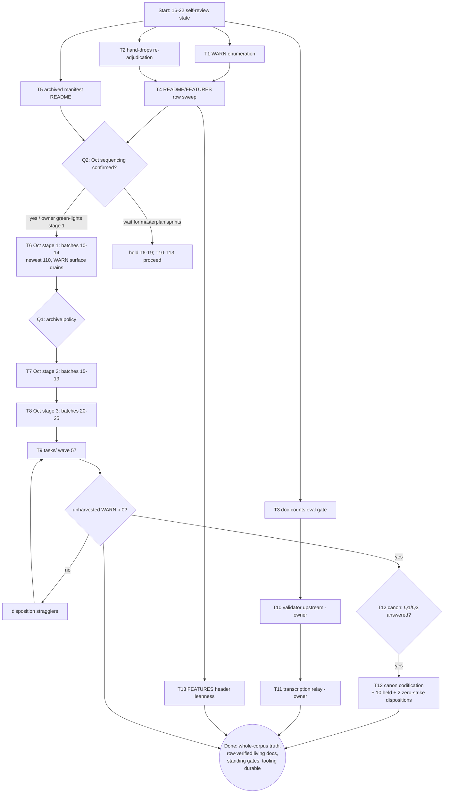

# SUPERB — Docs-Truth: Closeout Residuals + October Wave

**Created:** 2026-10-24 16:43 CEST · **Owner:** Lars · **Author:** docs-health closeout session (self-review executor)
**EXECUTING (instance T1-T5 residuals now; T6+ owner-gated (Q2), 2026-10-24 16:51 CEST, HEAD `57cd0de9b`):** executing (see AGENTS.md plan-execution tombstone)
**Trigger:** user dispatch — Pareto decomposition (1%/4%/20%/other-20%) + two-level task tables (30–100 min + ≤12 min) + execution graph + commit + push, plan first.
**Mission:** convert the docs-health mission's residual unverified surfaces into verified truth (3 tiny follow-ups), finish the living-docs row-depth pass, then carry the 9×-proven pipeline across the 2026-10 wave (442 root + 57 tasks reports) so the ENTIRE status corpus reaches truth — with the tooling upstreamed so the next wave doesn't re-pay the friction. Zero intent-loss, zero false history, zero Verschlimmbesserung.

## Context (what a fresh executor must know)

- **Predecessor chain:** `docs/planning/2026-10-19_05-06_*` (corpus completion — EXECUTED 2026-10-24) → `docs/planning/2026-10-24_12-11_*` (closeout + October wave — spine M1–M7 COMPLETE, M8–M13 remain) → THIS plan supersedes the M8–M13 remainder with re-derived numbers + adds the 5 closeout follow-ups harvested in `docs/status/2026-10-24_16-22_*` §f.
- **State at plan time:** Sept corpus CLOSED (1,953 verdicts / 294 files; CHANGELOG 2026-10-24 entry); 93 flagged PARTIAL files = adjudicated-open surface (13-file sample justified); queue holds 0 `[x]` rows; 5 new follow-up rows live in TODO_LIST + docs/todo/pipeline.md; 81 unharvested-§f WARNs (composition INHERITED-unverified — the 16-22 report's d.2); 10 cited-but-resolved archive candidates + 2 zero-strike files held pending owner answers; 10 commits unpushed at plan time (pushed by the dispatch that authored this plan).
- **Toolchain (proven 10× incl. the M1 drop-recovery):** classifier agent (read-only, ONE AT A TIME; prompt at `~/.cache/docshealth/classify-prompt.txt`) → transcription → `~/.cache/docshealth/validate-verdicts.sh` → retag-at-emission (v→w for moot/decided-against/superseded) → `annotate.go repair --dry-run` from repo root → `check-rows` per batch → pathspec commit. Batch lists derive by date-split (~22–24/batch). **Persist every classification/decision table to `~/.cache/docshealth/` at decision time** (the lost-52-file-table lesson, paid twice).
- **Verdict canon (unchanged, do NOT re-invent):** strike §b/§c/§f open asks only; §a ledgers + d/e/g stay bare; open-but-tracked stays BARE; `v` = done — evidence answering THE ASK; wrong-done is the WORST failure — ambiguity → bare.
- **Hard guards:** gates before every `git mv` (check-rows + banner); citation sweeps match FULL filenames; archived files never re-edited; agents one at a time; workspace under `~/.cache/docshealth/` (never /tmp); pathspec commits only; commit subjects ≤72 chars (em-dashes count); plan numbers re-verified at execution start.
- **Non-collision:** the SUPERB masterplan v2 (commit `1dab67993`) owns the repo-wide 1,760-TODO backlog and its sprints — THIS plan owns only the docs-truth surfaces (corpus + living-doc verification + docs tooling). No scope growth either direction.

## Ground truth (what remains, measured 2026-10-24 16:22)

| Surface | Count | State |
|---|---|---|
| Unverified WARN composition ("81, all-October" inherited claim) | 81 reports | **T1 VERIFIED 2026-10-24: 81 = 22 Sept stragglers (09-26→09-30, ~480 bare §f items) + 59 Oct — "all-October" REFUTED; flipper = daemon `f12302830` (R091 archive of `2026-09-30_07-42_architecture-catalog-golive-prep-continuation.md`, 11:49, between the prune measure and the 12-04 commit); census + seed persisted `~/.cache/docshealth/t1-warn-census.txt`; Sept folded into the wave seed (pipeline.md [decision] row updated)** |
| Hand-dropped contradictory w-verdicts (b03/b09) | 2 rows | bare, never re-adjudicated |
| Standing doc-counts gate | 0 | README asserts 131/228/46 with no eval gate enforcing them |
| README service-table rows + FEATURES row statuses | 30 + ~120 rows | counts verified 2026-10-24; rows NOT claim-verified |
| `docs/status/archived/` manifest | 1,457 files | no dir-level manifest (planning archive got one) |
| 2026-10 root wave | 442 reports | never swept; the 81-WARN surface lives here |
| 2026-10 tasks/ wave | 57 tq reports | never swept (queue-footer close-out convention) |
| Validator + prompt + relay upstream → docs-health skill (crush-config) | 3 artifacts | proven locally, never upstreamed |
| Canon decisions Q1 (cited-but-resolved archive policy) + Q3 (zero-strike banner) | 2 | unanswered; blocks 10 held candidates + 2 held files |
| FEATURES "Updated:" header leanness | 1 line, ~2.7k chars | 12 nested "(previous:" layers — [watch] |
| Zero-strike closure files | 2 | held in docs/status/ root pending Q3 |

## Pareto decomposition

### The 1% that delivers ~51%: KILL THE UNVERIFIED-CLAIM CLASS
WARN-composition enumeration + 2 hand-drops re-adjudication + doc-counts eval gate. ~1.6 h total. Why 51%: the ENTIRE 1,953-verdict mission's credibility rests on three residual claims that are currently inherited, unadjudicated, or unenforced ("81 all-October", "2 rows bare for cause", "README numbers true as of today"). Verifying the first two converts the mission's own evidence from probably-true to verified-true; the gate makes the third permanently self-enforcing. Cheapest truth-per-minute in the whole plan.

### The 4% that delivers ~64%: + LIVING-DOC ROW DEPTH
README service-table row verification + FEATURES row-status sweep + the archived-status manifest README. ~2.5 h. Why: the "SUPERB living docs" ask is currently counts-deep only; row-depth is what a reader actually trusts ("is MY service's row true?"), and the 1,457-file archive becomes navigable history instead of a black hole. Completes the original dispatch's visible half.

### The 20% that delivers ~80%: + OCTOBER WAVE STAGE 1 (M8, batches 10–14, ~110 newest reports)
The same pipeline over the NEWEST ~110 of the 442. ~6 h staged across sessions. Why 80%: intent-loss is ACTIVE here — every un-harvested October report is un-routed forward intent, and the 81-WARN surface concentrates in the newest reports. Sweeping the newest quarter stops the bleeding where it is freshest and re-proves the pipeline on 2026-10 shapes (superb-v2 sprint reports, task twins) before committing to the long tail. Owner gate Q2 acknowledged: this plan PROPOSES starting stage 1 now (the dispatch asking "what should we really do" is the sequencing signal); the default (wait for masterplan sprints) holds only until the owner says otherwise.

### The remaining 20% → 100%: + STAGES 2–3, tasks/ WAVE, TOOLING, CANON
Oct stages 2–3 (batches 15–25, ~225), tasks/ wave (57, queue-footer convention), validator+prompt upstream (M12) and transcription relay (M13) into the docs-health skill, Q1/Q3 canon codification once answered, FEATURES header leanness. ~16 h. Without it: the wave re-pays transcription friction, cited-file policy stays forked per-sweep, and drift returns next wave.

## Owner gates (block the marked tasks; from 16-22 report §g — ASKED, unanswered)

- **Q2 October sequencing** — ride after SUPERB masterplan v2 sprints vs start stage 1 now. This plan proposes NOW (default stays "after" until owner confirms). Gates T6 start.
- **Q1 archive policy** for cited-but-fully-resolved reports (keep-in-root vs archive-anyway). Gates T7/T8 archive waves (~500 fates) + the 10 held Sept candidates.
- **Q3 zero-strike canon** (header-banner form). Gates the 2 held files + future zero-item closures inside the Oct wave.
- **Tooling upstream authorization** (M12/M13 touch the crush-config repo, not this one). Gates T10/T11.

## Level 1 — macro tasks (30–100 min each; ALL remaining TODOs; sorted importance × impact / effort)

| # | Task | Est | Impact | Effort | Customer value | Depends on | Gate |
|---|---|---|---|---|---|---|---|
| T1 | **WARN-composition enumeration** — list all 81 §f-bearing WARN reports, confirm all-October or route Sept stragglers, name the 82→81 flipper; reconcile into the Oct-wave batch lists | 45m | ★★★★★ | S | the corpus mission's last inherited claim becomes verified | — | — |
| T2 | **Hand-drops re-adjudication** — the 2 contradictory w-verdict rows (b03/b09): read evidence, decide strike-vs-bare, apply via repair spec | 30m | ★★★★☆ | S | 2-row residual ambiguity closed; wrong-done risk eliminated | — | — |
| T3 | **Standing doc-counts eval gate** (`checks.doc-counts`) — eval nixosModules/gatus-endpoints/packages counts, compare to README's asserted 131/228/46, fail on drift + negative-test lint leg | 90m | ★★★★★ | M | the 55-vs-131 drift class becomes structurally impossible | — | — |
| T4 | **README + FEATURES row-depth sweep** — every service row (port/URL/claim) vs config; every FEATURES status row vs code; fix drift in place; stamp | 100m | ★★★★☆ | M | living docs trusted row-by-row, not just count-deep | T1 | — |
| T5 | **`docs/status/archived/` manifest README** — one-line-per-wave classification + sweep pointer (backfill 2026-10-01 + corpus sweep 2026-10-24 + future waves append) | 30m | ★★★☆☆ | S | 1,457-file archive becomes navigable | — | — |
| T6 | **Oct stage 1 — batches 10–14** (~110 newest root reports; full pipeline; archive candidates per batch; moved-pointer notes at move time) | 5×75m | ★★★★★ | L | active intent-loss stops where it accumulates; 81-WARN surface starts draining | T1–T3 | Q2 |
| T7 | **Oct stage 2 — batches 15–19** (~110) | 5×75m | ★★★★☆ | L | coverage | T6 | Q1, Q2 |
| T8 | **Oct stage 3 — batches 20–25** (~115 incl. twin-file classes + per-batch archive waves) | 5×75m | ★★★★☆ | L | 2026-10 root closed | T7 | Q1 |
| T9 | **tasks/ wave — 57 tq reports** (3 batches; queue-footer close-out convention) | 3×60m | ★★★☆☆ | M | corpus 100%: WARN surface to zero | T8 | — |
| T10 | **Validator + prompt upstream** → docs-health skill (crush-config): validate-verdicts.sh + prompt contract + retag-at-emission rule + persist-tables-at-decision-time rule; selftest fixture | 45m | ★★★☆☆ | S | every future sweep inherits the nets | T3 | owner |
| T11 | **Transcription relay** (crush-config): writable sub-agent writes agent output to disk; validator stays as net; one-batch live A/B + adopt-or-revert note | 75m | ★★☆☆☆ | M | kills the hand-copy corruption class (~1/470 lines) | T10 | owner |
| T12 | **Canon codification** — Q1/Q3 answers written into the docs-health skill ANNOTATE section + AGENTS TODO-system notes; disposition the 10 held Sept candidates + 2 zero-strike files accordingly; planning-cited-file policy rides Q1 | 45m | ★★★☆☆ | S | policy stops being per-session precedent | T7 | Q1, Q3 |
| T13 | **FEATURES header leanness** — collapse "Updated:" to last 3 inline + footer section for older layers | 30m | ★★☆☆☆ | S | header readable again | T4 | — |

**Totals:** T1–T5 residuals ≈ 5 h · T6–T9 October ≈ 18.5 h (staged across sessions by design) · T10–T13 tooling+canon ≈ 3.25 h (T10/T11 owner-gated).

## Level 2 — micro tasks (≤12 min each; ALL TODOs; same sort)

**T1 (WARN enumeration):** μ1 extract WARN list from check-todo-system (5m) · μ2 date-bucket the 81 (6m) · μ3 identify the 82→81 flipper vs 12-04 state (8m) · μ4 route any Sept straggler (harvest pair or verdict) (10m) · μ5 fold confirmed-October list into batch lists 10–25 seed (8m)

**T2 (hand-drops):** μ6 locate the 2 rows (b03/b09 drops logs + files) (6m) · μ7 read each row + its contradictory evidence (8m) · μ8 verdict-or-bare decision + spec entry (6m) · μ9 dry-run + apply + check-rows + pathspec commit (10m)

**T3 (counts gate):** μ10 write lib/check count-eval glue (12m) · μ11 README assertion extraction (grep the asserted numbers) (10m) · μ12 gate comparison + fail path (12m) · μ13 negative-test lint leg (fixture with wrong count) (12m) · μ14 wire into checks + selftest script (10m) · μ15 flake check green + pathspec commit (8m)

**T4 (row sweep):** μ16 README service rows 1–15 vs config (12m) · μ17 rows 16–30 (12m) · μ18 fix drift found (README) (10m) · μ19 FEATURES platform rows vs code (12m) · μ20 FEATURES service rows 1–60 (12m) · μ21 rows 61–120 (12m) · μ22 fix drift + vocabulary check (12m) · μ23 stamp both + cross-file consistency (8m)

**T5 (archive manifest):** μ24 draft waves table (backfill + corpus sweep + prior bulk waves from CHANGELOG) (10m) · μ25 write README + link from 16-22 report context (8m) · μ26 check-doc-links + commit (6m)

**T6–T8 (per batch NN, repeated ×15):** μa emit batch list (persist to cache!) (6m) · μb dispatch ONE classifier agent (12m) · μc transcribe TSV (10m) · μd validate + retag-at-emission (8m) · μe dry-run + apply (8m) · μf check-rows batch gate (8m) · μg archive candidates: citation sweep (full filenames) + check-rows + git mv + moved-pointer notes (12m) · μh pathspec commit (6m)

**T9 (tasks/ ×3 batches):** same μa–μh shape + queue-footer convention read-first (10m/step)

**T10 (upstream):** μ27 extract validator + prompt + rules to skill assets (10m) · μ28 selftest fixture (12m) · μ29 SKILL.md wiring note (8m)

**T11 (relay):** μ30 design choice: write-subagent vs tee harness (12m) · μ31 implement (12m) · μ32 one-batch live A/B (12m) · μ33 adopt-or-revert decision note (8m)

**T12 (canon):** μ34 Q1 answer → skill + AGENTS codification (10m) · μ35 Q3 answer → zero-strike banner form (8m) · μ36 disposition 10 held Sept candidates (12m) · μ37 disposition 2 zero-strike files (6m) · μ38 planning-cited policy note (6m)

**T13 (FEATURES header):** μ39 extract layers to footer section (10m) · μ40 keep last 3 inline + fix references (8m)

**Totals:** 40 named micros + 15 batch-repeats × 8 + 3 tasks-repeats × 8 = ~184 micro rows ≈ consistent with macro ≈ 26.75 h.

## Execution graph

## Verschlimmbesserung contract

1. Never touch `archived/` contents — archive-forward only via `git mv`, gates before every move.
2. Never strike without evidence answering THE ASK; ambiguity → bare (wrong-done is the worst outcome).
3. No reformatting (`nix fmt` churn trap); no mid-wave convention changes (canon stays until T12 codifies owner answers).
4. Citation sweeps match FULL filenames; a cited file stays in root until Q1 is answered otherwise.
5. One batch at a time; a red gate blocks the next; pathspec commits only; subjects ≤72 chars.
6. Persist every decision/classification table to `~/.cache/docshealth/` AT DECISION TIME.
7. Every mutation reversible-in-principle: specs are data, applies are diffable, moves are `git mv`.
8. Plan numbers re-verified at execution start (the 208≠249 and 16≠13 lessons — both paid on this mission).
9. The doc-counts gate must eval TRUTH and compare — never assert-against-assert (a self-referential gate is decoration).
10. No scope growth into SUPERB masterplan v2 sprint surfaces (and none of this plan's surfaces re-owned by it).

## What this plan deliberately does NOT do

- No 2026-10 wave execution before Q2 is confirmed (T6+ hold; T1–T5, T10–T13 proceed regardless).
- No skill/crush-config edits in THIS repo's commits (T10/T11 land in crush-config, owner-gated).
- No re-planning of the M8–M11 batch mechanics already proven (this plan inherits, re-numbers, and adds gates only).
- No new queue rows beyond this plan's own tracking (the 5 follow-ups are already queued; execution closes them in place).
