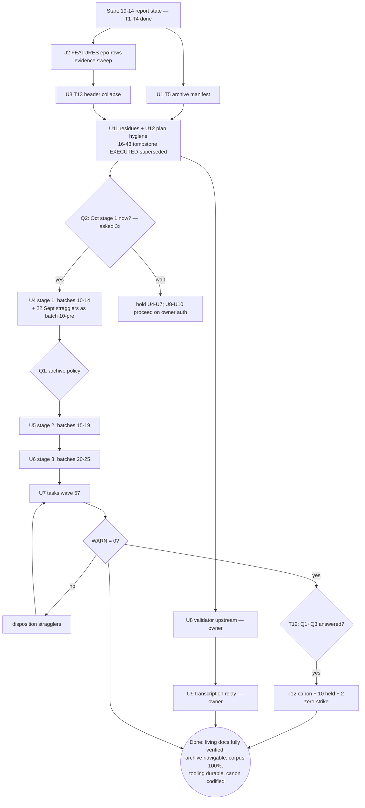

# SUPERB — Docs-Truth Remainder: Living-Docs Completion + Oct-Wave Gates

**Created:** 2026-10-24 19:28 CEST · **Owner:** Lars · **Author:** T1–T5 execution session (post 19-14 report)
**EXECUTING (instance U1-U3+U11/U12 DONE 2026-10-24 ~20:05 CEST — `a9e7383d2`/`e3d61ec36`/`9497cefab`/`552a363c6`; U4–U10 remain OWNER-GATED (Q2 wave sequencing, Q1 archive policy, tooling auth) — do not re-execute U1–U3; row-closes on both queue surfaces):** progress marker (see AGENTS.md plan-execution tombstone)
**Trigger:** user dispatch (re-fire) — Pareto decomposition (1%/4%/20%/other-20%) + two-level task tables (30–100 min + ≤12 min) + execution graph + commit + push, plan first.
**Mission:** finish the docs-truth mission's last living-doc surfaces (the unnavigable 1,457-file archive, the unreadable 13-layer FEATURES header, the ~90 unverified ✅ rows), then the ONLY thing left is the owner-gated October wave + tooling/canon. After this plan's non-gated tasks, every claim in every living doc is either verified, eval-enforced, or explicitly owner-gated — nothing else remains. Zero intent-loss, zero false history, zero Verschlimmbesserung.

## Context (what a fresh executor must know)

- **Predecessor chain:** `2026-10-19_05-06` (corpus, EXECUTED) → `2026-10-24_12-11` (closeout spine M1–M7, COMPLETE) → `2026-10-24_16-43` (docs-truth + Oct wave; **T1–T4 EXECUTED 2026-10-24** — census `dc7c057b0`, hand-drops `e6f8a58b9`, doc-counts gate `9a8ed187a`+`61d35c7ce`, row sweep `43bca64f4`) → THIS plan supersedes the 16-43 remainder with re-derived state. The 16-43 tombstone flips EXECUTED in this plan's commit.
- **State at plan time (all verified this session):** T1 census — WARN 81 = 22 Sept stragglers + 59 Oct ("all-October" refuted; flipper `f12302830`; seeds at `~/.cache/docshealth/t1-*`); T2 — 3 drop-defects closed; T3 — `checks.doc-counts` eval gate LIVE (eval truth vs README/FEATURES anchors, 3 negative legs, harness 15/0); T4 — all 33 README rows verified vs ports registry + live caddy eval + live generation + pgrep (7 rows + FEATURES indexer-web fixed; `services.md:43` premise corrected); T5 half-done (waves enumerated: 1,457 files / 35 adding-commits — table in `docs/status/2026-10-24_19-14_*` §b.1 and re-embedded below); 11 commits unpushed (push authorized by THIS dispatch).
- **Toolchain (proven 10×+):** classifier agent (read-only, ONE AT A TIME; prompt `~/.cache/docshealth/classify-prompt.txt`) → transcription → `validate-verdicts.sh` → retag-at-emission → `annotate.go repair --dry-run` from repo root → `check-rows` → pathspec commit. Persist every decision table to `~/.cache/docshealth/` AT DECISION TIME (paid 3× now — T5's wave table lives only in the 19-14 report because this rule was missed again).
- **Verdict canon (unchanged):** strike §b/§c/§f open asks only; §a ledgers + d/e/g stay bare; open-but-tracked stays BARE; `v` = done with evidence answering THE ASK; wrong-done is the WORST failure; ambiguity → bare.
- **Hard guards:** gates before every `git mv`; citation sweeps match FULL filenames; archived files never re-edited; agents one at a time; workspace `~/.cache/docshealth/` (never /tmp); pathspec commits only; subjects ≤72 chars (em-dashes count); `trash` not `rm`; **commit smallest coherent unit IMMEDIATELY** (T1/T2/T4 pathspec commits survived the daemon; only fat-batched T3 lost 3 races); plan numbers re-verified at execution start.
- **Non-collision:** SUPERB masterplan v2 (`1dab67993`) owns the ~850-row dispatch queue + sprint scheduling. THIS plan owns ONLY the docs-truth surfaces (living-doc completion + status-corpus wave + docs tooling). No scope growth either direction.

## Ground truth (what remains, measured 2026-10-24 19:14–19:28)

| Surface | Count | State |
|---|---|---|
| `docs/status/archived/` manifest README | 1,457 files / 35 waves | waves enumerated (below); README not written (T5, re-queued) |
| FEATURES ✅-row per-row evidence | ~90 un-flagged rows | flagged rows + counts + gate done (T4); ✅ rows lack row-level proof |
| FEATURES "Updated:" header | 13 nested layers | unreadable (T13, [watch] matured: this IS the docs pass) |
| 16-43 plan ground-truth rows T2–T4 | 3 rows | unstamped (stamp + tombstone flip ride this plan's commit) |
| Oct wave stages 1–3 + tasks/ | 442 root + 57 tasks/ + 22 Sept | owner-gated Q2; seeds at `~/.cache/docshealth/t1-{warn-census,oct-batch-seed}.txt` |
| Tooling upstream (validator+prompt / relay) | 3 artifacts | owner-gated (crush-config) |
| Canon Q1 (archive policy) + Q3 (zero-strike) | 2 answers | asked 3× (16-22 §g, 19-14 §g, this plan); block T7/T8/T12 + 10 held + 2 files |
| Session residues | 2 | `/tmp/statix-test.nix` probe (trash); parallel-session catalog work flag (owner attribution) |

**T5 wave table (from git history, re-derivable):** 2026-07-30 `43c266837` (75) · 2026-08-09 `499a6d21b` (152) + `f03d22c31` (96) · 2026-09-06 `dd4f5c995` (55) · 2026-09-14 `835f61643` (656) + `a6b4b2ff2` (133) + `6ddc763f0` (38) · 2026-10-18 `3202b5da0` (61) + `309d4057c` (35) · 2026-10-24 `f12302830` (1) — top waves ≈1,302/1,457; remainder ~155 files across 25 smaller commits.

## Pareto decomposition

### The 1% that delivers ~51%: LIVING-DOCS COMPLETION (T5 + T13 + ✅-rows, ~2.5 h)
The mission's remaining credibility gap concentrates here: the archive is unnavigable history (1,457 files, zero manifest), the FEATURES header is unreadable (13 layers ≈ 3k chars), and ~90 ✅ rows carry no row-level proof — the exact wrong-done class the canon calls the worst failure. Cheapest truth-per-minute left in the entire plan: every task is mechanically verifiable, none is owner-gated.

### The 4% that delivers ~64%: + OCT WAVE STAGE 1 (T6, batches 10–14, ~110 newest, ~6 h staged)
Owner-gated Q2 — PROPOSED NOW (3rd ask). The 81-WARN surface (22 Sept + 59 Oct) starts draining where intent-loss is freshest; the 22 Sept stragglers ride batch 10 (their closure premise was refuted by T1 — the Sept corpus close claimed "zero unharvested Sept" and was wrong).

### The 20% that delivers ~80%: + STAGES 2–3 + TASKS WAVE (T7–T9, ~12.5 h staged)
Coverage to 100% of the status corpus. T7/T8 mid-wave archive waves additionally gated on Q1 (~500 file fates).

### The other 20% → 100%: + TOOLING UPSTREAM, CANON, RESIDUES (T10–T12 + smalls, ~3 h)
Validator+prompt+relay into the docs-health skill (crush-config, owner-gated) so the next wave doesn't re-pay friction; Q1/Q3 codification once answered; /tmp probe trash; catalog-work attribution.

## Level 1 — macro tasks (30–100 min; ALL remaining docs-truth TODOs; sorted importance × impact / effort)

| # | Task | Est | Impact | Effort | Customer value | Depends | Gate |
|---|---|---|---|---|---|---|---|
| U1 | **T5 archive manifest** — `docs/status/archived/README.md`: waves table (re-embedded above), one line per bulk wave (date/commit/count/sweep pointer), link from TODO libraries context; check-doc-links | 30m | ★★★★★ | S | 1,457-file archive becomes navigable | — | — |
| U2 | **FEATURES ✅-row evidence sweep** — per-row proof (module exists + enable/unit shape or explicit artifact) for ~90 un-flagged ✅ rows; fix drift in place; stamp | 90m | ★★★★★ | M | living docs trusted row-by-row; wrong-done class closed | — | — |
| U3 | **T13 FEATURES header collapse** — keep last 3 "(previous:" layers inline, older 9 → footer "## Update history" section; references intact | 30m | ★★★☆☆ | S | header readable again (13 layers → 3) | U2 | — |
| U4 | **Oct stage 1 (batches 10–14, newest ~110 + 22 Sept stragglers as batch 10-pre)** — full pipeline per batch; archive candidates per batch gated on Q1 | 5×75m | ★★★★★ | L | intent-loss stops where it accumulates; WARN drains | U1–U3 | **Q2** |
| U5 | **Oct stage 2 (batches 15–19, ~110)** | 5×75m | ★★★★☆ | L | coverage | U4 | Q1, Q2 |
| U6 | **Oct stage 3 (batches 20–25, ~115 + twin-file classes)** | 5×75m | ★★★★☆ | L | 2026-10 root closed | U5 | Q1 |
| U7 | **tasks/ wave (57 tq reports, 3 batches, queue-footer close-out convention)** | 3×60m | ★★★☆☆ | M | corpus 100%; WARN → 0 | U6 | — |
| U8 | **T10 validator+prompt upstream** → docs-health skill (crush-config): validate-verdicts.sh + prompt + retag rule + persist-tables rule + doc-counts gate pattern note; selftest fixture | 45m | ★★★☆☆ | S | future waves inherit the nets | — | owner |
| U9 | **T11 transcription relay** (crush-config): writable sub-agent writes TSV to disk; one-batch A/B + adopt-or-revert | 75m | ★★☆☆☆ | M | kills hand-copy corruption class | U8 | owner |
| U10 | **T12 canon codification** — Q1/Q3 answers → skill ANNOTATE + AGENTS TODO notes; disposition 10 held Sept candidates + 2 zero-strike files; planning-cited policy rides Q1 | 45m | ★★★☆☆ | S | policy stops being per-session precedent | U6 | Q1, Q3 |
| U11 | **Session residues** — trash `/tmp/statix-test.nix`; catalog-work attribution note stays with the owner (f.8 of 19-14) | 10m | ★☆☆☆☆ | S | clean slate | — | — |
| U12 | **Plan hygiene (rides this plan's commit)** — stamp 16-43 rows T2–T4; flip its tombstone EXECUTED-superseded; non-collision re-affirmed | 10m | ★★☆☆☆ | S | history reads correctly | — | — |

**Totals:** U1–U3 + U11–U12 non-gated ≈ 2.8 h (executable NOW) · U4–U7 wave ≈ 18.5 h staged (Q2) · U8–U10 tooling+canon ≈ 2.75 h (owner/Q-gated).

## Level 2 — micro tasks (≤12 min each; same sort)

**U1 (T5):** μ1 persist waves TSV to `~/.cache/docshealth/t5-waves.tsv` (5m) · μ2 write README manifest (waves table + purpose + "closed history" header mirroring planning archive) (10m) · μ3 link from `docs/status/` context (the 19-14 report §b.1 pointer suffices; check-doc-links green) (4m) · μ4 commit (3m)

**U2 (✅-rows):** μ5 extract ✅-row list to cache TSV (6m) · μ6–μ15 verify 9 rows/batch ×10 batches: module file exists + enable/unit eval or artifact proof; TSV verdict per row (12m each) · μ16 fix drift rows found (10m) · μ17 stamp FEATURES Updated + gates + commit (8m)

**U3 (T13):** μ18 extract 13 layers to a scratch list (6m) · μ19 write footer "## Update history" section with older 9 (8m) · μ20 header keeps last 3 inline; verify references + gates (6m)

**U4–U7 (per batch NN, ×15 + 3):** μa emit batch list (persist!) (6m) · μb ONE classifier agent (12m) · μc transcribe TSV (10m) · μd validate + retag (8m) · μe dry-run + apply (8m) · μf check-rows gate (8m) · μg archive candidates: citation sweep + check-rows + git mv + moved-pointer notes (12m) · μh pathspec commit (6m)

**U8:** μ21 extract validator+prompt+rules to skill assets (10m) · μ22 selftest fixture (12m) · μ23 SKILL.md wiring note + doc-counts gate template pointer (8m)

**U9:** μ30 design: write-subagent vs tee harness (12m) · μ31 implement (12m) · μ32 one-batch live A/B (12m) · μ33 adopt-or-revert note (8m)

**U10:** μ34 Q1 → skill + AGENTS (10m) · μ35 Q3 → zero-strike banner form (8m) · μ36 disposition 10 held Sept candidates (12m) · μ37 disposition 2 zero-strike files (6m) · μ38 planning-cited policy note (6m)

**U11/U12:** μ39 trash `/tmp/statix-test.nix` (2m) · μ40 stamp 16-43 rows + tombstone flip + commit (8m)

**Totals:** 40 named micros + 15 batch-repeats × 8 + 3 tasks-repeats × 8 = ~184 rows ≈ consistent with macro ≈ 24 h (2.8 h non-gated).

## Execution graph

## Verschlimmbesserung contract

1. Never touch `archived/` contents — archive-forward only via `git mv`, gates before every move.
2. Never strike without evidence answering THE ASK; ambiguity → bare (wrong-done is the worst outcome).
3. No reformatting churn (`nix fmt` walks the whole tree — check `git status` after; only keep intended files); no mid-wave convention changes.
4. Citation sweeps match FULL filenames; a cited file stays in root until Q1 says otherwise.
5. One batch at a time; a red gate blocks the next; **pathspec commits of the smallest coherent unit IMMEDIATELY** (the T3 race lesson — fat batches lose daemon races).
6. Persist every decision/classification table to `~/.cache/docshealth/` AT DECISION TIME (missed 3× now).
7. Every mutation reversible-in-principle: specs are data, applies are diffable, moves are `git mv`.
8. Plan numbers re-verified at execution start; truncated displays lie — never alarm without `git show` (the tail-11 lesson).
9. Doc-counts gate evals TRUTH and compares — never assert-against-assert; anchors are single-occurrence forms, restructure = update anchors same-change.
10. No scope growth into masterplan v2's ~850-row queue; none of its surfaces re-owned here.
11. Push ONLY per this dispatch's authorization; after push, verify remote state (`git log origin/master..HEAD` = 0).

## What this plan deliberately does NOT do

- No Oct-wave execution (U4+) before Q2 is answered — U1–U3, U11–U12 proceed regardless; U8–U10 need owner/tooling auth.
- No skill/crush-config edits in THIS repo's commits (U8/U9 land in crush-config).
- No re-planning of proven batch mechanics; no new queue rows beyond this plan's own tracking (T5 + ✅-rows already queued at TODO_LIST:1484–1485).
- No FEATURES row status upgrades without row-level evidence — if proof fails, the row moves DOWN (⚠️), never up (wrong-done class).
