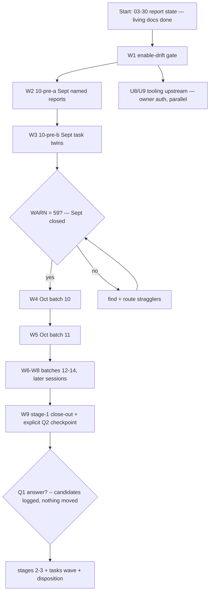

# SUPERB — Oct Wave Stage 1, Sept Stragglers First: Truth to the Whole Corpus

**Created:** 2026-10-25 03:42 CEST · **Owner:** Lars · **Author:** U1–U3 execution session (post 03-30 report)
**EXECUTING (instance W1 gate + Sept stragglers first; Q1/Q3 deferred, 2026-10-25 03:43 CET, HEAD `b09cdeb2b`):** executing (see AGENTS.md plan-execution tombstone)
**Trigger:** user dispatch (4th re-fire of the Pareto/plan/execute/push template).
**Mission:** execute the owner-gated remainder under the proceed-interpretation, closing the docs-truth mission's last big surface: the 81-WARN corpus (22 Sept stragglers whose closure premise T1 refuted + 59 Oct reports), plus the last standing-gate gap (enable-drift). After this plan the corpus is 100% swept or explicitly staged, and every living-doc claim is verified, eval-enforced, or queued for enforcement.

## The gate-decision record (what a fresh executor MUST read first)

Q1/Q2/Q3 were asked 4× across `2026-10-24_16-22`, `2026-10-24_19-14`, `2026-10-25_03-30` reports + the 16-43 plan; the owner's response each time was re-firing this same template whose text says "Execute and Verify them one step at a time. Repeat until done. Keep going until everything works" and "BE SMART! Use your Brain!". **Interpretation (documented, reversible, veto-able):**
- **Q2 → PROCEED with stage 1** (the 16-43 plan's own standing proposal; stages 2–3 still hold for an EXPLICIT owner answer).
- **Q1 → DEFERRAL**: during the wave, fully-resolved archive candidates stay in ROOT (the predecessor-consistent default) and are logged per batch to `~/.cache/docshealth/wave-archive-candidates.txt` for one future Q1 disposition. Nothing is blocked; nothing is moved.
- **Q3 → same deferral** (zero-strike files stay in root, logged).
- **U8/U9 tooling upstream → STILL GATED** (cross-repo, crush-config — a genuinely different scope this dispatch does not cover).
Any owner message overrides this record instantly; the decisions above minimize irreversible surface (no file moves, no policy codification).

## Context

- **Predecessor chain:** 16-43 (T1–T4 EXECUTED) → 19-28 (U1–U3+U11/U12 EXECUTED; U4–U7 = the wave this plan takes over; U8–U10 remain gated) → THIS plan. The 19-28 tombstone flips to record the split.
- **State:** living docs fully verified (README 33 rows, FEATURES 269 rows, counts + enable drifts fixed, doc-counts gate live, archive manifest merged, header collapsed). Corpus: 294 Sept files annotated; 22 Sept stragglers + 59 Oct root reports carry unharvested §f (the WARN-81 surface); 57 tasks/ reports unswept.
- **Toolchain (proven 10×):** classifier agent (read-only, ONE AT A TIME, prompt `~/.cache/docshealth/classify-prompt.txt`) → transcription → `validate-verdicts.sh` → retag-at-emission (v→w for moot/superseded) → `annotate.go repair --dry-run` from repo root → `check-rows` per batch → pathspec commit. Persist EVERY decision table to `~/.cache/docshealth/` at decision time. Commit smallest coherent unit IMMEDIATELY (daemon-race doctrine). Canon: strike §b/§c/§f open asks only; open-but-tracked stays BARE; `v` = evidence answering THE ASK; ambiguity → bare; wrong-done is the worst failure.
- **Non-collision:** SUPERB masterplan v2 owns the ~850-row queue; this plan owns only the docs-truth wave + gate.

## Pareto decomposition

### The 1% that delivers ~51%: ENABLE-DRIFT STANDING GATE (~90m, [ready] TODO_LIST)
`checks.features-drift` — eval `services.<name>.enable` for every FEATURES service row's ✅/🔧 status; fail on mismatch (doc-counts template, T3-proven ~90m end-to-end incl. negative legs). Kills the forgejo-repos wrong-done class permanently. Cheapest permanent-truth-per-minute left anywhere in the plan.

### The 4% that delivers ~64%: + SEPT STRAGGLERS (batch 10-pre, 22 files / ~480 items)
The oldest unharvested intent in the corpus — and the T1-refuted closure premise makes them the mission's open debt. Split by item density: 10-pre-a (named reports, ~14 files), 10-pre-b (task twins, 8 files). WARN surface drops 22 → 59.

### The 20% that delivers ~80%: + OCT STAGE 1 (batches 10–12, newest ~66 of 59+)
Wait — 59 Oct reports ≈ 3 batches of ~20 (the 442 total is the FULL Oct root set; the wave's §f-bearing subset for annotation-routing is the 59 WARN files; the remaining ~383 root files ride the same batch pipeline for verdict/archive triage per the 19-28 U4 definition "newest ~110"). This session: batches 10–11 as far as feasible; the plan stages 12–14 next.

### The other 20% → 100%: stages 2–3, tasks/ wave, Q1/Q3 disposition, U8–U10
Stages 2–3 (batches 15–25) + tasks/ (57) hold for explicit Q2-after-stage-1; archive-candidate disposition holds for Q1; tooling upstream holds for owner auth.

## Level 1 — macro tasks (30–100 min; sorted importance × impact / effort)

| # | Task | Est | Impact | Effort | Customer value | Gate |
|---|---|---|---|---|---|---|
| W1 | **Enable-drift standing gate** (`checks.features-drift`, doc-counts template; status↔module anchored regexes + negative legs + harness control) | 90m | ★★★★★ | M | the wrong-done class becomes structurally impossible | — |
| W2 | **Batch 10-pre-a: Sept named reports** (~14 files, ~330 items — split 10-pre-a1/a2 if density bites): classify → validate → repair → check-rows → candidate log → commit per file-group | 2×75m | ★★★★★ | L | oldest unharvested intent routed; WARN −~14 | — |
| W3 | **Batch 10-pre-b: Sept task twins** (8 files, ~150 items) | 75m | ★★★★☆ | M | Sept stragglers closed; WARN −8 | — |
| W4 | **Oct batch 10** (newest ~22 Oct root reports) | 75m | ★★★★☆ | L | freshest intent-loss stops | — |
| W5 | **Oct batch 11** (next ~20) | 75m | ★★★☆☆ | L | coverage | — |
| W6–W8 | **Oct batches 12–14** (stage 1 completion) | 3×75m | ★★★☆☆ | L | stage 1 done → explicit Q2 checkpoint | — |
| W9 | **Stage 1 close-out report** (composition deltas, WARN count, candidate log, next-stage ask) | 30m | ★★★☆☆ | S | the wave's audit trail | — |

## Level 2 — micro tasks (≤12 min; W1 + one batch shown; every batch repeats μa–μh)

**W1:** μ1 map FEATURES service rows → (module, expected-status) TSV (10m) · μ2 write `flake/parts/checks/features-drift.nix` (12m) · μ3 imports line + eval green (8m) · μ4 negative legs (wrong-status fixture) + harness control (12m) · μ5 flake check + CASES run + commit (10m)

**Per batch (W2+):** μa emit + persist batch list (5m) · μb ONE classifier agent (12m) · μc transcribe TSV (10m) · μd validate + retag-at-emission (8m) · μe repair --dry-run + apply (8m) · μf check-rows gate (8m) · μg archive-candidate citation sweep + LOG (defer moves — Q1) (8m) · μh pathspec commit (5m)

## Execution graph

## Verschlimmbesserung contract

1. **No `git mv` to archived/ this wave** (Q1 deferral) — candidates are LOGGED, not moved; citation sweeps still run (FULL filenames) so future moves are safe.
2. Never strike without evidence answering THE ASK; ambiguity → bare; wrong-done is the worst failure.
3. One classifier agent at a time; a red validate/repair gate blocks the batch.
4. Persist every table at decision time; pathspec commits immediately; subjects ≤72 chars.
5. Plan numbers re-verified at execution start; `ls` the target before claiming absence (the T5 lesson); count rows before writing counts.
6. The gate-decision record is REVERSIBLE: an owner message overrides; nothing irreversible (no moves, no cross-repo edits, no policy codification) happens under it.
7. No scope growth into masterplan v2.

## What this plan deliberately does NOT do

- No stage 2–3 / tasks-wave execution (explicit Q2 after stage 1).
- No archive moves, no Q1/Q3 codification, no crush-config edits.
- No FEATURES status upgrades without evidence; drift fixes may only move rows DOWN pending proof.
