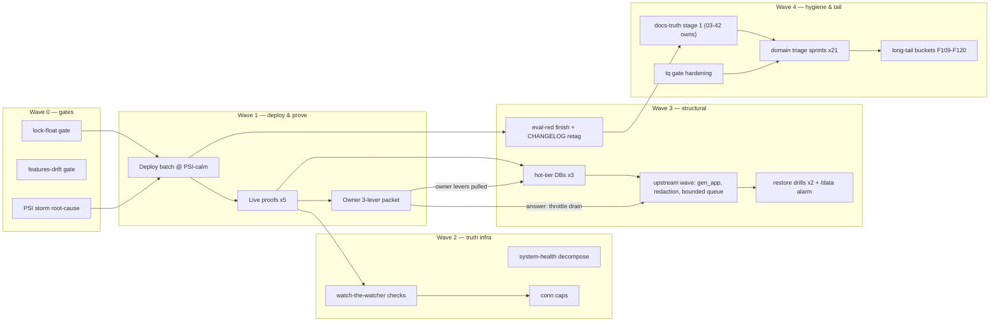

# SUPERB — Fleet Stabilization, Monitoring Truth & Deploy Throughput

**Created:** 2026-10-25 05:10 CEST · **Owner:** Lars · **Author:** monitor365 self-connect session (post 04-50 report + 05-05 review)
**EXECUTING (instance exec-2 resume: unblock upholds test, land 2 green batches, changelog, storm-gated deploy, 2026-10-25 07:29 CET, HEAD `c6f562541`):** executing (see AGENTS.md plan-execution tombstone)
**Trigger:** user dispatch (Pareto/plan/execute template, 5th re-fire).
**Mission:** un-break what is actively broken (monitor365 drain-trap, monitoring blindness), then permanently raise the two system-wide multipliers — monitoring truth (nothing watches the watcher) and deploy throughput (PSI gate + lock-float eval breaks) — then burn down the long tail by domain.

> **Format note:** `.md` + mermaid per the user's explicit demand (skill default is HTML+D2 — flagged override, not propagated).

## Predecessor chain & non-collision

`16-43 (T1–T4 EXECUTED)` → `19-28 (U1–U3 EXECUTED)` → **`03-42 oct-wave-stage1 (EXECUTING marker 03:43, HEAD b09cdeb2b)`** → THIS plan.

- **The 03-42 plan stays the owner of the docs-truth wave** (Sept stragglers + Oct stage 1 + enable-drift gate = its W1). Its EXECUTING marker is 84+ min stale with zero follow-through commits after `16e7fcb32` (03:43) — nobody visible is executing it. This plan REFERENCES its scope (T20/T21), never re-plans it. If its executor resumes, T20/T21 stand down.
- This plan owns: production stabilization (monitor365), monitoring-truth infrastructure, deploy-throughput gates, and the domain long-tail triage. The ~788-row `[ready]` queue and 1,830 library items are the universe it prioritizes, not duplicates.

## Errata (Step 0 verification, this session)

- `features-drift`/`enable-drift` check: **absent from flake/parts/checks/** (grep live 05:07) — still open despite `b09cdeb2b`'s commit message mentioning "enable-drift gate" (that commit landed the TODO row, not the check).
- Lock-float eval gate: **absent** — open (four eval-breaks rode the 2026-10-23 blanket wave).
- monitor365 rows (backlog 407.76M, cap 1B, backup OOM, node_exporter dedupe): **live-verified 04:0x–05:0x this session** — freshest evidence in the corpus.
- gatus :9100 holders (114/43/1): attributed this session; row upgraded `[ready]`.

## Universe inventory (2026-10-25 05:07)

| Domain library | Open | Done (pruned) | Dominant theme |
|---|---:|---:|---|
| services.md | 504 | 166 | per-service debt, monitor365 cluster, drills |
| pipeline.md | 494 | 77 | docs/process meta, dispatch hygiene |
| upstream.md | 174 | 25 | blocked:push fixes across ~15 repos |
| stability.md | 166 | 67 | freezes, PSI, memory guards |
| storage.md | 153 | 95 | hot-tier waves, /data, backups |
| monitoring.md | 137 | 37 | SigNoz/gatus/textfile truth |
| desktop.md | 92 | 21 | niri/DMS/audio polish |
| ai-stack.md | 26 | 4 | llama services |
| pixel6.md | 18 | 4 | phone sync |
| security.md | 16 | 5 | rotations, scans |
| **Libraries total** | **1,830** | | of which queue-exposed `[ready]` ≈ 788 |

## Pareto decomposition

### The 1% that delivers ~51% — CLOSE THE LIVE INCIDENT CLASS (monitor365 + monitoring truth)
The only ACTIVE production failure (pool-wedge flapping, armed 407.76M drain bomb, no backup since 10-24, host metrics blind 7 days) plus its permanent-truth companions (node_exporter self-health, rendered-uniqueness selftest). Everything downstream (retention first-fire, restore drills, hot-tier decision, watchdog budget rows) is blocked behind this cluster. Deploy the in-tree batch (already verified green), prove it live, hand the owner a 3-lever packet.

### The 4% that delivers ~64% — UN-BLOCK DEPLOY THROUGHPUT + KILL THE WEDGE CLASS AT ROOT
+ (a) **Ghostty interactive-scope IO storm root-cause** — the PSI gate has deferred the SAME batch three times; the gate itself is the fleet's throughput bottleneck. (b) **Eval gate on lock floats** — four eval-breaks in one blanket wave made every deploy DOA; the gate makes lock waves safe by construction. (c) **Hot-tier DB moves** (monitor365 first, then discordsync/browser-history) — moves fsync from ~200 ms to ~0.78 ms and deletes the entire pool-wedge CLASS, not one symptom.

### The 20% that delivers ~80% — TRUTH INFRASTRUCTURE + SAFETY DRILLS + DOCS WAVE
+ enable-drift standing gate (03-42 plan's W1, ~90m, cheapest permanent truth anywhere), system-health decomposition phase 1 (tonight's dup-metric bug was the direct cost of the 2,602-line monolith), gatus/papdashboard conn caps, master eval-red triage, CHANGELOG retag, restore drills (ClickHouse + monitor365 + borg ladder), /data gap + usage alarm, docs-truth stage 1 (referenced), tq harvest-gate hardening (sudo-skip, stale snapshots, watch re-fires — stops the ×8 no-op re-dispatch tax).

### The other 20% → 100%
Long tail by domain (desktop 92, ai-stack 26, security 16, pixel6 18) + monitoring/pipeline/services stale-marked triage passes + docs-truth stages 2–3 + tasks/ 57 (gated on Q2) + upstream push wave (~15 repos, gated on owner auth) + ROADMAP items. No shortcuts here — scheduled as bounded per-domain triage passes that retag/merge/close, not hero sessions.

## Level 1 — macro tasks (30–100 min; sorted importance × impact / effort)

| # | Task | Est | Impact | Effort | Customer value | Gate/deps |
|---|---|---:|---|---|---|---|
| T1 | Deploy the PSI-calm batch (volume cuts + retention + backup caps + memory fix + node_exporter dedupe) + anchor verify | 60m | 10 | 3 | ends the live flapping class | PSI-calm window |
| T2 | Post-deploy proofs: node_exporter zero-dup-errors, backup fire green, retention first-fire, :9100 pile drained | 45m | 9 | 2 | trust restored in monitoring | T1 |
| T3 | Owner 3-lever packet: cap 1B→250k + agent intent + `sudo du` backlog (scripts + exact commands) | 30m | 9 | 1 | defuses the drain bomb | owner-gated |
| T4 | Watch-the-watcher: node_exporter self-health gatus check + rendered-prom uniqueness selftest | 90m | 8 | 4 | 7-day blindness class dead forever | — |
| T5 | Ghostty interactive-scope IO storm root-cause (per-cgroup io accounting → fix or IOWeight-cap) | 90m | 8 | 5 | deploy gate stops deferring everything | — |
| T6 | Eval gate on lock floats (blanket-wave class) + negative legs | 90m | 8 | 4 | no more DOA deploys | — |
| T7 | enable-drift standing gate `checks.features-drift` (03-42 W1 scope) | 90m | 7 | 3 | doc-drift class permanent | 03-42 non-collision |
| T8 | monitor365 DuckDB → Samsung hot tier (doctrine C, full checklist) | 100m | 8 | 6 | wedge class root-killed | T1, PSI window |
| T9 | discordsync + browser-history hot-tier completions | 100m | 6 | 5 | same class, next victims | T8 pattern |
| T10 | gen_app upstream migration fix + SystemNix lock bump | 100m | 6 | 5 | fast-analytics revived | blocked:push |
| T11 | SsoConfigRow secret redaction upstream + Pocket ID client rotation runbook | 60m | 6 | 2 | closes a live journal leak | blocked:push/user |
| T12 | Bounded agent offline queue upstream design (drop-oldest + counter) | 90m | 7 | 5 | backlog bombs structurally impossible | blocked:push |
| T13 | system-health decomposition phase 1: `extraCollectors` seam extraction | 100m | 6 | 6 | tonight's bug class gets harder | — |
| T14 | gatus client pool + papdashboard ingest conn caps | 45m | 4 | 2 | 4096-backlog overflow risk gone | T2 evidence |
| T15 | Master eval-red triage completion (row 612 blanket-wave fallout) | 60m | 6 | 3 | tree green = deployable again | — |
| T16 | CHANGELOG deploy-pending retag with per-entry activation verification | 45m | 5 | 2 | honest history | T1 |
| T17 | ClickHouse native-BACKUP restore drill | 90m | 6 | 4 | backup = capability, not claim | — |
| T18 | monitor365 backup restore drill (export → fresh DB opens) | 60m | 6 | 3 | same | T1 |
| T19 | /data 175G df-vs-du gap + 85% usage alarm | 90m | 5 | 3 | no silent disk-full | — |
| T20 | Docs-truth stage 1 completion (Sept stragglers + Oct b10-11) — 03-42 plan owns | 100m | 5 | 5 | corpus truth | 03-42 non-collision |
| T21 | Docs-truth stages 2–3 + tasks/ 57 | 100m | 4 | 5 | corpus truth complete | Q2 owner-gated |
| T22 | tq harvest-gate hardening (sudo-skip, stale-snapshot, watch re-fire, log-only) | 90m | 6 | 4 | stops ×8 no-op dispatch tax | — |
| T23 | Desktop 92-row triage pass (retag/merge/close) | 60m | 3 | 3 | queue hygiene | — |
| T24 | Security 16-row sweep + ai-stack 26-row sweep | 60m | 4 | 2 | rotations current | — |
| T25 | Monitoring 137-row triage (stale-mark, fold into T4/T14) | 60m | 4 | 3 | queue hygiene | T4 |
| T26 | Pipeline 494-row stale-marked count + [ready] extraction | 100m | 4 | 4 | queue hygiene | — |
| T27 | Services 504-row triage pass (retag post-T1/T8 lands) | 100m | 4 | 4 | queue hygiene | T1–T9 |

**Total ≈ 26 h** of macro work; fine breakdown below.

## Level 2 — fine tasks (≤12 min each; ALL todos covered: tier tasks decomposed + domain buckets)

### Wave 0 — gates & prep (T5/T6/T7 early legs)
| ID | Fine task (≤12m) | From |
|---|---|---|
| F01 | io.pressure per-cgroup sampler script (10m sample, top-20) | T5 |
| F02 | Run sampler during next ghostty storm window; persist to ~/.cache/psi-storm/ | T5 |
| F03 | Read niri/ghostty IO suspects (shell-history sync? fontconfig? VTE) 1/2 | T5 |
| F04 | Same 2/2 + write root-cause row update | T5 |
| F05 | IOWeight-cap or fix decision + config edit | T5 |
| F06 | Deploy-gate exemption-vs-cap decision row for owner | T5 |
| F07 | Lock-float gate: eval-time flake.lock rev-drift detection sketch | T6 |
| F08 | Gate: throw-on-float implementation (flake/parts/checks) | T6 |
| F09 | Gate: negative leg (mutate lock in fixture → check fails) | T6 |
| F10 | Gate: allowlist mechanism for deliberate floats + docs | T6 |
| F11 | features-drift: option/service enable source-of-truth mapping | T7 |
| F12 | features-drift: check implementation (doc-counts template) | T7 |
| F13 | features-drift: negative leg + flake check green | T7 |

### Wave 1 — deploy & prove (T1/T2/T3)
| ID | Fine task | From |
|---|---|---|
| F14 | Pre-deploy: `nix flake check --no-build` + PSI watch start | T1 |
| F15 | Deploy at calm window + `--keep-going` discipline | T1 |
| F16 | Anchor verify: readlink current-system = newest gen-by-NUMBER | T1 |
| F17 | Proof: node_exporter journal zero "error gathering metrics" (10m window) | T2 |
| F18 | Proof: live .prom one-row-per-service + :9100 conns drained | T2 |
| F19 | Proof: backup unit green with MEMORY_LIMIT=6G journal line | T2 |
| F20 | Proof: retention first-fire journal lines + DB size delta | T2 |
| F21 | Proof: agent SSE reconnect + breaker closed (30m window) | T2 |
| F22 | Owner packet: cap-restore admin-API command block | T3 |
| F23 | Owner packet: agent stop/mask decision memo (row 747) | T3 |
| F24 | Owner packet: sudo du + journal-tail evidence template | T3 |

### Wave 2 — truth infrastructure (T4/T13/T14)
| ID | Fine task | From |
|---|---|---|
| F25 | node_exporter self-health: check design (journal-grep vs metric-presence) | T4 |
| F26 | Self-health: gatus endpoint + alert wiring | T4 |
| F27 | Self-health: negative test (inject dup row → check fires) | T4 |
| F28 | Uniqueness selftest: render system_health.prom in a fixture | T4 |
| F29 | Uniqueness selftest: assert + wire into checks + green | T4 |
| F30 | Decompose: extract per-service emit block to scripts/ (1/3) | T13 |
| F31 | Decompose: extract census/oomd blocks (2/3) | T13 |
| F32 | Decompose: extraCollectors seam option + migrate 2 collectors (3/3) | T13 |
| F33 | gatus client config: keep-alive/pool settings read + edit | T14 |
| F34 | papdashboard ingest: cadence + pool read, cap decision | T14 |
| F35 | Post-cap conn counts re-probe (/proc/net/tcp) | T14 |

### Wave 3 — structural fixes (T8–T12, T15–T19)
| ID | Fine task | From |
|---|---|---|
| F36 | Hot-tier: +C subvol prepare script (PSI-gated) for monitor365 DB | T8 |
| F37 | Hot-tier: migrate + verify row counts | T8 |
| F38 | Hot-tier: fstab + wants-not-requires + *Directory= audit | T8 |
| F39 | Hot-tier: deploy + fsync bench proof + pool-wedge watch | T8 |
| F40–F47 | discordsync + browser-history equivalents (4 legs each) | T9 |
| F48 | gen_app: upstream branch + migration design (new-table vs query-time) | T10 |
| F49 | gen_app: implement + upstream tests | T10 |
| F50 | gen_app: SystemNix lock bump + Binder-Error-gone proof | T10 |
| F51 | SsoConfigRow redaction: upstream patch + test | T11 |
| F52 | Pocket ID rotation: owner runbook steps + verify commands | T11 |
| F53 | Bounded queue: upstream design doc + issue draft | T12 |
| F54 | Bounded queue: drop-oldest + dropped-counter implementation | T12 |
| F55 | Bounded queue: lock bump + backlog-gauge-bounded proof | T12 |
| F56 | Eval-red: enumerate remaining red attrs (keep-going pass) | T15 |
| F57 | Eval-red: fix crowdsec-module class remnants | T15 |
| F58 | Eval-red: fix remaining two classes + green proof | T15 |
| F59 | CHANGELOG: per-entry in-tree-at-build verification 1/2 | T16 |
| F60 | CHANGELOG: activation-state retag 2/2 | T16 |
| F61 | CH drill: dir-mode BACKUP on test cluster | T17 |
| F62 | CH drill: fresh-cluster restore + DBs-present proof | T17 |
| F63 | CH drill: signoz.md runbook entry | T17 |
| F64 | M365 drill: export file → fresh open + row-count proof | T18 |
| F65 | M365 drill: runbook + retention-rollback note | T18 |
| F66 | /data: du-vs-df measurement pass (reflink/snapshot hypothesis) | T19 |
| F67 | /data: 85% alarm (gatus rule or textfile threshold) + test | T19 |
| F68 | /data: growth attribution row close (ai +76G class) | T19 |

### Wave 4 — queue & corpus hygiene (T20–T27)
| ID | Fine task | From |
|---|---|---|
| F69 | Docs-wave: CONFIRM 03-42 executor status before any T20 leg (tombstone check) | T20 |
| F70–F73 | Sept stragglers batch 10-pre-a (classifier→validate→annotate→commit ×4 legs) | T20 |
| F74–F77 | Sept stragglers batch 10-pre-b (same ×4) | T20 |
| F78–F81 | Oct batch 10 (same ×4) | T20 |
| F82–F85 | Oct batch 11 (same ×4) | T20 |
| F86 | tq: sudo-only-remaining skip rule implementation | T22 |
| F87 | tq: stale-snapshot guard (re-read library row at dispatch) | T22 |
| F88 | tq: watch-row same-day no-delta re-fire skip | T22 |
| F89 | tq: log-only disposition + CONTRIBUTING note | T22 |
| F90 | tq: dispatch-stamp clause cap (~3) sweep | T22 |
| F91–F94 | Desktop 92: 4 × ~23-row triage sprints (retag/merge/close) | T23 |
| F95–F96 | Security 16 + ai-stack 26 sweeps (2 sprints) | T24 |
| F97–F98 | Monitoring 137: 2 triage sprints (fold T4/T14-covered rows) | T25 |
| F99–F103 | Pipeline 494: 5 × ~100-row stale-marked sprints ([ready] extraction) | T26 |
| F104–F108 | Services 504: 5 sprints post-T1/T8 retags | T27 |

### Long-tail buckets (ALL remaining todos; not decomposed until their sprint opens)
| ID | Bucket | Covers | Open items |
|---|---|---|---:|
| F109 | storage.md remainder | hot-tier follow-ups, borg/offsite, pool watch | ~58 after T8/T9/T19 |
| F110 | stability.md remainder | freeze classes, zram, memory guards | ~100 after T5 |
| F111 | upstream.md push wave | ~15 repos blocked:push (needs owner auth) | 174 |
| F112 | docs-truth stages 2–3 + tasks/ 57 | Q2 owner-gated | 59+57 |
| F113 | desktop.md deep items | niri/DMS/audio beyond triage | ~60 after F91-94 |
| F114 | ai-stack deep items | llama services, GTT pool | ~20 after F95 |
| F115 | pixel6.md | phone sync family | 18 |
| F116 | ROADMAP candidates | vague/long-term harvest | tbd |
| F117 | services.md deep per-service rows | drills + go-lives beyond T17/T18 | ~300 after sprints |
| F118 | pipeline.md deep rows | dispatch/process meta beyond T22 | ~350 after sprints |
| F119 | Q1/Q3 corpus dispositions | archive candidates log | logged |
| F120 | U8–U10 tooling upstream | crush-config cross-repo | owner-gated |

**Fine total: 120 rows ≈ 20 h** (+ buckets opened progressively).

## Execution graph (mermaid)

## Standing owner questions (unanswerable by agents)

1. **Backup gap**: manual quiesced backup NOW (≈2-min outage, PSI risk) vs wait for the deployed fix's first 03:00 fire?
2. **Drain intent**: unthrottled 407.76M backlog drain vs rate-limited until cap 250k; and is the agent SUPPOSED to be enabled (row 747)?
3. **Upstream authorization**: may sessions write+push the monitor365 upstream fixes (gen_app migration, SsoConfigRow redaction, bounded queue), or is upstream yours?

## Execution rules

- **No verschlimmbessern**: every change verifiably no worse than found; no speculative rewrites; DELETE/VACUUM windows keep their rollback copies; deploy only through `nix run .#deploy` at PSI-calm.
- Tombstone (`scripts/plan-marker.sh`) before executing ANY task here; check the 03-42 executor before F69+.
- Daemon-race discipline: pathspec commits, `git show --stat` before amends, standalone lints after daemon-swept amends.
- Keep-going: after each fine task, verify + update the owning library row (queue ↔ library must not drift).
