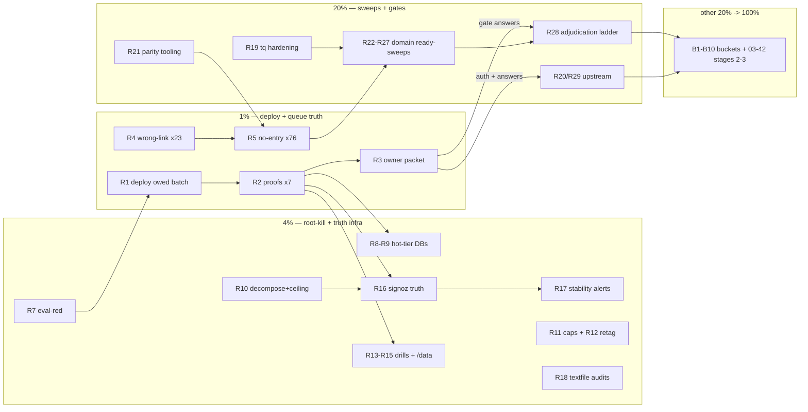

# SUPERB — Fleet-Stabilization Remainder & Backlog Parity (Wave 3)

**Created:** 2026-10-25 12:26 CET · **Owner:** Lars · **Author:** completed-TODO-prune session (post 10-38 report, 6th re-fire of the Pareto/plan/execute template)
**Trigger:** user dispatch (Pareto/plan/execute/push template, 6th re-fire).
**Mission:** execute the still-open remainder of the 05-10 fleet-stabilization plan (its exec waves 1-2 landed; deploy+proofs and the structural tail are owed), absorb the 2026-10-25 backlog-parity fallout (99 pairing WARNs, 122 unharvested reports — the queue's own truth debt), and open the per-domain burn-down of the 1,792-item open library universe with a coverage-proof mapping so ALL todos are owned by exactly one plan line.

> **Format note:** `.md` + mermaid per the user's explicit demand (pareto-planning skill default is HTML+D2 — flagged override, not propagated; identical to the 05-10 and 03-42 overrides).

## Predecessor chain & non-collision

`16-43 (T1–T4 EXECUTED)` → `19-28 (U1–U3 EXECUTED)` → `03-42 oct-wave-stage1 (EXECUTING marker 03:43, HEAD b09cdeb2b — STILL OWNS docs-truth stages + enable-drift… now landed via 416218795)` → `05-10 fleet-stabilization (EXECUTING marker exec-2 07:29, HEAD c6f562541; exec-1+exec-2 status report 09-25; NO follow-through commits after 10:38 except unrelated sessions)` → **THIS plan**.

- **THIS plan inherits the 05-10 remainder.** Its marker is 5h stale with zero plan-scoped commits since the exec-2 status report; per the twin-executor doctrine the tombstone check ran (git log c6f562541..HEAD: 27 commits, all either exec-2 legs, parallel hermes/discordsync sessions, or the 10-38 prune session — no active fleet-stabilization executor). If its executor resumes, the inherited R-items stand down.
- **03-42 keeps owning the docs-truth wave** (Sept stragglers + Oct stage 1 + stages 2-3). THIS plan references, never re-plans. Its enable-drift 1%-item (W1) is DONE (416218795).
- **Discordsync-immich session is ACTIVE** (status report 10-38 `_discordsync-immich-golive-prep-and-eval-rabbithole`, uncommitted hermes-script edits in tree): R9's discordsync legs and any discordsync/immich rows STAND DOWN until that session closes.
- **Shared tree:** parallel sessions + auto-commit daemon live. Pathspec commits only; re-read before every edit; verify daemon commits before amending (never amend over foreign files).

## Errata — Step 0 verification (what CLOSED between 05:07 and 12:26, so nothing here re-dispatches)

| 05-10 item | Verdict | Evidence |
|---|---|---|
| T4 watch-the-watcher | **DONE** | f800a2bc1 (textfile self-health check + rendered-unique selftest, endpoints 229→230) |
| T6 lock-float eval gate | **DONE** | 644fb7e43 (flake/expected-locks.nix, 93 inputs, 4-leg selftest) |
| T7 / W1 enable-drift gate | **DONE** | 416218795 (45 rows guarded, 0 violations) |
| T1 in-tree monitor365 batch | **HALF DONE** | 5555a89ec in-tree (dedupe, backup 6G cap, retention caps); **deploy + proofs owed** |
| /data usage alarm (T19 half) | **DONE** | edb3d4abb (usage tiers; README 49→51 rules b31a465e2) |
| crash-loop alert leg | **DONE** | e3293d694 (restart-metric swap + nsfw-class detection leg) |
| T5 ghostty root-cause | **PREMISE FALSIFIED** | F01-02 capture: storm = nix-daemon 152 MB/s + owner Gradle + nsfw crash-loop churn; victims tq-agent-pool + user@1000. Root-cause task CLOSED by evidence; residual = IOWeight/PSI-gate tuning rows only |
| T15 eval-red | **LARGELY DONE** | 050567953 unblocked the tree (upholds fix); residual triage only |
| freeze 3e5c8af5 evidence pull | **DONE** | 53fa88264/4b4318c8b/d2227a49a (death crash-class confirmed, row closed) |
| nsfw-classifier crash loop | **DONE** | gen 942 deployed, `61a5257c` upstream fix |
| NEW since 05:07 | **backlog-parity fallout** | 10-38 prune session: 520 done rows pruned to CHANGELOG (a5246a013); pairing WARNs 163→221 (99 = 23 wrong-link + 76 no-entry); unharvested 88→122 (+34 citation-less); 2 new rows queued (AGENTS.md gotcha note, prune scriptify) |
| NEW since 05:07 | **hermes fixture leg2** | 8ca9c1cd0 (leg1 answered, sandbox-only leg2 divergence open) |

## Universe inventory (live 2026-10-25 12:26, post-prune)

| Surface | Open rows | Notes |
|---|---:|---|
| TODO_LIST.md queue | 1,381 | of which `[ready]`-exposed **798** (dispatchable) |
| docs/todo libraries total | **1,792** | exact `grep -c '^- \[ \]'` |
| — pipeline.md | 502 | 413 ready-class |
| — services.md | 509 | 290 ready + 68 user + 63 decision + 60 watch + 22 deploy |
| — stability.md | 166 | 110 ready-class |
| — upstream.md | 174 | 106 ready + 37 push-gated |
| — monitoring.md | 136 | 113 ready-class |
| — storage.md | 153 | 66 ready |
| — desktop.md | 92 | 45 ready |
| — pixel6/ai-stack/security | 60 | 24 ready |
| Tag mix (first-bracket heuristic, ±prose noise) | ready ≈1,167 · decision 214 · watch 152 · blocked:user 147 · blocked:deploy 56 · blocked:push 48 · misc 8 | method noted; per-row truth lives in the files |

ROADMAP.md carries 0 checkbox rows (raw ideas section only — folded into R28's long-tail bucket B10).

## Pareto decomposition (recomputed for 12:26 truth)

### The 1% that delivers ~51% — DEPLOY THE OWED BATCH + RE-TRUTH THE QUEUE ITSELF
The monitor365 wedge class is fixed IN-TREE but possibly not LIVE (deploy owed); every "goes live with the next deploy" batch since 10-24 stacks behind it. Simultaneously the queue's own integrity broke surface today: 99 pairing WARNs + 122 unharvested reports mean ~15% of dispatches risk re-firing closed or phantom work. One deploy + proofs + owner packet (R1-R3) + two adjudication waves (R4-R5) unblock EVERYTHING downstream — deployability, monitoring trust, and dispatch correctness are the three multipliers every other task rides on.

### The 4% that delivers ~64% — KILL THE WEDGE CLASS AT ROOT + TRUTH INFRASTRUCTURE
+ hot-tier DB moves (R8-R9, fsync ~200ms→0.78ms deletes the pool-wedge class), system-health decomposition + ceiling fix (R10, the 2,602-line monolith bred tonight's dup bug AND its worst-case sum exceeds its own timer), SigNoz truth batch (R16: an EMPTY metadata table + a red traces check + phantom-series automation = the observability stack lying), stability alert batch (R17: trip-RATE + GPU thermal edge — the freeze class that keeps recurring), conn caps + CHANGELOG retag + restore drills + /data gap finish (R11-R15).

### The 20% that delivers ~80% — DOMAIN READY-SWEEPS + GATE LADDERS
+ all six domain [ready] cohorts (R22-R27, 1,070+ rows as bounded triage sprints: retag/merge/close/pair), the blocked/watch/decision adjudication ladder (R28, 617 rows whose true next action is a ≤12min ask/verify/retag each), tq harvest-gate hardening (R19 — stops the ×N no-op re-dispatch tax), upstream wave 1 (R20, auth-gated).

### The other 20% → 100%
Long-tail buckets B1-B10: upstream push wave (~15 repos, owner auth), docs-truth stages 2-3 + tasks/ 57 (03-42, Q2-gated), pixel6/ai-stack/security deep items, ROADMAP candidates, Q1/Q3 corpus dispositions, foreign-session scopes (discordsync-immich, hermes leg2) explicitly NOT planned here. No shortcuts — bounded per-domain sprints, never hero sessions.

## Level 1 — macro tasks (30–100 min each; sorted importance × impact / effort)

| # | Task | Est | Impact | Effort | Customer value | Gate/deps |
|---|---|---:|---|---|---|---|
| R1 | **Deploy the owed batch @ PSI-calm** (monitor365 dedupe+6G backup+retention caps, restart-metric swap, textfile self-health, crash-loop alert, /data tiers, gatus-alert-relay if not yet live) + `--keep-going` + anchor-verify by gen NUMBER + new terminal | 60m | ★★★★★ | M | the live wedge class ends; 5+ "next deploy" batches go live | PSI-calm window |
| R2 | **Post-deploy proofs ×7**: node_exporter dup-errors 0, rendered .prom unique, backup green w/ 6G line, retention first-fire, agent SSE breaker closed, relay healthz + counters, `system_health` series presence | 45m | ★★★★★ | S | monitoring trust restored | R1 |
| R3 | **Owner packet + standing questions**: cap 1B→250k command block, agent stop/mask intent (row 747), sudo-du backlog template, upstream write auth (R20), gate-strictness flips (pairing/harvest at 0), prune-entry format | 30m | ★★★★★ | S | every gated lever unblocks | R1-R2 evidence |
| R4 | **Pairing wave 1 — 23 wrong-link rows** (link-fix or move entry; 12m each, mechanical, gate-verifiable) | 60m | ★★★★★ | S | dispatch integrity, WARN −23 | — |
| R5 | **Pairing wave 2 — 76 no-entry rows** (~8 domain batches: verify → pair or close; feed the drift row) | 4×75m | ★★★★★ | M | WARN −76; queue = truth | R4 pattern |
| R6 | **Unharvested stage 1 sweep** (122 WARN: Sept 22 + Oct 59+34+newest — 03-42 toolchain, classifier→validate→annotate→commit; ~6 batches) | 6×75m | ★★★★☆ | L | freshest intent-loss stops; WARN → ~0 | 03-42 non-collision |
| R7 | **Eval-red master triage finish** (residual classes post-050567953; keep-going enumeration → fix → green proof) | 45m | ★★★★☆ | S | tree green = deployable at will | — |
| R8 | **monitor365 DuckDB → Samsung hot tier** (doctrine C full checklist; pre-deploy gate storage.md:13 first; PSI-gated prepare script) | 100m | ★★★★☆ | L | wedge class root-killed | R1, PSI window |
| R9 | **discordsync + browser-history hot-tier completions** — CHECK discordsync session closed first (non-collision) | 100m | ★★★☆☆ | L | same class, next victims | R8 pattern + session check |
| R10 | **system-health decompose phase 1** (extraCollectors seam, 3 extraction legs) + **worst-case sum fix** (≈500s > 180s ceiling, monitoring.md:20) | 100m | ★★★★☆ | L | the monolith stops breeding bug classes | — |
| R11 | **gatus client pool + papdashboard ingest conn caps** (read → cap → /proc/net/tcp re-probe) | 45m | ★★★☆☆ | S | 4096-backlog overflow risk gone | R2 evidence |
| R12 | **CHANGELOG deploy-pending retag** (per-entry in-tree-at-build + activation verification) | 45m | ★★★☆☆ | S | honest history | R1 |
| R13 | **ClickHouse native-BACKUP restore drill** (dir-mode BACKUP → fresh cluster → DBs-present proof → signoz.md) | 90m | ★★★★☆ | M | backup = capability, not claim | — |
| R14 | **monitor365 restore drill** (export → fresh DB opens → row-count proof → runbook) | 60m | ★★★★☆ | M | same | R1 |
| R15 | **/data du-vs-df gap + EIO inode path + Borg go-live gate** (storage.md:99; alarm half already landed) | 90m | ★★★☆☆ | M | no silent disk-full; corruption located | — |
| R16 | **SigNoz truth batch**: time_series_v2 EMPTY (:78), traces-coverage red (:42), zero-series automation + provisioner assertion (:24), mislabeled memory-events gauge (:93) | 100m | ★★★★☆ | M | the observability stack stops lying | — |
| R17 | **Stability alert batch**: zone-6 trip-RATE (:19), GPU thermal edge (:77), throttle high-counter rule (:94), fan-telemetry finish (:18) | 90m | ★★★★☆ | M | the recurring freeze class gets its alarms | — |
| R18 | **Textfile class audits**: exit-0/empty-value emitters (:15) + fixed-name .tmp (:17) — both bred real blind spots | 75m | ★★★☆☆ | M | collector lies impossible | — |
| R19 | **tq harvest-gate hardening** (sudo-skip, stale-snapshot guard, watch re-fire skip, log-only, stamp cap) | 90m | ★★★★☆ | M | ×N no-op dispatch tax ends | — |
| R20 | **Upstream wave 1 (owner-auth-gated)**: gen_app migration (T10), SsoConfigRow redaction (T11), bounded-queue design (T12) | 3×90m | ★★★☆☆ | L | upstream debt stops compounding | R3 auth answer |
| R21 | **Parity tooling** (queued today): AGENTS.md prune-gotcha note + `scripts/prune-done-todos.sh` (dry-run-first, WARN A/B, rev-pinned baseline) | 60m | ★★★☆☆ | S | future prunes cost 30m not 3h | — |
| R22 | **Monitoring 113 [ready] triage sprint** (2 × ~55-row passes; fold R16-R18-covered rows first) | 2×60m | ★★★☆☆ | M | queue hygiene | R16-R18 |
| R23 | **Stability 110 [ready] sprint** (2 passes; freeze-taxonomy rows stay forensic — LEAVE ALONE class) | 2×60m | ★★★☆☆ | M | queue hygiene | R17 |
| R24 | **Storage 66 [ready] sprint** (1 pass + borg/offsite deep half) | 75m | ★★★☆☆ | M | queue hygiene | R13 |
| R25 | **Services 290 [ready] 3-cohort sprint** (retag post-R1/R8; monitor365 cluster folds first) | 3×75m | ★★★☆☆ | M | queue hygiene | R1, R8 |
| R26 | **Pipeline 413 [ready] 4-cohort sprint** (dispatch-hygiene meta rows fold into R19 first) | 4×75m | ★★★☆☆ | M | queue hygiene | R19 |
| R27 | **Desktop 45 + ai 7 + security 4 + pixel6 13 sprint** (1-2 passes; rotations current) | 60m | ★★☆☆☆ | S | queue hygiene | — |
| R28 | **Adjudication ladder — 617 gated rows** (blocked:user 147 + deploy 56 + push 48 + watch 152 + decision 214): per-batch ≤12m next-action stamps (ask owner / retag / close-stale / verify-then-unblock) | 10×60m | ★★★☆☆ | L | the other 80% gets owners and dates | R3 answers |
| R29 | **Upstream triage: 106 ready + 48 push rows** (pair each with auth status; push wave staging) | 2×75m | ★★☆☆☆ | M | upstream surface honest | R3, R20 |
| R30 | **Docs-truth stages 2-3 + tasks/ 57** (03-42 owns; referenced for completeness) | — | ★★☆☆☆ | L | corpus truth complete | Q2 owner-gated |

**Total ≈ 43h macro.** Long-tail buckets (ALL remaining rows mapped, no orphan todos):

| Bucket | Covers | Open rows |
|---|---|---:|
| B1 | services.md deep per-service rows beyond R25 sprints (drills, go-lives) | ~200 |
| B2 | pipeline.md deep meta rows beyond R26 (process/tooling) | ~300 |
| B3 | stability.md forensic freeze taxonomy (LEAVE-ALONE evidence class) | ~55 |
| B4 | upstream.md remainder beyond R29 | ~40 |
| B5 | storage.md borg/offsite deep + pool/DAS | ~60 |
| B6 | desktop.md deep niri/DMS/audio | ~45 |
| B7 | pixel6 + ai-stack + security deep | ~45 |
| B8 | docs-truth stages 2-3 + tasks/ 57 + Q1/Q3 dispositions | 116 |
| B9 | foreign-session scopes (discordsync-immich active, hermes leg2) — NOT planned here | session-owned |
| B10 | ROADMAP raw ideas → harvest candidates | tbd |

**Coverage proof:** 1,792 library rows + 1,381 queue rows = R-items (executed) ∪ R22-R29 sprints (all [ready]) ∪ R28 ladder (all gated/watch/decision) ∪ B1-B10 (deep remainder) ∪ B9 (session-owned). Every row class has exactly one owner; no todo is unmapped.

## Level 2 — micro tasks (≤12 min each; core waves fully decomposed; sprints/ladders decomposed at open-time per 05-10 convention)

### Wave D — deploy & prove (R1/R2/R3)
| ID | Fine task (≤12m) |
|---|---|
| D01 | Pre-deploy: `nix flake check --no-build` + PSI watch start (some avg10 <20) |
| D02 | `nix run .#pre-deploy-check` 17 sections green |
| D03 | Deploy @ calm window, `--keep-going` discipline |
| D04 | Anchor verify: `readlink /run/current-system` = newest `system-N-link` BY NUMBER + profile repair if not |
| D05 | Proof: node_exporter journal zero dup-errors (10m window) |
| D06 | Proof: rendered .prom one-row-per-service + :9100 conn counts |
| D07 | Proof: backup unit green + MEMORY_LIMIT=6G journal line |
| D08 | Proof: retention first-fire journal + DB size delta |
| D09 | Proof: agent SSE reconnect + breaker closed (30m) |
| D10 | Proof: relay healthz + rule counters exact |
| D11 | Proof: `system_health` series presence + textfile scrape_error==0 |
| D12 | Owner packet: cap-restore admin-API block |
| D13 | Owner packet: agent intent memo + sudo-du template |
| D14 | Owner packet: upstream-auth + gate-strictness + prune-format asks |

### Wave P — queue parity (R4/R5/R21)
| ID | Fine task |
|---|---|
| P01-P04 | Wrong-link batch 1-4 (6+6+6+5 rows: fix link or move entry; gate re-run each) |
| P05-P12 | No-entry batches 1-8 per domain (verify → pair or close; ~10 rows each) |
| P13 | AGENTS.md TODO-System gotcha sentence (prune unmasks WARNs) |
| P14-P17 | `prune-done-todos.sh`: extract+render / prune+install / WARN A-B rev-pinned / dry-run+docs legs |

### Wave S — structural (R7-R18)
| ID | Fine task |
|---|---|
| S01 | Eval-red: keep-going enumeration of remaining attrs |
| S02 | Eval-red: fix class 1 + proof |
| S03 | Eval-red: fix class 2 + green proof |
| S04 | Hot-tier: PSI-gated +C subvol prepare (monitor365) |
| S05 | Hot-tier: migrate + row-count verify |
| S06 | Hot-tier: fstab + wants-not-requires + *Directory= audit |
| S07 | Hot-tier: deploy + fsync proof + pool-wedge watch |
| S08-S11 | discordsync legs (ONLY after session-close check) ×4 |
| S12-S14 | browser-history legs ×3 (prepare/migrate/verify) |
| S15-S17 | decompose: extract service-emit block / census+oomd / extraCollectors seam |
| S18 | worst-case sum fix (timer 180s vs ≈500s sections → trim or split) |
| S19-S21 | conn caps: gatus read+edit / papdashboard cap / re-probe |
| S22-S23 | CHANGELOG retag halves (verify + retag) |
| S24-S26 | CH drill: BACKUP on test cluster / restore proof / runbook |
| S27-S28 | M365 drill: export→fresh open / runbook |
| S29 | /data du-vs-df measurement (reflink/snapshot hypothesis) |
| S30 | EIO inode path locate + Borg gate decision row |
| S31 | time_series_v2: retention config read + fix attempt |
| S32 | time_series_v2: metadata restore-or-rebuild decision |
| S33 | traces-coverage red: 3 missing-services triage |
| S34 | zero-series automation: script + wire into checks |
| S35 | mislabeled gauge fix (system-health.nix:1122) |
| S36 | zone-6 trip-RATE rule + test |
| S37 | GPU thermal edge rule + test |
| S38 | throttle high-counter metric + rule |
| S39 | fan-telemetry sustained-Tctl finish leg |
| S40 | textfile exit-0/empty-value audit sweep |
| S41 | fixed-name .tmp audit sweep |

### Wave T — dispatch integrity + tail openers (R19/R22-R30 openers)
| ID | Fine task |
|---|---|
| T01 | tq sudo-skip rule |
| T02 | tq stale-snapshot guard |
| T03 | tq watch same-day no-delta skip |
| T04 | tq log-only + CONTRIBUTING note |
| T05 | tq stamp-cap sweep |
| T06-T30 | Sprint openers: per R22-R29 cohort, first pass = read+classify 12m slice (decomposition-at-open convention) |
| T31-T40 | Ladder openers: per R28 batch, first 10-row adjudication slice (ask/retag/close) |

**Fine total: ~100 explicit rows for the core; every sprint/ladder row additionally owned by its opener + bucket mapping (05-10 F109-F120 convention — decomposition happens when the sprint opens, against live rows, never against this snapshot).**

## Execution graph (mermaid)

## Standing owner questions (R3 payload, unanswerable by agents)

1. **Backup gap**: manual quiesced monitor365 backup NOW (≈2-min outage) vs wait for the deployed fix's first 03:00 fire?
2. **Drain + agent**: cap 1B→250k restore timing; is the agent supposed to run at all (row 747)?
3. **Upstream auth + gate strictness + prune format**: may sessions write+push upstream fixes; flip pairing/harvest gates strict at zero; keep verbatim CHANGELOG prune lists or count+range+sample?

## Execution rules

- **No verschlimmbessern**: every change verifiably no worse than found; DELETE/VACUUM keep rollback copies; deploys only via `nix run .#deploy` at PSI-calm; anchor-verify by generation NUMBER; the stability freeze-taxonomy rows (B3) are forensic evidence — never rewrite.
- Tombstone first (`scripts/plan-marker.sh <this-plan> start`) before executing ANY item here; check the 03-42 + discordsync sessions before R6/R9 legs.
- Daemon-race discipline: pathspec commits, `git show --stat` before any amend, standalone lints after daemon-swept amends, re-read before every edit (live sessions shifted TODO_LIST twice today already).
- Verify-then-claim: every "closed" mark needs its evidence cited (commit/file:line); counts re-derived live at execution time, never copied from this snapshot.
