# SUPERB Plan — OpenCloud Pilot Adoption (LAN/VPN, complement mode)

**Created:** 2026-10-25 13:30 CET
**EXECUTING (instance opencloud-executor-1, owner GO directive 2026-10-25 afternoon; A1=go, complement + LAN/VPN-only per plan scope, 2026-10-25 21:54 CET, HEAD `01d99b129`):** executing (see AGENTS.md plan-execution tombstone)

_2026-10-25 13:30 CET · status: **PLAN ONLY — not executed, no marker** (plan-execution tombstone discipline applies to the session that runs this) · author: PRO/CONTRA session (docs/status/2026-10-25_12-52_opencloud-adoption-pro-contra.md + Addenda 13:01 RustFS, 13:27 Paperless)_

**Scope:** Phase 1 agent build → Phase 2 owner usage window → Phase 3 canonical-store decision. Everything a pilot needs, nothing it doesn't. **Mode:** complement (Drive stays canonical — google-sync/drive-paperless UNTOUCHED), LAN/VPN-only exposure, production line `opencloud-production` 7.2.4, posix driver, stateDir on the HDD pool.

**Ground truth this plan rests on (verified 2026-10-25):**
- nixpkgs pin `fe1324228` ships: `opencloud` 8.1.0, `opencloud-production` 7.2.4, `services.opencloud` module (hardened unit, `environmentFile`, `stateDir` free-form) + upstream Selenium VM test; `opencloud-desktop` 4.0.0. NOT at pin: `openvfs`.
- Port 9200 free in `lib/ports.nix`. No dashboard-icons pack icon (404 @ pin AND main) → tile needs an http(s) URL icon.
- Fleet S3 demand = 0 → RustFS OUT (Addendum 1). Paperless untouched; any future doc-flow bridges via a drive-paperless `opencloud` SOURCE at the API layer, NEVER consume-dir coupling (Addendum 2).
- OpenCloud external-OIDC requirements: PKCE public clients + PREDEFINED client IDs (`web`, `OpenCloudDesktop`, `OpenCloudAndroid` via `WEBFINGER_*`) + role-claim trap (unmapped users fail login → pilot uses default-role driver, one promoted admin). Pocket ID emits `groups` only with `groups` scope + provisioned userGroups (sso-dns.md fleet facts).
- Parallel session active on `2026-10-25_12-26_SUPERB-fleet-stabilization-…` — zero scope overlap; all commits PATHSPEC-scoped (shared-tree rule).

**Owner gates carried from the [decision] row (docs/todo/services.md):** G1 canonical-store intent (= complement for the pilot, revisit Phase 3) · G2 exposure appetite (= LAN/VPN-only, public links are a Phase-3+ question).

---

## 1. Pareto Breakdown

### The 1% that deliver 51% — a reachable, authenticated instance
**Gates + core path only:** owner "go" (A1) → Pocket-ID-vs-embedded-IdP spike with a throwaway `extendModules` eval (B, decision DP1) → port + minimal module on the pool (C1–C7) → caddy vHost + sops secret (D1, D4) → deploy + login smoke (E1–E5). Result: `cloud.home.lan` answers, owner logs in with Pocket ID, files land on the pool. Everything else is improvement, not existence.

### The 4% that deliver 64% — usable from real devices, observably safe
Desktop client into the NixOS config (F1–F3), Android app with camera-upload OFF (F4–F6), gatus probe + live tile (D2–D3, G5), pool-recovery + backup/xattr coverage (C8, G2), eval battery green (D5–D6). Result: the cloud is on every device the owner uses and the fleet notices when it breaks.

### The 20% that deliver 80% — trustworthy: verified, documented, recoverable
Trash/versions-on-posix live verify (E7), WebDAV/rclone smoke (E8), journal + memory sweep (E9), runbook with the trap catalogue (G1a–c), memory-watermark coherence (C4), deploy anchor discipline (E2–E3), post-deploy battery (E4), VM-test defer/decide (G4). Result: the service behaves like the rest of the fleet — no silent degradation, no runbook-less orphan.

### The other 20% (to reach 100%) — deliberately later / conditional
Phase-3 decision review + possible successor plan (mirror flip, drive-paperless re-target — SEPARATE plan, H4) · public share-link exposure design (crowdsec + link-policy work, only if Phase 3 keeps it) · openvfs/pin-bump if virtual files wanted · Collabora office integration if editing wanted · `opencloud` SOURCE for drive-paperless only if a real doc-flow emerges · upstream nixpkgs module feedback if gaps found. **Not doing these now is the point** — Verschlimmbessern guard.

---

## 2. Comprehensive Plan — medium granularity (30–100 min, sorted by importance/impact/effort/customer-value)

Customer = the owner. Value = "log into my private cloud from my devices and trust it."

| # | Task | Phase | Est | Impact | Why this order |
|---|------|-------|-----|--------|----------------|
| M1 | Owner gate: confirm "go" + complement + LAN/VPN (G1/G2) | A | 5m | BLOCKING | nothing starts without it |
| M2 | Step-0 IdP spike: Pocket ID external-OIDC feasibility via throwaway `extendModules` eval (never force-enable in tree) → **DP1** Pocket-ID vs embedded fallback | B | 90m | CRITICAL | auth shape determines C/D wiring; cheapest place to fail |
| M3 | Core module `modules/nixos/services/opencloud.nix`: enable gate, `opencloud-production`, stateDir `/mnt/pool/services/opencloud`, serviceDefaults/harden, MemoryMax/MemoryHigh≥50%, ioTier, TimeoutStartSec | C | 90m | HIGH | the service itself |
| M4 | Pool + safety wiring: mount-gated dirs oneshot (atticd pattern), pool-recovery restartUnits, backup/xattr coverage | C | 45m | HIGH | mount-gating + pool-recovery are eval-gated; orphan-class prevention |
| M5 | Auth + secrets per DP1: WEBFINGER client IDs + issuer env + default-role driver, sops `opencloud.yaml` → `environmentFile` (PLACEHOLDER-safe) | B/D | 60m | HIGH | no login, no pilot |
| M6 | Reach: `services.integration` entry `cloud.home.lan` (plain reverse_proxy), gatus probe, tile with URL icon | D | 45m | HIGH | the front door + observability |
| M7 | Eval battery: `nix flake check --no-build`, all audits green (port-registry, gatus-coverage, tile-coverage, mount-gating, systemd-shape, memory-watermark), enable=false default inert | D | 30m | HIGH | the 5-layer pipeline is the house QA |
| M8 | Deploy + anchor discipline: §16 pre-check, `nix run .#deploy`, full-tree wait (`pgrep -f 'nh os|switch-to-configuration'` empty), `readlink /run/current-system` = newest `system-N-link` | E | 45m | HIGH | a deploy that silently reverts is worse than no deploy |
| M9 | Post-deploy verify: post-deploy-check.sh, Pocket-ID login + admin role, upload/download/share-link smoke, **trash/versions-on-posix verify**, WebDAV rclone smoke, journal + memory.events sweep | E | 75m | HIGH | proves the PRO-table claims live (Addendum-2 item included) |
| M10 | Desktop client: `opencloud-desktop` into evo-x2 user config, connect, sync + delta smoke | F | 45m | MED-HIGH | first real device; exercises the desktop client-ID leg |
| M11 | Android (owner): F-Droid app, login, camera-upload OFF (Immich owns photos) | F | 15m | MED | second device; owner hands |
| M12 | Runbook `docs/services/opencloud.md`: ports/secrets/units, trap catalogue (xattr `rsync -X`, no-downgrade-across-lines, role-claim fail-closed, watch-fs semantics), verify recipes, rollback | G | 90m | MED | a runbook-less service is future-session debt |
| M13 | Observability close: gatus green, tile live dot, optional SigNoz memory rule decision | G | 30m | MED | fleet-standard visibility |
| M14 | VM test `tests/test-opencloud.nix` — DECIDE defer-or-do (house norm says one per service; pilot may defer with a TODO row) | G | 15m (decide) | MED | honest scoping, not skipping silently |
| M15 | Usage window kickoff: 2–4 weeks, weekly journal glance cadence | H | 5m | MED | the pilot's data source |
| M16 | Mid-window checkpoint: sync health, error scan, usage notes | H | 15m | MED | catches drift early |
| M17 | Phase-3 decision review: complement/successor/drop → harvest outcome (successor ⇒ SEPARATE plan; drop ⇒ clean-exit checklist) | H | 30m | HIGH (long-term) | the actual question this pilot answers |
| M18 | Closeout: status report, CHANGELOG row, resolve the `[decision]` row, docs-health VERIFY pass on every doc touched | H | 45m | MED | single source of truth stays true |

**Total:** ~13h agent + ~30m owner + 2–4w calendar. Critical path: M1 → M2 → M3/M5 → M6 → M7 → M8 → M9 → M10.

---

## 3. Detailed Breakdown — fine granularity (≤12 min each, sorted by importance/impact/effort/customer-value)

### Phase A — Gates (P0)

| ID | Task | Est |
|----|------|-----|
| A1 | Owner confirms "go" + complement + LAN/VPN-only (G1/G2 answers) | 5m (owner) |
| A2 | Collision sweep: `rg -il opencloud` across TODO_LIST/docs/todo/CHANGELOG — confirm zero parallel work | 5m |
| A3 | Re-verify `opencloud-production` 7.2.4 + module still at pin (one `nix eval` pair) | 10m |

### Phase B — Step-0 IdP spike (P0, throwaway evals ONLY)

| ID | Task | Est |
|----|------|-----|
| B1 | Read nixpkgs module env surface (`environment` keys) + `pocket-id-config.provision` options for public/no-secret clients | 10m |
| B2 | Throwaway `extendModules` eval: opencloud enabled + `OC_EXCLUDE_RUN_SERVICES=idp` + external issuer env | 12m |
| B3 | Pocket ID provision shape: client `web`, PKCE, callback `https://cloud.home.lan/…` — can provision express it? | 12m |
| B4 | WEBFINGER env eval: `WEBFINGER_WEB/_DESKTOP/_ANDROID_OIDC_CLIENT_ID` + scopes incl. `groups` | 10m |
| B5 | **DP1 decision:** Pocket-ID GO vs embedded-IdP fallback (write verdict + evidence into runbook stub) | 12m |
| B6 | (only if fallback) embedded-IdP settings + `ADMIN_PASSWORD` via sops, default-role note | 10m |

### Phase C — Core module (P1)

| ID | Task | Est |
|----|------|-----|
| C1 | `lib/ports.nix`: `opencloud = 9200` | 5m |
| C2 | Module skeleton: options (enable, port from registry, stateDir, settings passthrough) | 12m |
| C3 | serviceDefaults/harden + `TimeoutStartSec` + ioTier background | 12m |
| C4 | `MemoryMax = 1G` + `MemoryHigh = 512M` (≥50% watermark-audit rule) | 5m |
| C5 | Minimal `settings` per DP1 (proxy/oidc block; skip `opencloud-init` oneshot only if settings.opencloud provided — decide deliberately) | 12m |
| C6 | `environmentFile` ← sops template path; PLACEHOLDER-safe fail-loud preStart | 10m |
| C7 | `stateDir = /mnt/pool/services/opencloud` + mount-gated dirs oneshot (atticd pattern, NO tmpfiles) | 12m |
| C8 | pool-recovery `restartUnits` entry + converge-coverage eval green | 10m |
| C9 | Filename-unique check + auto-discovery eval (`flake.nixosModules.opencloud` renders) | 10m |

### Phase D — Reach + secrets (P1)

| ID | Task | Est |
|----|------|-----|
| D1 | `services.integration` entry: `cloud` subdomain, plain `reverse_proxy` (Layer 1), loopback 9200 | 12m |
| D2 | Gatus probe entry (loopback URL on registry — coverage-audit green) | 10m |
| D3 | Tile: `dashboard-icons`-pack-absent → http URL icon (opencloud.eu press asset); §16-aware | 10m |
| D4 | sops scaffold `platforms/nixos/secrets/opencloud.yaml` + template render (values NEVER inline) | 12m |
| D5 | `nix flake check --no-build` — ALL audits green | 12m |
| D6 | Negative sanity: `enable = false` default → zero units rendered on evo-x2 eval | 8m |

### Phase E — Deploy + verify (P1)

| ID | Task | Est |
|----|------|-----|
| E1 | `pre-deploy-check.sh --section-16-only` dry run | 8m |
| E2 | `nix run .#deploy`; wait FULL tree (`pgrep -f 'nh os|switch-to-configuration'` EMPTY) | 12m |
| E3 | Anchor: `readlink /run/current-system` = newest-by-NUMBER `system-N-link` | 8m |
| E4 | `post-deploy-check.sh` full battery | 12m |
| E5 | Login smoke: Pocket ID → session; role=admin confirmed (owner assist if polkit-gated) | 12m |
| E6 | Web smoke: upload / download / share-link create (LAN) / delete→trash | 12m |
| E7 | **Trash + versions restore verify on posix driver** (Addendum-2 item — don't assume) | 12m |
| E8 | rclone WebDAV smoke: webdav remote list/put/get against cloud.home.lan | 10m |
| E9 | Journal error sweep + `memory.events` high-counter sweep (§17 class) | 10m |

### Phase F — Clients (P2)

| ID | Task | Est |
|----|------|-----|
| F1 | `opencloud-desktop` into evo-x2 user config (nixpkgs @ pin) | 12m |
| F2 | Deploy + client connect to `cloud.home.lan` (desktop client-ID leg exercised) | 12m |
| F3 | Sync smoke: folder pair, delta re-upload, conflict-free pause/resume | 12m |
| F4 | Android (owner): F-Droid app install + login (`OpenCloudAndroid` client-ID leg) | 12m (owner) |
| F5 | Android camera-upload OFF — Immich owns photos; verify setting | 5m |
| F6 | Mobile WEBFINGER login verified from both client legs | 10m |

### Phase G — Trust depth (P2)

| ID | Task | Est |
|----|------|-----|
| G1a | Runbook part 1: identity, ports, units, secrets, storage layout | 12m |
| G1b | Runbook part 2: trap catalogue (xattr `rsync -X`, no-downgrade lines, role-claim fail-closed, watch-fs, OC_INSECURE-loopback rationale) | 12m |
| G1c | Runbook part 3: verify recipes + rollback ladder + pool-detach degradation semantics | 12m |
| G2 | Backup coverage: pool snapshots include stateDir; Borg/restic xattr-preservation flag verify | 10m |
| G3 | SigNoz memory-rule decision (defer with TODO row if pilot says so) | 8m |
| G4 | VM test defer-or-do decision (house norm vs pilot scope — record either way) | 12m |
| G5 | Gatus check green + tile live dot eyeball on dash | 8m |

### Phase H — Window + decision + closeout (P3)

| ID | Task | Est |
|----|------|-----|
| H1 | Usage window kickoff: 2–4 weeks; weekly journal-glance cadence note | 5m |
| H2 | Mid-window checkpoint: sync health, error scan, notes | 12m |
| H3 | Phase-3 review (owner): complement / successor / drop | 12m (owner) |
| H4 | If successor → SEPARATE plan stub note (mirror flip, drive-paperless re-target) — NOT this plan | 5m |
| H5a | Closeout status report (self-harvesting §f) | 12m |
| H5b | CHANGELOG row + resolve `[decision]` row + docs-health VERIFY on touched docs | 12m |

**Fine totals:** 47 tasks · ~7h30m agent · ~35m owner · calendar-bound only in H.

---

## 4. Execution Graph

```mermaid
flowchart TD
    A1["A1 owner gate: go + complement + LAN/VPN"] --> A2["A2 collision sweep"]
    A2 --> A3["A3 pin re-verify"]
    A3 --> B1["B1 read module + pocket-id provision surface"]
    B1 --> B2["B2 throwaway extendModules eval: external IdP"]
    B2 --> B3["B3 pocket-id client 'web' PKCE shape"]
    B3 --> B4["B4 WEBFINGER client IDs eval"]
    B4 --> DP1{"DP1: Pocket ID GO?"}
    DP1 -- yes --> C1["C1 port 9200"]
    DP1 -- no --> B6["B6 embedded IdP + ADMIN_PASSWORD sops"] --> C1
    C1 --> C2["C2 module skeleton"]
    C2 --> C3["C3 harden + ioTier"] --> C4["C4 memory watermarks"]
    C4 --> C5["C5 settings per DP1"] --> C6["C6 environmentFile + fail-loud"]
    C6 --> C7["C7 pool stateDir + mount-gated oneshot"] --> C8["C8 pool-recovery wiring"]
    C8 --> C9["C9 auto-discovery eval"]
    C9 --> D1["D1 integration: cloud.home.lan"]
    D1 --> D2["D2 gatus probe"] --> D3["D3 tile + URL icon"]
    D3 --> D4["D4 sops scaffold"] --> D5["D5 flake check --no-build"]
    D5 --> D6["D6 enable=false inert"] --> E1["E1 §16 pre-check"]
    E1 --> E2["E2 deploy + full-tree wait"] --> E3["E3 anchor check"]
    E3 --> E4["E4 post-deploy battery"]
    E4 --> E5["E5 login smoke"] --> E6["E6 web smoke"]
    E6 --> E7["E7 trash/versions on posix"] --> E8["E8 WebDAV smoke"] --> E9["E9 sweeps"]
    E9 --> F1["F1 desktop pkg"] --> F2["F2 connect"] --> F3["F3 sync smoke"]
    F3 --> F4["F4 Android (owner)"] --> F5["F5 camera-upload OFF"] --> F6["F6 mobile login"]
    F6 --> G1a["G1a runbook 1"] --> G1b["G1b runbook 2 traps"] --> G1c["G1c runbook 3 recipes"]
    G1c --> G2["G2 backup/xattr"] --> G3["G3 signoz decision"] --> G4["G4 VM-test decide"] --> G5["G5 gatus + tile green"]
    G5 --> H1["H1 usage window 2-4w"] --> H2["H2 mid-window check"] --> H3{"H3 Phase-3: complement / successor / drop?"}
    H3 -- complement --> H5a["H5a closeout report"]
    H3 -- successor --> H4["H4 separate successor plan"] --> H5a
    H3 -- drop --> H5a
    H5a --> H5b["H5b changelog + rows + docs VERIFY"]
```

---

## 5. Done-Definition (pilot)

1. `cloud.home.lan` serves OpenCloud behind Pocket ID (or documented-embedded fallback), LAN/VPN only.
2. Files live at `/mnt/pool/services/opencloud` (posix driver), trash+versions VERIFIED live, WebDAV works, desktop + Android sync.
3. All pipeline layers green: eval audits, §16, post-deploy battery, gatus, tile; runbook exists; pool-recovery + backups cover it.
4. Owner used it for 2–4 weeks; Phase-3 decision recorded with evidence; queues/CHANGELOG/docs reconciled.

## 6. Risks & guards

- **Pocket ID public-client gap** (unverified) → DP1 spike first, embedded fallback is one flag away — never force-enable in the working tree (Critical Rule).
- **Posix-driver feature gaps** (trash/versions) → E7 verifies; if broken, switch driver decision is Phase-3 data, not a blocker to roll back.
- **Shared tree** → every commit PATHSPEC-scoped; daemon-race checks before each commit; re-read before edits.
- **Verschlimmbessern guard** → the NOT-doing list (§1 "other 20%") is binding; nothing beyond pilot scope lands without a new owner decision.
- **Young upstream** → pinned to `opencloud-production` (7.2.x); no downgrade paths; upgrades ride future pin bumps with CHANGELOG review.

## 7. Errata / pre-plan verification (skill step 0)

- `TODO_LIST.md`: zero opencloud rows (checked 13:30). Only tracker: the `[decision]` row in `docs/todo/services.md` (authored 12:52, extended 13:01/13:27) — M1/H3 resolve it.
- No prior plan/brainstorm covers a cloud drive (pre-read 12:5x, re-swept 13:30).
- Parallel session owns `2026-10-25_12-26_SUPERB-fleet-stabilization-remainder-and-backlog-parity.md` (modified in working tree) — untouched by this plan; commits stay pathspec-scoped.
- This plan is a snapshot: execution sessions harvest their tasks into `TODO_LIST.md` per docs-health doctrine; the `[decision]` row remains the living tracker until M1.
