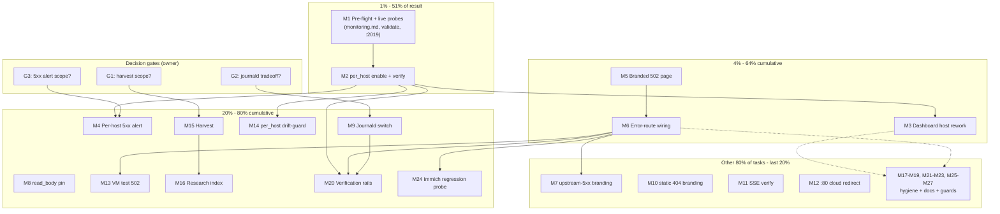

# SUPERB Plan — Caddy Edge: Pareto Execution Plan (Observability + UX + Hygiene)

**Created:** 2026-10-25 17:57 CET
**EXECUTING (instance crush-glm-5.3-flash-caddy-edge, 2026-10-25 18:56 CET, HEAD `1435874f8`):** executing (see AGENTS.md plan-execution tombstone)
**Inputs:** `docs/research/2026-10-25_caddy-deep-dive.html` (adoption audit 89/100, 3 findings) + `docs/status/2026-10-25_17-44_caddy-deep-dive-session-status.md` §f (50 items) — ALL 50 items are mapped below (traceability table).
**Scope:** follow-up work surfaced by THIS session's caddy deep dive only. Repo-wide backlog (other domains' TODO rows) is deliberately out of scope.
**Status:** PLANNED — not executing. When execution starts, write the tombstone first (`scripts/plan-marker.sh <this-file> start`, commit immediately).
**Format overrides honored (operator instruction):** `.md` file (skill default: HTML) + mermaid.js execution graph + fine tasks ≤12 min (skill default: ≤15 min). Flagged, not propagated.

## Step-0 errata & cross-references (found during pre-read — do NOT fork these)

| Existing open item | Where | Interaction with this plan |
|---|---|---|
| "Caddy access.log ingestion (filelog receiver) + log-ingestion-volume anomaly alert" | `docs/todo/monitoring.md:31`, TODO_LIST row 294 | **Directly interacts with finding 3 (M9).** If runtime logs move to journald (stdout), the global `access.log` file DISAPPEARS — the filelog-receiver row must then target per-vHost `access-*.log` files instead. M9/F39 reconciles both into ONE design note before any switch. Decision g2 covers this. |
| "Caddy Catch-All 404 gatus check → SigNoz dashboard group" | TODO_LIST row 310 → `docs/todo/monitoring.md` | Adjacent dashboard work; M3 (dashboard rework) should confirm this row's check visibility while touching dashboards. |
| Parallel session landed "Edge tracing (OpenTelemetry spans)" section in `docs/services/caddy.md` today (17:03) | caddy.md | Already reflected in the audit (tracing = fully leveraged). No conflict. |

Verified still open at authoring (17:57): `per_host` absent, no `handle_errors 502`, no journald encoder in `modules/nixos/services/caddy.nix`. Git tree clean at HEAD `8740dba10`+.

## Decision gates (owner answers required — g1–g3 from the status report)

- **G1 (gates M15):** harvest approved tasks into `TODO_LIST.md` + domain libs now, or keep plan-file-only?
- **G2 (gates M9):** drop geometrikks's tail of the GLOBAL access.log so runtime logs reach SigNoz via journald? (per-vHost tails unaffected; reconciles with the filelog row above)
- **G3 (gates M4):** per-host 5xx alert — yes/no; threshold, window, host scope.

---

## Pareto Breakdown

Customer = the operator (Lars). Value axes: observability of the ~20-service web edge, honest UX (error pages), security polish, maintenance-time saved.

### The 1% that delivers 51% (2 tasks)

1. **M2 — enable `metrics { per_host }`** (one word in `globalConfig` + verify). Unlocks per-vHost RED metrics for every service behind the proxy — the single highest-leverage change in the audit. Everything observability-related (M3 dashboard, M4 alert, F12 cardinality, M14 drift-guard) keys off it.
2. **M1 — pre-flight: monitoring-doc read + live probes** (`caddy validate`, rendered-config diff, `:2019` series pull). De-risks every subsequent task; closes the audit's own live-verification gap; costs under an hour.

### The 4% that deliver 64% (3 more tasks → 5 cumulative)

3. **M3 — dashboard host-dimension rework** — the visible payoff of per_host: per-service request/error/latency panels where today all 7 queries are aggregate `sum()`.
4. **M5 — branded 502 page** — the asset for honest dead-backend UX.
5. **M6 — error-route wiring** (`handle_errors 502 503 504` in the three helpers + catch-alls) — one edit site, every vHost inherits.

### The 20% that deliver 80% (9 more tasks → 14 cumulative)

6. **M4** per-host 5xx alert (g3) — turns metrics into incident detection.
7. **M8** `read_body` timeout pin — bounds the one real (if low) DoS surface.
8. **M9** journald runtime-log switch (g2) — caddy's own errors become SigNoz-visible.
9. **M13** VM test for the 502 route — regression-pins M6.
10. **M14** per_host drift-guard lint — protects M2 from silent removal.
11. **M15** harvest approved rows (g1) — keeps the queue the single dispatch source.
12. **M16** `docs/research/README.md` index — 34 reports become discoverable.
13. **M20** verification rails re-run (otel-audit + signoz-coverage legs) — green proof after config changes.
14. **M24** immich hybrid-auth regression probe — protects the one sanctioned exception while its helper changes (after M6).

### The other 80% of tasks → the last 20% to 100% (13 tasks)

M7 (upstream-5xx branding, optional), M10 (static-vHost 404 branding), M11 (SSE write_idle live verify), M12 (:80 cloud redirect verify), M17 (stance+verify rows), M18 (module doc batch), M19 (blind-subdomain hygiene), M21 (log hygiene), M22 (supersession+refresh), M23 (cadence+convention), M25 (mint SAN guard), M26 (vhostLayers heuristic), M27 (skill feedback + artifact home). Maintenance value, zero urgency — deliberately last.

---

## Comprehensive Plan — 27 medium tasks (30–100 min each)

Sorted by importance/impact/effort/customer-value (Pareto tier first, then impact × ease). Gates noted. Effort = focused-work estimate.

| # | Task | Tier | Impact | Effort | Gate | Covers §f items |
|---|------|------|--------|--------|------|-----------------|
| M1 | Pre-flight: read `docs/agents/monitoring.md`; `caddy validate --config /etc/caddy/caddy_config`; diff rendered config vs audit claims; live `:2019/metrics` series pull | 1% | High (de-risks all) | 45min | — | 25, 11, 12, 49 |
| M2 | Enable `metrics { per_host }` in globalConfig; flake check; deploy window; live cardinality check | 1% | Critical | 30min | — | 1, 13 |
| M3 | Dashboard host-dimension rework (`dashboards/caddy.json`): host variable + 6 panel conversions + top-hosts-by-5xx panel; SigNoz reload verify | 4% | High | 90min | after M2 | 2 |
| M5 | Branded 502/503/504 page derivation (linkFarm sibling of notFoundRoot); sandbox status-proof | 4% | High | 45min | — | 4 |
| M6 | Wire `handle_errors 502 503 504` into plainVHost + protectedVHost + renderVHost + both catch-alls; deploy + dead-backend probe (enable-gated service); runbook + smoke update | 4% | High | 60min | after M5 | 5 |
| M4 | Per-host 5xx alert: read `_signoz-alerts.nix` conventions (dotted-histogram class), draft rule per g3, wire, deploy, observe FP window | 20% | High | 90min | G3, after M2 | 3 |
| M8 | `servers { timeouts { read_body 15m } }` pin + confirm global 10GB body-cap scope is intended | 20% | Medium | 30min | — | 9, 17 |
| M9 | Journald switch: reconcile with filelog-receiver row (F39), switch default logger (`output stdout` + `format journald { wrap json }`), update geometrikks paths + runbook + test-caddy-logs-hot, deploy + verify priority prefixes + SigNoz ingest | 20% | High | 90min | G2 | 7, 8 |
| M13 | VM test for 502 route (extend test-caddy-auth.nix; branded-page + status asserts; negative-lint leg) | 20% | Medium | 60min | after M6 | 34 |
| M14 | Drift-guard lint: `per_host` must stay in globalConfig (existing audit-lint pattern + negative-test leg) | 20% | Medium | 45min | after M2 | 35 |
| M15 | Harvest approved rows → TODO_LIST.md one-liners + `docs/todo/{services,monitoring}.md` Sources; align done rows | 20% | High (process) | 30min | G1 | 23 |
| M16 | Create `docs/research/README.md` index (34 reports: subject/date/refresh-trigger) + link from docs/agents/README.md | 20% | Medium | 45min | — | 24 |
| M20 | Verification rails: re-run otel-endpoint-audit + signoz-coverage "caddy" legs post-change; OTEL budget note verify | 20% | Medium | 30min | after M2/M6 | 46, 47 |
| M24 | Immich hybrid-auth regression probe (LAN + mobile-app callback) after helper changes; document if shifted | 20% | Medium | 60min | after M6 | 43 |
| M7 | Optional: `handle_response @e status 5xx` upstream-response branding in proxyTo (opt-in param); default-off decision | rest | Low-Med | 45min | — | 6 |
| M10 | Static vHost (timers/catalog) 404 branding check + fix + regression pin | rest | Medium | 45min | — | 15 |
| M11 | SSE live verify: llama-chat long generation under 2.11.6 write_idle defaults; per-route `timeouts` handler if stalls | rest | Medium | 30min | — | 16 |
| M12 | `:80` redirect cloud-zone coverage verify + fix + regression | rest | Medium | 30min | — | 14 |
| M17 | Stance+verify rows: rate-limit stance (crowdsec stage-3 primary, plugin alternative) → services.md; monitor cache-override row verify; dnsblockd catchall-probe row verify; Cache-Control backstop note | rest | Low | 45min | — | 10, 19, 20, 21 |
| M18 | Module doc batch: enableReload rationale comment in caddy.nix; XFF no-trust + redaction "correct by default" runbook lines; Permissions-Policy review; hostOverride users audit | rest | Low | 60min | — | 32, 36, 37, 18 |
| M19 | Blind-subdomain hygiene: paperless row (registry move or refreshed justification); auth/seo/tasks deferral rows confirm; alerts alias removal-candidate note; seo callback watch-note | rest | Low | 60min | — | 29, 30, 31, 42 |
| M21 | Log hygiene: log_skip for probe noise; roll_compression zstd; per-vHost roll-budget decision | rest | Low | 60min | — | 38, 39, 40 |
| M22 | Supersession+refresh: annotate deep-dive report post-adoption (docs-health ANNOTATE); refresh-trigger watch row (next caddy major); inventory-granularity note (rows 8/9 split next refresh) | rest | Low | 45min | after adoptions | 26, 41, 48 |
| M23 | Cadence+convention: nixpkgs bump cadence check (flake.lock nixpkgs date vs caddy releases); CHANGELOG convention for research reports (grep forgejo/dnsblockd precedents) | rest | Low | 30min | — | 44, 45 |
| M25 | Mint SAN guard: assertion tying mint SAN list to networking.local zones; extend test-caddy-mint | rest | Low-Med | 45min | — | 22 |
| M26 | vhostLayers port heuristic: replace "first localhost: line" regex with helper-derived port map; post-deploy smoke re-verify | rest | Low | 60min | — | 33 |
| M27 | Skill feedback + artifacts: Context7-absent note for library-deep-dive; screenshot durable-home / regenerate-commands note | rest | Low | 30min | — | 27, 28 |

**§f item 50** (answer g1–g3) = the three gates above, not a work task. All 50 §f items are covered: 1–50 each appear in a "Covers" column exactly once.

---

## Fine Breakdown — 93 tasks ≤12 min each

Grouped under their medium task (execution coherence); group order = the sort above. Gates are 5–10 min owner answers. Full table; G = gate.

### Gates

| ID | Task | Min | Gate |
|----|------|-----|------|
| F01 | Answer G1 (harvest scope for M15) | 5 | G1 |
| F02 | Answer G2 (journald tradeoff, incl. filelog-row reconciliation) | 10 | G2 |
| F03 | Answer G3 (5xx alert scope/threshold/window/hosts) | 5 | G3 |

### M1 — Pre-flight & live probes (45min)

| ID | Task | Min |
|----|------|-----|
| F04 | Read `docs/agents/monitoring.md` (routing-table requirement) | 10 |
| F05 | `caddy validate --config /etc/caddy/caddy_config` (runbook path) | 10 |
| F06 | Diff rendered config vs audit claims (strict_sni_host/encode/tls/metrics present; per_host absent pre-M2) | 12 |
| F07 | Live `:2019/metrics` pull — record `caddy_http_*` series names (throwaway script; internal curl OK) | 12 |
| F08 | Record live-probe leg as mandatory audit phase (plan errata → future audits) | 5 |

### M2 — per_host enable + verify (30min)

| ID | Task | Min |
|----|------|-----|
| F09 | Add `metrics { per_host }` to globalConfig (caddy.nix) | 5 |
| F10 | `nix flake check --no-build` + eval evo-x2 toplevel | 12 |
| F11 | Stage deploy window (`nix run .#deploy`; post-deploy-check caddy legs) | 12 |
| F12 | Live cardinality check: host-label count ≈ vHost count + `_other` | 10 |

### M3 — Dashboard rework (90min)

| ID | Task | Min |
|----|------|-----|
| F13 | Read dashboards/caddy.json spec structure (variables/panels/queries shape) | 10 |
| F14 | Add `host` dashboard variable (dropdown from metric labels) | 12 |
| F15 | Convert request-rate panel to by-host | 10 |
| F16 | Convert status-code panel to by-host | 10 |
| F17 | Convert 5xx panels (2) to by-host | 10 |
| F18 | Convert in-flight panel to by-host | 8 |
| F19 | Add top-hosts-by-5xx table panel | 12 |
| F20 | SigNoz dashboard reload + render verification (post-deploy check) | 12 |

### M5 — 502 page (45min)

| ID | Task | Min |
|----|------|-----|
| F26 | Write error-page HTML (Catppuccin sibling of 404 page; echoes `{err.status_code}` + host) | 12 |
| F27 | Extend the linkFarm derivation (502.html beside index.html) | 10 |
| F28 | Sandbox-verify page serves with REAL 502 status (2026-10-07 sandbox-proof pattern) | 12 |

### M6 — Error-route wiring (60min)

| ID | Task | Min |
|----|------|-----|
| F29 | `handle_errors 502 503 504 { rewrite * /502.html; file_server }` in plainVHost | 8 |
| F30 | Same in protectedVHost + renderVHost (both static arms) | 10 |
| F31 | Same in both catch-alls (home.lan + cloud) | 6 |
| F32 | Deploy + dead-backend probe via an enable-gated vHost (never stop a live service) | 12 |
| F33 | Update runbook (error-page section) + vhost-layers smoke expectations | 12 |

### M4 — 5xx alert (90min) [G3]

| ID | Task | Min |
|----|------|-----|
| F21 | Read `_signoz-alerts.nix` rule patterns + dotted-histogram suffix convention | 10 |
| F22 | Draft per-host 5xx rate rule (threshold/window per G3) | 12 |
| F23 | Wire rule into `_signoz-alerts.nix` | 12 |
| F24 | Deploy + verify rule loaded (SigNoz API/journal probe) | 12 |
| F25 | Observe first cycles for FP; tune-threshold note | 12 |

### M8 — read_body pin (30min)

| ID | Task | Min |
|----|------|-----|
| F36 | `servers { timeouts { read_body 15m } }` in globalConfig | 5 |
| F37 | Confirm 10GB global body-cap scope intended (per-vHost carve-out if not) | 12 |
| F38 | flake check + validate | 10 |

### M9 — journald switch (90min) [G2]

| ID | Task | Min |
|----|------|-----|
| F39 | Design note reconciling journald switch with filelog-receiver row (docs/todo/monitoring.md:31) — one decision doc | 12 |
| F40 | Switch logFormat: `output stdout` + `format journald { wrap json }` | 8 |
| F41 | Update geometrikks caddyLogPaths (drop access.log entry) + assertion | 12 |
| F42 | Update caddy.md log map + runbook Logs section | 10 |
| F43 | Update test-caddy-logs-hot expectations | 12 |
| F44 | Deploy + verify journal priority prefixes + SigNoz ingest of runtime lines | 12 |

### M13 — VM test 502 (60min)

| ID | Task | Min |
|----|------|-----|
| F52 | Extend test-caddy-auth.nix: dead-backend case | 12 |
| F53 | Assert branded page content + 502 status | 12 |
| F54 | Run VM suite + negative-lints leg | 12 |

### M14 — drift-guard lint (45min)

| ID | Task | Min |
|----|------|-----|
| F55 | Lint: globalConfig must contain `per_host` (existing audit-lint pattern) | 12 |
| F56 | negative-test-lints.sh leg for the lint | 12 |
| F57 | flake check green | 8 |

### M15 — harvest (30min) [G1]

| ID | Task | Min |
|----|------|-----|
| F58 | Queue approved rows into TODO_LIST.md (`[ready]` one-liners) | 12 |
| F59 | Mirror into docs/todo/{services,monitoring}.md with `**Source:**` pointers | 12 |
| F60 | Align plan done-rows ↔ queue (edit both surfaces) | 6 |

### M16 — research index (45min)

| ID | Task | Min |
|----|------|-----|
| F61 | Write docs/research/README.md (34 reports: subject/date/refresh-trigger) | 12 |
| F62 | Add this deep-dive row + refresh trigger | 10 |
| F63 | Link from docs/agents/README.md provenance map | 10 |

### M20 — verification rails (30min)

| ID | Task | Min |
|----|------|-----|
| F77 | otel-endpoint-audit + signoz-coverage "caddy" legs green post-change | 10 |
| F78 | OTEL 26h-budget note still accurate post per_host | 8 |

### M24 — immich regression (60min)

| ID | Task | Min |
|----|------|-----|
| F87 | protectedVHost-change probe: LAN path + `app.immich:///oauth-callback` bypass | 12 |
| F88 | Document shift in immich runbook if any | 10 |

### M7 — upstream-5xx branding, optional (45min)

| ID | Task | Min |
|----|------|-----|
| F34 | `handle_response @e status 5xx` as opt-in proxyTo param | 12 |
| F35 | Default-off vs on decision + doc | 10 |

### M10 — static vHost 404 (45min)

| ID | Task | Min |
|----|------|-----|
| F45 | Probe timers/catalog unknown-path 404 behavior | 8 |
| F46 | Add branding to staticVHost if bare | 12 |
| F47 | Regression pin (checks.cloud-domain pattern) | 12 |

### M11 — SSE verify (30min)

| ID | Task | Min |
|----|------|-----|
| F48 | llama-chat long-generation live stream test (write_idle interplay) | 12 |
| F49 | Per-route `timeouts` handler IF stalls observed | 12 |

### M12 — :80 cloud redirect verify (30min)

| ID | Task | Min |
|----|------|-----|
| F50 | Verify matcher covers `*.larsartmann.cloud` (config read + plain-HTTP probe) | 12 |
| F51 | Fix + regression if broken | 12 |

### M17 — stance+verify rows (45min)

| ID | Task | Min |
|----|------|-----|
| F64 | Rate-limit stance row → docs/todo/services.md | 10 |
| F65 | monitor cache-override row verify/amend | 10 |
| F66 | dnsblockd catchall-probe row verify | 10 |
| F67 | Cache-Control backstop re-check note | 8 |

### M18 — module doc batch (60min)

| ID | Task | Min |
|----|------|-----|
| F68 | enableReload rationale comment in caddy.nix | 8 |
| F69 | XFF no-trust + redaction "correct by default" runbook lines | 10 |
| F70 | Permissions-Policy value review | 8 |
| F71 | hostOverride users audit (bank-sync class) | 12 |

### M19 — blind-subdomain hygiene (60min)

| ID | Task | Min |
|----|------|-----|
| F73 | paperless blind-row: registry move or refreshed justification | 12 |
| F74 | auth/seo/tasks deferral rows confirm | 10 |
| F75 | alerts alias removal-candidate note | 8 |
| F76 | seo callback watch-note | 8 |

### M21 — log hygiene (60min)

| ID | Task | Min |
|----|------|-----|
| F79 | log_skip for gatus/post-deploy probe paths | 12 |
| F80 | roll_compression zstd on log rolls | 10 |
| F81 | Per-vHost roll-budget decision (defaults vs cap) | 12 |

### M22 — supersession+refresh (45min)

| ID | Task | Min |
|----|------|-----|
| F82 | Annotate deep-dive report post-adoption (docs-health ANNOTATE mode) | 10 |
| F83 | Refresh-trigger watch row (next caddy major) | 8 |
| F84 | Inventory-granularity note (rows 8/9 split at next refresh) | 8 |

### M23 — cadence+convention (30min)

| ID | Task | Min |
|----|------|-----|
| F85 | nixpkgs bump cadence check (flake.lock date vs caddy release dates) | 10 |
| F86 | CHANGELOG convention check for research reports | 10 |

### M25 — mint SAN guard (45min)

| ID | Task | Min |
|----|------|-----|
| F89 | Assertion: mint SAN list tied to networking.local zones | 12 |
| F90 | Extend test-caddy-mint with third-zone negative case | 12 |

### M26 — vhostLayers heuristic (60min)

| ID | Task | Min |
|----|------|-----|
| F91 | Replace "first localhost: line" regex with helper-derived port map | 12 |
| F92 | post-deploy-check.sh smoke re-verify | 12 |

### M27 — skill feedback + artifacts (30min)

| ID | Task | Min |
|----|------|-----|
| F93 | library-deep-dive feedback note (Context7 MCP absent in this harness) | 8 |
| F94 | Screenshot durable-home / regenerate-commands note | 8 |

**Totals:** 93 fine tasks (3 gates + 90 work), ~16 h focused work. Median fine task 10–12 min.

---

## Execution graph (mermaid)

## Verification protocol (per medium task)

1. `nix flake check --no-build` green before any deploy.
2. Deploy via `nix run .#deploy` (never manual activation); anchor check (`readlink /run/current-system` vs newest `system-N-link`).
3. Task-specific probe (named in each fine task) — a check whose expected output wasn't written down first is not a check.
4. `post-deploy-check.sh` caddy legs green.
5. Update runbook + queue surfaces in the SAME change (edit both; no drift).

## Anti-verschlimmbesserung rules (operator directive #5)

- No speculative refactors; every change verifiably no worse than found (audit-verifiable: flake check + probes before/after).
- M9 flips a live log sink used by two consumers — gated on G2 + F39 design note, never drive-by.
- Never stop live services to test 502s (F32 uses enable-gated vHosts only).
- Per-host metric cardinality verified live (F12) before dashboards depend on it.
- Keep the seo GSC-callback vHost hand-rolled ("do NOT simplify" note stands).
