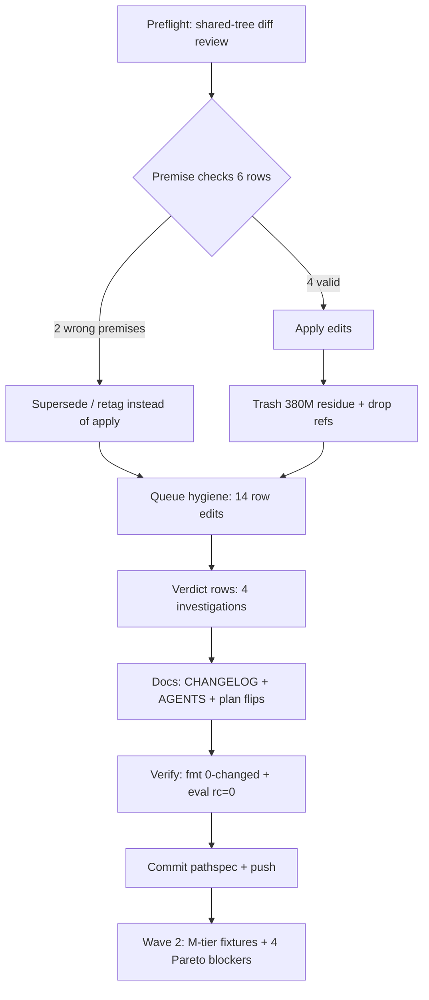

# SUPERB — Fast-TODO Wave 1 (XS/S tier execution)

**EXECUTING (crush/glm-5.3-flash, 2026-10-26 09:11, HEAD `2e9a5f557`):** fast-tier execution per the 2026-10-26 work-sorted inventory. This plan is the point-in-time snapshot; `TODO_LIST.md` is the living source.

## 0. Pareto read (before execution)

- **1% → ~51% of value:** the four storm/deploy blockers — ghostty interactive-scope IO root-cause, tq-agent-pool harvest full-rescan, InboxClean dashboard query cost (upstream), `scripts/deploy-when-quiescent.sh` productization. Each ≤1 session; none of them is a fast TODO, all of them gate everything else.
- **4% → ~64%:** the four above + the deploy-gated verification batteries (stability batch, caddy edge tracing :4318 fix, tile-logo wave) — they convert ~60 in-tree-but-unverified changes into closed rows.
- **20% → ~80%:** + the XS/S tier (this wave, ~350 rows of minutes-to-an-hour work), the M-tier fixture/assert family (~250 rows), and the queue-harness hardening cluster.
- **Remaining 80% of rows:** XL programs (offsite Borg go-live, /data corruption repair, hot-DB waves, CI restoration, vendorHash CI per repo) — owner-gated or multi-day; see the inventory report of 2026-10-26 08:4x.

## 1. Comprehensive plan (30–100 min tasks — full wave-1 scope)

| # | Task | Domain | Work | Impact | Status |
|---|------|--------|------|--------|--------|
| T1 | Premise-check + fix the 6 "one-line" config rows (catalog PATH, overcommit, hermes dup, flake comment, nvme default, tmp-crush-test) | services/pipeline/storage | 60 min | HIGH (3 of 6 premises were WRONG — fixed/superseded instead of applied) | ✅ done |
| T2 | Queue hygiene pass: retag tmp-reclaim, tick stale-done rows, dedupe reprioritized, flip SUPERB S-0702/S-1758 | pipeline | 45 min | HIGH (stops paid no-op re-fires) | ✅ done |
| T3 | Verdict rows: status-report.sh gatus read, btrfs-compression.prom ownership, nix-fmt scoping, niri-wrapped drift | monitoring/pipeline | 40 min | MED (kills repeated investigation cost) | ✅ done |
| T4 | Docs: CHANGELOG empty-workspace entry, AGENTS full-line-match note, services.md hermes recipe | docs | 25 min | MED | ✅ done |
| T5 | Formatter + green-eval verification battery | pipeline | 20 min | gate | ✅ done |
| T6 | Next wave (queued): M-tier fixtures — hermes WAL fixture, freshness composites, per-endpoint gatus collector, §17 user.slice leg | stability/monitoring | 4×90 min | HIGH | pending |
| T7 | Next wave (queued): PG-shadow-split pre-deploy gate + migrate-state forensics | storage | 2×80 min | CRITICAL (data-loss class) | pending |
| T8 | Next wave (queued): the four Pareto blockers | stability/monitoring/upstream | 4×60-100 min | CRITICAL | pending |
| T9 | Then: remaining XS/S tail (~300 rows, batched by domain) | all | ~15 h total | MED | pending |
| T10 | Then: L-tier builds (sev1 chronic latch, system-health decomposition, config diet, signoz dir split) | stability/services | multi-day | HIGH | pending |
| T11 | Owner-gated (never agent): XL programs — offsite Borg, /data repair, hot-DB waves, CI restoration pushes | storage/upstream | owner | CRITICAL | blocked:user |

## 2. Detailed 12-minute breakdown (wave 1 as executed)

| # | Micro-task | Result |
|---|-----------|--------|
| 1 | Preflight: HEAD pin, parallel-session diff review (append-only harvest rows + tmp migration) | ✅ |
| 2 | Row 354 premise check: catalog-inventory PATH | ALREADY FIXED 2026-10-23 (unit `path` list) → ticked, never-ticked re-fire class |
| 3 | Row 395 premise check: `vm.overcommit_memory=1` | SUPERSEDED — boot.nix:337 deliberately `mkForce 0`; applying would have reverted a conscious decision |
| 4 | Row 396 hermes dup-key probe | /home/hermes/config.yaml perm-denied → retag blocked:user + behavior-preserving recipe (delete earlier `provider: edge` line) |
| 5 | flake.nix:390 toolchain comment | rewritten rev-cited (fe1324228 / go 1.27.2) |
| 6 | Row 1337 nvme-health-monitor default | fail-loud: `default = null` + eval assertion naming by-id |
| 7 | Row 60 tmp-crush-test | content verified (`dnsblockd-vacuumed.db`, 380M, Aug-18, zero refs) → trashed; both config refs dropped (backup.nix, data-corruption-repair.sh) |
| 8 | Row 61 tmp-bench + /data/cache | both empty live → left in place, disposition recorded |
| 9 | Row 25 tmp-reclaim retag | `[blocked:deploy]`→`[blocked:user]` (sudo-only remainder) |
| 10 | Row 1310 reprioritized dedupe | verified single lane already (09-29 row pruned) → ticked |
| 11 | Row 266 status-report.sh read | unit-state only, no per-endpoint verdicts → per-endpoint metric row confirmed necessary |
| 12 | Row 268 btrfs-compression.prom ownership | owner FOUND: btrfs-compsize.timer (6h) via btrfs-compsize-metrics; staleness = admission-gate storm deferral |
| 13 | Row 648 niri-wrapped.nix drift | `nix fmt -- <path>`: 0 changed (already healed) |
| 14 | Row 1386 nix-fmt scoping | already answered in AGENTS.md (2026-10-23) → ticked; re-verified live |
| 15 | Rows 609 treefmt override warning | zero non-existent-input warnings in the live eval → already resolved |
| 16 | CHANGELOG empty-workspace entry + AGENTS full-line-match note | ✅ |
| 17 | SUPERB S-0702 + S-1758 plan rows | annotated done (9ff25c3b3) |
| 18 | Formatter over all changed .nix (3 files, 0 changed) + green eval probe | ✅ rc=0, only the known catalog-DNS warning |

## 3. Verification (this session, actual runs)

- `nix eval --raw .#nixosConfigurations.evo-x2.config.system.build.toplevel.drvPath` → rc=0, drv emitted (nvme assertion green under the by-id override).
- Warning scan of eval stderr: zero "override for a non-existent input"; only the queued catalog-DNS warning.
- `nix fmt -- <3 changed nix files>` → 0 changed (canonical).
- Live probes: `/home/hermes/config.yaml` perms (denied), `/data/tmp-bench` + `/data/cache/huggingface` (empty), `btrfs-compsize.{service,timer}` unit read (ownership), trash + `df /data` (67%).

## 4. Execution graph

## 5. Verschlimmbessern guards honored

- 2 of 6 "obvious one-line fixes" were deliberately NOT applied (overcommit mkForce-0 decision; catalog PATH already fixed) — the plan-faster-than-truth trap.
- Parallel session's files untouched (hot-user-caches.nix, disko, migrate-user-tmp-hot.sh, docs/agents/storage.md); shared TODO files committed with attribution note for their appended rows.
- Shared PATH stub/`trash` doctrine respected (no `rm`); btrfs damage-set evidence untouched (file was not in the documented damage set's live paths — test residue).
