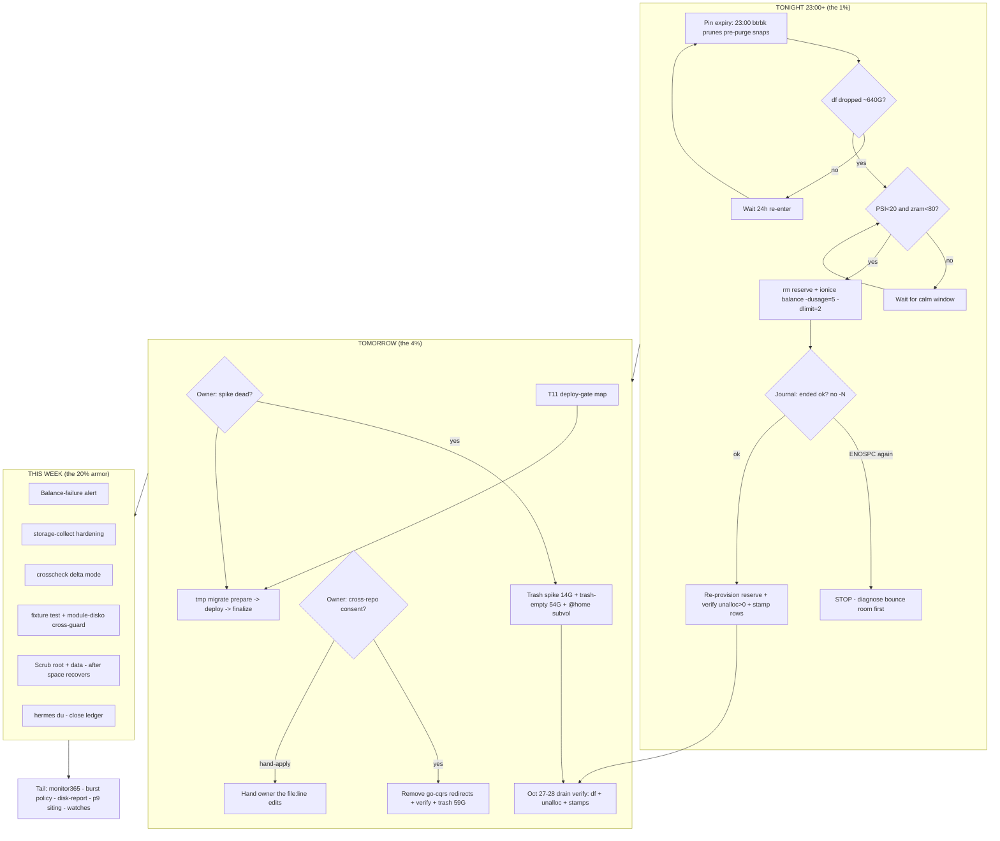

# SUPERB — QLC Root-Space & IO Crisis: Pareto Plan

**Date:** 2026-10-26 10:33 CET · **Scope:** the root-98% / IO-storm crisis cluster (this session's §f + coupled queue rows).
**Out of scope (owned elsewhere):** fast-tier XS/S queue + the four deploy blockers → `2026-10-26_09-11_SUPERB-fast-todo-wave1.md` (T6-T11).
**Living source:** `TODO_LIST.md` + `docs/todo/storage.md|monitoring.md` — this plan is the point-in-time snapshot.
**Standing facts this plan is built on (all live-verified 2026-10-26):** root 695G/723G = 98% · the 06:48 owner balance **ended `-28` ENOSPC** · 68G of purged caches pinned until tonight's/tomorrow's 23:00 btrbk expiry · chunk-unallocated 13 MiB · the Go-cache leak (~59G `projects/*` + ~9G `~/tmp/*`) still churning snapshotted `@` · E6 tmp config landed eval-green, execution pending · 54G staged in trash since Oct 8 · wevisone-spike = bare 14G venv.

---

## 0. Pareto Breakdown

### The 1% that delivers 51% — TONIGHT'S E1 BALANCE REDO
One 10-minute command sequence in the right window converts the pin-expired 68G + chunk debt back into usable space. Without it the box stays at 98%, every deploy gates on disk-space legs, and the next metadata-ENOSPC crash precursor is armed. Nothing else in this plan matters if this doesn't land.

### The 4% that delivers 64% — the space-and-leak quartet
1. E1 balance redo (the 1%, tonight)
2. E6 tmp migration execution (prepare → deploy → finalize; stops the double-billing churn, moves 25G to the Samsung)
3. `projects/*` redirect source-removal + trash ~59G (OWNER CONSENT GATE — question g.3 open; owner directive already given: "should not exist in the first place")
4. Owner sudo micro-window: `trash-empty` (54G, staged since Oct 8) + wevisone-spike trash (14G bare venv, confirm-dead gate)

Net effect: **~160G off the QLC + the leak closed + chunks healthy** → root back to ≤75-80%, deploy gates clear, nightly btrbk sends shrink.

### The 20% that delivers 80% — armor so it cannot silently recur
5. Balance-failure alerting (`ended with status: -N` was silent 84 min)
6. storage-collect storm hardening (btrfs metrics went stale mid-storm)
7. `io-psi-crosscheck.sh` delta mode (attribution in one command, not three broken awks)
8. E6 ship-quality pair: fixture test + hot-user-caches↔disko eval cross-guard
9. E2 scrub (root + /data, both stale >10d — integrity debt while we're about to trust balance/btrfs ops)
10. E3 hermes du (the last unknown in the space ledger)
11. Deploy-gate friction check at 98% root (the fix deploy for E6 must not be blocked by the disk-space legs)

### The other 80% of rows (to reach 100%)
E4 monitor365 39G relocation · E5 burst-snapshot policy · disk-report app · ClickHouse p9 siting · @home subvol delete · rescue double-fire attribution · cache-regrowth + tmp-idle-timeout watches · throttle-rule dissemination to agent docs · weekly-balance manual-gap wrapper.

---

## 1. Comprehensive Plan — 30-100 min tasks (sorted: impact ↓, then effort ↑)

| # | Task | Tier | Owner | Window | Effort | Impact | Depends on |
|---|------|------|-------|--------|--------|--------|------------|
| T1 | **E1 balance redo** — after 23:00 btrbk expiry: confirm snaps gone + df drop, then reserve-rm → quiet-gate (PSI<20, zram<80) → `ionice -c 3 btrfs balance start -dusage=5 -dlimit=2 /` → watch → journal end-status → re-provision reserve → `btrfs_device_unallocated_pct` verify | **1%** | owner (sudo) | **tonight 23:00+** | 40 min | CRITICAL | pin expiry 23:00 Oct 26/27 |
| T2 | **E6 tmp migration execution** — wevisone-spike decision → `migrate-user-tmp-hot.sh prepare` (entry gate) → deploy → finalize | 4% | owner+agent | tomorrow calm | 60 min | CRITICAL | T4 decision; calm window |
| T3 | **projects/* leak source-removal** — consent gate → edit go-cqrs-lite `scripts/go-env.sh:55-67` + `pre-commit.sh:18-22` (drop redirects, Go defaults → ~/.cache) → verify build env → trash ~59G trees after quiesce | 4% | agent (cross-repo consent) | this week | 90 min | CRITICAL | owner answer g.3 |
| T4 | **Owner sudo micro-window** — wevisone-spike trash (14G, bare venv) + `trash-empty` (54G staged Oct 8) + `@home` subvol delete | 4% | owner | anytime calm | 30 min | HIGH | confirm spike dead |
| T5 | **Balance-failure alerting** — journal-match unit or textfile composite for `balance: ended with status: -N` → gatus/discord | 20% | agent | anytime | 60 min | HIGH | — |
| T6 | **storage-collect storm hardening** — audit D-state starvation + dmesg SIGSYS loop (uid 966), add timeouts, confirm freshness alert | 20% | agent | anytime | 90 min | HIGH | — |
| T7 | **io-psi-crosscheck delta mode** — io.stat snapshot pair, top movers + unattributed-bytes signature, journal hint | 20% | agent | anytime | 80 min | MED-HIGH | — |
| T8 | **E6 ship-quality pair** — `test-migrate-user-tmp-hot.sh` fixture + module↔disko eval cross-guard (+ negative test group) | 20% | agent | anytime | 100 min | MED | T2 (finalize shape known) |
| T9 | **E2 scrub root + /data** — quiet weekend window, guard-aware | 20% | owner (sudo) | weekend | 45 min | MED | T1 (space first) |
| T10 | **E3 hermes du** — `sudo du -xh -d1 /home/hermes` → close the ledger unknown | 20% | owner (sudo) | anytime | 30 min | MED | — |
| T11 | **Deploy-gate friction check** — dry the pre-deploy disk-space legs at current %; know the WARN/BLOCK map before T2's deploy | 20% | agent | before T2 | 30 min | MED | — |
| T12 | **Drain verification** (Oct 27-28): df vs 666G baseline, unalloc metric, stamp row 185 | tail | agent | Oct 27-28 | 30 min | HIGH | T1, T4 |
| T13 | E4 monitor365 39G DuckDB relocation decision + wave | tail | owner | this week | 60 min | MED | — |
| T14 | E5 burst-snapshot policy (5 snaps Oct 23 class) | tail | agent | this week | 80 min | MED | — |
| T15 | disk-report app (subvol-aware consumer report — this crisis WAS its manual run, twice) | tail | agent | later | 100+ min | MED | — |
| T16 | ClickHouse p9 siting decision (197G lifetime writes on the root disk) | tail | decision | later | 60 min | MED | — |
| T17 | .rescue double-fire attribution (22:25+22:30) | tail | agent | anytime | 30 min | LOW-MED | — |
| T18 | Watches: ~/.cache 80G regrowth (>90G → row), tmp automount idle×builds | tail | agent | post-T2 | 30 min | LOW | T2 |
| T19 | Weekly-balance manual-gap wrapper (maintenance-entry-gate "balance running" leg) | tail | agent | later | 60 min | LOW-MED | — |
| T20 | Post-recovery housekeeping: annotate stale disk-cleanup-proposal, storage.md runbook note for E6 execution, CHANGELOG entry | tail | agent | after T2 | 30 min | LOW | T1, T2 |

**Effort total (agent-executable):** ~11h · **owner windows:** 3 short sudo sessions + 1 consent answer.

---

## 2. Fine Breakdown — every task at ≤12 min (grouped by task; global order = table order)

| µ# | Task | Micro-step | Min |
|----|------|-----------|-----|
| 1.1 | T1 | 23:00+: `journalctl -u btrbk-root --since 23:00` — confirm run + snapshot prune of the 3 pre-purge snaps | 5 |
| 1.2 | T1 | `df -h /` — expect used drop toward ~640G; if unchanged, snaps NOT expired → wait 24h, re-enter at 1.1 | 3 |
| 1.3 | T1 | Gate check: PSI some avg10 <20% + zram <80% (`/proc/pressure/io`, `grep MemAvailable /proc/meminfo`) | 4 |
| 1.4 | T1 | `sudo rm /btrfs-emergency-reserve` | 1 |
| 1.5 | T1 | Launch: `sudo ionice -c 3 btrfs balance start -dusage=5 -dlimit=2 /`; watch first 5 min (PSI, write rate) | 10 |
| 1.6 | T1 | `sudo btrfs balance status -v /` until ended; **journalctl -k \| grep balance** — assert no `status: -N` | 8 |
| 1.7 | T1 | `sudo systemctl start btrfs-emergency-reserve`; `btrfs filesystem usage /` → unallocated > 0 (aim ≥20G) | 6 |
| 1.8 | T1 | Stamp storage.md row 183 `[x]` + CHANGELOG; gatus "BTRFS Chunk Health" green check | 8 |
| 2.1 | T2 | Spike decision (owner): dead → trash wevisone-spike (rides T4 window) OR move to ~/projects | 2 |
| 2.2 | T2 | `bash scripts/migrate-user-tmp-hot.sh --dry-run prepare` — review top-consumers output | 4 |
| 2.3 | T2 | T11 gate result check — deploy legs green at current root%? If BLOCK class → defer deploy to post-T1 | 5 |
| 2.4 | T2 | `sudo bash scripts/migrate-user-tmp-hot.sh prepare` (entry gate enforces calm; verify double-pass counts) | 10 |
| 2.5 | T2 | Deploy: quiescence check (`nix eval` green probe) → `nix run .#deploy` | 10 |
| 2.6 | T2 | `sudo bash scripts/migrate-user-tmp-hot.sh finalize` (mount answers + user write probe) | 6 |
| 2.7 | T2 | Soak note in row 182; shadow-cleanup scheduled +2 days (µ2.8) | 4 |
| 2.8 | T2 | (+2d) `shadow-cleanup` — archive verify + QLC shadow delete | 10 |
| 3.1 | T3 | Consent answer → if hand-apply: hand owner the two file:line edits; STOP task here | 3 |
| 3.2 | T3 | go-cqrs-lite: read `scripts/go-env.sh:55-67` + `pre-commit.sh:18-22` (premise-check exact current state) | 8 |
| 3.3 | T3 | Remove redirect lines; keep any mount-alive guard that still makes sense; commit in that repo | 10 |
| 3.4 | T3 | One build in go-cqrs-lite → assert caches land in ~/.cache (not projects/.) | 10 |
| 3.5 | T3 | After builds quiesce: trash `projects/{.gocache-disk,.golangci-disk,.gotmp}` (~59G) | 8 |
| 3.6 | T3 | Watch dir non-regrowth next day; stamp row 182 remainder | 4 |
| 4.1 | T4 | `trash-list \| grep -i spike` sanity → `trash ~/tmp/wevisone-spike` | 6 |
| 4.2 | T4 | `trash-empty` (54G staged since Oct 8 — confirm no parallel-session entries needed first via trash-list scan) | 10 |
| 4.3 | T4 | `sudo btrfs subvolume delete /mnt/btrfs-root/@home`; tick library row | 6 |
| 4.4 | T4 | `df -h /` before/after → record freed sum in row 185 stamp | 4 |
| 5.1 | T5 | Choose mechanism: systemd unit with `journal-match` on kernel msg → textfile prom `balance_failed 1` + timestamp | 10 |
| 5.2 | T5 | Module edit + negative-shape check (oneshot+Restart audit rules) + port audit N/A probe | 10 |
| 5.3 | T5 | Gatus check on the prom (or sev1-bridge leg) + Discord alert text with runbook pointer | 10 |
| 5.4 | T5 | Eval green + `nix fmt --` + fixture selftest hook if the family has one | 8 |
| 6.1 | T6 | Reproduce: unit file read (storage-collect.service) — IO class, timeouts, seccomp line for dmesg | 8 |
| 6.2 | T6 | Identify uid 966 owner of the SIGSYS dmesg helper; decide fix (drop dmesg call vs allow syscall) | 10 |
| 6.3 | T6 | Harden: TimeoutStartSec + IOSchedulingClass idle; verify no implicit-mount audit trips | 10 |
| 6.4 | T6 | Freshness: confirm storage textfile freshness gatus check exists; add if missing (guard-fresh pattern) | 10 |
| 7.1 | T7 | Script: snap io.stat tree ×2 (5s), join deltas, top movers + unattributed residual print | 12 |
| 7.2 | T7 | Hint block: residual > threshold → print journal grep recipe (sudo trail + kernel balance lines) | 6 |
| 7.3 | T7 | shellcheck + `--help` + dry fixture (loopback test on cgroup v2 present) | 10 |
| 7.4 | T7 | Wire as optional crosscheck output mode; negative-test lint group if eval-touched | 8 |
| 8.1 | T8 | Fixture `test-migrate-user-tmp-hot.sh`: stage fake SRC+SUBVOL, root-uid override, prepare leg asserts | 12 |
| 8.2 | T8 | Fixture: finalize + shadow-cleanup legs (aux mount stubbed via TMP_MIGRATE_AUX) | 12 |
| 8.3 | T8 | Cross-guard: selftests.nix assert — ∀ hot-user-caches entry: subvol ∈ disko samsung-tlc subvolumes | 10 |
| 8.4 | T8 | Red-green verify: temp-remove a disko entry → eval fails; restore → green; commit | 10 |
| 9.1 | T9 | Guard-aware window check (churn window, PSI) → `sudo btrfs scrub start -B /` watched, or tmux + status poll | 10×3 |
| 9.2 | T9 | Same for /data (larger — may exceed 12min slices; poll loop) | 10×3 |
| 9.3 | T9 | Post: `btrfs scrub status` errors=0 → tick E2 part of row 184 | 6 |
| 10.1 | T10 | `sudo ionice -c 3 nice -n 19 du -xh -d1 /home/hermes \| sort -rh \| head` | 8 |
| 10.2 | T10 | Ledger update: replace "unknown" with the number; recompute snapshot-exclusive bucket | 8 |
| 10.3 | T10 | If >30G: queue hot-db/relocation decision row; else close E3 | 6 |
| 11.1 | T11 | Read pre-deploy-check.sh disk-space legs (thresholds, WARN vs BLOCK classes) | 8 |
| 11.2 | T11 | Map current df against thresholds → write the WARN/BLOCK expectation into T2's deploy step | 6 |
| 11.3 | T11 | If BLOCK at 98%: record the exact override path + gate ordering (never blind-force) | 5 |
| 12.1 | T12 | Oct 27-28: df vs 666G baseline + unalloc metric + `ls .snapshots` count | 6 |
| 12.2 | T12 | Stamp row 185 with numbers; tick the TODO_LIST drain row if converged | 6 |
| 13.1 | T13 | monitor365: confirm pool safety-copy freshness; write relocation decision options (hot-db wave vs stay) | 12 |
| 13.2 | T13 | If move: ride the hot-db wave runbook (separate plan) | — |
| 14.1 | T14 | btrbk config read: catch-up triggers, why 5× on Oct 23; rate-limit proposal | 10 |
| 14.2 | T14 | Implement policy (min-interval between @ snaps / collapse burst) + fixture | 12 |
| 15.x | T15 | disk-report app: 3-4 micro-slices (spec, subvol walk, output, wire as app) — only after recovery | 12×4 |
| 16.1 | T16 | ClickHouse siting memo: p9 writes/day vs Samsung space; decision row update | 12 |
| 17.1 | T17 | `.rescue` double-fire: journalctl -u btrfs-rescue-snapshot around 22:25/22:30 Oct 25 | 8 |
| 17.2 | T17 | Root-cause (timer vs manual vs deploy hook); fix or document cadence | 10 |
| 18.1 | T18 | Post-T2 watch rows: .cache >90G check; overnight build autofs re-wake latency probe | 8 |
| 19.1 | T19 | maintenance-entry-gate: add explicit "balance running" refusal leg (`btrfs balance status` probe) | 12 |
| 20.1 | T20 | Annotate stale disk-cleanup-proposal as superseded; CHANGELOG entry; storage.md E6 runbook note | 10 |

---

## 3. Execution Graph

## 4. Verschlimmbessern Guards

- **T1 re-runs ONLY in a verified-freed + calm state** — the -28 was exactly the no-bounce-room failure; if ENOSPC repeats: STOP, diagnose, do not re-fire with different flags blindly.
- **T3 is cross-repo**: no edits without the consent answer; the redirects encode two documented outage classes — remove the redirect, never "improve" it onto buildcache (87% full).
- **T2 order is load-bearing** (prepare BEFORE deploy — shadow-split class); script entry gates are the enforcement, don't bypass with DEPLOY_FORCE.
- Parallel-session files (pipeline.md, 07-09 report) untouched; wave-1 plan scope (fast-tier + deploy blockers) NOT duplicated here.
- No `rm` anywhere; trash + purge only; balance ops always ionice + bounded flags from the runbook.

## 5. Open Owner Gates (blocking)

1. wevisone-spike dead? (blocks µ2.1/T4)
2. Cross-repo edit consent for cv + go-cqrs-lite (blocks T3)
3. Balance deviation 06:48 — improvised vs deliberate (affects runbook wording only)
