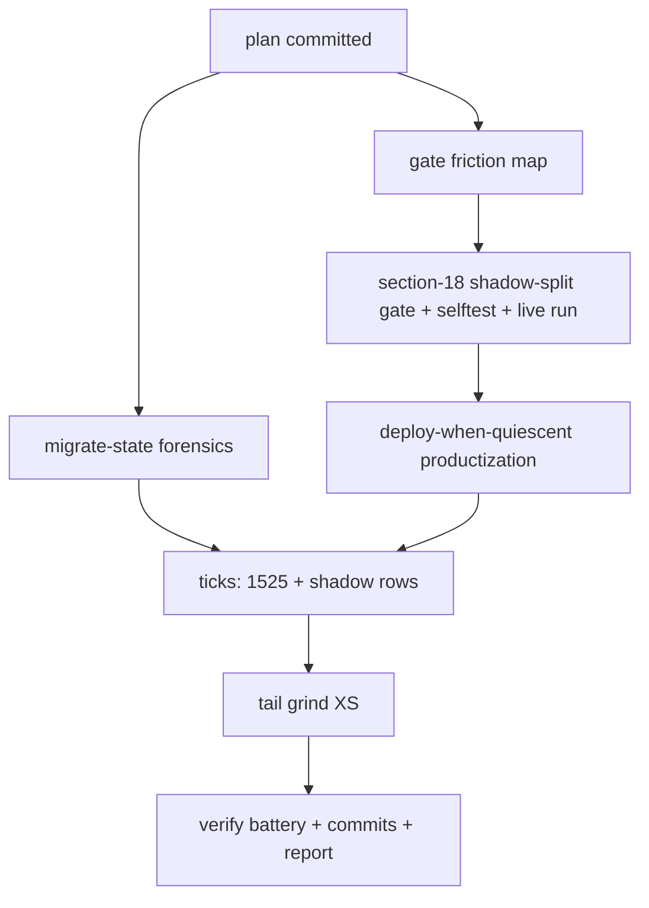

# SUPERB — Fast-TODO Wave 2: Deploy-Blocker Execution Plan

**Date:** 2026-10-26 10:55 CET · **Executor:** this session · **HEAD at authoring:** `739334737`
**Companion plans (read-first, Step 0 honored):**
`docs/planning/2026-10-26_09-11_SUPERB-fast-todo-wave1.md` (wave 1 — DONE, `d5cd73e98`) ·
`docs/planning/2026-10-26_10-33_SUPERB-qlc-root-space-crisis-pareto-plan.md` (space/IO crisis — parallel session, T1–T4 owner-gated, T5–T8 agent armor) ·
`docs/status/2026-10-26_07-09_deploy-unblock-gen949-quiescence-race-status.md` (§f.1 = this wave's P5) ·
`docs/status/2026-10-26_10-46_caddy-gen950-rider-verification-self-review.md` (its §f rows landed in queue at 10:4x — read, not re-queued).

**EXECUTING (crush instance, 2026-10-26 10:55, HEAD 739334737):** this session executes P2–P8 below.

---

## 0. Standing facts (live-verified 10:44–10:52 this session)

- Root `/` = 698G/723G = **99%, 14G free** (crisis plan owns the drain; tonight 23:00 balance redo is the 1%).
- nvme enumeration flipped AGAIN (root now `nvme0n1p6`, Samsung `/nix` = `nvme1n1p2`) — the by-id rule holds.
- `/mnt/hot/.migrate-state/` **does not exist** → the P3 forensics answer shapes up as "zero state records survive"; waves were claim-only.
- Open-row census: queue 1,401 (+4 new from the 10:46 caddy report) · storage 170 · stability 169 · monitoring 147 · ai-stack 26 · services 522 · upstream 181 · security 17 · pipeline 521 · desktop 92 · pixel6 18 → **~3,264 open**.
- Parallel-dirty files this session MUST NOT edit: `TODO_LIST.md` (surgical full-line edits only), `docs/todo/{pipeline,monitoring}.md`, `flake.nix`, `flake/parts/checks/selftests.nix`, `lib/{lars-packages,ports}.nix`, `modules/nixos/services/{caddy,hot-user-caches,journal-backup,journal-serve}.nix`, `platforms/*`, `docs/agents/storage.md`, `docs/services/*`, `disko/samsung-tlc.nix`, `scripts/migrate-user-tmp-hot.sh`, `README.md`.
- Deploys are OFF the table this session (99% root + PSI storms + owner sudo windows). Build/eval/scripts/docs only.

## 1. Coverage map — ALL open TODOs and their disposition this wave

| Surface | Open | Disposition this wave |
|---|---|---|
| TODO_LIST.md (queue) | 1,401 | P6 ticks for rows this session executes; +4 caddy rows = parallel harvest, left |
| storage.md | 170 | **P3 + P4 execute the top two `[ready]` rows** (shadow-split gate, .migrate-state forensics); third row blocked by dirty docs/agents/storage.md |
| stability.md | 169 | untouched (owner/PSI-gated body; tq-pool cursor row is M+ and monitoring.md-dirty adjacent) |
| monitoring.md | 147 | dirty by parallel session — its 10:33-plan armor items (T5–T7) belong there; not mine |
| ai-stack.md | 26 | untouched (models/GPU rows are owner-scale decisions) |
| services.md | 522 | P7 candidates only (docs-only rows); hermes config row still `[blocked:user]` |
| upstream.md | 181 | untouched (cross-repo consent gate per 10:33 plan guard) |
| security.md | 17 | untouched (owner-gated rotations) |
| pipeline.md | 521 | P5 executes row :579 (deploy-when-quiescent); twin tick deferred while dirty (documented exception, wave-1 precedent) |
| desktop.md | 92 | untouched (owner UX calls) |
| pixel6.md | 18 | untouched (device-attached) |

## 2. Session µ-task table — every task ≤12 min (global order = table order)

| µ# | Task | Detail | Min | Impact |
|---|---|---|---|---|
| P1.1 | This plan file | write + commit (tombstone guards) | 10 | process |
| P2.1 | Deploy-gate friction map | read pre-deploy disk-space legs (§ around :320), map 99%-root + 67% /data against thresholds, record WARN/BLOCK expectation for tomorrow's E6 deploy into §5 below | 12 | MED-HIGH (unblocks T2 of crisis plan) |
| P3.1 | .migrate-state forensics | read `scripts/migrate-hot-db.sh` state-dir lifecycle; verify dir absent; enumerate waves (gatus, dnsblockd, pocket-id, browser-history, discordsync, postgres) from configuration.nix + git log | 12 | MED |
| P3.2 | Forensics inventory | wave → evidence table (state record / commit / docs); write into library row DONE-note + status-report § | 12 | MED |
| P4.1 | §18 gate lib | `scripts/lib/shadow-split-gate.sh`: eval-driven entry enumeration contract (caller passes JSON), verdict logic (empty-subvol-over-nonempty-shadow = wave-6 signature; PG_VERSION presence parity; parity bands; EACCES degradation to WARN) | 12 | CRITICAL (data-loss class) |
| P4.2 | §18 wire | pre-deploy-check.sh: source lib, `--section-18-only` flag, §18 body after §17, verdict callbacks | 12 | CRITICAL |
| P4.3 | §18 selftest | `scripts/test-predeploy-shadow-split.sh` (storage-history-smoke pattern): green / empty-subvol FAIL / PG_VERSION-missing FAIL / parity WARN / EACCES-degrade WARN / fresh-shadow PASS / user-caches-WARN-class | 12 | HIGH |
| P4.4 | §18 live run | run the real gate against live entries (incl. E6 tmp in-tree state); shellcheck lib+test; scoped `nix fmt --` | 12 | HIGH |
| P4.5 | §18 red-green | temporarily point SS fixture at a mutation to prove FAIL fires; restore; document flake-check wiring deferral (selftests.nix parallel-dirty) | 12 | MED |
| P5.1 | deploy-when-quiescent.sh | shared eval-relevant-paths def (scripts/lib/eval-relevant-paths.sh), 4×60s polls, clean-tree + heat-check, `nix eval --raw` green pre-gate (NO --no-link), stability constant derived from battery duration | 12 | CRITICAL (deploy-race class) |
| P5.2 | rc-classification | §11-void/flake-check rc=1 under live executor = expected-retry output class; anything else stops for review; `--once`/`--fire` modes (default dry) | 12 | HIGH |
| P5.3 | shellcheck + dry verify | shellcheck both scripts; dry-run against the CURRENT (dirty) tree → must refuse; scoped fmt | 12 | HIGH |
| P6.1 | Queue ticks | TODO_LIST.md full-line ticks: row 1525 (P5), shadow-split + .migrate-state rows; pipeline.md twin tick ONLY if file goes clean | 12 | MED |
| P7.1 | Tail grind I | 2–4 XS docs-only rows (candidates: services.md docs-only fixups feasible without dirty files) | 12 | MED |
| P8.1 | Verify battery | bash scripts/check-todo-system.sh; shellcheck new files; `nix eval --raw` toplevel probe (quiescence-permitting); git status cross-check for foreign files | 12 | HIGH |
| P8.2 | Commit + report | pathspec commits (lib, pre-deploy-check.sh, test, quiescent scripts, TODO ticks, plan/report docs); status report §a–g; final chat table | 12 | HIGH |

## 3. Execution graph

## 4. Verschlimmbessern guards

- **Dirty-file list in §0 is absolute.** selftests.nix stays untouched → §18's flake-check wiring is DEFERRED with an explicit note (standalone test script proves the lib now; the wire-in lands when the parallel session commits).
- Gate never invents an escape env (anti-blind-skip discipline): fix = run prepare, not force.
- `nix eval` for entry enumeration is read-only; NO `--no-link` (07-09 §d.3).
- Quiescence script defaults to DRY (observe + report); it fires `nix run .#deploy` only with `--fire`.
- No sudo values, no secrets, no `rm` (trash only), no deploys, no upstream pushes.
- False premises from wave 1 stay dead: overcommit `mkForce 0` is deliberate; catalog-inventory already fixed; row 609 override already gone.

## 5. P2 deliverable — deploy-gate friction map at the current root%

Recorded 10:5x after reading `scripts/deploy.sh` entry gates (:132–296) + pre-deploy disk legs:

| Gate | Threshold | Current (10:44) | Expected verdict at E6 deploy (pre-T1-balance) |
|---|---|---|---|
| deploy.sh mem-PSI | block ≥20 | stormy this morning | likely BLOCK → wait or `DEPLOY_FORCE_PRESSURE=1` (owner call) |
| pre-deploy §8 disk space | FAIL <5G, **WARN <15G** (byte-based, % context-only) | / 14G free → **WARN only** | NOT a blocker; the real gates are PSI/zram/mem |
| deploy.sh zram | block ≥95+PSI ≥5 | 58–62G/62G this morning | BLOCK class |
| deploy.sh io-PSI | block ≥20 real | storm-dependent | wait for calm window |
| pre-deploy §8 stale sandboxes | WARN | 2 stale | WARN, self-heals on 4h timer |
| pre-deploy §18 (NEW, this wave) | FAIL on empty-subvol-over-nonempty-shadow | E6 in-flight: subvol prepared → PASS expected; if prepare skipped → **FAIL (by design)** | the gate is the T2 entry-guard |

**Consequence for the crisis plan's T2 (corrected after reading §8's exact thresholds):** at 14G free the E6 deploy does NOT block on disk (WARN only); the binding gates are the PSI/zram/memory entry gates + owner policy. §8's FAIL floor is 5G — tonight's balance redo (T1) is still what buys real headroom, but a calm-window deploy tomorrow is gate-legal at today's numbers.

## 6. Open gates (not this session's to answer)

1. Owner Qs from `…10-38_fast-todo-wave1-session-status.md` (overcommit posture; hermes config; wave-2 order) — order now answered by owner directive (this execution); other two stand.
2. Crisis-plan gates: wevisone-spike dead? cross-repo consent? balance 06:48 deviation intent?
3. pipeline.md twin ticks for 1525 — land when the parallel session commits the file.
