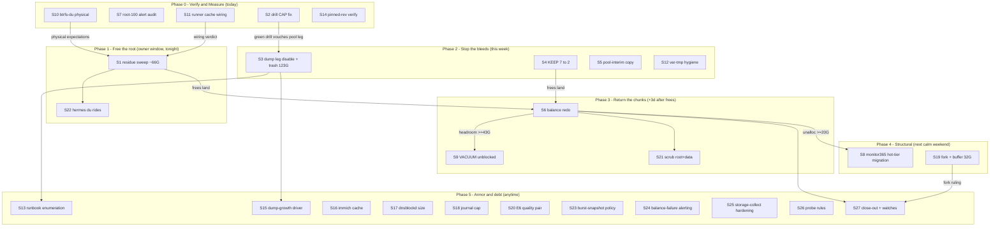

# SUPERB — Storage Crisis Recovery: Pareto Plan v2 (the /var layer)

**Created:** 2026-10-27 11:49 CET
**EXECUTING (instance storage-crisis-executor, 2026-10-27 14:22 CET, HEAD `790bffbdc`; session-3 night 23:xx, HEAD `2bd54efec+`):** executing (see AGENTS.md plan-execution tombstone). Session-3 (23:30 report): the 98% clock broken via the §f.11 stopgap ladder; S1/S2*/S4/S7/S15/S16/S18/S22*/S24 done or verified; train B (S3+3 fixes) sequencer-armed; S6 pin-gate GREEN (calm-window run pending); S8/S9/S19/S21/S27 remain
**Date:** 2026-10-27 11:49 CET · **Author session:** 2026-10-27 storage-tier audit (`docs/status/2026-10-27_10-38_var-storage-tier-audit-status.md` + `…_11-36_var-storage-audit-self-review-status.md`)
**Successor to:** `docs/planning/2026-10-26_10-33_SUPERB-qlc-root-space-crisis-pareto-plan.md` (reconciliation in §5 — that plan was perms-blind on `/var`, estimated ~45G where reality is 516G; its T1 balance ran WITHOUT the frees and could not return chunks — this plan fixes the ordering).
**Goal:** QLC root `@` back to ≥50G usable headroom + device-unallocated ≥20G; storage usage non-stupid (no redundant unpruned backup legs, backups verifiable, residue gone, growth bounded); every change verified, nothing verschlimmbessert.
**Scope:** ALL open storage-domain todos (queue + `docs/todo/storage.md` + storage-adjacent rows in services/monitoring/pipeline). Non-storage backlog stays in `TODO_LIST.md` (out of scope, listed §6 for completeness).

**Live state at planning time:** root `@` 714G/723G used, **device-unallocated 1.00 MiB** (metadata-ENOSPC precursor), data chunks 673.45GiB/671.99 used. Samsung hot tier 545G/928G. HDD pool 3.1T/15T (22%). Emergency reserve present (re-provisioned 10-26 22:55).

---

## 0. Pareto Breakdown

### The 1% that delivers 51% — UNBLOCK SPACE + UNBLOCK TRUTH
Two acts unlock everything else:
- **S1 — the owner residue-sweep sudo window** (~66G verified-dead on the root: discordsync restore copies 23G, /var/tmp debris ~15G, containers overlay 4.9G, gitea.pre 5G, runner go-build 13G, monitor365 corpses ~22G): the ONLY thing that ends the 1 MiB-unalloc ENOSPC exposure tonight.
- **S2 — the drill CAP fix** (one harden{} line): restores backup VERIFIABILITY — every other storage decision (deleting the 123G dumps, trusting the pool leg) is gated on a green drill.

### The 4% that delivers 64% — stop the bleeds + return the chunks
- **S3 — kill the redundant weekly forgejo dump leg** (+123G Samsung back, stops +27G/wk).
- **S4 — monitor365 KEEP 7→2** (stops hoarding 7×33G on the fullest fs).
- **S5 — monitor365 pool-interim copy** (only off-NVMe DB copy is 5d stale; empty pre-provisioned subvol exists).
- **S6 — balance redo AFTER the frees** (the 10-26 balance was structurally ineffective: `-dusage=5` has nothing to relocate at 99.6%-full chunks — frees first, then chunks return).
- **S7 — why is root-100% not paging** (detector-first: if the ≥93% alert is silent, every other green is suspect).

### The 20% that delivers 80% — structural, so it cannot recur
- **S8 — monitor365 hot-tier migration** (36G DB + backups off the QLC root; unblocks the VACUUM the fs is too full to run; converts file-copy retention to ~free CoW snapshots).
- **S9 — VACUUM actually runs** (127M rows/90d, DB self-reclaim restored).
- **S10-S12 — measure physical truth, fix runner cache wiring, /var/tmp hygiene policy.**
- **S13-S18 — runbook truth + classification debt** (forgejo backup-leg enumeration, pinned-rev verify, dump-growth driver, immich cache, dnsblockd size, journal cap).
- **S19 — the buffer fork** (32G frozen since July, gated on the owner's monitor365 decision).

### The other 80% of rows (to reach 100%)
Armor and debt: S20 (E6 ship-quality pair), S21 (scrub root+/data), S22 (hermes du), S23 (burst-snapshot policy), S24 (balance-failure alerting — pred. T5, never queued), S25 (storage-collect storm hardening — pred. T6), S26 (probe-harness rules), S27 (predecessor close-out + watches). Deferred/blocked: §6.

---

## 1. Comprehensive Plan — 30-100 min tasks (sorted: impact ↓, then effort ↑)

| # | Task | Tier | Owner | Window | Effort | Impact | Depends on |
| --- | --- | --- | --- | --- | --- | --- | --- |
| S1 | **Residue-sweep sudo window** — ordered one-shot command list w/ verification probes after each step: discordsync ×4 (23G) → /var/tmp debris (~15G) → containers overlay (4.9G, post reference-grep) → gitea.pre (5G) → runner .cache/go-build (13G, post wiring check) → monitor365 corpses (~22G) → July SQLite relics; `trash` not `rm` for non-rebuildable | **1%** | owner | tonight, calm | 40m | CRITICAL | S10 (ideally), S11 wiring verdict |
| S2 | **Drill CAP fix** — `CapabilityBoundingSet = "CAP_FOWNER CAP_DAC_READ_SEARCH"` in forgejo-restore-drill harden{} → eval → deploy (quiescence) → force-run drill → BOTH legs green | **1%** | agent | today | 30m | CRITICAL | deploy window |
| S3 | **Disable redundant forgejo dump leg** — `services.forgejo.dump.enable = false` → deploy → verify nightly forgejo-backup still green → owner `sudo trash /var/lib/forgejo/dump/*` (123G Samsung) → Samsung df delta | **4%** | agent+owner | after S2 | 45m | CRITICAL | S2 green drill |
| S4 | **monitor365 KEEP 7→2** — `serverCfg.backup.keep` config change → deploy → next 03:00 fire prunes corpses + oldest fulls → journal verify | **4%** | agent | any deploy | 30m | HIGH | coordinate w/ monitor365 sessions |
| S5 | **monitor365 pool-interim copy** — mount-gated oneshot after 03:00 backup: cp newest `*.backup_*.db` → `/mnt/pool/services/monitor365/` (empty subvol!), keep 3, `.last_success` marker + integration backup row | **4%** | agent | this week | 60m | HIGH | S4 shape known |
| S6 | **Balance redo POST-frees** — after S1/S4 frees + 3d pin expiry: reserve-rm → quiet gate (PSI<20, zram<80) → `ionice -c3 btrfs balance start -dusage=10 -dlimit=5 /` (frees EXIST now) → journal end-status → re-provision reserve → unalloc ≥20G | **4%** | owner | +3d after S1 | 40m | CRITICAL | S1, S4, pin expiry |
| S7 | **Root-100% alert audit** — gatus config + firing history for "Root filesystem >=93%": red-and-tolerated vs silent (phantom-green); fix the detector if silent; document which | **4%** | agent | today | 45m | HIGH | — |
| S8 | **monitor365 hot-tier migration** — caddy-logs-hot doctrine: +C subvol `hot/monitor365-server` → PSI-gated migrate script → fstab nofail/wants → `*Directory=` audit → deploy → verify; THEN redesign retention to `btrfs snapshot -r` + btrbk leg | **20%** | agent+owner | next calm wkd | 100m | CRITICAL-structural | S6 headroom, parallel-session coord |
| S9 | **VACUUM unblock verify** — after S6/S8: confirm nightly retention line reads VACUUM completed (needs ≥43G headroom); watch DB size trend; add headroom watch row if flaky | **20%** | agent | post S6 | 30m | HIGH | S6 or S8 |
| S10 | **btrfs-du physical measurement** — `sudo btrfs filesystem du -s /var/lib/monitor365-server/*` → shared-vs-exclusive split → correct S1/S4 reclaim expectations in the rows | **4%** | owner | pre-S1 | 15m | MED-HIGH | — |
| S11 | **Runner cache wiring fix** — why `.cache/go-build` 13G despite `/mnt/buildcache/ci-runner-cache` tmpfiles: audit runner unit env (GOCACHE reaches jobs?), fix redirect, then S1 trashes the stale 13G | **20%** | agent | today | 45m | MED-HIGH | runner stable (gen-955 rows) |
| S12 | **/var/tmp hygiene policy** — tmpfiles age for /var/tmp 30d→14d + move `boot-evidence-pull.sh` output to `~/.cache/boot-evidence/` + encode agent-artifact convention | **20%** | agent | this week | 45m | MED | — |
| S13 | **forgejo.md backup-leg enumeration** — rewrite Storage section listing ALL legs (daily pool zip, 8h btrbk subvol, weekly stateDir [being removed], Sunday drill) — single source of truth | **20%** | agent | post S3 | 30m | MED | S3 decision |
| S14 | **Pinned-rev dump-module verify** — `nix eval` the rendered forgejo-dump unit (ExecStart/WorkingDirectory) on evo-x2; confirm master-verified claims hold at the pinned nixpkgs | **20%** | agent | anytime | 12m | MED | — |
| S15 | **Dump-growth driver** — `unzip -l` newest pool zip: repos vs LFS vs packages share; decide pool zip retention shape (7d×27G ≈ 189G — right?) | **20%** | agent | anytime | 20m | MED | — |
| S16 | **immich cache classification** — /var/cache/immich 6.5G: accept / relocate hot / sweep-set; record in immich.md | **20%** | agent | anytime | 25m | MED | — |
| S17 | **dnsblockd 7.2G audit** — retention knobs + growth trend (dnsblockd.md owns domain); bounded-retention if unbounded | **20%** | agent | anytime | 30m | MED | — |
| S18 | **journal SystemMaxUse cap** — explicit cap for journal-hot (7.8G today) so Samsung headroom math stays honest | **20%** | agent | anytime | 20m | MED | — |
| S19 | **monitor365 fork + buffer disposition** — owner decides agent-vs-retire (row 558); then 32G frozen buffer trash-or-drain decision (2.31M segs, frozen since 07-30) | **20%** | owner | this week | 20m | HIGH | owner ruling |
| S20 | **E6 ship-quality pair** — `test-migrate-user-tmp-hot.sh` fixture + hot-user-caches↔disko eval cross-guard (+ negative-test group) | 20% | agent | anytime | 90m | MED | — |
| S21 | **Scrub root + /data** (E2) — quiet window, guard-aware, post-frees | tail | owner | weekend | 45m | MED | S1, S6 |
| S22 | **hermes du** (E3) — rides S1's sudo window; closes the C1/C3 unknown | tail | owner | w/ S1 | 12m | MED | — |
| S23 | **btrbk burst-snapshot policy** (E5) — why 5 snaps Oct 23; cap catch-up bursts | tail | agent | this week | 80m | MED | — |
| S24 | **Balance-failure alerting** (pred. T5 — NEVER queued, see errata) — journal-match/textfile composite for `balance: ended with status: -N` → gatus/discord | tail | agent | anytime | 60m | MED-HIGH | — |
| S25 | **storage-collect storm hardening** (pred. T6, monitoring.md:181) — D-state starvation + SIGSYS loop fixes, timeouts, freshness alert | tail | agent | anytime | 90m | MED | — |
| S26 | **Probe-harness rules** → docs/agents/shell-devtools.md (no error-eating pipes, section manifest, no 2>/dev/null) | tail | agent | anytime | 12m | MED | — |
| S27 | **Predecessor close-out** — annotate 10-26 plan status; drain-verify stamp (row 183) post-S6; wevisone-spike + @home-subvol rides in S1 window; watches: ~/.cache >90G threshold row, tmp automount × builds | tail | agent+owner | post S6 | 45m | MED | S1, S6 |

---

## 2. Fine Breakdown — every task ≤12 min (grouped by S#; global order = §1 order)

| µ# | S# | Micro-step | Min |
| --- | --- | --- | --- |
| 1.1 | S1 | Pre-step: containers reference-grep (`rg -l 'var/lib/containers' modules/ scripts/ flake*`) — verdict trash-or-keep | 6 |
| 1.2 | S1 | Write the ordered sudo list file (`~/.cache/storage-audit/sweep-sudo-list.sh`, dry-run first with echo) + hand to owner | 10 |
| 1.3 | S1 | Owner: `sudo trash /var/lib/discordsync-pre-restore-* /var/lib/discordsync-incident2-*` (4 dirs, 23G) | 4 |
| 1.4 | S1 | Owner: `sudo trash` the /var/tmp debris set (v13-rehearsal, inboxclean-io-probe/visual/rehearsal, go-build, 4× boot-evidence, wise-go-session, restore scratch ×2) | 8 |
| 1.5 | S1 | Owner: `sudo trash /var/lib/gitea.pre-forgejo-migration` (5G, April) | 2 |
| 1.6 | S1 | Owner: `sudo trash /var/lib/containers/storage` (if µ1.1 verdict = trash) | 4 |
| 1.7 | S1 | Owner: `sudo trash /var/lib/private/gitea-runner/evo-x2/.cache/go-build` (if S11 says stale) | 3 |
| 1.8 | S1 | Owner: `sudo trash /var/lib/monitor365-server/monitor365.duckdb.backup_2026102[45]*` corpses + monitor365.db relics | 4 |
| 1.9 | S1 | Probe: `df -h /` + `btrfs filesystem usage /` → stamp storage.md sweep row (frees visible now; extents free over 3d pin) | 6 |
| 2.1 | S2 | Edit forgejo.nix drill harden{}: add CAP_FOWNER CAP_DAC_READ_SEARCH | 4 |
| 2.2 | S2 | `nix flake check --no-build` (syntax) + `nix eval` drill unit render sanity | 8 |
| 2.3 | S2 | Deploy in quiescence window (heat-check + green-eval probe first) | 10 |
| 2.4 | S2 | Force `sudo systemctl start forgejo-restore-drill` (harness script) → journal: both legs green | 8 |
| 2.5 | S2 | Stamp TODO rows (drill fix [x] w/ evidence); note OnFailure silent | 4 |
| 3.1 | S3 | Edit forgejo.nix: `dump.enable = false`; verify family-condition-audit handles the vanished unit (eval) | 8 |
| 3.2 | S3 | Deploy + verify next 03:30 forgejo-backup journal green (pool zip) | 10 |
| 3.3 | S3 | Owner: `sudo trash /var/lib/forgejo/dump/*` (123G); Samsung df delta; frees over 3d hot/forgejo pin | 6 |
| 3.4 | S3 | Stamp rows; CHANGELOG bullet | 8 |
| 4.1 | S4 | Locate keep option (upstream server-module) → set 2 in SystemNix config | 8 |
| 4.2 | S4 | Deploy; watch next 03:00 fire journal: prune lines show 5 deletions | 10 |
| 4.3 | S4 | `du -sh /var/lib/monitor365-server` delta stamp | 4 |
| 5.1 | S5 | Write `monitor365-pool-copy` oneshot (mount-gated, cp newest backup, keep 3, marker) + timer after 03:10 | 10 |
| 5.2 | S5 | Integration registry backup row + backup-coordination metric wiring | 10 |
| 5.3 | S5 | Eval + deploy + force-run + pool-side `ls -lh` verify + Gatus row green | 12 |
| 6.1 | S6 | Pre-gate: confirm S1/S4 frees landed (`df`, storage.md row stamps) + 3d pin window passed | 5 |
| 6.2 | S6 | Quiet gate: PSI some avg10 <20%, zram <80%; else defer | 3 |
| 6.3 | S6 | `sudo rm /btrfs-emergency-reserve` | 1 |
| 6.4 | S6 | `sudo ionice -c3 btrfs balance start -dusage=10 -dlimit=5 /`; watch 5 min | 10 |
| 6.5 | S6 | `btrfs balance status -v /` until ended; journal: no `status: -N` | 8 |
| 6.6 | S6 | Re-provision reserve; `btrfs filesystem usage /`: unalloc ≥20G; stamp rows + gatus Chunk Health green | 8 |
| 7.1 | S7 | Read gatus-config root-fs check + threshold; grep storage-collector series for `/` used% at 100% window | 8 |
| 7.2 | S7 | Gatus API/status: alert state + history (fired? resolved? muted?) | 8 |
| 7.3 | S7 | Verdict doc: tolerated-red vs silent; if silent → fix (collector scale/condition) + negative-test leg | 12 |
| 8.1 | S8 | Read hot-db.md + caddy-logs-hot pattern; check upstream stateDir option suffices | 10 |
| 8.2 | S8 | Write migrate script (PSI-gated, prepare/finalize, marker) + module mount wiring + `*Directory=` audit | 12 |
| 8.3 | S8 | `sudo bash migrate … prepare` (copies 36G+ to +C subvol; calm window) | 10 |
| 8.4 | S8 | Deploy (mount wants-not-requires, tmpfiles, +chown ExecStartPre) + finalize swap | 10 |
| 8.5 | S8 | Verify: server up, DB rw, /health 200; QLC root df delta stamp | 8 |
| 8.6 | S8 | Retention redesign: `btrfs snapshot -r` + btrbk leg replaces KEEP copies (post-migration task, may re-plan) | 12 |
| 9.1 | S9 | Watch next 03:00 retention journal: "VACUUM" not "skipped" | 5 |
| 9.2 | S9 | `ls -lh` DB size trend over 3 nights; stamp row | 6 |
| 10.1 | S10 | `sudo btrfs filesystem du -s /var/lib/monitor365-server/*` (harness) → record shared/exclusive | 10 |
| 11.1 | S11 | Read runner unit env (GOCACHE/GOMODCACHE) + config.yaml; find why HOME .cache filled | 10 |
| 11.2 | S11 | Fix (env override or HOME cache symlink into ci-runner-cache); deploy; trigger a CI job; verify cache lands on buildcache | 12 |
| 12.1 | S12 | tmpfiles rule: /var/tmp age 14d (keep systemd-private dirs exempt — they're per-boot) | 8 |
| 12.2 | S12 | Point boot-evidence-pull.sh output at ~/.cache/boot-evidence/ + update §15 gate expectations if path-coupled | 10 |
| 12.3 | S12 | Shell-devtools note: agent debris → ~/.cache, never /var/tmp | 4 |
| 13.1 | S13 | Rewrite forgejo.md Storage section (all legs + drill + this incident's lesson) | 12 |
| 14.1 | S14 | `nix eval` rendered forgejo-dump unit at pinned nixpkgs → confirm backupDir + no-retention | 8 |
| 15.1 | S15 | `sudo ls` + `unzip -l` newest pool zip \| awk size-by-topdir → repos/LFS/DB split; retention verdict | 10 |
| 16.1 | S16 | immich.md row: classification + decision (accept/relocate/sweep-set) | 10 |
| 17.1 | S17 | dnsblockd.md + config read: retention knobs; `sudo du -sh` breakdown (harness); verdict row | 12 |
| 18.1 | S18 | journal-hot.nix: read current cap; set explicit SystemMaxUse if unset; deploy rides next train | 8 |
| 19.1 | S19 | Owner ruling on row 558 (agent up vs retire) — recorded in the row | 5 |
| 19.2 | S19 | If retire/drain-decided: buffer disposition (`sudo trash` 32G or drain procedure) + stamp | 10 |
| 20.1 | S20 | Write test-migrate-user-tmp-hot.sh fixture (TMP_MIGRATE_* overrides, 3 legs) | 12 |
| 20.2 | S20 | Eval cross-guard assertion (hot-user-caches ↔ disko) + negative-test group leg | 12 |
| 21.1 | S21 | Quiet-window scrub root + /data (owner sudo; guard-aware) + error-delta check | 12 |
| 22.1 | S22 | `sudo du -xh -d1 /home/hermes \| sort -rh \| head -20` (rides S1 window); stamp C1/C3 ledger | 8 |
| 23.1 | S23 | btrbk journal forensics Oct 23 bursts; policy fix (catch-up cap) + config change | 12 |
| 24.1 | S24 | Balance-failure detector: journal-match unit or textfile composite; wire gatus/discord; test by simulation | 12 |
| 25.1 | S25 | storage-collect: add timeouts, fix dmesg SIGSYS helper (uid 966), freshness alert; fixture leg | 12 |
| 26.1 | S26 | Encode 3 probe-harness rules into docs/agents/shell-devtools.md beside the live-probe set | 10 |
| 27.1 | S27 | Annotate 10-26 plan (status per task; pointer here) | 8 |
| 27.2 | S27 | Post-S6 drain stamp on storage.md row 183 (df, unalloc, before/after) | 6 |
| 27.3 | S27 | Watches: ~/.cache >90G threshold row decision; tmp-automount × overnight builds check | 10 |
| 27.4 | S27 | Wevisone-spike + @home-subvol rides confirmed/trashed in S1 window; stamps | 6 |

---

## 3. Execution Graph

**Hard gates:** no dump-trash before a green drill (S2→S3); no balance before frees + pin expiry (S1/S4→S6); no VACUUM expectation before headroom (S6→S9); migration needs unalloc headroom for its scratch copy (S6→S8).

## 4. Safety Rails (the verschlimmbessern guard)

1. `trash` over `rm` for everything not provably rebuildable; rebuildable caches (runner go-build, containers overlay) may `rm` per doctrine — after the µ1.1/S11 verdicts.
2. Every owner step carries a verification probe; every agent deploy rides the quiescence heat-check; no force past gates.
3. Snapshot pin windows respected: root frees land over 3d — no space conclusions from post-trash `df` alone (btrfs du / usage probes instead).
4. Pathspec commits only (parallel sessions live in this tree); plan-execution tombstone (`scripts/plan-marker.sh <this-plan> start`) before ANY executor starts; IO PSI <20% for every walk.
5. Nothing in Phase 4 touches the monitor365 service without coordinating with the active monitor365 parallel sessions (IO-storm fixes [blocked:push]).
6. Sequencing is load-bearing: S2 before S3; S1/S4 before S6; S6 before S8/S9/S21. Do not reorder for convenience.

## 5. Errata & Predecessor Reconciliation (10-26 plan)

| 10-26 task | Status | Basis |
| --- | --- | --- |
| T1 E1 balance | RAN but INEFFECTIVE — unalloc still 1.00 MiB | live `btrfs filesystem usage` 10-27; `-dusage=5` at 99.6%-full chunks had nothing to relocate; superseded by S6 (post-frees, `-dusage=10`) |
| T2 E6 tmp migration | DONE 10-26 | hot-user-caches live; T8 ship-quality pair still open → S20 |
| T3 projects leak | OPEN (cross-repo consent) | stays in its own rows; out of this plan's window, listed §6 |
| T4 owner micro-window | OPEN | wevisone-spike + @home rows → folded into S1 window (µ27.4) |
| T5 balance-failure alerting | NEVER QUEUED (harvest miss) | → S24 (this errata corrects the 10-26 plan's §f harvest claim) |
| T6 storage-collect hardening | OPEN | monitoring.md:181 → S25 |
| T7 io-psi-crosscheck | SUPERSEDED | io-attrib.sh row (monitoring.md) covers it |
| T9 scrub / T10 hermes du / T13 monitor365 / T14 burst | OPEN | → S21 / S22 / S8 / S23 |
| T11 deploy-gate friction / T12 drain verify / T15 disk-report / T16 CH p9 / T17 .rescue / T18 watches / T19 weekly-balance / T20 housekeeping | OPEN/absorbed | T12→µ27.2; T17→storage.md row; T18→µ27.3; T15/T16→§6 deferred |

## 6. Complete Inventory — deferred / blocked (NOT scheduled; the remaining % to 100%)

| Item | State |
| --- | --- |
| Offsite Borg go-live (3rd copy, 3-2-1) | implemented DORMANT; owner-gated (host-key pin) |
| /data corruption T05-T09 (10 bad files, scrub-gated) | blocked: scrub delta gate + per-file sign-off |
| projects/* Go-cache leak source-removal (E6 follow-through) | blocked: cross-repo owner consent |
| disk-report app (subvol-aware consumer report) | deferred; this crisis was its manual run ×2 |
| ClickHouse p9 siting (197G lifetime writes on root disk) | deferred decision |
| deploy-quiescence productization + io-attrib.sh + float-proof fixes | queued elsewhere (pipeline/monitoring); out of storage scope |
| ~/.cache regrowth (80G, >90G threshold) | watch; µ27.3 |
| Rust-cache inert buildcache/{cargo,rust,sccache} recreations | owner-manual rm; rides any S1-style window |

**Harvest status:** every task in this plan maps to an existing TODO_LIST/library row (queued 10-27 10-38 + 11-36 passes) EXCEPT S24 (balance-failure alerting — the 10-26 harvest miss this plan corrects; row added at commit time). No new rows otherwise; this file is the snapshot, `TODO_LIST.md` stays the living source.
