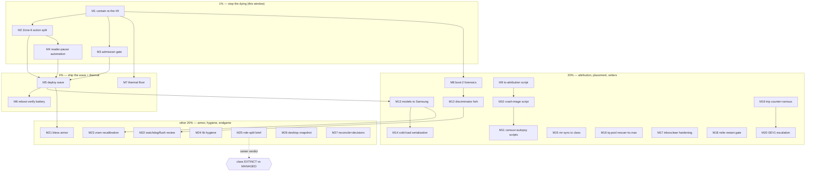

# SUPERB — Stability Crash-Extinction: Pareto Plan

**Created:** 2026-10-28 01:25 CET · **Author session:** watchdog double-crash diagnosis (`docs/status/2026-10-28_00-58_watchdog-double-crash-diagnosis-live-recovery-storm-status.md`)
**EXECUTING (instance stability-extinction executor session (crash-diagnosis continuation); executing ungated agent legs only (M1 close-out, F5/F6/F14 designs, M8-M12 forensics/scripts, M15/M19/M22/M24/M25); gates §7 stay owner-held, 2026-10-28 01:51 CET, HEAD `1c1746551`):** executing (see AGENTS.md plan-execution tombstone)
**Goal:** Make the evo-x2 stop dying: no more watchdog resets, no more recovery-storm crash loops, thermal family contained — by ratifying and landing the four already-designed structural fixes, plus the forensics/observability legs that keep them honest.
**Scope:** ALL open stability-domain todos (TODO_LIST `### stability` + `docs/todo/stability.md` + tonight's session items + the pending-deploy wave's stability legs + ROADMAP stability ideas). Non-stability backlog stays in `TODO_LIST.md` (§6, listed with counts). The EXECUTING storage plan (`2026-10-27_11-49`) is NOT superseded — its deploy legs are coordinated here, its storage content untouched.
**Live state at planning time:** io PSI some avg60 **72.6%** (9th post-crash re-fire, boot 0 = `b0d70d73`, guard trips #4508/#4509); two hardware-watchdog deaths in 24h (boot -2 `b803d718` 10:03 Oct 27 undiagnosed, boot -1 `3caf5548` 00:40 Oct 28 root-caused: 4.5h Zone-6 livelock + k10temp 100 °C); journal 7.9G/8G; boot-chain session (00:44–01:15) left 5 eval-green fixes UNDEPLOYED; storage-crisis plan mid-flight (train B armed).
**Nothing in this plan deploys during a storm.** Every deploy leg runs the quiescence protocol (§5.1). Owner gates are explicit and never self-ratified.

---

## 0. Pareto Breakdown

### The 1% that delivers 51% — STOP THE DYING (4 acts)
The box died 33+ times because four specific gaps each have a designed, evidenced, unratified fix. Landing these four converts "storm = death" into "storm = pause and survive":
- **A. Zone-6 action split** — IO-trips SIGSTOP the *driver trees* (headless builds/backups only, never owner PTYs), not the LLM socket. 4 proven wrong-tool incidents (#24, #25, tonight ×2). Z6 cooldown 600s→120–180s. `[blocked:user] row 157`
- **B. Battery-class admission gate** — refuse `nix build`/`flake check`/VM-test batteries while the guard recently tripped or PSI is in band (deploy.sh gate shape, refusal UX = owner question §7.1). 8 documented violations, each fatal. `row 135`
- **C. Post-crash reader-pause automation** — auto-pause resumable readers + catch-up writers on recovery boots while guard-active. 8 documented re-fires; #9 is live RIGHT NOW. `row 156`
- **D. Contain the live storm** — the 30-min owner sudo window (stop readers, park the `go` battery tree) that drains re-fire #9 before it becomes freeze #34.

### The 4% that delivers 64% — SHIP THE PENDING WAVE + THERMAL FLOOR
- **E. One deploy wave behind the quiescence protocol** — boot-chain's 5 fixes + stability batch + storage train-B in ONE switch, then the anchor check + ONE deliberate-reboot battery that closes **five** stacked calm-window verifications (TODO_LIST:146).
- **F. Thermal floor** — owner BIOS: fans 100% + PPT/TDP cap if exposed; agent: k10temp maxima pull + fan-telemetry probe + sensors wiring. Physics no gate fixes; kills the instant-cut family's ceiling-riding.

### The 20% that delivers 80% — ATTRIBUTION, PLACEMENT, STANDING WRITERS
- **G. Forensics tooling** — `io-writer-attribution.sh` (tonight's broken one-liner proved the need), crash-triage script (reset-reason-N-boots + un-evidenced-boot sweep + vacuum clock), `journal-census.sh`, `crash-autopsy.sh` (all but the first already queued rows).
- **H. Boot -2 forensics + freeze-family discriminator fork** — classify the second death; make the next autopsy start at the fork.
- **I. IO placement** — active model set → Samsung hot tier, cold-load serialization, llama pre-warm (removes 50–60G of QLC cold-reads per boot cycle).
- **J. Standing writers** — mr-sync-dashboard io idle-class (~19 MB/s forever), tq-pool full-state rescan (146–389 GB/trip!) + io.max caps, inboxclean-web reconnect storm hardening, nsfw-classifier storm-aware restart gating.
- **K. Guard observability** — per-boot trip counter in SEV1 line + Gatus; freeze-census threshold table; SEV1 sustained-escalation leg (option B, owner-ratified threshold after the census).

### The other 20% to reach 100% — ARMOR, HYGIENE, ENDGAME
- **L.** bless-boot regression armor (eval assertion + pre-reboot leg — the boot-chain session deferred its own armor)
- **M.** Watchdog window + journal flush-lag review (last 30–90s of evidence systematically lost)
- **N.** ZRAM/watermark recalibration after the load shape changes
- **O.** Stability-library hygiene pass (prune `[x]`, recount drift WARNs per the 2026-10-25 protocol)
- **P.** Harvest discipline (this plan's new rows → TODO_LIST + libs — done at authoring time, §8)
- **Q.** Role-split decision brief (second box: services/builds off the desktop) — the only path to extinction-by-architecture
- **R.** Desktop-state snapshot collector (freeze autopsies stop needing owner memory)
- **S.** flm Zone-6 exemption decision; tq-pool gate-refusal OnFailure noise decision
- **T.** Read + reconcile the 00:20–00:22 sibling reports into the incident record

---

## 1. Comprehensive Plan — medium granularity (30–100 min each, 27 tasks)

Sorted by importance → impact → effort → value. **Gate** = owner ratification needed before agent execution.

| ID | Task | Tier | Impact | Effort | Who | Gate | Depends |
|----|------|------|--------|--------|-----|------|---------|
| M1 | Contain live re-fire #9: owner sudo stops recovery readers + parks `go` battery tree; agent verifies PSI drain + trip quiet | 1% | CRITICAL | 30m | owner+agent | sudo | — |
| M2 | Zone-6 action split: IO-class trips SIGSTOP headless driver trees + forensics bundle; Z6 cooldown 120–180s; distinct IO escalation; memory zones keep socket-stop; VM test (pause/resume, never-PTY invariant) | 1% | CRITICAL | 100m | agent | **§7.1 go** | M1 |
| M3 | Battery-class admission gate: `nix build`/`flake check`/VM-test wrapper refused on trip-recent/PSI-band (deploy.sh shape); refusal UX per owner answer | 1% | CRITICAL | 100m | agent | **§7.1 UX** | M1 |
| M4 | Post-crash reader-pause automation: boot-ordered pause unit (readers + catch-up writers) while guard-active/PSI>40, calm-resume; selftest | 1% | CRITICAL | 90m | agent | — | M2 (action shape) |
| M5 | Deploy wave assembly: boot-chain 5 fixes + M2+M3+M4 + stability batch + storage train-B; quiescence protocol; anchor verify (§5.1) | 4% | HIGH | 100m | agent+owner | calm window | M2,M3,M4 |
| M6 | Reboot-verify battery: ONE owner window + 2–3 deliberate reboots closing all five stacked calm-window verifications (bless/counter/mirror, userspace re-measure, Samsung warm-reboot repro, guard VM legs, boot-0 prom re-check) | 4% | HIGH | 60m | owner+agent | reboots | M5 |
| M7 | Thermal floor: owner BIOS fans-100% + PPT cap if exposed; agent k10temp Oct-27 maxima pull, fan-telemetry probe, sensors wiring check; verify delta under load | 4% | HIGH | 30m+30m | owner+agent | — | M1 (calm box) |
| M8 | Boot -2 (`b803d718`) death-window forensics; classify via discriminator; append to evidence file | 20% | MED | 45m | agent | — | — |
| M9 | `scripts/io-writer-attribution.sh` + fixture selftest (the 5s /proc io pass, cgroup join, no-argv-leak) | 20% | MED | 45m | agent | — | — |
| M10 | Crash-triage script: reset-reason last-N boots + un-evidenced-crashed-boot sweep + vacuum clock (pre-vacuum-gate companion) + selftest | 20% | MED | 45m | agent | — | — |
| M11 | `scripts/journal-census.sh` (SEV1/trip/OOM census, no head-truncation) + `scripts/crash-autopsy.sh` codification (queued rows; sensors leg + freeze-series lookup) | 20% | MED | 90m | agent | — | — |
| M12 | Freeze-family discriminator fork doc section in stability.md (instant-cut thermal vs progressive livelock; entry-point table) | 20% | MED | 30m | agent | — | M8 |
| M13 | Active model set → Samsung hot tier: space check, `+C` subvol, migrate, repoint modelPath, verify loads | 20% | MED | 100m | agent | — | M5 (calm) |
| M14 | Cold-load serialization: one heavy-job slot / After= chain for llama-chat+flm+vlm+rag; llama pre-warm ExecStartPre | 20% | MED | 60m | agent | — | M13 |
| M15 | mr-sync-dashboard IO class fix: `IOSchedulingClass=idle` or PSI-aware sync window + verify standing-19MB/s gone | 20% | MED | 30m | agent | — | — |
| M16 | tq-agent-pool: skip-cursor/early-exit rescan fix + `io.max` cgroup cap on pool + build slices (owner throughput answer §7.2) | 20% | MED | 60m | agent | **§7.2** | — |
| M17 | inboxclean-web hardening: reconnect backoff + bounded aggregations | 20% | MED | 45m | agent | — | — |
| M18 | nsfw-classifier storm-aware restart gating (PSI-band condition / longer backoff for cold-start-heavy units) | 20% | MED | 30m | agent | — | — |
| M19 | Guard per-boot trip counter in SEV1 line + Gatus crash-loop check; freeze-census trips/uptime table (threshold defense) | 20% | MED | 45m | agent | — | — |
| M20 | SEV1 sustained-escalation leg, option B (warn-tier latch, ≥N trips/h × ≥2h state-file latch ~30–60 lines) + Gatus | 20% | MED | 60m | agent | **§7.1 ratify** | M19 census |
| M21 | bless-boot regression armor: eval assertion (ordering after boot-mirror-sync) + pre-reboot-check leg (boot-chain session's deferred rows) | 80%→100% | MED | 45m | agent | — | M5 |
| M22 | Watchdog window + flush-lag review: sp5100-tco timeout vs journal flush lag; document evidence-loss window; adjust if warranted | 80%→100% | LOW-MED | 30m | agent | — | M12 |
| M23 | ZRAM/watermark recalibration check: verify 47G sizing + swappiness against post-fix load shape; adjust only with evidence | 80%→100% | LOW | 30m | agent | — | M5,M13 |
| M24 | Stability-lib hygiene: prune `[x]` rows via `scripts/prune-done-todos.sh` (dry-run, rev-pinned WARN A/B), recount drift row | 80%→100% | LOW | 60m | agent | — | — |
| M25 | Role-split decision brief: second-box evidence pack (crash cost accounting, what moves, monthly cost, what stays) — OWNER DECISION DOC, no infra | 80%→100% | STRATEGIC | 45m | agent | — | — |
| M26 | Desktop-state snapshot collector (dpms/lock/session textfile, short timer) so freeze autopsies stop needing owner memory | 80%→100% | LOW | 45m | agent | — | — |
| M27 | Reconcile 00:20–00:22 sibling reports + flm-exemption decision row + tq OnFailure-noise decision row close-out into incident record | 80%→100% | LOW | 30m | agent | — | — |

**Total: ~19h agent + ~2h owner.** Gates: M2/M3/M20 (§7.1), M16 (§7.2), M5/M6 (calm window + reboots).

---

## 2. Fine Breakdown — max 12 min each

P0 = this session/next calm window. P1 = first dispatch cycle. P2 = second cycle. P3 = background.

| ID | Task (≤12 min each) | Parent | Pri |
|----|---------------------|--------|-----|
| F1 | Owner: `sudo systemctl stop crush-hot-db-migrate.service discordsync-db-heal.service` (+hermes heal if D-state) | M1 | P0 |
| F2 | Owner: park the `go` battery tree (SIGSTOP via sudo, resumable) | M1 | P0 |
| F3 | Agent: watch PSI avg60 to <20 over 10 min; log drain curve to incident record | M1 | P0 |
| F4 | Agent: re-run pre-vacuum gate + confirm evidence files committed | M1 | P0 |
| F5 | Read guard source: locate zone dispatch + action functions, cooldown var | M2 | P0 |
| F6 | Design note in module: IO-action = SIGSTOP headless trees; enumerate tree sources (cgroup io.stat top-N pids, filter uids 0/nixbld + unit-owned) | M2 | P0 |
| F7 | Implement never-PTY invariant (tty-owned pids excluded, owner uid interactive scopes excluded) | M2 | P0 |
| F8 | Implement Z6 cooldown config (default 150s) + IO/memory action split dispatch | M2 | P0 |
| F9 | Implement pause-state file + calm-resume (SIGCONT on PSI<20 sustained 10m) | M2 | P0 |
| F10 | Forensics bundle emit on IO-action (io.pressure + io.stat snapshot) | M2 | P0 |
| F11 | VM test: IO-trip pauses fake driver tree; PTY tree untouched; resume works | M2 | P0 |
| F12 | VM test: memory-zone action unchanged (regression leg) | M2 | P0 |
| F13 | Runbook update `docs/services/memory-emergency-guard.md` (action table) | M2 | P0 |
| F14 | Wrapper script `nix`-gate design: hook point (shell drv / PATH wrapper), state input (trips-recent file, /proc/pressure) | M3 | P0 |
| F15 | Implement gate script (fail message: calm-window hint + `--force` escape documented) | M3 | P0 |
| F16 | Wire gate into devshell PATH + document in CONTRIBUTING (agent shells only, never owner login) | M3 | P0 |
| F17 | Selftest: gate refuses under simulated trip-state; passes calm | M3 | P0 |
| F18 | Reader-pause unit: enumerate units (migrate/heal/rsync class) as config list | M4 | P0 |
| F19 | Implement pause-on-boot-if-guard-active service (ConditionPathExists on trip state) | M4 | P0 |
| F20 | Calm-resume timer + crash-safety (pause idempotent, resume once) | M4 | P0 |
| F21 | Selftest + fixture (paused units list matches config) | M4 | P0 |
| F22 | Quiescence pre-check: 4×60s clean-tree + eval-relevant mtimes >5min + green drvPath probe | M5 | P1 |
| F23 | Assemble wave: confirm boot-chain 5 fixes + M2–M4 + stability batch + train-B all eval-green together | M5 | P1 |
| F24 | Owner: `nix run .#deploy`; agent watches via pgrep-tree completion | M5 | P1 |
| F25 | Anchor verify: `readlink /run/current-system` == newest `system-N-link` (by NUMBER) | M5 | P1 |
| F26 | Post-deploy smoke + §11/§16 sections; defer others per storm discipline | M5 | P1 |
| F27 | Owner reboot #1 → agent: boot-time measure, bless/counter/mirror decode | M6 | P1 |
| F28 | Reboot #2/#3 → Samsung warm-reboot repro legs + guard VM-test legs | M6 | P1 |
| F29 | Clickhouse-stack move decision apply (post-gate) or bank decision doc | M6 | P1 |
| F30 | Owner: BIOS fans 100% + PPT cap note (photograph settings) | M7 | P1 |
| F31 | Agent: k10temp hourly-max query Oct 26–28 (SigNoz/ClickHouse) → incident record | M7 | P1 |
| F32 | Agent: fan-telemetry probe (hwmon sweep) + sensors config wiring | M7 | P1 |
| F33 | Agent: same-load before/after thermal delta (post-BIOS) → verdict: curve was conservative vs already-maxed | M7 | P1 |
| F34 | Pull boot -2 death window journal tail + census | M8 | P1 |
| F35 | Classify via discriminator (thermal vs livelock); write verdict + append evidence file | M8 | P1 |
| F36 | `io-writer-attribution.sh` core (two snapshots, awk join, comm names only) | M9 | P1 |
| F37 | Redact-argv compliance + no-secrets selftest + fixture | M9 | P1 |
| F38 | Crash-triage script: reset-reason last-N + boot-evidence gap sweep + vacuum clock | M10 | P1 |
| F39 | Selftest + wire as first-step note into stability.md autopsy section | M10 | P1 |
| F40 | `journal-census.sh` (identifier-scoped, uniq -c, no head) | M11 | P2 |
| F41 | `crash-autopsy.sh` codify (sensors leg, freeze-series lookup, boot-evidence-pull call) | M11 | P2 |
| F42 | Discriminator-fork section drafted into stability.md | M12 | P2 |
| F43 | Samsung free-space check + plan `+C` subvol | M13 | P2 |
| F44 | Migrate active GGUF set + repoint modelPath + one load verify | M13 | P2 |
| F45 | Heavy-job serialization slot for cold loads + pre-warm ExecStartPre | M14 | P2 |
| F46 | mr-sync-dashboard ionice idle + verify standing read drops | M15 | P2 |
| F47 | tq-pool rescan skip-cursor fix (repos=3 items=1605 skipped=1605 → early-exit) | M16 | P2 |
| F48 | io.max caps on pool + build slices (after owner throughput answer) | M16 | P2 |
| F49 | inboxclean-web backoff + bounded query PR prep (foreign repo — verify-before-filing) | M17 | P2 |
| F50 | nsfw-classifier restart-gate unit override + condition | M18 | P2 |
| F51 | SEV1 line: per-boot trip count; Gatus crash-loop check | M19 | P2 |
| F52 | Freeze-census table: trips/boot ÷ uptime across family boots | M19 | P2 |
| F53 | Escalation leg implement (latch state file, warn-tier, once-per-set) | M20 | P2 |
| F54 | Escalation Gatus check + VM leg 6a extension | M20 | P2 |
| F55 | bless eval assertion (after= boot-mirror-sync renders) | M21 | P2 |
| F56 | pre-reboot-check §bless-ordering leg | M21 | P2 |
| F57 | Watchdog/flush-lag evidence note + verdict (keep vs adjust) | M22 | P3 |
| F58 | ZRAM mm_stat re-read + fill% vs new load; document | M23 | P3 |
| F59 | Hygiene: prune-done-todos dry-run + WARN A/B pin | M24 | P3 |
| F60 | Hygiene: execute prune + recount drift row | M24 | P3 |
| F61 | Role-split brief: crash-cost table (33+ freezes × downtime) | M25 | P3 |
| F62 | Role-split brief: what-moves/what-stays + cost options | M25 | P3 |
| F63 | Desktop-state collector module + textfile + gatus silence rule | M26 | P3 |
| F64 | Read 00:20–00:22 reports; reconcile evening-session attribution | M27 | P3 |
| F65 | flm-exemption decision row: evidence pack + owner question finalize | M27 | P3 |
| F66 | tq OnFailure-noise decision row close (RestartSec backoff vs once-notice) | M27 | P3 |

**66 fine tasks** (each ≤12 min). Agent-executable without gates: 51. Owner-gated: F1, F2, F24, F27–F28, F30 (+§7 answers).

---

## 3. Execution Graph

**Critical path:** M1 → M2 → M4 → M5 → M6 (~7h + owner windows). M3 rides parallel.

---

## 4. Verification gates (per task)

- M2: VM tests F11/F12 green; runbook updated; **first live storm must show pause-not-death** (the ratification evidence).
- M3: F17 selftest + one deliberate live refusal observed in an agent shell.
- M4: fixture + first real recovery boot shows readers paused WITHOUT agent action (re-fire #10 must not happen — the ratification evidence).
- M5: anchor verify (exit-14 class), smoke sections, NO deploy if avg10 ≥20%/zram ≥90%/MemAvail <10% (deploy.sh gate owns this).
- M6: all five stacked verifications closed with journal/busctl evidence, one report.
- M7: measured k10temp delta, published table; verdict curve-vs-maxed.
- M9/M10/M11: fixture selftests registered in flake checks.
- Every code task: `nix flake check --no-build` + scoped `nix fmt -- <paths>`; full battery only at quiescence (§5.2).

## 5. Verschlimmbesserung guards

1. **Quiescence protocol for every deploy/build:** 4×60s polls: tree clean, no eval-relevant mtime <5min, drvPath eval green; root-level `flake.lock` included in the heat-check (2026-10-25 lesson). Deploy's own battery owns §11 — never a separate probe.
2. **No full `nix flake check` (VM builds) while PSI avg10 >20%** — the gate M3 builds is the enforcement; until it exists, discipline is manual.
3. **No force-enable of disabled services; no manual activation** — throwaway `extendModules` only (AGENTS rule).
4. **SIGSTOP scope is config-owned, headless-only, PTY-invariant-tested** — the 2026-10-07 revocation is honored by construction, not prose.
5. **Pathspec commits only** (`git commit -m … -- <path>`); parallel sessions (boot-chain, storage-executor) own their files.
6. **Plan-execution tombstone:** any executor writes `scripts/plan-marker.sh <plan> start` BEFORE acting and commits it immediately.

## 6. Out-of-scope backlog (stays in TODO_LIST.md — the living queue)

Queue: 855 `[ready]` + 52 `[decision]` total. By domain (ready/decision): stability 109/33 (covered here except pre-2026-10-14 autopsy rows folded into M8–M12), services 317/69, pipeline 443/43, monitoring 123/9, desktop 45/17, upstream 113/21, ai-stack 12/10, pixel6 13/2, security 5/6. Storage plan (`2026-10-27_11-49`) EXECUTING — S8/S9/S19/S21/S27 remain; not re-planned here. Non-stability items surface into future domain plans per house pattern.

## 7. Open owner gates (cannot be self-answered)

1. **§7.1 — the big three:** (a) Zone-6 action split go/no-go (headless-only SIGSTOP scope); (b) admission-gate refusal UX: hard-fail vs queue-park; (c) SEV1 option-B threshold ratification (after F52 census).
2. **§7.2 — throughput tradeoffs:** io.max cap values for tq-pool/build slices (accept slower builds); flm exemption.
3. **§7.3 — hardware/strategy:** BIOS fans-100% + PPT-cap willingness; role-split (second box) appetite — M25 brief informs, owner decides.

## 8. Harvest (done at authoring time per TODO-system rules)

New rows added to `TODO_LIST.md` `### stability` + `docs/todo/stability.md` (library entries): io-writer-attribution script (M9), crash-triage reset-reason sweep (M10), per-boot trip counter in SEV1 line (F51), watchdog/flush-lag review (M22). Existing rows NOT duplicated — this plan references them by row content; queue one-liners unchanged.

## 9. Errata (stale-backlog corrections found during planning)

- "Guard trip-rate escalation" row: DONE 2026-10-26 (`loadBearing` landed) — correctly ticked; not re-planned.
- SEV1-escalation row's "~15 lines" estimate: self-retracted upstream; plan carries the corrected 30–60-line latch shape.
- ROADMAP "QLC SLC-cache exhaustion" root-cause prose predates the thermal/instant-cut family split (freeze #8+ archaeology) — discriminator fork (M12) supersedes that framing; ROADMAP edit deferred to M12 to avoid doc churn.
- TODO_LIST:146 calm-window row assumed ONE window closes five verifications — still true post-M5; M6 consumes it rather than duplicating.

## 10. Execution log

### 2026-10-28 01:51 — executor session start (ungated legs only)

**M1 containment state at takeover (01:46–01:51):**
- Storm was NOT draining: guard trips **#4510–#4514** fired 01:05–01:45 (cooldown-pace, one per 600 s window), all Zone 6, wrong-tool action (sockets+sacrifice stop) each time. io.stat per trip: system.slice +19…+52 GB / 10 min window.
- `crush-hot-db-migrate.service` = **failed** (ended itself), `discordsync-db-heal.service` = inactive → F1 owner legs MOOT.
- Live writer attribution (5 s /proc io pass): headless `bash scripts/tools/bump-dep.sh larsartmann/go-retry v0.9.0 --commit --lint …` (session-12.scope, PGID 1931684, 16 min old, tty=none) + child `golangci-lint`; nix-daemon worker serving it (system.slice = the 52 GB window). A go-ecosystem battery amplifying re-fire #9 — the M3 admission-gate violation class, live.
- **ACTION TAKEN (agent, no sudo needed — uid-1000 target): SIGSTOP process group `-1931684`** (bash + golangci-lint verified `T`-state). This is M2's designed action applied manually, once. Zero data loss; fully resumable.
- **RESUME INSTRUCTION (when io PSI avg60 < 20 sustained ~10 min): `/run/current-system/sw/bin/kill -CONT -1931684`** — then check `ps -o stat= -p 1931684` shows `S` again.
- PSI at stop: avg10=66.87 avg60=65.03 (re-intensifying from 49 — the battery was actively worsening it).

**Legs in scope this instance:** M1 close-out (F3/F4), F5/F6 (guard source + Z6 design note), F14 (admission-gate design), M8 (boot-2 forensics), M12 (discriminator fork), M9/M10/M11 (scripts+selftests), M19 (F51/F52), M15, M22, M24, M25. Deploy legs (M5/M6) and gated legs (M2/M3/M16/M20 implementation) NOT executed — §7 gates stay owner-held.

### F5 source-map (guard, for the eventual §7.1 implementer)

- Zone dispatch (zones 1–6 elif chain): `memory-emergency-guard.nix` lines ~352–393 (pre-design-note numbering). Zone 6 = io PSI avg60 ≥ threshold AND disk-busy corroboration.
- **Wrong-tool site:** socket stop runs FIRST and OUTSIDE the cooldown for EVERY zone (`if [ "$trip" = "1" ]` → `systemctl stop $SOCKET_UNITS`, the "activation path first" 2026-08-22 loop-fix). This is what the split must make zone-conditional.
- Full action branch (cooldown-else): sacrifice stop, churn-unit stop w/ catch-up protection + `CHURN_STOPPED_FILE`, forensics transient unit, persist-before-log trip identity (fsync), per-zone counters, io.stat attribution delta vs snapshot.
- Cooldown: `cfg.actionCooldownSeconds` (600 s) — single knob for all zones today; split needs `ioActionCooldownSeconds` (default 150).
- Restore path: 4-axis calm gate (mem avg10/avg60, io avg60, episodes) — the Z6 calm-resume (SIGCONT) hangs symmetric here, keyed on `restoreIoSomeAvg60ThresholdPercent`.
- Already exists and REUSED (no new build needed): `trips_this_boot` + `load_bearing` metrics (2026-10-25), per-trip io.stat attribution, `ioPsiForensics` bundle, churn re-arm machinery.

### F6 design — Zone-6 action split (awaiting §7.1a go)

1. **Dispatch:** at the trip branch, `zone-class = (zone == 6 ? io : memory)`. Memory class (zones 1–5): byte-identical behavior to today. IO class: SKIP socket+sacrifice stop entirely; instead run the pause action.
2. **Tree selection (attributed, config-owned):** from the existing per-trip io.stat attribution delta, take top-N cgroups (N=3); intersect with `cfg.ioPause.cgroupPatterns` (default: `nix-daemon.service`, `tq-agent-pool.service`, headless `session-*.scope` agent trees); walk each cgroup's `cgroup.procs`, group by PGID.
3. **Never-PTY invariant (hard):** a PGID is pausable ONLY if NO process in the group has a controlling TTY (`ps -o tty=` ≠ `?` for any member ⇒ skip, log skip). Owner interactive work is unpausable by construction. Additionally skip uid 0 groups that own no build (allow config for nixbld/nix-daemon workers, which ARE pausable — builds resume).
4. **Pause action:** `kill -STOP -<pgid>` each eligible group (cap: `maxPauseGroups`, default 8), write `PAUSE_FILE` = epoch + pgid list + comm names, journal line `IO-PAUSE: stopped pgids … (drivers: <comms>) — socket left SERVING`.
5. **Calm-resume:** in the 30 s loop, if `PAUSE_FILE` exists AND io PSI avg60 < `restoreIoSomeAvg60ThresholdPercent` sustained ≥ `ioPause.calmSeconds` (default 600): `kill -CONT` each pgid (dead pgids silently skipped), clear file, journal `IO-RESUME`. Safety cap `maxPausedSeconds` (default 3600): auto-resume + WARN even if never calm — a tree must never stay frozen overnight unattended.
6. **Escalation (distinct IO ladder):** if zone-6 trips continue while `PAUSE_FILE` non-empty (drivers paused but pressure persists ⇒ the writer is NOT in the pausable set), escalate to the EXISTING churn-stop machinery (unit stops) on trip ≥3 of the pause window — never to the socket stop.
7. **flm/LLM exemption by construction:** services are not pausable trees; zone-6 no longer touches sockets. The §7.2 flm question dissolves for zone 6.
8. **VM-test contract (F11/F12):** scenario Z6-pause — fake headless writer (dd loop, tty=?) + fake owner PTY process in the VM; force zone-6 trip via the existing test seam; assert writer T-stopped, PTY untouched, socket ACTIVE; calm injection → writer resumed, PAUSE_FILE cleared. Scenario mem-regression — zone-3 trip still stops sockets, pauses nothing.

### F14 design — battery admission gate (awaiting §7.1b UX answer)

1. **Hook point:** devshell-only PATH wrapper named `nix`, placed FIRST in the devshell's PATH (`flake/parts/devshells.nix`) — real nix at `builtins.storePath` passthrough for all non-battery invocations. Owner login shells never include the devshell PATH prefix ⇒ owner unaffected by construction. Gates subcommands: `build`, `shell`, `develop`, `run`, `flake check` (the battery forms; `nix eval`/`fmt` pass free).
2. **State inputs (read-only, user-readable):** (a) guard trip-recent: textfile metric `memory_emergency_guard_last_trip_recent=1` or last-trip epoch within 30 min; (b) live PSI band: `/proc/pressure/{io,memory}` some avg10 ≥ 20% (mirrors deploy.sh's pressure gate exactly — one doctrine, two enforcement points).
3. **Refusal UX — the open §7.1b question, both variants designed:**
   - **Hard-fail (recommended default):** exit 1, message names the condition (trip-recent vs PSI-band), the calm-window hint ("retry when io PSI avg10 < 20 and no guard trip in 30 min; current: io avg10 X%, mem avg10 Y%, last trip Zs ago"), and the documented escape `ADMISSION_GATE_FORCE=1` (audit-logged to the incident record, never silent).
   - **Queue-park (variant B):** wrapper spools the argv to `~/.cache/admission-gate/parked/` + a calm-poll timer unit re-executes when the band clears. More moving parts (spool GC, dupe suppression, timer unit) — recommend NOT v1.
4. **Selftest (F17):** fixture state dir with fake trip-epoch → refusal asserted; calm fixture → passthrough; force-env → passthrough + warn line. Registered in the flake selftests check.
5. **Deployment surface:** flake/parts/devshells.nix + one script in `scripts/` + CONTRIBUTING note. Zero systemd changes, zero module changes — cannot affect the running box until the next deploy, and then only inside devshells.
