# SUPERB dnsblockd Integration Plan — Pareto Execution Brief

**Created:** 2026-10-28 10:40 CET · **HEAD at authoring:** `7a59d5e42`
**EXECUTING (instance crush-dnsblockd-exec-1, 2026-10-28 10:56 CET, HEAD `e5cddf26f`):** executing (see AGENTS.md plan-execution tombstone)
**Scope:** every OPEN row on the **dnsblockd integration surface** across 9 domain libraries (`services`, `monitoring`, `storage`, `upstream`, `pipeline`, `stability`, `security`, `desktop`, plus the queue) and `ROADMAP.md` Theme 8. Collected by script, not by memory: 60 queue rows + 62 service-library rows + 9 monitoring + 13 upstream + 7 storage + 11 pipeline + 2 stability + 1 security + 1 desktop matched the dnsblockd/DNS pattern, then deduped and premise-checked.
**Explicitly OUT of scope:** the ~1,300 queue rows owned by other services/subsystems (storage crisis, ai-meter, papermill, cv, forgejo, signoz-GCP, desktop). Same method applies; they are not this brief.
**Source of truth for findings:** `docs/architecture-understanding/2026-10-28_10-18_dnsblockd-integration.html` and `docs/status/2026-10-28_10-32_dnsblockd-integration-review-status-and-self-review.md`.

> **Execution tombstone (AGENTS.md, mandatory):** before running ANY task below, write the marker first —
> `scripts/plan-marker.sh docs/planning/2026-10-28_10-40_SUPERB-dnsblockd-integration-plan.md start "<note>"`, flip to `done` when finished, and commit the marker immediately. Two instances reading this file must never both start `T10`.

---

## 0. Step 0 — Errata: rows this plan REFUSES to re-dispatch

Premise-checking (skill Step 0) falsified four rows that a naive Pareto pass would have scheduled. Two are already closed in `docs/todo/services.md` during this session; the other two are corrected here.

| Row | Was | Reality (evidence) | Action |
| --- | --- | --- | --- |
| "Clean up orphaned dnsblockd tracking DB" (services.md:74, `[blocked:user]`) | trash `/var/lib/dnsblockd/dnsblockd_tracking.db` (724 M) | File is **GONE** — live `ls -la /var/lib/dnsblockd` 2026-10-28 10:14 shows one `tracking.db` (2.55 G) + WAL/SHM | **CLOSED** this session |
| "dnsblockd-wait-listener: verify the 60s budget" (services.md:561) | raise 60s → ~150s | Budget is **already 300 s**, journal-measured; 150 s was later falsified as inside the healthy 61.5–255.5 s distribution | **CLOSED** this session |
| "Migrate dns-blocker.nix" + "push csrf_enabled/blocklist_files" | `[blocked:push]` | Both options exist at the locked rev `f9bb6477` (`options/core.nix:171`, `options/dns.nix:178`) | Re-tagged `[blocked:user]` (unit identity only) |
| "dnsblockd second-wave capabilities" (services.md:97, `[watch]`) | policies/trial lists/ECS/h3 pending | All four are **rendered and live** (`policies`, `dns_blocklist_trial_urls`, `dns_ecs_enabled`, `tls_h3_enabled` in the deployed YAML) | Retag in `T03` |

**Also recorded:** ~10 rows carry `**DONE …**` prose but still `[ ]` (services.md:90-94, queue:506-509, 637, 640). That is the known prune backlog, **not** evidence of open work — `T27` (script-driven prune) owns it. Hand-editing them would desync queue↔library.

---

## 1. The Pareto breakdown (what actually moves the needle)

The "result" here is one sentence: **a dnsblockd integration where every failure mode is either impossible or paged, and where upstream owns the schema.** Leverage below is estimated against that sentence — honest estimates, not measurements.

### 1.1 The 1% that delivers 51%

Three items, all small, all unblocked, all in surfaces I can touch without a deploy:

1. **Readiness gate on the real contract** (`T01`) — the sole resolver's gate proofs `:80` TCP, never `:53` UDP+TCP. This single defect invalidates the *reason the gate exists* (the 2026-10-12 silent wedge). ~60 min including the negative test.
2. **CA-parity guard** (`T02`) — parity is verified identical today and enforced by *nothing*; the first rotation silently breaks browser trust **and** the filter-proxy lie that depends on it. ~40 min, one section in `post-deploy-check.sh`.
3. **Falsified-row closure** (`T03`) — two closed already; retagging the rest stops the next dispatch session from spending a cycle re-doing landed work. ~45 min, zero code risk.

Together: the highest-consequence defect in the integration + its only silent-rot guard + the backlog hygiene that keeps the next session honest. That is the 51%.

### 1.2 The 4% that delivers 64% (adds on top of the 1%)

4. **Allowlist backup** (`T04`) — the only irreversible artifact on an unsnapshotted tier.
5. **OTel observer** (`T05`) — the exporter's failure is currently only visible *through* the exporter.
6. **Module option validation** (`T06`) — closes the review's own blind spot (48% read) so the scores stop being provisional.
7. **Doc-claim sweep** (`T07`) — `monitoring.md`/`sso-dns.md` claims vs live probes.

### 1.3 The 20% that delivers 80%

8. **`Type = "notify"`** (`T08`) — deletes the whole poll mechanism and uses the readiness signal the binary already emits.
9. **Upstream-module migration** (`T09`, `T10`, `T11`) — the structural cap: 57 of ~110 keys today; gateway/cluster/DoQ/retention unreachable; two upstream VM tests forgone.
10. **Registry inversion + rpi3 parity** (`T12`, `T13`) — the last two surfaces outside the owning module.
11. **Blocklist freshness** (`T14`, `T15`) — the only blocking data in the system with no age signal.
12. **hot/dnsblockd coverage decision** (`T16`) — closes a `[watch]` that has been asking the same question since 2026-10-14.
13. **Gateway surface** (`T17`) — owner-gated upstream; sequenced last by dependency, not by value.

### 1.4 The other 20% — needed to reach 100%

Everything left: the four doc-pointer tasks, two comment sweeps, h2/ALPN verification, the catch-all↔wildcard eval assertion, the filter-proxy probe, the catalog-warning batch, three upstream issues, one post-deploy battery, and the prune pass (`T18`–`T27`). Individually low value, collectively the difference between "good" and "no loose ends".

---

## 2. Comprehensive plan — 27 tasks, 30–100 min each

Sorted by **priority score** = `(Impact×2 + CustomerValue) ÷ (Effort/30)`. Higher = do sooner. **Seq** is the *execution* order, which respects gates; priority ≠ sequence when a task is blocked.

| Prio | ID | Task | Why it matters (evidence) | Imp | CV | Eff | Risk | Gate | Seq |
| --- | --- | --- | --- | --- | --- | --- | --- | --- | --- |
| 9.0 | **T02** | CA-parity guard in `post-deploy-check.sh` | Inline PEM (`dns-blocker-config.nix:244-278`) == sops CA (verified `EE:A9:E1:…:49:88`) and **nothing enforces it**; rotation silently breaks browser trust + the filter lie | 4 | 4 | 40 | 1 | none | 2 |
| 7.5 | **T01** | Readiness gate → `:53` UDP+TCP + negative test | Gate greps `:80` (`listenerWait`, dns-blocker.nix:1346-1367); `ss -ltn` is TCP-only; the 10-12 wedge is caught only incidentally | 5 | 5 | 60 | 2 | none | 1 |
| 6.0 | **T03** | Close/re-tag falsified + stale dnsblockd rows | 2 closed today; 2 more mislead the next dispatch; ~10 `DONE`-prose rows must go to the prune script, not a hand edit | 3 | 3 | 45 | 2 | none | 3 |
| 5.6 | **T04** | Allowlist backup (oneshot + timer) | `allowlist_path` on `hot/dnsblockd`; btrbk covers `hot/forgejo` only; a few hundred bytes of human judgement, ungated by any snapshot | 5 | 5 | 80 | 2 | Q3 | 6 |
| 5.5 | **T11** | Adopt upstream `nixos-vm-test` for the unit | Our unit is never booted in CI; upstream boots the exact unit + gateway variant. A wrong syscall/family only shows in prod, where prod IS the sole resolver | 4 | 3 | 60 | 2 | T10 | 12 |
| 5.5 | **T16** | Decide + wire hot/dnsblockd coverage | `[watch]` since 2026-10-14 asking whether btrbk covers the hot subvol; today's answer is "deliberately not" — decide and record | 4 | 3 | 60 | 2 | doctrine | 7 |
| 5.3 | **T23** | Filter-proxy post-deploy probe | 4 keys (`proxy_tls_passthrough`, `proxy_inject_strip_csp`, absent `proxy_filter_domains`, active unit after restartTriggers) changed 2026-10-08 and were never probed | 3 | 2 | 45 | 1 | none | 8 |
| 5.3 | **T27** | Prune pass via script (dry-run first) | ~10 dnsblockd-surface rows are done-in-prose; prune UNMASKS WARNs (163→221 last time) — script + recount, never hand-edit | 3 | 2 | 45 | 3 | T03 | 4 |
| 5.25 | **T18** | Search-domain LAN-client policy | Owner decision open since 10-17; the wildcard makes failed public names resolve to the host for any search-domain client | 2 | 3 | 40 | 2 | Q-owner | 9 |
| 5.0 | **T08** | `Type = "notify"` + `AF_UNIX`, delete the poll | Binary calls `sdnotify.Ready()` after `srv.Startup()` at the locked rev; the wrapper forces `Type=simple` and re-implements readiness | 5 | 5 | 90 | 4 | deploy | 11 |
| 4.8 | **T07** | Doc-claim sweep (`monitoring.md`, `sso-dns.md`) | `signoz-coverage` still claims `wiring = "config"` while :4318 is dead; routing docs carry dnsblockd claims nobody re-checked | 3 | 2 | 50 | 1 | none | 5 |
| 4.8 | **T22** | Eval-assert catch-all ↔ wildcard-DNS pairing | Two configs that must agree (caddy `*.home.lan`, dnsblockd wildcard zone) with no gate between them | 3 | 2 | 50 | 2 | none | 13 |
| 4.7 | **T05** | OTel observer from `:9090/metrics` | `otelInternalErrors: 40667`, 903 `:4318` refusals this boot, and the only metric that reports it rides the dead exporter | 4 | 3 | 70 | 2 | collector | 10 |
| 4.2 | **T09** | Migration spike: 53-option mapping table | 57 of ~110 keys today; the mapping is the migration's real cost and it is unknown | 5 | 4 | 100 | 3 | Q1 | 14 |
| 4.2 | **T10** | Migration execution + render parity + rollback drill | The structural cap itself; needs T09 + the identity decision | 5 | 4 | 100 | 5 | T09,Q1 | 15 |
| 4.1 | **T14** | Blocklist age metric + gatus threshold | SRI-pinned mutable GitLab `main`; `dns-update.sh` has no timer and no metric — the blocking data is the only artifact without an age signal | 4 | 3 | 80 | 2 | none | 16 |
| 4.0 | **T26** | Post-deploy battery + vendorHash verification | Two queue rows ask whether the battery ever ran on a generation carrying the wave revs | 3 | 2 | 60 | 2 | quiescence | 17 |
| 3.6 | **T15** | `dns-update.sh` timer or explicit manual cadence | Same freshness class as T14, cheaper half | 2 | 2 | 50 | 2 | none | 18 |
| 3.4 | **T13** | rpi3-dns render variant in the render test | rpi3 shares the module and is tested by nothing; the render test covers evo-x2 only | 3 | 2 | 70 | 2 | none | 19 |
| 3.4 | **T21** | h2 block-page coverage + ALPN gotcha | Queue row exists; block page serves HTTP/1.1 vs h2 behavior unverified | 3 | 2 | 70 | 2 | none | 20 |
| 3.4 | **T25** | Upstream issues batch (race, startup hang, proxy_inject) | Three verified-or-verifiable defects that belong upstream; one has been queued since 10-12 | 3 | 2 | 70 | 1 | none | 21 |
| 3.3 | **T12** | Registry inversion: gatus checks into the entry | `DNS Resolver`/`TCP`/`DNS Blocker` still in the core list (gatus-config.nix:763-790); entry carries zero checks | 2 | 1 | 45 | 2 | none | 22 |
| 3.3 | **T17** | Gateway surface wiring | Ability live upstream, unreachable from Nix; owner-gated by T366/T367 + issue #24 | 4 | 3 | 100 | 5 | upstream | 27 |
| 3.0 | **T19** | Runbook pointer batch (4 docs) | Four `[ready]` rows that each prevent a re-discovery: /etc/hosts shadow, 443 map, proxy disambiguation, OIDC link | 2 | 1 | 50 | 1 | none | 23 |
| 2.5 | **T20** | Comment sweeps (pre-T299 + contradictions) | Two queue rows; stale comments are how the 10-17 session "re-discovered" a deliberate design as a split brain | 2 | 1 | 60 | 1 | none | 24 |
| 2.4 | **T06** | Module option validation (read 460-1195) | The review read 48%; scores are provisional until the option block is read | 3 | 2 | 100 | 1 | none | 25 |
| 1.9 | **T24** | Catalog/eval warning batch | 3 queue rows for the same 21-subdomain warning; 9 zero-deploy entries named `dnsblock` vs `dnsblockd` | 2 | 1 | 80 | 1 | none | 26 |

**Load check:** 27 tasks, 1,790 estimated minutes ≈ 30 h of focused work. Tiers: 1% = T01/T02/T03 (~145 min), 4% adds T04–T07 (~270 min), 20% adds T08–T17 (~870 min), tail = T18–T27 (~505 min).

---

## 3. Fine breakdown — 115 steps, ≤12 min each

Every step is independently verifiable and small enough to stop between steps. `Blocked by` names the prerequisite step, not the parent task.

### T01 — Readiness gate (1%)
| ID | Step | Min | Blocked by |
| --- | --- | --- | --- |
| F01a | Read `listenerWait` + the budget eval assertion + the render test's gate asserts | 8 | — |
| F01b | Change the poll to `ss -ltnu` and match `:53` on both families, keep the fail-open path | 12 | F01a |
| F01c | Rewrite the ERROR text to name the 5-phase discriminator and UDP-vs-TCP | 6 | F01b |
| F01d | Add the negative test: a `:80`-only listener map must FAIL the new check | 12 | F01b |
| F01e | Verify: `nix eval` the unit + run the script against a fixture listener map | 12 | F01d |
| F01f | Update runbook "Structural gate" paragraph to the new contract | 6 | F01e |

### T02 — CA-parity guard (1%)
| ID | Step | Min | Blocked by |
| --- | --- | --- | --- |
| F02a | Read `post-deploy-check.sh`; pick the next free section number and its report shape | 8 | — |
| F02b | Implement: `openssl x509 -noout -fingerprint -sha256` on the PKI entry vs `/run/secrets/dnsblockd_ca_cert` | 12 | F02a |
| F02c | BLOCK message naming both paths + the rotation drill | 8 | F02b |
| F02d | Negative leg: mismatched fixture cert must BLOCK (harness pattern from existing selftests) | 12 | F02b |
| F02e | `bash -n` + shellcheck + one standalone run in a quiet window | 8 | F02d |

### T03 — Falsified/stale rows (1%)
| ID | Step | Min | Blocked by |
| --- | --- | --- | --- |
| F03a | ~~Close orphaned-tracking-DB row~~ | 5 | DONE |
| F03b | ~~Close 60 s-budget row + record the `:53`-vs-`:80` drift~~ | 8 | DONE |
| F03c | Retag services.md:97 second-wave row (policies/trial/ECS/h3 all live) | 10 | — |
| F03d | Audit services.md:96 adoption-wave row down to its real remainder (dashboard walk only) | 8 | — |
| F03e | List `DONE`-prose-but-`[ ]` rows in the dnsblockd surface for T27 | 10 | — |

### T04 — Allowlist backup (4%)
| ID | Step | Min | Blocked by |
| --- | --- | --- | --- |
| F04a | Confirm target path + unit shape with the owner answer (Q3) | 8 | Q3 |
| F04b | Write the oneshot (+ timer) — new block in `scheduled-tasks.nix` or the hot-db module | 12 | F04a |
| F04c | Runtime dir / perms / `mkStateDir` conventions | 8 | F04b |
| F04d | Smoke: run the unit by hand, assert the copy exists and is non-empty | 12 | F04b |
| F04e | Document in runbook + `hot-db.md`; state what is NOT backed up (tracking/journal) | 8 | F04d |

### T05 — OTel observer (4%)
| ID | Step | Min | Blocked by |
| --- | --- | --- | --- |
| F05a | Write the collector stanza reading `dnsblockd_otel_internal_errors` from `127.0.0.1:9090/metrics` | 12 | — |
| F05b | Add the gatus condition with a threshold (and prove `pat()` anchoring: `\n` newline, not `\\n`) | 10 | F05a |
| F05c | Wire it into the existing textfile path (system-health seam or a dedicated oneshot) | 12 | F05a |
| F05d | Verify against a fixture body; document the dead-exporter drill | 12 | F05c |

### T06 — Option validation (4%)
| ID | Step | Min | Blocked by |
| --- | --- | --- | --- |
| F06a | Read `dns-blocker.nix:460-620` (network/listener options) | 12 | — |
| F06b | Read `:620-800` (DNS/proxy options) | 12 | F06a |
| F06c | Read `:800-980` (OIDC/devices options) | 12 | F06b |
| F06d | Read `:980-1195` (policies/assertions) | 12 | F06c |
| F06e | Build the camelCase→`snake_case` mapping table (deliverable: table in the plan appendix) | 12 | F06d |
| F06f | Record per-option verdicts (coherent / drifted / omit-on-purpose) in the runbook | 12 | F06e |

### T07 — Doc-claim sweep (4%)
| ID | Step | Min | Blocked by |
| --- | --- | --- | --- |
| F07a | Grep `docs/agents/monitoring.md` for dnsblockd/OTel claims | 8 | — |
| F07b | Grep `docs/agents/sso-dns.md` for the same | 8 | — |
| F07c | Verify each claim against live probes (`ss`, `journalctl`, `dig`, `/health`) | 12 | F07a,F07b |
| F07d | Mark each verified/stale inline with a date | 10 | F07c |

### T08 — Type=notify (20%)
| ID | Step | Min | Blocked by |
| --- | --- | --- | --- |
| F08a | Add `AF_UNIX` to `RestrictAddressFamilies` (notify socket requirement) | 6 | — |
| F08b | Switch `Type = "simple"` → `"notify"`, delete `ExecStartPost` | 10 | F08a |
| F08c | Delete `listenerWait` + retune the budget assertions (keep budget<envelope coherence) | 12 | F08b |
| F08d | Update the render test's gate asserts | 10 | F08c |
| F08e | `nix eval` + read the rendered unit (Type, no ExecStartPost, AF_UNIX present) | 12 | F08d |
| F08f | Deploy in a lull; verify 5/5 phases and READY in the journal | 12 | F08e, deploy |

### T09 — Migration spike (20%)
| ID | Step | Min | Blocked by |
| --- | --- | --- | --- |
| F09a | Dump upstream option names/types/defaults from `nix/modules/nixos/options/*.nix` | 12 | — |
| F09b | Map the 53 wrapper options → upstream `snake_case` names | 12 | F09a |
| F09c | List wrapper options upstream LACKS (candidate upstream PRs) | 12 | F09b |
| F09d | List upstream capabilities we would gain (gateway/cluster/DoQ/doh3/retention/dhcp) | 8 | F09a |
| F09e | Write the "SystemNix-only layers" keep-list (sops env, gates, ioTier, onFailure, ports, registry) | 8 | F09b |
| F09f | Owner brief: user identity, chown plan, rollback path (Q1) | 12 | F09e |

### T10 — Migration execution (20%)
| ID | Step | Min | Blocked by |
| --- | --- | --- | --- |
| F10a | Add `imports = [ inputs.dnsblockd.nixosModules.dnsblockd ]`; delete the render block | 12 | T09,Q1 |
| F10b | Re-home sops env, ioTier, onFailureP0, ports, registry entry onto the upstream unit | 12 | F10a |
| F10c | chown plan for `/var/lib/dnsblockd` (4.6 G journal + 2.55 G tracking, resolver stopped) | 8 | Q1 |
| F10d | Render-parity diff: all 57 surviving keys present with identical values | 12 | F10b |
| F10e | Deploy in a lull + 4-probe verify (health, :53, block page, stats) | 12 | F10d |
| F10f | Rollback drill: revert commit + redeploy + confirm old unit returns | 12 | F10e |

### T11 — VM test adoption (20%)
| ID | Step | Min | Blocked by |
| --- | --- | --- | --- |
| F11a | Wire upstream `nixos-vm-test` into our `checks` | 12 | T10 |
| F11b | Adapt host specifics (ports, dataDir, block IP) | 12 | F11a |
| F11c | Run locally in an IO lull (PSI gate) | 12 | F11b |
| F11d | Add to the CI `vm-tests` matrix | 10 | F11c |

### T12–T27 — remaining medium tasks
| ID | Step | Min | Blocked by |
| --- | --- | --- | --- |
| F12a | Move the HTTP `/health` check into `services.integration.dnsblockd.checks` | 10 | — |
| F12b | Keep the raw DNS protocol checks in the core list + comment why | 8 | F12a |
| F12c | Verify the rendered gatus config is byte-identical | 12 | F12a |
| F13a | Read the rpi3 dns-blocker config block | 8 | — |
| F13b | Add an `extendModules` rpi3 variant to the render test | 12 | F13a |
| F13c | Assert the 5 rpi3-specific keys | 10 | F13b |
| F13d | Run the test and record the pass | 8 | F13c |
| F14a | Compute max mtime across loaded `dns_blocklists` | 12 | — |
| F14b | Emit the textfile metric | 10 | F14a |
| F14c | Gatus threshold check (age > N days → WARN) | 10 | F14b |
| F14d | Document the refresh drill in the runbook | 8 | F14c |
| F15a | Read `scripts/dns-update.sh` for unattended safety (network, dirty tree, failure mode) | 10 | — |
| F15b | Either wire a timer or write "manual, quarterly" with a calendar hint | 12 | F15a |
| F15c | Add the runbook hook | 8 | F15b |
| F16a | Re-read doctrine C + `snapshots.nix` hot coverage | 8 | — |
| F16b | Decide: allowlist copy vs full subvol btrbk entry | 8 | F16a |
| F16c | Write the chosen wiring (or the documented exclusion + why) | 12 | F16b |
| F16d | Verify with a btrbk dry run | 12 | F16c |
| F17a | Read upstream gateway options + ADR-0011 residual-bypass matrix | 12 | — |
| F17b | Read issue #24 + upstream T366/T367 status | 12 | — |
| F17c | Draft the mirroring module options (per-domain/per-device opt-in) | 12 | F17a |
| F17d | Draft the firewall leg (block external DoH/DoT + outbound UDP 443) with an off switch | 12 | F17c |
| F17e | Arm/off-switch drill + pre/post-deploy gate notes | 12 | F17d |
| F18a | Restate the decision and its two options from the queue row | 10 | — |
| F18b | Attach the live wildcard evidence (10-17 probes) so the owner has the data | 8 | F18a |
| F18c | Record the owner answer in todos + `dns-resolver.nix` comment | 10 | Q-owner |
| F19a | Add the `/etc/hosts` zone-shadow pointer sentence to the runbook | 8 | — |
| F19b | Add the 443-listener IP map table to `docs/services/caddy.md` | 8 | — |
| F19c | Add the 3-concept "proxy" disambiguation to `docs/agents/sso-dns.md` | 12 | — |
| F19d | Link the OIDC recovery runbook from the docs index | 8 | — |
| F20a | Grep comments for pre-T299 claims | 10 | — |
| F20b | Grep for comments contradicting adjacent config | 10 | — |
| F20c | Replace each with a dated correction (never delete the history) | 12 | F20b |
| F20d | Note the sweep result in the runbook | 8 | F20c |
| F21a | Read the block-page TLS/ALPN config path | 12 | — |
| F21b | Probe h2 negotiation live (`openssl s_client -alpn h2`) | 12 | F21a |
| F21c | Record the gotcha in the runbook | 10 | F21b |
| F21d | Decide whether h2 should be enabled (and what it buys) | 8 | F21b |
| F22a | Locate the caddy `*.home.lan` catch-all + dnsblockd wildcard zone configs | 10 | — |
| F22b | Write the pairing assertion (both or neither) | 12 | F22a |
| F22c | Negative-test it (drop one side, expect eval failure) | 12 | F22b |
| F23a | Grep the live YAML for the four filter-proxy keys | 10 | — |
| F23b | Assert the unit is active after the restartTriggers restart | 8 | F23a |
| F23c | Fold both into `post-deploy-check.sh` | 12 | F23b |
| F24a | Dedupe the 3 catalog-warning rows into one working item | 10 | — |
| F24b | Per name: catalog entry or documented acceptance | 12 | F24a |
| F24c | Land the entries | 12 | F24b |
| F24d | Re-run eval; confirm the warning clears or is justified | 8 | F24c |
| F25a | Verify the test-suite data race at upstream HEAD | 12 | — |
| F25b | File issue 1 (sdns cache globals vs otel bridge) with the repro | 12 | F25a |
| F25c | File issue 2 (startup hang before `server_init`) + the 5-phase evidence | 12 | — |
| F25d | File issue 3 (`proxy_inject_script_url` scheme/reachability) | 12 | — |
| F26a | Check PSI quiescence before running anything heavy | 8 | — |
| F26b | Run `scripts/post-deploy-check.sh` on a generation carrying the wave revs | 12 | F26a |
| F26c | Triage + record (including the vendorHash-wave leg) | 12 | F26b |
| F27a | Dry-run `scripts/prune-done-todos.sh` with the rev-pinned A/B | 12 | T03 |
| F27b | Review the diff for over-prune (never prune a row with an open Source drift) | 12 | F27a |
| F27c | Apply + recount the WARN drift row (expect the count to RISE) | 12 | F27b |

**Load check:** 115 steps, 1,180 min of step-time (the medium estimates include review/verification overhead). No step exceeds 12 min.

---

## 4. Execution graph

```mermaid
flowchart TD
    subgraph GATES["Owner gates — nothing downstream starts without these"]
        Q1["Q1 unit identity: dnsblockd user vs root"]
        Q2["Q2 authority to land fixes in tree"]
        Q3["Q3 backup target + privacy of tracking data"]
    end

    subgraph P1["1% → 51%"]
        T01["T01 readiness gate :53 + negative test"]
        T02["T02 CA-parity guard"]
        T03["T03 falsified + stale rows"]
    end

    subgraph P4["4% → 64%"]
        T04["T04 allowlist backup"]
        T05["T05 OTel observer"]
        T06["T06 option validation"]
        T07["T07 doc-claim sweep"]
    end

    subgraph P20["20% → 80%"]
        T08["T08 Type=notify"]
        T09["T09 migration spike"]
        T10["T10 migration execution"]
        T11["T11 VM test adoption"]
        T12["T12 registry inversion"]
        T13["T13 rpi3 render variant"]
        T14["T14 blocklist age metric"]
        T15["T15 update cadence"]
        T16["T16 hot coverage decision"]
        T17["T17 gateway wiring"]
    end

    subgraph TAIL["other 20% → 100%"]
        T18["T18 search-domain policy"]
        T19["T19 runbook pointers"]
        T20["T20 comment sweeps"]
        T21["T21 h2 + ALPN"]
        T22["T22 catch-all assertion"]
        T23["T23 filter-proxy probe"]
        T24["T24 catalog warnings"]
        T25["T25 upstream issues"]
        T26["T26 post-deploy battery"]
        T27["T27 prune pass"]
    end

    Q1 --> T09
    Q1 --> T10
    Q3 --> T04
    T01 --> T08
    T03 --> T27
    T09 --> T10
    T10 --> T11
    T14 --> T15
    T16 --> T04
    EXT["upstream T366 / T367 / issue 24"] --> T17

    EXEC["scripts/plan-marker.sh start"] --> T01
    T01 --> T02
    T02 --> T07
    T03 --> T27
    T06 --> T09
```

---

## 5. Verification protocol (applies to every task)

1. **Before:** `git rev-parse HEAD` + `git status --short`; if another session is active, re-read the target file immediately before editing (concurrent-edit doctrine).
2. **During:** one logical change per edit; no speculative rewrites; if a fix needs a second file, both land in the same commit.
3. **After (code):** `nix eval .#nixosConfigurations.evo-x2.config.system.build.toplevel.drvPath` (cheap, no `--no-link`), then the task's own probe.
4. **After (docs):** `bash scripts/check-todo-system.sh` must print `OK: TODO queue/library structure clean`; queue↔library edits are paired in the same commit.
5. **Never:** hand-prune done rows (`T27` owns it), force-enable a disabled service to "verify", or activate a built toplevel manually.

**Rollback:** every task is a single commit. Revert = `git revert <sha>`; deploys are re-run through `nix run .#deploy` in an IO lull. The migration (`T10`) additionally requires `F10f` — a rehearsed rollback — before it may be called done.

---

## 6. Risk register (top 5)

| Risk | Where | Mitigation |
| --- | --- | --- |
| Readiness-gate rewrite fails a slow-but-healthy boot | T01/F01b | keep the 300 s budget untouched; only the *observed port* changes; negative test proves the `:80`-only case fails |
| `Type = "notify"` leaves the unit "activating" forever if `AF_UNIX` is denied | T08/F08a | AF_UNIX lands in the same commit as `Type`; the upstream VM test (T11) is the long-term guard |
| Migration changes ownership of a 7 GB data dir | T10/F10c | chown while stopped, verify `tracking.db` row counts before/after, rehearsed rollback |
| Prune removes rows with open Source drift | T27 | script + dry run + rev-pinned A/B; never hand-edit |
| Gateway arm has no off switch under load | T17 | offline drill documented before arming; firewall leg lands behind a single toggle |

---

## 7. What this plan deliberately does NOT do

- **No speculative refactor of the wrapper.** The migration is gated, not smuggled in as "cleanup".
- **No new abstraction** to fix a one-service problem.
- **No re-dispatch of the four falsified rows** (epilogue: they are recorded in §0 so the next reader cannot be misled).
- **No deploy from an agent shell.** Every activation leg carries an explicit `deploy` gate.
