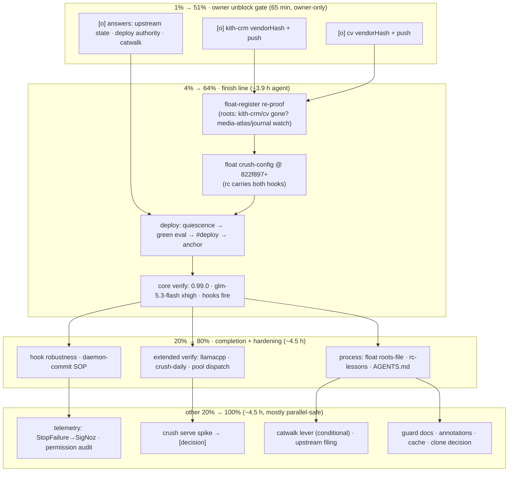

# SUPERB — crush 0.99.0 Rollout Finish + Hardening (Pareto Plan)

**EXECUTED (instance all 24 tasks executed/closed; deploy1 live (gen-962, crush 0.99.0); deploy2 storm-gated on flm crash-loop; report docs/status/2026-10-29_22-35_*, 2026-10-29 22:28 CET, HEAD `90b17f512`):** execution finished

**Authored:** 2026-10-29 18:42 CET — Crush agent session, branch `media-atlas-hub-service`
**Scope:** ALL open work from the crush v0.99.0 adoption session (docs/status/2026-10-29_18-33_crush-0990-session-brutal-self-review-and-status.md §f, 32 items) + the pipeline.md finish-line rows. State verified at authoring time: nur float committed + flake check green; crush-config master @ 822f897 (hooks landed, not floated); evo-x2 still on 0.98.2; toplevel build blocked by kith-crm@c3ed35c2 + cv@fc0506b upstream vendorHash.

**Goal:** every crush session on every host (interactive, tq-agent-pool, crush-debug) runs 0.99.0 with platform-enforced argv redaction + trap remediation, verified live, without breaking the in-flight media-atlas branch.

**Non-negotiables:** agents never push upstream repos (owner pushes kith-crm/cv); deploy discipline (quiescence heat-check → green-eval probe → `nix run .#deploy` owns §11 → anchor check by generation NUMBER); pathspec commits in the shared tree (parallel session ACTIVE on media-atlas + workflows); no verschlimmbessern — this plan changes no behavior until executed.

---

## 1. Pareto Breakdown

### The 1% that delivers 51%
**The owner's two upstream pushes + three answers.** kith-crm + cv vendorHash fixes (got-hash evidence already captured in the proof logs) and the Q1–Q3 answers (upstream state, deploy authority, catwalk verdict). One owner action unblocks the entire chain: without it, NOTHING goes live and the staged float + hooks sit inert.

### The 4% that delivers 64%
**The finish line:** re-proof the float → float crush-config → deploy → the 3 core live verifications (version+anchor, glm-5.3-flash parity, hooks fire). Half a day of agent work that converts "staged" into "every session protected."

### The 20% that delivers 80%
Finish-line completion (extended verification: llamacpp discovery, crush-daily schema, pool dispatch) **plus** the process hardening that stops this session's own failure classes from recurring: float-register roots-extraction file (mixed-log root misattribution, live today), rc-masking lessons (live twice today), crush-config AGENTS.md for the hook layer.

### The other 20% to reach 100%
Telemetry + pool roadmap (StopFailure→SigNoz, TurnEnd→ai-meter attribution, crush-serve spike, piped permissions, permission audit log), conditional catwalk levers, upstream PostCompact filing, guard prose ergonomics, housekeeping (report annotation, cache cleanup, kith-crm clone decision).

---

## 2. Comprehensive Plan — medium granularity (30–100 min each)

Sorted by importance → impact → effort → customer-value. `Gate` = hard dependency.

| # | Task | Tier | Gate | Est | Impact | Effort | Value |
|---|------|------|------|-----|--------|--------|-------|
| T1 | **[owner]** kith-crm vendorHash fix + push (evidence: got `sha256-LpMsryrv…`) | 1% | — | 30 | CRITICAL (blocks all) | low (owner) | unblocks everything |
| T2 | **[owner]** cv vendorHash fix + push (got `sha256-fyOA12V…`) | 1% | — | 30 | CRITICAL (blocks all) | low (owner) | unblocks everything |
| T3 | **[owner]** Answer Q1–Q3 (upstream state / deploy authority / catwalk verdict) | 1% | — | 5 | CRITICAL (gates T4–T6, T19) | trivial | decision certainty |
| T4 | Re-run float-register ceremony: roots re-verify (incl. media-atlas recurrence + journal FOD watch), lock+registry pair commit | 4% | T1,T2 | 60 | HIGH | medium | proven float |
| T5 | Float crush-config input (822f897+), same ceremony, confirm rendered rc in closure carries both hooks | 4% | T4 | 30 | HIGH | low | config rides same generation |
| T6 | Deploy: quiescence poll → green-eval probe → `nix run .#deploy` → anchor check (gen NUMBER) → post-deploy battery | 4% | T3,T5 | 100 | **HIGHEST** | high | 0.99.0 + hooks LIVE |
| T7 | Core live verification: version, anchor, provider/model parity (**glm-5.3-flash xhigh**), both hooks fire (pgrep REDACT, jq DIRENV_DIFF context) | 4% | T6 | 45 | **HIGHEST** | low | proves the point of it all |
| T8 | Extended verification: llamacpp discovery on live 8899 (double-/v1 fix), `provider add --help` type confirm | 20% | T6 | 30 | MEDIUM | low | closes llamacpp unknowns |
| T9 | crush-daily schema compat: inspect DB, one observed run, sane output | 20% | T6 | 30 | MEDIUM | low | protects daily insights |
| T10 | tq-agent-pool sanity: one dispatch through 0.99.0, tool-failure resilience + hooks active in pool context | 20% | T6 | 30 | HIGH | low | proves pool value (#4143) |
| T11 | float-register: per-run roots-extraction summary file + selftest leg | 20% | — | 30 | MEDIUM (stops root-misattribution class) | low | audit reliability |
| T12 | crush-config AGENTS.md: PostToolUse hook layer, fixture-matrix pattern, DIRENV_DIFF/jq-stdin rule | 20% | — | 45 | MEDIUM | low | future hook authors |
| T13 | lessons.md (crush-config): rc-masking (`PIPESTATUS`, never `| tail; echo rc=$?`) + one-log-per-extraction attribution | 20% | — | 30 | MEDIUM (both failed live today) | low | incident-class kill |
| T14 | Hook robustness: redact size-cap early-exit + trap-remediation DIRENV_DIFF capture-before-unset (with fixtures) | 20% | T7 | 45 | MEDIUM | low | hook hardening |
| T15 | Daemon-commit SOP: scoped lint-leg re-run (verify 2dd4a77ba's expected-locks alejandra-clean) + CONTRIBUTING clause | 20% | — | 30 | LOW-MED | low | closes daemon-race gap |
| T16 | StopFailure observe hook → SigNoz rule + gatus endpoint (provider-error telemetry for pool runs) | rest | T6 | 60 | MEDIUM | medium | observability |
| T17 | `crush serve` persistent-pool spike → decision doc + `[decision]` row (SIGHUP reload viability) | rest | T6 | 100 | MEDIUM | high | architecture option |
| T18 | Upstream filing: PostCompact/SessionStart context-injection support (verify-before-filing + github-voice, owner approves) | rest | — | 30 | LOW-MED | low | upstream leverage |
| T19 | Catwalk lever landing IF triggered: `option provider-auto-update false` + sessionVariables nuance doc | rest | T3 | 30 | CONDITIONAL | low | hermeticity option |
| T20 | Guard prose ergonomics: ALLOW_RG_REPLACE-for-prose doc in crush-config | rest | — | 15 | LOW | trivial | ergonomics |
| T21 | PermissionResult observe hook → permission-decision audit log (jq JSONL) | rest | T6 | 45 | LOW-MED | low | audit trail |
| T22 | Annotate 18:30 report appendix: media-atlas root note (ANNOTATE mode, never rewrite) | rest | — | 10 | LOW | trivial | record accuracy |
| T23 | Cache cleanup `~/.cache/crush099` post-deploy | rest | T6 | 5 | TRIVIAL | trivial | hygiene |
| T24 | kith-crm local clone decision + tq pool repos coverage check | rest | T3 | 30 | LOW | low | diagnosability |

**Totals:** 24 tasks ≈ 13.5 h agent work + ~65 min owner actions. Tier 1% ≈ 65 min owner; 4% ≈ 3.9 h; 20% ≈ 4.5 h; rest ≈ 4.5 h.

---

## 3. Detailed Breakdown — micro granularity (≤12 min each)

All 72 micro-tasks, grouped by parent task, same sort. `[o]` = owner action.

| µ | Task (≤12 min) | Parent | Gate |
|---|----------------|--------|------|
| 1.1 | `[o]` clone/fetch kith-crm, checkout c3ed35c2 | T1 | — |
| 1.2 | `[o]` build go-modules FOD, capture got-hash | T1 | 1.1 |
| 1.3 | `[o]` set vendorHash, full package build green | T1 | 1.2 |
| 1.4 | `[o]` commit + push | T1 | 1.3 |
| 2.1 | `[o]` fetch cv (rev fc0506b not in local clone) | T2 | — |
| 2.2 | `[o]` build FOD, capture got-hash | T2 | 2.1 |
| 2.3 | `[o]` set vendorHash, build green | T2 | 2.2 |
| 2.4 | `[o]` commit + push | T2 | 2.3 |
| 3.1 | `[o]` answer Q1 (upstream kith-crm/cv state) | T3 | — |
| 3.2 | `[o]` answer Q2 (deploy on branch vs after merge) | T3 | — |
| 3.3 | `[o]` answer Q3 (catwalk verdict: park vs pin now) | T3 | — |
| 4.1 | quiescence + rev-pin (`git status`, `git log --stat` since rev) | T4 | T1,T2 |
| 4.2 | run float-register, monitor proof log | T4 | 4.1 |
| 4.3 | triage roots: kith-crm/cv gone? media-atlas/journal recurrence? | T4 | 4.2 |
| 4.4 | verify lock+registry commit pair landed (or amend properly) | T4 | 4.3 |
| 5.1 | `nix flake update crush-config` | T5 | T4 |
| 5.2 | float-register proof green | T5 | 5.1 |
| 5.3 | eval rendered rc in closure: grep both hook add lines | T5 | 5.2 |
| 6.1 | quiescence poll: ≥4×60s, eval-relevant mtimes ≥5min stale | T6 | T3,T5 |
| 6.2 | green-eval probe: toplevel drvPath | T6 | 6.1 |
| 6.3 | `nix run .#deploy` (monitor; deploy owns §11) | T6 | 6.2 |
| 6.4 | anchor: `readlink /run/current-system` == newest system-N-link by NUMBER | T6 | 6.3 |
| 6.5 | post-deploy battery incl. hook-relevant smoke | T6 | 6.4 |
| 7.1 | fresh shell `crush --version` == 0.99.0 | T7 | T6 |
| 7.2 | provider list parity: zai/gemini/synthetic/minax(disabled)/llamacpp | T7 | 7.1 |
| 7.3 | model parity: **glm-5.3-flash present, xhigh tier** (assert entity) | T7 | 7.2 |
| 7.4 | hook-fire: `pgrep -af monitor365` → REDACTED in result | T7 | 7.1 |
| 7.5 | hook-fire: `jq --version` fail → DIRENV_DIFF context | T7 | 7.1 |
| 7.6 | tq repos' `.crushrc` managed blocks unaffected spot-check | T7 | 7.3 |
| 8.1 | start llama-server on 8899 (any GGUF) | T8 | T6 |
| 8.2 | llamacpp model list + journal discover line (no double-/v1) | T8 | 8.1 |
| 8.3 | `crush provider add --help`: capture type list (llamacpp vs completions) | T8 | T6 |
| 8.4 | stop server | T8 | 8.2 |
| 9.1 | inspect crush-daily unit + DB path | T9 | T6 |
| 9.2 | trigger one run, watch journal | T9 | 9.1 |
| 9.3 | verify output parses/sane | T9 | 9.2 |
| 10.1 | dispatch one `[ready]` queue item via pool | T10 | T6 |
| 10.2 | observe: rc hooks active, turn survives tool failures | T10 | 10.1 |
| 11.1 | float-register: add roots-extraction writer fn | T11 | — |
| 11.2 | selftest leg (planted-log fixture) | T11 | 11.1 |
| 11.3 | pathspec commit | T11 | 11.2 |
| 12.1 | crush-config AGENTS.md: hook-layer section draft | T12 | — |
| 12.2 | fixture-pattern + DIRENV_DIFF/jq-stdin rules | T12 | 12.1 |
| 12.3 | commit | T12 | 12.2 |
| 13.1 | lessons: rc-masking (PIPESTATUS rule, 2 live hits) | T13 | — |
| 13.2 | lessons: one-log-per-extraction attribution | T13 | — |
| 13.3 | commit (crush-config repo) | T13 | 13.1,13.2 |
| 14.1 | redact-argv-output size-cap + fixture case | T14 | T7 |
| 14.2 | trap-remediation: capture DIRENV_DIFF before unset + fixture | T14 | T7 |
| 14.3 | hook-fixtures check green + commit | T14 | 14.1,14.2 |
| 15.1 | scoped `nix fmt -- flake/expected-locks.nix --fail-on-change` | T15 | — |
| 15.2 | `nix flake check --no-build` standalone | T15 | 15.1 |
| 15.3 | CONTRIBUTING daemon-race clause: post-sweep lint-leg re-run | T15 | 15.2 |
| 16.1 | StopFailure hook script + wiring design | T16 | T6 |
| 16.2 | SigNoz rule + gatus endpoint + registry entries | T16 | 16.1 |
| 16.3 | deploy + verify firing (controlled provider error) | T16 | 16.2 |
| 17.1 | read `crush serve` docs + pool module constraints | T17 | T6 |
| 17.2 | decision doc draft (per-task processes vs persistent server) | T17 | 17.1 |
| 17.3 | `[decision]` row + owner sign-off | T17 | 17.2 |
| 18.1 | re-verify observe-only claim at v0.99.0 tag | T18 | — |
| 18.2 | draft via github-voice (evidence-heavy body) | T18 | 18.1 |
| 18.3 | `[o]` owner approval + file upstream | T18 | 18.2 |
| 19.1 | (IF triggered) `option provider-auto-update false` + render fixture | T19 | T3 |
| 19.2 | sessionVariables-not-crushrc nuance doc | T19 | 19.1 |
| 20.1 | guard prose doc: ALLOW_RG_REPLACE prefix for prose-bearing commits | T20 | — |
| 21.1 | PermissionResult hook → JSONL audit log script | T21 | T6 |
| 21.2 | fixture + wiring + logrotate consideration | T21 | 21.1 |
| 22.1 | annotate 18:30 report (appendix: media-atlas root) | T22 | — |
| 23.1 | rm ~/.cache/crush099 sandbox dirs (trash) | T23 | T6 |
| 24.1 | kith-crm clone decision row + tq repos coverage grep | T24 | T3 |

---

## 4. Execution Graph

**Critical path:** A1+A2+A3 → B1 → B2 → B3 → B4 → (C1‖C2‖C3). Everything in G2/G3 outside T14 is parallelizable by other sessions once B4 is green.

---

## 5. Errata / state verification (Step 0 discipline)

- Everything in the 18:33 report §f was re-verified open at 18:32–18:42 (float staged-not-deployed; hooks landed-not-floated; roots still red as of the 18:00 proof; media-atlas-key-provision drv rebuilds green standalone — parallel-session-resolved or transient, re-check at T4).
- No task in this plan duplicates existing pipeline.md rows: the finish-line row IS T4–T7 here (plan supersedes with detail; row stays as the queue pointer); the roots-file row IS T11. The 18:33 report §f remains the source inventory.
- Parallel session active (media-atlas.nix, 4 workflow files modified at 18:42) — every execution task re-pins content before edits (multi-agent write discipline).

## 6. Verschlimmbessern guards

- T14 changes hook behavior AFTER live verification (T7) proves the baseline — never before.
- T19 lands ONLY on an explicit trigger (owner answer or charm-catalog drift incident) — parked is a decision, not a TODO default.
- T17 is a spike + decision doc, NOT an implementation — the pool keeps per-task processes until the owner signs off.
- No task touches the parallel session's in-flight files (media-atlas.nix, workflows, expected-locks staging area).
