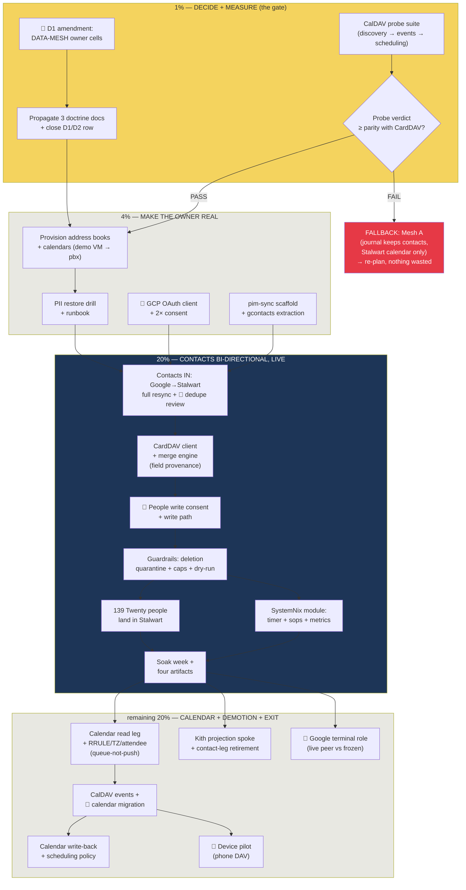

# Stalwart Single-Truth — Pareto Execution Plan

> **Decision locked 2026-10-29 (owner):** Stalwart (`pbx.artmann.tech`) becomes
> the single source of truth for **contacts + calendar** (D1 = Mesh B). The two
> Google accounts are bi-directional sync edges. The Kith CRM journal demotes to
> **relations/companies/deals/tasks** and holds a read-only people projection.
> This plan converts that decision into executed reality without
> verschlimmbessern-ing a fleet that is already 80% built.

**Status:** PLAN (nothing below has been executed yet; owner gates marked 🧑).
**Sources:** the two 2026-10-29 proposals (SystemNix
`docs/planning/2026-10-29_21-18_contacts-calendar-mesh-proposal.html`,
pbx-artmann `docs/research/2026-10-29_contacts-calendar-data-mesh-proposal.html`),
the step-up brief (`docs/planning/2026-10-29_21-45_contacts-calendar-what-exists-and-the-step-up.html`),
and a session-wide re-verification of every load-bearing claim (2026-10-29 ~21:45–22:11).

---

## 1. Verified starting point (nothing assumed)

| Fact | Status | Evidence |
| --- | --- | --- |
| Constitution ratified 2026-10-19; contacts owner = CRM journal; calendar owner = TBD (by rule) | verified today | `crm/docs/DATA-MESH.md` §1–3 |
| `internal/gcontacts` (Google→journal, multi-account, read-only scope) FULLY_FUNCTIONAL, never run vs real Google | verified today | `crm/FEATURES.md:130-143` |
| `internal/carddav` out-mirror (journal→Stalwart vCard4) FULLY_FUNCTIONAL, E2E green, not deployed | verified today | `crm/FEATURES.md:25` |
| Stalwart CardDAV probe-verified at deployed pin 0.16.26: **17/18 PASS** | verified today | `nix-email/FEATURES.md:62` + `docs/probes/2026-10-28-carddav-01626/` |
| **No CalDAV probe exists** (the one unmeasured surface) | verified today | `nix-email/docs/probes/` (absent) |
| Journal holds **zero** people contacts; 139 people staged in Twenty dump | verified today | `SystemNix docs/todo/services.md:366` |
| crm-server runs with zero `-google-*`/`-carddav-*` flags — all legs OFF | verified today | `SystemNix modules/nixos/services/crm.nix` |
| NetBird mesh joins evo-x2 + pbx; store backup nightly; CRM restore drilled | verified today | `pbx hosts/pbx/backup.nix:108` |
| Three doctrine docs disagree on contacts owner → this plan resolves to ONE answer | verified today | `SystemNix docs/todo/services.md:15` |

**Errata / corrections applied while planning** (Step 0 of the method): none —
re-verification found no stale backlog items; the D1/D2 decision row in
`docs/todo/services.md:15` is still open and is closed BY this plan.

---

## 2. Pareto breakdown

### The 1% that delivers 51% — DECIDE + MEASURE (~half a day)

The doctrine amendment (5 table cells) + the CalDAV probe verdict. Everything
else in this plan is known-good engineering; these two items are the only
unknowns. They convert the proposal into an executable project and gate all
code. >50% of the value because they make every subsequent hour safe.

1. Amend `crm/docs/DATA-MESH.md`: contacts + calendar owner = **Stalwart**; Google spoke = IN/OUT with one writer per leg; Kith = relations.
2. Propagate the same cell to pbx-artmann + SystemNix doctrine docs; close the D1/D2 decision row.
3. Run the CalDAV probe suite at the deployed pin → measured verdict (the only real gate left).

### The 4% that delivers 64% — MAKE THE OWNER REAL (~2 days)

Provision + prove the owner. After this, Stalwart passes every ownership test
the constitution demands (write authority, restore path you have run, export path):

4. Declarative provision plan: address books + calendars per account (demo VM, then pbx).
5. PII restore drill from the nightly store archive + runbook.
6. GCP OAuth client (People API, production publishing) + one consent per account.
7. `pim-sync` scaffold + extraction of the gcontacts core (deliberately prepared: `crm/FEATURES.md:193` notes the `System` seam as extraction pre-work).
8. Contacts IN leg: Google A+B → Stalwart, full resync, dry-run review list.

### The 20% that delivers 80% — CONTACTS BI-DIRECTIONAL, LIVE (~1.5 weeks)

The daily-pain problem solved end-to-end with the guardrails:

9. Stalwart CardDAV client in pim-sync (re-pointed out-mirror client).
10. Merge engine: field-provenance diff, conflict counter, dry-run.
11. Google People write path (field-scoped, per-account write consent).
12. Deletion quarantine + per-run change caps.
13. The 139 Twenty people land in Stalwart (CSV→vCard).
14. SystemNix service module (timer, sops, monitoring, onFailure) + soak week + four artifacts.

### The remaining 20% to reach 100% — CALENDAR + DEMOTION + EXIT DOOR

15. Calendar read leg (Calendar API, incremental sync tokens).
16. RRULE/timezone/attendee mapping — queue-not-push for attendee events.
17. CalDAV event client + calendar migration.
18. Calendar write-back leg + scheduling policy.
19. Kith people projection spoke (Stalwart→journal, read-only) + retirement of journal contact legs.
20. Device pilot (one phone, DAV) + Google terminal-role decision (owner, deferred).

---

## 3. Comprehensive plan — medium granularity (30–100 min per task)

Sorted by importance/impact/customer-value, then effort. 🧑 = owner gate.
**Gate:** nothing in tier 3+ starts before tasks 1–5 (the 1%) are green.

| # | Task | Tier | Est (min) | Impact | Owner | Depends on |
| --- | --- | --- | --- | --- | --- | --- |
| 1 | Amend `crm/docs/DATA-MESH.md`: owner table (contacts+calendar = Stalwart), spoke table (Google IN/OUT, CardDAV/CalDAV native, Kith projection), principle-1 note | 1% | 45 | 10 | 🧑 approves, agent writes | — |
| 2 | Propagate owner cell: `pbx-artmann/docs/architecture/data-ownership.md`, `SystemNix/docs/agents/data-ownership.md`, close D1/D2 row in `docs/todo/services.md:15` | 1% | 30 | 9 | agent | 1 |
| 3 | CalDAV probe suite part 1: scaffold + discovery chain + MKCOL calendars + basic PUT/GET (demo VM, deployed pin) | 1% | 100 | 10 | agent | — |
| 4 | CalDAV probe suite part 2: event semantics — recurring events with timezones, If-Match/ETag, sync-collection tokens, delete/tombstone behavior | 1% | 100 | 10 | agent | 3 |
| 5 | CalDAV probe suite part 3: scheduling caps (RFC 6638) + verdict transcript into `docs/probes/` + FEATURES row | 1% | 60 | 9 | agent | 4 |
| 6 | PII provision plan: address books + calendars per account (demo VM first, then pbx via nix-email provision dialect) | 4% | 90 | 9 | agent | 5 (probe PASS) |
| 7 | PII restore drill: restore contacts+calendar from nightly store archive in demo VM; record runbook | 4% | 90 | 9 | agent | 6 |
| 8 | 🧑 GCP OAuth client (People API, production publishing) + one consent per account; agent verifies refresh behavior | 4% | 45 | 8 | 🧑+agent | — |
| 9 | `pim-sync` scaffold: repo, Go module, flake, sops skeleton, CI | 4% | 100 | 8 | agent | 1 |
| 10 | Extract gcontacts core into pim-sync: People client, OAuth loopback, multi-account registry, atomic 0600 state, single-flight runner | 4% | 100 | 9 | agent | 9 |
| 11 | Contacts IN leg: Google→Stalwart full resync with dry-run + owner review list (dedupe by email+name ladder) | 4% | 100 | 9 | 🧑 reviews | 6, 8, 10 |
| 12 | Stalwart CardDAV client in pim-sync (UID=stable id, etag re-PUT, squatter eviction — re-point out-mirror code) | 20% | 100 | 9 | agent | 10 |
| 13 | Merge engine: field-provenance diff (write back only owner-changed fields), conflict counter, reported-not-hidden | 20% | 100 | 10 | agent | 12 |
| 14 | 🧑 Google People write consent (write scope, per account) + field-scoped update path in pim-sync | 20% | 100 | 9 | 🧑+agent | 13 |
| 15 | Guardrails: deletion quarantine (deletes never propagate without explicit confirm), per-run change caps (abort >N), dry-run default | 20% | 60 | 10 | agent | 14 |
| 16 | 139 Twenty people → Stalwart: CSV→vCard import through the same door, provenance recorded | 20% | 60 | 7 | agent | 11 |
| 17 | SystemNix `pim-sync` module: systemd timer (minute-scale), sops secrets, onFailure, Prometheus counters | 20% | 90 | 8 | agent | 15 |
| 18 | Four artifacts (constitution principle 7): contract doc, probe transcripts link, ops runbook, boot posture decision | 20% | 90 | 7 | agent | 17 |
| 19 | Soak week: daily per-leg conflict report, drift alert tuning, fix what surfaces | 20% | 30/day | 8 | agent | 17 |
| 20 | Calendar read leg: Google Calendar API client + incremental sync tokens + event normalization | rest | 100 | 7 | agent | 19 (soak clean) |
| 21 | RRULE/timezone/attendee mapping + **queue-not-push** policy for attendee-bearing events (first months) | rest | 100 | 8 | agent | 20 |
| 22 | Stalwart CalDAV event client + calendar migration (Google→Stalwart, dry-run review) | rest | 100 | 7 | 🧑 reviews | 21, 5 |
| 23 | Calendar write-back leg + scheduling policy (invites originate in exactly one place) | rest | 100 | 7 | agent | 22 |
| 24 | Kith people projection spoke: Stalwart→journal read-only IN (links not copies) so relations/deals keep working | rest | 100 | 8 | agent | 11 |
| 25 | Kith contact-leg retirement: flags stay off, FEATURES rows marked re-pointed/retired, update `docs/ops/WHERE-IS-MY-DATA.md` + crm ROADMAP idea row | rest | 45 | 6 | agent | 24 |
| 26 | 🧑 Device pilot: one phone speaks CardDAV+CalDAV directly to Stalwart (the exit door from Google) | rest | 30 | 6 | 🧑 | 22 |
| 27 | 🧑 Google terminal-role decision per account: live peer vs frozen mirror (+ freeze ritual if frozen) | rest | 30 | 5 | 🧑 | 19 |

**Totals:** 27 tasks ≈ 35 h of agent work (plus soak days) + 5 owner gates.
Tier 1 (the 1%) ≈ 5.5 h; tiers 1+2 (the 4%) ≈ 14 h.

---

## 4. Fine breakdown — max 12 min per task

Micro-tasks under each parent. IDs `P.n` = parent `#n`. Sorted by parent
importance; within a parent, execution order.

| ID | Micro-task | Min | Gate |
| --- | --- | --- | --- |
| 1.1 | Draft new owner-table rows for DATA-MESH.md (contacts, calendars) as a patch | 10 | — |
| 1.2 | Rewrite Google spoke row (IN/OUT, one writer per leg) + add native CardDAV/CalDAV + Kith projection rows | 12 | — |
| 1.3 | Add amendment note (supersedes 2026-10-19 contacts decision, why, date, owner approval) | 8 | — |
| 1.4 | 🧑 Owner reviews patch; commit to crm repo | 5 | 🧑 |
| 2.1 | pbx-artmann `data-ownership.md`: fill owner cells, close "no declared owner" gap | 12 | — |
| 2.2 | SystemNix `docs/agents/data-ownership.md`: same cells + adapter row | 10 | — |
| 2.3 | services.md:15 — mark D1/D2 DECIDED (Mesh B + field-scoped writes w/ quarantine), link this plan | 8 | — |
| 2.4 | Cross-check: grep all three docs for "journal is contacts truth" remnants | 5 | — |
| 3.1 | Create probe dir `docs/probes/<date>-caldav-01626/` + README + transcript scaffold | 10 | — |
| 3.2 | Demo VM boot + provision one test calendar (MKCOL) via curl | 12 | — |
| 3.3 | Probe discovery chain: `/.well-known/caldav`, principal, calendar-home-set | 12 | — |
| 3.4 | Probe basic event PUT/GET (VEVENT, UID echo, ETag return) | 12 | — |
| 4.1 | Write probe: recurring event (RRULE weekly×5) + TZID Europe/Berlin → GET, compare byte semantics | 12 | — |
| 4.2 | Probe override of single occurrence (RECURRENCE-ID) round-trip | 12 | — |
| 4.3 | Probe conditional PUT: If-Match required? UID-change → 412? (mirror CardDAV suite) | 10 | — |
| 4.4 | Probe sync-collection report + sync-token increment on change | 12 | — |
| 4.5 | Probe delete behavior (tombstone vs vanishing) + maxResults behavior | 8 | — |
| 5.1 | Probe scheduling: freebusy query + optional iTIP invite handling | 12 | — |
| 5.2 | Write verdict README (PASS/FAIL per probe) + known-deviance list | 12 | — |
| 5.3 | Add CalDAV row to `nix-email/FEATURES.md` with transcript pointer | 8 | — |
| 5.4 | 🧑 GO/NO-GO on calendar owner (expected: GO; fallback documented = Mesh A) | 5 | 🧑 |
| 6.1 | Draft provision objects: 2 address books + 2 calendars (per account) in demo VM plan | 12 | — |
| 6.2 | Apply plan in demo VM; verify via DAV discovery | 10 | — |
| 6.3 | Port plan objects to pbx host config (nix-email provision dialect) | 12 | — |
| 6.4 | Deploy to pbx; verify live discovery from evo-x2 over NetBird | 10 | — |
| 7.1 | Snapshot demo VM store; destroy PII objects | 8 | — |
| 7.2 | Restore from archive path; verify objects + ETags semantically intact | 12 | — |
| 7.3 | Write `PII-RESTORE-DRILL.md` runbook + datestamp | 12 | — |
| 8.1 | 🧑 Create GCP project + OAuth client (People API, production publishing) | 12 | 🧑 |
| 8.2 | 🧑 Consent flow per account (2×) | 6 | 🧑 |
| 8.3 | Record refresh-token survival >7d (InboxClean lesson) | 10 | — |
| 9.1 | Init repo `pim-sync` (flake, Go module, cmd/ skeleton, LICENSE) | 12 | — |
| 9.2 | Config struct + per-account registry file format (copy gcontacts pattern) | 12 | — |
| 9.3 | sops secret skeleton + env wiring stub | 10 | — |
| 9.4 | CI: build + test + lint (BuildFlow pattern) | 12 | — |
| 10.1 | Copy `internal/gcontacts` People client (pagination, tombstones) into pim-sync | 12 | — |
| 10.2 | Copy OAuth loopback consent + token cache | 10 | — |
| 10.3 | Copy atomic 0600 state + EXPIRED_SYNC_TOKEN resync + backoff | 12 | — |
| 10.4 | Copy single-flight runner + per-account failure isolation | 12 | — |
| 10.5 | Unit tests ported green | 12 | — |
| 11.1 | Implement vCard upsert into Stalwart book (UID=stable hash of google resourceName) | 12 | — |
| 11.2 | Dry-run full resync account A: review list output (create/update/skip counts) | 12 | — |
| 11.3 | Dry-run account B; cross-account dedupe candidates list (email+name ladder) | 12 | — |
| 11.4 | 🧑 Owner approves merge list | 5 | 🧑 |
| 11.5 | Real run both accounts; verify counts + spot-check 10 vCards via GET | 12 | — |
| 12.1 | Port carddav client core (discovery, multiget, etag map) | 12 | — |
| 12.2 | Foreign-squatter eviction + delete propagation port | 12 | — |
| 12.3 | Integration test vs demo VM (green suite from crm adapted) | 12 | — |
| 13.1 | Implement provenance journal of owner-side field changes (per-run diff since last pass) | 12 | — |
| 13.2 | Field-scoped merge: outbound payload = only owner-changed fields | 12 | — |
| 13.3 | Conflict detection (same field changed both sides) → queue + counter | 12 | — |
| 13.4 | Table-driven tests: ping-pong loop must NOT occur (regression pin) | 12 | — |
| 14.1 | 🧑 Add contacts.write scope consent per account | 6 | 🧑 |
| 14.2 | Implement People update calls (field-masked) + tombstone policy Google→owner | 12 | — |
| 14.3 | Round-trip test: owner edit lands in Google; Google edit lands in owner | 12 | — |
| 15.1 | Deletion quarantine: deletions detected → held + reported, never propagated | 12 | — |
| 15.2 | Per-run caps: >N changes (start N=50) aborts run + alerts | 10 | — |
| 15.3 | Dry-run default flag; live runs require explicit opt-in flag | 8 | — |
| 15.4 | Chaos test: wiped owner book must NOT wipe Google (quarantine holds) | 12 | — |
| 16.1 | Convert staged CSVs → vCard (map Twenty fields, provenance note per card) | 12 | — |
| 16.2 | Import into Stalwart through pim-sync door; counts reconcile 139/61 | 10 | — |
| 16.3 | Update services.md:366 row → landed in owner | 5 | — |
| 17.1 | SystemNix module: pim-sync service + timer (every 5 min, jittered) | 12 | — |
| 17.2 | sops: google tokens + stalwart creds wiring | 10 | — |
| 17.3 | Prometheus counters: per-leg changes/conflicts/quarantined/last-success | 12 | — |
| 17.4 | onFailure + start-limit + log hygiene | 8 | — |
| 17.5 | Deploy + 24h journal silence check | 10 | — |
| 18.1 | Contract doc: entities, directions, actors, join keys, trust posture | 12 | — |
| 18.2 | Ops runbook: enable/disable/rollback/freeze (kill switch = stop timer) | 12 | — |
| 18.3 | Boot posture decision (manual one-shot vs timer) + record in DATA-MESH | 8 | — |
| 18.4 | Link all four artifacts from DATA-MESH spoke rows | 6 | — |
| 19.1 | Daily soak report script (per-leg table) | 10 | — |
| 19.2 | Drift alert (count mismatch owner↔google) threshold tuning | 10 | — |
| 19.3 | Fix list from soak week; retro note in this plan's errata | 12 | — |
| 20.1 | Calendar API client: events.list + sync tokens + page tokens | 12 | — |
| 20.2 | Normalization: Google event JSON → internal event (dates, TZ, attendees, recurrence) | 12 | — |
| 20.3 | "The calendar set" whitelist config (which calendars sync) | 10 | — |
| 20.4 | Unit tests with fixture payloads (weekly RRULE, all-day, TZ-crossing) | 12 | — |
| 21.1 | Internal event → VEVENT writer (RRULE + RECURRENCE-ID + EXDATE fidelity) | 12 | — |
| 21.2 | Attendee-bearing events → review queue, never auto-push (policy flag) | 10 | — |
| 21.3 | Round-trip fuzz: event → Google → owner → Google, semantic equality | 12 | — |
| 22.1 | CalDAV event client (reuses discovery from 3.x) + etag map | 12 | — |
| 22.2 | Calendar migration dry-run: counts + review list per calendar | 12 | — |
| 22.3 | 🧑 Owner approves migration list; real run; spot-check on webmail agenda | 10 | 🧑 |
| 23.1 | Owner→Google event write path (field-scoped, same merge engine) | 12 | — |
| 23.2 | Scheduling policy: invites originate owner-side only; incoming iTIP → queue | 10 | — |
| 23.3 | Calendar round-trip + quarantine + caps tests (mirror 15.x) | 12 | — |
| 24.1 | Kith spoke: Stalwart→journal read-only people projection (match ladder reuse) | 12 | — |
| 24.2 | Relations/deals reference projected people (link not copy) verification | 12 | — |
| 24.3 | DATA-MESH spoke row for the projection + FEATURES row in crm | 10 | — |
| 25.1 | Mark crm FEATURES gcontacts/carddav rows: RE-POINTED to pim-sync (dates) | 8 | — |
| 25.2 | Update `WHERE-IS-MY-DATA.md` + crm ROADMAP calendar idea row | 10 | — |
| 25.3 | Verify crm-server still boots clean with legs off (no dead flags) | 8 | — |
| 26.1 | 🧑 Phone: add DAV account (pbx.artmann.tech, CardDAV+CalDAV) | 12 | 🧑 |
| 26.2 | 🧑 Verify phone edit reaches owner; owner edit reaches phone | 10 | 🧑 |
| 27.1 | 🧑 Decide per account: Google = live peer or frozen mirror | 12 | 🧑 |
| 27.2 | If frozen: freeze ritual (stop typing, read-only scope, calendar entry) documented | 10 | — |

**Totals:** 97 micro-tasks ≈ 17.5 h of fine-grained execution
(the rest of the 35 h is verification loops, reviews and soak).

---

## 5. Execution graph

**Kill switches (verschlimmbesser insurance):** every stage is stoppable by
`systemctl stop pim-sync.timer` (Google still holds live bytes = worst case is
a re-import, never data loss); deletion quarantine holds until explicitly
cleared; the probe gate can redirect the whole plan to Mesh A with zero wasted
work (probe, OAuth, provision, drill are load-bearing there too).

---

## 6. What this plan deliberately does NOT do

- Does **not** land the 139 into the journal (that closes the free-Mesh-B window).
- Does **not** touch the ratified 2026-10-19 constitution before the owner
  approves the amendment patch (task 1.4).
- Does **not** enable any write scope before guardrails (15.x) are tested.
- Does **not** auto-push attendee-bearing events, ever (first months: queue).

_Generated 2026-10-29 22:11 · method: pareto-planning skill (1%→4%→20%→rest) ·
all facts re-verified in-repo this session._
