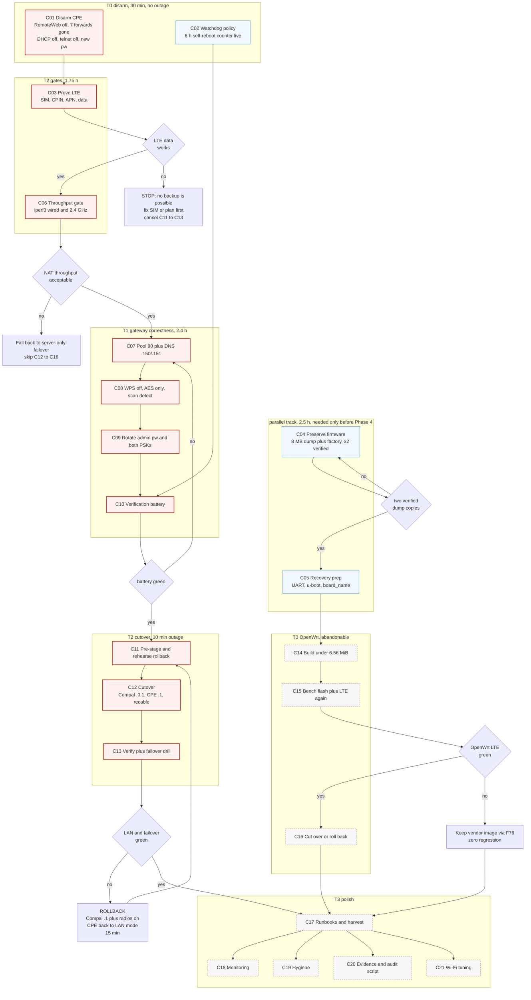

# SUPERB PLAN: 4G failover first, hackable firmware second

**Version:** v2, 2026-10-29 (replaces v1 `22-18` in place)
**What this is:** the execution plan for turning a currently-useless 4G CPE into the household's primary router with a
working LTE backup, then (separately, optionally) replacing its 2016 firmware with real OpenWrt so the owner can run their
own software on it.
**Ground truth:** `docs/reviews/2026-10-29_19-40_router-configuration-review.md` (device inventory),
`docs/status/2026-10-29_21-31_router-audit-openwrt-feasibility-status.md` (session findings + corrections).
**Status:** plan only. Zero configuration applied to either device. Option 1 (CPE becomes the router) approved by the owner.

### What changed in v2, and why it is better

| v1 problem | v2 fix |
| --- | --- |
| Time-to-value was inflated because flash preservation sat in the same gate as the 4G proof | Flash evidence moved **off the critical path** (it is insurance for the *optional* phase, the cutover never touches firmware). Time-to-value is now **8.2 h hands-on**, and the plan names which track is which |
| "8 MB may not fit" was a guess | **Arithmetic**: kernel plus squashfs budget is **6.56 MiB**. A lean 24.10 fits with 0.46 MiB spare; 24.10 **plus mwan3 is over by 0.14 MiB**, so the image must be trimmed. See §1.3 |
| "The modem may refuse a DHCP pool of 1" was a guess | **Falsified by the device's own validator**: `verifyMinMax(poolSize, 1, 254 - start_last_octet)`. Pool 1 is legal |
| No per-task verification, so "done" was arguable | Every one of the 92 fine rows now carries a **Done when** clause |
| No acceptance criteria, so success was subjective | §0.1 Definition of Done, seven testable criteria |
| No cutover troubleshooting | §7 has a minute-by-minute runbook plus a symptom-to-cause triage table for the window itself |
| Pareto tiering was asserted, not derived | §2 derives it, and §2.5 records v1's specific mistake |

---

## 0. The outcome, the tiers, the critical path

### 0.1 Definition of Done (seven criteria, each testable)

| # | Criterion | Test |
| --- | --- | --- |
| D1 | No device on the property accepts a known default credential | `admin/admin` rejected on the gateway and the CPE; telnet refuses |
| D2 | No internet-reachable admin surface, zero inbound forwards anywhere | Remote Web off, forwards tables empty on both, gateway WAN Blocking on |
| D3 | One DHCP server per segment, ever | gateway serves nothing; CPE serves `.10 to .99` on the house segment only |
| D4 | LAN clients resolve through dnsblockd | a DHCP client gets DNS `.150`/`.151`, and a blocked domain answers `192.168.1.200` |
| D5 | A cable outage does not take the house offline | coax out, whole-house internet over LTE in **under 30 s**, verified twice |
| D6 | The server's assumptions still hold | `nix flake check --no-build` exits 0, `getent hosts home.lan` answers, gateway still `192.168.1.1` |
| D7 | The firmware can be replaced safely, or the refusal is recorded | two verified copies of the 8 MB dump plus `factory`, or a written decision with the reason |

D1 to D6 are the product. D7 is the license to experiment.

### 0.2 Tiered delivery (pick a stopping point)

| Tier | Tasks | Hands-on | What the owner gets |
| --- | --- | --- | --- |
| **T0** | C01 | **30 min** | The two-DHCP race, the exposed admin toggle and the 7 armed forwards are gone. The reported "no internet" confusion stops being possible |
| **T1** | T0 + C07, C08, C09, C10 | **3 h** | D1, D2, D3, D4 true. Gateway correct, credentials rotated, the LAN finally uses the home DNS stack |
| **T2** | T1 + C03, C06, C11, C12, C13 | **8.2 h** | D5, D6 true. Whole-house LTE failover live on the vendor firmware, with a rehearsed rollback |
| **T3** | all 21 (adds C02, C04, C05, C14 to C21) | **21.8 h** | D7 true: firmware preserved, the OpenWrt path attempted or declined, docs, monitoring, hygiene |

**T2 is the product.** T3 is optional upside: if the flash fails, T2's outcome is untouched.

### 0.3 Critical path, and what runs beside it

```
CP: C01 -> C03 (G1) -> C06 (G3) -> C07 -> C08 -> C09 -> C10 (G4) -> C11 -> C12 (G5) -> C13
     30    60          45          45     30     40     30          60     90          60   = 490 min = 8.2 h
```

Everything else is **parallel or post-value**: `C02` (watchdog policy, 30 min, inside T1), `C04` plus `C05` (flash
evidence, 2.5 h, any time before `C14`), `C14` to `C21` (T3). This is the v1 mistake corrected: flash evidence insures an
optional phase, so it must not sit in the gate in front of the household's outage window.

---

## 1. Ground truth

### 1.1 The two devices

| | ISP gateway | 4G CPE |
| --- | --- | --- |
| Identity | Compal **DMC7002KLG** (Vodafone Station), FW **2.9.13**, DOCSIS 3.0, BPI+ on | Vendor LuCI fork, FW **1.0.273-20240928-115300**, kernel **4.4.140** (LEDE 17.01 BSP) |
| Hardware | ISP supplied | **MT7628AN** 580 MHz, **64 MB RAM**, **8 MB flash**, no PCIe (2.4 GHz only) |
| Uplink | public `89.65.239.240/22`, 8x4 DOCSIS, SNR ~39 dB | wired port currently in **LAN mode** (no WAN exists) plus **Quectel EC200A-EU**, **no SIM** |
| Address and DHCP | `192.168.1.1`, pool `.10 to .253`, DNS `193.47.158.254/255` | `192.168.1.254`, pool `.101 to .200` (live), DNS `10.43.255.55` (unroutable) |
| Admin | `admin/admin`, plain HTTP | `admin/admin`, LuCI plus **telnet 23 open** plus **Remote Web ON** |
| Exposure | no forwards, no DMZ, UPnP off, WAN Blocking on, only port 80 on LAN | **7 forwards to `192.168.1.100`** armed (22, 443, 6443, 41641, 9500, 9501, 9502) |
| Wi-Fi | 5 GHz (7 clients) plus 2.4 GHz, WPA2, **WPS PIN on**, 2.4 uses TKIP+AES | 2.4 GHz only, WPA2, SSID `Europol \| Law enforcement`, 0 clients |

### 1.2 The three problems in the owner's own terms

1. "The 4G router has no internet." Cause proven, not guessed: the CPE has **no WAN interface at all** (LAN mode), so its
   DHCP hands out a dead gateway `.254` and an unroutable DNS, and its modem has **no SIM**.
2. "I want my own software on it." It is an MT7628AN on 8 MB flash with a 2016 kernel wearing a 24.10 LuCI veneer.
   Upstream is feasible; it is an upgrade, not a prerequisite.
3. The house is mis-wired for its own future: two DHCP servers on one segment, gateway DNS bypassing dnsblockd, and a pool
   that swallows every static address this repo depends on.

### 1.3 Quantified constraints (replaces v1's hedges)

| Constraint | Number | Source |
| --- | --- | --- |
| Flash | 8,388,608 B (**8.00 MiB**), 6 MTD partitions | `/proc/mtd` listing in the CPE syslog |
| Kernel plus squashfs budget | **6,881,280 B = 6.56 MiB** (`rootfs_data` start minus `firmware` start) | partition table |
| Current vendor split | kernel **1.22 MiB** plus squashfs **5.34 MiB** plus overlay **1.00 MiB** | partition table |
| Lean 24.10 image | ~6.1 MiB, **fits with 0.46 MiB spare** | derived, Appendix C |
| 24.10 plus mwan3 | ~6.7 MiB, **over budget by 0.14 MiB** | derived; the image must be trimmed (no LuCI on the base, or 23.05) |
| Full-flash dump over UART | **12.1 min** at 115200 at 100 % efficiency, **~16 min** base64-encoded | arithmetic, Appendix C |
| Gateway DHCP pool validator | `verifyMinMax(poolSize, 1, 254 - start_last_octet)`, so **min 1**, max 244 from `.10` | `BasicLAN.html:117` |
| Gateway lease validator | `verifyMinMax(leaseTime, 30, 4294967295)` | `BasicLAN.html:133` |
| RAM | 60,708 KiB | syslog |
| Radios | 2.4 GHz only, no PCIe card, vendor `MT7628 AP Driver 4.1.0.0` | syslog |
| LTE module | Quectel **EC200A-EU**, USB `2c7c:6005`, CDC-Ethernet plus 3 AT ports, module NAT on | syslog |

### 1.4 Proof ledger

| Claim | State | Proof |
| --- | --- | --- |
| CPE DHCP is live on `.101 to .200` | **proved (runtime)** | `dnsmasq-dhcp[1776]: DHCP, IP range ...` |
| CPE DHCP has granted **zero** leases this boot | **proved** | no `DHCPACK` in 1391 log lines |
| CPE has no WAN interface | **proved (runtime)** | `pingcheck: Interface 'wan' not found` |
| No SIM | **proved** | `AT+CPIN? -> +CME ERROR: 10` |
| CPE self-reboots after 6 h offline | **proved (live counter)** | `watchcat: ... 2960 seconds ... reaching 21600` |
| Gateway has no bridge/modem page | **proved (24-page census)** | full menu enumeration |
| Gateway WAN admin is closed from outside | **not proved** | hairpin unsupported, test inconclusive |
| CPE NAT throughput adequate | **unknown** | never measured (`C06`) |
| CPE `board_name` | **unknown** | no shell, no board field in the UI |
| Compal rejects pool = 1 | **falsified** | validator minimum is 1 |
| 24.10 plus mwan3 fits 8 MB | **falsified** | 6.7 MiB against a 6.56 MiB budget |

---

## 2. Pareto, derived

### 2.1 The 1 % that delivers 51 %: `C01`, 30 minutes

Turn Remote Web off, delete the 7 forwards, turn the CPE's DHCP server off. It is 51 % of the result because:

- It is **the cause of the reported symptom**. The server has never granted a lease, so disabling it is proven neutral for
  every current client, and it retires the failure mode permanently.
- It removes the only **internet-reachable default-credential admin** on the property.
- It disarms **7 forwards** that publish SSH, the k8s API and Longhorn the instant a WAN exists.

Three form changes, one device, reversible in 10 minutes.

### 2.2 The 4 % that delivers 64 %: `C01` plus `C03` plus `C06` (~2.5 h)

Two gates that decide whether the architecture is possible at all, both cheap:

| Task | Cancels what, if it fails |
| --- | --- |
| **C03** prove the LTE uplink (SIM, `AT+CPIN?`, registration, real data) | everything from `C11` on. No SIM means no backup, so re-architecting the house would be pointless |
| **C06** throughput gate (`iperf3` wired plus 2.4 GHz) | `C12` and `C13`. A 580 MHz NAT path that caps below the cable tier is a downgrade, not a backup |

**v1 put `C04` (flash preservation) in this tier. That was wrong**: the cutover never touches firmware, so flash evidence is
insurance for the optional phase, not a gate on the value. It now sits on the parallel track in §0.3.

### 2.3 The 20 % that delivers 80 %: `C01` to `C13` (~8.2 h)

A household with a working LTE backup on the firmware that already knows how to drive this modem, correct DNS and DHCP, no
default credentials, and a rehearsed rollback. That is D1 to D6 in §0.1.

### 2.4 The rest, to reach 100 % (~13 h)

`C02`, `C04`, `C05`, `C14` to `C21`: preserve the firmware, attempt OpenWrt, runbooks, monitoring, hygiene, Wi-Fi tuning.
Valuable, optional, individually abandonable.

### 2.5 v1's Pareto mistake, recorded

v1 claimed the 4 % tier included the flash dump, which put a 2.5 h gate in front of the outage window and made the plan look
further from value than it is. v1 also hedged two facts that were already checkable from artifacts on disk (the pool
minimum and the flash budget). Both are resolved in §1.3.

---

## 3. Risk doctrine and blast radius

| Bucket | Tasks | Worst case | Reversal | Budget |
| --- | --- | --- | --- | --- |
| **R0 config-only** | C01, C02, C07, C08, C09, C18, C19 | a Wi-Fi blip, clients re-join | retype the old value; gateway backup from `F33` | 5 to 10 min |
| **R1 topology** | C11, C12, C13 | the house offline until the ladder runs | report Part 4.5 ladder; server config never changes | 15 min |
| **R2 irreversible** | C04 (read-only), C15 (flash) | a brick | only survivable because of C04, via the path from F28 | 20 min |
| **R3 optional-only** | C14, C16 to C21 | wasted hours, no regression | abandon | n/a |

Iron rules: never two DHCP servers on one segment; never a flash without two verified dumps; never reboot the household
twice without a verification pass between; every step ends with a read-back, never with a save toast.

---

## 4. Coarse plan, 21 tasks, 30 to 100 min

`CP` marks the critical path, `||` marks work that runs beside it, `post` marks the optional tail.

| ID | Task | Track | Min | I | CV | RR | E |
| --- | --- | --- | --- | --- | --- | --- | --- |
| C01 | **Disarm the CPE**: Remote Web off, 7 forwards deleted, DHCP off, telnet off, new admin password | **CP** | 30 | 5 | 4 | 5 | 1 |
| C03 | **Prove the LTE uplink**: SIM, `AT+CPIN?`, registration, APN, real data path | **CP** | 60 | 5 | 5 | 3 | 3 |
| C06 | **Throughput gate**: `iperf3` wired and 2.4 GHz through the CPE | **CP** | 45 | 4 | 4 | 4 | 2 |
| C07 | **Gateway LAN, DHCP, DNS**: backup, pool 244 to 90, DNS to `.150`/`.151` | **CP** | 45 | 5 | 5 | 4 | 2 |
| C08 | **Gateway wireless hardening**: WPS off both bands, 2.4 GHz AES-only, port-scan detection | **CP** | 30 | 4 | 4 | 4 | 1 |
| C09 | **Credential rotation**: gateway admin password, both PSKs to 20+ chars | **CP** | 40 | 5 | 4 | 5 | 2 |
| C10 | **Verification battery** (§8) | **CP** | 30 | 4 | 3 | 3 | 1 |
| C11 | **Pre-stage the cutover**: address plan, both configs, rollback rehearsal, window | **CP** | 60 | 4 | 4 | 4 | 2 |
| C12 | **Execute the cutover** (the single outage window) | **CP** | 90 | 5 | 5 | 3 | 3 |
| C13 | **Post-cutover verify plus failover drill** | **CP** | 60 | 5 | 5 | 3 | 2 |
| C02 | CPE watchdog policy (Watchcat 6 h counter is live, Watchdog `@dns`) | || | 30 | 3 | 3 | 3 | 1 |
| C04 | **Preserve the firmware**: full 8 MB dump, `factory`, `u-boot-env`, two verified copies | || | 90 | 4 | 3 | 5 | 3 |
| C05 | **Recovery prep**: `board_name`, UART pinout, u-boot recovery, one-page runbook | || | 60 | 3 | 2 | 5 | 3 |
| C14 | OpenWrt image: `ramips/mt76x8`, EC200A CDC path, mwan3, **trimmed to 6.56 MiB** | post | 100 | 4 | 4 | 2 | 5 |
| C15 | Bench flash plus 4G re-confirmation (only with C04 verified twice) | post | 100 | 4 | 4 | 2 | 5 |
| C16 | OpenWrt cutover, or roll back and keep the vendor image | post | 60 | 3 | 3 | 2 | 3 |
| C17 | Runbooks `docs/services/router.md` plus `4g-cpe.md`, harvest the plan into the todo system | post | 90 | 3 | 3 | 2 | 2 |
| C18 | Monitoring: gatus TCP checks, syslog receiver decision | post | 60 | 3 | 2 | 3 | 2 |
| C19 | Hygiene: `.16`, `.29`/Pixel-6, IPv6 posture, TTL decision | post | 45 | 3 | 2 | 3 | 2 |
| C20 | Evidence archive plus repeatable CPE audit script | post | 60 | 2 | 1 | 3 | 2 |
| C21 | Wi-Fi tuning: 5 GHz AP decision, DFS 52, 2.4 GHz 40 to 20 MHz | post | 60 | 3 | 3 | 1 | 2 |

Totals: **critical path 490 min (8.2 h)**, parallel track 150 min (2.5 h), post-value 635 min (10.6 h),
all-in 1,275 min (21.3 h).

---

## 5. Fine plan, 92 tasks, each 12 minutes or less hands-on

The **Done when** column is the contract: if it is not observably true, the row is not done. Wall-clock waits are called
out where they exist (the 12 minute rule is hands-on time, not elapsed time).

### Phase 0, disarm and stabilise (T0, no outage)

| ID | Task | Done when | Parent |
| --- | --- | --- | --- |
| F01 | Open Advanced, Security, Remote Web on the CPE | the Remote Web form renders with a toggle | C01 |
| F02 | Toggle Remote Web off, Save and Apply | the served HTML shows `fa-toggle-off` and `enabled=0` | C01 |
| F03 | Delete the forward `ssh-onprem-0` (TCP 22 to `.100`) | the row is gone after reload | C01 |
| F04 | Delete `onprem-0-k8s` 443 and 6443 | both rows gone | C01 |
| F05 | Delete `onprem-0-tailscale` 41641 and Longhorn 9500/9501/9502 | all four rows gone | C01 |
| F06 | Reload the forwards page | the table reports no values | C01 |
| F07 | DHCP Server tab: toggle off, Save and Apply | the served form shows `ignore=1` | C01 |
| F08 | Check the CPE syslog after the restart | no `DHCP, IP range` line appears | C01 |
| F09 | Disable telnetd | TCP 23 refuses a connection | C01 |
| F10 | Change the CPE admin password, then log out and in | the old password fails, the new one works | C01 |
| F11 | Read and record Watchcat's live counter as a baseline | the value is in the runbook | C02 |
| F12 | Decide Watchcat: keep 6 h or raise to 24 h, then apply | the chosen period reads back | C02 |
| F13 | Record the Watchdog target (`@dns`, 10 s, 60 s) | the configuration is captured in the runbook | C02 |

### Phase 1a, the two gates (critical path)

| ID | Task | Done when | Parent |
| --- | --- | --- | --- |
| F14 | Insert a SIM and power-cycle the CPE | the SIM is visibly seated and the box has rebooted | C03 |
| F15 | Read `AT+CPIN?` from the syslog | the log shows `+CPIN: READY` | C03 |
| F16 | Capture registration state (`AT+CREG?`, `+QNWINFO`) | `0,1` or `0,5` plus a band or operator string is recorded | C03 |
| F17 | Enter or confirm the APN profile | the APN reads back on the 4G page | C03 |
| F18 | Prove a data path with the SIM | the CPE itself reaches the internet (route or ping evidence) | C03 |
| F19 | Record the LTE address and signal metrics | IP plus RSRP/SINR recorded as the baseline | C03 |
| F29 | Put the CPE in WAN mode on the bench with the cable as uplink | the CPE shows a WAN interface with a `192.168.x` address | C06 |
| F30 | Run `iperf3` through the wired path | a Mbps number is recorded | C06 |
| F31 | Run `iperf3` over the CPE's 2.4 GHz Wi-Fi | a Mbps number is recorded | C06 |
| F32 | Write the go or no-go against the DOCSIS tier | one sentence naming both numbers and the verdict | C06 |

### Phase 1b, preserve the firmware (parallel track, before Phase 4 only)

| ID | Task | Done when | Parent |
| --- | --- | --- | --- |
| F20 | Attach UART leads, confirm `ttyS0` at 115200 on boot | boot text appears on the console | C05 |
| F21 | Interrupt u-boot and probe TFTP or web recovery | the recovery menu, its key timing and the expected filename are recorded | C05 |
| F22 | Read the board or product string from the u-boot env or console | the string is in the runbook | C05 |
| F23 | Look the string up in upstream's `mt76x8` device list | either a device entry is named, or "generic mt76x8 only" is recorded | C05 |
| F24 | Start the full 8 MB dump and watch it progress (**~16 to 20 min wall clock over UART**) | the dump is growing and will land complete | C04 |
| F25 | Extract `factory` (0x40000 to 0x50000) as its own blob | a 65,536 B file exists | C04 |
| F26 | Save `u-boot-env` and the partition table | both stored beside the dump | C04 |
| F27 | Checksum the dump and `factory`, store a second copy off-machine | two `sha256` pairs match | C04 |
| F28 | Write the one-page brick-recovery runbook | the page sits in the repo and its commands match the F21 notes | C05 |

### Phase 2, gateway correctness (T1, one reboot plus one Wi-Fi blip)

| ID | Task | Done when | Parent |
| --- | --- | --- | --- |
| F33 | Download the gateway's encrypted config backup, store it off-repo | a non-empty file exists outside the repo | C07 |
| F34 | Set pool size 244 to **90** (`.10 to .99`) | the field reads back 90 | C07 |
| F35 | Set DNS1 `192.168.1.150`, DNS2 `192.168.1.151` | both fields read back | C07 |
| F36 | Save and wait out the gateway reboot | the gateway answers again with a fresh uptime | C07 |
| F37 | Force a client renew and inspect it | the client holds `.10 to .99` with DNS `.150` | C07 |
| F38 | Query a known-blocked domain from that client | it answers `192.168.1.200` | C07 |
| F39 | 2.4 GHz WPS: disable | the WPS setting reads off | C08 |
| F40 | 5 GHz WPS: disable | the WPS setting reads off | C08 |
| F41 | 2.4 GHz security: encryption to AES only, keep WPA2-PSK | encryption reads `aes` | C08 |
| F42 | Advanced, Firewall: enable port scan detection | the checkbox reads checked | C08 |
| F43 | Reconnect the 2.4 GHz clients after the rekey | they associate again | C08 |
| F44 | Set a unique 16+ char gateway admin password | the old password is rejected, the new one accepted | C09 |
| F45 | Set a 20+ char 2.4 GHz PSK, reconnect devices | a device joins with the new key | C09 |
| F46 | Set a 20+ char 5 GHz PSK, reconnect devices | a device joins with the new key | C09 |
| F47 | Record where the credentials live (never the values) | the runbook points at the store, not the secret | C09 |
| F48 | Run the full §8 battery | all seven checks pass | C10 |
| F49 | Run `nix flake check --no-build` | it exits 0 | C10 |

### Phase 3, the cutover (T2, one booked window)

| ID | Task | Done when | Parent |
| --- | --- | --- | --- |
| F50 | Write the address plan into the runbook | the table matches §7.1 | C11 |
| F51 | Record the owner-supplied label model, port count and Wi-Fi path, then propagate into F58 and F61 | the runbook holds all three and F61 is marked A/B or C | C11 |
| F52 | Pre-enter the Compal's `192.168.0.1/24`, DHCP `.2`, limit `1` | values staged and the apply order written down | C11 |
| F53 | Pre-enter the CPE's LAN `.1`, DHCP `.10/90`, DNS `.150/.151` | values staged with the same order | C11 |
| F54 | Confirm that no static route is needed (`192.168.0.0/24` is the WAN connected subnet) | the runbook says "no route", and the modem-UI check is deferred to F63 | C11 |
| F55 | Rehearse the rollback ladder against the live devices | every step is spoken and none is missing | C11 |
| F56 | Book the window and announce the outage length | start and end are written in the runbook | C11 |
| F57 | Apply the Compal LAN change to `192.168.0.1`, wait for the reboot | the gateway answers at `192.168.0.1` | C12 |
| F58 | Recable: Compal LAN1 to CPE WAN, CPE LAN to the house switch | the CPE's WAN link is up | C12 |
| F59 | Switch the CPE's WAN/LAN port to WAN mode, apply, wait | the CPE shows a WAN interface on `192.168.0.x` | C12 |
| F60 | Set CPE LAN `.1`, DHCP `.10/90`, DNS `.150/.151`, apply | the CPE answers at `.1` and leases from `.10 to .99` | C12 |
| F61 | Re-enable Compal DHCP as pool `.2` limit `1`; turn its radios off **only under path A or B** | the modem pool is one address and the radios follow the chosen path | C12 |
| F62 | LAN verification: `ping .1`, `getent home.lan`, a fresh lease, a Wi-Fi join | all four pass | C13 |
| F63 | Confirm both WANs, and reach the modem UI from the LAN | Compal WAN `89.65.x`, CPE WAN `192.168.0.x`, modem UI opens | C13 |
| F64 | Failover drill: unplug the coax, time the switch to LTE | whole-house internet returns in under 30 s, time recorded | C13 |
| F65 | Restore the coax, time the failback | wired returns, time recorded | C13 |
| F66 | Re-run the §8 battery and `nix flake check --no-build` | all green | C13 |

### Phase 4, OpenWrt (T3, separate bucket, abandonable)

| ID | Task | Done when | Parent |
| --- | --- | --- | --- |
| F67 | Confirm the device or its closest sibling in `mt76x8` | an entry is named, or "generic" with its caveats | C14 |
| F68 | Confirm the EC200A path (CDC-Ethernet plus an AT driver, not QMI) | the specific packages are named | C14 |
| F69 | Assemble a package list that fits **6.56 MiB** | the summed size is under budget on paper | C14 |
| F70 | Assemble the image config and run the build (**20 to 40 min wall clock**) | kernel plus squashfs is under 6.56 MiB | C14 |
| F71 | Stand up TFTP recovery with the filenames from F28 | the server answers on the expected address with the image | C15 |
| F72 | Flash with the console attached (**10 to 20 min wall clock**) | first boot reaches a login prompt | C15 |
| F73 | Post-flash hygiene: root password, telnet off, radio and calibration intact | telnet refuses and the 2.4 GHz AP is up | C15 |
| F74 | Rebuild the 4G path (`uqmi` or an AT script plus failover policy) | interface plus member metrics configured | C15 |
| F75 | Prove LTE data and failover on the bench | the F64 drill passes on OpenWrt | C15 |
| F76 | Cut over, or re-flash the `F24` dump and keep the vendor image | one of the two states is live and verified | C16 |
| F77 | Record the decision that dnsblockd stays on evo-x2 plus rpi3 | written, with the RAM and flash reason | C16 |

### Phase 5, polish to 100 %

| ID | Task | Done when | Parent |
| --- | --- | --- | --- |
| F78 | Write `docs/services/router.md` | the file exists with inventory, addresses and traps | C17 |
| F79 | Write `docs/services/4g-cpe.md` | the file exists, including the recovery path | C17 |
| F80 | Rename the dnsblockd `lan-router` entry, add the modem at `192.168.0.1` | the registry matches the new topology | C17 |
| F81 | Harvest the plan into `TODO_LIST.md` plus the domain libraries | every open item exists in the queue | C17 |
| F82 | Add gatus `tcp://192.168.1.254:80` and, post-cutover, `tcp://192.168.1.1:80` | both checks exist and are green | C18 |
| F83 | Decide the syslog receiver; build it or record the refusal | a decision exists, and if built, logs arrive | C18 |
| F84 | Identify `192.168.1.16` | the owner confirms what it is, or it is removed | C19 |
| F85 | Reconcile the `.29`/Pixel-6 record with the live lease | the registry matches reality | C19 |
| F86 | Decide the LAN IPv6 posture and make the config match | decision plus consistent config | C19 |
| F87 | Decide TTL override from the tariff's tethering policy | the decision is recorded with its evidence | C19 |
| F88 | Archive this session's evidence durably, or delete it deliberately | artifacts exist in a durable path or are gone | C20 |
| F89 | Write the repeatable CPE audit script | one command reproduces the inventory | C20 |
| F90 | Lock the 5 GHz decision in the runbook | the chosen path is written where F51 pointed | C21 |
| F91 | Move 5 GHz off DFS channel 52 to 36 to 48 (only if a radio is kept) | the channel reads within 36 to 48 | C21 |
| F92 | Set 2.4 GHz to 20 MHz | the bandwidth reads 20 | C21 |

---

## 6. Execution graph



Read it as three contracts: `G1` and `G3` can cancel the architecture before any outage; `G5` is the only gate that touches
the household and it has a 15 minute ladder; `G6` is optional upside that costs nothing when it fails, because `C13`
already delivered D1 to D6.

---

## 7. The cutover runbook

### 7.1 Address plan

| Segment | Device | Address | Notes |
| --- | --- | --- | --- |
| modem to router link | Compal LAN | `192.168.0.1/24`, DHCP on, pool `.2` limit `1` | only the CPE's WAN lives here (the validator allows a pool of 1) |
| modem to router link | CPE WAN | DHCP client, expects `192.168.0.2` | primary uplink |
| modem to router link | CPE LTE | module NAT address | automatic backup |
| house LAN | CPE LAN and 2.4 GHz AP | **`192.168.1.1/24`** | unchanged repo assumption |
| house LAN | CPE DHCP | start `.10`, limit `90` | keeps `.53/.100/.150/.151/.200` free |
| house LAN | CPE DHCP DNS | `192.168.1.150`, `192.168.1.151` | satisfies D4 |
| house LAN | evo-x2 and rpi3 | static `.150` and `.151` | no NixOS change needed |

### 7.2 Minute-by-minute (target 10, hard cap 30)

| T+ | Action | Success signal |
| --- | --- | --- |
| 0 | Announce start, open the rollback card | one person reads, one acts |
| 1 | Compal: apply `192.168.0.1` plus DHCP `.2/1` | gateway answers at `192.168.0.1` |
| 3 | Recable: Compal LAN1 to CPE WAN, CPE LAN to the house switch | link LEDs up |
| 4 | CPE: switch the port to WAN mode, apply | CPE rebooted, WAN interface present |
| 6 | CPE: LAN `.1`, DHCP `.10/90`, DNS `.150/.151`, apply | `.1` reachable from a laptop on the LAN |
| 7 | Compal: radios off (path A or B only) | the 5 GHz SSID disappears |
| 8 | Verify: ping `.1`, `getent hosts home.lan`, fresh lease, Wi-Fi join | all four |
| 9 | Verify WANs: Compal `89.65.x`, CPE `192.168.0.x` | both |
| 10 | Declare success, then run `C13` at leisure | the drill, not the clock, decides |

### 7.3 Mid-window triage

| Symptom | Most likely cause | 30 second check | Fix |
| --- | --- | --- | --- |
| LAN clients have no gateway | CPE DHCP not actually serving | the `F07` read-back | turn DHCP on with `.10/90` |
| Clients get an address but no internet | the CPE's WAN got no lease | CPE status, WAN interface | set the Compal pool to `.2` limit `1`, renew the CPE WAN |
| The CPE has internet, clients do not | clients still hold the old lease | client IP and DNS | renew the client |
| DNS timeouts everywhere | `.150`/`.151` unreachable, or DNS not handed out | `dig @192.168.1.150 auth.home.lan` | confirm dnsblockd, temporarily fall back to `9.9.9.9` |
| A Wi-Fi SSID vanished | radios off but path C was wanted | which path was chosen | re-enable the Compal radios |
| Two subnets visible | the Compal LAN was not moved | ARP for `.1` owner | re-apply `192.168.0.1` |
| Nothing works | recable error | link LEDs, `cat /proc/net/arp` | roll back, 15 min ladder |

---

## 8. Verification battery and state diff

### 8.1 Battery (run at `F48` and `F66`)

```bash
# 1. D1: defaults rejected on the gateway (expect 401 seven times)
for p in BasicLAN AdvancedForwarding StatusPing StatusTraceroute SystemPassword SystemFactoryDefault; do
  printf '%s ' "$(curl -s -o /dev/null -w '%{http_code}' "http://192.168.1.1/$p.asp")"; echo "$p"
done

# 2. D2: no inbound anywhere
grep -c 'cbid.firewall' ~/.cache/router-review/api/network_forwards.json   # expect a header-only count
# the CPE's Remote Web must read enabled=0 in the served form

# 3. D3: exactly one DHCP server per segment (expect no match after F07)
grep -o 'IP range [0-9.]* -- [0-9.]*' ~/.cache/router-review/syslog.txt

# 4. D4: LAN resolves through dnsblockd, not Vodafone
dig +short @192.168.1.1 doubleclick.net
dig +short @192.168.1.150 auth.home.lan

# 5. D6: the server's assumptions still hold
cd ~/projects/SystemNix && nix flake check --no-build
getent hosts _gateway                          # 192.168.1.1
cat /proc/net/arp | grep '192\.168\.1\.1\b'    # CPE MAC 9c:e5:49:61:91:78 after cutover

# 6. Wi-Fi reality
nmcli -f SSID,SECURITY,SIGNAL,CHAN dev wifi list
```

### 8.2 State diff to record (auditability)

| Field | Before | After | Recorded in |
| --- | --- | --- | --- |
| Gateway LAN | `192.168.1.1` | `192.168.0.1` | runbook |
| Gateway DHCP | `.10 / 244` | `.2 / 1` | runbook |
| Gateway DNS to clients | Vodafone | `150/151` pre-cutover, CPE-advertised after | runbook |
| CPE mode | LAN | WAN | runbook |
| CPE LAN | `192.168.1.254` | `192.168.1.1` | runbook |
| CPE DHCP | `.101 / 100`, DNS `10.43.255.55` | `.10 / 90`, DNS `150/151` | runbook |
| CPE exposure | Remote Web on, 7 forwards | both off and empty | runbook |
| Credentials | `admin/admin` on both | rotated, stored outside the repo | password store |

---

## 9. Stop-the-line rules and rollback ladder

### 9.1 Stop the line when

1. `F27` checksums disagree: **no flash on this device, ever** (`C15` cancelled permanently).
2. A client leases outside `.10 to .99` after `C07`: do not stack the next change, re-verify the pool first.
3. evo-x2 loses its route or DNS during `C12`: roll back immediately, debug afterwards.
4. The window passes 30 minutes: roll back, re-book.
5. A row's **Done when** is unmet: the next row does not start.

### 9.2 Rollback ladder

| After | Action | Budget |
| --- | --- | --- |
| F02 to F12 | re-enable toggles, retype forwards, restart DHCP | 10 min |
| F34 to F46 | restore the config backup from F33 | 5 min plus reboot |
| F57 to F61 | Compal LAN to `192.168.1.1` plus pool `.10/244` plus radios on; CPE back to LAN mode with DHCP off | 15 min |
| F72 | re-flash the `F24` dump over the path from F28 | 20 min |
| F76 | re-flash the vendor image, no reprovisioning needed | 20 min |

The server never changes (`192.168.1.150`, gateway `.1`), so **no NixOS rebuild is ever part of a rollback**.

---

## 10. Known weaknesses (honest, quantified)

| # | Weakness | Why it matters | Mitigation |
| --- | --- | --- | --- |
| 1 | `C03` can fail outright (no SIM, no data plan, refusal to register) | `G1` cancels the architecture, and the session ends 2.5 h in with no backup | Accept it as the correct outcome: the CPE stays a lab device, and `T1` still leaves the gateway correct |
| 2 | The EC200A does its own NAT (`AT+QCFG="nat",1`) | the CPE's WAN may already be private, so double NAT is live and unmeasured | `F19` records the real WAN address, `C06` measures the path end to end |
| 3 | Path A makes the CPE the only AP, 2.4 GHz, single radio, 0 current clients | the household's 5 GHz band disappears, the largest user-visible regression in this plan | Question 2 stays open, and path B is the fix, at the cost of hardware |
| 4 | 24.10 plus mwan3 is **0.14 MiB over budget** | the "obvious" image does not fit 8 MB | `F69` and `F70` trim the base (no LuCI on the image, or 23.05); `C14` may legitimately end at "vendor firmware retained" |
| 5 | No budget line for path B hardware | the recommended Wi-Fi path is unsourced | owner decision, question 2 |
| 6 | Four rows own long wall-clock waits (F24 dump about 16 min, F70 build 20 to 40, F72 flash 10 to 20, F64 and F65 drills) | stacking them turns a 12 minute rule into a multi-hour sitting with a tired operator | separate sittings; the plan marks every one |
| 7 | Nothing is rehearsed on hardware | every step is validated against HTTP-read state, not against this device's real bootloader | `C05` exists exactly for this, and it runs before any flash |
| 8 | The gateway's WAN-side admin closure is unproven | "WAN Blocking on, no forwards" is strong evidence, not proof | keep all four properties, and never add a forward |

Two v1 hedges are now **falsified and removed**: the modem accepts a DHCP pool of 1, and the flash budget is arithmetic
rather than speculation.

---

## 11. Non-goals

- `dnsblockd` (or any Go daemon) on the CPE: 64 MB RAM, 8 MB flash, 580 MHz. Decision recorded at `F77`.
- DMZ or port forwards on either device: inbound is unused, remote access rides Tailscale/Netbird.
- Replacing the Compal: it is the DOCSIS modem, and its exposure is already minimal (no forwards, no DMZ, UPnP off, WAN
  Blocking on, only port 80 on the LAN).
- 5 GHz from the CPE: no PCIe card, it is a hardware ceiling.
- Touching `flake.nix`, `flake/parts/`, `lib/`, or any Nix module. Nothing in this plan needs it.

---

## 12. Questions only the owner can answer

1. **CPE label model and LAN port count** (blocks `F51`, informs `F23` and `F58`). No `board_name` is reachable.
2. **Wi-Fi path A, B or C** (blocks `F51`, `F61`, `C21`): A is the CPE's 2.4 GHz only, free but slower; B adds a 5 GHz AP
   and is recommended; C keeps the Compal's radios, fast for those clients but they lose LAN services and never fail over.
3. **Deliverable location and harvesting**: `docs/reports/` does not exist here (`docs/reviews/`, `docs/status/`,
   `docs/audits/` do). Keep the review in `docs/reviews/`, or create `docs/reports/`? And harvest §4 and §5 into
   `TODO_LIST.md` plus `docs/todo/*.md` now, or after `T2`?

---

## Appendix A: evidence index

| Artifact | Proves |
| --- | --- |
| `~/.cache/router-review/{Status,Basic,Advanced,Wireless,System}*.html` | every gateway setting, plus the DHCP validators |
| `~/.cache/router-review/util.js` (21,362 B) | client-side helpers; the pool and lease validators live in `BasicLAN.html` |
| `~/.cache/router-review/api/*` (26 files) | every CPE setting |
| `~/.cache/router-review/q_system_status_syslog.html` (165 KB, 1391 lines) | hardware, EC200A, SIM state, dnsmasq runtime, watchcat counter, no WAN |
| `fw2.py` output | the 7 forwards with protocol and ports |
| `unauth.sh` output | 401 on all sensitive gateway pages |
| `scan.py` output | only port 80 open on the gateway |
| `nmcli dev wifi list` | SSIDs, security, channels |

## Appendix B: falsified and retired assumptions

| Assumption | Status | Replacement |
| --- | --- | --- |
| "The CPE is not serving DHCP" | falsified | it is live and has never leased anyone |
| "The CPE has no working clock or no NTP" | falsified | it syncs after boot; only the HTTP `Date` header was stale |
| "The LTE module is EC25-class" | corrected | **EC200A-EU**, CDC-Ethernet, module NAT on |
| "A static route is needed to reach the modem UI" | falsified | `192.168.0.0/24` is the WAN connected subnet, masquerade suffices |
| "The Compal may refuse a pool of 1" | falsified | the validator minimum is 1 |
| "8 MB may not fit an image" | quantified | a lean 24.10 fits with 0.46 MiB spare, and **not** with mwan3 |

## Appendix C: how the numbers were derived

```python
flash      = 0x800000                  # 8,388,608 B
firmware   = (0x50000, 0x7e0000)       # 7,929,856 B
kern_end   = 0x1893d0                  # kernel ends here
data_start = 0x6e0000                  # rootfs_data starts here
budget     = data_start - firmware[0]  # 6,881,280 B = 6.56 MiB   kernel plus squashfs ceiling
overlay    = firmware[1] - data_start  # 1,048,576 B = 1.00 MiB
uart_secs  = flash * 10 / 115200       # 728 s = 12.1 min at 100 %, about 16 min base64
```

Gateway validators, read from the device's own page source:

```js
function checkDHCPPoolMinMax(obj) { poolSize = obj.value; startDHCPIp = start.split('.');
  size = 254 - startDHCPIp[3]; return verifyMinMax(poolSize, 1, size); }             // minimum 1
function checkDHCPLeaseTimeMin(obj) { return verifyMinMax(obj.value, 30, 4294967295); }  // minimum 30 s
```
