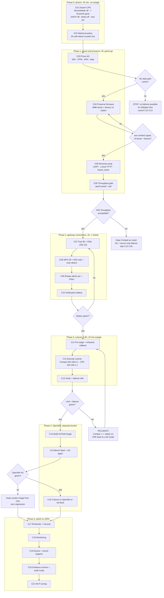

# SUPERB PLAN: 4G failover first, OpenWrt second (Pareto-ordered execution plan)

**Created:** 2026-10-29 22:18 CET · **Author:** agent session · **HEAD at authoring:** `1b8634ee7`
**Status:** PLAN ONLY, nothing applied to hardware · **Owner approval:** Option 1 (4G CPE becomes the router) chosen
**Inputs:** `docs/reviews/2026-10-29_19-40_router-configuration-review.md` (device truth),
`docs/status/2026-10-29_21-31_router-audit-openwrt-feasibility-status.md` (session truth)

---

## 0. Context: what actually exists, and what is proved

### 0.1 The two devices

| | ISP gateway | 4G CPE |
| --- | --- | --- |
| Identity | Compal **DMC7002KLG** (Vodafone Station / Horizon), FW **2.9.13**, DOCSIS 3.0, BPI+ on | Vendor LuCI fork, FW **1.0.273-20240928-115300**, kernel **4.4.140** (LEDE 17.01 BSP) |
| Hardware | ISP supplied | **MT7628AN** 580 MHz, **64 MB RAM**, **8 MB flash**, no PCIe (2.4 GHz only) |
| Uplink | public `89.65.239.240/22`, 8x4 DOCSIS, SNR 39 dB | wired (LAN port, currently **LAN mode**) + **Quectel EC200A-EU** LTE module, **SIM not inserted** (`AT+CPIN? -> CME ERROR: 10`) |
| Address | `192.168.1.1`, DHCP **on** `.10 to .253`, DNS `193.47.158.254/255` | `192.168.1.254`, DHCP **on** `.101 to .200` (runtime-proven), DNS `10.43.255.55` (unroutable) |
| Admin | `admin/admin` over plain HTTP | `admin/admin` over LuCI, telnet 23 open, **Remote Web (WAN admin) ON** |
| Exposure | no forwards, no DMZ, UPnP off, WAN Blocking on, only port 80 on LAN | **7 forwards to `192.168.1.100`** armed (22, 443, 6443, 41641, 9500, 9501, 9502) |
| Wi-Fi | 5 GHz (7 clients) + 2.4 GHz, WPA2, **WPS PIN on**, 2.4 uses TKIP+AES | 2.4 GHz only, SSID `Europol \| Law enforcement`, WPA2, 0 clients |

### 0.2 The three real problems, in the owner's terms

1. **"The 4G router has no internet."** Root cause is now runtime-proven, not guessed: the CPE is in **LAN mode** (no WAN
   interface exists: `pingcheck: Interface 'wan' not found`), so its DHCP hands out gateway `.254` and DNS `10.43.255.55`;
   any client that leases from it is stranded. Its LTE modem has **no SIM**, so there is no backup path either.
2. **"I want my own software on it."** The box is an MT7628AN with 8 MB flash running a 2016 BSP kernel rebuilt in 2024
   with a 24.10 LuCI veneer. Upstream OpenWrt is feasible, but it is an *upgrade*, not a prerequisite.
3. **The house network is currently mis-wired for its own future**: two DHCP servers on one segment, gateway DNS bypassing
   dnsblockd, and a DHCP pool that swallows every static address this repo depends on.

### 0.3 Proof ledger: proved vs assumed

| Claim | Status | Proof |
| --- | --- | --- |
| CPE serves DHCP on `.101 to .200` | **PROVED (runtime)** | `dnsmasq-dhcp[1776]: DHCP, IP range 192.168.1.101 -- 192.168.1.200, lease time 12h` |
| CPE has no WAN interface | **PROVED (runtime)** | `pingcheck: Interface 'wan' not found or error`, `'wan6' not up` |
| CPE LTE module is a Quectel EC200A-EU | **PROVED** | `4gup: start 2c7c:6005`, `AT+CGMR -> EC200AEUV1HAR02A06M16` |
| CPE LTE has no SIM | **PROVED** | `AT+CPIN? -> +CME ERROR: 10` |
| CPE reboots itself after 6 h offline | **PROVED (live counter)** | `watchcat: no internet connectivity for 2960 seconds. Reseting when reaching 21600` |
| CPE clock syncs via NTP after boot | **PROVED** (corrects my earlier claim) | boot log `Sat Mar 7 15:32` then `Thu Oct 29 19:46` |
| CPE's DHCP never granted a lease this boot | **PROVED** | zero `DHCPACK`/`DHCPOFFER` lines in 1391 syslog lines |
| Gateway WPS PIN is on, both bands | PROVED (config) | embedded JSON `WPS.Enable=1`, `ConfigMethodsEnabled=PBC,PIN` |
| Gateway has no bridge/modem page | PROVED (24-page census) | full menu enumeration |
| Gateway's WAN admin port is closed from outside | **NOT proved** | hairpin unsupported, so the test was inconclusive |
| CPE NAT throughput is adequate | **UNKNOWN** | never measured, this is the cutover's biggest unknown |
| CPE `board_name` / product string | **UNKNOWN** | no shell, no board field in the UI |

---

## 1. Pareto: what actually delivers the result

### 1.1 The 1% that delivers 51%

**One task: disarm the CPE (`C01`, 30 min).** Turn Remote Web off, delete the 7 forwards, turn its DHCP server off.

Why this is the whole ballgame:

- It is the **actual cause of the reported symptom**. The CPE's dnsmasq has never granted a lease in this boot, so turning
  it off changes nothing for any current client (proven safe), and it removes the failure mode permanently.
- It kills the only **internet-reachable default-credential admin** on the property. Today it is harmless only because the
  port is in LAN mode; that stops being true the moment a SIM goes in.
- It disarms **7 forwards that publish SSH, the k8s API and Longhorn** to the internet the instant a WAN exists.

Three form changes, one device, 30 minutes, fully reversible, zero topology risk. Nothing else in this plan has that
ratio.

### 1.2 The 4% that delivers 64%

`C01` plus three cheap checks that prevent the expensive mistakes:

| Task | What it prevents |
| --- | --- |
| **C03** prove the 4G uplink (SIM, `AT+CPIN?`, registration, real data) | Re-architecting the entire house for an uplink that may not work. Today the LTE path is *unproven* and the module is a Cat-4 EC200A with NAT enabled (`AT+QCFG="nat" -> 1`) |
| **C04** preserve the firmware (full 8 MB dump + `factory` + `u-boot-env`) | A brick with no way back. `factory` holds radio calibration; lose it and the Wi-Fi never works again |
| **C06** throughput gate (`iperf3` through the CPE) | Committing the household to a 580 MHz NAT path that may cap well under the cable plan |

Those four together (roughly 3.5 h) decide go or no-go on the entire architecture. Everything after them is execution.

### 1.3 The 20% that delivers 80%

`C01 to C13`: disarm, prove, preserve, fix the gateway, cut over, verify. Concretely: a working household with a working
4G backup on the **vendor firmware**, correct DNS and DHCP, and no default credentials anywhere. That is the whole
customer outcome.

### 1.4 The other 20% (to reach 100%)

`C14 to C21`: the OpenWrt upgrade (separate risk bucket), documentation, monitoring, device/record hygiene, evidence
archival, and Wi-Fi tuning. Valuable, but **none of it is required for the owner's stated goal to be true**.

### 1.5 Why this order, and not "flash OpenWrt first"

Flashing first is the instinct, and it is wrong here:

- **Two irreversible risks must never share a window.** Re-architecting the LAN and replacing the firmware in one change
  means a failure leaves no known-good state to fall back to.
- **The vendor firmware's 4G handling is its one genuinely good feature** (`4gup` AT scripting for a CDC-Ethernet EC200A
  is fiddly to rebuild). Shipping the failover on the firmware that already does it is faster and safer.
- **The owner's benefit arrives at `C13`.** At that point the network is better than today. The OpenWrt attempt at `C15`
  is then a pure upside: if it fails, nothing regresses.

---

## 2. Risk-bucket doctrine (do not verschlimmbessern)

| Bucket | Contains | Reversal |
| --- | --- | --- |
| **R0, config-only** | `C01`, `C02`, `C07`, `C08`, `C09`, `C18`, `C19` | re-enter the old value; gateway config backup taken in `F14` |
| **R1, LAN topology** | `C11`, `C12`, `C13` | report Part 4.5 ladder: Compal back to `192.168.1.1`, CPE back to LAN mode, radios on |
| **R2, irreversible** | `C04` (dump, non-destructive), `C15` (flash) | only the dump makes `C15` survivable. **No flash before `C04` is verified twice** |

Hard rules for the execution window:

1. Never change a router's LAN IP and reboot the household twice in one sitting without a verification pass in between.
2. Never leave two DHCP servers enabled on one segment, in any phase.
3. Never flash without two independent copies of the full 8 MB image plus `factory`.
4. Capture a gateway config backup (encrypted, off-repo) before the first gateway change.
5. Every step ends with a read-back verification, never with "the form said OK".

---

## 3. COARSE PLAN: 21 tasks, 30 to 100 minutes each

Scores: **I**mpact, **CV** customer value, **RR** risk reduction, **E**ffort (5 = most effort). Priority = (2I + 2CV + RR) / E.

| ID | Task | Phase | I | CV | RR | E | Prio |
| --- | --- | --- | --- | --- | --- | --- | --- |
| C01 | **Disarm the CPE**: Remote Web off, 7 forwards deleted, DHCP server off, telnet off, new admin password | 0 | 5 | 4 | 5 | 1 | **23.0** |
| C03 | **Prove the 4G uplink**: SIM in, `AT+CPIN?`, registration, APN, real data path | 1 | 5 | 5 | 3 | 3 | **6.0** |
| C04 | **Preserve the firmware**: full 8 MB dump, `factory` partition, `u-boot-env`, two copies each | 1 | 4 | 3 | 5 | 3 | **5.3** |
| C07 | **Gateway LAN/DHCP/DNS**: pool 244 to 90, DNS to `.150`/`.151`, config backup first | 2 | 5 | 5 | 4 | 2 | **9.5** |
| C08 | **Gateway wireless hardening**: WPS off both bands, 2.4 GHz AES-only, port-scan detection on | 2 | 4 | 4 | 4 | 1 | **16.0** |
| C09 | **Credential rotation**: gateway admin password, both PSKs to 20+ chars | 2 | 5 | 4 | 5 | 2 | **9.5** |
| C02 | **CPE watchdog policy**: decide Watchcat (6 h self-reboot, live counter) and Watchdog `@dns` | 0 | 3 | 3 | 3 | 1 | **12.0** |
| C06 | **Throughput gate**: `iperf3` wired NAT and Wi-Fi through the CPE | 1 | 4 | 4 | 4 | 2 | **8.0** |
| C05 | **Recovery prep**: `board_name`, UART pinout, u-boot TFTP/web recovery probe, recovery runbook | 1 | 3 | 2 | 5 | 3 | **4.3** |
| C10 | **Post-change verification battery**: DNS, pool, WPS, auth, DOCSIS | 2 | 4 | 3 | 3 | 1 | **14.0** |
| C11 | **Pre-stage the cutover**: address plan, both configs prepared, window booked, rollback rehearsed | 3 | 4 | 4 | 4 | 2 | **8.0** |
| C12 | **Execute the cutover**: Compal to `192.168.0.0/24`, CPE to `192.168.1.1` + WAN mode, recable | 3 | 5 | 5 | 3 | 3 | **6.0** |
| C13 | **Post-cutover verify + failover drill**: coax out, time the switch, restore, time failback | 3 | 5 | 5 | 3 | 2 | **9.0** |
| C14 | **OpenWrt evaluation/build**: `ramips/mt76x8`, EC200A CDC support, mwan3, 8 MB size budget | 4 | 4 | 4 | 2 | 5 | **3.6** |
| C15 | **Bench flash + 4G re-confirmation** (only with C04 verified twice) | 4 | 4 | 4 | 2 | 5 | **3.6** |
| C16 | **OpenWrt cutover or rollback** (green only) | 4 | 3 | 3 | 2 | 3 | **3.3** |
| C17 | **Docs + harvest**: `docs/services/router.md`, `docs/services/4g-cpe.md`, harvest 50 items | 5 | 3 | 3 | 2 | 2 | **4.5** |
| C18 | **Monitoring**: gatus `tcp://192.168.1.254:80`, post-cutover `tcp://192.168.1.1:80`, syslog receiver decision | 5 | 3 | 2 | 3 | 2 | **4.0** |
| C19 | **Device and record hygiene**: identify `.16`, reconcile the `.29`/Pixel-6 row, IPv6 posture, TTL decision | 5 | 3 | 2 | 3 | 2 | **4.0** |
| C20 | **Evidence archive + repeatable audit script** for these CPEs | 5 | 2 | 1 | 3 | 2 | **2.5** |
| C21 | **Wi-Fi tuning**: 5 GHz AP decision, DFS channel 52, 2.4 GHz 40 to 20 MHz | 5 | 3 | 3 | 1 | 2 | **3.5** |

**Total coarse effort:** ~21 h of work, of which **~5 h is the 80 %** (`C01` to `C13` minus the flash research).

### Coarse task detail (scope boundaries)

- **C01** ends when all five states read back as changed and a telnet connect is refused. No topology change, no reboot.
- **C03** ends with the CPE (still in LAN mode) reaching the internet with the SIM if possible, or a documented hard blocker
  (no SIM / no data plan / registration refused). **A blocker here cancels `C11` to `C13`.**
- **C04** ends with two verified copies (checksum match) of an 8 MB dump plus a separate `factory` blob.
- **C06** ends with a number in Mbps for wired NAT and 2.4 GHz Wi-Fi, compared against the DOCSIS tier.
- **C07** and **C08** are the only household-facing interruptions, one gateway reboot each; do them in one sitting.
- **C12** is the single outage window (~10 min). **C13** must be same-session.
- **C14** to **C16** may each end in "abandoned, vendor firmware retained" without harming anything.

---

## 4. FINE PLAN: 92 tasks, each 12 minutes or less

Same ordering as above, grouped by phase. Fine IDs are `F##`.

### Phase 0: disarm and stabilise (no outage, no topology change)

| ID | ≤12 min task | Parent | I | CV | RR | E |
| --- | --- | --- | --- | --- | --- | --- |
| F01 | Log into the CPE, open Advanced, Security, Remote Web | C01 | 5 | 4 | 5 | 1 |
| F02 | Toggle Remote Web OFF and Save & Apply; read the toggle back | C01 | 5 | 5 | 5 | 1 |
| F03 | Open Port Forwards, delete `ssh-onprem-0` (TCP 22 to `.100`) | C01 | 5 | 5 | 4 | 1 |
| F04 | Delete `onprem-0-k8s` 443 and 6443 | C01 | 5 | 5 | 4 | 1 |
| F05 | Delete `onprem-0-tailscale` 41641 and the three Longhorn rules (9500/9501/9502) | C01 | 5 | 5 | 4 | 1 |
| F06 | Confirm the forwards table is empty on reload | C01 | 5 | 4 | 3 | 1 |
| F07 | DHCP Server tab: toggle OFF, Save & Apply | C01 | 5 | 5 | 5 | 1 |
| F08 | Verify in the syslog that dnsmasq restarted with DHCP disabled (no range line) | C01 | 4 | 3 | 5 | 2 |
| F09 | Disable telnetd, confirm port 23 refuses | C01 | 4 | 2 | 4 | 2 |
| F10 | Change the CPE admin password; log out and back in to prove it | C01 | 4 | 3 | 5 | 2 |
| F11 | Record Watchcat's current live counter value (baseline) | C02 | 3 | 2 | 2 | 1 |
| F12 | Decide Watchcat: keep 6 h as last resort, or raise to 24 h; apply | C02 | 3 | 3 | 3 | 1 |
| F13 | Confirm Watchdog target `@dns` is reachable from the CPE's own LAN (it will be, once it routes) | C02 | 2 | 1 | 2 | 2 |

### Phase 1: prove and preserve (the go/no-go gate)

| ID | ≤12 min task | Parent | I | CV | RR | E |
| --- | --- | --- | --- | --- | --- | --- |
| F14 | Insert a SIM, power-cycle the CPE | C03 | 5 | 5 | 3 | 1 |
| F15 | Read `AT+CPIN?` from the syslog (expect `+CPIN: READY`) | C03 | 5 | 5 | 3 | 1 |
| F16 | Capture the registration state (`AT+CREG?` / `+QNWINFO`) from the 4G page | C03 | 5 | 5 | 3 | 1 |
| F17 | Enter or confirm the APN profile on the 4G page | C03 | 5 | 5 | 3 | 2 |
| F18 | Prove a data path: the CPE reaches the internet with the SIM (link/route check) | C03 | 5 | 5 | 3 | 2 |
| F19 | Record the LTE signal metrics and the assigned IP as the baseline | C03 | 3 | 3 | 2 | 1 |
| F20 | Attach UART leads per board silkscreen; confirm `ttyS0` @115200 output at boot | C05 | 3 | 2 | 5 | 3 |
| F21 | Probe u-boot for TFTP/web recovery (interrupt at boot, note the menu and the expected filename) | C05 | 3 | 2 | 5 | 3 |
| F22 | Capture `board_name` / product string from u-boot env or the console | C05 | 4 | 2 | 3 | 2 |
| F23 | Find the exact device in upstream OpenWrt's `mt76x8` device list (by model string) | C05 | 4 | 3 | 3 | 2 |
| F24 | Dump the full 8 MB flash to a file over the console or the read path | C04 | 4 | 3 | 5 | 3 |
| F25 | Extract and store the `factory` partition (0x40000 to 0x50000) separately | C04 | 4 | 3 | 5 | 2 |
| F26 | Save `u-boot-env` and the partition table output | C04 | 3 | 2 | 5 | 1 |
| F27 | Checksum both copies of the dump and of `factory`; store one copy off-machine | C04 | 4 | 3 | 5 | 2 |
| F28 | Write the one-page brick-recovery runbook (TFTP name, IP, key timing) into the repo | C05 | 3 | 2 | 5 | 2 |
| F29 | Put the CPE temporarily in WAN mode with the cable as uplink, on the bench | C06 | 4 | 4 | 4 | 2 |
| F30 | Run `iperf3` through the CPE wired path; record Mbps | C06 | 4 | 4 | 4 | 2 |
| F31 | Run `iperf3` over its 2.4 GHz Wi-Fi; record Mbps | C06 | 4 | 4 | 4 | 2 |
| F32 | Compare against the DOCSIS tier and write the go/no-go verdict | C06 | 4 | 4 | 4 | 1 |

### Phase 2: gateway correctness (one reboot, one Wi-Fi blip)

| ID | ≤12 min task | Parent | I | CV | RR | E |
| --- | --- | --- | --- | --- | --- | --- |
| F33 | Download the gateway's encrypted config backup, store off-repo | C07 | 4 | 2 | 5 | 1 |
| F34 | BASIC, LAN: set pool size 244 to **90** (`.10 to .99`) | C07 | 5 | 5 | 4 | 1 |
| F35 | Set DNS1 `192.168.1.150`, DNS2 `192.168.1.151` | C07 | 5 | 5 | 4 | 1 |
| F36 | Save; wait out the gateway reboot (~2 min) | C07 | 5 | 5 | 4 | 2 |
| F37 | Verify the new DHCP scope: force a client renew, check IP `.10 to .99` and DNS `.150` | C07 | 5 | 5 | 4 | 2 |
| F38 | Prove the LAN resolves through dnsblockd (query a blocked domain from a DHCP client) | C07 | 4 | 5 | 3 | 2 |
| F39 | WIRELESS 2.4 GHz WPS: Disable | C08 | 4 | 3 | 4 | 1 |
| F40 | WIRELESS 5 GHz WPS: Disable | C08 | 4 | 3 | 4 | 1 |
| F41 | 2.4 GHz Security: encryption to AES only, keep WPA2-PSK | C08 | 4 | 4 | 3 | 1 |
| F42 | ADVANCED, Firewall: enable port scan detection | C08 | 3 | 2 | 3 | 1 |
| F43 | Reconnect affected clients after the 2.4 GHz rekey and verify | C08 | 3 | 3 | 2 | 2 |
| F44 | Gateway admin password to a unique 16+ char value | C09 | 5 | 3 | 5 | 1 |
| F45 | Generate and set a 20+ char 2.4 GHz PSK, reconnect clients | C09 | 4 | 4 | 4 | 2 |
| F46 | Generate and set a 20+ char 5 GHz PSK, reconnect clients | C09 | 4 | 4 | 4 | 2 |
| F47 | Record where the credentials live (not in the repo) in the runbook | C09 | 3 | 2 | 3 | 1 |
| F48 | Verification battery: DOCSIS signal, 401 sweep, only port 80, WPS off, pool bounds | C10 | 4 | 3 | 3 | 2 |
| F49 | Confirm the repo still evaluates: `nix flake check --no-build` | C10 | 3 | 2 | 3 | 2 |

### Phase 3: the cutover (single outage window)

| ID | ≤12 min task | Parent | I | CV | RR | E |
| --- | --- | --- | --- | --- | --- | --- |
| F50 | Write the address plan into the runbook (`192.168.0.0/24` link, `192.168.1.0/24` house) | C11 | 4 | 3 | 3 | 1 |
| F51 | Fill the two risk gaps only the owner can close (label model, Wi-Fi path A/B/C) | C11 | 4 | 4 | 3 | 1 |
| F52 | Pre-configure the Compal's `192.168.0.1/24` + DHCP `.2` limit `1` values but do not apply | C11 | 4 | 3 | 3 | 2 |
| F53 | Pre-configure the CPE's LAN `.1` + DHCP `.10/90` + DNS `.150/.151` values but do not apply | C11 | 4 | 3 | 3 | 2 |
| F54 | Add the CPE static route `192.168.0.0/24 via 192.168.0.1` (for modem admin access) | C11 | 3 | 2 | 2 | 1 |
| F55 | Rehearse the rollback ladder out loud, step by step, against the live devices | C11 | 4 | 3 | 5 | 2 |
| F56 | Book the window; announce the outage duration | C11 | 2 | 3 | 2 | 1 |
| F57 | Apply the Compal LAN change to `192.168.0.1`, wait for the reboot | C12 | 5 | 5 | 3 | 2 |
| F58 | Recable: Compal LAN1 to CPE WAN, CPE LAN to the house switch | C12 | 5 | 5 | 3 | 2 |
| F59 | Switch the CPE's WAN/LAN port to WAN mode, apply, wait for reboot | C12 | 5 | 5 | 3 | 2 |
| F60 | Set the CPE LAN to `192.168.1.1`, DHCP `.10/90`, DNS `.150/.151`, apply | C12 | 5 | 5 | 3 | 2 |
| F61 | Re-enable the Compal DHCP with pool `.2` limit `1`; turn both of its radios off | C12 | 4 | 4 | 3 | 2 |
| F62 | Verify `ping 192.168.1.1`, `getent hosts home.lan`, a fresh DHCP lease, Wi-Fi association | C13 | 5 | 5 | 3 | 2 |
| F63 | Confirm the gateway's WAN still holds `89.65.239.240` and the CPE's WAN holds `192.168.0.2` | C13 | 5 | 5 | 3 | 1 |
| F64 | Failover drill: unplug the coax, time the switch to LTE, record it | C13 | 5 | 5 | 3 | 3 |
| F65 | Restore the coax, time the failback, record it | C13 | 5 | 5 | 3 | 3 |
| F66 | Re-run the verification battery and `nix flake check --no-build` post-cutover | C13 | 4 | 4 | 3 | 2 |

### Phase 4: OpenWrt (separate risk bucket, optional upside)

| ID | ≤12 min task | Parent | I | CV | RR | E |
| --- | --- | --- | --- | --- | --- | --- |
| F67 | Confirm the device entry (or the closest sibling) in `ramips/mt76x8` | C14 | 4 | 4 | 2 | 2 |
| F68 | Check EC200A support: `kmod-usb-net-cdc-ether` + `uqmi`/`comgt` path in 24.10 | C14 | 4 | 4 | 2 | 2 |
| F69 | Assemble a package list that fits 8 MB (mwan3, firewall, dropbear, no Go binaries) | C14 | 4 | 4 | 2 | 3 |
| F70 | Build the image on evo-x2 and check the squashfs size against the 0x6e0000 rootfs budget | C14 | 4 | 3 | 2 | 3 |
| F71 | Prepare the TFTP recovery server and image filenames from F28 | C15 | 4 | 3 | 5 | 2 |
| F72 | Flash over the recovery path with the console attached, watch the boot | C15 | 4 | 4 | 2 | 3 |
| F73 | First boot: set root password, disable telnet, confirm 2.4 GHz radio and calibration intact | C15 | 4 | 4 | 3 | 2 |
| F74 | Rebuild the 4G path (`uqmi` or AT-script + `mwan3` with wired primary, LTE backup) | C15 | 5 | 5 | 2 | 3 |
| F75 | Prove 4G data + failover on OpenWrt, on the bench | C15 | 5 | 5 | 2 | 3 |
| F76 | Cut over to OpenWrt, or roll back to the vendor image from F24 | C16 | 3 | 3 | 2 | 3 |
| F77 | Decide dnsblockd placement explicitly: stays on evo-x2 + rpi3, router only advertises `.150/.151` | C16 | 4 | 3 | 3 | 1 |

### Phase 5: the other 20 % (polish to 100 %)

| ID | ≤12 min task | Parent | I | CV | RR | E |
| --- | --- | --- | --- | --- | --- | --- |
| F78 | Write `docs/services/router.md` (gateway runbook) | C17 | 3 | 3 | 2 | 2 |
| F79 | Write `docs/services/4g-cpe.md` (CPE runbook: hardware, addresses, traps, recovery) | C17 | 3 | 3 | 2 | 2 |
| F80 | Rename the dnsblockd `lan-router` entry and add the modem at `192.168.0.1` | C17 | 3 | 2 | 2 | 1 |
| F81 | Harvest the coarse plan into `TODO_LIST.md` + the matching `docs/todo/*.md` libraries | C17 | 3 | 3 | 2 | 3 |
| F82 | Add gatus `tcp://192.168.1.254:80` (and `192.168.1.1:80` post-cutover) | C18 | 3 | 2 | 3 | 1 |
| F83 | Decide the syslog receiver: bring up udp/514 and point the gateway's remote logging at it | C18 | 3 | 2 | 3 | 3 |
| F84 | Identify `192.168.1.16` (CommScope OUI, no open ports) | C19 | 3 | 2 | 3 | 2 |
| F85 | Reconcile the `.29` / Pixel-6 decommission row against the live lease | C19 | 3 | 2 | 2 | 1 |
| F86 | Decide the LAN IPv6 posture (CPE currently SLAAC on; 4G adds a second path) | C19 | 3 | 2 | 3 | 1 |
| F87 | Decide TTL override based on the SIM tariff's tethering policy | C19 | 3 | 3 | 2 | 1 |
| F88 | Archive this session's evidence (probes + dumps) under a durable path, or delete deliberately | C20 | 2 | 1 | 3 | 2 |
| F89 | Write the repeatable CPE audit script (endpoint list + field parser) | C20 | 2 | 1 | 3 | 3 |
| F90 | Settle the 5 GHz question for real: accept 2.4-only, or add an AP on the CPE LAN | C21 | 3 | 3 | 1 | 2 |
| F91 | Move 5 GHz off DFS channel 52 to 36 to 48 (only if the Compal keeps a radio) | C21 | 3 | 3 | 1 | 1 |
| F92 | Set 2.4 GHz to 20 MHz (0 clients on it today) | C21 | 2 | 2 | 1 | 1 |

---

## 5. Execution graph



**Read the graph as three independent contracts:**

1. `G1` and `G3` are cheap gates that can cancel the architecture before any outage.
2. `G5` is the only gate that touches the household. Rollback is fully scripted in report Part 4.5.
3. `G6` is optional upside. Failing it costs nothing because `C13` already delivered the outcome.

---

## 6. Verification battery (run after `C10` and after `C13`)

```bash
# 1. Gateway auth is still enforced on every page (expect 401 x7)
for p in BasicLAN AdvancedForwarding StatusPing StatusTraceroute SystemPassword SystemFactoryDefault; do
  printf '%s ' "$(curl -s -o /dev/null -w '%{http_code}' "http://192.168.1.1/$p.asp")"; echo "$p"
done

# 2. DHCP scope is the new one (expect 192.168.1.10 to .99 with DNS .150)
cat ~/.cache/router-review/dhcp_now.html   # after a forced renew

# 3. LAN resolves through dnsblockd, not Vodafone
dig +short @192.168.1.1 doubleclick.net    # must NOT return 193.47.x
dig +short @127.0.0.1 auth.home.lan

# 4. Repo still evaluates (DNS + TCP path proof)
cd ~/projects/SystemNix && nix flake check --no-build

# 5. Post-cutover: address ownership
getent hosts _gateway                       # 192.168.1.1
cat /proc/net/arp | grep -E '192\.168\.1\.1\b'   # should be the CPE's MAC 9c:e5:49:61:91:78

# 6. Wi-Fi reality check
nmcli -f SSID,SECURITY,SIGNAL,CHAN dev wifi list

# 7. Failover evidence
journalctl -u NetworkManager --since '-10 min' | grep -iE 'route|dhcp'   # after the drill
```

---

## 7. Rollback ladder

| After | Rollback | Time |
| --- | --- | --- |
| `C01` | re-enable the toggles / retype forwards | 10 min |
| `C07`/`C08`/`C09` | restore the gateway config backup from `F33` | 5 min + reboot |
| `C12` | Compal LAN back to `192.168.1.1`, DHCP `.10/244`, radios on, CPE back to LAN mode, DHCP off | 15 min |
| `C15` | re-flash the `F24` dump over the recovery path from `F28` | 20 min |
| `C16` | re-flash the vendor image, no reprovisioning needed | 20 min |

The server never changes: `192.168.1.150` static, gateway `.1`, so **no NixOS rebuild is ever part of a rollback**.

---

## 8. Non-goals (do not drift into these)

- Running `dnsblockd` (or any Go daemon) on the CPE: 64 MB RAM, 8 MB flash, 580 MHz. Decision recorded as `F77`.
- Enabling DMZ or port forwards on either device: inbound is not needed (Tailscale/Netbird carry remote access).
- Replacing the Compal: it is the DOCSIS modem and its history of unauth RCEs is neutralised by WAN Blocking, zero
  forwards, no DMZ and UPnP off. Keep those four properties and the exposure stays minimal.
- Getting 5 GHz out of the CPE: no PCIe slot, it is a hardware ceiling.
- Touching `flake.nix`, `flake/parts/`, or any Nix module as part of this plan. Nothing here needs it.

---

## 9. Open questions (owner input, blocking the noted tasks)

1. **CPE model/product string from the label, and LAN port count** (blocks `F51`, informs `F23`, `F58`). No `board_name`
   is reachable from the firmware.
2. **Wi-Fi path A, B or C** (blocks `F51` and `C21`): A = CPE 2.4 GHz only, free but slower; B = add a 5 GHz AP on the CPE
   LAN, recommended; C = leave the Compal's radios on, fast but those clients lose LAN services and never fail over.
3. **Where deliverables live and whether to harvest now**: `docs/reports/` does not exist in this repo
   (`docs/reviews/`, `docs/status/`, `docs/audits/` do). The review currently sits in `docs/reviews/`, this plan in
   `docs/planning/`. Also: should the coarse plan be harvested into `TODO_LIST.md` + `docs/todo/*.md` right away?

---

## Appendix A: evidence index

| Artifact | Path | Proves |
| --- | --- | --- |
| Gateway page census | `~/.cache/router-review/{Status,Basic,Advanced,Wireless,System}*.html` | every Part 1 setting |
| CPE config endpoints | `~/.cache/router-review/api/*` (26 files) | every Part 2 setting |
| CPE syslog | `~/.cache/router-review/q_system_status_syslog.html` (165 KB) | hardware, EC200A, SIM state, dnsmasq runtime, watchcat counter |
| Forwards extraction | `fw2.py` output | 7 rules, protocols and ports |
| Auth sweep | `unauth.sh` output | 401 on all sensitive gateway pages |
| Port scan | `scan.py` output | only 80 open on the gateway |
| Wi-Fi scan | `nmcli dev wifi list` | SSIDs, security, channels |

## Appendix B: what this plan deliberately does not repeat

- It does not re-litigate the architecture: Option 1 was chosen; `G3` is the only escape hatch.
- It does not assume the CPE's DHCP was idle: it was serving, runtime-proven, and is turned off first.
- It does not assume the 4G works: `C03` is a hard gate.
- It does not assume the flash is safe: `C04` is a hard gate with two verified copies.
