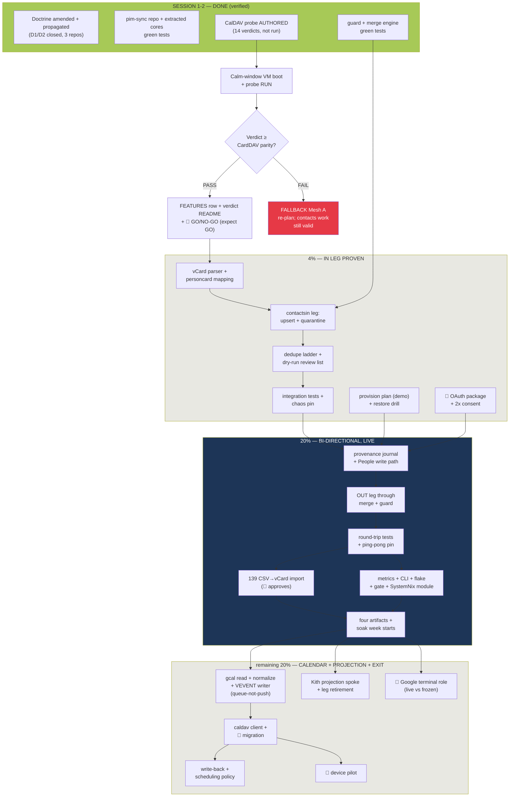

# Stalwart Single-Truth — Remaining-Work Pareto Plan (v2)

> **Decision (locked 2026-10-29, owner):** Stalwart (`pbx.artmann.tech`) is the
> single source of truth for contacts + calendar (D1 = Mesh B). This is plan
> **v2**: a re-cut of `2026-10-29_22-11_stalwart-single-truth-pareto-execution-plan.md`
> against what session 1 actually shipped (see
> `docs/status/2026-10-29_22-38_stalwart-single-truth-execution-session-1.md`
> for the full session report incl. the seven own-goal lessons). Nothing
> already done is re-dispatched; everything still open is in the tables below.

**Status:** PLAN v2 (execution IN PROGRESS — session 2 started 22:40; owner
gates marked 🧑). **Method:** pareto-planning skill (1%→4%→20%→rest), user
overrides: `.md` + mermaid, micro tasks ≤ 12 min.

---

## 1. Verified starting point (post session 1 — nothing assumed)

| Fact | Status | Evidence |
| --- | --- | --- |
| DATA-MESH constitution amended: contacts+calendar = Stalwart; Kith demoted to relations + read-only people projection | **DONE** session 1 | crm `507595b` (owner cells, spoke table, namespaces `gcal:`/`carddav-in:`, amendment note) |
| Doctrine propagated + D1/D2 closed (pbx `15b25c6`, SystemNix `cd32cfd76`); services.md rows 15/16/366/367 updated | **DONE** session 1 | git hashes; pre-commit hooks green |
| CalDAV probe suite AUTHORED (14 verdicts, stdlib, port-overridable) — **NOT yet RUN** (demo VM admission-gated on the IO storm, PSI peaked 95.6) | scaffold done | `nix-email/docs/probes/2026-10-29-caldav-01626/` |
| pim-sync repo born: STACK.md (stack-selection skill), go.mod 1.27.2, LICENSE/.gitignore | **DONE** session 1 | `~/projects/pim-sync`, commits `7679975`..`2ddb737` |
| gcontacts + carddav cores extracted, journal seams replaced by `Syncer` interface, actor = `bot:pim-sync` | **DONE** session 1 | `66a04cb`; all ported plain tests green (go 1.27.2) |
| Guard package (dry-run default, caps abort-and-stay, deletion quarantine hold-unless-cleared, live-without-cap refuses) | **DONE** session 2 | `9b0623c`, 4 tests green |
| Merge engine (three-way field diff vs last-agreed provenance; conflicted bases kept; ping-pong pin: 1 edit = 1 propagation) | **DONE** session 2 | `9b0623c`, 6 tests green |
| golang.org/x/oauth2 v0.37.0 = the ONLY third-party dep (STACK.md OAuth exception) | verified | `go.mod` |
| Storm debt: SystemNix dprint-format step refused mid-storm — doctrine tables committed unaligned (cosmetic) | OPEN | `buildflow -s dprint-format` output 22:26 |
| Journal still holds ZERO people contacts; 139 staged in Twenty dump; free-Mesh-B window STILL OPEN | verified 22:11 | `docs/todo/services.md:366` |

**Errata applied while planning (Step 0):** session-1 lessons encoded as
rules below — test expectations derived from executed verdicts (not imagined
labels); import-grep before dependency claims; retry-loop commits in
daemon-contended repos; commit at every green milestone. v1's 27 tasks:
#1, #2, #9 (part), #10, #13 (core), #15 (core) are done or subsumed —
everything else is re-ranked here.

## 2. Pareto re-cut

### The 1% that delivers 51% — RUN THE GATE + CLOSE THE DEBT (~half a day)

The only unmeasured surface left is CalDAV-on-0.16.26. The probe script
exists; running it converts the calendar half of the decision from
"expected GO" to "measured GO". Plus the storm debt so the fleet's own
gates go green again. Everything calendar is blocked on this; everything
contacts is NOT (contacts rides CardDAV, already 17/18 PASS).

1. Boot the demo VM at the first calm window (PSI < 20 both + no guard
   trip), run `caldav_probe.py`, capture transcript + console excerpt.
2. Verdict README + `nix-email/FEATURES.md` CalDAV row + 🧑 GO/NO-GO note
   (expected GO; fallback Mesh A stays documented).
3. SystemNix `buildflow -s dprint-format --fix` (storm debt) + push chores.

### The 4% that delivers 64% — THE IN LEG, PROVEN END-TO-END (~2 days)

Contacts Google→Stalwart executable against the demo VM: parser, mapping,
leg, dedupe, dry-run. Plus owner-real tasks (provision, drill, OAuth).

4. vCard parser + personcard mapping (UID = stable hash of `google:<acct>` resourceName).
5. `contactsin` leg: discover → EnsureBook → etag map → upsert (If-Match +
   the proven 412 dialect) → deletions quarantined.
6. Dedupe ladder (UID → email → name) + dry-run review list + cross-account
   candidates report (🧑 reviews before any real run).
7. IN-leg integration tests vs `carddavtest` + the chaos pin (wiped book
   must NOT wipe Google).
8. Provision plan objects (2 books + 2 calendars) in the demo VM, verify
   via DAV discovery; port to the pbx dialect (deploy = 🧑).
9. PII restore drill from the store archive + `PII-RESTORE-DRILL.md`.
10. 🧑 OAuth instruction package: GCP client (People API, production
    publishing), 2× consent, refresh-token >7d verification recipe.

### The 20% that delivers 80% — BI-DIRECTIONAL, LIVE, GUARDED (~1.5 weeks)

11. Provenance journal persistence (per-leg state via syncfile) + People
    write path (field-masked) + OUT leg (SyncCollection → diff → write).
12. Round-trip tests (owner↔Google) + the 139 CSV→vCard import + reconcile.
13. Ship shape: metrics textfile, cmdguard CLI, flake + buildflow gate,
    README/AGENTS, SystemNix module (timer/sops/onFailure), four
    artifacts, soak tooling + soak week start.

### The remaining 20% to 100% — CALENDAR + PROJECTION + EXIT DOOR

14. Calendar legs (gcal client → normalization → VEVENT writer →
    queue-not-push → caldav client → migration → write-back → scheduling
    policy), Kith projection spoke + contact-leg retirement, device
    pilot + Google terminal role (🧑), fleet polish (meta, drift check).

## 3. Comprehensive plan — medium granularity (30–100 min per task)

Sorted by importance/impact/customer-value, then effort. 🧑 = owner gate.
**Gate:** tasks 6–9 start after task 1's probe lands (contacts work may
proceed in parallel — CardDAV is already probe-pinned).

| # | Task | Tier | Est (min) | Impact | Owner | Depends on |
| --- | --- | --- | --- | --- | --- | --- |
| 1 | CalDAV probe RUN: demo VM boot at calm window, `caldav_probe.py`, transcript + `vm-console-excerpt.log` | 1% | 100 | 10 | agent | calm PSI |
| 2 | Probe verdict README + `nix-email/FEATURES.md` CalDAV row + 🧑 GO/NO-GO note (fallback Mesh A stays linked) | 1% | 60 | 9 | 🧑 5 min | 1 |
| 3 | Storm debt: SystemNix dprint-format fix; push chores (SystemNix now; crm/pbx after peer wave — 🧑 call) | 1% | 30 | 7 | agent | calm PSI |
| 4 | vCard parser (`internal/carddav/parse.go`: unfold, UID/FN/N/EMAIL/TEL/ORG/CATEGORIES/REV) + table tests | 4% | 90 | 9 | agent | — |
| 5 | `internal/personcard`: Person↔Card mapping + UID = stable hash of `google:<acct>/resourceName` + tests | 4% | 60 | 9 | agent | 4 |
| 6 | `internal/contactsin` leg (gcontacts.Syncer impl): discover → EnsureBook → etag map → upsert with If-Match/412 dialect → quarantine deletions | 4% | 100 | 10 | agent | 5 |
| 7 | Dedupe ladder (UID→email→name) + dry-run review list + cross-account candidates report | 4% | 90 | 9 | 🧑 reviews | 6 |
| 8 | IN-leg integration tests vs `carddavtest` + chaos pin: wiped book must NOT wipe Google (15.4) | 4% | 100 | 10 | agent | 6 |
| 9 | Provision plan objects (2 books + 2 calendars) demo VM + DAV-discovery verify + port to pbx dialect (deploy 🧑) | 4% | 90 | 9 | agent+🧑 | 1 (VM) |
| 10 | PII restore drill from nightly store archive (demo VM) + `PII-RESTORE-DRILL.md` runbook | 4% | 90 | 9 | agent | 9 |
| 11 | 🧑 OAuth instruction package: GCP client (People API, production publishing), 2× consent, refresh >7d recipe; agent verifies once consents exist | 4% | 45 | 8 | 🧑+agent | — |
| 12 | Provenance journal persistence (per-leg state via syncfile) + leg-state wiring into runner | 20% | 90 | 10 | agent | 6 |
| 13 | Google People write path: field-masked `updateConnection`, tombstone policy Google→owner | 20% | 100 | 9 | agent | 12 |
| 14 | OUT leg: SyncCollection delta → parse changed cards → three-way diff → field-scoped writes through guard | 20% | 100 | 10 | agent | 13 |
| 15 | Round-trip tests: owner edit lands in Google, Google edit lands in owner; ping-pong pin at leg level | 20% | 90 | 10 | agent | 14 |
| 16 | 139 Twenty people CSV→vCard import (Twenty field map, provenance per card) + counts reconcile 139/61 (demo book first) | 20% | 90 | 8 | agent | 6 |
| 17 | Metrics: Prometheus textfile collector (changes/conflicts/quarantined/last-success per leg) | 20% | 60 | 7 | agent | 14 |
| 18 | cmdguard CLI (`cmd/pim-sync`: sync-contacts, auth, import-csv, dry-run/live flags) — load cmdguard skill first | 20% | 100 | 8 | agent | 14 |
| 19 | flake.nix (go-nix-helpers + cmdguard private dep + vendorHash chase; nix-private-go-repos skill) + `.buildflow.yml` + first full gate | 20% | 100 | 8 | agent | 18 |
| 20 | pim-sync README + AGENTS.md (commands, dialect invariants, guardrail contracts) + `meta` register + stack-drift-check | 20% | 60 | 6 | agent | 19 |
| 21 | SystemNix `pim-sync` module: systemd timer (5 min, jittered), sops secrets, onFailure, start-limit, log hygiene | 20% | 90 | 8 | agent | 19 |
| 22 | Four artifacts (constitution principle 7): contract doc, ops runbook (kill switch = stop timer), boot posture decision, DATA-MESH spoke-row links | 20% | 90 | 7 | agent | 21 |
| 23 | Soak tooling: daily per-leg report script + drift alert thresholds; soak week starts when legs live | 20% | 60 | 7 | agent | 21 |
| 24 | gcal client (events.list + sync/page tokens) + event normalization + calendar-set whitelist + fixture tests | rest | 100 | 7 | agent | 2 (GO) |
| 25 | VEVENT writer (RRULE/RECURRENCE-ID/EXDATE fidelity) + attendee queue-not-push policy + round-trip fuzz | rest | 100 | 8 | agent | 24 |
| 26 | `internal/caldav` client + calendar migration dry-run (counts + review list) + write-back leg + scheduling policy (invites originate owner-side; iTIP → queue) + caps tests | rest | 100 | 7 | 🧑 reviews | 25, 1 |
| 27 | Kith projection spoke (crm: Stalwart→journal read-only, links not copies) + contact-leg retirement (FEATURES/WHERE-IS-MY-DATA re-pointed, boots-clean) + 🧑 punch lists (device pilot, Google terminal role) | rest | 100 | 8 | agent+🧑 | 14, 26 |

**Totals:** 27 tasks ≈ 40 h agent work + 5 owner gates. Tier 1 ≈ 3 h;
tiers 1+2 ≈ 16 h.

## 4. Fine breakdown — max 12 min per task

IDs `P.n` = parent §3 task `#n`. Sorted by parent; within a parent,
execution order. (Session-2 already-done items are NOT re-listed.)

| ID | Micro-task | Min | Gate |
| --- | --- | --- | --- |
| 1.1 | PSI poll loop (background): alert when avg10+avg60 < 20% and no guard trip 30 min | 6 | — |
| 1.2 | Boot demo VM (`nix run .#vm` from nix-email); verify banner + stalwart version 0.16.26 in console | 12 | — |
| 1.3 | Run `python3 caldav_probe.py > caldav-probe.log`; count PASS lines | 10 | — |
| 1.4 | Capture `vm-console-excerpt.log` (preflight + version evidence); shut VM down | 8 | — |
| 2.1 | Write verdict README: PASS/FAIL table per C1-C14 + known-deviance list | 12 | — |
| 2.2 | Add CalDAV row to `nix-email/FEATURES.md` with transcript pointer | 8 | — |
| 2.3 | 🧑 GO/NO-GO note (expected GO; fallback = Mesh A re-plan, nothing wasted) | 5 | 🧑 |
| 3.1 | SystemNix `nix develop -c buildflow -s dprint-format --fix` at calm window; commit | 12 | — |
| 3.2 | Push SystemNix (plan v2 + status report + doctrine); record push in session notes | 6 | — |
| 3.3 | crm + pbx push decision: verify peer wave settled, then push or hold for 🧑 | 8 | 🧑 |
| 4.1 | Parser core: unfold (CRLF/continuation), property split, param parse | 12 | — |
| 4.2 | Field extraction: UID/FN/N/EMAIL/TEL(×N)/ORG/CATEGORIES/REV | 12 | — |
| 4.3 | Round-trip test: `Card.Emit` → parse → same values (fold/escape tolerance) | 12 | — |
| 4.4 | Deviance tests: folded lines, escaped commas, missing FN, empty card | 12 | — |
| 5.1 | UID hash: `sha256("google:<acct>/<resourceName>")` → base32/hex prefix; constant + test | 10 | — |
| 5.2 | Person→Card mapping (name/email/phones/org; FN synthesis rules) + test | 12 | — |
| 5.3 | Card→Record (merge-engine field vocabulary) extraction + test | 12 | — |
| 5.4 | Person→Record mapping for the Google side of the diff + test | 10 | — |
| 6.1 | Leg skeleton: config (base URL, user, pass, book name), client wiring | 10 | — |
| 6.2 | Snapshot phase: SyncCollection etag map + Multiget bodies → parsed cards | 12 | — |
| 6.3 | Upsert phase: new card → PUT; changed → If-Match re-PUT; 412 → refetch+compare+retry (dialect) | 12 | — |
| 6.4 | Squatter eviction port (foreign-UID href: re-PUT with etag; 412 → DELETE + recreate) | 12 | — |
| 6.5 | Deletion path: vanished Google person → guard.Quarantine (never auto-delete) | 10 | — |
| 6.6 | Dry-run mode: collect all actions, zero writes, review-list render | 10 | — |
| 6.7 | Leg unit tests with a fake book (httptest) covering each phase | 12 | — |
| 7.1 | Dedupe ladder rung 1: UID hit → update path | 10 | — |
| 7.2 | Ladder rung 2: email match across accounts → candidates list (no auto-merge) | 12 | — |
| 7.3 | Ladder rung 3: name+org normalized match → candidates list | 12 | — |
| 7.4 | Review-list rendering: create/update/skip counts + candidate table | 12 | — |
| 7.5 | 🧑 Owner reviews the first dry-run output before any live run | 5 | 🧑 |
| 8.1 | Integration test: full dry-run vs `carddavtest` server (green suite) | 12 | — |
| 8.2 | Integration test: live upsert idempotence (second run = zero writes) | 12 | — |
| 8.3 | Chaos pin: wipe all cards server-side → next run quarantines + caps abort, Google untouched | 12 | — |
| 8.4 | 412-dialect test: stale etag → 412 → refetch → correct re-PUT | 12 | — |
| 9.1 | Provision plan objects (demo): 2 address books + 2 calendars per account shape | 12 | — |
| 9.2 | Apply in demo VM; verify via DAV discovery (books + calendars enumerable) | 10 | — |
| 9.3 | Port objects to pbx `mail.nix` provision dialect (nix-email pin) | 12 | — |
| 9.4 | 🧑 Deploy to pbx + verify live discovery from evo-x2 over NetBird | 10 | 🧑 |
| 10.1 | Snapshot demo store; destroy PII objects | 8 | — |
| 10.2 | Restore from archive path; semantic verify (objects + etags) | 12 | — |
| 10.3 | Write `PII-RESTORE-DRILL.md` runbook + datestamp | 12 | — |
| 11.1 | 🧑 Instruction doc: GCP project choice (reuse InboxClean's vs fresh), client creation steps | 12 | 🧑 |
| 11.2 | 🧑 Instruction doc: production publishing + People API scope; 2× consent flow | 10 | 🧑 |
| 11.3 | Verification recipe: refresh-token survival >7d check (InboxClean lesson) | 8 | — |
| 11.4 | Land client-secret + tokens into the sops skeleton paths | 10 | — |
| 12.1 | Provenance state struct (per-leg, per-entity base records) + syncfile persistence | 12 | — |
| 12.2 | Wire into runner settle path (state + provenance written together, atomically) | 12 | — |
| 12.3 | Corrupt-state = safe full re-merge semantics + test | 10 | — |
| 13.1 | People update payload builder (field-masked: names/emailAddresses/phoneNumbers/organizations) | 12 | — |
| 13.2 | updateConnection call + etag If-Match semantics + error classification | 12 | — |
| 13.3 | Tombstone policy: Google person vanished → owner quarantine (mirror of 6.5) | 10 | — |
| 13.4 | Write-path tests vs httptest fake People API | 12 | — |
| 14.1 | OUT-leg skeleton: SyncCollection on the book → changed hrefs | 12 | — |
| 14.2 | Parse changed cards → Records; diff vs Google snapshot + provenance base | 12 | — |
| 14.3 | Apply TakeLocal decisions through guard → field-masked writes | 12 | — |
| 14.4 | Conflict queue: counter + review list entry (reported, never auto-picked) | 10 | — |
| 14.5 | OUT-leg tests: owner edit propagates once; google-only edit untouched | 12 | — |
| 15.1 | E2E round-trip test A: owner-side edit → OUT leg → fake Google → IN leg → settle | 12 | — |
| 15.2 | E2E round-trip test B: Google-side edit → IN leg → owner book → OUT leg → settle | 12 | — |
| 15.3 | Ping-pong pin at leg level: N idle rounds → zero writes | 12 | — |
| 15.4 | Cross-account collision test: same person in A+B → both UIDs kept, candidate reported | 12 | — |
| 16.1 | Twenty CSV field map (persons: name/email/phones/company; companies) | 12 | — |
| 16.2 | CSV→Card conversion with provenance note (NOTE: imported-from-twenty) | 12 | — |
| 16.3 | Import dry-run through the IN-leg door: counts reconcile 139/61 | 10 | — |
| 16.4 | 🧑 Real import approval (into demo first, pbx after provision) | 5 | 🧑 |
| 16.5 | Update `services.md:366` row: landed via pim-sync door | 5 | — |
| 17.1 | Textfile collector schema: pimsync_leg_{changes,conflicts,quarantined,last_success_unix} | 12 | — |
| 17.2 | Collector write path (0600 .prom, atomic) + unit test | 12 | — |
| 18.1 | Load cmdguard skill; command skeleton (root + 3 subcommands) | 12 | — |
| 18.2 | `auth` command (OAuth loopback per account) | 12 | — |
| 18.3 | `sync-contacts` command (dry-run default, `--live` opt-in, `--max-changes`) | 12 | — |
| 18.4 | `import-csv` command (dry-run default) + exit codes per cmdguard contract | 12 | — |
| 19.1 | Load nix-private-go-repos skill; flake skeleton (go-nix-helpers go-standard) | 12 | — |
| 19.2 | cmdguard private dep wiring (mkPreparedSource/publicDeps/vendorHash chase) | 12 | — |
| 19.3 | `.buildflow.yml` (env GOTOOLCHAIN 1.27.2) + first gate run + fix findings | 12 | — |
| 19.4 | `nix build` + `nix flake check` green | 12 | — |
| 20.1 | README (what/why, quickstart, kill switch) | 12 | — |
| 20.2 | AGENTS.md (commands, dialect invariants, guardrail contract, pins) | 12 | — |
| 20.3 | `meta set --project pim-sync` + tags; `stack-drift-check.sh` exit 0 | 8 | — |
| 21.1 | SystemNix module skeleton: service + timer (5 min, jitter), package from flake | 12 | — |
| 21.2 | sops keys: stalwart creds + google tokens wiring | 10 | — |
| 21.3 | onFailure unit + start-limit + ProtectSystem/ReadWritePaths posture | 12 | — |
| 21.4 | Metrics textfile path + timer-interval env | 10 | — |
| 21.5 | 🧑 Deploy to evo-x2 + 24 h journal-silence check | 10 | 🧑 |
| 22.1 | Contract doc: entities, directions, actors, join keys, trust posture | 12 | — |
| 22.2 | Ops runbook: enable/disable/rollback/freeze; kill switch = stop timer | 12 | — |
| 22.3 | Boot posture decision (manual one-shot vs timer) recorded in DATA-MESH | 8 | — |
| 22.4 | Link the four artifacts from the DATA-MESH spoke rows (crm edit) | 6 | — |
| 23.1 | Daily soak report script (per-leg table from state files) | 12 | — |
| 23.2 | Drift alert: owner↔google count mismatch threshold | 10 | — |
| 23.3 | Soak-day entries template + retro errata hook in this plan | 8 | — |
| 24.1 | gcal client: events.list + page tokens + syncToken (mirror gcontacts patterns) | 12 | — |
| 24.2 | Google event JSON → internal Event (dates, TZ, attendees, recurrence) | 12 | — |
| 24.3 | Calendar-set whitelist config ("the calendar set") | 10 | — |
| 24.4 | Fixture tests: weekly RRULE, all-day, TZ-crossing, cancelledStatus | 12 | — |
| 25.1 | Event → VEVENT writer (RRULE + RECURRENCE-ID + EXDATE fidelity) | 12 | — |
| 25.2 | Attendee-bearing events → review queue, never auto-push (policy flag) | 10 | — |
| 25.3 | Round-trip fuzz: event → owner → Google → semantic equality | 12 | — |
| 26.1 | `internal/caldav` client: discovery reuse + calendar-query + PUT/GET + sync tokens | 12 | — |
| 26.2 | Calendar migration dry-run: counts + review list per calendar | 12 | — |
| 26.3 | 🧑 Migration list approval + real run + webmail spot-check | 10 | 🧑 |
| 26.4 | Write-back leg through merge+guard; scheduling policy (invites owner-side; iTIP → queue) | 12 | — |
| 26.5 | Calendar quarantine + caps tests (mirror 8.x) | 12 | — |
| 27.1 | crm: Kith projection spoke (Stalwart→journal read-only IN; links not copies; match ladder reuse) | 12 | — |
| 27.2 | crm: relations/deals reference projected people — verification test | 12 | — |
| 27.3 | crm: DATA-MESH spoke row + FEATURES row for the projection | 10 | — |
| 27.4 | crm: FEATURES gcontacts/carddav rows → RE-POINTED to pim-sync (dates); WHERE-IS-MY-DATA update; ROADMAP idea row | 10 | — |
| 27.5 | crm: boots-clean verify with legs off (no dead flags) | 8 | — |
| 27.6 | 🧑 Punch list: device pilot (DAV account on one phone, edit round-trip) | 12 | 🧑 |
| 27.7 | 🧑 Punch list: Google terminal role per account (live peer vs frozen mirror + freeze ritual) | 12 | 🧑 |

**Totals:** 110 micro-tasks ≈ 19.5 h of fine-grained execution (the rest of
the 40 h is verification loops, reviews, soak, and the calm-window waits).

## 5. Execution graph

**Kill switches (unchanged):** `systemctl stop pim-sync.timer` (Google still
holds live bytes → worst case re-import); deletion quarantine holds until
explicitly cleared; probe FAIL redirects to Mesh A with zero wasted work.

## 6. What this plan deliberately does NOT do

- Does **not** land the 139 into the journal (free-Mesh-B window stays open).
- Does **not** enable any write scope before guardrails are leg-tested (8.x).
- Does **not** auto-push attendee-bearing events, ever (first months: queue).
- Does **not** push crm/pbx mid-peer-wave without the owner's explicit OK
  (SystemNix push is owner-authorized this session; peer waves own their
  unpushed commits).
- Does **not** create the GitHub remote for pim-sync without the owner (🧑
  open question from session 1).
- Does **not** force the nix admission gate during IO storms (`ADMISSION_GATE_FORCE`
  stays untouched; VM work waits for the calm bar).

_Generated 2026-10-29 22:42 · method: pareto-planning skill (user overrides:
.md + mermaid, ≤12 min micro) · starting point verified against git hashes
and test output from sessions 1-2 · session report: docs/status/2026-10-29_22-38_._
