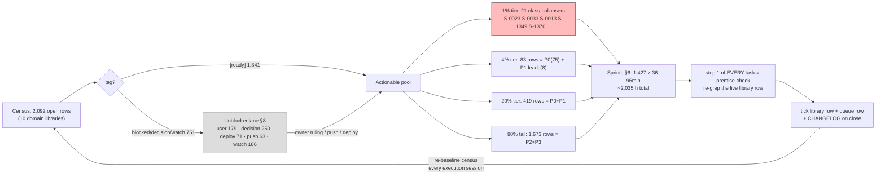

# SUPERB Backlog Masterplan v3 — all 2,092 open TODOs scheduled

**Created:** 2026-11-03 17:10 CET · **HEAD:** `3b619de32` · **Status:** PLAN (not executing — `scripts/plan-marker.sh` marker owed before any execution session)
**EXECUTING (instance superb-v3-exec-1, 2026-11-03 17:33 CET, HEAD `7241d5d7b`):** executing (see AGENTS.md plan-execution tombstone)
**Supersedes:** `docs/planning/2026-10-23_15-00_SUPERB-backlog-masterplan-v2.md` (v2, census 1,760 — kept for provenance; its instance `superb-masterplan-v2-exec-2` ran to completion 2026-10-24; S-048 closed 2026-11-03 by the pre-commit eval-relevance skip session). Census drift since v2: **+332 rows** (2,092 vs 1,760) in 11 days — parallel sessions append faster than executors close; this plan re-baselines everything.
**Source inventory:** the 10 domain libraries (`docs/todo/{ai-stack,desktop,monitoring,pipeline,pixel6,security,services,stability,storage,upstream}.md`), open `- [ ]` rows only. The `TODO_LIST.md` queue mirrors the `[ready]` subset and is NOT double-counted.

## 1. What this is

A two-level execution schedule over the entire open backlog (same shape as v2, re-baselined):

- **Level 1 (section 6):** 1,427 sprints, 36–96 min each (~2,035 h total), covering all 1,341 agent-actionable rows. Sorted by priority (P0→P3), then domain.
- **Level 2 (section 7):** every one of the 2,092 open rows as its own row with a first-step pointer, a step-count (each step ≤12 min), and priority. Gated rows carry 0 steps and point at the unblocker lane (section 8).
- **Completeness assertion:** `grep -ch '^- \[ \]' docs/todo/*.md | awk '{s+=$1} END{print s}'` must equal 2,092 and the Level-2 table must hold exactly 2,092 `S-` rows. Verified at authoring time. **Re-baseline this check at the start of every execution session** (v1→v2 drifted +8 in five hours; v2→v3 drifted +332 in eleven days).

**Deliberately NOT touched** (the Verschlimmbessern guard): `TODO_LIST.md`, `docs/todo/*`, scripts, modules — this file is purely additive. No TODO-system conventions change; this plan does NOT become a harvest surface (the tq pool keeps harvesting `TODO_LIST.md` only). Buckets/priorities here are a planning lens; the lifecycle tags in the libraries remain authoritative for dispatch legality.

## 2. Method

**Effort model** (one step = ≤12 min; steps are premise-check → do → verify → record), inherited verbatim from v2:

| Bucket | Meaning                                                                                | Steps | ≈Min |
| ------ | -------------------------------------------------------------------------------------- | ----- | ---- |
| M      | one-line doc/convention/citation fixes                                                 | 1     | 12   |
| H1     | single probe, measurement, small close                                                 | 3     | 36   |
| H2     | implement + selftest leg + eval (collector, gate, fixture, small module)               | 8     | 96   |
| H4     | VM test / battery / drill (authored as 3 sprints)                                      | 20    | 240  |
| D      | multi-day refactor/sweep (authored as 6 sprints)                                       | 48    | 576  |
| GATED  | remaining work needs owner/sudo/deploy/PSI-calm/reboot/push/decision — time-unbounded  | 0     | —    |

**Classification method for v3** (mechanical, stated so the next session can audit it):

1. **Inheritance from v2 (1,697 of 2,092 rows = 81%):** each open row was matched to its v2 Level-2 entry by domain + first-three-significant-title-words; matched rows inherit v2's priority AND bucket. This preserves 5 weeks of accumulated prioritization judgment.
2. **New/reworded rows (395) get rule-based classification:** bucket from keywords on the ASK HEAD only (never the `**Source:**` citation tail — status-report filenames polluted the first generator run with words like "battery"/"migrate"); priority = P1 for `[ready]` rows naming incident classes (freeze/crash/OOM/leak/secret/corruption/storm), P3 for `[watch]`, else P2. No new row was auto-promoted to P0 — P0 is earned by v2 inheritance or owner call.
3. **Gating is tag-driven:** `[blocked:*]`, `[decision]`, `[watch]` → GATED, 0 steps, unblocker lane.
4. **Every task's step 1 is a premise-check** — v3 line refs are authoring-time line numbers and WILL drift; the row text in the library is the contract, this table is the index.

## 3. Pareto breakdown

**The 1% that delivers 51% — 21 rows whose completion collapses whole incident classes** (each unlocks a family of dependent rows; these lead sprints T-0001..T-0021):

| S-id | Row | Why it is 1% |
| --- | --- | --- |
| S-0023 | Identify the 06:00–09:00 thermal-ceiling compute driver (stability:133) | Root cause of the freeze family — ~25 stability autopsy rows are downstream of knowing WHAT drives the 06–09h ceiling |
| S-0033 | Attribute the sustained IO storm ~50% avg10 4+h (stability:212) | Same class: the storm-attribution unblocks every storm-tolerance gate (§18, bank-sync readiness, probes) |
| S-0013 | monitor365-server SQLite pool wedge + shutdown hang (services:589) | Recurring live pain; the whole monitor365-reliability cluster rides on it |
| S-1349 | 🔑 Rotate leaked/stale API keys (security:13, GATED:user) | The persistent nag; security posture; unlocks closing the leak-history chapter |
| S-1370 | /data corruption repair decision (storage:26, GATED) | Data integrity; owner-gated; unblocks Borg go-live |
| S-0036 | EIO /data inode path + Borg go-live gate (storage:100) | Depends on S-1370 ruling; closes the repair chapter |
| S-0002 | sops manifest check-mode in pre-deploy (pipeline:87) | Prevention layer: catches the secret-wiring class before deploy, not after |
| S-0021 | sev1 chronic-storm latch (stability:129) | Kills the alert-noise floor that buries every real sev1 |
| S-0041 | monitor365 upstream: JWT secret off argv (upstream:211) | Secret-hygiene class (the redact-argv trap seen live) |
| S-0042 | monitor365 upstream: stop logging SsoConfigRow at INFO (upstream:219) | Same secret-hygiene class |
| S-1342 | FastFlowLM disable-or-pin (ai-stack:42, GATED) | Owner call ending a crash-class generator |
| S-1347 | ghostty interactive-scope IO storm root-cause (monitoring:180, GATED) | One of the two identified storm drivers |
| S-1354 | Delete 4 orphaned all-scope Forgejo PATs (services:37, GATED) | Silent-cleanup leak class |
| S-1361 | DiscordSync Oct 2–14 data-loss recovery (services:419, GATED:owner) | Customer-data loss incident, still open |
| S-1362 | P0 INCIDENT: paperless DB empty after hot-db flip (services:523, GATED) | The incident family's remaining branch |
| S-1365 | nix-daemon build admission during storms (stability:113, GATED) | Structural fix for the freeze-precursor class |
| S-1366 | kdump dump-dir missing (stability:135, GATED) | Crash evidence: without dumps the autopsy family starves |
| S-1355 | Turso plan decision (services:125, GATED:user) | Billing call; the only live branch of the DB-plan question |
| S-1781 | security.lockKernelModules (security:27, GATED) | Lands only after net-vpn; tracked so it is not lost |
| S-0001..S-0021 (the P0 actionable block) | — see section 6, sprints T-0001+ | The remaining P0 actionable leads |

**The 4% that delivers 64% — 83 rows = all 75 open P0 rows** (42 actionable + 33 gated; gated ones are owner-unblock asks, minutes not hours) **+ the top 8 P1 H2 leads** (S-0043 ai-meter client-key design fix, S-0044 suspend lock race, S-0045 DMS weather IP-geo + the next 5 P1 H2s in sprint order).

**The 20% that delivers 80% — 419 rows = every P0 + P1 row** (340 actionable ≈ 490 h of sprints, plus the 79 P0/P1 gated rows whose unblocking is an owner conversation, not agent work).

**The other 80% to reach 100% — 1,673 rows:** all P2/P3 (1,006 actionable long-tail + 582 P2/P3 gated + drift margin). Mostly small closes (M=111, H1=274), watch-rows that dissolve when their subject lands, and decisions that ride owner reviews. Do NOT skip: the tail is where doc-drift and phantom-metric classes hide — harvest order stays P0→P3, but every prune pass re-exposes pairings.

## 4. Execution graph

## 5. Guardrails

- **Verschlimmbessern guard:** this plan changes NO code, NO TODO rows, NO conventions. It is an index. If executing a row reveals the row itself is wrong, fix the ROW (its library file) with evidence, not the plan.
- **Plan-execution tombstone** (AGENTS.md): before executing this file, write the EXECUTING marker via `scripts/plan-marker.sh docs/planning/2026-11-03_17-10_SUPERB-backlog-masterplan-v3.md start <instance>` and commit it immediately.
- **Drift rule:** the census WILL move. An execution session owns re-baselining its slice: re-grep the row before acting (premise-check), and if the row is gone, tick nothing — record the observation in the session report.
- **Priority lens, not law:** P0/P1 ordering beats P2/P3 EXCEPT when a P2 unblocks a P1 (dependency beats sort key — the S-1370 → S-0036 shape).

## 6. Level 1 — the 1,427 sprints (36–96 min each)

Members reference Level-2 IDs (`S-nnnn`); packed sprints list all members, H4/D rows spread across part-sprints. Sorted by priority, then domain.

| T-id | P | Domain | Sprint lead row | Members | Min |
| --- | --- | --- | --- | --- | --- |
| T-0001 | P0 | pipeline | Allowlist the secret-history scanner's own canaries** — CI ` | S-0001 | 96 |
| T-0002 | P0 | pipeline | sops manifest check-mode in pre-deploy-check** (`sops-instal | S-0002 | 96 |
| T-0003 | P0 | pipeline | Eval-guard follow-ups (from the 17-49 session's P0/P1)** — ( | S-0003 | 96 |
| T-0004 | P0 | pipeline | gitleaks-coverage-selftest: ULID-user_id FP fixture + allowl | S-0004 | 96 |
| T-0005 | P0 | pipeline | §18 CPU leg: storm-aware downgrade or longer confirmation wi | S-0005 | 96 |
| T-0006 | P0 | security | ROOT: settle the `/run/secrets/sops-nix-age-key` ghost** — a | S-0006 | 96 |
| T-0007 | P0 | security | Add a Slack-token rule + fixture to gitleaks-coverage-selfte | S-0007 | 96 |
| T-0008 | P0 | services | Paperless DRF-token age metric + Gatus check (`pocket-id-sec | S-0008 | 96 |
| T-0009 | P0 | services | pbx secrets-preflight: derive expected-local names from gene | S-0009 | 96 |
| T-0010 | P0 | services | Trace the false "Oct 10/11 enrollment" + phantom `ln-install | S-0010 | 96 |
| T-0011 | P0 | services | Clean up the 5 leaked `bank-sync demo` test instances** — ra | S-0011 | 96 |
| T-0012 | P0 | services | Make the bank-sync readiness gate storm-tolerant: PSI-aware  | S-0012 | 96 |
| T-0013 | P0 | services | monitor365-server: IO-storm SQLite pool wedge + shutdown-pat | S-0013 | 96 |
| T-0014 | P0 | services | InboxClean storm-driver follow-ups (agent legs)** — (1) iden | S-0014 | 96 |
| T-0015 | P0 | stability | Automated post-hard-reset check** (`scripts/post-crash-check | S-0015 | 96 |
| T-0016 | P0 | stability | Guard/crash-forensics follow-ups (crash2 + freeze-3 reviews) | S-0016 | 96 |
| T-0017 | P0 | stability | Post-freeze storm drain verification + remaining drivers** — | S-0017 | 96 |
| T-0018 | P0 | stability | llama-rag dark-guard collector DEAD + leaked instances unrea | S-0018 | 96 |
| T-0019 | P0 | stability | Split the bundled "Guard/crash-forensics follow-ups" row int | S-0019 | 96 |
| T-0020 | P0 | stability | Freeze-#28 post-crash hardware checks** (still open from the | S-0020 | 96 |
| T-0021 | P0 | stability | sev1-escalation chronic-storm latch: implement the steady-st | S-0021 | 96 |
| T-0022 | P0 | stability | Freeze-#11 post-crash protocol on boot 0: flm socket + recov | S-0022 | 96 |
| T-0023 | P0 | stability | Identify the 06:00–09:00 CEST thermal-ceiling compute driver | S-0023 | 96 |
| T-0024 | P0 | stability | stability.md freeze-family discriminator fork** (instant-cut | S-0024 | 96 |
| T-0025 | P0 | stability | `scripts/crash-autopsy.sh`** (boot gaps, journal-cut discrim | S-0025 | 96 |
| T-0026 | P0 | stability | Post-crash resumable-reader pause automation (freeze-6 rule  | S-0026 | 96 |
| T-0027 | P0 | stability | inboxclean-web IO storm hardening** — unbounded dashboard ag | S-0027 | 96 |
| T-0028 | P0 | stability | Desktop-state snapshot collector for freeze autopsies** — gr | S-0028 | 96 |
| T-0029 | P0 | stability | Pin freeze-#27 session-1386 to its crush session(s)** — .cru | S-0029 | 96 |
| T-0030 | P0 | stability | freeze-#28 tq-memcg-vs-guard cross-check** — boot -1 OOM vic | S-0030 | 96 |
| T-0031 | P0 | stability | Complete freeze-20 driver attribution: sdb writeback writer  | S-0031 | 96 |
| T-0032 | P0 | stability | Autopsy the `daecca67` freeze (2026-10-18 03:03:38) — third  | S-0032 | 96 |
| T-0033 | P0 | stability | Attribute the sustained IO storm (~50% some avg10 for 4+ h o | S-0033 | 96 |
| T-0034 | P0 | stability | Quantify the crash-class boot cadence (freeze-cluster eviden | S-0034 | 96 |
| T-0035 | P0 | stability | Codify the live io-PSI storm attribution probes into docs/ag | S-0035 | 36 |
| T-0036 | P0 | storage | Locate the EIO /data inode's path + Borg go-live gate** — `/ | S-0036 | 96 |
| T-0037 | P0 | storage | Boot IO storm: relocate SignOz ClickHouse state onto the Sam | S-0037 | 96 |
| T-0038 | P0 | storage | Hot-db shadow-split guard: make the module/script detect "mo | S-0038 | 96 |
| T-0039 | P0 | upstream | tq preflight corrupted-repo lane: on `git status` failing wi | S-0039 | 96 |
| T-0040 | P0 | upstream | crm: prove the internal/httpapi 30s-timeout storm class pre- | S-0040 | 96 |
| T-0041 | P0 | upstream | monitor365 upstream: stop passing the JWT secret as a CLI ar | S-0041 | 96 |
| T-0042 | P0 | upstream | monitor365 upstream: stop logging full SsoConfigRow at INFO* | S-0042 | 96 |
| T-0043 | P1 | ai-stack | ai-meter BLOCKER: client-key permission design fix + deploy  | S-0043 | 96 |
| T-0044 | P1 | desktop | Close the suspend lock race: make `dms-lock` wait for compos | S-0044 | 96 |
| T-0045 | P1 | desktop | Identify the DMS weather IP-geo endpoint and check dnsblockd | S-0045 | 96 |
| T-0046 | P1 | desktop | Live-verify KeePassXC passkeys in Helium (deployed 2026-10-0 | S-0046 | 36 |
| T-0047 | P1 | desktop | Stale deploy lock removal** — `/tmp/.systemnix-deploy.lock`  | S-0047 | 96 |
| T-0048 | P1 | desktop | Attribute modified `scripts/post-deploy-check.sh`** — in wor | S-0048 | 96 |
| T-0049 | P1 | desktop | niri-session-manager restore gate** — do not restore windows | S-0049 | 96 |
| T-0050 | P1 | desktop | deploy.sh lock staleness** — lock outlives dead deploy; add  | S-0050 | 96 |
| T-0051 | P1 | desktop | dms-paste CI workflow** — `nix flake check` on push; action  | S-0051 | 96 |
| T-0052 | P1 | desktop | Persist a 3-branch dms-wallpaper-init regression fixture** ( | S-0052 | 96 |
| T-0053 | P1 | monitoring | Swap-exhaustion alert coverage audit** — freeze #38 (2026-10 | S-0053 | 36 |
| T-0054 | P1 | monitoring | Commit the dashboard generator + eval-time dashboard JSON li | S-0054 | 96 |
| T-0055 | P1 | monitoring | Investigate the live "SigNoz Traces Coverage" Gatus red (`si | S-0055 | 96 |
| T-0056 | P1 | monitoring | `signoz-collector-config-lint` flake check** — render collec | S-0056 | 96 |
| T-0057 | P1 | monitoring | Deploy + post-deploy verify the batched user-manager scan fi | S-0057 | 36 |
| T-0058 | P1 | monitoring | Restore-drill continuity gate: catch mid-history holes, not  | S-0058 | 80 |
| T-0059 | P1 | monitoring | Restore-drill continuity gate: catch mid-history holes, not  | S-0058 | 80 |
| T-0060 | P1 | monitoring | Restore-drill continuity gate: catch mid-history holes, not  | S-0058 | 80 |
| T-0061 | P1 | monitoring | Fix tq-agent-pool post-deploy-check detection** — the 01:5x  | S-0059 | 96 |
| T-0062 | P1 | monitoring | Post-deploy verification battery for the 2026-10-12 observab | S-0060 | 80 |
| T-0063 | P1 | monitoring | Post-deploy verification battery for the 2026-10-12 observab | S-0060 | 80 |
| T-0064 | P1 | monitoring | Post-deploy verification battery for the 2026-10-12 observab | S-0060 | 80 |
| T-0065 | P1 | monitoring | Wire census-ring freshness into `scripts/post-deploy-check.s | S-0061 | 36 |
| T-0066 | P1 | monitoring | Triage node-exporter's sustained ~356 journal lines/min (pos | S-0062 | 96 |
| T-0067 | P1 | monitoring | post-deploy-check §20: pin the crm `-passkeys=false` UNIT po | S-0063 | 96 |
| T-0068 | P1 | monitoring | `system_service_cpu_percent` is a standing all-zeros phantom | S-0064 | 36 |
| T-0069 | P1 | monitoring | gatus boot-userspace regression alert retune post-boot-gate- | S-0065 | 96 |
| T-0070 | P1 | monitoring | FastFlowLM post-deploy leg: pat the socket's ActiveState, no | S-0066 | 96 |
| T-0071 | P1 | monitoring | Post-deploy rendered-TOML spot-check for the collector cuts* | S-0067, S-0068 | 72 |
| T-0072 | P1 | monitoring | storage-collect storm hardening** — during the 2026-10-26 ba | S-0069 | 96 |
| T-0073 | P1 | monitoring | Balance-failure alerting** — kernel `balance: ended with sta | S-0070, S-0071 | 72 |
| T-0074 | P1 | monitoring | gatus multi-label pat() lint (S7 phantom-green class)** — an | S-0072 | 36 |
| T-0075 | P1 | monitoring | Rewrite the SigNoz SEV1 collector-outage narrative as a CLOS | S-0073 | 96 |
| T-0076 | P1 | monitoring | Rewrite the SigNoz SEV1 collector-outage narrative as a CLOS | S-0073 | 96 |
| T-0077 | P1 | monitoring | Rewrite the SigNoz SEV1 collector-outage narrative as a CLOS | S-0073 | 96 |
| T-0078 | P1 | monitoring | Rewrite the SigNoz SEV1 collector-outage narrative as a CLOS | S-0073 | 96 |
| T-0079 | P1 | monitoring | Rewrite the SigNoz SEV1 collector-outage narrative as a CLOS | S-0073 | 96 |
| T-0080 | P1 | monitoring | Rewrite the SigNoz SEV1 collector-outage narrative as a CLOS | S-0073 | 96 |
| T-0081 | P1 | pipeline | post-deploy-check.sh: assert the managed resolv.conf carries | S-0074 | 96 |
| T-0082 | P1 | pipeline | Re-pin the hermes-agent flake input to the last eval-green r | S-0075 | 96 |
| T-0083 | P1 | pipeline | AGENTS.md "Agent shells block common ops binaries" section:  | S-0076 | 96 |
| T-0084 | P1 | pipeline | Determine whether nixpkgs-compat.yml's nightly `nix flake ch | S-0077 | 96 |
| T-0085 | P1 | pipeline | deploy.sh `--when-calm` mode** — self-contained gated-deploy | S-0078 | 96 |
| T-0086 | P1 | pipeline | Wire `check-cv-oidc-gate.sh` as a flake check (`checks.x86_6 | S-0079 | 96 |
| T-0087 | P1 | pipeline | Flake-update bot: rollback-on-red for single-input eval brea | S-0080 | 96 |
| T-0088 | P1 | pipeline | Pre-deploy batch build of mkLarsPackages + cv + hermes input | S-0081 | 96 |
| T-0089 | P1 | pipeline | Known-outage classification in post-deploy-check** — FAILs w | S-0082 | 96 |
| T-0090 | P1 | pipeline | Surprise bulk `nix flake update` validation gate** — an unat | S-0083 | 96 |
| T-0091 | P1 | pipeline | §11 vendorHash gate is blind to `flakePkg`-imported tools' F | S-0084 | 96 |
| T-0092 | P1 | pipeline | Pre-deploy: verify the NESTED art-dupl consumers can't pull  | S-0085 | 36 |
| T-0093 | P1 | pipeline | corpse-pile gate branch: self-attribution + forensics into t | S-0086 | 96 |
| T-0094 | P1 | pipeline | Service-completeness manifest audit (eval-time or CI): every | S-0087 | 96 |
| T-0095 | P1 | pipeline | deploy.sh: lock-wait on activation contention** — poll/seria | S-0088 | 96 |
| T-0096 | P1 | pipeline | deploy.sh lock-guard selftest: pattern-anchored extraction o | S-0089 | 96 |
| T-0097 | P1 | pipeline | deploy.sh exit-13 abort: append a gate-state summary line (P | S-0090 | 96 |
| T-0098 | P1 | pipeline | Annotate the T13 concurrent-deploy guard docs with the new a | S-0091 | 12 |
| T-0099 | P1 | pipeline | Derive AUTH_VHOSTS from caddy.nix (or eval-time assert)** —  | S-0092 | 96 |
| T-0100 | P1 | pipeline | Identify residual post-deploy WARNs** (null-byte line ~233;  | S-0093 | 96 |
| T-0101 | P1 | pipeline | post-deploy-check: poll browser-history /health + drop deplo | S-0094 | 96 |
| T-0102 | P1 | pipeline | Post-deploy-check failure semantics + escalation** — warn-vs | S-0095 | 96 |
| T-0103 | P1 | pipeline | Add `--force` flag to deploy.sh for phantom metrics** (docum | S-0096 | 96 |
| T-0104 | P1 | pipeline | Refactor discordsync to use a shared HTTP gate helper** (`mk | S-0097 | 96 |
| T-0105 | P1 | pipeline | deploy-window journal anchoring + retry/backoff on external  | S-0098 | 96 |
| T-0106 | P1 | pipeline | Pre-deploy §11 FOD preview for the three 2026-10-14 master-f | S-0099 | 96 |
| T-0107 | P1 | pipeline | CI execution path for the script-fixture selftests** — the r | S-0100 | 96 |
| T-0108 | P1 | pipeline | tq runbook: minimum verification gate for no-code-change clo | S-0101 | 12 |
| T-0109 | P1 | pipeline | Sweep remaining TODO rows phrased "red on every deploy"/"red | S-0102 | 96 |
| T-0110 | P1 | pipeline | AGENTS.md pin-claim gate: any "the lock pinned X at time T"  | S-0103 | 96 |
| T-0111 | P1 | pipeline | Standardize the "goes live with the next deploy" suffix on e | S-0104 | 96 |
| T-0112 | P1 | pipeline | Run the FULL `nix flake check` (all 63 checks, with builds)  | S-0105 | 96 |
| T-0113 | P1 | pipeline | Annotate the 02-52 signoz-flip report with the dnsblockd `/h | S-0106 | 96 |
| T-0114 | P1 | pipeline | deploy.sh generic "stopped-for-containment" post-switch stop | S-0107 | 96 |
| T-0115 | P1 | pipeline | Eval-guard additions (extends the 17-49 eval-guard row above | S-0108 | 96 |
| T-0116 | P1 | pipeline | Extend `deploy-restart-audit.nix`: any unit named in deploy. | S-0109 | 96 |
| T-0117 | P1 | pipeline | Wire the find-based symlink sweep into post-deploy-check.sh  | S-0110 | 96 |
| T-0118 | P1 | pipeline | Pre-deploy §10: WARN when `memory_emergency_guard_churn_unit | S-0111 | 96 |
| T-0119 | P1 | pipeline | Add an eval-time/check assertion pinning the buildcache reap | S-0112 | 96 |
| T-0120 | P1 | pipeline | Consolidated "next deploy must verify" checklist section in  | S-0113 | 36 |
| T-0121 | P1 | pipeline | Pre-commit: classify `path ... is not valid` eval failures a | S-0114 | 96 |
| T-0122 | P1 | pipeline | Investigate how parallel-session files landed unformatted (g | S-0115 | 96 |
| T-0123 | P1 | pipeline | FOWNER-chmod eval lint** — flag hardened root units whose Ex | S-0116 | 96 |
| T-0124 | P1 | pipeline | Exposition-syntax validator as a flake check or smoke step** | S-0117 | 96 |
| T-0125 | P1 | pipeline | deploy-queue as a systemd user unit/timer** — tonight's 90-m | S-0118 | 96 |
| T-0126 | P1 | pipeline | deploy.sh pressure gate rebound race** — gate measured PSI=O | S-0119 | 96 |
| T-0127 | P1 | pipeline | Enumerate the 2026-09-22/23 nixpkgs-move FOD casualties via  | S-0120 | 96 |
| T-0128 | P1 | pipeline | Survey `.githooks/pre-commit` gate legs for fixture/shellche | S-0121 | 96 |
| T-0129 | P1 | pipeline | Input-graph diet audit (420 lock nodes)** — enumerate subtre | S-0122 | 96 |
| T-0130 | P1 | pipeline | Sweep the flake `checks.*` VM tests for authored-but-never-e | S-0123 | 80 |
| T-0131 | P1 | pipeline | Sweep the flake `checks.*` VM tests for authored-but-never-e | S-0123 | 80 |
| T-0132 | P1 | pipeline | Sweep the flake `checks.*` VM tests for authored-but-never-e | S-0123 | 80 |
| T-0133 | P1 | pipeline | Pressure-gate disk-busy classifier: multi-sample window befo | S-0124 | 96 |
| T-0134 | P1 | pipeline | AGENTS.md gotcha: deep-forcing `config.assertions` ≠ topleve | S-0125 | 96 |
| T-0135 | P1 | pipeline | Task-ID dedup gate in the queue harvest/dispatch** — skip it | S-0126 | 96 |
| T-0136 | P1 | pipeline | Provenance anchor-quote hygiene** — status reports abbreviat | S-0127 | 96 |
| T-0137 | P1 | pipeline | Fix the stale dedup-gate pointers in docs/status/2026-10-01_ | S-0128 | 12 |
| T-0138 | P1 | pipeline | Test the smoke's FALLBACK auth branch before the next deploy | S-0129 | 96 |
| T-0139 | P1 | pipeline | Build the pre/post-deploy-check apps in `nix flake check` (o | S-0130 | 96 |
| T-0140 | P1 | pipeline | Pin CI's statix to the flake lock** — CI runs `nix run nixpk | S-0131 | 96 |
| T-0141 | P1 | pipeline | Full toplevel build to clear the nix-build kill verdict** —  | S-0132 | 96 |
| T-0142 | P1 | pipeline | Pre-deploy eval-failure leg must surface the root cause** —  | S-0133 | 96 |
| T-0143 | P1 | pipeline | Deploy-time quiescence gate** — content-pinning before EDITS | S-0134 | 96 |
| T-0144 | P1 | pipeline | pre-deploy-check: probe store-path DB-validity before declar | S-0135 | 96 |
| T-0145 | P1 | pipeline | Pre-deploy build-set enumeration leg** — dry-run the derivat | S-0136 | 96 |
| T-0146 | P1 | pipeline | Store-hit-first reflex in the deploy runbook** — before acce | S-0137 | 12 |
| T-0147 | P1 | pipeline | Characterize the `<out>.lock` residue class** — a `^C` mid-b | S-0138 | 96 |
| T-0148 | P1 | pipeline | docs/agents/go-ecosystem.md: refresh the vendorHash-freshnes | S-0139 | 96 |
| T-0149 | P1 | pipeline | Per-host §11 vendorHash gate (rpi3-dns + darwin parity)** —  | S-0140 | 96 |
| T-0150 | P1 | pipeline | pre-deploy-check: mutual-exclusion error for --section-10-on | S-0141 | 96 |
| T-0151 | P1 | pipeline | Suppress nix trusted-setting notices in gate captures** — ev | S-0142 | 96 |
| T-0152 | P1 | pipeline | post-deploy-check polkit leg: assert an agent OWNS the polki | S-0143 | 96 |
| T-0153 | P1 | pipeline | Re-baseline the deploy-exit-3 smoke baseline after the polki | S-0144 | 96 |
| T-0154 | P1 | pipeline | Root-cause the devshell-vs-FOD module-graph divergence (crus | S-0145 | 96 |
| T-0155 | P1 | pipeline | Encode the post-lock-wave enumeration gate: no deploy handof | S-0146 | 96 |
| T-0156 | P1 | pipeline | Investigate buildflow `format` not applying rustfmt in monit | S-0147 | 96 |
| T-0157 | P1 | pipeline | `deploy.sh --wait-for-pressure <minutes>`: first-class bound | S-0148 | 96 |
| T-0158 | P1 | pipeline | Investigate the tq queue's re-fire of completed task 000001a | S-0149 | 96 |
| T-0159 | P1 | pipeline | Scoped locked-formatter pass over wave4's 8 edited files bef | S-0150 | 96 |
| T-0160 | P1 | pipeline | Root-cause the 2026-10-07 ~16:2x UNANCHORED first switch** — | S-0151 | 96 |
| T-0161 | P1 | pipeline | deploy.sh: anchor verify-and-heal loop + neutral UNANCHORED  | S-0152 | 96 |
| T-0162 | P1 | pipeline | I/O-pressure gate: add per-device signals so multi-session P | S-0153 | 96 |
| T-0163 | P1 | pipeline | post-deploy smoke: name the 4 re-baselined advisory FAILs an | S-0154 | 96 |
| T-0164 | P1 | pipeline | post-deploy-check: name NEW failing checks when the advisory | S-0155 | 96 |
| T-0165 | P1 | pipeline | Add a machine-readable gate field to queue rows (`gate:sudo` | S-0156 | 96 |
| T-0166 | P1 | pipeline | Post-gate-fix regression test: after the sudo pre-flight/gat | S-0157 | 96 |
| T-0167 | P1 | pipeline | CI: build the toplevel on lock-bump commits** — nix-check.ym | S-0158 | 96 |
| T-0168 | P1 | pipeline | Same-rev FOD drift probe: pre-deploy re-verification for pin | S-0159 | 36 |
| T-0169 | P1 | pipeline | Pre-deploy co-travel enumeration** — a shared-tree deploy sh | S-0160 | 96 |
| T-0170 | P1 | pipeline | Deploy-concurrency guard in pre-deploy-check: detect a live  | S-0161 | 96 |
| T-0171 | P1 | pipeline | FOD rev-staleness guard in pre-deploy-check: flag a hash-mis | S-0162 | 96 |
| T-0172 | P1 | pipeline | Shim-drop-protocol amendment: drop-comment lock-rev stamp +  | S-0163 | 12 |
| T-0173 | P1 | pipeline | gotchas-archive entries: "mid-deploy tree mutation invalidat | S-0164 | 96 |
| T-0174 | P1 | pipeline | Probe ALL plain vHosts in post-deploy-check, not only PLAIN_ | S-0165 | 96 |
| T-0175 | P1 | pipeline | Clear the two stale-cap DRIFT rows flagged by the TODO gate* | S-0166 | 96 |
| T-0176 | P1 | pipeline | Static check: FAIL a shim drop-comment whose cited lock rev  | S-0167 | 12 |
| T-0177 | P1 | pipeline | Deploy pressure gate: PSI pre-check BEFORE the 72-check pre- | S-0168 | 96 |
| T-0178 | P1 | pipeline | deploy.sh anchor gap: an nh abort BEFORE its profile bump le | S-0169 | 96 |
| T-0179 | P1 | pipeline | Root-cause the UNANCHORED-profile mechanism** — the first 20 | S-0170 | 96 |
| T-0180 | P1 | pipeline | Verify the storage-collector lock bump content before/at the | S-0171 | 96 |
| T-0181 | P1 | pipeline | Catch writeShellApplication script breakage at commit/CI tim | S-0172 | 96 |
| T-0182 | P1 | pipeline | Guard the bank-sync lock input at `67dd64526e5a55d86ff40ab49 | S-0173 | 96 |
| T-0183 | P1 | pipeline | Verify why dnsblockd check-lockstep did not fire before the  | S-0174 | 96 |
| T-0184 | P1 | pipeline | Review the parallel session's staged deploy.sh + scripts/io- | S-0175 | 96 |
| T-0185 | P1 | pipeline | deploy.sh anchor self-heal on exit-14** — when /run/current- | S-0176 | 96 |
| T-0186 | P1 | pipeline | Pre-deploy build-class smoke for flake app derivations** — § | S-0177 | 96 |
| T-0187 | P1 | pipeline | HaGeZi FOD hash churn: stabilize the mirror fetch or documen | S-0178 | 96 |
| T-0188 | P1 | pipeline | Verify post-lift lock consistency for the three 2026-10-14 l | S-0179 | 96 |
| T-0189 | P1 | pipeline | Verify the vendorHash shims cited by the lifted pins' commen | S-0180, S-0181, S-0182 | 60 |
| T-0190 | P1 | pipeline | Un-red the CI Nix-flake-check workflow (two failure classes, | S-0183 | 96 |
| T-0191 | P1 | pipeline | Broken-toplevel build signal** — local-tree `nh os switch`/t | S-0184 | 96 |
| T-0192 | P1 | pipeline | Build the deploy-intent tooling** (convention landed in docs | S-0185, S-0186 | 24 |
| T-0193 | P1 | pipeline | deploy.sh: move the deploy lock from /tmp to /run (root-owne | S-0187 | 96 |
| T-0194 | P1 | pipeline | Regression pins for the 2026-10-17 deploy.sh/pre-deploy-chec | S-0188 | 96 |
| T-0195 | P1 | pipeline | Extend the content-addressed stamp to pre-deploy-check #2 (t | S-0189 | 96 |
| T-0196 | P1 | pipeline | Parallelize post-deploy-check.sh sequential probe sections** | S-0190 | 36 |
| T-0197 | P1 | pipeline | App-eval dedup in deploy.sh: ONE eval resolving pre/post-dep | S-0191 | 96 |
| T-0198 | P1 | pipeline | Inspect the aborted 19:33-45 deploy log + retire the stale ` | S-0192 | 96 |
| T-0199 | P1 | pipeline | Collect 3-5 phased deploy logs → per-phase cost table → re-r | S-0193 | 96 |
| T-0200 | P1 | pipeline | Selftests: anchor self-repair + boot-mirror -ef no-op + heal | S-0194 | 96 |
| T-0201 | P1 | pipeline | deploy.sh hardenings: bash -n pre-flight for generated scrip | S-0195 | 96 |
| T-0202 | P1 | pipeline | Add the re-lock-then-verify ordering sentence to go-ecosyste | S-0196 | 36 |
| T-0203 | P1 | pipeline | Lock-staleness CI check for ?ref=master inputs** — compare e | S-0197 | 96 |
| T-0204 | P1 | pipeline | Retry the go-1.27.2-wave deploy AFTER the concurrent session | S-0198 | 96 |
| T-0205 | P1 | pipeline | deploy.sh `--wait-for-lock` (or documented `flock -n /tmp/.s | S-0199 | 96 |
| T-0206 | P1 | pipeline | AGENTS.md anchor-discipline caveat: phased activation orderi | S-0200 | 96 |
| T-0207 | P1 | pipeline | Port-squat detection leg for post-deploy-check: registry-por | S-0201 | 96 |
| T-0208 | P1 | pipeline | Post-deploy-check proxy-staleness sweep: legs aliasing "rece | S-0202 | 96 |
| T-0209 | P1 | pipeline | Close the pre-deploy-check.sh §3 shellcheck gap: standalone  | S-0203 | 96 |
| T-0210 | P1 | pipeline | Harden pre-deploy §3 against eval failure + add a negative t | S-0204 | 96 |
| T-0211 | P1 | pipeline | Eval gate on lock floats** — the 2026-10-23 07:09 blanket wa | S-0205 | 96 |
| T-0212 | P1 | pipeline | Pre-flight PSI/k10temp check before eval-heavy batches** — t | S-0206, S-0207 | 48 |
| T-0213 | P1 | pipeline | post-deploy-check: split "not listening" from "non-loopback  | S-0208 | 96 |
| T-0214 | P1 | pipeline | library-deep-dive skill: note the harness constraints hit du | S-0209, S-0210 | 48 |
| T-0215 | P1 | pipeline | pre-deploy-check must tee its FULL output to a persistent ~/ | S-0211 | 96 |
| T-0216 | P1 | pipeline | Storm-aware runtime probes in pre-deploy-check** — the same  | S-0212, S-0213, S-0214 | 60 |
| T-0217 | P1 | pipeline | Sweep liveness checks for the `kill -0` / PID-reuse trap** — | S-0215 | 96 |
| T-0218 | P1 | pipeline | Sweep liveness checks for the `kill -0` / PID-reuse trap** — | S-0215 | 96 |
| T-0219 | P1 | pipeline | Sweep liveness checks for the `kill -0` / PID-reuse trap** — | S-0215 | 96 |
| T-0220 | P1 | pipeline | Sweep liveness checks for the `kill -0` / PID-reuse trap** — | S-0215 | 96 |
| T-0221 | P1 | pipeline | Sweep liveness checks for the `kill -0` / PID-reuse trap** — | S-0215 | 96 |
| T-0222 | P1 | pipeline | Sweep liveness checks for the `kill -0` / PID-reuse trap** — | S-0215 | 96 |
| T-0223 | P1 | pipeline | crash-triage `--boots 5` default vs stability.md's `--boots  | S-0216, S-0217, S-0218 | 84 |
| T-0224 | P1 | services | indexer-web post-deploy smoke + live bring-up verification** | S-0219 | 96 |
| T-0225 | P1 | services | Runner job-lifecycle observability (forgejo.nix, deploy-gate | S-0220 | 96 |
| T-0226 | P1 | services | Label-semantics eval selftest (forgejo.nix)** — pin the runn | S-0221 | 96 |
| T-0227 | P1 | services | Re-enable (or rebuild tag-gated) the paperless-gpt-auto cons | S-0222 | 96 |
| T-0228 | P1 | services | Nightly dns-blocklist drift automation** — the HaGeZi GitLab | S-0223 | 96 |
| T-0229 | P1 | services | Investigate Pocket ID SQLITE_BUSY restart bursts** — recurri | S-0224 | 96 |
| T-0230 | P1 | services | HaGeZi blocklist refresh workflow** — SRI-hash refresh caden | S-0225 | 96 |
| T-0231 | P1 | services | DiscordSync Immich cross-archive go-live: DEPLOY ONLY — the  | S-0226 | 80 |
| T-0232 | P1 | services | DiscordSync Immich cross-archive go-live: DEPLOY ONLY — the  | S-0226 | 80 |
| T-0233 | P1 | services | DiscordSync Immich cross-archive go-live: DEPLOY ONLY — the  | S-0226 | 80 |
| T-0234 | P1 | services | Miniflux runbook gate-proof block** — add the documented SSO | S-0227 | 12 |
| T-0235 | P1 | services | Re-audit TODO row 40 (dnsblockd `/health` wedge) against the | S-0228 | 96 |
| T-0236 | P1 | services | G1 gate evidence VOID, not incomplete: the "4+ green 8h send | S-0229 | 96 |
| T-0237 | P1 | services | __Identify the /tmp/pbx-toplevel-_ deletion actor + harden t | S-0230 | 96 |
| T-0238 | P1 | services | pbx runbook: roots-restore one-liner into netbird-deploy.md' | S-0231, S-0232 | 24 |
| T-0239 | P1 | services | pbx docs-gates: aggregate ALL 5 gates, never short-circuit a | S-0233 | 96 |
| T-0240 | P1 | services | sopsFile git-visibility gate** — every module-declared sopsF | S-0234 | 96 |
| T-0241 | P1 | services | Post-deploy verification battery for the netbird leverage pa | S-0235 | 80 |
| T-0242 | P1 | services | Post-deploy verification battery for the netbird leverage pa | S-0235 | 80 |
| T-0243 | P1 | services | Post-deploy verification battery for the netbird leverage pa | S-0235 | 80 |
| T-0244 | P1 | services | nsfw-classifier upstream: stop the cbor undecodable-event WA | S-0236, S-0237 | 72 |
| T-0245 | P1 | services | nsfw-classifier: negative-test the two new eval cases** — `f | S-0238 | 96 |
| T-0246 | P1 | services | nsfw-classifier: pre-deploy model-sanity gate leg** — `scrip | S-0239 | 96 |
| T-0247 | P1 | services | bank-sync-paperless post-deploy smoke probe** — post-deploy- | S-0240, S-0241 | 72 |
| T-0248 | P1 | services | Persist the geometrikks OIDC scripts fixture as a flake chec | S-0242 | 96 |
| T-0249 | P1 | services | Post-deploy live-verify the emeet-pixyd registry wiring** —  | S-0243 | 36 |
| T-0250 | P1 | services | Eval-time forgejo-family gate assertion** — every unit consu | S-0244 | 96 |
| T-0251 | P1 | services | Refresh the "13 smoke FAILs" figure on the G1-blocked surfac | S-0245 | 96 |
| T-0252 | P1 | services | monitor365-server logs its Pocket ID client_secret at INFO l | S-0246 | 36 |
| T-0253 | P1 | services | browser-history: read the 01:45 deploy log's post-deploy bat | S-0247 | 80 |
| T-0254 | P1 | services | browser-history: read the 01:45 deploy log's post-deploy bat | S-0247 | 80 |
| T-0255 | P1 | services | browser-history: read the 01:45 deploy log's post-deploy bat | S-0247 | 80 |
| T-0256 | P1 | services | browser-history: run the VM test at lock `87c6d4a` (full bui | S-0248 | 80 |
| T-0257 | P1 | services | browser-history: run the VM test at lock `87c6d4a` (full bui | S-0248 | 80 |
| T-0258 | P1 | services | browser-history: run the VM test at lock `87c6d4a` (full bui | S-0248 | 80 |
| T-0259 | P1 | services | bank-sync post-deploy smoke: assert SCA send/verify + statem | S-0249 | 36 |
| T-0260 | P1 | services | bank-sync fix-locus verification (deploy-blocker): upstream  | S-0250 | 96 |
| T-0261 | P1 | services | Confirm the 5 buildflow error findings pre-date the 10-08 dn | S-0251 | 96 |
| T-0262 | P1 | services | crm: regression test for the ungated `/static/` mount** — th | S-0252 | 96 |
| T-0263 | P1 | services | Verify the three no-block migrations finished clean after th | S-0253 | 96 |
| T-0264 | P1 | services | Document the deploy-smoke probe budget in docs/services/mr-s | S-0254 | 36 |
| T-0265 | P1 | services | Resolve the eval warning: 19 catalog integration subdomains  | S-0255 | 96 |
| T-0266 | P1 | services | crush-daily: CI leg against throwaway probes** — the two dat | S-0256 | 36 |
| T-0267 | P1 | services | Post-deploy §21 auto-rotation smoke** — enabled+absent unit  | S-0257 | 96 |
| T-0268 | P1 | services | WAL-gate discordsync-db-heal's integrity_check** — the uncon | S-0258 | 96 |
| T-0269 | P1 | services | Verify the pocket-id "Hot Tier" anchored Gatus check renders | S-0259 | 96 |
| T-0270 | P1 | services | RAG over the forgejo mirror corpus (resource-gated)** — inde | S-0260 | 96 |
| T-0271 | P1 | services | RAG over the forgejo mirror corpus (resource-gated)** — inde | S-0260 | 96 |
| T-0272 | P1 | services | RAG over the forgejo mirror corpus (resource-gated)** — inde | S-0260 | 96 |
| T-0273 | P1 | services | RAG over the forgejo mirror corpus (resource-gated)** — inde | S-0260 | 96 |
| T-0274 | P1 | services | RAG over the forgejo mirror corpus (resource-gated)** — inde | S-0260 | 96 |
| T-0275 | P1 | services | RAG over the forgejo mirror corpus (resource-gated)** — inde | S-0260 | 96 |
| T-0276 | P1 | services | post-deploy-check: assert changed units are actually RUNNING | S-0261 | 96 |
| T-0277 | P1 | services | bank-sync: identify rev `c220c0b4` (deployed daemon) vs rehe | S-0262 | 36 |
| T-0278 | P1 | services | Triage the 9 zero-deploy catalog entries for registry drift* | S-0263 | 96 |
| T-0279 | P1 | services | SystemNix CHANGELOG entry for the Kith CRM passkeys-off depl | S-0264 | 12 |
| T-0280 | P1 | services | Port device-truth crosscheck into the tq-agent-pool PSI gate | S-0265 | 96 |
| T-0281 | P1 | services | Re-run the full pre-deploy battery + `nix flake check --no-b | S-0266 | 80 |
| T-0282 | P1 | services | Re-run the full pre-deploy battery + `nix flake check --no-b | S-0266 | 80 |
| T-0283 | P1 | services | Re-run the full pre-deploy battery + `nix flake check --no-b | S-0266 | 80 |
| T-0284 | P1 | services | Triage the catalog-DNS eval warning (21 subdomains)** — ever | S-0267 | 96 |
| T-0285 | P1 | services | Negative-test the LIVE forgejo-family-condition gate** — ext | S-0268 | 96 |
| T-0286 | P1 | services | Deploy the forgejo batch (family-gate assertions + stale con | S-0269 | 96 |
| T-0287 | P1 | services | Eval-audit: ConditionPathExists gates must declare their gat | S-0270 | 96 |
| T-0288 | P1 | services | Live spot-verify the 2026-10-21 condition-gate sweep classif | S-0271 | 36 |
| T-0289 | P1 | services | Land the forgejo-runner option migration (lock-wave eval blo | S-0272 | 96 |
| T-0290 | P1 | services | Post-deploy live SAM turn test (synthetic.new pivot)** — the | S-0273, S-0274 | 72 |
| T-0291 | P1 | services | Sweep for gates/polls with no executing check (the silent-fi | S-0275 | 96 |
| T-0292 | P1 | services | Sweep for gates/polls with no executing check (the silent-fi | S-0275 | 96 |
| T-0293 | P1 | services | Sweep for gates/polls with no executing check (the silent-fi | S-0275 | 96 |
| T-0294 | P1 | services | Sweep for gates/polls with no executing check (the silent-fi | S-0275 | 96 |
| T-0295 | P1 | services | Sweep for gates/polls with no executing check (the silent-fi | S-0275 | 96 |
| T-0296 | P1 | services | Sweep for gates/polls with no executing check (the silent-fi | S-0275 | 96 |
| T-0297 | P1 | services | `Persistent=true` census on converger-adjacent oneshot timer | S-0276 | 36 |
| T-0298 | P1 | services | Provisioner public-client branch has NO selftest** — the isP | S-0277 | 96 |
| T-0299 | P1 | stability | Guard PAUSE_FILE silent-cycle observability** — the ioPause  | S-0278, S-0279 | 24 |
| T-0300 | P1 | stability | Root-cause the phantom-PSI deploy gate — UPDATE 2026-10-08 ( | S-0280 | 96 |
| T-0301 | P1 | stability | Post-deploy verification battery for the 2026-10-21 stabilit | S-0281 | 80 |
| T-0302 | P1 | stability | Post-deploy verification battery for the 2026-10-21 stabilit | S-0281 | 80 |
| T-0303 | P1 | stability | Post-deploy verification battery for the 2026-10-21 stabilit | S-0281 | 80 |
| T-0304 | P1 | stability | Pre-deploy §17 negative-path fixture selftest** (zombie-moun | S-0282 | 96 |
| T-0305 | P1 | stability | - [ ] **Disambiguate pre-deploy §17 (zombie mounts) vs post- | S-0283 | 96 |
| T-0306 | P1 | stability | Deploy the login-gate fixes at the first PSI-calm window** — | S-0284 | 96 |
| T-0307 | P1 | stability | Verify deploy.sh's post-switch `reset-failed` covers templat | S-0285 | 96 |
| T-0308 | P1 | stability | `DEPLOY_FORCE_PRESSURE=1` must not silently bypass the guard | S-0286, S-0287 | 72 |
| T-0309 | P1 | stability | Attribute the freeze-#39 death-minute llama-server (PID 3024 | S-0288 | 36 |
| T-0310 | P1 | stability | Wire `io-psi-forensics` into deploy.sh's IO-pressure-gate bl | S-0289 | 96 |
| T-0311 | P1 | stability | project-discovery-daemon into `ioChurnUnits` (or heavy-job-g | S-0290 | 96 |
| T-0312 | P1 | stability | deploy-queue: auto-retry deploy on PSI-calm** — wrapper that | S-0291 | 96 |
| T-0313 | P1 | stability | Deploy-gate corpse-scan upgrade: kernel threads + major:mino | S-0292 | 96 |
| T-0314 | P1 | stability | Post-deploy gate re-measure + residual in-transaction gate s | S-0293 | 36 |
| T-0315 | P1 | stability | Exercise the pre-vacuum evidence gate live on evo-x2** — run | S-0294 | 96 |
| T-0316 | P1 | stability | Fixture-test deploy.sh's extracted entry gates beyond the tr | S-0295 | 96 |
| T-0317 | P1 | stability | PSI entry gate for model-load units** — refuse (tq-pool patt | S-0296 | 96 |
| T-0318 | P1 | stability | Deploy the 2026-10-18 boot-gate batch + verify the oidc-setu | S-0297 | 36 |
| T-0319 | P1 | stability | Add a `[when:storm]`-style weather-condition tag convention  | S-0298 | 96 |
| T-0320 | P1 | stability | Codify the Oct-3 OOM lineage's step-2 spot-check as a runnab | S-0299, S-0300, S-0301 | 84 |
| T-0321 | P1 | stability | Weekly boot-evidence-scratch-gc timer** — startup-only gc mi | S-0302 | 36 |
| T-0322 | P1 | stability | Extend the cascade fixture to b0d70d73's later OOM windows** | S-0303 | 96 |
| T-0323 | P1 | stability | Kill-pass join across a year boundary** — syslog timestamps  | S-0304, S-0305, S-0306 | 84 |
| T-0324 | P1 | storage | Pre-deploy §10 fixture: prove the auto-loan handles registry | S-0307 | 96 |
| T-0325 | P1 | storage | Verify the Rust Cache Gatus checks live-evaluate (prom fresh | S-0308 | 96 |
| T-0326 | P1 | storage | Pin the pre-deploy §13 classifier's eval shapes in a committ | S-0309 | 96 |
| T-0327 | P1 | storage | Fix §16's enable-blind SKIP (`ob_post_deploy`)** — the post- | S-0310 | 96 |
| T-0328 | P1 | storage | Wrapper↔lib parity flake check for the offsite-borg smoke li | S-0311 | 96 |
| T-0329 | P1 | storage | Make the drill's real-mode mountpoint gate fixture-reachable | S-0312 | 80 |
| T-0330 | P1 | storage | Make the drill's real-mode mountpoint gate fixture-reachable | S-0312 | 80 |
| T-0331 | P1 | storage | Make the drill's real-mode mountpoint gate fixture-reachable | S-0312 | 80 |
| T-0332 | P1 | storage | Add a grep-gate (flake check or pre-commit) that fails on st | S-0313 | 36 |
| T-0333 | P1 | storage | Persist the under-hot/toplevelMount guard case in `tests/tes | S-0314 | 96 |
| T-0334 | P1 | storage | Batch the two owner-gated reclaim steps into ONE copy-paste  | S-0315 | 96 |
| T-0335 | P1 | storage | Deploy-gate assertion: live evo-x2 btrbk retention matches t | S-0316 | 96 |
| T-0336 | P1 | storage | Tighten the /data watch self-gate clause** (library mirror o | S-0317 | 96 |
| T-0337 | P1 | storage | Verify btrbk snapshot coverage actually includes hot/dnsbloc | S-0318 | 96 |
| T-0338 | P1 | storage | post-deploy-check: assert `findmnt /home/hermes` carries `su | S-0319 | 96 |
| T-0339 | P1 | upstream | PapDashboard icon-hardening wave: lock bump `a1a505f5` → `06 | S-0320 | 96 |
| T-0340 | P1 | upstream | browser-history gate-count gap: read-model `Count()` = 0 des | S-0321, S-0322 | 72 |
| T-0341 | P1 | upstream | monitor365 upstream: memory_limit shape validation FAILS SIL | S-0323 | 36 |
| T-0342 | P1 | upstream | go-commit: add a build gate — HEAD was committed BROKEN** —  | S-0324 | 96 |
| T-0343 | P1 | upstream | PMA upstream: CI guard against go-commit pin regression (rec | S-0325 | 96 |
| T-0344 | P1 | upstream | `jscpd` lockfile** PR; **XRT boost 1.87+ compat** (`nix-amd- | S-0326 | 96 |
| T-0345 | P1 | upstream | PMA daemon: stop committing broken flake.lock** | S-0327 | 96 |
| T-0346 | P1 | upstream | BuildFlow: root-cause the flake.lock flip-flopper** — the wo | S-0328 | 96 |
| T-0347 | P1 | upstream | Verify the dnsblockd `/health` cached-response regression te | S-0329 | 96 |
| T-0348 | P1 | upstream | Repo-generic CI do-analyzer across all LarsArtmann Go repos* | S-0330 | 96 |
| T-0349 | P1 | upstream | Investigate the `go-standard.proxyVendor = true is ignored w | S-0331 | 96 |
| T-0350 | P1 | upstream | papdashboard post-push chain: lock update → probe → deploy → | S-0332 | 36 |
| T-0351 | P1 | upstream | Sweep the `b4fd65b1` → `c59305ba` lock window for OTHER same | S-0333 | 96 |
| T-0352 | P1 | upstream | Verify upstream CI green for the two 2026-10-07 vendorHash p | S-0334 | 96 |
| T-0353 | P1 | upstream | md-go-validator: confirm its own CI is green with e+jOFi3m…  | S-0335 | 96 |
| T-0354 | P1 | upstream | clickhouseVersionPinOverlay: run its documented drop check** | S-0336 | 96 |
| T-0355 | P1 | upstream | Root-cause the DiscordSync goModules FOD hash invariance** — | S-0337 | 96 |
| T-0356 | P1 | upstream | Port a check-lockstep-style gate to DiscordSync; audit crm/i | S-0338 | 96 |
| T-0357 | P1 | upstream | file-and-image-renamer: re-pin upstream vendorHash at the cu | S-0339, S-0340 | 48 |
| T-0358 | P2 | ai-stack | crushrc extraRc health-gate: repoint providers at the proxy  | S-0341 | 96 |
| T-0359 | P2 | ai-stack | Re-add the openrouter upstream to ai-meter + route openseo t | S-0342 | 96 |
| T-0360 | P2 | ai-stack | Premise-refresh + close the ai-meter deploy-chain BLOCKER ro | S-0343, S-0344, S-0345 | 84 |
| T-0361 | P2 | ai-stack | Investigate llama-server pid churn (:8850 cycled 3290688→416 | S-0346, S-0347 | 72 |
| T-0362 | P2 | desktop | DMS/quickshell RSS + restart-count metric via the niri-healt | S-0348 | 36 |
| T-0363 | P2 | desktop | Gatus zombie alert: agent-executable recovery text** — alert | S-0349 | 96 |
| T-0364 | P2 | desktop | Write `docs/services/desktop-alerting.md` runbook** — tiers, | S-0350, S-0351, S-0352 | 84 |
| T-0365 | P2 | desktop | quotaboard CI workflow** — `nix flake check` + `go test` on  | S-0353 | 36 |
| T-0366 | P2 | monitoring | Fix the `crush_events.prom` permission denial in the node_ex | S-0354 | 96 |
| T-0367 | P2 | monitoring | SigNoz v1 query-API GET contract broken or changed — the doc | S-0355, S-0356 | 72 |
| T-0368 | P2 | monitoring | Execute the owner-decided FULL MIRROR of DiscordSync `monito | S-0357 | 36 |
| T-0369 | P2 | monitoring | Textfile-collector exit-0/empty-value class audit** — every  | S-0358 | 96 |
| T-0370 | P2 | monitoring | fan-telemetry gap (sustained-Tctl ALERT half LANDED 2026-10- | S-0359 | 96 |
| T-0371 | P2 | monitoring | Zone-6 guard trip-RATE alert** — level-based PSI rules keep  | S-0360 | 96 |
| T-0372 | P2 | monitoring | btrbk receive-freshness + pool-snapshot-freshness monitoring | S-0361 | 96 |
| T-0373 | P2 | monitoring | Deferred-scrub observability + scrub-guard VM test** — the n | S-0362 | 80 |
| T-0374 | P2 | monitoring | Deferred-scrub observability + scrub-guard VM test** — the n | S-0362 | 80 |
| T-0375 | P2 | monitoring | Deferred-scrub observability + scrub-guard VM test** — the n | S-0362 | 80 |
| T-0376 | P2 | monitoring | Extend the user-unit monitoring pattern to remaining blind s | S-0363 | 96 |
| T-0377 | P2 | monitoring | Caddy per-vHost access-*.log ingestion (filelog receiver)**  | S-0364 | 36 |
| T-0378 | P2 | monitoring | buildcache-gc observability** — `buildcache_gc_last_success_ | S-0365 | 96 |
| T-0379 | P2 | monitoring | Post-deploy verify the 2026-10-28 ingest-probe batch** — aft | S-0366 | 36 |
| T-0380 | P2 | monitoring | Verify the README gatus 241→243 provenance stamp** — attribu | S-0367 | 96 |
| T-0381 | P2 | monitoring | Fixture/selftest legs for the 2026-10-28 probe additions** — | S-0368 | 96 |
| T-0382 | P2 | monitoring | Persisted regression tests for the pool-smart collector scri | S-0369 | 96 |
| T-0383 | P2 | monitoring | Verify no SigNoz alert rule hardcodes the old `maxUpstreamGa | S-0370 | 96 |
| T-0384 | P2 | monitoring | Gatus "SigNoz Traces Coverage" check body pattern uses `[BOD | S-0371 | 96 |
| T-0385 | P2 | monitoring | Signoz-coverage/observability test+panel additions** — "Tele | S-0372 | 96 |
| T-0386 | P2 | monitoring | Add `crush_hot_db_*` textfile metrics (migrated/skipped/fail | S-0373, S-0374 | 72 |
| T-0387 | P2 | monitoring | Build the generic displaced-cache detector: textfile collect | S-0375 | 96 |
| T-0388 | P2 | monitoring | Gatus check for `node_textfile_scrape_error` (monitor-of-mon | S-0376 | 96 |
| T-0389 | P2 | monitoring | GCP Fleet dashboard live-label verification + quantile refin | S-0377 | 96 |
| T-0390 | P2 | monitoring | GCP data-freshness alerting** — once names are live-verified | S-0378 | 96 |
| T-0391 | P2 | monitoring | SigNoz GCP integration hardening batch** — (a) VM test `test | S-0379 | 96 |
| T-0392 | P2 | monitoring | Gap-check /nix (Samsung tlc) usage monitoring; add a textfil | S-0380 | 96 |
| T-0393 | P2 | monitoring | ClickHouse fill-velocity gauge + projected time-to-fill aler | S-0381 | 96 |
| T-0394 | P2 | monitoring | Runbook: the live-fire collector-config validation procedure | S-0382 | 96 |
| T-0395 | P2 | monitoring | Gatus flm-port audit + the gatus↔pocket-id :52626 mystery pa | S-0383 | 96 |
| T-0396 | P2 | monitoring | Gatus canary: system_health** series presence in node_export | S-0384 | 96 |
| T-0397 | P2 | monitoring | Bound the system_health blind window + confirm the 93%-root- | S-0385 | 96 |
| T-0398 | P2 | monitoring | Thermal alerting coverage: GPU edge (CPU/k10temp half LANDED | S-0386 | 96 |
| T-0399 | P2 | monitoring | SigNoz time_series_v2 is EMPTY — metadata retention investig | S-0387 | 96 |
| T-0400 | P2 | monitoring | Durable hwmon fingerprint→chip mapping table in docs/agents/ | S-0388 | 96 |
| T-0401 | P2 | monitoring | node_exporter `error encoding and sending metric family: wri | S-0389 | 96 |
| T-0402 | P2 | monitoring | Confirm the "Caddy Catch-All 404" gatus check surfaces in th | S-0390 | 96 |
| T-0403 | P2 | monitoring | Fold the python-urllib+gunzip `/metrics` probe recipe into t | S-0391 | 36 |
| T-0404 | P2 | monitoring | Push-lag tripwire: alert when master runs far ahead of origi | S-0392 | 96 |
| T-0405 | P2 | monitoring | Fix the mislabeled `system_service_memory_events_high` textf | S-0393 | 96 |
| T-0406 | P2 | monitoring | Continuous throttle observability: `high`-counter textfile m | S-0394 | 36 |
| T-0407 | P2 | monitoring | Confirm gatus shows forgejo red** — the subvolMigratedMarker | S-0395 | 96 |
| T-0408 | P2 | monitoring | monitoring.md conventions note: absence-proof rules + §10 ca | S-0396 | 12 |
| T-0409 | P2 | monitoring | Root-cause the standing `node_textfile_scrape_error=1` (a .p | S-0397 | 96 |
| T-0410 | P2 | monitoring | Gatus textfile-staleness check for `census-memory-ring.log`* | S-0398 | 36 |
| T-0411 | P2 | monitoring | Generalize the never-.prom textfile lint repo-wide + sweep o | S-0399 | 96 |
| T-0412 | P2 | monitoring | docs/agents/monitoring.md pointer: census-gap forensics read | S-0400 | 12 |
| T-0413 | P2 | monitoring | SigNoz dashboards inventory check** — whether any doc/provis | S-0401 | 96 |
| T-0414 | P2 | monitoring | nvme-health-monitor module default is still the flip-trap li | S-0402 | 96 |
| T-0415 | P2 | monitoring | Probe whether the `pma-commits` walk string is DEAD on the c | S-0403, S-0404 | 72 |
| T-0416 | P2 | monitoring | monitor365/monitor365-server emit DUPLICATE textfile metrics | S-0405 | 96 |
| T-0417 | P2 | monitoring | Verify the monitor365 buffer-pressure gatus check is red + d | S-0406 | 96 |
| T-0418 | P2 | monitoring | monitor365-server observability: find a stats/metrics endpoi | S-0407 | 96 |
| T-0419 | P2 | monitoring | Audit alerting for paperless-family producer death** — `pape | S-0408 | 96 |
| T-0420 | P2 | monitoring | Generalize the "metric that cannot move" self-check (phantom | S-0409 | 96 |
| T-0421 | P2 | monitoring | Confirm the gatus-config-parse check actually guards `ui.but | S-0410 | 96 |
| T-0422 | P2 | monitoring | Verify gatus accepts `client.timeout` at config parse, then  | S-0411 | 96 |
| T-0423 | P2 | monitoring | Batch `client.timeout` across ALL node_exporter /metrics gat | S-0412 | 96 |
| T-0424 | P2 | monitoring | Alert-description disambiguation pass over gatus-config.nix* | S-0413 | 12 |
| T-0425 | P2 | monitoring | Emit per-endpoint gatus failure NAMES from the gatus meta co | S-0414 | 96 |
| T-0426 | P2 | monitoring | SigNoz coverage dark four: hermes, monitor365-server, papdas | S-0415 | 36 |
| T-0427 | P2 | monitoring | Dry-fire notify-failure-p0@ end-to-end after the stability-b | S-0416 | 80 |
| T-0428 | P2 | monitoring | Dry-fire notify-failure-p0@ end-to-end after the stability-b | S-0416 | 80 |
| T-0429 | P2 | monitoring | Dry-fire notify-failure-p0@ end-to-end after the stability-b | S-0416 | 80 |
| T-0430 | P2 | monitoring | Vacuous-rule meta-check: alert when a provisioned SigNoz rul | S-0417, S-0418 | 72 |
| T-0431 | P2 | monitoring | `io-psi-crosscheck.sh` delta mode** — snapshot per-cgroup io | S-0419 | 36 |
| T-0432 | P2 | monitoring | Dead-view ClickHouse query sweep** — the caddy.md §Edge-trac | S-0420 | 96 |
| T-0433 | P2 | monitoring | Dead-view ClickHouse query sweep** — the caddy.md §Edge-trac | S-0420 | 96 |
| T-0434 | P2 | monitoring | Dead-view ClickHouse query sweep** — the caddy.md §Edge-trac | S-0420 | 96 |
| T-0435 | P2 | monitoring | Dead-view ClickHouse query sweep** — the caddy.md §Edge-trac | S-0420 | 96 |
| T-0436 | P2 | monitoring | Dead-view ClickHouse query sweep** — the caddy.md §Edge-trac | S-0420 | 96 |
| T-0437 | P2 | monitoring | Dead-view ClickHouse query sweep** — the caddy.md §Edge-trac | S-0420 | 96 |
| T-0438 | P2 | monitoring | otel-endpoint-audit: assert exporter-protocol↔port-kind agre | S-0421, S-0422 | 72 |
| T-0439 | P2 | monitoring | Why is root-fs 100% not paging? Check the gatus "Root filesy | S-0423, S-0424 | 72 |
| T-0440 | P2 | monitoring | Collector-death detection composite** — 2026-10-27 the colle | S-0425 | 96 |
| T-0441 | P2 | monitoring | Audit every `signoz-coverage.expected` service for the expor | S-0426, S-0427 | 72 |
| T-0442 | P2 | monitoring | Investigate node-exporter journal rate ~437 lines/min** — fl | S-0428 | 80 |
| T-0443 | P2 | monitoring | Investigate node-exporter journal rate ~437 lines/min** — fl | S-0428 | 80 |
| T-0444 | P2 | monitoring | Investigate node-exporter journal rate ~437 lines/min** — fl | S-0428 | 80 |
| T-0445 | P2 | monitoring | Gatus assertion for monitor365 SSO-identity presence** — ide | S-0429, S-0430, S-0431 | 84 |
| T-0446 | P2 | monitoring | Exercise the SigNoz TTFT alert rules with one real streaming | S-0432, S-0433, S-0434, S-0435 | 96 |
| T-0447 | P2 | pipeline | Adopt a "last verified" convention for doctrine/state pages  | S-0436, S-0437, S-0438 | 60 |
| T-0448 | P2 | pipeline | Structural §10 fix: URL-aware phantom-metric extraction** —  | S-0439 | 96 |
| T-0449 | P2 | pipeline | Extend `audit-textfile-tmp.sh` class B to `scripts/*.sh` + ` | S-0440 | 96 |
| T-0450 | P2 | pipeline | lint-static.nix statix debt in HEAD now BLOCKS hook-gated co | S-0441, S-0442 | 72 |
| T-0451 | P2 | pipeline | Batch-harvest the 145 unharvested §f-bearing reports** — che | S-0443 | 36 |
| T-0452 | P2 | pipeline | Remove the dead `duckdb` env attr in `monitor365-retention-s | S-0444 | 96 |
| T-0453 | P2 | pipeline | Negative mutation leg for `checks.monitor365-retention-rende | S-0445 | 96 |
| T-0454 | P2 | pipeline | Attribute + pin the last `'system' has been renamed to/repla | S-0446, S-0447, S-0448, S-0449 | 96 |
| T-0455 | P2 | pipeline | `docs/status/archived/` manifest README** — mirror `docs/pla | S-0450, S-0451, S-0452, S-0453 | 96 |
| T-0456 | P2 | pipeline | Scriptify the completed-TODO prune pipeline (`scripts/prune- | S-0454, S-0455, S-0456 | 84 |
| T-0457 | P2 | pipeline | Close the daemon-sweep-skips-shellcheck class**: repo `nix r | S-0457 | 96 |
| T-0458 | P2 | pipeline | Close the daemon-sweep-skips-shellcheck class**: repo `nix r | S-0457 | 96 |
| T-0459 | P2 | pipeline | Close the daemon-sweep-skips-shellcheck class**: repo `nix r | S-0457 | 96 |
| T-0460 | P2 | pipeline | Close the daemon-sweep-skips-shellcheck class**: repo `nix r | S-0457 | 96 |
| T-0461 | P2 | pipeline | Close the daemon-sweep-skips-shellcheck class**: repo `nix r | S-0457 | 96 |
| T-0462 | P2 | pipeline | Close the daemon-sweep-skips-shellcheck class**: repo `nix r | S-0457 | 96 |
| T-0463 | P2 | pipeline | Shell discipline: never interpolate unvalidated grep output  | S-0458 | 12 |
| T-0464 | P2 | pipeline | Doctrine: "cannot be automated in Nix" adjudications must en | S-0459 | 96 |
| T-0465 | P2 | pipeline | Converger-pattern checklist (daemon-less oneshots): OnFailur | S-0460, S-0461 | 72 |
| T-0466 | P2 | pipeline | R19 scoping: locate the tq agent-pool harvest implementation | S-0462 | 96 |
| T-0467 | P2 | pipeline | Gate hardening: pairing WARNs should emit row line numbers** | S-0463, S-0464, S-0465 | 84 |
| T-0468 | P2 | pipeline | DiscordSync stop-path exit 69 look (upstream, verify-before- | S-0466, S-0467 | 72 |
| T-0469 | P2 | pipeline | float-register: green-proof marker so registered-but-unprove | S-0468, S-0469, S-0470 | 84 |
| T-0470 | P2 | pipeline | Screenshot/artifact durable home (M27)** — session artifacts | S-0471, S-0472 | 72 |
| T-0471 | P2 | pipeline | Encode probe-harness rules into docs/agents/shell-devtools.m | S-0473, S-0474 | 72 |
| T-0472 | P2 | pipeline | Encode the owner PSI deploy policy (2-min window ≤ 80%) into | S-0475 | 36 |
| T-0473 | P2 | pipeline | Generalize the §10 port-migration fallback to the svc-metric | S-0476 | 96 |
| T-0474 | P2 | pipeline | Generalize the §10 port-migration fallback to the svc-metric | S-0476 | 96 |
| T-0475 | P2 | pipeline | Generalize the §10 port-migration fallback to the svc-metric | S-0476 | 96 |
| T-0476 | P2 | pipeline | Generalize the §10 port-migration fallback to the svc-metric | S-0476 | 96 |
| T-0477 | P2 | pipeline | Generalize the §10 port-migration fallback to the svc-metric | S-0476 | 96 |
| T-0478 | P2 | pipeline | Generalize the §10 port-migration fallback to the svc-metric | S-0476 | 96 |
| T-0479 | P2 | pipeline | flake-input-pin-audit-selftest fails `nix flake check` on DI | S-0477 | 96 |
| T-0480 | P2 | pipeline | Pre-commit: wire doc-counts-anchored .md edits into the flak | S-0478 | 80 |
| T-0481 | P2 | pipeline | Pre-commit: wire doc-counts-anchored .md edits into the flak | S-0478 | 80 |
| T-0482 | P2 | pipeline | Pre-commit: wire doc-counts-anchored .md edits into the flak | S-0478 | 80 |
| T-0483 | P2 | pipeline | Behavior-verify lint pair: writeShellApplication runtimeInpu | S-0479, S-0480, S-0481 | 84 |
| T-0484 | P2 | pipeline | Document the host-probe harness pattern in docs/CONTRIBUTING | S-0482 | 36 |
| T-0485 | P2 | pipeline | Extend the queue-author spot-verify rule (AGENTS.md TODO Sys | S-0483 | 96 |
| T-0486 | P2 | pipeline | Move remaining `/tmp` scratch in scripts and agent recipes t | S-0484 | 36 |
| T-0487 | P2 | pipeline | Wire `dprint.json` into something, or delete it** — the repo | S-0485 | 96 |
| T-0488 | P2 | pipeline | Widen pre-deploy §11's FOD enumeration to the toplevel closu | S-0486, S-0487 | 72 |
| T-0489 | P2 | pipeline | Battery §6: last-run result instead of sticky failed flags** | S-0488 | 80 |
| T-0490 | P2 | pipeline | Battery §6: last-run result instead of sticky failed flags** | S-0488 | 80 |
| T-0491 | P2 | pipeline | Battery §6: last-run result instead of sticky failed flags** | S-0488 | 80 |
| T-0492 | P2 | pipeline | Same-commit runbook-section rule in the module template** —  | S-0489, S-0490, S-0491, S-0492 | 96 |
| T-0493 | P2 | pipeline | Reconcile the 04:00 vs 05:44 smoke runs** — the 04-04 sessio | S-0493, S-0494, S-0495 | 84 |
| T-0494 | P2 | pipeline | float-register: fit the auto-commit subject under the 72-cha | S-0496, S-0497, S-0498 | 84 |
| T-0495 | P2 | pipeline | Clear the TODO-gate backlog (161 unharvested §f status repor | S-0499, S-0500 | 72 |
| T-0496 | P2 | pipeline | Add a --no-verify commit self-check: run the TODO-system che | S-0501 | 96 |
| T-0497 | P2 | pipeline | Live-proof the pre-commit eval-relevance SKIP branch** — wat | S-0502, S-0503, S-0504 | 84 |
| T-0498 | P2 | security | Verify the adb mDNS listener on 0.0.0.0:5353 is intentional* | S-0505, S-0506 | 72 |
| T-0499 | P2 | services | Verify a restore path for TaskChampion task state** — `taskc | S-0507 | 36 |
| T-0500 | P2 | services | paperless-tasks-collector fixture test** — render the collec | S-0508 | 96 |
| T-0501 | P2 | services | DMARC fleet follow-ups (collector = `dmarc@larsartmann.cloud | S-0509 | 96 |
| T-0502 | P2 | services | Paperless encrypted-tag consistency alert (companion; the fa | S-0510 | 96 |
| T-0503 | P2 | services | Verify the Jev "decision model" ecosystem at source before a | S-0511 | 36 |
| T-0504 | P2 | services | Implement the paperless-triage confidence gate (productioniz | S-0512 | 80 |
| T-0505 | P2 | services | Implement the paperless-triage confidence gate (productioniz | S-0512 | 80 |
| T-0506 | P2 | services | Implement the paperless-triage confidence gate (productioniz | S-0512 | 80 |
| T-0507 | P2 | services | Reconcile the accounting-extraction runbook section with the | S-0513 | 36 |
| T-0508 | P2 | services | postfix `status=bounced` journal-rate textfile metric + Gatu | S-0514 | 96 |
| T-0509 | P2 | services | Forgejo mirror monitoring depth** — sense per-repo `mirror_u | S-0515 | 96 |
| T-0510 | P2 | services | Live-verify `forgejo_mirror_*` metric flow + both Gatus chec | S-0516, S-0517 | 72 |
| T-0511 | P2 | services | Verify gatus live state for the 4 bank-sync checks** — modul | S-0518 | 96 |
| T-0512 | P2 | services | Backfill scope after SCA approval: blocked window only vs fu | S-0519 | 36 |
| T-0513 | P2 | services | Eval/VM assertion pairing the SCA gatus checks with the sent | S-0520 | 96 |
| T-0514 | P2 | services | dnsblockd readiness gate proves the WRONG port: it polls the | S-0521, S-0522 | 72 |
| T-0515 | P2 | services | Extend post-deploy-check §19 with the dnsblockd allowlist ba | S-0523 | 96 |
| T-0516 | P2 | services | Between-deploys freshness signal for the allowlist backup**  | S-0524 | 36 |
| T-0517 | P2 | services | Pin the allowlist-backup ExecStart in a render fixture** — t | S-0525 | 96 |
| T-0518 | P2 | services | Post-deploy re-verification of the 4318 filter + :53 readine | S-0526 | 36 |
| T-0519 | P2 | services | catalog coverage: 22 enabled integration subdomains have no  | S-0527 | 96 |
| T-0520 | P2 | services | catalog coverage: 22 enabled integration subdomains have no  | S-0527 | 96 |
| T-0521 | P2 | services | catalog coverage: 22 enabled integration subdomains have no  | S-0527 | 96 |
| T-0522 | P2 | services | catalog coverage: 22 enabled integration subdomains have no  | S-0527 | 96 |
| T-0523 | P2 | services | catalog coverage: 22 enabled integration subdomains have no  | S-0527 | 96 |
| T-0524 | P2 | services | catalog coverage: 22 enabled integration subdomains have no  | S-0527 | 96 |
| T-0525 | P2 | services | Annotate the papdashboard.md tile census: mr-sync "down 502" | S-0528 | 36 |
| T-0526 | P2 | services | Decompose system-health's monolithic collector behind an `ex | S-0529 | 96 |
| T-0527 | P2 | services | audit-textfile-tmp.sh gap: mktemp-0600-into-textfile-dir cla | S-0530 | 96 |
| T-0528 | P2 | services | bank-sync monitoring: add a read-model liveness probe (trans | S-0531 | 36 |
| T-0529 | P2 | services | papdashboard journal flood (§18 class): server[1998] logs ~6 | S-0532 | 96 |
| T-0530 | P2 | services | monitor365 spawns `dmesg` every 60 s and dies on seccomp (SI | S-0533 | 36 |
| T-0531 | P2 | services | monitor365-backup collector phantom-red (frozen ~80 days)**  | S-0534 | 96 |
| T-0532 | P2 | services | Move the monitor365 DuckDB to the Samsung hot tier** — state | S-0535 | 96 |
| T-0533 | P2 | services | Runbook state refresh (docs/services/monitor365.md)** — add: | S-0536 | 96 |
| T-0534 | P2 | services | nsfw-classifier + mr-sync-dashboard state check** — both nam | S-0537 | 96 |
| T-0535 | P2 | services | ClickHouse native-BACKUP restore drill** — `clickhouse-db-ba | S-0538 | 80 |
| T-0536 | P2 | services | ClickHouse native-BACKUP restore drill** — `clickhouse-db-ba | S-0538 | 80 |
| T-0537 | P2 | services | ClickHouse native-BACKUP restore drill** — `clickhouse-db-ba | S-0538 | 80 |
| T-0538 | P2 | services | Agent-side `Store channel full, dropping process event (back | S-0539 | 96 |
| T-0539 | P2 | services | `dmesg` coredumps inside the monitor365 agent cgroup (user 9 | S-0540 | 96 |
| T-0540 | P2 | services | Mechanize the rendered-parity proof: checks derivation over  | S-0541, S-0542 | 72 |
| T-0541 | P2 | services | Fixture/VM-test for the reflink backup path** — the redesign | S-0543 | 80 |
| T-0542 | P2 | services | Fixture/VM-test for the reflink backup path** — the redesign | S-0543 | 80 |
| T-0543 | P2 | services | Fixture/VM-test for the reflink backup path** — the redesign | S-0543 | 80 |
| T-0544 | P2 | services | cv-server unit: assert real readiness, not process-liveness* | S-0544 | 36 |
| T-0545 | P2 | services | netbird `/dex/healthz` check end-to-end green** — the caddy- | S-0545 | 80 |
| T-0546 | P2 | services | netbird `/dex/healthz` check end-to-end green** — the caddy- | S-0545 | 80 |
| T-0547 | P2 | services | netbird `/dex/healthz` check end-to-end green** — the caddy- | S-0545 | 80 |
| T-0548 | P2 | services | monitor365: /health now 308-redirects after the Oct 26 float | S-0546, S-0547 | 72 |
| T-0549 | P2 | services | pre-reboot-check boot-assessment leg** — two probes closing  | S-0548, S-0549 | 72 |
| T-0550 | P2 | services | Verify Gatus alert coverage for the geometrikks-down window  | S-0550, S-0551 | 72 |
| T-0551 | P2 | services | Disable the redundant retention-free weekly forgejo dump leg | S-0552 | 36 |
| T-0552 | P2 | services | Fix forgejo-restore-drill DAC blindness: add `CapabilityBoun | S-0553 | 80 |
| T-0553 | P2 | services | Fix forgejo-restore-drill DAC blindness: add `CapabilityBoun | S-0553 | 80 |
| T-0554 | P2 | services | Fix forgejo-restore-drill DAC blindness: add `CapabilityBoun | S-0553 | 80 |
| T-0555 | P2 | services | dnsblockd 7.2G size rationale check** — correct tier (Samsun | S-0554, S-0555 | 72 |
| T-0556 | P2 | services | Identify the forgejo dump-growth driver (3.9G→27G in 7 weekl | S-0556, S-0557 | 72 |
| T-0557 | P2 | services | Gatus "OpenCloud WebFinger Discovery" body-pat premise does  | S-0558, S-0559 | 72 |
| T-0558 | P2 | services | Extend the wildcard guard to the APEX record ↔ apex vHost pa | S-0560 | 96 |
| T-0559 | P2 | services | Observer selftest: make the shipped dnsblockd freshness scri | S-0561 | 96 |
| T-0560 | P2 | services | Harden `dnsblockd-otel-observer` after its first production  | S-0562, S-0563 | 72 |
| T-0561 | P2 | services | Sweep `ss -ltn`-style listener gates for the wrong-port clas | S-0564 | 96 |
| T-0562 | P2 | services | Sweep `ss -ltn`-style listener gates for the wrong-port clas | S-0564 | 96 |
| T-0563 | P2 | services | Sweep `ss -ltn`-style listener gates for the wrong-port clas | S-0564 | 96 |
| T-0564 | P2 | services | Sweep `ss -ltn`-style listener gates for the wrong-port clas | S-0564 | 96 |
| T-0565 | P2 | services | Sweep `ss -ltn`-style listener gates for the wrong-port clas | S-0564 | 96 |
| T-0566 | P2 | services | Sweep `ss -ltn`-style listener gates for the wrong-port clas | S-0564 | 96 |
| T-0567 | P2 | services | Triage the pre-battery failed-unit batch (12 units)** — btrb | S-0565 | 80 |
| T-0568 | P2 | services | Triage the pre-battery failed-unit batch (12 units)** — btrb | S-0565 | 80 |
| T-0569 | P2 | services | Triage the pre-battery failed-unit batch (12 units)** — btrb | S-0565 | 80 |
| T-0570 | P2 | services | Decompose /var/lib/monitor365-server 110G growth** — du said | S-0566 | 36 |
| T-0571 | P2 | services | ci-watchdog intent check** — deterministic ~2s exit-code fai | S-0567 | 96 |
| T-0572 | P2 | services | monitor365-pool-copy + paperless-exporter last-good audit**  | S-0568, S-0569 | 72 |
| T-0573 | P2 | services | Eval assertion: every `allowlistBackup.enable`d host must ap | S-0570, S-0571 | 72 |
| T-0574 | P2 | services | Collector-return re-audit of the dnsblockd 4318 `LogFilterPa | S-0572 | 96 |
| T-0575 | P2 | services | Audit the monitor365 ensure-sso-identity heal's UNKNOWN-erro | S-0573 | 36 |
| T-0576 | P2 | services | Deduplicate the OpenCloud Web OIDC client — the provisioner  | S-0574 | 96 |
| T-0577 | P2 | services | Deduplicate the OpenCloud Web OIDC client — the provisioner  | S-0574 | 96 |
| T-0578 | P2 | services | Deduplicate the OpenCloud Web OIDC client — the provisioner  | S-0574 | 96 |
| T-0579 | P2 | services | Deduplicate the OpenCloud Web OIDC client — the provisioner  | S-0574 | 96 |
| T-0580 | P2 | services | Deduplicate the OpenCloud Web OIDC client — the provisioner  | S-0574 | 96 |
| T-0581 | P2 | services | Deduplicate the OpenCloud Web OIDC client — the provisioner  | S-0574 | 96 |
| T-0582 | P2 | services | Triage gitea-runner + tq inactive units from the 2026-10-29  | S-0575, S-0576 | 72 |
| T-0583 | P2 | services | Consolidate the journal vendorHash shim to ONE site + run th | S-0577, S-0578 | 72 |
| T-0584 | P2 | services | Identify 192.168.1.16 (MAC 44:aa:f5:eb:f6:b7, Compal OUI)**  | S-0579, S-0580 | 72 |
| T-0585 | P2 | services | Re-arm sweep of the 2026-10-31 owner stop batch vs the gen-9 | S-0581 | 96 |
| T-0586 | P2 | services | Re-arm sweep of the 2026-10-31 owner stop batch vs the gen-9 | S-0581 | 96 |
| T-0587 | P2 | services | Re-arm sweep of the 2026-10-31 owner stop batch vs the gen-9 | S-0581 | 96 |
| T-0588 | P2 | services | Re-arm sweep of the 2026-10-31 owner stop batch vs the gen-9 | S-0581 | 96 |
| T-0589 | P2 | services | Re-arm sweep of the 2026-10-31 owner stop batch vs the gen-9 | S-0581 | 96 |
| T-0590 | P2 | services | Re-arm sweep of the 2026-10-31 owner stop batch vs the gen-9 | S-0581 | 96 |
| T-0591 | P2 | services | Investigate the nh `os switch` → `switch-to-configuration te | S-0582, S-0583 | 72 |
| T-0592 | P2 | services | Add an eval-time comment/assertion in dns-blocker-config.nix | S-0584 | 96 |
| T-0593 | P2 | services | Post-deploy gitea-runner check: tolerate the ensure-timer co | S-0585, S-0586 | 72 |
| T-0594 | P2 | stability | Zone 6 alert fatigue** — 14 trips paged Discord ~every 10 mi | S-0587 | 96 |
| T-0595 | P2 | stability | `scripts/io-attribution.sh` — scriptify the measured-window  | S-0588, S-0589 | 72 |
| T-0596 | P2 | stability | Gate A/B for the `9362ad399` `--no-verify` bypass** — the co | S-0590 | 36 |
| T-0597 | P2 | stability | Add per-unit `churn_units_rearmed{unit=…}` metric for forens | S-0591 | 96 |
| T-0598 | P2 | stability | scripts/journal-census.sh: standard boot alert/trip census h | S-0592 | 36 |
| T-0599 | P2 | stability | Standing fixture/negative leg for the `boot-metrics-emit` op | S-0593 | 96 |
| T-0600 | P2 | stability | boot-metrics emitter: widen the `boot_reset_reason_watchdog` | S-0594 | 96 |
| T-0601 | P2 | stability | Post-deploy boot-module verification under the kmodigest-con | S-0595, S-0596 | 72 |
| T-0602 | P2 | stability | Read the ioPause attribution/top-IO selection code path for  | S-0597, S-0598 | 72 |
| T-0603 | P2 | stability | Sweep ALL fastflowlm.socket re-arms across retained boots vs | S-0599 | 96 |
| T-0604 | P2 | stability | Sweep ALL fastflowlm.socket re-arms across retained boots vs | S-0599 | 96 |
| T-0605 | P2 | stability | Sweep ALL fastflowlm.socket re-arms across retained boots vs | S-0599 | 96 |
| T-0606 | P2 | stability | Sweep ALL fastflowlm.socket re-arms across retained boots vs | S-0599 | 96 |
| T-0607 | P2 | stability | Sweep ALL fastflowlm.socket re-arms across retained boots vs | S-0599 | 96 |
| T-0608 | P2 | stability | Sweep ALL fastflowlm.socket re-arms across retained boots vs | S-0599 | 96 |
| T-0609 | P2 | stability | Pin the fetched chromium commit SHA beside the adj-300 citat | S-0600, S-0601 | 72 |
| T-0610 | P2 | stability | Textfile collector: top-5 total-vm processes metric (or SigN | S-0602 | 96 |
| T-0611 | P2 | stability | Attribute session-74.scope's chromium + 2 chrome-headless sp | S-0603 | 36 |
| T-0612 | P2 | storage | Three-numbers textfile collector for the discordsync backup  | S-0604 | 96 |
| T-0613 | P2 | storage | rust-cache-metrics first-scrape race** — deploy.sh starts `r | S-0605 | 96 |
| T-0614 | P2 | storage | Make parked-trash size observable: emit a `trash_size_bytes` | S-0606 | 96 |
| T-0615 | P2 | storage | One-shot observation proof for the 2w-sharp retention model: | S-0607 | 36 |
| T-0616 | P2 | storage | Extend the borg-drill fixture's `no-junk-cwd` assertion to t | S-0608 | 80 |
| T-0617 | P2 | storage | Extend the borg-drill fixture's `no-junk-cwd` assertion to t | S-0608 | 80 |
| T-0618 | P2 | storage | Extend the borg-drill fixture's `no-junk-cwd` assertion to t | S-0608 | 80 |
| T-0619 | P2 | storage | Fix the stale "deploy-pending, converged by the next run" cl | S-0609 | 96 |
| T-0620 | P2 | storage | Fix the stale "deploy-pending, converged by the next run" cl | S-0609 | 96 |
| T-0621 | P2 | storage | Fix the stale "deploy-pending, converged by the next run" cl | S-0609 | 96 |
| T-0622 | P2 | storage | Fix the stale "deploy-pending, converged by the next run" cl | S-0609 | 96 |
| T-0623 | P2 | storage | Fix the stale "deploy-pending, converged by the next run" cl | S-0609 | 96 |
| T-0624 | P2 | storage | Fix the stale "deploy-pending, converged by the next run" cl | S-0609 | 96 |
| T-0625 | P2 | storage | Fold the `/data/docker` sudo ladder (du → tar volumes → tras | S-0610, S-0611 | 48 |
| T-0626 | P2 | storage | Write `scripts/test-migrate-user-tmp-hot.sh` fixture** — pro | S-0612 | 96 |
| T-0627 | P2 | storage | Write `scripts/test-migrate-user-tmp-hot.sh` fixture** — pro | S-0612 | 96 |
| T-0628 | P2 | storage | Write `scripts/test-migrate-user-tmp-hot.sh` fixture** — pro | S-0612 | 96 |
| T-0629 | P2 | storage | Write `scripts/test-migrate-user-tmp-hot.sh` fixture** — pro | S-0612 | 96 |
| T-0630 | P2 | storage | Write `scripts/test-migrate-user-tmp-hot.sh` fixture** — pro | S-0612 | 96 |
| T-0631 | P2 | storage | Write `scripts/test-migrate-user-tmp-hot.sh` fixture** — pro | S-0612 | 96 |
| T-0632 | P2 | storage | Eval-time cross-guard: every `services.hot-user-caches.cache | S-0613, S-0614 | 72 |
| T-0633 | P2 | storage | Teach the pin map its SECOND layer: `services.btrfs-rescue`  | S-0615, S-0616 | 48 |
| T-0634 | P2 | storage | Repair or confirm-alive the sibling backup-coordination stra | S-0617 | 96 |
| T-0635 | P2 | storage | Repair or confirm-alive the sibling backup-coordination stra | S-0617 | 96 |
| T-0636 | P2 | storage | Repair or confirm-alive the sibling backup-coordination stra | S-0617 | 96 |
| T-0637 | P2 | storage | Repair or confirm-alive the sibling backup-coordination stra | S-0617 | 96 |
| T-0638 | P2 | storage | Repair or confirm-alive the sibling backup-coordination stra | S-0617 | 96 |
| T-0639 | P2 | storage | Repair or confirm-alive the sibling backup-coordination stra | S-0617 | 96 |
| T-0640 | P2 | storage | Pull btrbk-data's own Backup Summary + local retention table | S-0618, S-0619 | 72 |
| T-0641 | P2 | storage | Heal the btrbk-forgejo stray receive target** — 13:40 failur | S-0620, S-0621 | 72 |
| T-0642 | P2 | storage | Delete residue subvols on the QLC root** — `.rescue/zz-test- | S-0622 | 36 |
| T-0643 | P2 | upstream | InboxClean dashboard query cost: cache/index/limit "top send | S-0623 | 96 |
| T-0644 | P2 | upstream | monitor365 upstream: server-side backup (HTTP admin route) t | S-0624 | 96 |
| T-0645 | P2 | upstream | monitor365 upstream: WAL deletion desyncs indexes from table | S-0625 | 36 |
| T-0646 | P2 | upstream | storage-collector: durable UMask fix upstream** — SystemNix  | S-0626 | 96 |
| T-0647 | P2 | upstream | papdashboard OTel span instrumentation upstream** — no local | S-0627 | 96 |
| T-0648 | P2 | upstream | monitor365 cache-policy follow-ups: `/ds/` + `/ds-static/` h | S-0628, S-0629 | 48 |
| T-0649 | P2 | upstream | monitor365 upstream: fix the app_usage_refresh Binder Error  | S-0630 | 96 |
| T-0650 | P2 | upstream | monitor365 upstream: archive-to-Parquet-then-delete as the r | S-0631 | 96 |
| T-0651 | P2 | upstream | monitor365 upstream: bounded offline queue (drop-oldest + dr | S-0632 | 96 |
| T-0652 | P2 | upstream | monitor365 upstream: process events must stop embedding full | S-0633 | 96 |
| T-0653 | P2 | upstream | monitor365 upstream: rollup tables — raw events expire in da | S-0634 | 96 |
| T-0654 | P2 | upstream | monitor365 upstream: rollup tables — raw events expire in da | S-0634 | 96 |
| T-0655 | P2 | upstream | monitor365 upstream: rollup tables — raw events expire in da | S-0634 | 96 |
| T-0656 | P2 | upstream | monitor365 upstream: rollup tables — raw events expire in da | S-0634 | 96 |
| T-0657 | P2 | upstream | monitor365 upstream: rollup tables — raw events expire in da | S-0634 | 96 |
| T-0658 | P2 | upstream | monitor365 upstream: rollup tables — raw events expire in da | S-0634 | 96 |
| T-0659 | P2 | upstream | monitor365 upstream: surface the tenant event-cap + current  | S-0635 | 96 |
| T-0660 | P2 | upstream | monitor365 upstream: set meta.mainProgram on monitor365-serv | S-0636 | 96 |
| T-0661 | P2 | upstream | hermes-agent upstream: push the stdenv.hostPlatform.isLinux  | S-0637, S-0638 | 72 |
| T-0662 | P2 | upstream | Verify upstream InboxClean CI green for the go.mod 1.27.3 da | S-0639, S-0640 | 72 |
| T-0663 | P2 | upstream | monitor365: stop the full MV refresh at every process start  | S-0641, S-0642 | 72 |
| T-0664 | P2 | upstream | Add "repo-wide live-`vendorHash` surface inventory" as step  | S-0643 | 36 |
| T-0665 | P3 | ai-stack | Better-model bench for llama-chat (abliterated family ONLY — | S-0644 | 96 |
| T-0666 | P3 | ai-stack | Ollama-removal doc tail** — two remaining residues: (1) llam | S-0645 | 12 |
| T-0667 | P3 | ai-stack | ai-meter: native-gemini adapter — BUILT + TESTED 2026-10-17, | S-0646 | 96 |
| T-0668 | P3 | ai-stack | ai-meter: wire hermes through the proxy** — hermes calls GLM | S-0647 | 96 |
| T-0669 | P3 | desktop | crush-debug: add Gatus-failing-checks as a picker source** — | S-0648 | 96 |
| T-0670 | P3 | desktop | Adopt iNiR's mandatory QML patterns for `pkgs/dms-plugins/`  | S-0649 | 96 |
| T-0671 | P3 | desktop | niri tty `early import: Error::DeviceMissing` per-second jou | S-0650 | 96 |
| T-0672 | P3 | desktop | ssh-suspend-guard: verify any sleep inhibitor actually holds | S-0651 | 36 |
| T-0673 | P3 | desktop | Document DMS config surfaces in docs/agents/desktop.md (move | S-0652 | 96 |
| T-0674 | P3 | desktop | Eval guard: declared DMS settings keys ⊆ pinned SettingsSpec | S-0653 | 96 |
| T-0675 | P3 | desktop | Deploy evo-x2 carrying Spotify (`38e146ab`) once the tree is | S-0654 | 96 |
| T-0676 | P3 | desktop | Dead-app-reference audit: niri window-rule app-ids + session | S-0655 | 96 |
| T-0677 | P3 | desktop | Trace the 10:48 session-restore helium non-spawn + journal-p | S-0656 | 96 |
| T-0678 | P3 | desktop | CHANGELOG row for the empty-workspace cleanup** — `2-web-dp1 | S-0657 | 12 |
| T-0679 | P3 | desktop | Verify the managed-storage key names against primary source* | S-0658 | 96 |
| T-0680 | P3 | desktop | Eval-check pinning the 3rdparty passkey policy** — my own fi | S-0659 | 96 |
| T-0681 | P3 | desktop | Single-source the KeePassXC extension ID (3-way split brain) | S-0660 | 96 |
| T-0682 | P3 | desktop | Check conditional UI (autofill `webauthn`) support in KeePas | S-0661 | 96 |
| T-0683 | P3 | desktop | Identify the Oct 3 14:36–16:12 polkit requester** — polkitd- | S-0662 | 96 |
| T-0684 | P3 | desktop | Create docs/services/dms.md** — the desktop shell (the most  | S-0663 | 96 |
| T-0685 | P3 | desktop | Enable `programs.nix-index` + `services.plocate`** — low-ris | S-0664 | 96 |
| T-0686 | P3 | desktop | Zombie auto-stop remediation** — extend niri-drm-healthcheck | S-0665 | 96 |
| T-0687 | P3 | desktop | Seat-session-truth guards** — replace every env-var session  | S-0666 | 96 |
| T-0688 | P3 | desktop | niri-session abort cleanup** — on aborted session start, uns | S-0667 | 96 |
| T-0689 | P3 | desktop | niri.service stop hardening** — audit TimeoutStopSec/KillMod | S-0668 | 96 |
| T-0690 | P3 | desktop | session-boot-audit: new negative classes** — failed-login en | S-0669 | 96 |
| T-0691 | P3 | desktop | scripts/session-doctor.sh** — read-only diagnostic collapsin | S-0670 | 96 |
| T-0692 | P3 | desktop | GPU-side trigger chase** — identify pid 4433 (amdgpu "VM mem | S-0671 | 36 |
| T-0693 | P3 | desktop | Docs: three additions** — desktop.md: headless-zero-outputs  | S-0672 | 96 |
| T-0694 | P3 | desktop | swayidle live-unit drift check** — verify deployed unit carr | S-0673 | 96 |
| T-0695 | P3 | desktop | offline-banner consumer-side env-contract pin** — nothing in | S-0674 | 96 |
| T-0696 | P3 | desktop | Deploy the PasteBot follow-up batch** — delete mode (`:s -na | S-0675 | 96 |
| T-0697 | P3 | desktop | niri zombie: Restart=on-failure resurrects oomd-killed niri  | S-0676 | 96 |
| T-0698 | P3 | desktop | dms-paste formatter split brain: reconcile dprint vs treefmt | S-0677 | 36 |
| T-0699 | P3 | desktop | Content-review the co-edited dms-paste docs** — a follow-up  | S-0678 | 96 |
| T-0700 | P3 | desktop | Real-build probe of the composed DMS package (patchDms → wea | S-0679 | 36 |
| T-0701 | P3 | monitoring | `check_user_service` in scheduled-tasks.nix is defined-but-n | S-0680 | 96 |
| T-0702 | P3 | monitoring | `scripts/backup-catchup-report.sh` (backup-catchup report)** | S-0681 | 96 |
| T-0703 | P3 | monitoring | Zero-series sweep automation + provisioner-Result assertion  | S-0682 | 96 |
| T-0704 | P3 | monitoring | `file_storage` cursor persistence for the journald receiver* | S-0683 | 96 |
| T-0705 | P3 | monitoring | Declarative health-check** — `criticalSystemServices` is a h | S-0684 | 96 |
| T-0706 | P3 | monitoring | Split `signoz_traces_missing` semantics into never-seen vs w | S-0685 | 96 |
| T-0707 | P3 | monitoring | Shorter freshness budget design for dense always-on emitters | S-0686 | 96 |
| T-0708 | P3 | monitoring | After the 4 remaining trace-gap flips: add each serviceName  | S-0687 | 96 |
| T-0709 | P3 | monitoring | Enabled-but-inactive consumer detection net** — textfile met | S-0688 | 96 |
| T-0710 | P3 | monitoring | Gatus "I/O Stall Rate" permanently-red review** — a continuo | S-0689 | 96 |
| T-0711 | P3 | monitoring | Pool-usage Gatus thresholds** — >50% WARN / >70% CRIT on the | S-0690 | 96 |
| T-0712 | P3 | monitoring | Wire `memory_emergency_guard_churn_rearms_total` into a Gatu | S-0691 | 96 |
| T-0713 | P3 | monitoring | Gatus→Discord delivery E2E audit + chronic-red escalation**  | S-0692 | 96 |
| T-0714 | P3 | monitoring | Hot-tier mount-degradation probe** — the doctrine-C mounts ( | S-0693 | 36 |
| T-0715 | P3 | monitoring | Sanctioned agent-readable Gatus recorded-verdict surface (re | S-0694 | 96 |
| T-0716 | P3 | monitoring | Smoke guard: per-service journal-rate + sustained-CPU sanity | S-0695 | 96 |
| T-0717 | P3 | monitoring | HM runtime sweep leg (user.slice)** — §17 + the eval waterma | S-0696 | 96 |
| T-0718 | P3 | monitoring | Log→trace correlation for the span-emitting Go fleet** — liv | S-0697 | 96 |
| T-0719 | P3 | monitoring | PSI kernel-percent fixture selftest** — pin `/proc/pressure` | S-0698 | 96 |
| T-0720 | P3 | monitoring | llama-chat depth health probe: /health is green while the br | S-0699 | 36 |
| T-0721 | P3 | monitoring | Dashboard selector-freshness guard (the stranded `.*c5:00_0` | S-0700 | 96 |
| T-0722 | P3 | monitoring | §14 gap: assert the integration-registry backup row config-s | S-0701 | 96 |
| T-0723 | P3 | monitoring | bank-sync error counter: proper re-verify + window-based smo | S-0702 | 36 |
| T-0724 | P3 | monitoring | Did the "CPU Thermal Ceiling (>=95°C sustained 30m)" rule FI | S-0703 | 96 |
| T-0725 | P3 | monitoring | Alert on stuck-throttled state: "THERMAL THROTTLE ENTER with | S-0704 | 96 |
| T-0726 | P3 | monitoring | Persist a regression fixture for the io-psi-forensics empty- | S-0705 | 96 |
| T-0727 | P3 | monitoring | Gatus pat audit for `btrfs_compression_ratio_pct`** — check  | S-0706 | 96 |
| T-0728 | P3 | monitoring | Freshness-composite fixture legs for system-health** — extra | S-0707 | 96 |
| T-0729 | P3 | monitoring | Draft the shodan-audit oneshot+timer unit for evo-x2 (homela | S-0708 | 96 |
| T-0730 | P3 | monitoring | IPv6 exposure inventory, both sites** — global-v6 posture is | S-0709 | 96 |
| T-0731 | P3 | monitoring | `paperless_llmindex_last_success_age_seconds` contradicts th | S-0710 | 96 |
| T-0732 | P3 | monitoring | Alert on the paperless FAILED-task backlog actually reaching | S-0711 | 96 |
| T-0733 | P3 | monitoring | Probe the paperless consume directory for staleness/depth (t | S-0712 | 96 |
| T-0734 | P3 | monitoring | Live-probe the `logs.home.lan` redirect itself** — the butto | S-0713 | 36 |
| T-0735 | P3 | pipeline | CI: weekly lint-findings baseline-diff job (catch new signoz | S-0714 | 96 |
| T-0736 | P3 | pipeline | CONTRIBUTING daemon-race policy: immediate attribution-settl | S-0715 | 96 |
| T-0737 | P3 | pipeline | Done-preflight deliverable-touch check** — a footer-carrying | S-0716 | 96 |
| T-0738 | P3 | pipeline | pre-commit nixpkgs fast-guard honesty: distinguish nix-failu | S-0717 | 96 |
| T-0739 | P3 | pipeline | dead-guard-lint v2: cover non-`-z`/`-n` guard forms** — the  | S-0718 | 96 |
| T-0740 | P3 | pipeline | Run actionlint (or equivalent YAML-schema lint) over the 3 w | S-0719 | 96 |
| T-0741 | P3 | pipeline | Land the agent-doc pointer: depgraph is on PATH via mkLarsPa | S-0720 | 12 |
| T-0742 | P3 | pipeline | TODO_LIST `[x]` prune pass** — remove the 16 rows flipped 20 | S-0721 | 96 |
| T-0743 | P3 | pipeline | CONTRIBUTING: selftest-modes-exit-first convention + fall-th | S-0722 | 12 |
| T-0744 | P3 | pipeline | PSI-aware pre-commit fast-path: defer the flake-check batter | S-0723 | 80 |
| T-0745 | P3 | pipeline | PSI-aware pre-commit fast-path: defer the flake-check batter | S-0723 | 80 |
| T-0746 | P3 | pipeline | PSI-aware pre-commit fast-path: defer the flake-check batter | S-0723 | 80 |
| T-0747 | P3 | pipeline | Gate-waiting watcher scripts must re-sync their worktree fro | S-0724 | 96 |
| T-0748 | P3 | pipeline | Eval-time audits for unit-shape contracts (the cv-226 class) | S-0725 | 96 |
| T-0749 | P3 | pipeline | crush-config phase 2: serve AGENTS.md + references from the  | S-0726 | 96 |
| T-0750 | P3 | pipeline | Flake-check guard: HTML `pat()` needles must start with `<`* | S-0727 | 96 |
| T-0751 | P3 | pipeline | Centralize curl in `scripts/lib.sh` `fetch()` helper**. **So | S-0728 | 96 |
| T-0752 | P3 | pipeline | Extend mkOidcGate with optional diagnostic output** (lost TL | S-0729 | 96 |
| T-0753 | P3 | pipeline | VM tests for the 2026-08-14 Gatus patterns** + `tests/test-b | S-0730 | 80 |
| T-0754 | P3 | pipeline | VM tests for the 2026-08-14 Gatus patterns** + `tests/test-b | S-0730 | 80 |
| T-0755 | P3 | pipeline | VM tests for the 2026-08-14 Gatus patterns** + `tests/test-b | S-0730 | 80 |
| T-0756 | P3 | pipeline | Retire stale ZFS-VM scripts/workflow remnants** (`scripts/zf | S-0731 | 96 |
| T-0757 | P3 | pipeline | Annotate appendix-only ARCHIVED reports** — 11 archived 2026 | S-0732 | 96 |
| T-0758 | P3 | pipeline | AGENTS.md compression session** — ~263KB now (grew ~180KB in | S-0733 | 96 |
| T-0759 | P3 | pipeline | Second-pass annotation of the PARTIALLY-annotated August rep | S-0734 | 12 |
| T-0760 | P3 | pipeline | Triage `docs/planning/` remaining UNDATED files** (go-flake- | S-0735 | 96 |
| T-0761 | P3 | pipeline | gotchas-archive narratives missing** — foreign-NixOS `/etc`  | S-0736 | 96 |
| T-0762 | P3 | pipeline | Verify docs/CONTRIBUTING + docs/DOMAIN_LANGUAGE freshness**  | S-0737 | 96 |
| T-0763 | P3 | pipeline | Deploy.sh backup retention** — timestamped `.bak` files; kee | S-0738 | 96 |
| T-0764 | P3 | pipeline | Verify the flake-input-pin-audit fixture test is committed + | S-0739 | 96 |
| T-0765 | P3 | pipeline | lars-packages.nix header: add the shim-form one-liner** — "f | S-0740 | 12 |
| T-0766 | P3 | pipeline | Record the templ allowlist precedent (codegen-compat pin cla | S-0741 | 96 |
| T-0767 | P3 | pipeline | Add "commit-cadence occupancy check" to docs/CONTRIBUTING.md | S-0742 | 96 |
| T-0768 | P3 | pipeline | Auto-commit daemon vs queue-task commit race: adopt single-c | S-0743 | 96 |
| T-0769 | P3 | pipeline | AGENTS DORMANT/DISABLED banner sweep + confirmation-wording  | S-0744, S-0745 | 48 |
| T-0770 | P3 | pipeline | AGENTS.md size diet: split per-service runbooks fully into ` | S-0746 | 96 |
| T-0771 | P3 | pipeline | AGENTS.md size diet: split per-service runbooks fully into ` | S-0746 | 96 |
| T-0772 | P3 | pipeline | AGENTS.md size diet: split per-service runbooks fully into ` | S-0746 | 96 |
| T-0773 | P3 | pipeline | AGENTS.md size diet: split per-service runbooks fully into ` | S-0746 | 96 |
| T-0774 | P3 | pipeline | AGENTS.md size diet: split per-service runbooks fully into ` | S-0746 | 96 |
| T-0775 | P3 | pipeline | AGENTS.md size diet: split per-service runbooks fully into ` | S-0746 | 96 |
| T-0776 | P3 | pipeline | Fresh uncached `checks.x86_64-linux.hermes` VM run** in a lo | S-0747 | 96 |
| T-0777 | P3 | pipeline | Verify-before-harvest rule in docs-health HARVEST** — any "X | S-0748 | 96 |
| T-0778 | P3 | pipeline | Harvest resolution-grep** — before dispatching/re-queuing an | S-0749 | 36 |
| T-0779 | P3 | pipeline | Pre-commit fast path for docs-only diffs** — gitleaks + fast | S-0750 | 96 |
| T-0780 | P3 | pipeline | Audit recent `--no-verify` commits for skipped-guard exposur | S-0751 | 36 |
| T-0781 | P3 | pipeline | Human-capability tag at task enqueue** — tasks whose minimal | S-0752 | 96 |
| T-0782 | P3 | pipeline | Task-queue dispatcher guard: grep newer status docs before d | S-0753 | 12 |
| T-0783 | P3 | pipeline | Document the amend-on-daemon-race repair as the standard que | S-0754 | 96 |
| T-0784 | P3 | pipeline | Task reports: "verified live this pass: yes/no" column per i | S-0755 | 96 |
| T-0785 | P3 | pipeline | Reword smoke FAIL strings to name the probed artifact** — th | S-0756 | 36 |
| T-0786 | P3 | pipeline | Eval-time assertion: every smoke-grep target path in post-de | S-0757 | 96 |
| T-0787 | P3 | pipeline | Consolidate `docs/status/archived/` (571 files, Jan-2026 era | S-0758 | 96 |
| T-0788 | P3 | pipeline | Consolidate `docs/status/archived/` (571 files, Jan-2026 era | S-0758 | 96 |
| T-0789 | P3 | pipeline | Consolidate `docs/status/archived/` (571 files, Jan-2026 era | S-0758 | 96 |
| T-0790 | P3 | pipeline | Consolidate `docs/status/archived/` (571 files, Jan-2026 era | S-0758 | 96 |
| T-0791 | P3 | pipeline | Consolidate `docs/status/archived/` (571 files, Jan-2026 era | S-0758 | 96 |
| T-0792 | P3 | pipeline | Consolidate `docs/status/archived/` (571 files, Jan-2026 era | S-0758 | 96 |
| T-0793 | P3 | pipeline | __Archive-sweep continuation: reference-check the remaining  | S-0759 | 96 |
| T-0794 | P3 | pipeline | Document agent-safe verification patterns in docs/CONTRIBUTI | S-0760 | 96 |
| T-0795 | P3 | pipeline | AGENTS.md daemon-race commit protocol: write → commit immedi | S-0761 | 96 |
| T-0796 | P3 | pipeline | Evidence-provenance convention for closure reports: every id | S-0762, S-0763, S-0764, S-0765 | 96 |
| T-0797 | P3 | pipeline | Sweep status docs for other memory-sourced pin claims ("pin  | S-0766, S-0767 | 24 |
| T-0798 | P3 | pipeline | When annotating existing reports, prefer ONE consolidated an | S-0768 | 96 |
| T-0799 | P3 | pipeline | When annotating existing reports, prefer ONE consolidated an | S-0768 | 96 |
| T-0800 | P3 | pipeline | When annotating existing reports, prefer ONE consolidated an | S-0768 | 96 |
| T-0801 | P3 | pipeline | When annotating existing reports, prefer ONE consolidated an | S-0768 | 96 |
| T-0802 | P3 | pipeline | When annotating existing reports, prefer ONE consolidated an | S-0768 | 96 |
| T-0803 | P3 | pipeline | When annotating existing reports, prefer ONE consolidated an | S-0768 | 96 |
| T-0804 | P3 | pipeline | Record the `nix derivation show` JSON shape facts for this b | S-0769 | 96 |
| T-0805 | P3 | pipeline | `systemd-analyze verify` sweep over ALL unit files** — file  | S-0770 | 36 |
| T-0806 | P3 | pipeline | AGENTS prevention-table sweep** — every gotcha bullet names  | S-0771 | 96 |
| T-0807 | P3 | pipeline | Stop flm/guard `/tmp/z6*` probe leftovers** + probe-file hyg | S-0772 | 36 |
| T-0808 | P3 | pipeline | tmp-cleanup prevention depth** — extend `tmp-cleaner-audit`  | S-0773 | 96 |
| T-0809 | P3 | pipeline | Extend `mount-gating-audit.nix` (or new audit): reject `Read | S-0774 | 96 |
| T-0810 | P3 | pipeline | Add to CONTRIBUTING.md: the same-task-ID report-discovery ru | S-0775 | 96 |
| T-0811 | P3 | pipeline | Eval-time assertion: every `btrfs send`-carrying unit declar | S-0776 | 96 |
| T-0812 | P3 | pipeline | Harden the re-dispatch verification protocol with two missin | S-0777 | 96 |
| T-0813 | P3 | pipeline | Codify the "verification-only close" evidence-class conventi | S-0778 | 12 |
| T-0814 | P3 | pipeline | Fix the AGENTS.md sev1 section `zone1..5_trips_total` vs `zo | S-0779 | 96 |
| T-0815 | P3 | pipeline | Annotate `docs/status/2026-09-17_01-37_task-000001a0ac8110e2 | S-0780 | 96 |
| T-0816 | P3 | pipeline | docs/CONTRIBUTING.md convention: boot-scoped vs window-scope | S-0781 | 12 |
| T-0817 | P3 | pipeline | Daemon-vs-precommit incident filing: the auto-daemon swept s | S-0782 | 96 |
| T-0818 | P3 | pipeline | Deploy wrapper: refuse early with a clear message when runni | S-0783 | 96 |
| T-0819 | P3 | pipeline | Smoke-baseline staleness stamps** — annotate each known FAIL | S-0784 | 96 |
| T-0820 | P3 | pipeline | Repo regression test for the system-health nrestarts integer | S-0785 | 96 |
| T-0821 | P3 | pipeline | Formatter-exclusion regression guard** — a flake check asser | S-0786 | 96 |
| T-0822 | P3 | pipeline | Abstraction helpers from the 2026-05 abstraction review (4 s | S-0787 | 96 |
| T-0823 | P3 | pipeline | User-env single-source enforcement checks** — machine-enforc | S-0788 | 96 |
| T-0824 | P3 | pipeline | Queue dedup preflight so closeout/review-fix dispatches stop | S-0789 | 96 |
| T-0825 | P3 | pipeline | Surface re-fire counts in tq verify output (go-taskqueue ups | S-0790, S-0791 | 48 |
| T-0826 | P3 | pipeline | PMA upstream: cap the heuristic commit subject at the 72-cha | S-0792 | 96 |
| T-0827 | P3 | pipeline | Duplicate-row lint in check-todo-system.sh** — flag byte-ide | S-0793 | 96 |
| T-0828 | P3 | pipeline | Land the GOTOOLCHAIN shell-removal follow-ups (2026-09-29 se | S-0794 | 96 |
| T-0829 | P3 | pipeline | Extract the pre-mount-unit test scaffolding pattern** — thre | S-0795 | 96 |
| T-0830 | P3 | pipeline | Eval coalescing convention for parallel sessions** — live ev | S-0796, S-0797 | 48 |
| T-0831 | P3 | pipeline | Extend `scripts/check-todo-system.sh` with an entry-pairing  | S-0798 | 96 |
| T-0832 | P3 | pipeline | Guard against agent one-shot scripts running unbounded from  | S-0799 | 96 |
| T-0833 | P3 | pipeline | go-nix-helpers own-pinned consumer sweep** — the proxyVendor | S-0800 | 96 |
| T-0834 | P3 | pipeline | Annotate the 04-34 nsfw report's false "HEALED by ~05:00" pr | S-0801 | 96 |
| T-0835 | P3 | pipeline | Sweep TODO_LIST `[x]` rows whose fix landed in footer-less d | S-0802 | 96 |
| T-0836 | P3 | pipeline | Restore the ~19 open docs/todo/pipeline.md backlog entries t | S-0803 | 96 |
| T-0837 | P3 | pipeline | Disposition the 2026-09-29_01-45 memory-guard Source report' | S-0804 | 96 |
| T-0838 | P3 | pipeline | Annotate the 23-20 scrub-stop report with post-authoring lan | S-0805 | 96 |
| T-0839 | P3 | pipeline | No-op re-fire report compaction** — after ≥3 verification-on | S-0806 | 96 |
| T-0840 | P3 | pipeline | Consolidate the three 2026-09-30 reports for the scrub exit- | S-0807 | 96 |
| T-0841 | P3 | pipeline | Allowlist read-only `systemctl status`/`is-active` in agent  | S-0808 | 96 |
| T-0842 | P3 | pipeline | Spot-verify the 00-42 report's §f.21–50 carried-radar rows a | S-0809 | 36 |
| T-0843 | P3 | pipeline | Extend `scripts/check-todo-system.sh` (or a sibling check) w | S-0810 | 96 |
| T-0844 | P3 | pipeline | Add (or de-reference) the `caddy-mutant` negative-test case* | S-0811 | 96 |
| T-0845 | P3 | pipeline | Refresh the SSO-layer table in docs/agents/sso-dns.md vs the | S-0812 | 96 |
| T-0846 | P3 | pipeline | Textfile-dir mktemp-leftover retention** — 7 root-owned 0-by | S-0813 | 96 |
| T-0847 | P3 | pipeline | Self-firing automation verdict persistence convention** — th | S-0814, S-0815 | 24 |
| T-0848 | P3 | pipeline | Daemon-past-failing-hooks guard (2nd confirmed instance)** — | S-0816 | 96 |
| T-0849 | P3 | pipeline | Spot-verify the remaining 14:32-closeout queued rows' premis | S-0817 | 36 |
| T-0850 | P3 | pipeline | E2E the serviceconfig-merge v2 audit through the real hook** | S-0818 | 96 |
| T-0851 | P3 | pipeline | Eval-time "never-enabled unit" audit** — fail `nix flake che | S-0819 | 96 |
| T-0852 | P3 | pipeline | Fix the 63 queue↔library entry drifts surfaced by the new pa | S-0820 | 96 |
| T-0853 | P3 | pipeline | Close the unharvested-report backlog surfaced by the harvest | S-0821 | 96 |
| T-0854 | P3 | pipeline | T11 remainder: superseded-chain cleanup in 5 docs/agents fil | S-0822 | 96 |
| T-0855 | P3 | pipeline | Codify the re-fire evidence-appendix convention in CONTRIBUT | S-0823 | 12 |
| T-0856 | P3 | pipeline | Extend `check-image-updates.sh`: semver-currency for digest- | S-0824 | 96 |
| T-0857 | P3 | pipeline | Fixture smoke test for `das-link-recovery-check.sh`: assert  | S-0825 | 96 |
| T-0858 | P3 | pipeline | Sweep scripts/ for the multi-row findmnt → readlink `set -e` | S-0826 | 96 |
| T-0859 | P3 | pipeline | Codify the marker-commit convention for daemon-scattered que | S-0827 | 12 |
| T-0860 | P3 | pipeline | Probe accuracy: expected-down shapes in the smoke baseline + | S-0828 | 96 |
| T-0861 | P3 | pipeline | Eval-warning cleanup batch** — `programs.zsh.initExtra` → `i | S-0829 | 96 |
| T-0862 | P3 | pipeline | Nix `--json` deprecation sweep over scripts/ + docs call sit | S-0830, S-0831 | 24 |
| T-0863 | P3 | pipeline | Rerun BuildFlow's lychee step with a >=15m budget for a real | S-0832 | 96 |
| T-0864 | P3 | pipeline | Add the 9 dep-less BuildFlow tools to devShells.default** —  | S-0833 | 96 |
| T-0865 | P3 | pipeline | Give nix-checker an ignore/exclude surface** — 100 of 107 fi | S-0834 | 96 |
| T-0866 | P3 | pipeline | Diagnose gomod-freshness doctor kill** — `[infrastructure:do | S-0835 | 96 |
| T-0867 | P3 | pipeline | Master-plan P3 remaining ~42 rows (post-crosswalk), quiet-wi | S-0836 | 96 |
| T-0868 | P3 | pipeline | Verify or strip the taskchampion runbook's client-usage clai | S-0837 | 12 |
| T-0869 | P3 | pipeline | Pointer hygiene lint: exactly one `# Runbook:` line per serv | S-0838 | 96 |
| T-0870 | P3 | pipeline | Codify the correction-surface sibling sweep in CONTRIBUTING. | S-0839 | 96 |
| T-0871 | P3 | pipeline | Precision-pass the negative-provenance-claim scanner candida | S-0840 | 96 |
| T-0872 | P3 | pipeline | Diagnose the task-queue re-fire loop: one closed item was di | S-0841 | 96 |
| T-0873 | P3 | pipeline | Codify the fix-ticket disposition protocol in CONTRIBUTING.m | S-0842 | 96 |
| T-0874 | P3 | pipeline | Reconcile the fix-ticket lifecycle vocabulary: fire stamps c | S-0843 | 96 |
| T-0875 | P3 | pipeline | Annotate the 2026-10-01 06-27 task-000001a0f58abc5e source r | S-0844 | 96 |
| T-0876 | P3 | pipeline | Codify the multi-stamp queue-row compaction convention (≥3 r | S-0845 | 12 |
| T-0877 | P3 | pipeline | Wrap the GC-class flake-check flap: a `path '…' is not valid | S-0846 | 96 |
| T-0878 | P3 | pipeline | Sweep the other re-fired task IDs (2026-09-23/24 window, 4 I | S-0847 | 96 |
| T-0879 | P3 | pipeline | Give the re-fire protocol's step 4 a canonical landing spot* | S-0848 | 96 |
| T-0880 | P3 | pipeline | Guard the pre-commit docs-only skip premise: assert no check | S-0849 | 96 |
| T-0881 | P3 | pipeline | Re-home the sandbox-debug technique for nix build-script fix | S-0850 | 96 |
| T-0882 | P3 | pipeline | Run-on evidence-row splice guard in `check-todo-system.sh`** | S-0851 | 96 |
| T-0883 | P3 | pipeline | Rows-after-closing-footer guard in `check-todo-system.sh`**  | S-0852 | 96 |
| T-0884 | P3 | pipeline | Amend docs/CONTRIBUTING.md's fix close-out convention: recor | S-0853 | 12 |
| T-0885 | P3 | pipeline | alejandra-format `platforms/nixos/desktop/niri-wrapped.nix`* | S-0854 | 96 |
| T-0886 | P3 | pipeline | Giant-package cache-miss sweep** — probe the full toplevel c | S-0855 | 96 |
| T-0887 | P3 | pipeline | Daemon commit-discard forensics + policy entry** — during th | S-0856 | 96 |
| T-0888 | P3 | pipeline | check-todo-system.sh: DONE-stamp hash reachability leg** — D | S-0857 | 96 |
| T-0889 | P3 | pipeline | Annotate the historical §11 “unable to determine status” rep | S-0858 | 96 |
| T-0890 | P3 | pipeline | §11 got-hash handoff file** — on a FOD hash-mismatch FAIL, a | S-0859 | 96 |
| T-0891 | P3 | pipeline | vendor-freshness flow-level stub-nix selftest** — the fixtur | S-0860 | 96 |
| T-0892 | P3 | pipeline | Nix-output-shape drift canary for the §11 parser fixtures**  | S-0861 | 96 |
| T-0893 | P3 | pipeline | Session-bus debugging note for agent shells in docs/agents/s | S-0862 | 12 |
| T-0894 | P3 | pipeline | reset-failed sweep after niri-flake-polkit unit removal** —  | S-0863 | 96 |
| T-0895 | P3 | pipeline | Pre-commit lint leg flagging bare line-number cites (`file.m | S-0864 | 96 |
| T-0896 | P3 | pipeline | Gate reviewer findings on git-state premise checks: a fixer  | S-0865 | 96 |
| T-0897 | P3 | pipeline | Queue-row verdict-stamp compaction for re-fired items: cap i | S-0866 | 96 |
| T-0898 | P3 | pipeline | Gate flake input hygiene on override warnings** — "override  | S-0867 | 96 |
| T-0899 | P3 | pipeline | gotchas-archive: chromedp pseudo-version semver-shadowing en | S-0868 | 96 |
| T-0900 | P3 | pipeline | Extend the MEASURED-filenames rule to task IDs in status-rep | S-0869 | 96 |
| T-0901 | P3 | pipeline | Codify store-hit identity as sufficient re-dispatch step-2 s | S-0870 | 36 |
| T-0902 | P3 | pipeline | Document the formatter rule in CONTRIBUTING.md: never `nix r | S-0871 | 96 |
| T-0903 | P3 | pipeline | Rebuild + reinstall the BuildFlow CLI (stale binary)** — Bui | S-0872 | 96 |
| T-0904 | P3 | pipeline | Eval-enforce the Environment list-form convention** — the 20 | S-0873 | 12 |
| T-0905 | P3 | pipeline | Trial `buildflow -s nix-hash-fix` on SystemNix's shim layout | S-0874 | 96 |
| T-0906 | P3 | pipeline | Document the re-pin-triple rule in the nix-flakes.md drop-pr | S-0875 | 96 |
| T-0907 | P3 | pipeline | Persist wave enumeration evidence durably — append the speci | S-0876 | 96 |
| T-0908 | P3 | pipeline | Document the extendModules assertion-forcing gotcha in nix-f | S-0877 | 96 |
| T-0909 | P3 | pipeline | Document the systemctl-banned agent probe set in shell-devto | S-0878 | 36 |
| T-0910 | P3 | pipeline | Codify the "partially landed re-dispatch" branch in the re-d | S-0879 | 96 |
| T-0911 | P3 | pipeline | Retire the 3×-fired tmp-reclaim item out of the harvest pool | S-0880 | 96 |
| T-0912 | P3 | pipeline | Codify footer-in-template discipline for task-dispatch commi | S-0881 | 96 |
| T-0913 | P3 | pipeline | Add a `sudo -n true` pre-flight to the tq harness** — filter | S-0882 | 96 |
| T-0914 | P3 | pipeline | Add an explicit RETIRE outcome to the CONTRIBUTING re-dispat | S-0883 | 96 |
| T-0915 | P3 | pipeline | Re-stamp notes carry a structured `no-op-fires: N` token** s | S-0884 | 12 |
| T-0916 | P3 | pipeline | Retag the tmp-reclaim queue row to a non-harvestable/skip ta | S-0885 | 96 |
| T-0917 | P3 | pipeline | Add a `findmnt`/`/proc/self/mounts` subvol mount-state probe | S-0886, S-0887, S-0888 | 60 |
| T-0918 | P3 | pipeline | Fold the tmp-reclaim 8-fire history into a single gotchas-ar | S-0889 | 96 |
| T-0919 | P3 | pipeline | Clarify in CONTRIBUTING's re-dispatch protocol: tick the che | S-0890 | 96 |
| T-0920 | P3 | pipeline | Standardize the report harvest marker + teach it to check-to | S-0891 | 96 |
| T-0921 | P3 | pipeline | Consumer-CSS class-coverage guard: every class on a served p | S-0892 | 96 |
| T-0922 | P3 | pipeline | Agent-shell `kill` builtin is unsupported — document pkill a | S-0893 | 96 |
| T-0923 | P3 | pipeline | Promote the vHost CSS-coverage probe to a reusable script**  | S-0894 | 36 |
| T-0924 | P3 | pipeline | Close the re-dispatch protocol step-4 footer gap: fires whos | S-0895 | 96 |
| T-0925 | P3 | pipeline | Auto-queue "re-probe upstream, drop shim if converged" whene | S-0896 | 36 |
| T-0926 | P3 | pipeline | Trial `buildflow -s nix-hash-fix` on a green tree against th | S-0897 | 96 |
| T-0927 | P3 | pipeline | Persist each smoke run's NEW-regression flags (exit-3 list)  | S-0898 | 96 |
| T-0928 | P3 | pipeline | Window the Pocket ID smoke SQLITE_BUSY check by since-last-r | S-0899 | 96 |
| T-0929 | P3 | pipeline | Add the wave5 treadmill half-life datapoint to docs/agents/n | S-0900 | 96 |
| T-0930 | P3 | pipeline | Re-dispatch protocol step 2 amendment (docs/CONTRIBUTING.md) | S-0901 | 96 |
| T-0931 | P3 | pipeline | Give /etc/caddy/vhost-layers protected rows their REAL backe | S-0902 | 96 |
| T-0932 | P3 | pipeline | Extract the vHost probe verdict into one function + fixture- | S-0903, S-0904 | 72 |
| T-0933 | P3 | pipeline | Storm-aware vHost probe verdict: rc 28 (timeout) under activ | S-0905 | 36 |
| T-0934 | P3 | pipeline | Harvest or marker-close the standing 96-97 unharvested §f-be | S-0906 | 96 |
| T-0935 | P3 | pipeline | Give footer-only (`--allow-empty`) commits a defined pre-com | S-0907 | 96 |
| T-0936 | P3 | pipeline | Pathspec-commit task edits immediately after editing (before | S-0908 | 96 |
| T-0937 | P3 | pipeline | Storm-downgrade the ss/`ss`-parse smoke probes (paperless-gp | S-0909 | 36 |
| T-0938 | P3 | pipeline | Assert §18 output VISIBILITY at the integration seam, not ju | S-0910 | 96 |
| T-0939 | P3 | pipeline | Codify the `--no-verify` own-terms proof** (CONTRIBUTING dis | S-0911 | 36 |
| T-0940 | P3 | pipeline | Fix the queue harvest feeding stale row snapshots into dispa | S-0912 | 96 |
| T-0941 | P3 | pipeline | Run a dedicated unharvested-§f-report sweep** (library mirro | S-0913 | 96 |
| T-0942 | P3 | pipeline | Add a first-class "log-only" disposition to the dispatch con | S-0914 | 96 |
| T-0943 | P3 | pipeline | Codify the empty/pathspec-commit pattern for shared-tree no- | S-0915 | 96 |
| T-0944 | P3 | pipeline | Grep-guard/fixture-leg for setup-forgejo.sh-class scripts**  | S-0916 | 96 |
| T-0945 | P3 | pipeline | Harvest checker: accept basename-prefix globs + authoring-ti | S-0917 | 96 |
| T-0946 | P3 | pipeline | Sweep status reports/docs for `.nodes["<input>"]`-style rev  | S-0918, S-0919, S-0920, S-0921 | 48 |
| T-0947 | P3 | pipeline | Survey the fleet for chromedp pins (v0.19 migration exposure | S-0922 | 96 |
| T-0948 | P3 | pipeline | - [ ] **Harvester filter: never dispatch `[x]`+CLOSED rows** | S-0923 | 96 |
| T-0949 | P3 | pipeline | - [ ] **Re-fire stamp on closed rows after no-op re-dispatch | S-0924 | 96 |
| T-0950 | P3 | pipeline | §f-harvest backlog triage** — 104 unharvested §f-bearing sta | S-0925, S-0926 | 72 |
| T-0951 | P3 | pipeline | Smoke baseline should match FAIL lines by unit name, not lin | S-0927 | 96 |
| T-0952 | P3 | pipeline | Document the Nix indented-string quote-rendering table in do | S-0928 | 96 |
| T-0953 | P3 | pipeline | Attribute the 2026-10-13 ~17:34 bank-sync ceiling float to i | S-0929 | 96 |
| T-0954 | P3 | pipeline | Resolve-or-correct the unresolvable "§f.30" citation in the  | S-0930 | 12 |
| T-0955 | P3 | pipeline | Footer-record commit for the canary item-1 close** — batch 0 | S-0931 | 96 |
| T-0956 | P3 | pipeline | Sweep docs/INTERIM-INPUT-PINS.md §A for dead git+file rows** | S-0932 | 96 |
| T-0957 | P3 | pipeline | Sweep the 8 remaining `with pkgs;` sites in flake/parts + ex | S-0933 | 96 |
| T-0958 | P3 | pipeline | Expired-shim sweep in overlays/shared.nix** — three TEMPORAR | S-0934 | 96 |
| T-0959 | P3 | pipeline | pkgs/ meta-completeness audit** — the 2026-10-14 review veri | S-0935 | 96 |
| T-0960 | P3 | pipeline | Verdict-durability rule: write `$TQ_RESULT_FILE` immediately | S-0936 | 96 |
| T-0961 | P3 | pipeline | Permanent negative-test case for the signoz one-query-per-pa | S-0937 | 96 |
| T-0962 | P3 | pipeline | Attribute the false "already-finished" dispatch premise via  | S-0938 | 96 |
| T-0963 | P3 | pipeline | Queue premise-provenance + verification-failed lane** — disp | S-0939 | 96 |
| T-0964 | P3 | pipeline | check-todo-system.sh surface-pair consistency leg** — a queu | S-0940 | 96 |
| T-0965 | P3 | pipeline | Codify footer-discipline for verification-only dispatches: t | S-0941 | 96 |
| T-0966 | P3 | pipeline | Lint-guard the `ExecStart = pkgs.writeShellApplication {…}`  | S-0942 | 96 |
| T-0967 | P3 | pipeline | Conflict-marker pre-commit guard for the daemon path** — `gr | S-0943 | 96 |
| T-0968 | P3 | pipeline | Verify whether scoped `nix fmt . <path>` actually scopes; do | S-0944 | 96 |
| T-0969 | P3 | pipeline | Bound the provisioner-loop `systemctl is-enabled` calls with | S-0945 | 96 |
| T-0970 | P3 | pipeline | Race-detector 15-min window vs daemon cadence: quantify the  | S-0946 | 96 |
| T-0971 | P3 | pipeline | nh profile-write loss: controlled repro (quiescent box, _COM | S-0947 | 96 |
| T-0972 | P3 | pipeline | Codify report-currency pre-pass + rev-stamped verdicts in th | S-0948 | 96 |
| T-0973 | P3 | pipeline | jq stdin-form discipline at the shell root: alias/wrapper `j | S-0949 | 96 |
| T-0974 | P3 | pipeline | Agent-shell jq wrapper: alias/wrap `jq` to `env -u DIRENV_DI | S-0950 | 96 |
| T-0975 | P3 | pipeline | Twin-session tombstone for af13f5aa3** — the 09:09 heuristic | S-0951 | 96 |
| T-0976 | P3 | pipeline | Extend execution-marker convention to task-queue batches** — | S-0952, S-0953 | 24 |
| T-0977 | P3 | pipeline | actionlint/YAML-parse leg for `.github/workflows/**` edits** | S-0954 | 96 |
| T-0978 | P3 | pipeline | Standalone lint re-run for daemon-swept batch files** — `scr | S-0955 | 96 |
| T-0979 | P3 | pipeline | Eval-time lint for chmod/chown in non-`+` preStarts of harde | S-0956 | 96 |
| T-0980 | P3 | pipeline | Selftest/fixture for the scan-to-paperless guards (the bugs  | S-0957 | 96 |
| T-0981 | P3 | pipeline | Audit `scripts/` for `exit` inside `while true`, and for fat | S-0958 | 96 |
| T-0982 | P3 | pipeline | Ship a commit-preflight helper (subject ≤72 + pipefail-safe  | S-0959 | 96 |
| T-0983 | P3 | pipeline | One-line TODO rows must be matched FULL-LINE in edit-tool ti | S-0960 | 96 |
| T-0984 | P3 | pipeline | Daemon-race countermeasure for docs-only sprint commits: com | S-0961 | 36 |
| T-0985 | P3 | pixel6 | Udev rule for Google USB vendor 18d1 (adb access)** — durabl | S-0962 | 96 |
| T-0986 | P3 | pixel6 | Enrich `universal-call-recorder/index.csv` with call-log con | S-0963 | 96 |
| T-0987 | P3 | pixel6 | SHA256SUMS for Signal + WhatsApp + Cube ACR sets** (only UCR | S-0964 | 96 |
| T-0988 | P3 | pixel6 | Full ffprobe sweep over all 591 UCR WAVs** (5 spot-checked o | S-0965 | 36 |
| T-0989 | P3 | pixel6 | Add `backups/pixel6` to btrbk-pool snapshot set + backup-coo | S-0966 | 96 |
| T-0990 | P3 | pixel6 | Recover `/tmp/pixel6-*.sh` transfer scripts into `scripts/`* | S-0967 | 96 |
| T-0991 | P3 | pixel6 | WAV→FLAC mirror of UCR archive** (54 GB → ~18 GB; tag during | S-0968 | 96 |
| T-0992 | P3 | pixel6 | Navidrome audio-archive server (DECIDED over Jellyfin)** — p | S-0969 | 96 |
| T-0993 | P3 | pixel6 | Whisper transcription batch (GPU) over the 591 calls** — fee | S-0970 | 96 |
| T-0994 | P3 | pixel6 | Call analytics + prefix decode** (0/1/3/5 = direction?) | S-0971 | 96 |
| T-0995 | P3 | pixel6 | Immich ingestion of DCIM + WhatsApp media** | S-0972 | 96 |
| T-0996 | P3 | pixel6 | Human-friendly renamed mirror tree** (hardlink mirror, no ex | S-0973 | 12 |
| T-0997 | P3 | pixel6 | Pool README day-2 update** (signal key, pending XMLs, Navidr | S-0974 | 96 |
| T-0998 | P3 | security | Crush key-hygiene leftovers** — rotate zai/gemini/minimax ke | S-0975 | 96 |
| T-0999 | P3 | security | ~~**Identify + tame the Go pprof listener on `*:6060`**~~ ** | S-0976 | 96 |
| T-1000 | P3 | services | Verify the Forgejo issues/comments API contract against the  | S-0977 | 12 |
| T-1001 | P3 | services | bank-sync sentinel go-live — residual verification** (deploy | S-0978 | 96 |
| T-1002 | P3 | services | indexer-web ioTier assignment** — the daily full-tree scan o | S-0979 | 96 |
| T-1003 | P3 | services | setup-forgejo.sh: loud-fail on empty `FJ_SHA` after HTTP 200 | S-0980 | 96 |
| T-1004 | P3 | services | Forgejo + architecture-catalog runbook capture (`docs/servic | S-0981 | 12 |
| T-1005 | P3 | services | Fixture-from-live discipline for setup-forgejo.sh's jq** — c | S-0982 | 96 |
| T-1006 | P3 | services | Close the Forgejo-side feature-request search directly on Co | S-0983 | 96 |
| T-1007 | P3 | services | Verify the first REAL push-triggered Actions runs on the G2- | S-0984 | 96 |
| T-1008 | P3 | services | indexer-web `[RESPONSE_TIME]` condition on the UI Gatus chec | S-0985 | 96 |
| T-1009 | P3 | services | indexer-web VM regression test** — the service shipped 2026- | S-0986 | 96 |
| T-1010 | P3 | services | Wire the native "Apply AI suggestions" workflow on paperless | S-0987 | 96 |
| T-1011 | P3 | services | Audit ALL flm consumers' client timeouts against the cold-lo | S-0988 | 96 |
| T-1012 | P3 | services | Explain the 16:03 post-cap `fastflowlm.socket` listen** — re | S-0989 | 96 |
| T-1013 | P3 | services | Attic-class follow-ups from the exit-4 fix** — (1) sweep OTH | S-0990 | 96 |
| T-1014 | P3 | services | Caddy reload root-cause fix** — `PrivateTmp=true` blocks `sy | S-0991 | 96 |
| T-1015 | P3 | services | Hermes periodic bump workflow** — pin policy decision, sched | S-0992 | 96 |
| T-1016 | P3 | services | Hermes: classify live `tools.registry` journal warnings**. * | S-0993 | 96 |
| T-1017 | P3 | services | Hermes build-time import smoke test** (`hermes --version` ex | S-0994 | 96 |
| T-1018 | P3 | services | SearXNG streaming exploration** | S-0995 | 96 |
| T-1019 | P3 | services | PMA: commit-failure + journald-staleness Gatus checks** (`pm | S-0996 | 96 |
| T-1020 | P3 | services | hermes: verify ROCm env + runtime llama-server VRAM verify** | S-0997 | 36 |
| T-1021 | P3 | services | drive-paperless end-to-end VM test (real DRF, not stubs)** — | S-0998 | 80 |
| T-1022 | P3 | services | drive-paperless end-to-end VM test (real DRF, not stubs)** — | S-0998 | 80 |
| T-1023 | P3 | services | drive-paperless end-to-end VM test (real DRF, not stubs)** — | S-0998 | 80 |
| T-1024 | P3 | services | drive-ingest fixture hardening: immich preflight-fail + dupl | S-0999 | 96 |
| T-1025 | P3 | services | drive-paperless journal + walk scalability pass (2026-10-19) | S-1000 | 96 |
| T-1026 | P3 | services | Self-document the deliberately-red Turso Gatus check** — ren | S-1001 | 96 |
| T-1027 | P3 | services | DiscordSync Immich upstream Tier-3 (fix-at-source)** — verif | S-1002 | 96 |
| T-1028 | P3 | services | Root-cause the InboxClean→Paperless `gmail` tag demote PATCH | S-1003 | 96 |
| T-1029 | P3 | services | Miniflux VM test extension** — assert `DISABLE_LOCAL_AUTH=1` | S-1004 | 80 |
| T-1030 | P3 | services | Miniflux VM test extension** — assert `DISABLE_LOCAL_AUTH=1` | S-1004 | 80 |
| T-1031 | P3 | services | Miniflux VM test extension** — assert `DISABLE_LOCAL_AUTH=1` | S-1004 | 80 |
| T-1032 | P3 | services | Add the mail-wiring PASS-since-2026-09-05 status to the pape | S-1005 | 96 |
| T-1033 | P3 | services | `projects-management-automation` Environment= splitting** —  | S-1006 | 96 |
| T-1034 | P3 | services | project-discovery-daemon IO taming** — sustains ~7 MB/s disc | S-1007 | 96 |
| T-1035 | P3 | services | Hermes deferred-cleanups cluster (partly PAST DUE)** — (1) d | S-1008 | 96 |
| T-1036 | P3 | services | Forgejo issue-filing one-liners + pinned upstream rev in `do | S-1009 | 12 |
| T-1037 | P3 | services | Annotate the 16-45 report's §g1-3 questions RESOLVED** (§g1  | S-1010 | 96 |
| T-1038 | P3 | services | forgejo.md reconcile-detail section update** — the "Renames/ | S-1011 | 36 |
| T-1039 | P3 | services | btrbk forgejo-subvol snapshot CONTENT sanity** — through the | S-1012 | 96 |
| T-1040 | P3 | services | Mirror script per-org repo counts in the summary** — `forgej | S-1013, S-1014 | 72 |
| T-1041 | P3 | services | Diagnose (then fix or consciously tolerate) the `lars/auto-d | S-1015 | 96 |
| T-1042 | P3 | services | Extend forgejo-mirror-health with a prune-notice signal** —  | S-1016 | 96 |
| T-1043 | P3 | services | geometrikks logPulls/extraLogFiles render selftest** — the 2 | S-1017 | 96 |
| T-1044 | P3 | services | geometrikks pbx-feed freshness signal (probe-first)** — a de | S-1018, S-1019 | 48 |
| T-1045 | P3 | services | FEATURES row: geometrikks multi-source remote feeds** — Syst | S-1020 | 96 |
| T-1046 | P3 | services | Expose hub cadence/timeout as module options** — `services.h | S-1021 | 96 |
| T-1047 | P3 | services | `architecture-catalog` VM test (`tests/test-architecture-cat | S-1022 | 80 |
| T-1048 | P3 | services | `architecture-catalog` VM test (`tests/test-architecture-cat | S-1022 | 80 |
| T-1049 | P3 | services | `architecture-catalog` VM test (`tests/test-architecture-cat | S-1022 | 80 |
| T-1050 | P3 | services | Chroma-exact Catppuccin syntax highlighting** — forgejo code | S-1023 | 96 |
| T-1051 | P3 | services | Forgejo auto-theme dark-mode body fix — DEPLOYED 2026-10-11  | S-1024 | 96 |
| T-1052 | P3 | services | Codify the theme shadowed-var cascade guard + smoke assertio | S-1025 | 96 |
| T-1053 | P3 | services | CHANGELOG row + forgejo.md runbook section for the theme cas | S-1026 | 12 |
| T-1054 | P3 | services | Commit or stash CV TODO_LIST.md to unstick tq task `000001a0 | S-1027 | 96 |
| T-1055 | P3 | services | pbx AGENTS: add the staging-ritual gotchas paid for 2026-10- | S-1028 | 96 |
| T-1056 | P3 | services | net-vpn.md polish: mesh probes + peer table + historical CHA | S-1029 | 12 |
| T-1057 | P3 | services | pbx AGENTS: mock-fidelity doctrine** — mock must enforce han | S-1030 | 96 |
| T-1058 | P3 | services | nsfw-classifier module: fix the stale "signoz-coverage walks | S-1031 | 96 |
| T-1059 | P3 | services | integration-registry.md step 9: codify RESPONSE_TIME tiering | S-1032, S-1033, S-1034, S-1035 | 72 |
| T-1060 | P3 | services | nsfw-classifier unit: TimeoutStartSec renders into [Unit] an | S-1036 | 96 |
| T-1061 | P3 | services | nsfw-classifier verdicts.db: count + classify the cbor-unrea | S-1037 | 36 |
| T-1062 | P3 | services | GeoMetrikks ingestion data-plane Gatus check** — `/health/re | S-1038 | 96 |
| T-1063 | P3 | services | CV render smoke IO-pressure-aware** — the `/de/cv` proxy ren | S-1039 | 96 |
| T-1064 | P3 | services | bank-sync smoke counter windowing** — `bank_sync_sync_errors | S-1040 | 36 |
| T-1065 | P3 | services | Resolve the catalog integration-subdomain warning (21 names) | S-1041 | 96 |
| T-1066 | P3 | services | Execute the two VM tests touched by the manifest removal** — | S-1042 | 80 |
| T-1067 | P3 | services | Execute the two VM tests touched by the manifest removal** — | S-1042 | 80 |
| T-1068 | P3 | services | Execute the two VM tests touched by the manifest removal** — | S-1042 | 80 |
| T-1069 | P3 | services | Editorial pass: fold "Agent Notes (migrated from AGENTS.md 2 | S-1043 | 96 |
| T-1070 | P3 | services | VM test for the mr-sync module** — `tests/test-mr-sync.nix`  | S-1044 | 80 |
| T-1071 | P3 | services | VM test for the mr-sync module** — `tests/test-mr-sync.nix`  | S-1044 | 80 |
| T-1072 | P3 | services | VM test for the mr-sync module** — `tests/test-mr-sync.nix`  | S-1044 | 80 |
| T-1073 | P3 | services | Mock Pocket ID API in the paperless VM test to assert provis | S-1045 | 80 |
| T-1074 | P3 | services | Mock Pocket ID API in the paperless VM test to assert provis | S-1045 | 80 |
| T-1075 | P3 | services | Mock Pocket ID API in the paperless VM test to assert provis | S-1045 | 80 |
| T-1076 | P3 | services | systemnix-camera widget parity with the upstream Quickshell  | S-1046 | 96 |
| T-1077 | P3 | services | tmp-cleanup cannot remove foreign-owned /tmp entries — the > | S-1047 | 96 |
| T-1078 | P3 | services | Free port 3000 for forgejo** — the knowledge-graph service s | S-1048 | 96 |
| T-1079 | P3 | services | Verify/correct the knowledge-graph :3000 squat premise (row  | S-1049 | 96 |
| T-1080 | P3 | services | Document the Miniflux feed-management procedure in docs/serv | S-1050 | 96 |
| T-1081 | P3 | services | InboxClean upstream: dedicated gmail-verdict-cache regressio | S-1051 | 96 |
| T-1082 | P3 | services | Identify the 30s /health poller on :8099** — journal shows a | S-1052 | 96 |
| T-1083 | P3 | services | InboxClean upstream: pin templ CLI ≥ go.mod templ version**  | S-1053 | 96 |
| T-1084 | P3 | services | Name the backend that compresses media responses** — the 202 | S-1054 | 96 |
| T-1085 | P3 | services | Caddy Server-Timing: test `>+` deferred-add semantics + comp | S-1055 | 96 |
| T-1086 | P3 | services | Install the NoRedirect opener in `.crush/live-verify-404.py` | S-1056 | 36 |
| T-1087 | P3 | services | Smoke the `:80` non-subdomain branch** — bare-IP/foreign-Hos | S-1057 | 96 |
| T-1088 | P3 | services | Write the CHANGELOG row for the 2026-10-07 vendorHash wave** | S-1058, S-1059, S-1060 | 84 |
| T-1089 | P3 | services | Persist the capability-audit 4-leg negative/positive matrix  | S-1061 | 96 |
| T-1090 | P3 | services | Bump geometrikks to upstream v0.20.0 and re-verify the two f | S-1062 | 36 |
| T-1091 | P3 | services | bank-sync: classify verdict-only SCA 403s (no OTT issued) so | S-1063 | 96 |
| T-1092 | P3 | services | Record the wrong-phone incident + resolution in docs/service | S-1064 | 96 |
| T-1093 | P3 | services | Verify nsfw-classifier actually serves /inject/filter.js** — | S-1065 | 96 |
| T-1094 | P3 | services | crm: fix the two pre-existing test failures (proven NOT from | S-1066 | 96 |
| T-1095 | P3 | services | Triage the 4 `loaded failed` oneshots from the 01:5x reset l | S-1067 | 96 |
| T-1096 | P3 | services | Bank-sync wise failures: analyze one captured trace** — `err | S-1068 | 96 |
| T-1097 | P3 | services | Deploy the staged three-check fixes at the first io some avg | S-1069 | 96 |
| T-1098 | P3 | services | crush-daily: reconcile the templ-components LOCKSTEP pin** — | S-1070 | 36 |
| T-1099 | P3 | services | crush-daily: run the full `TestUI_` suite inside a nix check | S-1071 | 96 |
| T-1100 | P3 | services | crush-daily: re-enable + verify `doCheck` end-to-end from Sy | S-1072 | 36 |
| T-1101 | P3 | services | Pocket ID auto-rotation: eval-time consumer-map cross-check* | S-1073 | 96 |
| T-1102 | P3 | services | Pocket ID auto-rotation: unknown never-active consumer unit  | S-1074 | 96 |
| T-1103 | P3 | services | Auto-rotation `write_prom` selftest leg** — the .prom writer | S-1075 | 96 |
| T-1104 | P3 | services | VM test the auto-rotation apply path** — mocked Pocket ID mu | S-1076 | 80 |
| T-1105 | P3 | services | VM test the auto-rotation apply path** — mocked Pocket ID mu | S-1076 | 80 |
| T-1106 | P3 | services | VM test the auto-rotation apply path** — mocked Pocket ID mu | S-1076 | 80 |
| T-1107 | P3 | services | Auto-rotation state file: replace `source` with `read`-based | S-1077 | 96 |
| T-1108 | P3 | services | Successful-rotation INFO ping** — Discord/SigNoz event per s | S-1078 | 96 |
| T-1109 | P3 | services | Auto-rotation cap>1 ordering guard** — encode the dnsblockd→ | S-1079 | 96 |
| T-1110 | P3 | services | sso-dns.md rotation pointer** — one line in the SSO chapter  | S-1080 | 12 |
| T-1111 | P3 | services | Re-interval N-strike de-escalation** — `forgejo-reinterval-m | S-1081 | 96 |
| T-1112 | P3 | services | Zombie-mirror detector** — the 2026-10-12 zombie (`lars/nix- | S-1082 | 96 |
| T-1113 | P3 | services | 24h mirror-freshness sweep** — interval convergence (462×`2h | S-1083 | 96 |
| T-1114 | P3 | services | Audit ALL Pocket ID consumers for the one-shot-discovery deg | S-1084 | 96 |
| T-1115 | P3 | services | inboxclean-canary scrape_errors gauge is dead code (fail-ope | S-1085 | 96 |
| T-1116 | P3 | services | Migrate discordsync.nix:86-87 case patterns `'''/*[!0-9]*` → | S-1086 | 96 |
| T-1117 | P3 | services | Verify bank-sync sync-streak restart semantics: does `bank_s | S-1087 | 96 |
| T-1118 | P3 | services | browser-history: fix the vendored cqrs-htmx drift that break | S-1088 | 96 |
| T-1119 | P3 | services | bank-sync: negative preflight rehearsal on the new binary be | S-1089 | 80 |
| T-1120 | P3 | services | bank-sync: negative preflight rehearsal on the new binary be | S-1089 | 80 |
| T-1121 | P3 | services | bank-sync: negative preflight rehearsal on the new binary be | S-1089 | 80 |
| T-1122 | P3 | services | Deploy the discordsync db-heal fix wave + verify, and fold t | S-1090 | 36 |
| T-1123 | P3 | services | Verify tq-agent-pool start-limit 40/1800 under fire** — fix  | S-1091 | 96 |
| T-1124 | P3 | services | Codify the combined-window hot-db wave variant in docs/servi | S-1092 | 96 |
| T-1125 | P3 | services | Pocket ID provisioner hardening: after ANY client CREATE, fo | S-1093 | 96 |
| T-1126 | P3 | services | migrate-hot-db.sh: preflight action + per-step mounted-guard | S-1094 | 96 |
| T-1127 | P3 | services | configuration.nix diet: prose → docs/services owners, host-i | S-1095 | 96 |
| T-1128 | P3 | services | configuration.nix diet: prose → docs/services owners, host-i | S-1095 | 96 |
| T-1129 | P3 | services | configuration.nix diet: prose → docs/services owners, host-i | S-1095 | 96 |
| T-1130 | P3 | services | configuration.nix diet: prose → docs/services owners, host-i | S-1095 | 96 |
| T-1131 | P3 | services | configuration.nix diet: prose → docs/services owners, host-i | S-1095 | 96 |
| T-1132 | P3 | services | configuration.nix diet: prose → docs/services owners, host-i | S-1095 | 96 |
| T-1133 | P3 | services | Signoz family → per-service directory via one-module-per-dir | S-1096 | 96 |
| T-1134 | P3 | services | Signoz family → per-service directory via one-module-per-dir | S-1096 | 96 |
| T-1135 | P3 | services | Signoz family → per-service directory via one-module-per-dir | S-1096 | 96 |
| T-1136 | P3 | services | Signoz family → per-service directory via one-module-per-dir | S-1096 | 96 |
| T-1137 | P3 | services | Signoz family → per-service directory via one-module-per-dir | S-1096 | 96 |
| T-1138 | P3 | services | Signoz family → per-service directory via one-module-per-dir | S-1096 | 96 |
| T-1139 | P3 | services | Optionify the 6 hardcoded `/home/lars` module sites** — cv.n | S-1097 | 96 |
| T-1140 | P3 | services | Sweep docs/services/*.md for stale rev references to the thr | S-1098 | 96 |
| T-1141 | P3 | services | migrate-hot-db: pre-stop sqlite WAL checkpoint step + outcom | S-1099 | 96 |
| T-1142 | P3 | services | Deploy the hot-db bootstrap CAP_DAC_OVERRIDE fix in an IO lu | S-1100 | 96 |
| T-1143 | P3 | services | Wire `scripts/inboxclean-paperless.sh` as a flake app (`nix  | S-1101 | 96 |
| T-1144 | P3 | services | Fixture-test the wrapper's unit-env extraction (7 var names  | S-1102 | 96 |
| T-1145 | P3 | services | Write the CHANGELOG row for the 2026-10-15 wave2** — discord | S-1103 | 12 |
| T-1146 | P3 | services | Harden every `$STATE_DIRECTORY` consumer against the colon-j | S-1104 | 96 |
| T-1147 | P3 | services | CHANGELOG row for the session-3 execution batch** — backup ` | S-1105 | 12 |
| T-1148 | P3 | services | Selftest for `scripts/mutation-smoke.sh`** — the repo's depl | S-1106 | 96 |
| T-1149 | P3 | services | docs-health ANNOTATE pass on `docs/2026-10-15_browser-histor | S-1107 | 96 |
| T-1150 | P3 | services | gitea-runner follow-ups: first-boot CREDENTIALS proof + toke | S-1108 | 96 |
| T-1151 | P3 | services | searxng: boot-time ClearURLs fetch is fatal** — `init()` fet | S-1109 | 96 |
| T-1152 | P3 | services | tq-agent-pool: gate refusals must not consume the start budg | S-1110 | 36 |
| T-1153 | P3 | services | Eval-time lint: volatile credential sources** — flag `LoadCr | S-1111 | 96 |
| T-1154 | P3 | services | discordsync hotloop triage (§18 journal-rate class)** — 2026 | S-1112 | 36 |
| T-1155 | P3 | services | GeoMetrikks rotated-log backfill timer** — approved in princ | S-1113 | 96 |
| T-1156 | P3 | services | Forgejo GitHub-outage fire drill** — the 470+ mirrors exist  | S-1114 | 80 |
| T-1157 | P3 | services | Forgejo GitHub-outage fire drill** — the 470+ mirrors exist  | S-1114 | 80 |
| T-1158 | P3 | services | Forgejo GitHub-outage fire drill** — the 470+ mirrors exist  | S-1114 | 80 |
| T-1159 | P3 | services | Two-way GitHub↔Forgejo issue sync** — owner wants BOTH direc | S-1115 | 96 |
| T-1160 | P3 | services | Gatus render-location verification for the 2026-10-16 forgej | S-1116 | 96 |
| T-1161 | P3 | services | BLEVE code-index queryability probe + EXCLUDE glob audit** — | S-1117, S-1118 | 72 |
| T-1162 | P3 | services | `package-dependency-graph` CLI onto the runner PATH** — run  | S-1119 | 96 |
| T-1163 | P3 | services | Verify the dist serving-side picked up 604ce4d** — run 104 r | S-1120 | 96 |
| T-1164 | P3 | services | Drop the inert `AmbientCapabilities/CapabilityBoundingSet =  | S-1121 | 96 |
| T-1165 | P3 | services | bank-sync: document + verify the CLI-backfill-vs-daemon proj | S-1122, S-1123 | 48 |
| T-1166 | P3 | services | bank-sync-sca.md: Wise single-active-OTT semantics + re-arm  | S-1124 | 96 |
| T-1167 | P3 | services | Clean up the two new stray `bank-sync demo` instances (`:187 | S-1125 | 96 |
| T-1168 | P3 | services | Verify the frozen `bank-sync-pre-keybump-20261016` archive s | S-1126 | 96 |
| T-1169 | P3 | services | domains ci-watchdog upstream: pass `-R "$repo"` to `gh run l | S-1127 | 96 |
| T-1170 | P3 | services | pbx-backup-pull verbatim-sync tripwire** — the SystemNix mod | S-1128 | 96 |
| T-1171 | P3 | services | forgejo: verify games-org repo visibility=private via API**  | S-1129, S-1130 | 72 |
| T-1172 | P3 | services | Observe the first real sync_on_commit round-trip on a games- | S-1131 | 96 |
| T-1173 | P3 | services | Verify the next weekly forgejo dump includes the 17 new game | S-1132 | 96 |
| T-1174 | P3 | services | Mirror-recovery drill: scripts/forgejo-attach-org-push-mirro | S-1133 | 80 |
| T-1175 | P3 | services | Mirror-recovery drill: scripts/forgejo-attach-org-push-mirro | S-1133 | 80 |
| T-1176 | P3 | services | Mirror-recovery drill: scripts/forgejo-attach-org-push-mirro | S-1133 | 80 |
| T-1177 | P3 | services | fine-tune checkout has no origin remote** — assign (forgejo, | S-1134 | 96 |
| T-1178 | P3 | services | Archive the Drive qonto_archive attachment sets into Paperle | S-1135 | 96 |
| T-1179 | P3 | services | Import the Wise XLS activity exports (Drive, both orgs, full | S-1136 | 96 |
| T-1180 | P3 | services | User-namespace push-mirror attacher (`scripts/forgejo-attach | S-1137 | 96 |
| T-1181 | P3 | services | Automate the push-mirror round-trip proof as a script** — th | S-1138 | 96 |
| T-1182 | P3 | services | Reserved-native skip list in `forgejo-mirror-github`** — the | S-1139 | 96 |
| T-1183 | P3 | services | Consume-dir readability guard for non-wrapper producers** —  | S-1140 | 96 |
| T-1184 | P3 | services | Make scanner watch a systemd unit (Restart=always, journal,  | S-1141 | 96 |
| T-1185 | P3 | services | Paperless token-mint boot resilience (repeatable failure cla | S-1142 | 96 |
| T-1186 | P3 | services | Diagnose the failing bank-sync-paperless unit** — every uplo | S-1143 | 96 |
| T-1187 | P3 | services | Post-restore SSO login round-trip verification** — `auth_use | S-1144 | 96 |
| T-1188 | P3 | services | Evaluate `pol` in OCR_LANGUAGE for the Polish receipt stream | S-1145 | 96 |
| T-1189 | P3 | services | Scanner docs refresh (scanner.md + CHANGELOG + FEATURES)** — | S-1146, S-1147, S-1148 | 84 |
| T-1190 | P3 | services | Verify paperless auto-rotation/deskew behaviourally, not jus | S-1149 | 96 |
| T-1191 | P3 | services | First-batch content checks: `DATE_ORDER=DMY` date extraction | S-1150 | 96 |
| T-1192 | P3 | services | Canon PIXMA provenance check** — `hardware.sane.enable` was  | S-1151 | 96 |
| T-1193 | P3 | services | Watch-loop rc explanation must be conditional on the actual  | S-1152 | 96 |
| T-1194 | P3 | services | Surface watch events to the operator (desktop notification)* | S-1153 | 96 |
| T-1195 | P3 | services | Assert PNG products structurally in receipts mode** — `verif | S-1154 | 96 |
| T-1196 | P3 | services | Batch manifest as the ledger substrate (one JSON line per de | S-1155 | 96 |
| T-1197 | P3 | services | `status` should print a campaign line** — today answering "i | S-1156 | 96 |
| T-1198 | P3 | services | catalog-inventory-sync: `bash: command not found` at generat | S-1157 | 96 |
| T-1199 | P3 | services | Explain the +0.8 GB live-data growth between the Oct 21/22 b | S-1158 | 96 |
| T-1200 | P3 | services | Backup retention vs QLC root space** — _.backup__.db artifac | S-1159 | 96 |
| T-1201 | P3 | services | DuckDB memory tuning review** — MemoryMax 4G / MemoryHigh 3G | S-1160 | 96 |
| T-1202 | P3 | services | Check/cap the agent flight-recorder `diagnostics/` growth on | S-1161 | 96 |
| T-1203 | P3 | services | Wire the new upstream crowdsec-setup oneshot through the hou | S-1162 | 96 |
| T-1204 | P3 | services | Deploy + live-verify journal-serve (Hauptbuch vHost)** — mod | S-1163 | 96 |
| T-1205 | P3 | services | Deploy + live-verify journal-serve (Hauptbuch vHost)** — mod | S-1163 | 96 |
| T-1206 | P3 | services | Deploy + live-verify journal-serve (Hauptbuch vHost)** — mod | S-1163 | 96 |
| T-1207 | P3 | services | Deploy + live-verify journal-serve (Hauptbuch vHost)** — mod | S-1163 | 96 |
| T-1208 | P3 | services | Deploy + live-verify journal-serve (Hauptbuch vHost)** — mod | S-1163 | 96 |
| T-1209 | P3 | services | Deploy + live-verify journal-serve (Hauptbuch vHost)** — mod | S-1163 | 96 |
| T-1210 | P3 | services | Sweep docs/services/*.md for other "second writer unidentifi | S-1164 | 96 |
| T-1211 | P3 | stability | Schedule the calm-window verification battery as ONE owner-c | S-1165 | 80 |
| T-1212 | P3 | stability | Schedule the calm-window verification battery as ONE owner-c | S-1165 | 80 |
| T-1213 | P3 | stability | Schedule the calm-window verification battery as ONE owner-c | S-1165 | 80 |
| T-1214 | P3 | stability | Per-unit io.stat top-consumer sampler** — the guard reports  | S-1166 | 96 |
| T-1215 | P3 | stability | Zram recompression live study per ADR-009 gating** — baselin | S-1167 | 96 |
| T-1216 | P3 | stability | Harden `usb_flap_scrape_errors` to wrap the event-query jour | S-1168 | 96 |
| T-1217 | P3 | stability | Boot-time catch-up stampede control** — after multi-day outa | S-1169 | 96 |
| T-1218 | P3 | stability | Root-cause the 13:36:13 `mnt-pool.mount` same-second SIGTERM | S-1170 | 96 |
| T-1219 | P3 | stability | Evaluate systemd `Upholds=` as the declarative auto-restart  | S-1171 | 96 |
| T-1220 | P3 | stability | Negative-test the `btrfs-scrub@` SuccessExitStatus override* | S-1172 | 96 |
| T-1221 | P3 | stability | Fleet-wide sweep: oneshots that can exit non-zero "legitimat | S-1173 | 96 |
| T-1222 | P3 | stability | Live clean-stop proof for the bridge `SuccessExitStatus = [  | S-1174 | 96 |
| T-1223 | P3 | stability | sev1-bridge emitter for booted≠newest** (currently Gatus→Dis | S-1175 | 96 |
| T-1224 | P3 | stability | journald `SystemMaxUse` cap (7.7G on the QLC root, proven EN | S-1176 | 96 |
| T-1225 | P3 | stability | Guard VM-test extensions** — stop-assert a second churn unit | S-1177 | 80 |
| T-1226 | P3 | stability | Guard VM-test extensions** — stop-assert a second churn unit | S-1177 | 80 |
| T-1227 | P3 | stability | Guard VM-test extensions** — stop-assert a second churn unit | S-1177 | 80 |
| T-1228 | P3 | stability | pool-recovery residual wiring** — `pool_usb_recovery_*` metr | S-1178 | 96 |
| T-1229 | P3 | stability | Read the guard's own journal (`memory-emergency-guard-check` | S-1179 | 96 |
| T-1230 | P3 | stability | VM tests for the re-arm: drain→relapse→drain (counter increm | S-1180 | 80 |
| T-1231 | P3 | stability | VM tests for the re-arm: drain→relapse→drain (counter increm | S-1180 | 80 |
| T-1232 | P3 | stability | VM tests for the re-arm: drain→relapse→drain (counter increm | S-1180 | 80 |
| T-1233 | P3 | stability | Document the "re-arm races a manual stop" caveat (a human `s | S-1181 | 96 |
| T-1234 | P3 | stability | python3 3.13.15 vs 3.14.7 both on the system path** — surfac | S-1182 | 96 |
| T-1235 | P3 | stability | Root-cause IO PSI with idle disks and ZERO D-state processes | S-1183 | 96 |
| T-1236 | P3 | stability | Sweep docs/services/*.md runbooks for manual-heal prescripti | S-1184, S-1185 | 24 |
| T-1237 | P3 | stability | Scrub timers `Persistent = false` + serialize the three scru | S-1186 | 96 |
| T-1238 | P3 | stability | Root-cause guard silence in the 09:56 boot** — guard started | S-1187 | 96 |
| T-1239 | P3 | stability | Backup-starvation audit Sep 27-29** — 432 trips ⇒ btrbk send | S-1188 | 96 |
| T-1240 | P3 | stability | Eval-time stray-unit lint: flag a `systemd.services.<name>`  | S-1189 | 96 |
| T-1241 | P3 | stability | Quickshell Qt-fatal coredump at 09:51 death** (`init_platfor | S-1190 | 96 |
| T-1242 | P3 | stability | Guard forensics: per-trip top-8 SERVICE io snapshots persist | S-1191 | 96 |
| T-1243 | P3 | stability | Boot-entry inventory verb: extend pre-reboot-check (or a sma | S-1192 | 96 |
| T-1244 | P3 | stability | IO admission for tq pool + parallel build slices** — cgroup  | S-1193 | 96 |
| T-1245 | P3 | stability | Pre-bind port forensics ExecStartPre on fastflowlm.service** | S-1194 | 96 |
| T-1246 | P3 | stability | Guard cooldown disclosure line: journal when a trip's churn- | S-1195 | 96 |
| T-1247 | P3 | stability | Audit-label `btrfs scrub cancel` invocations (the heal-bread | S-1196 | 96 |
| T-1248 | P3 | stability | Deploy the P2 attribution batch + re-verify live** — scrub-s | S-1197 | 36 |
| T-1249 | P3 | stability | Journal vacuum schedule audit** — establish WHEN vacuum fire | S-1198 | 96 |
| T-1250 | P3 | stability | Midnight 85 GB system.slice IO attribution + nix-gc/QLC-full | S-1199 | 96 |
| T-1251 | P3 | stability | Guard trip-log line: add load average** — the guard logs PSI | S-1200 | 96 |
| T-1252 | P3 | stability | btrfs device-stats pre/post-#11 baseline comparison** — free | S-1201 | 96 |
| T-1253 | P3 | stability | Boot -1 thermal series forensics 10:00→14:14** (samples_v4 f | S-1202 | 96 |
| T-1254 | P3 | stability | Encode the cross-session battery SIGSTOP license as policy** | S-1203 | 80 |
| T-1255 | P3 | stability | Encode the cross-session battery SIGSTOP license as policy** | S-1203 | 80 |
| T-1256 | P3 | stability | Encode the cross-session battery SIGSTOP license as policy** | S-1203 | 80 |
| T-1257 | P3 | stability | tq-agent-pool harvest tick full-state rescan** — every ~5-mi | S-1204 | 96 |
| T-1258 | P3 | stability | `systemd-bless-boot` loses a same-second race to `boot-mirro | S-1205 | 96 |
| T-1259 | P3 | stability | Identify the consumer re-waking FastFlowLM after every guard | S-1206 | 96 |
| T-1260 | P3 | stability | Boot-fix verification boot + warm-reboot repro + per-boot re | S-1207 | 96 |
| T-1261 | P3 | stability | Audit the initrd 31s outliers** — initrd is 5-13s typical bu | S-1208 | 96 |
| T-1262 | P3 | stability | Verify census timer cadence vs ring keep=720 "≈24h" claim; r | S-1209 | 36 |
| T-1263 | P3 | stability | Freeze-#27 death-minute ranking verdict** — weigh the three  | S-1210 | 96 |
| T-1264 | P3 | stability | Extend memory-guard trip lines to top-5 child-unit IO deltas | S-1211 | 96 |
| T-1265 | P3 | stability | Document the three-line PSI doctrine** — deploy.sh 20% (depl | S-1212 | 96 |
| T-1266 | P3 | stability | Fixture selftest for btrfs-gc-guard itself (space legs untes | S-1213 | 96 |
| T-1267 | P3 | stability | Identify the /mnt/buildcache (sdb) no-waiter ~100%-busy chur | S-1214 | 96 |
| T-1268 | P3 | stability | Identify the chromium-inside-tq-agent-pool-memcg workflow**  | S-1215 | 96 |
| T-1269 | P3 | stability | Journald truncated-file warnings (`system@…journal~ is trunc | S-1216 | 96 |
| T-1270 | P3 | stability | llama-chat streaming pre-warm: ExecStartPre `cat`-style sequ | S-1217 | 96 |
| T-1271 | P3 | stability | Serialize concurrent cold model loads (one heavy-job slot or | S-1218 | 96 |
| T-1272 | P3 | stability | Active GGUF set → Samsung hot-tier `+C` subvol (space-check  | S-1219 | 96 |
| T-1273 | P3 | stability | transaction_open gauge OPEN-path has never executed anywhere | S-1220 | 96 |
| T-1274 | P3 | stability | Commit the ee085387 boot-evidence file + re-run `scripts/pre | S-1221 | 96 |
| T-1275 | P3 | stability | thermal-pstate-guard: shed-load escalation rung for sustaine | S-1222 | 96 |
| T-1276 | P3 | stability | thermal-pstate-guard: fix restore hysteresis** — the 12-cool | S-1223 | 96 |
| T-1277 | P3 | stability | flm-real `libqwen2_npu.so` GPF (boot ee085387, 19:06)** — ke | S-1224 | 96 |
| T-1278 | P3 | stability | Identify the full-disk readers behind memory-guard trip #344 | S-1225 | 96 |
| T-1279 | P3 | stability | Wrap dev-shell builds in heavy-job admission** — load 111 fi | S-1226 | 96 |
| T-1280 | P3 | stability | Attribute the 15:48:13 stability.md touch** — content==HEAD  | S-1227 | 96 |
| T-1281 | P3 | stability | Boot -1 (pre-03:05, watchdog-expiry) formal evidence pull**  | S-1228 | 96 |
| T-1282 | P3 | storage | Close-out discipline line for hot-tier waves in docs/agents/ | S-1229 | 96 |
| T-1283 | P3 | storage | Quiet-window Samsung live-FS re-bench for baseline parity**  | S-1230 | 96 |
| T-1284 | P3 | storage | Shared PATH-stub scaffolding for script fixture tests** — fo | S-1231 | 96 |
| T-1285 | P3 | storage | Pool + disk-domain quality (2026-08-28 review)** — (1) add ` | S-1232 | 96 |
| T-1286 | P3 | storage | ClickHouse native-BACKUP restore drill** — script + runbook  | S-1233 | 80 |
| T-1287 | P3 | storage | ClickHouse native-BACKUP restore drill** — script + runbook  | S-1233 | 80 |
| T-1288 | P3 | storage | ClickHouse native-BACKUP restore drill** — script + runbook  | S-1233 | 80 |
| T-1289 | P3 | storage | DR-runbook provenance checklist line in `docs/CONTRIBUTING.m | S-1234 | 12 |
| T-1290 | P3 | storage | Rebuild the `hot-db` + `crush-hot-db` VM tests green on the  | S-1235 | 80 |
| T-1291 | P3 | storage | Rebuild the `hot-db` + `crush-hot-db` VM tests green on the  | S-1235 | 80 |
| T-1292 | P3 | storage | Rebuild the `hot-db` + `crush-hot-db` VM tests green on the  | S-1235 | 80 |
| T-1293 | P3 | storage | Identify the process recreating `/mnt/buildcache/golangci-li | S-1236 | 96 |
| T-1294 | P3 | storage | check-probe dirs on the buildcache SSD (`.cache-write-probe` | S-1237 | 36 |
| T-1295 | P3 | storage | Triage the ACTIVE NVMe fallback regrowth seen 2026-10-02 06: | S-1238 | 96 |
| T-1296 | P3 | storage | Generate the home.file buildcache symlinks from the same sin | S-1239 | 96 |
| T-1297 | P3 | storage | Eval-time guard for the mountPoint-vs-HM-symlink class** — r | S-1240 | 96 |
| T-1298 | P3 | storage | Stub-fixture test for `discordsync-attachments-migrate` BEFO | S-1241 | 96 |
| T-1299 | P3 | storage | dbBackup-ON-path VM coverage in `tests/test-browser-history. | S-1242 | 96 |
| T-1300 | P3 | storage | Post-migration performance proofs for the rust-cache SSD** — | S-1243 | 96 |
| T-1301 | P3 | storage | Delete the buildcache-resident migration debris + add a clea | S-1244 | 96 |
| T-1302 | P3 | storage | Extract the offsite-borg positive-render guard into a shared | S-1245 | 96 |
| T-1303 | P3 | storage | VM rehearsal of offsite-borg runtime FAIL shapes** — eval as | S-1246 | 80 |
| T-1304 | P3 | storage | VM rehearsal of offsite-borg runtime FAIL shapes** — eval as | S-1246 | 80 |
| T-1305 | P3 | storage | VM rehearsal of offsite-borg runtime FAIL shapes** — eval as | S-1246 | 80 |
| T-1306 | P3 | storage | Assert the BORG_RSH shape in §13 + §16** — the smokes verify | S-1247 | 96 |
| T-1307 | P3 | storage | Inventory `docs/services/*` runbooks for operational figures | S-1248 | 12 |
| T-1308 | P3 | storage | Verify no root-fs shadowed originals straggle from the click | S-1249 | 96 |
| T-1309 | P3 | storage | Failure catch-up for the dump legs (Persistent misses ≠ fail | S-1250 | 96 |
| T-1310 | P3 | storage | Automate the weekly restore-drill for `discordsync-db-backup | S-1251 | 80 |
| T-1311 | P3 | storage | Automate the weekly restore-drill for `discordsync-db-backup | S-1251 | 80 |
| T-1312 | P3 | storage | Automate the weekly restore-drill for `discordsync-db-backup | S-1251 | 80 |
| T-1313 | P3 | storage | Add a trash-prune mechanism (weekly `trash-empty 30d` user t | S-1252 | 96 |
| T-1314 | P3 | storage | Document the tool-level sudo ban in docs/agents/storage.md's | S-1253 | 96 |
| T-1315 | P3 | storage | Co-change guard: `snapshot_preserve` edits must touch the fr | S-1254 | 96 |
| T-1316 | P3 | storage | Parity guard: `rustCacheDirs` ↔ `KNOWN_RUSTCACHE_ENTRIES`**  | S-1255 | 96 |
| T-1317 | P3 | storage | `rust-cache-gc` needs its own `highWatermarkPercent`** — it  | S-1256 | 96 |
| T-1318 | P3 | storage | Sweep stale "frozen spare / SSD 2 / spare SSDs" references** | S-1257 | 96 |
| T-1319 | P3 | storage | Write the owner runbook one-liner for the @cache-home.regula | S-1258 | 12 |
| T-1320 | P3 | storage | Check btrbk/snapshot configs for a stale `@cache-home.regula | S-1259 | 96 |
| T-1321 | P3 | storage | Reconcile the go-lint numbers between the trashed copy (1.6G | S-1260 | 96 |
| T-1322 | P3 | storage | Measure whether the 55G Trash (~/.local/share/Trash, on the  | S-1261 | 96 |
| T-1323 | P3 | storage | Measure realized reclaim after trash-empty runs** (df before | S-1262 | 36 |
| T-1324 | P3 | storage | Post-gc drain proof for the ~/tmp/go-lint reclamation** — af | S-1263 | 96 |
| T-1325 | P3 | storage | Promote the /data watch du -sb baseline from prose figures t | S-1264, S-1265 | 72 |
| T-1326 | P3 | storage | Attribute the 2026-10-10 /data/ai growth (+76G in ~17h: 459→ | S-1266, S-1267 | 72 |
| T-1327 | P3 | storage | Explain the ~175G df-vs-du gap on /data (867G used vs 692G d | S-1268 | 36 |
| T-1328 | P3 | storage | crush-hot-db-migrate: 10min wall for 0 relocations** — the 2 | S-1269 | 96 |
| T-1329 | P3 | storage | bench-disk.sh's hardcoded fio store path is GC-able** — `FIO | S-1270 | 96 |
| T-1330 | P3 | storage | VM-test leg for the boot-mirror path trigger (runtime half)* | S-1271 | 80 |
| T-1331 | P3 | storage | VM-test leg for the boot-mirror path trigger (runtime half)* | S-1271 | 80 |
| T-1332 | P3 | storage | VM-test leg for the boot-mirror path trigger (runtime half)* | S-1271 | 80 |
| T-1333 | P3 | storage | Identify the day-scale buildcache refill source (ec-hub 54G) | S-1272 | 96 |
| T-1334 | P3 | upstream | Audit the other four 618d4593 wave inputs against documented | S-1273 | 96 |
| T-1335 | P3 | upstream | Upstream cqrs-htmx usermgmt: an ES-registered user was LOST  | S-1274 | 96 |
| T-1336 | P3 | upstream | PMA discovery daemon starvation — upstream root cause** — Sy | S-1275 | 96 |
| T-1337 | P3 | upstream | Satellite GOEXPERIMENT sweep (21 repos)** — `scripts/report- | S-1276 | 96 |
| T-1338 | P3 | upstream | Satellite GOEXPERIMENT sweep (21 repos)** — `scripts/report- | S-1276 | 96 |
| T-1339 | P3 | upstream | Satellite GOEXPERIMENT sweep (21 repos)** — `scripts/report- | S-1276 | 96 |
| T-1340 | P3 | upstream | Satellite GOEXPERIMENT sweep (21 repos)** — `scripts/report- | S-1276 | 96 |
| T-1341 | P3 | upstream | Satellite GOEXPERIMENT sweep (21 repos)** — `scripts/report- | S-1276 | 96 |
| T-1342 | P3 | upstream | Satellite GOEXPERIMENT sweep (21 repos)** — `scripts/report- | S-1276 | 96 |
| T-1343 | P3 | upstream | go-nix-helpers: default `GOEXPERIMENT=jsonv2` in template/de | S-1277 | 96 |
| T-1344 | P3 | upstream | go-nix-helpers: default `GOEXPERIMENT=jsonv2` in template/de | S-1277 | 96 |
| T-1345 | P3 | upstream | go-nix-helpers: default `GOEXPERIMENT=jsonv2` in template/de | S-1277 | 96 |
| T-1346 | P3 | upstream | go-nix-helpers: default `GOEXPERIMENT=jsonv2` in template/de | S-1277 | 96 |
| T-1347 | P3 | upstream | go-nix-helpers: default `GOEXPERIMENT=jsonv2` in template/de | S-1277 | 96 |
| T-1348 | P3 | upstream | go-nix-helpers: default `GOEXPERIMENT=jsonv2` in template/de | S-1277 | 96 |
| T-1349 | P3 | upstream | Verify go-codec floor vs nixpkgs go (1.26.7)** — the loud-fa | S-1278 | 96 |
| T-1350 | P3 | upstream | Hermes upstream: propose `projectsDir` RO-bind pattern for t | S-1279 | 96 |
| T-1351 | P3 | upstream | Pin go-cqrs-lite benchstat `rev = "master"`** (floating rev, | S-1280 | 96 |
| T-1352 | P3 | upstream | Switch root `go-cqrs-lite` flake input from `git+ssh://` to  | S-1281 | 96 |
| T-1353 | P3 | upstream | DiscordSync: rebase the `nix/aa56b582-vendorhash` branch int | S-1282 | 96 |
| T-1354 | P3 | upstream | `aw-watcher-utilization` poetry-core migration** — `pkgs/aw- | S-1283 | 96 |
| T-1355 | P3 | upstream | `valkey` / `aiocache` / `timm` / `xformers` broken tests** — | S-1284 | 96 |
| T-1356 | P3 | upstream | `taskwarrior3` build flags** — `SYSTEM_CORROSION=on` + `ENAB | S-1285 | 96 |
| T-1357 | P3 | upstream | Kitty GC resilience patch**; **KeePassXC Chromium manifests* | S-1286 | 96 |
| T-1358 | P3 | upstream | Darwin user definition requirement** (issue #6036) | S-1287 | 96 |
| T-1359 | P3 | upstream | Kernovia: reconcile `pkg/eventsourcing/shared` with TypeSpec | S-1288 | 36 |
| T-1360 | P3 | upstream | InboxClean repo hygiene + engineering follow-ups (2026-09-30 | S-1289 | 96 |
| T-1361 | P3 | upstream | InboxClean repo hygiene + engineering follow-ups (2026-09-30 | S-1289 | 96 |
| T-1362 | P3 | upstream | InboxClean repo hygiene + engineering follow-ups (2026-09-30 | S-1289 | 96 |
| T-1363 | P3 | upstream | InboxClean repo hygiene + engineering follow-ups (2026-09-30 | S-1289 | 96 |
| T-1364 | P3 | upstream | InboxClean repo hygiene + engineering follow-ups (2026-09-30 | S-1289 | 96 |
| T-1365 | P3 | upstream | InboxClean repo hygiene + engineering follow-ups (2026-09-30 | S-1289 | 96 |
| T-1366 | P3 | upstream | paperless-ngx upstream: empty-vocabulary classifier training | S-1290 | 96 |
| T-1367 | P3 | upstream | Migrate `overview` + `project-dependency-graph` off the remo | S-1291 | 96 |
| T-1368 | P3 | upstream | BuildFlow: materialize the pre-commit hook on evo-x2** — the | S-1292 | 96 |
| T-1369 | P3 | upstream | picoclaw: triage the latent test failures exposed by the sql | S-1293 | 36 |
| T-1370 | P3 | upstream | Overview upstream: retry discovery** (one-shot at startup →  | S-1294 | 96 |
| T-1371 | P3 | upstream | __Queue preflight vs parallel-session churn: uncommitted fil | S-1295 | 96 |
| T-1372 | P3 | upstream | PMA upstream: root-cause the fleet-wide auto-commit exit-128 | S-1296 | 96 |
| T-1373 | P3 | upstream | Queue: done-filter / same-ID idempotency short-circuit** — t | S-1297 | 96 |
| T-1374 | P3 | upstream | Queue-side: stable item ID across re-enqueues + record/re-at | S-1298 | 96 |
| T-1375 | P3 | upstream | Consider a lightweight queue "claim" step (one-line intent n | S-1299 | 12 |
| T-1376 | P3 | upstream | Fix the website repo's `builtAt` stamping (larsartmann.com s | S-1300 | 96 |
| T-1377 | P3 | upstream | go-taskqueue: queue-level work-claiming/dedup** — surface an | S-1301 | 96 |
| T-1378 | P3 | upstream | go-taskqueue: visibility surface for the citation check (jou | S-1302 | 12 |
| T-1379 | P3 | upstream | go-taskqueue: decide whether `FailureEvidence.Tail` (tq show | S-1303 | 96 |
| T-1380 | P3 | upstream | Root-cause WHY BuildFlow minted `gobuild`/`gocache`/`gomod`  | S-1304 | 96 |
| T-1381 | P3 | upstream | Queue hygiene: auto-skip dispatch of items already `[x]` wit | S-1305 | 96 |
| T-1382 | P3 | upstream | Queue intake freshness rule: items asserting live system sta | S-1306 | 96 |
| T-1383 | P3 | upstream | go-nix-helpers lock bump: dynamic go-toolchain auto-select o | S-1307 | 96 |
| T-1384 | P3 | upstream | go-nix-helpers lock bump: dynamic go-toolchain auto-select o | S-1307 | 96 |
| T-1385 | P3 | upstream | go-nix-helpers lock bump: dynamic go-toolchain auto-select o | S-1307 | 96 |
| T-1386 | P3 | upstream | go-nix-helpers lock bump: dynamic go-toolchain auto-select o | S-1307 | 96 |
| T-1387 | P3 | upstream | go-nix-helpers lock bump: dynamic go-toolchain auto-select o | S-1307 | 96 |
| T-1388 | P3 | upstream | go-nix-helpers lock bump: dynamic go-toolchain auto-select o | S-1307 | 96 |
| T-1389 | P3 | upstream | go-taskqueue / tq pool: dispatch-time item-state re-check to | S-1308 | 96 |
| T-1390 | P3 | upstream | PMA OTel span instrumentation upstream** — daemon cycle span | S-1309 | 96 |
| T-1391 | P3 | upstream | Sweep LarsArtmann repos for the `_local_deps` tree-walking-t | S-1310 | 96 |
| T-1392 | P3 | upstream | nixpkgs: guard the oci-containers rootless-podman assertion  | S-1311 | 96 |
| T-1393 | P3 | upstream | Root-cause the clickhouse drv diff `fzq1ngjk` → `x1c3z55`**  | S-1312 | 96 |
| T-1394 | P3 | upstream | Upstream nixpkgs: clickhouse 26.8 absent from cache.nixos.or | S-1313 | 96 |
| T-1395 | P3 | upstream | Upstream nixpkgs hygiene: cc-wrapper `--target x86_64-linux- | S-1314 | 96 |
| T-1396 | P3 | upstream | hermes-agent (NousResearch) upstream: migrate `stdenv.isLinu | S-1315 | 96 |
| T-1397 | P3 | upstream | DMS upstream: PolkitService never retries a failed registrat | S-1316 | 96 |
| T-1398 | P3 | upstream | nixpkgs upstream: polkit-kde-agent-1 aborts "module fusion i | S-1317 | 96 |
| T-1399 | P3 | upstream | nsfw-classifier upstream: sd_notify support + LAN default `- | S-1318 | 96 |
| T-1400 | P3 | upstream | cqrs-htmx: cut a push/tag round so sibling local checkouts s | S-1319 | 96 |
| T-1401 | P3 | upstream | templ-components upstream: document the nested-module @sourc | S-1320 | 96 |
| T-1402 | P3 | upstream | Drop or fix the go-structure-linter `treefmt-nix` override i | S-1321 | 96 |
| T-1403 | P3 | upstream | Revive `scripts/extract-twenty` for the post-Docker world: a | S-1322 | 96 |
| T-1404 | P3 | upstream | go-cqrs-lite: classify the 164-file origin/master commit wav | S-1323 | 96 |
| T-1405 | P3 | upstream | niri libdisplay-info shim (overlays/linux.nix): run its docu | S-1324 | 96 |
| T-1406 | P3 | upstream | File upstream InboxClean: year-2611 corpus date-parse** — 2  | S-1325 | 96 |
| T-1407 | P3 | upstream | File upstream InboxClean: year-2611 corpus date-parse** — 2  | S-1325 | 96 |
| T-1408 | P3 | upstream | File upstream InboxClean: year-2611 corpus date-parse** — 2  | S-1325 | 96 |
| T-1409 | P3 | upstream | File upstream InboxClean: year-2611 corpus date-parse** — 2  | S-1325 | 96 |
| T-1410 | P3 | upstream | File upstream InboxClean: year-2611 corpus date-parse** — 2  | S-1325 | 96 |
| T-1411 | P3 | upstream | File upstream InboxClean: year-2611 corpus date-parse** — 2  | S-1325 | 96 |
| T-1412 | P3 | upstream | CI-watch the 2026-10-13 eight-repo upstream push wave** — pa | S-1326 | 96 |
| T-1413 | P3 | upstream | Fix the two PRE-EXISTING DiscordSync test failures** — (1) ` | S-1327 | 96 |
| T-1414 | P3 | upstream | templ-components v1.23.0 post-push verification** — the rele | S-1328 | 96 |
| T-1415 | P3 | upstream | Sweep LarsArtmann repos for .gitignore rules shadowing real  | S-1329 | 96 |
| T-1416 | P3 | upstream | go-taskqueue harvest tick log: add duration + items-scanned* | S-1330 | 96 |
| T-1417 | P3 | upstream | go-taskqueue upstream: move StartLimitBurst/IntervalSec out  | S-1331 | 96 |
| T-1418 | P3 | upstream | File the geometrikks os.access availability-probe issue upst | S-1332 | 36 |
| T-1419 | P3 | upstream | File the geometrikks malformed-capture filter suggestion ups | S-1333 | 96 |
| T-1420 | P3 | upstream | Determine the browser-history downloads firefox=0 mechanism* | S-1334 | 96 |
| T-1421 | P3 | upstream | Fix the browser-history behavioural sync marshal failure (en | S-1335 | 96 |
| T-1422 | P3 | upstream | Add Firefox search-query extraction to browser-history (sear | S-1336 | 96 |
| T-1423 | P3 | upstream | browser-history: agent-token auth for the MV3 dwell-time ext | S-1337 | 96 |
| T-1424 | P3 | upstream | Bump DMS input past 2026-10-11 + restore paste-snippets rece | S-1338 | 96 |
| T-1425 | P3 | upstream | crm docs/ops/PASSKEY-RECOVERY.md: refresh for the Pocket-ID- | S-1339 | 96 |
| T-1426 | P3 | upstream | crm: stop logging inert rpid/origin in the `auth enabled` li | S-1340 | 96 |
| T-1427 | P3 | upstream | crm README/screenshots: check for a stale both-buttons login | S-1341 | 96 |

## 7. Level 2 — all 2,092 open rows

One row per open TODO (authoring-time line refs — see §9.4). GATED rows carry 0 steps and point at §8.

| S-id | Ref | Row (truncated) | Bucket | Steps | Priority |
| --- | --- | --- | --- | --- | --- |
| S-1648 | ai-stack:13 | LIVE hermes rogue reranker on :8849 — kill or bless (2026-10-23, found by the be… | GATED | 0 | P3 |
| S-1649 | ai-stack:14 | berth (github.com/T-Crypt/berth) gfx1150 spike trigger** — GPU-lease broker whos… | GATED | 0 | P3 |
| S-1650 | ai-stack:15 | llama.cpp park-in-RAM / KV-snapshot upstream watch** — berth's park protocol exi… | GATED | 0 | P3 |
| S-1651 | ai-stack:16 | MiniMax quota decision (carried ×5)** — upgrade / PAYG / wait for reset | GATED | 0 | P3 |
| S-1652 | ai-stack:17 | flm upstream release watch (T3.4)** — v1.0.2 SIGABRT heap bug recurrence watch (… | GATED | 0 | P3 |
| S-1511 | ai-stack:18 | llama-chat gatus check live verification** — after the next evo-x2 switch: gatus… | GATED | 0 | P2 |
| S-0644 | ai-stack:19 | Better-model bench for llama-chat (abliterated family ONLY — owner directive 202… | H2 | 8 | P3 |
| S-1375 | ai-stack:20 | Vulkan llama.cpp experiment: the wedge-free iGPU path (owner-gated GPU soak)** —… | GATED | 0 | P1 |
| S-1376 | ai-stack:21 | Post-deploy verification chain: ollama removal + llama.home.lan exposure** — aft… | GATED | 0 | P1 |
| S-1653 | ai-stack:22 | paperless-gpt vision route re-decision (post-ollama)** — the OCR-rescue path's o… | GATED | 0 | P3 |
| S-0645 | ai-stack:23 | Ollama-removal doc tail** — two remaining residues: (1) llama-rag.nix's "Why lla… | M | 1 | P3 |
| S-1512 | ai-stack:27 | llama-rag monitoring depth** — Gatus FUNCTIONAL probes (`/v1/embeddings` 1024-di… | GATED | 0 | P2 |
| S-1377 | ai-stack:28 | Post-deploy llama-rag verification chain: `/health` 200 on :8848/:8849, `/v1/emb… | GATED | 0 | P1 |
| S-1654 | ai-stack:29 | flm-dark history delivery proof (narrowed 2026-09-19)** — verify Gatus/Discord a… | GATED | 0 | P3 |
| S-1655 | ai-stack:30 | Execute the llama-rag re-enable soak (harness SHIPPED 2026-09-19; execution root… | GATED | 0 | P3 |
| S-1656 | ai-stack:31 | FastFlowLM staged go-live: v1.0.2 → current upstream (v1.0.7 at last check)** — … | GATED | 0 | P3 |
| S-1657 | ai-stack:32 | llama-vlm live verification + soak** — ports 8127/8128 confirmed LISTENING 2026-… | GATED | 0 | P3 |
| S-1513 | ai-stack:33 | NPU temp/power telemetry: chase kernel-side hwmon or accept blind** — amdxdna on… | GATED | 0 | P2 |
| S-1514 | ai-stack:34 | Premise-check the NPU-telemetry decision row before it reaches the owner** — ver… | GATED | 0 | P2 |
| S-0646 | ai-stack:35 | ai-meter: native-gemini adapter — BUILT + TESTED 2026-10-17, remaining = deploy … | H2 | 8 | P3 |
| S-0647 | ai-stack:36 | ai-meter: wire hermes through the proxy** — hermes calls GLM/MiniMax from its ow… | H2 | 8 | P3 |
| S-1658 | ai-stack:38 | Agent Router (ex-Envoy AI Gateway) adoption triggers** — T1 llama.cpp router-mod… | GATED | 0 | P3 |
| S-0043 | ai-stack:39 | ai-meter BLOCKER: client-key permission design fix + deploy chain** — the daemon… | H2 | 8 | P1 |
| S-1342 | ai-stack:42 | FastFlowLM: disable-or-pin until the crash class is fixed** — 2026-10-20/21: `do… | GATED | 0 | P0 |
| S-0341 | ai-stack:44 | crushrc extraRc health-gate: repoint providers at the proxy only while ai-meter … | H2 | 8 | P2 |
| S-0342 | ai-stack:45 | Re-add the openrouter upstream to ai-meter + route openseo through the proxy** —… | H2 | 8 | P2 |
| S-0343 | ai-stack:46 | Premise-refresh + close the ai-meter deploy-chain BLOCKER row (above)** — live 2… | H1 | 3 | P2 |
| S-0344 | ai-stack:47 | ai-meter ledger report consumer — `pkgs/ai-meter/reports/` is EMPTY** — usage.js… | M | 1 | P2 |
| S-0345 | ai-stack:48 | ai-meter histogram latency families** — request_seconds/ttft expose only _sum/_c… | H1 | 3 | P2 |
| S-1659 | ai-stack:49 | usage.jsonl retention/rotation check** — one JSON object per call forever, no ro… | GATED | 0 | P3 |
| S-1660 | ai-stack:50 | crush-debug client identity** — headless error-to-agent sessions meter as client… | GATED | 0 | P3 |
| S-1515 | ai-stack:51 | In-proxy 429 policy: amend the transparent doctrine?** — 31×429 (3.9%) since the… | GATED | 0 | P2 |
| S-1516 | ai-stack:54 | Interactive-inference CPU floor under batch storms** — 2026-10-27 live: llama-ch… | GATED | 0 | P2 |
| S-1661 | ai-stack:55 | flm crash-loop RECURRED 2026-10-29 21:08–21:34 (gen-962 evening)** — three crash… | GATED | 0 | P3 |
| S-1517 | ai-stack:56 | llama-chat: disable-or-pin — 2nd consecutive storm night from the same loop (own… | GATED | 0 | P2 |
| S-1662 | ai-stack:57 | hermes spawns patchelf into its own seccomp wall every ~10 min (SIGSYS loop, 202… | GATED | 0 | P3 |
| S-1518 | ai-stack:58 | tq-agent-pool: keep per-task `crush -y` processes vs persistent `crush server` (… | GATED | 0 | P2 |
| S-0346 | ai-stack:59 | Investigate llama-server pid churn (:8850 cycled 3290688→4161668→731372, :8848 c… | H1 | 3 | P2 |
| S-0347 | desktop:13 | Fix the stale dms-shell bump-verify comment in `flake.nix`** — the dankMaterialS… | H1 | 3 | P2 |
| S-1663 | desktop:14 | Confirm the in-tree DMS 2.x QML patch legs in a real desktop session** — the leg… | GATED | 0 | P3 |
| S-1378 | desktop:16 | Verify AccountsService avatar re-link + DMS render post-deploy** — tmpfiles `L+`… | GATED | 0 | P1 |
| S-1664 | desktop:17 | Avatar HiDPI sizing: accept 256x199 or regenerate at 512x398** — on the 4K DP-1 … | GATED | 0 | P3 |
| S-1665 | desktop:18 | Runtime-verify wf-recorder screen recording on niri** — build-proven only. **Sou… | GATED | 0 | P3 |
| S-1666 | desktop:19 | Smart-audio: verify audible output + reverse direction (incl. DP-2 cross-output … | GATED | 0 | P3 |
| S-1343 | desktop:20 | btop privileges + terminal-restore policy (user, niri-storm session)** — sudoers… | GATED | 0 | P0 |
| S-1667 | desktop:21 | Verify niri blur live (visual)** — implemented 2026-09-19: a catch-all `window-r… | GATED | 0 | P3 |
| S-1668 | desktop:22 | crush-debug live verification** — eval + shellcheck + `--help`/sev1-preview prov… | GATED | 0 | P3 |
| S-0648 | desktop:23 | crush-debug: add Gatus-failing-checks as a picker source** — failed-units + sev1… | H2 | 8 | P3 |
| S-0044 | desktop:24 | Close the suspend lock race: make `dms-lock` wait for compositor-confirmed lock … | H2 | 8 | P1 |
| S-0649 | desktop:25 | Adopt iNiR's mandatory QML patterns for `pkgs/dms-plugins/` in docs/CONTRIBUTING… | H2 | 8 | P3 |
| S-1669 | desktop:26 | Add "known-harmless desktop journal noise" section to docs/agents/desktop.md** —… | GATED | 0 | P3 |
| S-0348 | desktop:27 | DMS/quickshell RSS + restart-count metric via the niri-health collector** — we m… | H1 | 3 | P2 |
| S-1670 | desktop:28 | Trial iNiR as a DMS alternative via their Home Manager module** — iNiR (github:s… | GATED | 0 | P3 |
| S-0650 | desktop:29 | niri tty `early import: Error::DeviceMissing` per-second journal flood** — 140,4… | H2 | 8 | P3 |
| S-0651 | desktop:30 | ssh-suspend-guard: verify any sleep inhibitor actually holds** — the guard's sys… | H1 | 3 | P3 |
| S-1344 | desktop:34 | Post-storm live confirmation on evo-x2: one login/restart cycle, journal shows e… | GATED | 0 | P0 |
| S-1671 | desktop:35 | Signal Desktop backlog (DECIDED scope: theme shipped; chat-color automation pend… | GATED | 0 | P3 |
| S-1519 | desktop:36 | Verify the niri gatus fix live: `system_niri_metrics_fresh 1` in `:9100/metrics`… | GATED | 0 | P2 |
| S-1672 | desktop:37 | xdg-desktop-portal dependency-failure flaps while the graphical session reports … | GATED | 0 | P3 |
| S-1379 | desktop:38 | Superfile: deploy + live TUI verification** — everything landed 2026-09-21 (HM m… | GATED | 0 | P1 |
| S-1673 | desktop:39 | Superfile ↔ yazi coexistence contract** — both installed by user choice; no defa… | GATED | 0 | P3 |
| S-1674 | desktop:40 | Superfile macOS cd-on-quit live run** — the darwin lastdir path (`~/Library/Appl… | GATED | 0 | P3 |
| S-1675 | desktop:41 | Superfile lower-priority follow-ups** — upstream `spf` symlink issue filing; 1-w… | GATED | 0 | P3 |
| S-0652 | desktop:42 | Document DMS config surfaces in docs/agents/desktop.md (moved out of AGENTS.md 2… | H2 | 8 | P3 |
| S-0653 | desktop:43 | Eval guard: declared DMS settings keys ⊆ pinned SettingsSpec.js keys** — DMS sil… | H2 | 8 | P3 |
| S-0045 | desktop:44 | Identify the DMS weather IP-geo endpoint and check dnsblockd classification** — … | H2 | 8 | P1 |
| S-1380 | desktop:45 | DMS desktop settings (13 keys + weather accent patch): deploy + post-deploy smok… | GATED | 0 | P1 |
| S-1676 | desktop:46 | DMS owner choices: font-scale surface, text render type, weather accent color** … | GATED | 0 | P3 |
| S-0654 | desktop:47 | Deploy evo-x2 carrying Spotify (`38e146ab`) once the tree is quiescent** — user-… | H2 | 8 | P3 |
| S-1381 | desktop:48 | Post-deploy Spotify window-rule + session-manager verification** — launch Spotif… | GATED | 0 | P1 |
| S-0655 | desktop:49 | Dead-app-reference audit: niri window-rule app-ids + session-manager app list ⊆ … | H2 | 8 | P3 |
| S-0656 | desktop:50 | Trace the 10:48 session-restore helium non-spawn + journal-pin when the wedged g… | H2 | 8 | P3 |
| S-1677 | desktop:51 | Next-login acceptance test: NO second password prompt + exactly ONE helium insta… | GATED | 0 | P3 |
| S-1678 | desktop:52 | Keyring endgame: complete the seahorse alignment** — DECIDED 2026-10-06: option … | GATED | 0 | P3 |
| S-1679 | desktop:53 | Purge trashed dp profile dirs + merge-backup retention** — `~/.local/share/heliu… | GATED | 0 | P3 |
| S-1680 | desktop:54 | Visual sanity of the DMS bar with `showOccupiedWorkspacesOnly`** — setting verif… | GATED | 0 | P3 |
| S-1681 | desktop:55 | DP-2 reconnect: verify `chat`/`media` still pin to the TV after the workspace re… | GATED | 0 | P3 |
| S-0657 | desktop:56 | CHANGELOG row for the empty-workspace cleanup** — `2-web-dp1`/`dp2-web` REMOVED … | M | 1 | P3 |
| S-0046 | desktop:57 | Live-verify KeePassXC passkeys in Helium (deployed 2026-10-06)** — the `3rdparty… | H1 | 3 | P1 |
| S-0658 | desktop:58 | Verify the managed-storage key names against primary source** — `settings.passke… | H2 | 8 | P3 |
| S-0659 | desktop:59 | Eval-check pinning the 3rdparty passkey policy** — my own first edit shape (sepa… | H2 | 8 | P3 |
| S-0660 | desktop:60 | Single-source the KeePassXC extension ID (3-way split brain)** — `oboonakemofpal… | H2 | 8 | P3 |
| S-0661 | desktop:61 | Check conditional UI (autofill `webauthn`) support in KeePassXC-Browser 1.10.4.1… | H2 | 8 | P3 |
| S-1682 | desktop:62 | Register a second authenticator on Pocket ID (KeePassXC passkey + YubiKey)** — p… | GATED | 0 | P3 |
| S-1683 | desktop:63 | Import/migrate existing passkeys into KeePassXC?** — wherever today's live passk… | GATED | 0 | P3 |
| S-1684 | desktop:64 | macOS passkey parity** — `extraChromiumPolicies` is NixOS-only; the MacBook's He… | GATED | 0 | P3 |
| S-1382 | desktop:66 | Post-deploy polkit verification (deploy → restart dms → one real prompt)** — the… | GATED | 0 | P1 |
| S-0662 | desktop:67 | Identify the Oct 3 14:36–16:12 polkit requester** — polkitd-side dig: system jou… | H2 | 8 | P3 |
| S-0663 | desktop:68 | Create docs/services/dms.md** — the desktop shell (the most user-visible enabled… | H2 | 8 | P3 |
| S-1685 | desktop:69 | Deploy the helium launch-guard fix + live-verify** — the wedged-launch guard fix… | GATED | 0 | P3 |
| S-1383 | desktop:71 | Post-deploy Unhook install probe** — Unhook (`khncfooichmfjbepaaaebmommgaepoid`)… | GATED | 0 | P1 |
| S-1686 | desktop:72 | Unhook toggle ceremony + functional check** — Unhook's options live in per-profi… | GATED | 0 | P3 |
| S-1687 | desktop:73 | Unhook maintenance watch** — closed-source (All Rights Reserved, no repo), last … | GATED | 0 | P3 |
| S-1688 | desktop:74 | Darwin YT-extension parity** — the NixOS Helium drawer now carries 7 YT extensio… | GATED | 0 | P3 |
| S-1689 | desktop:75 | sunshine (Moonlight host) spec — security model first** — LAN-only vs the OIDC/v… | GATED | 0 | P3 |
| S-1690 | desktop:76 | Doctrine ruling: does the 2026-10-08 runtime removal extend to VM hosts (libvirt… | GATED | 0 | P3 |
| S-1384 | desktop:77 | kanata/keyd system-level key remapping evaluation** — works in games/TTY unlike … | GATED | 0 | P1 |
| S-0664 | desktop:78 | Enable `programs.nix-index` + `services.plocate`** — low-risk dev QoL (which-pac… | H2 | 8 | P3 |
| S-1691 | desktop:82 | Incident close-out verification** — owner at machine: desktop visible, movie pla… | GATED | 0 | P3 |
| S-0047 | desktop:83 | Stale deploy lock removal** — `/tmp/.systemnix-deploy.lock` from 13:37 outlived … | H2 | 8 | P1 |
| S-0048 | desktop:84 | Attribute modified `scripts/post-deploy-check.sh`** — in working tree at session… | H2 | 8 | P1 |
| S-0665 | desktop:85 | Zombie auto-stop remediation** — extend niri-drm-healthcheck or add oneshot: whe… | H2 | 8 | P3 |
| S-0666 | desktop:86 | Seat-session-truth guards** — replace every env-var session gate (ConditionEnvir… | H2 | 8 | P3 |
| S-0667 | desktop:87 | niri-session abort cleanup** — on aborted session start, unset XDG_SESSION_ID fr… | H2 | 8 | P3 |
| S-0049 | desktop:88 | niri-session-manager restore gate** — do not restore windows unless a seat sessi… | H2 | 8 | P1 |
| S-0668 | desktop:89 | niri.service stop hardening** — audit TimeoutStopSec/KillMode; niri wedged in a … | H2 | 8 | P3 |
| S-0669 | desktop:90 | session-boot-audit: new negative classes** — failed-login env-pollution (stale X… | H2 | 8 | P3 |
| S-1692 | desktop:91 | Upstream niri filings** — (1) niri survives SIGTERM while wedged in DRM connecto… | GATED | 0 | P3 |
| S-0670 | desktop:92 | scripts/session-doctor.sh** — read-only diagnostic collapsing this session's 15 … | H2 | 8 | P3 |
| S-0349 | desktop:93 | Gatus zombie alert: agent-executable recovery text** — alert says `systemctl --u… | H2 | 8 | P2 |
| S-0671 | desktop:94 | GPU-side trigger chase** — identify pid 4433 (amdgpu "VM memory stats non-zero w… | H1 | 3 | P3 |
| S-0672 | desktop:95 | Docs: three additions** — desktop.md: headless-zero-outputs signature (layer_she… | H2 | 8 | P3 |
| S-0050 | desktop:96 | deploy.sh lock staleness** — lock outlives dead deploy; add owner-pid liveness c… | H2 | 8 | P1 |
| S-0673 | desktop:97 | swayidle live-unit drift check** — verify deployed unit carries the 4h DPMS time… | H2 | 8 | P3 |
| S-1693 | desktop:98 | DP-2 physical-layer check** — connector connect/disconnect every ~1s in niri log… | GATED | 0 | P3 |
| S-1694 | desktop:99 | Auto-remediation authorization** — owner policy call on trading the all-recovery… | GATED | 0 | P3 |
| S-1695 | desktop:100 | niri pin age** — unstable-2026-08-02 (~10wk old); watch upstream for logout/tear… | GATED | 0 | P3 |
| S-1696 | desktop:105 | Deploy offline-banner v3 (bar push-down + last-online caption + click-dismiss)**… | GATED | 0 | P3 |
| S-0674 | desktop:106 | offline-banner consumer-side env-contract pin** — nothing in SystemNix asserts t… | H2 | 8 | P3 |
| S-1697 | desktop:107 | paste-snippets: delete action** — IMPLEMENTED 2026-10-16: `:s -name` query form … | GATED | 0 | P3 |
| S-1345 | desktop:108 | snippets-vs-snapshots secret exposure decision** — perms fix landed (chmod 600 i… | GATED | 0 | P0 |
| S-1698 | desktop:109 | paste-snippets: scan size cap** — IMPLEMENTED 2026-10-16: scan leg emits a frame… | GATED | 0 | P3 |
| S-0675 | desktop:110 | Deploy the PasteBot follow-up batch** — delete mode (`:s -name`), 64K scan cap, … | H2 | 8 | P3 |
| S-0676 | desktop:111 | niri zombie: Restart=on-failure resurrects oomd-killed niri headless during sess… | H2 | 8 | P3 |
| S-0677 | desktop:112 | dms-paste formatter split brain: reconcile dprint vs treefmt** — the repo now ca… | H1 | 3 | P3 |
| S-0678 | desktop:113 | Content-review the co-edited dms-paste docs** — a follow-up session added FEATUR… | H2 | 8 | P3 |
| S-0679 | desktop:114 | Real-build probe of the composed DMS package (patchDms → weather chain)** — the … | H1 | 3 | P3 |
| S-1699 | desktop:115 | dms-paste: LICENSE + push-norm rulings** — (1) public repo is unlicensed (matche… | GATED | 0 | P3 |
| S-0051 | desktop:116 | dms-paste CI workflow** — `nix flake check` on push; action versions must be ver… | H2 | 8 | P1 |
| S-1700 | desktop:117 | Orphaned `systemnix-snippets` keys in runtime plugin_settings.json** — id rename… | GATED | 0 | P3 |
| S-0052 | desktop:118 | Persist a 3-branch dms-wallpaper-init regression fixture** (HM eval test or test… | H2 | 8 | P1 |
| S-0350 | desktop:119 | Write `docs/services/desktop-alerting.md` runbook** — tiers, DND scope, bypass t… | M | 1 | P2 |
| S-0351 | desktop:120 | Package nvtop master (`71094a9`) as a local pkgs/ override so the desktop's nvto… | H1 | 3 | P2 |
| S-1520 | desktop:132 | Crush default-catalog provider surface: 41 picker-selectable providers without k… | GATED | 0 | P2 |
| S-1521 | desktop:133 | Add a real Nix LSP (nil/nixd) or keep none** — statix is deliberately declared d… | GATED | 0 | P2 |
| S-1522 | desktop:137 | Deploy + live-verify the quotaboard desktop integration** — full post-switch che… | GATED | 0 | P2 |
| S-1523 | desktop:138 | Wire ZAI_API_KEY + SYNTHETIC_API_KEY via sops → `services.quotaboard.environment… | GATED | 0 | P2 |
| S-0352 | desktop:139 | Verify the Forgejo→GitHub push mirror for `lars/quotaboard` attached after the d… | H1 | 3 | P2 |
| S-0353 | desktop:140 | quotaboard CI workflow** — `nix flake check` + `go test` on push to Forgejo mast… | H1 | 3 | P2 |
| S-0053 | monitoring:13 | Swap-exhaustion alert coverage audit** — freeze #38 (2026-10-30 03:32) reached S… | H1 | 3 | P1 |
| S-0354 | monitoring:14 | Fix the `crush_events.prom` permission denial in the node_exporter textfile coll… | H2 | 8 | P2 |
| S-1701 | monitoring:15 | Close out the gen-959 deploy smoke on a calm box** — the 2026-10-28 deploy exite… | GATED | 0 | P3 |
| S-0355 | monitoring:17 | SigNoz v1 query-API GET contract broken or changed — the documented PromQL pre-v… | H1 | 3 | P2 |
| S-0356 | monitoring:19 | Create a discordsync SigNoz dashboard** — 10 dashboards exist (browser-history h… | H1 | 3 | P2 |
| S-0357 | monitoring:20 | Execute the owner-decided FULL MIRROR of DiscordSync `monitoring/alerts.yml` (65… | H1 | 3 | P2 |
| S-1524 | monitoring:22 | SEV1: signoz-collector DEAD since 2026-10-27 20:21:53 — ALL telemetry (metrics+l… | GATED | 0 | P2 |
| S-0680 | monitoring:23 | `check_user_service` in scheduled-tasks.nix is defined-but-never-called** (dead … | H2 | 8 | P3 |
| S-0358 | monitoring:25 | Textfile-collector exit-0/empty-value class audit** — every textfile emitter usi… | H2 | 8 | P2 |
| S-0359 | monitoring:28 | fan-telemetry gap (sustained-Tctl ALERT half LANDED 2026-10-12)** — ~~freezes #8… | H2 | 8 | P2 |
| S-0360 | monitoring:29 | Zone-6 guard trip-RATE alert** — level-based PSI rules keep missing the trend: f… | H2 | 8 | P2 |
| S-0681 | monitoring:31 | `scripts/backup-catchup-report.sh` (backup-catchup report)** — makes the next ou… | H2 | 8 | P3 |
| S-0361 | monitoring:32 | btrbk receive-freshness + pool-snapshot-freshness monitoring** — `/mnt/pool/.sna… | H2 | 8 | P2 |
| S-0362 | monitoring:33 | Deferred-scrub observability + scrub-guard VM test** — the new scrub deferral gu… | H4 | 20 | P2 |
| S-0682 | monitoring:34 | Zero-series sweep automation + provisioner-Result assertion generalization + GOT… | H2 | 8 | P3 |
| S-1525 | monitoring:35 | Browser-test the SigNoz UI + eyeball the 5 `systemnix-*` dashboards** — API-veri… | GATED | 0 | P2 |
| S-0363 | monitoring:36 | Extend the user-unit monitoring pattern to remaining blind spots** — user-unit f… | H2 | 8 | P2 |
| S-0054 | monitoring:37 | Commit the dashboard generator + eval-time dashboard JSON lint** — `/tmp/gen_das… | H2 | 8 | P1 |
| S-0683 | monitoring:40 | `file_storage` cursor persistence for the journald receiver** — `start_at=end` l… | H2 | 8 | P3 |
| S-0364 | monitoring:41 | Caddy per-vHost access-*.log ingestion (filelog receiver)** + **log-ingestion-vo… | H1 | 3 | P2 |
| S-0365 | monitoring:42 | buildcache-gc observability** — `buildcache_gc_last_success_timestamp` + `_prune… | H2 | 8 | P2 |
| S-0684 | monitoring:43 | Declarative health-check** — `criticalSystemServices` is a hand-maintained list … | H2 | 8 | P3 |
| S-0366 | monitoring:47 | Post-deploy verify the 2026-10-28 ingest-probe batch** — after the next deploy c… | H1 | 3 | P2 |
| S-0367 | monitoring:48 | Verify the README gatus 241→243 provenance stamp** — attributed to the browser-h… | H2 | 8 | P2 |
| S-0368 | monitoring:49 | Fixture/selftest legs for the 2026-10-28 probe additions** — mock-server matrix … | H2 | 8 | P2 |
| S-1385 | monitoring:53 | Post-deploy pool-smart validation** — collector runs as root with real SAT reads… | GATED | 0 | P1 |
| S-0369 | monitoring:54 | Persisted regression tests for the pool-smart collector script** — the fixture h… | H2 | 8 | P2 |
| S-0055 | monitoring:55 | Investigate the live "SigNoz Traces Coverage" Gatus red (`signoz_traces_missing … | H2 | 8 | P1 |
| S-0685 | monitoring:56 | Split `signoz_traces_missing` semantics into never-seen vs went-dark (separate g… | H2 | 8 | P3 |
| S-0370 | monitoring:57 | Verify no SigNoz alert rule hardcodes the old `maxUpstreamGaps` value of 5 (metr… | H2 | 8 | P2 |
| S-0686 | monitoring:58 | Shorter freshness budget design for dense always-on emitters (dnsblockd emits ev… | H2 | 8 | P3 |
| S-0687 | monitoring:59 | After the 4 remaining trace-gap flips: add each serviceName to the SigNoz Servic… | H2 | 8 | P3 |
| S-0371 | monitoring:60 | Gatus "SigNoz Traces Coverage" check body pattern uses `[BODY] != pat(*\nsignoz_… | H2 | 8 | P2 |
| S-0688 | monitoring:61 | Enabled-but-inactive consumer detection net** — textfile metric + Gatus check fo… | H2 | 8 | P3 |
| S-0689 | monitoring:62 | Gatus "I/O Stall Rate" permanently-red review** — a continuously-red check is al… | H2 | 8 | P3 |
| S-0372 | monitoring:63 | Signoz-coverage/observability test+panel additions** — "Telemetry Coverage" dash… | H2 | 8 | P2 |
| S-0690 | monitoring:64 | Pool-usage Gatus thresholds** — >50% WARN / >70% CRIT on the HDD pool (only dock… | H2 | 8 | P3 |
| S-0373 | monitoring:65 | Add `crush_hot_db_*` textfile metrics (migrated/skipped/failed counters + last-s… | H1 | 3 | P2 |
| S-0374 | monitoring:66 | Build a post-23:30 self-verifying receive-freshness probe (textfile metric `root… | H1 | 3 | P2 |
| S-0691 | monitoring:67 | Wire `memory_emergency_guard_churn_rearms_total` into a Gatus check or the SigNo… | H2 | 8 | P3 |
| S-0375 | monitoring:68 | Build the generic displaced-cache detector: textfile collector flagging any non-… | H2 | 8 | P2 |
| S-1702 | monitoring:69 | Gatus double-page policy: hub federation check + per-service checks page twice o… | GATED | 0 | P3 |
| S-1703 | monitoring:70 | Enable `HEALTH_HUB_METRICS` + Signoz scrape wiring for the hub** — the metrics e… | GATED | 0 | P3 |
| S-0376 | monitoring:71 | Gatus check for `node_textfile_scrape_error` (monitor-of-monitor)** — a poisoned… | H2 | 8 | P2 |
| S-1526 | monitoring:72 | SigNoz GCP integration: RE-ARM + DEPLOY the executed go-live** — SA/IAM/key are … | GATED | 0 | P2 |
| S-0377 | monitoring:73 | GCP Fleet dashboard live-label verification + quantile refinement** — post-go-li… | H2 | 8 | P2 |
| S-0378 | monitoring:74 | GCP data-freshness alerting** — once names are live-verified, add a SigNoz rule … | H2 | 8 | P2 |
| S-0379 | monitoring:75 | SigNoz GCP integration hardening batch** — (a) VM test `tests/test-signoz-gcp.ni… | H2 | 8 | P2 |
| S-0380 | monitoring:76 | Gap-check /nix (Samsung tlc) usage monitoring; add a textfile metric + Gatus che… | H2 | 8 | P2 |
| S-1527 | monitoring:78 | Deploy the observability batch + verification battery** — spanmetrics (`signozsp… | GATED | 0 | P2 |
| S-0381 | monitoring:79 | ClickHouse fill-velocity gauge + projected time-to-fill alert** — GB/day delta (… | H2 | 8 | P2 |
| S-0056 | monitoring:80 | `signoz-collector-config-lint` flake check** — render collector.yaml, boot the r… | H2 | 8 | P1 |
| S-0382 | monitoring:81 | Runbook: the live-fire collector-config validation procedure** — document the re… | H2 | 8 | P2 |
| S-1704 | monitoring:82 | Ratchet `maxUpstreamGaps` after overview spans verified** — one fewer upstream g… | GATED | 0 | P3 |
| S-0383 | monitoring:83 | Gatus flm-port audit + the gatus↔pocket-id :52626 mystery pair** — doctrine says… | H2 | 8 | P2 |
| S-1705 | monitoring:84 | Verify 2026-09-30 guard notifies actually DELIVERED** — the guard journaled `res… | GATED | 0 | P3 |
| S-0692 | monitoring:86 | Gatus→Discord delivery E2E audit + chronic-red escalation** — the "mr-sync Dashb… | H2 | 8 | P3 |
| S-0384 | monitoring:87 | Gatus canary: system_health** series presence in node_exporter /metrics_* — whol… | H2 | 8 | P2 |
| S-0385 | monitoring:88 | Bound the system_health blind window + confirm the 93%-root-alert metric source*… | H2 | 8 | P2 |
| S-0386 | monitoring:90 | Thermal alerting coverage: GPU edge (CPU/k10temp half LANDED 2026-10-12)** — ~~t… | H2 | 8 | P2 |
| S-0387 | monitoring:91 | SigNoz time_series_v2 is EMPTY — metadata retention investigation** — the label … | H2 | 8 | P2 |
| S-0693 | monitoring:92 | Hot-tier mount-degradation probe** — the doctrine-C mounts (`/var/log/caddy` cad… | H1 | 3 | P3 |
| S-0388 | monitoring:93 | Durable hwmon fingerprint→chip mapping table in docs/agents/monitoring.md** — wi… | H2 | 8 | P2 |
| S-1706 | monitoring:94 | Gatus: polkit agent slot-ownership check** — session-bus probe of org.freedeskto… | GATED | 0 | P3 |
| S-0057 | monitoring:95 | Deploy + post-deploy verify the batched user-manager scan fix (2026-10-06 gkr-pa… | H1 | 3 | P1 |
| S-0389 | monitoring:96 | node_exporter `error encoding and sending metric family: write: connection reset… | H2 | 8 | P2 |
| S-1707 | monitoring:97 | Truncated journal segment ignored on every journalctl invocation** — `Journal fi… | GATED | 0 | P3 |
| S-0390 | monitoring:98 | Confirm the "Caddy Catch-All 404" gatus check surfaces in the SigNoz Infrastruct… | H2 | 8 | P2 |
| S-0694 | monitoring:99 | Sanctioned agent-readable Gatus recorded-verdict surface (read-only)** — the Gat… | H2 | 8 | P3 |
| S-1528 | monitoring:100 | Verify the vendorHash-wave post-deploy-check ran on a generation carrying the wa… | GATED | 0 | P2 |
| S-0391 | monitoring:101 | Fold the python-urllib+gunzip `/metrics` probe recipe into the monitoring docs**… | H1 | 3 | P2 |
| S-0392 | monitoring:102 | Push-lag tripwire: alert when master runs far ahead of origin or last-push ages … | H2 | 8 | P2 |
| S-0058 | monitoring:103 | Restore-drill continuity gate: catch mid-history holes, not just freshness** — t… | H4 | 20 | P1 |
| S-0695 | monitoring:104 | Smoke guard: per-service journal-rate + sustained-CPU sanity check** — DiscordSy… | H2 | 8 | P3 |
| S-1386 | monitoring:105 | Runtime throttle finding: hard deploy gate or advisory?** — when the memory.even… | GATED | 0 | P1 |
| S-0393 | monitoring:106 | Fix the mislabeled `system_service_memory_events_high` textfile gauge** — system… | H2 | 8 | P2 |
| S-0394 | monitoring:107 | Continuous throttle observability: `high`-counter textfile metric + SigNoz rule*… | H1 | 3 | P2 |
| S-0696 | monitoring:108 | HM runtime sweep leg (user.slice)** — §17 + the eval watermark audit are asymmet… | H2 | 8 | P3 |
| S-0697 | monitoring:109 | Log→trace correlation for the span-emitting Go fleet** — live 2026-10-10: only 4… | H2 | 8 | P3 |
| S-1529 | monitoring:110 | GCP dashboard disposition while the receiver stays containment-disabled** — `das… | GATED | 0 | P2 |
| S-0059 | monitoring:111 | Fix tq-agent-pool post-deploy-check detection** — the 01:5x smoke says "agent po… | H2 | 8 | P1 |
| S-0395 | monitoring:112 | Confirm gatus shows forgejo red** — the subvolMigratedMarker skip is the DESIGNE… | H2 | 8 | P2 |
| S-0698 | monitoring:113 | PSI kernel-percent fixture selftest** — pin `/proc/pressure` PERCENT semantics v… | H2 | 8 | P3 |
| S-1346 | monitoring:114 | P0-batch deploy + close-out battery** — deploy the verified batch at the first P… | GATED | 0 | P0 |
| S-0396 | monitoring:115 | monitoring.md conventions note: absence-proof rules + §10 canary conflict** — do… | M | 1 | P2 |
| S-0699 | monitoring:116 | llama-chat depth health probe: /health is green while the brain is storm-starved… | H1 | 3 | P3 |
| S-0700 | monitoring:117 | Dashboard selector-freshness guard (the stranded `.*c5:00_0` class)** — the 2026… | H2 | 8 | P3 |
| S-0701 | monitoring:118 | §14 gap: assert the integration-registry backup row config-side** — `sh_pre_depl… | H2 | 8 | P3 |
| S-0397 | monitoring:119 | Root-cause the standing `node_textfile_scrape_error=1` (a .prom is rejected WHOL… | H2 | 8 | P2 |
| S-1530 | monitoring:120 | signoz-collector MemoryMax=1G adequacy after the hostmetrics addition** — §17 sw… | GATED | 0 | P2 |
| S-0060 | monitoring:121 | Post-deploy verification battery for the 2026-10-12 observability batch** (deplo… | H4 | 20 | P1 |
| S-0702 | monitoring:123 | bank-sync error counter: proper re-verify + window-based smoke semantics** — the… | H1 | 3 | P3 |
| S-1387 | monitoring:124 | Post-deploy live verify of the census durability ring on evo-x2** — after the ne… | GATED | 0 | P1 |
| S-0398 | monitoring:125 | Gatus textfile-staleness check for `census-memory-ring.log`** — a silently dead … | H1 | 3 | P2 |
| S-0061 | monitoring:126 | Wire census-ring freshness into `scripts/post-deploy-check.sh`** — §19-style ass… | H1 | 3 | P1 |
| S-0399 | monitoring:127 | Generalize the never-.prom textfile lint repo-wide + sweep other textfile collec… | H2 | 8 | P2 |
| S-0400 | monitoring:128 | docs/agents/monitoring.md pointer: census-gap forensics reads the ring FIRST** —… | M | 1 | P2 |
| S-1388 | monitoring:130 | Verify inboxclean-canary collector LIVE post-deploy** — the 2026-10-13 bbae5884 … | GATED | 0 | P1 |
| S-0062 | monitoring:131 | Triage node-exporter's sustained ~356 journal lines/min (post-deploy §18 standin… | H2 | 8 | P1 |
| S-1708 | monitoring:132 | browser-history render-p99 rule threshold calibration (after ~1 week of real ser… | GATED | 0 | P3 |
| S-0401 | monitoring:133 | SigNoz dashboards inventory check** — whether any doc/provisioner surface enumer… | H2 | 8 | P2 |
| S-0402 | monitoring:134 | nvme-health-monitor module default is still the flip-trap literal** — `modules/n… | H2 | 8 | P2 |
| S-0063 | monitoring:135 | post-deploy-check §20: pin the crm `-passkeys=false` UNIT posture** — §20 verdic… | H2 | 8 | P1 |
| S-0703 | monitoring:136 | Did the "CPU Thermal Ceiling (>=95°C sustained 30m)" rule FIRE during boot ee085… | H2 | 8 | P3 |
| S-0064 | monitoring:137 | `system_service_cpu_percent` is a standing all-zeros phantom (found 2026-10-23 d… | H1 | 3 | P1 |
| S-0403 | monitoring:138 | Probe whether the `pma-commits` walk string is DEAD on the current PMA binary (r… | H1 | 3 | P2 |
| S-0404 | monitoring:139 | Root-cause the `node_load1` zero-in-selector anomaly (SigNoz query leg)** — duri… | H1 | 3 | P2 |
| S-0704 | monitoring:140 | Alert on stuck-throttled state: "THERMAL THROTTLE ENTER without EXIT for >60 min… | H2 | 8 | P3 |
| S-0705 | monitoring:141 | Persist a regression fixture for the io-psi-forensics empty-marker** (fixture + … | H2 | 8 | P3 |
| S-0706 | monitoring:142 | Gatus pat audit for `btrfs_compression_ratio_pct`** — check whether a pat() refe… | H2 | 8 | P3 |
| S-0065 | monitoring:143 | gatus boot-userspace regression alert retune post-boot-gate-deploy** — userspace… | H2 | 8 | P1 |
| S-0707 | monitoring:144 | Freshness-composite fixture legs for system-health** — extract the system-health… | H2 | 8 | P3 |
| S-1709 | monitoring:145 | Owner: Shodan Monitor signup + both IPs + triggers + notifier** — free accounts … | GATED | 0 | P3 |
| S-0708 | monitoring:146 | Draft the shodan-audit oneshot+timer unit for evo-x2 (homelab external-exposure … | H2 | 8 | P3 |
| S-0709 | monitoring:147 | IPv6 exposure inventory, both sites** — global-v6 posture is undocumented for th… | H2 | 8 | P3 |
| S-0405 | monitoring:148 | monitor365/monitor365-server emit DUPLICATE textfile metrics — node_exporter gat… | H2 | 8 | P2 |
| S-0406 | monitoring:149 | Verify the monitor365 buffer-pressure gatus check is red + decide agent-check pa… | H2 | 8 | P2 |
| S-0407 | monitoring:150 | monitor365-server observability: find a stats/metrics endpoint, wire events-coun… | H2 | 8 | P2 |
| S-0066 | monitoring:151 | FastFlowLM post-deploy leg: pat the socket's ActiveState, not the raw port** — t… | H2 | 8 | P1 |
| S-0408 | monitoring:153 | Audit alerting for paperless-family producer death** — `paperless-gpt` and `bank… | H2 | 8 | P2 |
| S-0710 | monitoring:155 | `paperless_llmindex_last_success_age_seconds` contradicts the task log — verify … | H2 | 8 | P3 |
| S-0711 | monitoring:157 | Alert on the paperless FAILED-task backlog actually reaching a human** — the col… | H2 | 8 | P3 |
| S-0712 | monitoring:159 | Probe the paperless consume directory for staleness/depth (the ingest-side stall… | H2 | 8 | P3 |
| S-0409 | monitoring:161 | Generalize the "metric that cannot move" self-check (phantom-metric detector)** … | H2 | 8 | P2 |
| S-1710 | monitoring:163 | Deploy evo-x2 and live-verify the Gatus "Logs" header button** — added 2026-10-2… | GATED | 0 | P3 |
| S-0713 | monitoring:164 | Live-probe the `logs.home.lan` redirect itself** — the button trusts the 2026-10… | H1 | 3 | P3 |
| S-0410 | monitoring:165 | Confirm the gatus-config-parse check actually guards `ui.buttons`** — if it only… | H2 | 8 | P2 |
| S-1389 | monitoring:167 | Gatus OIDC start-gate fail-open** — the `mkOidcGate` start gate turns any sole-r… | GATED | 0 | P1 |
| S-1711 | monitoring:172 | rpi3-dns resolv.conf-drift watch: build it or accept the gap** — rpi3's only res… | GATED | 0 | P3 |
| S-0411 | monitoring:173 | Verify gatus accepts `client.timeout` at config parse, then the 15s PSI-check fi… | H2 | 8 | P2 |
| S-0412 | monitoring:174 | Batch `client.timeout` across ALL node_exporter /metrics gatus checks** — Swap M… | H2 | 8 | P2 |
| S-0413 | monitoring:175 | Alert-description disambiguation pass over gatus-config.nix** — checks whose con… | M | 1 | P2 |
| S-0414 | monitoring:176 | Emit per-endpoint gatus failure NAMES from the gatus meta collector** — incident… | H2 | 8 | P2 |
| S-0067 | monitoring:179 | Post-deploy rendered-TOML spot-check for the collector cuts** — read the NEW age… | H1 | 3 | P1 |
| S-1347 | monitoring:180 | Root-cause the ghostty interactive-scope IO storm as a first-class row** — the s… | GATED | 0 | P0 |
| S-0415 | monitoring:181 | SigNoz coverage dark four: hermes, monitor365-server, papdashboard, PMA report n… | H1 | 3 | P2 |
| S-1531 | monitoring:182 | window_focused collector is dead weight on Wayland — disable or wait for upstrea… | GATED | 0 | P2 |
| S-0416 | monitoring:184 | Dry-fire notify-failure-p0@ end-to-end after the stability-batch deploy** — the … | H4 | 20 | P2 |
| S-0417 | monitoring:185 | Vacuous-rule meta-check: alert when a provisioned SigNoz rule's metric has no se… | H1 | 3 | P2 |
| S-0068 | monitoring:186 | Calm-window post-deploy-check re-run for the 2026-10-25 storm-suspect FAILs** — … | H1 | 3 | P1 |
| S-1532 | monitoring:189 | caddy signoz-coverage budget semantics (26h env false-pages quiet weekends)** — … | GATED | 0 | P2 |
| S-0418 | monitoring:190 | Post-deploy caddy span UX pass** — after the tracing deploy's §e live-verify (DO… | H1 | 3 | P2 |
| S-1712 | monitoring:191 | Observe "Caddy Per-Host 5xx Rate High" for false positives 24-48h post-edge-depl… | GATED | 0 | P3 |
| S-1713 | monitoring:192 | Journal-volume regression watch: caddy runtime logs now ingest via the journald … | GATED | 0 | P3 |
| S-0419 | monitoring:193 | `io-psi-crosscheck.sh` delta mode** — snapshot per-cgroup io.stat twice (~5s), p… | H1 | 3 | P2 |
| S-0069 | monitoring:194 | storage-collect storm hardening** — during the 2026-10-26 balance the collector … | H2 | 8 | P1 |
| S-0070 | monitoring:195 | Balance-failure alerting** — kernel `balance: ended with status: -28` (2026-10-2… | H1 | 3 | P1 |
| S-0420 | monitoring:196 | Dead-view ClickHouse query sweep** — the caddy.md §Edge-tracing verify recipe sh… | D | 48 | P2 |
| S-0421 | monitoring:197 | otel-endpoint-audit: assert exporter-protocol↔port-kind agreement** — the 2026-1… | H1 | 3 | P2 |
| S-1714 | monitoring:198 | caddy span-volume quiet-window baseline** — first sample 2026-10-26 ~10:40: 2,68… | GATED | 0 | P3 |
| S-0422 | monitoring:199 | Write `scripts/io-attrib.sh` (per-unit cgroup IO-delta sampler + device map + PS… | H1 | 3 | P2 |
| S-0423 | monitoring:200 | Why is root-fs 100% not paging? Check the gatus "Root filesystem >=93% used" ale… | H1 | 3 | P2 |
| S-0071 | monitoring:201 | Balance-failure alerting: `balance: ended with status: -N` was silent 84 min dur… | H1 | 3 | P1 |
| S-0072 | monitoring:202 | gatus multi-label pat() lint (S7 phantom-green class)** — any pat() condition wi… | H1 | 3 | P1 |
| S-1715 | monitoring:203 | T09 drain disarm: tighten monitor365 compaction back to defaults + delete the dr… | GATED | 0 | P3 |
| S-1533 | monitoring:204 | Restore/verify monitor365 `max_events_per_day` cap BEFORE any next agent restart… | GATED | 0 | P2 |
| S-0424 | monitoring:205 | Deploy + verify: signoz GCP receiver `project_id` fix (signoz.nix mkReceiver, fi… | H1 | 3 | P2 |
| S-0425 | monitoring:206 | Collector-death detection composite** — 2026-10-27 the collector sat start-limit… | H2 | 8 | P2 |
| S-1534 | monitoring:208 | Bounded the monitor365 agent-watchdog 0-device restart loop (code landed 2026-10… | GATED | 0 | P2 |
| S-0426 | monitoring:209 | Audit every `signoz-coverage.expected` service for the exporter-blindness class*… | H1 | 3 | P2 |
| S-0427 | monitoring:210 | Dashboard the dnsblockd freshness textfile (the out-of-band leg, for the post-re… | H1 | 3 | P2 |
| S-1535 | monitoring:211 | `signoz-coverage` entries need an expiring last-verified date** — `wiring = "con… | GATED | 0 | P2 |
| S-0073 | monitoring:212 | Rewrite the SigNoz SEV1 collector-outage narrative as a CLOSED incident with its… | D | 48 | P1 |
| S-0428 | monitoring:213 | Investigate node-exporter journal rate ~437 lines/min** — flagged by post-deploy… | H4 | 20 | P2 |
| S-1716 | monitoring:214 | monitor365 post-prune io.stat re-attribution 2-3 days** — confirm the escalation… | GATED | 0 | P3 |
| S-0429 | monitoring:215 | Gatus assertion for monitor365 SSO-identity presence** — identity loss currently… | H1 | 3 | P2 |
| S-0430 | monitoring:216 | SigNoz dashboard panel(s) for the netbird** series_* — the scrape job + manageme… | H1 | 3 | P2 |
| S-0431 | monitoring:217 | Persist the 2026-10-29 GPU-monitoring findings into this doc's GPU section** — f… | M | 1 | P2 |
| S-1717 | monitoring:218 | Health-hub transient FAIL flaps under IO storm (hub fetch-deadline class)** — 20… | GATED | 0 | P3 |
| S-0432 | monitoring:219 | Exercise the SigNoz TTFT alert rules with one real streaming llama-chat call** —… | H1 | 3 | P2 |
| S-1536 | monitoring:220 | Consider structured telemetry for the §22 trust-bundle duplicate-WARN** — a text… | GATED | 0 | P2 |
| S-0433 | monitoring:221 | Negative-test leg for the gatus-endpoint-uniqueness eval gate** — the 2026-11-02… | H1 | 3 | P2 |
| S-0434 | pipeline:13 | Stray-continuation-line guard for the single-physical-line surfaces (`TODO_LIST.… | M | 1 | P2 |
| S-0435 | pipeline:14 | Index the two 2026-10-29 ownership artifacts in `docs/README.md` Key Documents (… | M | 1 | P2 |
| S-0436 | pipeline:15 | Adopt a "last verified" convention for doctrine/state pages and stamp `docs/agen… | M | 1 | P2 |
| S-0437 | pipeline:16 | Codify the research-artifact convention in AGENTS.md (`docs/research/` + index r… | M | 1 | P2 |
| S-0438 | pipeline:18 | Float-proof ergonomics: per-run roots-extraction summary + daemon-commit lint-le… | H1 | 3 | P2 |
| S-1537 | pipeline:20 | Finish the crush 0.99.0 rollout: float crush-config @ `822f897`+, deploy, run th… | GATED | 0 | P2 |
| S-0714 | pipeline:25 | CI: weekly lint-findings baseline-diff job (catch new signoz-query-lint / gatus-… | H2 | 8 | P3 |
| S-0074 | pipeline:27 | post-deploy-check.sh: assert the managed resolv.conf carries NO `search` line** … | H2 | 8 | P1 |
| S-0715 | pipeline:29 | CONTRIBUTING daemon-race policy: immediate attribution-settle clause (`git log -… | H2 | 8 | P3 |
| S-0716 | pipeline:31 | Done-preflight deliverable-touch check** — a footer-carrying preflight completio… | H2 | 8 | P3 |
| S-0717 | pipeline:32 | pre-commit nixpkgs fast-guard honesty: distinguish nix-failure (nix unavailable/… | H2 | 8 | P3 |
| S-0075 | pipeline:33 | Re-pin the hermes-agent flake input to the last eval-green rev** — `nix flake ch… | H2 | 8 | P1 |
| S-0076 | pipeline:34 | AGENTS.md "Agent shells block common ops binaries" section: add the service-env … | H2 | 8 | P1 |
| S-1718 | pipeline:36 | Concurrent-edit-loss policy note for CONTRIBUTING's daemon-race section** — 2026… | GATED | 0 | P3 |
| S-0001 | pipeline:38 | Allowlist the secret-history scanner's own canaries** — CI `secret-history-scan`… | H2 | 8 | P0 |
| S-1719 | pipeline:39 | branching-flow SSH input is unfetchable from Actions — every push CI red regardl… | GATED | 0 | P3 |
| S-0718 | pipeline:40 | dead-guard-lint v2: cover non-`-z`/`-n` guard forms** — the 2026-10-04 close-out… | H2 | 8 | P3 |
| S-1720 | pipeline:41 | Triage the 5 remaining failing VM tests with provenance (log timestamp vs commit… | GATED | 0 | P3 |
| S-1390 | pipeline:42 | Drop the project-dependency-graph vendorHash shim in lib/lars-packages.nix** — t… | GATED | 0 | P1 |
| S-1721 | pipeline:43 | Watch the FIRST pushed nix-check run for the two new private-input fetch classes… | GATED | 0 | P3 |
| S-0077 | pipeline:44 | Determine whether nixpkgs-compat.yml's nightly `nix flake check --no-build` forc… | H2 | 8 | P1 |
| S-0719 | pipeline:45 | Run actionlint (or equivalent YAML-schema lint) over the 3 workflow files edited… | H2 | 8 | P3 |
| S-0720 | pipeline:46 | Land the agent-doc pointer: depgraph is on PATH via mkLarsPackages** — one line … | M | 1 | P3 |
| S-1722 | pipeline:47 | GOPRIVATE pattern: extend to the private SDK family (project-discovery-sdk, proj… | GATED | 0 | P3 |
| S-1723 | pipeline:48 | Verify depgraph builds + runs natively on aarch64-darwin at the next MacBook reb… | GATED | 0 | P3 |
| S-0078 | pipeline:50 | deploy.sh `--when-calm` mode** — self-contained gated-deploy loop inside deploy.… | H2 | 8 | P1 |
| S-0079 | pipeline:51 | Wire `check-cv-oidc-gate.sh` as a flake check (`checks.x86_64-linux.cv-oidc-gate… | H2 | 8 | P1 |
| S-0721 | pipeline:52 | TODO_LIST `[x]` prune pass** — remove the 16 rows flipped 2026-10-04 plus the ol… | H2 | 8 | P3 |
| S-0722 | pipeline:53 | CONTRIBUTING: selftest-modes-exit-first convention + fall-through audit** — ever… | M | 1 | P3 |
| S-0080 | pipeline:55 | Flake-update bot: rollback-on-red for single-input eval breaks** — bot procedure… | H2 | 8 | P1 |
| S-0723 | pipeline:56 | PSI-aware pre-commit fast-path: defer the flake-check battery leg with a loud WA… | H4 | 20 | P3 |
| S-0724 | pipeline:57 | Gate-waiting watcher scripts must re-sync their worktree from HEAD at gate-open*… | H2 | 8 | P3 |
| S-0081 | pipeline:58 | Pre-deploy batch build of mkLarsPackages + cv + hermes inputs** — the 2026-08-10… | H2 | 8 | P1 |
| S-0082 | pipeline:59 | Known-outage classification in post-deploy-check** — FAILs whose units are down … | H2 | 8 | P1 |
| S-0725 | pipeline:60 | Eval-time audits for unit-shape contracts (the cv-226 class)** — (1) `ReadWriteP… | H2 | 8 | P3 |
| S-0083 | pipeline:61 | Surprise bulk `nix flake update` validation gate** — an unattended full lock upd… | H2 | 8 | P1 |
| S-0439 | pipeline:62 | Structural §10 fix: URL-aware phantom-metric extraction** — only `pat()` conditi… | H2 | 8 | P2 |
| S-0084 | pipeline:63 | §11 vendorHash gate is blind to `flakePkg`-imported tools' FODs** — §11 enumerat… | H2 | 8 | P1 |
| S-0085 | pipeline:64 | Pre-deploy: verify the NESTED art-dupl consumers can't pull the stale vendorHash… | H1 | 3 | P1 |
| S-0086 | pipeline:65 | corpse-pile gate branch: self-attribution + forensics into the deploy log** — th… | H2 | 8 | P1 |
| S-0087 | pipeline:66 | Service-completeness manifest audit (eval-time or CI): every enabled service ⇒ G… | H2 | 8 | P1 |
| S-1391 | pipeline:67 | Deploy to macOS** — darwin registry override written, NOT deployed | GATED | 0 | P1 |
| S-1392 | pipeline:68 | CI read-only GitHub PAT (user, 1 step)** — all nix workflows have been dark for … | GATED | 0 | P1 |
| S-1393 | pipeline:69 | Deploy policy for foreign undeployed tree changes (user/team contract)** — (a) s… | GATED | 0 | P1 |
| S-0726 | pipeline:70 | crush-config phase 2: serve AGENTS.md + references from the module, retire the l… | H2 | 8 | P3 |
| S-0088 | pipeline:71 | deploy.sh: lock-wait on activation contention** — poll/serialize instead of abor… | H2 | 8 | P1 |
| S-0089 | pipeline:72 | deploy.sh lock-guard selftest: pattern-anchored extraction of the LIVE guard blo… | H2 | 8 | P1 |
| S-0090 | pipeline:73 | deploy.sh exit-13 abort: append a gate-state summary line (PSI mem/io avg10, gua… | H2 | 8 | P1 |
| S-0091 | pipeline:74 | Annotate the T13 concurrent-deploy guard docs with the new abort-output shape** … | M | 1 | P1 |
| S-0727 | pipeline:75 | Flake-check guard: HTML `pat()` needles must start with `<`**. **Source:** 08-16… | H2 | 8 | P3 |
| S-0092 | pipeline:76 | Derive AUTH_VHOSTS from caddy.nix (or eval-time assert)** — 5/7 probes used host… | H2 | 8 | P1 |
| S-0728 | pipeline:77 | Centralize curl in `scripts/lib.sh` `fetch()` helper**. **Source:** 08-16 22-00 … | H2 | 8 | P3 |
| S-0093 | pipeline:78 | Identify residual post-deploy WARNs** (null-byte line ~233; quickshell 1-error-l… | H2 | 8 | P1 |
| S-0094 | pipeline:79 | post-deploy-check: poll browser-history /health + drop deploy.sh explicit restar… | H2 | 8 | P1 |
| S-1394 | pipeline:80 | Create Attic cache + CI token** — `atticadm make-token`; push `signoz-frontend` … | GATED | 0 | P1 |
| S-0729 | pipeline:81 | Extend mkOidcGate with optional diagnostic output** (lost TLS fingerprint diagno… | H2 | 8 | P3 |
| S-0095 | pipeline:82 | Post-deploy-check failure semantics + escalation** — warn-vs-fail; failure-strea… | H2 | 8 | P1 |
| S-0730 | pipeline:83 | VM tests for the 2026-08-14 Gatus patterns** + `tests/test-buildcache.nix` + pro… | H4 | 20 | P3 |
| S-0096 | pipeline:84 | Add `--force` flag to deploy.sh for phantom metrics** (documented escape hatch) | H2 | 8 | P1 |
| S-0097 | pipeline:85 | Refactor discordsync to use a shared HTTP gate helper** (`mkHttpGate`) or extend… | H2 | 8 | P1 |
| S-0731 | pipeline:86 | Retire stale ZFS-VM scripts/workflow remnants** (`scripts/zfs-vm-*.sh`, `systems… | H2 | 8 | P3 |
| S-0002 | pipeline:87 | sops manifest check-mode in pre-deploy-check** (`sops-install-secrets -check-mod… | H2 | 8 | P0 |
| S-0098 | pipeline:88 | deploy-window journal anchoring + retry/backoff on external HTTP checks**. **Sou… | H2 | 8 | P1 |
| S-0732 | pipeline:89 | Annotate appendix-only ARCHIVED reports** — 11 archived 2026-08-1x files (author… | H2 | 8 | P3 |
| S-0733 | pipeline:90 | AGENTS.md compression session** — ~263KB now (grew ~180KB in August); dedicated … | H2 | 8 | P3 |
| S-0734 | pipeline:91 | Second-pass annotation of the PARTIALLY-annotated August reports (~30 files in d… | M | 1 | P3 |
| S-0735 | pipeline:92 | Triage `docs/planning/` remaining UNDATED files** (go-flake-template-reference.m… | H2 | 8 | P3 |
| S-0736 | pipeline:93 | gotchas-archive narratives missing** — foreign-NixOS `/etc` symlink escape, tar … | H2 | 8 | P3 |
| S-0737 | pipeline:94 | Verify docs/CONTRIBUTING + docs/DOMAIN_LANGUAGE freshness** (README + FEATURES u… | H2 | 8 | P3 |
| S-0738 | pipeline:95 | Deploy.sh backup retention** — timestamped `.bak` files; keep last 3 | H2 | 8 | P3 |
| S-0099 | pipeline:96 | Pre-deploy §11 FOD preview for the three 2026-10-14 master-flipped inputs before… | H2 | 8 | P1 |
| S-1395 | pipeline:97 | Deploy evo-x2 with the master-tracked pins + shims, then post-deploy probes** — … | GATED | 0 | P1 |
| S-0739 | pipeline:98 | Verify the flake-input-pin-audit fixture test is committed + CI-wired** — `tests… | H2 | 8 | P3 |
| S-1396 | pipeline:99 | Lock-node orphan watch after the 2026-10-14 pin-flip re-locks** — the three `--u… | GATED | 0 | P1 |
| S-0740 | pipeline:100 | lars-packages.nix header: add the shim-form one-liner** — "flakePkg consumers sh… | M | 1 | P3 |
| S-1397 | pipeline:101 | Root-nixpkgs bump wave → re-probe erraudit FOD FIRST** — erraudit is the root-ni… | GATED | 0 | P1 |
| S-0741 | pipeline:102 | Record the templ allowlist precedent (codegen-compat pin class) in docs/agents/n… | H2 | 8 | P3 |
| S-0742 | pipeline:103 | Add "commit-cadence occupancy check" to docs/CONTRIBUTING.md multi-agent section… | H2 | 8 | P3 |
| S-0100 | pipeline:104 | CI execution path for the script-fixture selftests** — the runCommand selftests … | H2 | 8 | P1 |
| S-0743 | pipeline:108 | Auto-commit daemon vs queue-task commit race: adopt single-command pathspec comm… | H2 | 8 | P3 |
| S-0744 | pipeline:109 | AGENTS DORMANT/DISABLED banner sweep + confirmation-wording convention** — audit… | M | 1 | P3 |
| S-0745 | pipeline:110 | Sanctioned read-only host-state probe for agent sessions** (e.g. an allowlisted … | H1 | 3 | P3 |
| S-0746 | pipeline:111 | AGENTS.md size diet: split per-service runbooks fully into `docs/services/` with… | D | 48 | P3 |
| S-1398 | pipeline:112 | Run the next deploy — three verified-but-un deployed changes are stacked on mast… | GATED | 0 | P1 |
| S-0747 | pipeline:113 | Fresh uncached `checks.x86_64-linux.hermes` VM run** in a low-pressure window — … | H2 | 8 | P3 |
| S-0748 | pipeline:114 | Verify-before-harvest rule in docs-health HARVEST** — any "X red since DATE" cla… | H2 | 8 | P3 |
| S-0749 | pipeline:115 | Harvest resolution-grep** — before dispatching/re-queuing any item, grep `docs/s… | H1 | 3 | P3 |
| S-0750 | pipeline:116 | Pre-commit fast path for docs-only diffs** — gitleaks + fast guards + `nix flake… | H2 | 8 | P3 |
| S-0751 | pipeline:117 | Audit recent `--no-verify` commits for skipped-guard exposure** — quantify what … | H1 | 3 | P3 |
| S-0752 | pipeline:118 | Human-capability tag at task enqueue** — tasks whose minimal execution needs a b… | H2 | 8 | P3 |
| S-0753 | pipeline:119 | Task-queue dispatcher guard: grep newer status docs before dispatching trace ite… | M | 1 | P3 |
| S-0754 | pipeline:120 | Document the amend-on-daemon-race repair as the standard queue-worker commit pro… | H2 | 8 | P3 |
| S-0101 | pipeline:121 | tq runbook: minimum verification gate for no-code-change closures** — `nix flake… | M | 1 | P1 |
| S-0755 | pipeline:122 | Task reports: "verified live this pass: yes/no" column per item** — makes carry-… | H2 | 8 | P3 |
| S-0102 | pipeline:123 | Sweep remaining TODO rows phrased "red on every deploy"/"red since DATE" for unv… | H2 | 8 | P1 |
| S-0756 | pipeline:124 | Reword smoke FAIL strings to name the probed artifact** — the paperless FAIL poi… | H1 | 3 | P3 |
| S-1399 | pipeline:125 | One FULL post-deploy-check run as the new green baseline after the owed reboot**… | GATED | 0 | P1 |
| S-0757 | pipeline:126 | Eval-time assertion: every smoke-grep target path in post-deploy-check.sh exists… | H2 | 8 | P3 |
| S-0758 | pipeline:127 | Consolidate `docs/status/archived/` (571 files, Jan-2026 era) into `docs/status/… | D | 48 | P3 |
| S-0759 | pipeline:128 | __Archive-sweep continuation: reference-check the remaining docs/status/2026-_ r… | H2 | 8 | P3 |
| S-0760 | pipeline:129 | Document agent-safe verification patterns in docs/CONTRIBUTING.md** — file greps… | H2 | 8 | P3 |
| S-1538 | pipeline:130 | Deploy-timing decision (user): the hermes cron fix, pool-smart metrics, and btrf… | GATED | 0 | P2 |
| S-1724 | pipeline:131 | Go-live evidence policy (user): is a store-cached VM-test green acceptable go-li… | GATED | 0 | P3 |
| S-1400 | pipeline:132 | Deploy the stacked verified work (signoz-coverage dnsblockd flip + ratchet, Herm… | GATED | 0 | P1 |
| S-1725 | pipeline:133 | Evidence durability for the attic closure: gcroot the two VM-test outputs (`wnid… | GATED | 0 | P3 |
| S-0103 | pipeline:134 | AGENTS.md pin-claim gate: any "the lock pinned X at time T" sentence gets `git s… | H2 | 8 | P1 |
| S-0761 | pipeline:135 | AGENTS.md daemon-race commit protocol: write → commit immediately post-verify; o… | H2 | 8 | P3 |
| S-0762 | pipeline:136 | Evidence-provenance convention for closure reports: every identity/equivalence c… | M | 1 | P3 |
| S-0763 | pipeline:137 | Grep tripwire (pre-commit docs path or CI) for unprovenanced "byte-identical"/"s… | M | 1 | P3 |
| S-0764 | pipeline:138 | Duplicate-dispatch detection: grep `docs/status/` for the finding's distinctive … | H1 | 3 | P3 |
| S-0104 | pipeline:139 | Standardize the "goes live with the next deploy" suffix on every config-landing … | H2 | 8 | P1 |
| S-0105 | pipeline:140 | Run the FULL `nix flake check` (all 63 checks, with builds) once off-peak — the … | H2 | 8 | P1 |
| S-1726 | pipeline:141 | Re-run the verbatim old-drv attic rebuild (`aqs52r76…`) once on a quiet machine … | GATED | 0 | P3 |
| S-0765 | pipeline:142 | `tq dlq` triage of the dead-lettered CV (`cmd/cv` build verify) and go-taskqueue… | H1 | 3 | P3 |
| S-0106 | pipeline:143 | Annotate the 02-52 signoz-flip report with the dnsblockd `/health` resolution (i… | H2 | 8 | P1 |
| S-0766 | pipeline:144 | Sweep status docs for other memory-sourced pin claims ("pin at the red", "the lo… | M | 1 | P3 |
| S-1727 | pipeline:145 | Decide whether archived status reports may be HARVEST-carried without a fresh re… | GATED | 0 | P3 |
| S-0767 | pipeline:146 | NEVER-paste-full-SHA convention for evidence tables: abbreviated in tree, full f… | M | 1 | P3 |
| S-0768 | pipeline:147 | When annotating existing reports, prefer ONE consolidated annotation block per f… | D | 48 | P3 |
| S-1728 | pipeline:148 | Verify the attic falsification greens survive the next nixpkgs re-lock (drv name… | GATED | 0 | P3 |
| S-0769 | pipeline:149 | Record the `nix derivation show` JSON shape facts for this box (object keyed by … | H2 | 8 | P3 |
| S-1729 | pipeline:150 | OWNER QUESTION: correct-in-place vs append-only for published status reports — w… | GATED | 0 | P3 |
| S-1401 | pipeline:151 | Deploy (`nix run .#deploy`) so the fixed website-deploy-monitor + disk-growth-ch… | GATED | 0 | P1 |
| S-1730 | pipeline:152 | Git-identity follow-through: user rewrite-vs-leave decision (recommendation: mai… | GATED | 0 | P3 |
| S-1402 | pipeline:153 | E2E-verify the §10 auto-derived loan on the next real deploy (confirm `systemctl… | GATED | 0 | P1 |
| S-1731 | pipeline:154 | OWNER QUESTION: git history disposition for the foreign-identity cohorts (~5.2k … | GATED | 0 | P3 |
| S-0770 | pipeline:155 | `systemd-analyze verify` sweep over ALL unit files** — file the remaining warnin… | H1 | 3 | P3 |
| S-0107 | pipeline:156 | deploy.sh generic "stopped-for-containment" post-switch stop-list** — generalize… | H2 | 8 | P1 |
| S-0003 | pipeline:157 | Eval-guard follow-ups (from the 17-49 session's P0/P1)** — (1) `system-health.mo… | H2 | 8 | P0 |
| S-0771 | pipeline:158 | AGENTS prevention-table sweep** — every gotcha bullet names its enforcing guard … | H2 | 8 | P3 |
| S-1732 | pipeline:159 | Git remote-ref reconciliation (from the corpse-pile triage; user-owned unless no… | GATED | 0 | P3 |
| S-0772 | pipeline:160 | Stop flm/guard `/tmp/z6*` probe leftovers** + probe-file hygiene convention (pro… | H1 | 3 | P3 |
| S-1403 | pipeline:161 | OWNER QUESTIONS (batch): (1) deploy now or batch (eval-time guards are zero-runt… | GATED | 0 | P1 |
| S-0773 | pipeline:162 | tmp-cleanup prevention depth** — extend `tmp-cleaner-audit` to systemd USER serv… | H2 | 8 | P3 |
| S-0108 | pipeline:163 | Eval-guard additions (extends the 17-49 eval-guard row above)** — start-limit-au… | H2 | 8 | P1 |
| S-1733 | pipeline:164 | Adopt "Task-Queue-ID in DONE stamps" + a daemon footer convention so auto-commit… | GATED | 0 | P3 |
| S-1404 | pipeline:165 | Deploy Zone 6 + post-deploy metric probe NOW, or hold for the /nix soak window (… | GATED | 0 | P1 |
| S-1734 | pipeline:166 | Redesign the `services.integration` declaration guard to survive an enclosing `m… | GATED | 0 | P3 |
| S-1735 | pipeline:167 | If row 551 adopts the mkIf-survivable shape: retire the 12 test co-imports + upd… | GATED | 0 | P3 |
| S-0109 | pipeline:168 | Extend `deploy-restart-audit.nix`: any unit named in deploy.sh's provisioner loo… | H2 | 8 | P1 |
| S-0774 | pipeline:169 | Extend `mount-gating-audit.nix` (or new audit): reject `ReadWritePaths` entries … | H2 | 8 | P3 |
| S-0110 | pipeline:170 | Wire the find-based symlink sweep into post-deploy-check.sh so the check survive… | H2 | 8 | P1 |
| S-1405 | pipeline:171 | Pre-deploy §10: confirm the new crush/niri metrics' auto-loans retired themselve… | GATED | 0 | P1 |
| S-0775 | pipeline:172 | Add to CONTRIBUTING.md: the same-task-ID report-discovery rule (`ls docs/status/… | H2 | 8 | P3 |
| S-1736 | pipeline:173 | Auto-commit daemon: skip files modified within the last N seconds (it committed … | GATED | 0 | P3 |
| S-1737 | pipeline:174 | Deploy the stacked window fixes (Zone 6 churn re-arm `2fc4db64` + btrbk-data Mem… | GATED | 0 | P3 |
| S-0776 | pipeline:175 | Eval-time assertion: every `btrfs send`-carrying unit declares a MemoryHigh (cla… | H2 | 8 | P3 |
| S-0111 | pipeline:176 | Pre-deploy §10: WARN when `memory_emergency_guard_churn_units_stopped` is presen… | H2 | 8 | P1 |
| S-0112 | pipeline:177 | Add an eval-time/check assertion pinning the buildcache reap-list contents (six … | H2 | 8 | P1 |
| S-0777 | pipeline:178 | Harden the re-dispatch verification protocol with two missing bullets (CONTRIBUT… | H2 | 8 | P3 |
| S-0778 | pipeline:179 | Codify the "verification-only close" evidence-class convention (runtime vs lock/… | M | 1 | P3 |
| S-0779 | pipeline:180 | Fix the AGENTS.md sev1 section `zone1..5_trips_total` vs `zone1..6` inconsistenc… | H2 | 8 | P3 |
| S-0780 | pipeline:181 | Annotate `docs/status/2026-09-17_01-37_task-000001a0ac8110e2*` (duplicate Zone 6… | H2 | 8 | P3 |
| S-1738 | pipeline:182 | COMMIT MAPPING (2026-09-17 closeout): the auto-commit daemon swept this harvest'… | GATED | 0 | P3 |
| S-0113 | pipeline:183 | Consolidated "next deploy must verify" checklist section in TODO_LIST — llama-ra… | H1 | 3 | P1 |
| S-1739 | pipeline:184 | Deploy window for the pending batch (llama-rag re-enable + hermes `-v` + crush-h… | GATED | 0 | P3 |
| S-0114 | pipeline:185 | Pre-commit: classify `path ... is not valid` eval failures as a loud WARN naming… | H2 | 8 | P1 |
| S-0781 | pipeline:186 | docs/CONTRIBUTING.md convention: boot-scoped vs window-scoped journal assertions… | M | 1 | P3 |
| S-0115 | pipeline:187 | Investigate how parallel-session files landed unformatted (geometrikks.nix + 3 s… | H2 | 8 | P1 |
| S-0782 | pipeline:188 | Daemon-vs-precommit incident filing: the auto-daemon swept staged files mid-hook… | H2 | 8 | P3 |
| S-0783 | pipeline:189 | Deploy wrapper: refuse early with a clear message when running inside an agent s… | H2 | 8 | P3 |
| S-0784 | pipeline:190 | Smoke-baseline staleness stamps** — annotate each known FAIL in the post-deploy … | H2 | 8 | P3 |
| S-0116 | pipeline:191 | FOWNER-chmod eval lint** — flag hardened root units whose Exec*/script text chmo… | H2 | 8 | P1 |
| S-0117 | pipeline:192 | Exposition-syntax validator as a flake check or smoke step** — the nrestarts `[n… | H2 | 8 | P1 |
| S-0785 | pipeline:193 | Repo regression test for the system-health nrestarts integer guards** — the writ… | H2 | 8 | P3 |
| S-0786 | pipeline:194 | Formatter-exclusion regression guard** — a flake check asserting `docs/**/*.html… | H2 | 8 | P3 |
| S-0787 | pipeline:195 | Abstraction helpers from the 2026-05 abstraction review (4 survivors)** — (1) `m… | H2 | 8 | P3 |
| S-1406 | pipeline:196 | Post-deploy finish of the user-env single-source cleanup** — after the queued de… | GATED | 0 | P1 |
| S-0788 | pipeline:197 | User-env single-source enforcement checks** — machine-enforce the 2026-09-22 doc… | H2 | 8 | P3 |
| S-0118 | pipeline:198 | deploy-queue as a systemd user unit/timer** — tonight's 90-min inline poller die… | H2 | 8 | P1 |
| S-0119 | pipeline:199 | deploy.sh pressure gate rebound race** — gate measured PSI=OK, ran minutes of pr… | H2 | 8 | P1 |
| S-0120 | pipeline:200 | Enumerate the 2026-09-22/23 nixpkgs-move FOD casualties via the existing pre-dep… | H2 | 8 | P1 |
| S-0440 | pipeline:201 | Extend `audit-textfile-tmp.sh` class B to `scripts/*.sh` + `docs/**/*.md`** — th… | H2 | 8 | P2 |
| S-1407 | pipeline:202 | Fix the pre-existing `checks.disko-layout` eval failure** — `nix flake check --n… | GATED | 0 | P1 |
| S-0789 | pipeline:203 | Queue dedup preflight so closeout/review-fix dispatches stop re-firing on alread… | H2 | 8 | P3 |
| S-0790 | pipeline:204 | Surface re-fire counts in tq verify output (go-taskqueue upstream)** — the 09-16… | H1 | 3 | P3 |
| S-0791 | pipeline:205 | Automate TODO-citation rot detection** — line-number citations in TODO_LIST.md +… | M | 1 | P3 |
| S-0792 | pipeline:206 | PMA upstream: cap the heuristic commit subject at the 72-char hook limit** — the… | H2 | 8 | P3 |
| S-0121 | pipeline:207 | Survey `.githooks/pre-commit` gate legs for fixture/shellcheck coverage gaps** —… | H2 | 8 | P1 |
| S-0793 | pipeline:208 | Duplicate-row lint in check-todo-system.sh** — flag byte-identical one-liner row… | H2 | 8 | P3 |
| S-1740 | pipeline:209 | Enforcement vs norm for "status reports self-harvest §f at authoring time"** — t… | GATED | 0 | P3 |
| S-1408 | pipeline:210 | Monitoring evidence standard for "deployed AND monitored"** — today's bar (deplo… | GATED | 0 | P1 |
| S-0794 | pipeline:211 | Land the GOTOOLCHAIN shell-removal follow-ups (2026-09-29 session)** — (a) amend… | H2 | 8 | P3 |
| S-1741 | pipeline:212 | Buildcache toolchain-key fork watch (shells now default GOTOOLCHAIN to Go's auto… | GATED | 0 | P3 |
| S-1742 | pipeline:213 | Pre-commit flake-check verdict cache — DECIDED AGAINST 2026-09-29 (kept for the … | GATED | 0 | P3 |
| S-0122 | pipeline:214 | Input-graph diet audit (420 lock nodes)** — enumerate subtrees never forced by a… | H2 | 8 | P1 |
| S-1409 | pipeline:215 | Lix migration research (the structural eval-latency fix)** — Nix 2.34 has no fla… | GATED | 0 | P1 |
| S-0795 | pipeline:216 | Extract the pre-mount-unit test scaffolding pattern** — three divergent variants… | H2 | 8 | P3 |
| S-0796 | pipeline:217 | Eval coalescing convention for parallel sessions** — live evidence 2026-09-29: f… | M | 1 | P3 |
| S-1743 | pipeline:218 | Create NIX_GITHUB_RO_TOKEN (fine-grained PAT, Contents: Read-only) and set the r… | GATED | 0 | P3 |
| S-0123 | pipeline:219 | Sweep the flake `checks.*` VM tests for authored-but-never-executed scenarios: b… | H4 | 20 | P1 |
| S-0797 | pipeline:220 | Queue↔library entry drift sweep: for every TODO_LIST queue row, grep its linked … | H1 | 3 | P3 |
| S-0798 | pipeline:221 | Extend `scripts/check-todo-system.sh` with an entry-pairing check** — a queue ro… | H2 | 8 | P3 |
| S-0799 | pipeline:223 | Guard against agent one-shot scripts running unbounded from /tmp** — 2026-09-30 … | H2 | 8 | P3 |
| S-0124 | pipeline:224 | Pressure-gate disk-busy classifier: multi-sample window before the "corpse-pile"… | H2 | 8 | P1 |
| S-0800 | pipeline:225 | go-nix-helpers own-pinned consumer sweep** — the proxyVendor-default fix (`go-ni… | H2 | 8 | P3 |
| S-0801 | pipeline:226 | Annotate the 04-34 nsfw report's false "HEALED by ~05:00" premise inline** — the… | H2 | 8 | P3 |
| S-0125 | pipeline:227 | AGENTS.md gotcha: deep-forcing `config.assertions` ≠ toplevel green** — the two … | H2 | 8 | P1 |
| S-1744 | pipeline:229 | crush-config delivery chain: push `163b76e` → bump SystemNix crush-config input … | GATED | 0 | P3 |
| S-0802 | pipeline:230 | Sweep TODO_LIST `[x]` rows whose fix landed in footer-less daemon heuristic comm… | H2 | 8 | P3 |
| S-0803 | pipeline:231 | Restore the ~19 open docs/todo/pipeline.md backlog entries the daemon heuristic … | H2 | 8 | P3 |
| S-0804 | pipeline:232 | Disposition the 2026-09-29_01-45 memory-guard Source report's unswept §f items**… | H2 | 8 | P3 |
| S-0805 | pipeline:233 | Annotate the 23-20 scrub-stop report with post-authoring landings** — its §c2/§f… | H2 | 8 | P3 |
| S-0126 | pipeline:234 | Task-ID dedup gate in the queue harvest/dispatch** — skip items whose closure em… | H2 | 8 | P1 |
| S-0806 | pipeline:235 | No-op re-fire report compaction** — after ≥3 verification-only fires on one tick… | H2 | 8 | P3 |
| S-0127 | pipeline:236 | Provenance anchor-quote hygiene** — status reports abbreviate quoted finding-anc… | H2 | 8 | P1 |
| S-0128 | pipeline:237 | Fix the stale dedup-gate pointers in docs/status/2026-10-01_07-16 §f.1** — annot… | M | 1 | P1 |
| S-0807 | pipeline:238 | Consolidate the three 2026-09-30 reports for the scrub exit-1 task-ID family (00… | H2 | 8 | P3 |
| S-0808 | pipeline:239 | Allowlist read-only `systemctl status`/`is-active` in agent sandboxes (with just… | H2 | 8 | P3 |
| S-1745 | pipeline:240 | Make the pre-commit hook honest on an EMPTY staged set (print "nothing staged — … | GATED | 0 | P3 |
| S-1746 | pipeline:241 | Daemon worktree-regression guard decision: refuse/flag batches where a tracked f… | GATED | 0 | P3 |
| S-1747 | pipeline:242 | Standing commit-time re-grep of the finding's premises in review-fix dispatches … | GATED | 0 | P3 |
| S-0809 | pipeline:243 | Spot-verify the 00-42 report's §f.21–50 carried-radar rows against current TODO_… | H1 | 3 | P3 |
| S-0810 | pipeline:244 | Extend `scripts/check-todo-system.sh` (or a sibling check) with report→queue har… | H2 | 8 | P3 |
| S-1748 | pipeline:245 | check-todo-system.sh v2: DONE-state pairing + stale-tag checks** — (1) a `[x]` q… | GATED | 0 | P3 |
| S-0129 | pipeline:246 | Test the smoke's FALLBACK auth branch before the next deploy rides it** — the de… | H2 | 8 | P1 |
| S-0811 | pipeline:247 | Add (or de-reference) the `caddy-mutant` negative-test case** — the 11-33 caddy … | H2 | 8 | P3 |
| S-0812 | pipeline:248 | Refresh the SSO-layer table in docs/agents/sso-dns.md vs the registry (moved out… | H2 | 8 | P3 |
| S-0813 | pipeline:249 | Textfile-dir mktemp-leftover retention** — 7 root-owned 0-byte `*.prom.XXXXXX` l… | H2 | 8 | P3 |
| S-0814 | pipeline:250 | Self-firing automation verdict persistence convention** — the session's PSI-watc… | M | 1 | P3 |
| S-0815 | pipeline:251 | Degenerate-artifact verification guard convention** — the session declared "SYNT… | M | 1 | P3 |
| S-1410 | pipeline:252 | Unattended self-firing deploy policy** — the session armed a background PSI-watc… | GATED | 0 | P1 |
| S-0816 | pipeline:253 | Daemon-past-failing-hooks guard (2nd confirmed instance)** — the caddy shallow-m… | H2 | 8 | P3 |
| S-0817 | pipeline:254 | Spot-verify the remaining 14:32-closeout queued rows' premises** — the shallow-m… | H1 | 3 | P3 |
| S-0818 | pipeline:255 | E2E the serviceconfig-merge v2 audit through the real hook** — plant a continuat… | H2 | 8 | P3 |
| S-0819 | pipeline:257 | Eval-time "never-enabled unit" audit** — fail `nix flake check` when a `services… | H2 | 8 | P3 |
| S-0820 | pipeline:258 | Fix the 63 queue↔library entry drifts surfaced by the new pairing check** — `che… | H2 | 8 | P3 |
| S-0821 | pipeline:259 | Close the unharvested-report backlog surfaced by the harvest-coverage lint (coun… | H2 | 8 | P3 |
| S-0822 | pipeline:260 | T11 remainder: superseded-chain cleanup in 5 docs/agents files (nix-flakes, secr… | H2 | 8 | P3 |
| S-1749 | pipeline:261 | Owner questions standing from the durability plan (session 4 §g, re-asked sessio… | GATED | 0 | P3 |
| S-0823 | pipeline:263 | Codify the re-fire evidence-appendix convention in CONTRIBUTING.md** — a verific… | M | 1 | P3 |
| S-0824 | pipeline:264 | Extend `check-image-updates.sh`: semver-currency for digest-pinned app images** … | H2 | 8 | P3 |
| S-0825 | pipeline:266 | Fixture smoke test for `das-link-recovery-check.sh`: assert the script reaches i… | H2 | 8 | P3 |
| S-0826 | pipeline:267 | Sweep scripts/ for the multi-row findmnt → readlink `set -e` silent-death patter… | H2 | 8 | P3 |
| S-0827 | pipeline:268 | Codify the marker-commit convention for daemon-scattered queue work** — when the… | M | 1 | P3 |
| S-0130 | pipeline:269 | Build the pre/post-deploy-check apps in `nix flake check` (or CI) — close the sm… | H2 | 8 | P1 |
| S-0828 | pipeline:270 | Probe accuracy: expected-down shapes in the smoke baseline + pre-deploy §10** — … | H2 | 8 | P3 |
| S-0131 | pipeline:271 | Pin CI's statix to the flake lock** — CI runs `nix run nixpkgs#statix` (nixpkgs-… | H2 | 8 | P1 |
| S-0441 | pipeline:272 | lint-static.nix statix debt in HEAD now BLOCKS hook-gated commits of that file**… | H1 | 3 | P2 |
| S-0829 | pipeline:273 | Eval-warning cleanup batch** — `programs.zsh.initExtra` → `initContent`; `stdenv… | H2 | 8 | P3 |
| S-0830 | pipeline:275 | Nix `--json` deprecation sweep over scripts/ + docs call sites** — nix CLI warns… | M | 1 | P3 |
| S-0831 | pipeline:276 | (restoration note)** the auto-commit daemon batch `d22ccd48` deleted 21 backlog … | M | 1 | P3 |
| S-0832 | pipeline:278 | Rerun BuildFlow's lychee step with a >=15m budget for a real verdict** — the 202… | H2 | 8 | P3 |
| S-0132 | pipeline:279 | Full toplevel build to clear the nix-build kill verdict** — `nix build .#nixosCo… | H2 | 8 | P1 |
| S-0833 | pipeline:280 | Add the 9 dep-less BuildFlow tools to devShells.default** — prettier, ruff, dpri… | H2 | 8 | P3 |
| S-0834 | pipeline:281 | Give nix-checker an ignore/exclude surface** — 100 of 107 findings are self-decl… | H2 | 8 | P3 |
| S-1750 | pipeline:282 | BuildFlow budget policy for SystemNix** — `--budget 5m` is structurally unfair h… | GATED | 0 | P3 |
| S-0835 | pipeline:283 | Diagnose gomod-freshness doctor kill** — `[infrastructure:doctor.gomod_tidy] sig… | H2 | 8 | P3 |
| S-0836 | pipeline:285 | Master-plan P3 remaining ~42 rows (post-crosswalk), quiet-window batch** — IO-he… | H2 | 8 | P3 |
| S-0837 | pipeline:286 | Verify or strip the taskchampion runbook's client-usage claims** — session 5 wro… | M | 1 | P3 |
| S-0838 | pipeline:287 | Pointer hygiene lint: exactly one `# Runbook:` line per service module + every p… | H2 | 8 | P3 |
| S-0133 | pipeline:288 | Pre-deploy eval-failure leg must surface the root cause** — check #1 printed onl… | H2 | 8 | P1 |
| S-0134 | pipeline:289 | Deploy-time quiescence gate** — content-pinning before EDITS is doctrine but not… | H2 | 8 | P1 |
| S-0135 | pipeline:290 | pre-deploy-check: probe store-path DB-validity before declaring 203/EXEC "layout… | H2 | 8 | P1 |
| S-0839 | pipeline:292 | Codify the correction-surface sibling sweep in CONTRIBUTING.md** — when correcti… | H2 | 8 | P3 |
| S-0840 | pipeline:294 | Precision-pass the negative-provenance-claim scanner candidate, then implement i… | H2 | 8 | P3 |
| S-0841 | pipeline:295 | Diagnose the task-queue re-fire loop: one closed item was dispatched 5× in under… | H2 | 8 | P3 |
| S-0842 | pipeline:296 | Codify the fix-ticket disposition protocol in CONTRIBUTING.md, next to the re-di… | H2 | 8 | P3 |
| S-0843 | pipeline:297 | Reconcile the fix-ticket lifecycle vocabulary: fire stamps call ticket `000001a1… | H2 | 8 | P3 |
| S-0442 | pipeline:298 | Extend queue verify-output telemetry (go-taskqueue upstream) with per-ticket fix… | H1 | 3 | P2 |
| S-0844 | pipeline:299 | Annotate the 2026-10-01 06-27 task-000001a0f58abc5e source report §f questions w… | H2 | 8 | P3 |
| S-0845 | pipeline:300 | Codify the multi-stamp queue-row compaction convention (≥3 re-fire stamps → coll… | M | 1 | P3 |
| S-0846 | pipeline:301 | Wrap the GC-class flake-check flap: a `path '…' is not valid` store-path error s… | H2 | 8 | P3 |
| S-0847 | pipeline:302 | Sweep the other re-fired task IDs (2026-09-23/24 window, 4 IDs / 7 fires) for th… | H2 | 8 | P3 |
| S-0848 | pipeline:303 | Give the re-fire protocol's step 4 a canonical landing spot** — step 4 says "lan… | H2 | 8 | P3 |
| S-0849 | pipeline:304 | Guard the pre-commit docs-only skip premise: assert no check derivation reads `d… | H2 | 8 | P3 |
| S-0850 | pipeline:305 | Re-home the sandbox-debug technique for nix build-script fixtures: `nix derivati… | H2 | 8 | P3 |
| S-1411 | pipeline:307 | Deploy evo-x2 carrying samber-linter v0.4.0 (input re-locked @ 7d76464, `nix bui… | GATED | 0 | P1 |
| S-0851 | pipeline:309 | Run-on evidence-row splice guard in `check-todo-system.sh`** — the re-fire-10 ap… | H2 | 8 | P3 |
| S-0852 | pipeline:310 | Rows-after-closing-footer guard in `check-todo-system.sh`** — the re-fire-10 har… | H2 | 8 | P3 |
| S-0853 | pipeline:312 | Amend docs/CONTRIBUTING.md's fix close-out convention: record fix-commit ancestr… | M | 1 | P3 |
| S-0854 | pipeline:313 | alejandra-format `platforms/nixos/desktop/niri-wrapped.nix`** — `alejandra --che… | H2 | 8 | P3 |
| S-0136 | pipeline:315 | Pre-deploy build-set enumeration leg** — dry-run the derivations-to-build set wi… | H2 | 8 | P1 |
| S-0137 | pipeline:316 | Store-hit-first reflex in the deploy runbook** — before accepting a giant build,… | M | 1 | P1 |
| S-0138 | pipeline:317 | Characterize the `<out>.lock` residue class** — a `^C` mid-build leaves a 0-byte… | H2 | 8 | P1 |
| S-0855 | pipeline:318 | Giant-package cache-miss sweep** — probe the full toplevel closure against cache… | H2 | 8 | P3 |
| S-1751 | pipeline:319 | Private binary cache (cachix/attic) for clickhouse-class uncached giants** — nee… | GATED | 0 | P3 |
| S-0856 | pipeline:321 | Daemon commit-discard forensics + policy entry** — during the §11 session (2026-… | H2 | 8 | P3 |
| S-0857 | pipeline:322 | check-todo-system.sh: DONE-stamp hash reachability leg** — DONE stamps citing co… | H2 | 8 | P3 |
| S-0139 | pipeline:323 | docs/agents/go-ecosystem.md: refresh the vendorHash-freshness guidance to the §1… | H2 | 8 | P1 |
| S-0858 | pipeline:324 | Annotate the historical §11 “unable to determine status” reports with the resolu… | H2 | 8 | P3 |
| S-0859 | pipeline:325 | §11 got-hash handoff file** — on a FOD hash-mismatch FAIL, also write the `got:`… | H2 | 8 | P3 |
| S-0140 | pipeline:326 | Per-host §11 vendorHash gate (rpi3-dns + darwin parity)** — the gate hardcodes `… | H2 | 8 | P1 |
| S-0860 | pipeline:327 | vendor-freshness flow-level stub-nix selftest** — the fixture selftest covers th… | H2 | 8 | P3 |
| S-0141 | pipeline:328 | pre-deploy-check: mutual-exclusion error for --section-10-only + --section-11-on… | H2 | 8 | P1 |
| S-0142 | pipeline:329 | Suppress nix trusted-setting notices in gate captures** — every `nix build/eval`… | H2 | 8 | P1 |
| S-0861 | pipeline:330 | Nix-output-shape drift canary for the §11 parser fixtures** — the original §11 b… | H2 | 8 | P3 |
| S-1412 | pipeline:331 | Set `system.stateVersion` explicitly on synthetic eval systems (×81 eval warning… | GATED | 0 | P1 |
| S-0143 | pipeline:332 | post-deploy-check polkit leg: assert an agent OWNS the polkit slot** — the curre… | H2 | 8 | P1 |
| S-0144 | pipeline:333 | Re-baseline the deploy-exit-3 smoke baseline after the polkit deploy** — the pol… | H2 | 8 | P1 |
| S-0862 | pipeline:334 | Session-bus debugging note for agent shells in docs/agents/shell-devtools.md** —… | M | 1 | P3 |
| S-0863 | pipeline:335 | reset-failed sweep after niri-flake-polkit unit removal** — verify post-deploy w… | H2 | 8 | P3 |
| S-0864 | pipeline:336 | Pre-commit lint leg flagging bare line-number cites (`file.md:<line>`) in docs/s… | H2 | 8 | P3 |
| S-0865 | pipeline:337 | Gate reviewer findings on git-state premise checks: a fixer executes a finding's… | H2 | 8 | P3 |
| S-0866 | pipeline:338 | Queue-row verdict-stamp compaction for re-fired items: cap inline RE-DISPATCH st… | H2 | 8 | P3 |
| S-0867 | pipeline:339 | Gate flake input hygiene on override warnings** — "override for a non-existent i… | H2 | 8 | P3 |
| S-0145 | pipeline:340 | Root-cause the devshell-vs-FOD module-graph divergence (crush-daily chromedp cas… | H2 | 8 | P1 |
| S-0868 | pipeline:341 | gotchas-archive: chromedp pseudo-version semver-shadowing entry** — chromedp v0.… | H2 | 8 | P3 |
| S-0146 | pipeline:342 | Encode the post-lock-wave enumeration gate: no deploy handoff after a full flake… | H2 | 8 | P1 |
| S-0004 | pipeline:343 | gitleaks-coverage-selftest: ULID-user_id FP fixture + allowlist-regex-region sem… | H2 | 8 | P0 |
| S-1413 | pipeline:344 | Archive completeness-gate shape: relax to "banner OR strikethrough" vs mechanica… | GATED | 0 | P1 |
| S-1752 | pipeline:345 | Does docs/research/ grow an archived/ convention?** (the superseded 2026-07-11 b… | GATED | 0 | P3 |
| S-1753 | pipeline:346 | test-paperless-gpt flake wiring is red for the whole tree** — `nix flake check` … | GATED | 0 | P3 |
| S-0147 | pipeline:347 | Investigate buildflow `format` not applying rustfmt in monitor365** — 2026-10-06… | H2 | 8 | P1 |
| S-1754 | pipeline:348 | Repair the two heuristic daemon commit messages (3267b34e + 4fba14c3)** — the ca… | GATED | 0 | P3 |
| S-0148 | pipeline:349 | `deploy.sh --wait-for-pressure <minutes>`: first-class bounded pressure-gate wai… | H2 | 8 | P1 |
| S-1755 | pipeline:350 | `builtins.toFile` fixture paths can go INVALID in the store under GC/storm press… | GATED | 0 | P3 |
| S-0149 | pipeline:351 | Investigate the tq queue's re-fire of completed task 000001a114260b6eacb70df0fe2… | H2 | 8 | P1 |
| S-0869 | pipeline:352 | Extend the MEASURED-filenames rule to task IDs in status-report filenames** — CO… | H2 | 8 | P3 |
| S-0870 | pipeline:353 | Codify store-hit identity as sufficient re-dispatch step-2 spot-check evidence i… | H1 | 3 | P3 |
| S-0871 | pipeline:354 | Document the formatter rule in CONTRIBUTING.md: never `nix run nixpkgs#<formatte… | H2 | 8 | P3 |
| S-0872 | pipeline:355 | Rebuild + reinstall the BuildFlow CLI (stale binary)** — BuildFlow's own doctor … | H2 | 8 | P3 |
| S-0873 | pipeline:356 | Eval-enforce the Environment list-form convention** — the 2026-10-07 sweep was a… | M | 1 | P3 |
| S-0150 | pipeline:357 | Scoped locked-formatter pass over wave4's 8 edited files before the next push** … | H2 | 8 | P1 |
| S-0874 | pipeline:358 | Trial `buildflow -s nix-hash-fix` on SystemNix's shim layout (dry-run first)** —… | H2 | 8 | P3 |
| S-0875 | pipeline:359 | Document the re-pin-triple rule in the nix-flakes.md drop-protocol bullet: hash … | H2 | 8 | P3 |
| S-0876 | pipeline:360 | Persist wave enumeration evidence durably — append the specified/got table to th… | H2 | 8 | P3 |
| S-1414 | pipeline:361 | §11-after-any-lock-wave enforcement point — where does the vendorHash gate run w… | GATED | 0 | P1 |
| S-0151 | pipeline:362 | Root-cause the 2026-10-07 ~16:2x UNANCHORED first switch** — the geometrikks-dep… | H2 | 8 | P1 |
| S-0152 | pipeline:363 | deploy.sh: anchor verify-and-heal loop + neutral UNANCHORED message** — on the U… | H2 | 8 | P1 |
| S-0153 | pipeline:364 | I/O-pressure gate: add per-device signals so multi-session PSI noise stops block… | H2 | 8 | P1 |
| S-0154 | pipeline:365 | post-deploy smoke: name the 4 re-baselined advisory FAILs and stop silent re-bas… | H2 | 8 | P1 |
| S-0155 | pipeline:366 | post-deploy-check: name NEW failing checks when the advisory-fail count moves** … | H2 | 8 | P1 |
| S-0877 | pipeline:367 | Document the extendModules assertion-forcing gotcha in nix-flakes.md** — force `… | H2 | 8 | P3 |
| S-0878 | pipeline:368 | Document the systemctl-banned agent probe set in shell-devtools docs** — agent s… | H1 | 3 | P3 |
| S-1756 | pipeline:369 | Ad-hoc bg watcher pattern vs systemd for session automation** — the 2026-10-07 b… | GATED | 0 | P3 |
| S-0879 | pipeline:370 | Codify the "partially landed re-dispatch" branch in the re-dispatch verification… | H2 | 8 | P3 |
| S-1415 | pipeline:371 | Extend the tq harvest gate: skip items whose ONLY remaining work requires sudo/r… | GATED | 0 | P1 |
| S-0880 | pipeline:372 | Retire the 3×-fired tmp-reclaim item out of the harvest pool** — fold its only a… | H2 | 8 | P3 |
| S-1757 | pipeline:373 | Add a queue-header "dispatchability" hint** documenting that items whose remaini… | GATED | 0 | P3 |
| S-0156 | pipeline:374 | Add a machine-readable gate field to queue rows (`gate:sudo` / `gate:owner` / `g… | H2 | 8 | P1 |
| S-1758 | pipeline:375 | Auto-retire queue items after N verified no-op re-dispatches (e.g. 3)** in the t… | GATED | 0 | P3 |
| S-0881 | pipeline:376 | Codify footer-in-template discipline for task-dispatch commits (CONTRIBUTING)** … | H2 | 8 | P3 |
| S-1416 | pipeline:377 | Audit every `[blocked:deploy]` queue row for the sudo-only-remainder mismatch** … | GATED | 0 | P1 |
| S-0882 | pipeline:378 | Add a `sudo -n true` pre-flight to the tq harness** — filter sudo-gated items at… | H2 | 8 | P3 |
| S-0883 | pipeline:379 | Add an explicit RETIRE outcome to the CONTRIBUTING re-dispatch protocol** — "ver… | H2 | 8 | P3 |
| S-0884 | pipeline:380 | Re-stamp notes carry a structured `no-op-fires: N` token** so tooling parses fir… | M | 1 | P3 |
| S-0885 | pipeline:381 | Retag the tmp-reclaim queue row to a non-harvestable/skip tag now** (one line; r… | H2 | 8 | P3 |
| S-0886 | pipeline:382 | Add a `findmnt`/`/proc/self/mounts` subvol mount-state probe to the re-dispatch … | H1 | 3 | P3 |
| S-0157 | pipeline:383 | Post-gate-fix regression test: after the sudo pre-flight/gate rows land, re-disp… | H2 | 8 | P1 |
| S-0887 | pipeline:384 | Collapse the duplicated `→ docs/todo/services.md` pointer on the crm-backup queu… | M | 1 | P3 |
| S-0888 | pipeline:385 | Index the 8 tmp-reclaim fire reports** (one-line pointer list on the item's libr… | M | 1 | P3 |
| S-0889 | pipeline:386 | Fold the tmp-reclaim 8-fire history into a single gotchas-archive entry** (trash… | H2 | 8 | P3 |
| S-0890 | pipeline:387 | Clarify in CONTRIBUTING's re-dispatch protocol: tick the checkbox only when EVER… | H2 | 8 | P3 |
| S-0158 | pipeline:388 | CI: build the toplevel on lock-bump commits** — nix-check.yml evals but never BU… | H2 | 8 | P1 |
| S-0443 | pipeline:389 | Batch-harvest the 145 unharvested §f-bearing reports** — check-todo-system stric… | H1 | 3 | P2 |
| S-0159 | pipeline:390 | Same-rev FOD drift probe: pre-deploy re-verification for pinned FOD inputs** — 2… | H1 | 3 | P1 |
| S-0891 | pipeline:391 | Standardize the report harvest marker + teach it to check-todo-system** — every … | H2 | 8 | P3 |
| S-0892 | pipeline:392 | Consumer-CSS class-coverage guard: every class on a served page must resolve in … | H2 | 8 | P3 |
| S-0893 | pipeline:393 | Agent-shell `kill` builtin is unsupported — document pkill as the way** (2026-10… | H2 | 8 | P3 |
| S-0160 | pipeline:394 | Pre-deploy co-travel enumeration** — a shared-tree deploy ships every parallel s… | H2 | 8 | P1 |
| S-0894 | pipeline:395 | Promote the vHost CSS-coverage probe to a reusable script** (`scripts/probe-vhos… | H1 | 3 | P3 |
| S-0895 | pipeline:396 | Close the re-dispatch protocol step-4 footer gap: fires whose only landing rides… | H2 | 8 | P3 |
| S-0896 | pipeline:397 | Auto-queue "re-probe upstream, drop shim if converged" whenever a NON-follower v… | H1 | 3 | P3 |
| S-0897 | pipeline:398 | Trial `buildflow -s nix-hash-fix` on a green tree against the lib/lars-packages.… | H2 | 8 | P3 |
| S-0898 | pipeline:399 | Persist each smoke run's NEW-regression flags (exit-3 list) to a needs-attributi… | H2 | 8 | P3 |
| S-0899 | pipeline:400 | Window the Pocket ID smoke SQLITE_BUSY check by since-last-restart/rate instead … | H2 | 8 | P3 |
| S-0161 | pipeline:401 | Deploy-concurrency guard in pre-deploy-check: detect a live nh / switch-to-confi… | H2 | 8 | P1 |
| S-0900 | pipeline:402 | Add the wave5 treadmill half-life datapoint to docs/agents/nix-flakes.md:81 (shi… | H2 | 8 | P3 |
| S-1417 | pipeline:403 | Verify CI green on the flake/parts split push** — nix-check.yml runs the same ga… | GATED | 0 | P1 |
| S-1418 | pipeline:404 | evo-x2 toplevel deploy-cache warm build after the flake/parts split** — delibera… | GATED | 0 | P1 |
| S-1759 | pipeline:405 | paperless-gpt VM test head ownership** — a concurrent session narrowed `{pkgs, i… | GATED | 0 | P3 |
| S-0162 | pipeline:406 | FOD rev-staleness guard in pre-deploy-check: flag a hash-mismatch whose FOD stor… | H2 | 8 | P1 |
| S-0163 | pipeline:407 | Shim-drop-protocol amendment: drop-comment lock-rev stamp + §11 drop-condition r… | M | 1 | P1 |
| S-0164 | pipeline:408 | gotchas-archive entries: "mid-deploy tree mutation invalidates §11" + "dirty-tre… | H2 | 8 | P1 |
| S-0901 | pipeline:409 | Re-dispatch protocol step 2 amendment (docs/CONTRIBUTING.md): require a LIVE-sta… | H2 | 8 | P3 |
| S-0165 | pipeline:410 | Probe ALL plain vHosts in post-deploy-check, not only PLAIN_VHOSTS[0]** — the pl… | H2 | 8 | P1 |
| S-0902 | pipeline:411 | Give /etc/caddy/vhost-layers protected rows their REAL backend port** — every pr… | H2 | 8 | P3 |
| S-0903 | pipeline:412 | Extract the vHost probe verdict into one function + fixture-test ALL branches (i… | H1 | 3 | P3 |
| S-0904 | pipeline:413 | Derive the vHost probe timeout per-vhost from integration checks' client.timeout… | H1 | 3 | P3 |
| S-0905 | pipeline:414 | Storm-aware vHost probe verdict: rc 28 (timeout) under active systemnix_io_storm… | H1 | 3 | P3 |
| S-1419 | pipeline:415 | Watch the first real post-deploy-check run over the 20s/rc-classified vHost prob… | GATED | 0 | P1 |
| S-0906 | pipeline:417 | Harvest or marker-close the standing 96-97 unharvested §f-bearing status reports… | H2 | 8 | P3 |
| S-0907 | pipeline:418 | Give footer-only (`--allow-empty`) commits a defined pre-commit path: scope the … | H2 | 8 | P3 |
| S-0908 | pipeline:419 | Pathspec-commit task edits immediately after editing (before the ~10-min daemon … | H2 | 8 | P3 |
| S-0909 | pipeline:420 | Storm-downgrade the ss/`ss`-parse smoke probes (paperless-gpt :8106 loopback leg… | H1 | 3 | P3 |
| S-0005 | pipeline:421 | §18 CPU leg: storm-aware downgrade or longer confirmation window** — the 10s cgr… | H2 | 8 | P0 |
| S-0910 | pipeline:422 | Assert §18 output VISIBILITY at the integration seam, not just callback invocati… | H2 | 8 | P3 |
| S-0911 | pipeline:423 | Codify the `--no-verify` own-terms proof** (CONTRIBUTING dispatch conventions): … | H1 | 3 | P3 |
| S-1760 | pipeline:424 | Dispatch-contract template vs CONTRIBUTING re-dispatch protocol conflict** (libr… | GATED | 0 | P3 |
| S-0912 | pipeline:425 | Fix the queue harvest feeding stale row snapshots into dispatch prompts** (libra… | H2 | 8 | P3 |
| S-0913 | pipeline:426 | Run a dedicated unharvested-§f-report sweep** (library mirror of the TODO_LIST q… | H2 | 8 | P3 |
| S-1420 | pipeline:427 | Owner: should the tq pool enforce the 24h watch self-gate queue-side?** (library… | GATED | 0 | P1 |
| S-0914 | pipeline:428 | Add a first-class "log-only" disposition to the dispatch contract** (library mir… | H2 | 8 | P3 |
| S-0166 | pipeline:429 | Clear the two stale-cap DRIFT rows flagged by the TODO gate** (library mirror of… | H2 | 8 | P1 |
| S-0915 | pipeline:430 | Codify the empty/pathspec-commit pattern for shared-tree no-op records in CONTRI… | H2 | 8 | P3 |
| S-0916 | pipeline:431 | Grep-guard/fixture-leg for setup-forgejo.sh-class scripts** — the class-7 gate b… | H2 | 8 | P3 |
| S-0917 | pipeline:432 | Harvest checker: accept basename-prefix globs + authoring-time harvest-parity hi… | H2 | 8 | P3 |
| S-0167 | pipeline:433 | Static check: FAIL a shim drop-comment whose cited lock rev doesn't match `.node… | M | 1 | P1 |
| S-0918 | pipeline:434 | Sweep status reports/docs for `.nodes["<input>"]`-style rev citations** — same o… | M | 1 | P3 |
| S-0919 | pipeline:435 | Compact the lars-packages.nix + linux.nix drop-comment graveyard** — 2026-09/10-… | M | 1 | P3 |
| S-0920 | pipeline:436 | lars-packages.nix selftest: FAIL any `overrideAttrs { vendorHash` whose comment … | M | 1 | P3 |
| S-0921 | pipeline:437 | Status-report convention: shim drop claims MUST cite `root.inputs`-resolved revs… | M | 1 | P3 |
| S-1421 | pipeline:438 | Record the "user directive overrides `[blocked:push]`" case in the queue-contrac… | GATED | 0 | P1 |
| S-0922 | pipeline:439 | Survey the fleet for chromedp pins (v0.19 migration exposure)** — which LarsArtm… | H2 | 8 | P3 |
| S-1761 | pipeline:440 | Daemon commit-message quality: mechanism so heuristic commits don't win races wh… | GATED | 0 | P3 |
| S-0923 | pipeline:441 | - [ ] **Harvester filter: never dispatch `[x]`+CLOSED rows** — Oct-3 OOM item (c… | H2 | 8 | P3 |
| S-0924 | pipeline:442 | - [ ] **Re-fire stamp on closed rows after no-op re-dispatch** — one-line "re-fi… | H2 | 8 | P3 |
| S-0168 | pipeline:443 | Deploy pressure gate: PSI pre-check BEFORE the 72-check pre-deploy suite + conve… | H2 | 8 | P1 |
| S-0925 | pipeline:444 | §f-harvest backlog triage** — 104 unharvested §f-bearing status reports (check-t… | H1 | 3 | P3 |
| S-1762 | pipeline:445 | Em-dash style ruling for source code** — project convention uses em dashes perva… | GATED | 0 | P3 |
| S-0169 | pipeline:446 | deploy.sh anchor gap: an nh abort BEFORE its profile bump leaves the tree UNANCH… | H2 | 8 | P1 |
| S-0170 | pipeline:447 | Root-cause the UNANCHORED-profile mechanism** — the first 2026-10-12 deploy swit… | H2 | 8 | P1 |
| S-0926 | pipeline:448 | Eval audit: ExecStartPost/ExecStartPre probe budgets vs TimeoutStartSec** — gene… | H1 | 3 | P3 |
| S-0927 | pipeline:449 | Smoke baseline should match FAIL lines by unit name, not line text** — the node_… | H2 | 8 | P3 |
| S-0171 | pipeline:451 | Verify the storage-collector lock bump content before/at the next deploy** — the… | H2 | 8 | P1 |
| S-0172 | pipeline:453 | Catch writeShellApplication script breakage at commit/CI time, not build time** … | H2 | 8 | P1 |
| S-0928 | pipeline:455 | Document the Nix indented-string quote-rendering table in docs/agents/nix-flakes… | H2 | 8 | P3 |
| S-0173 | pipeline:457 | Guard the bank-sync lock input at `67dd64526e5a55d86ff40ab49ce4a07794922962`** —… | H2 | 8 | P1 |
| S-0174 | pipeline:458 | Verify why dnsblockd check-lockstep did not fire before the dep-sweep commit shi… | H2 | 8 | P1 |
| S-0175 | pipeline:459 | Review the parallel session's staged deploy.sh + scripts/io-psi-crosscheck.sh ch… | H2 | 8 | P1 |
| S-0929 | pipeline:460 | Attribute the 2026-10-13 ~17:34 bank-sync ceiling float to its owning session** … | H2 | 8 | P3 |
| S-0930 | pipeline:461 | Resolve-or-correct the unresolvable "§f.30" citation in the closed sev1-fatigue … | M | 1 | P3 |
| S-0931 | pipeline:462 | Footer-record commit for the canary item-1 close** — batch 000001a132c430236f257… | H2 | 8 | P3 |
| S-0176 | pipeline:464 | deploy.sh anchor self-heal on exit-14** — when /run/current-system ≠ latest prof… | H2 | 8 | P1 |
| S-0177 | pipeline:465 | Pre-deploy build-class smoke for flake app derivations** — §1's `nix flake check… | H2 | 8 | P1 |
| S-1422 | pipeline:467 | Root-cause the UNANCHORED mechanism (not just auto-repair it)** — the 2026-10-14… | GATED | 0 | P1 |
| S-0178 | pipeline:468 | HaGeZi FOD hash churn: stabilize the mirror fetch or document the re-hash drill*… | H2 | 8 | P1 |
| S-0179 | pipeline:470 | Verify post-lift lock consistency for the three 2026-10-14 lifted pins (erraudit… | H2 | 8 | P1 |
| S-0180 | pipeline:471 | Verify the vendorHash shims cited by the lifted pins' comments exist and are cur… | M | 1 | P1 |
| S-0932 | pipeline:472 | Sweep docs/INTERIM-INPUT-PINS.md §A for dead git+file rows** — observed 2026-10-… | H2 | 8 | P3 |
| S-1423 | pipeline:473 | CI first-run of negative-tests group `inputpin`** (2 new eval_case legs, ~2-3 mi… | GATED | 0 | P1 |
| S-1424 | pipeline:474 | nix eval-cache SQLite `busy` warnings under concurrent agent sessions** — `error… | GATED | 0 | P1 |
| S-0933 | pipeline:475 | Sweep the 8 remaining `with pkgs;` sites in flake/parts + extend with-pkgs-lint … | H2 | 8 | P3 |
| S-0934 | pipeline:476 | Expired-shim sweep in overlays/shared.nix** — three TEMPORARY shim families carr… | H2 | 8 | P3 |
| S-0935 | pipeline:477 | pkgs/ meta-completeness audit** — the 2026-10-14 review verified module-layer qu… | H2 | 8 | P3 |
| S-0181 | pipeline:478 | Shared deploy-intent convention for concurrent agent deploy loops** — two sessio… | M | 1 | P1 |
| S-0182 | pipeline:480 | Unblock the dispatch verify gate (hermes-agent re-pin + docs-scoped `.tq-verify`… | H1 | 3 | P1 |
| S-0936 | pipeline:481 | Verdict-durability rule: write `$TQ_RESULT_FILE` immediately after the report co… | H2 | 8 | P3 |
| S-1763 | pipeline:482 | Budget carve-out for done-prompt/verdict-recording dispatches** — the daily budg… | GATED | 0 | P3 |
| S-0183 | pipeline:483 | Un-red the CI Nix-flake-check workflow (two failure classes, both pre-date 2026-… | H2 | 8 | P1 |
| S-1425 | pipeline:484 | Add a tracked-`*.py` allowlist gate so absolute "zero Python" claims cannot drif… | GATED | 0 | P1 |
| S-0937 | pipeline:485 | Permanent negative-test case for the signoz one-query-per-panel lint trap** — th… | H2 | 8 | P3 |
| S-1764 | pipeline:486 | Policy: what a session does when check-todo-system fails on a LIVE parallel sess… | GATED | 0 | P3 |
| S-1348 | pipeline:487 | Re-run post-deploy-check on a calm box and refresh the storm-contaminated smoke … | GATED | 0 | P0 |
| S-0184 | pipeline:488 | Broken-toplevel build signal** — local-tree `nh os switch`/toplevel failures pag… | H2 | 8 | P1 |
| S-0185 | pipeline:489 | Build the deploy-intent tooling** (convention landed in docs/CONTRIBUTING.md §De… | M | 1 | P1 |
| S-0938 | pipeline:490 | Attribute the false "already-finished" dispatch premise via .crush/crush.db + pr… | H2 | 8 | P3 |
| S-0939 | pipeline:491 | Queue premise-provenance + verification-failed lane** — dispatches asserting pri… | H2 | 8 | P3 |
| S-0940 | pipeline:492 | check-todo-system.sh surface-pair consistency leg** — a queue row's checkbox sta… | H2 | 8 | P3 |
| S-0186 | pipeline:493 | Negative-test marker convention: anchor on assertion text, never bare check/modu… | M | 1 | P1 |
| S-0941 | pipeline:494 | Codify footer-discipline for verification-only dispatches: the Task-Queue-ID foo… | H2 | 8 | P3 |
| S-0942 | pipeline:495 | Lint-guard the `ExecStart = pkgs.writeShellApplication {…}` class (derivation-di… | H2 | 8 | P3 |
| S-0943 | pipeline:496 | Conflict-marker pre-commit guard for the daemon path** — `grep -E '^(<<<<<<</===… | H2 | 8 | P3 |
| S-0944 | pipeline:497 | Verify whether scoped `nix fmt . <path>` actually scopes; document in nix-flakes… | H2 | 8 | P3 |
| S-0187 | pipeline:498 | deploy.sh: move the deploy lock from /tmp to /run (root-ownership wedge class)**… | H2 | 8 | P1 |
| S-0188 | pipeline:499 | Regression pins for the 2026-10-17 deploy.sh/pre-deploy-check.sh optimizations**… | H2 | 8 | P1 |
| S-0189 | pipeline:500 | Extend the content-addressed stamp to pre-deploy-check #2 (toplevel eval)** — AS… | H2 | 8 | P1 |
| S-0945 | pipeline:501 | Bound the provisioner-loop `systemctl is-enabled` calls with `timeout 10`** — AS… | H2 | 8 | P3 |
| S-0190 | pipeline:502 | Parallelize post-deploy-check.sh sequential probe sections** — ASK: pre-deploy-c… | H1 | 3 | P1 |
| S-0191 | pipeline:503 | App-eval dedup in deploy.sh: ONE eval resolving pre/post-deploy-check program pa… | H2 | 8 | P1 |
| S-0192 | pipeline:504 | Inspect the aborted 19:33-45 deploy log + retire the stale `signoz_logs_pipeline… | H2 | 8 | P1 |
| S-0946 | pipeline:505 | Race-detector 15-min window vs daemon cadence: quantify the fire rate from recen… | H2 | 8 | P3 |
| S-0193 | pipeline:506 | Collect 3-5 phased deploy logs → per-phase cost table → re-rank remaining perf i… | H2 | 8 | P1 |
| S-1426 | pipeline:507 | Anchor repair + exit-14 recurrence: 2026-10-17 20:0x four gate-forced deploys al… | GATED | 0 | P1 |
| S-1765 | pipeline:508 | Post-reboot verification battery (PSI-phantom kernel test + dbus dedup boot proo… | GATED | 0 | P3 |
| S-0194 | pipeline:509 | Selftests: anchor self-repair + boot-mirror -ef no-op + health-check is_pending_… | H2 | 8 | P1 |
| S-0195 | pipeline:510 | deploy.sh hardenings: bash -n pre-flight for generated scripts + pre-gate PSI se… | H2 | 8 | P1 |
| S-0947 | pipeline:511 | nh profile-write loss: controlled repro (quiescent box, _COMM=sudo capture, exit… | H2 | 8 | P3 |
| S-0948 | pipeline:513 | Codify report-currency pre-pass + rev-stamped verdicts in the report conventions… | H2 | 8 | P3 |
| S-0196 | pipeline:515 | Add the re-lock-then-verify ordering sentence to go-ecosystem.md** — 2026-10-18 … | H1 | 3 | P1 |
| S-0949 | pipeline:517 | jq stdin-form discipline at the shell root: alias/wrapper `jq` → `env -u DIRENV_… | H2 | 8 | P3 |
| S-0950 | pipeline:519 | Agent-shell jq wrapper: alias/wrap `jq` to `env -u DIRENV_DIFF jq` in every agen… | H2 | 8 | P3 |
| S-0197 | pipeline:520 | Lock-staleness CI check for ?ref=master inputs** — compare each tracked-ref inpu… | H2 | 8 | P1 |
| S-1539 | pipeline:521 | Sweep the 2026-10 status wave (442 root reports + 57 docs/status/tasks/ + 22 Sep… | GATED | 0 | P2 |
| S-0951 | pipeline:522 | Twin-session tombstone for af13f5aa3** — the 09:09 heuristic commit (mkOidcGate … | H2 | 8 | P3 |
| S-0952 | pipeline:523 | Extend execution-marker convention to task-queue batches** — footer greps are bl… | M | 1 | P3 |
| S-0198 | pipeline:525 | Retry the go-1.27.2-wave deploy AFTER the concurrent session quiesces** — eval g… | H2 | 8 | P1 |
| S-0953 | pipeline:526 | Update the stale toolchain comment flake.nix:335** — says "go_1_27 = 1.27.1 — th… | M | 1 | P3 |
| S-1766 | pipeline:528 | pma forward-bump after the go-floor fix push: `3397f957` needs the owner push wi… | GATED | 0 | P3 |
| S-0954 | pipeline:530 | actionlint/YAML-parse leg for `.github/workflows/**` edits** — pre-commit's file… | H2 | 8 | P3 |
| S-0199 | pipeline:531 | deploy.sh `--wait-for-lock` (or documented `flock -n /tmp/.systemnix-deploy.lock… | H2 | 8 | P1 |
| S-0200 | pipeline:532 | AGENTS.md anchor-discipline caveat: phased activation ordering** — observed live… | H2 | 8 | P1 |
| S-1767 | pipeline:533 | Owner push window: 7 commits ahead of origin (journal integration rides a00eecfa… | GATED | 0 | P3 |
| S-1768 | pipeline:534 | journal integration: first CI/validation surfaces post-push** — (1) nix-check gr… | GATED | 0 | P3 |
| S-0201 | pipeline:535 | Port-squat detection leg for post-deploy-check: registry-port socket inodes must… | H2 | 8 | P1 |
| S-0202 | pipeline:536 | Post-deploy-check proxy-staleness sweep: legs aliasing "recently ran" with "heal… | H2 | 8 | P1 |
| S-0955 | pipeline:537 | Standalone lint re-run for daemon-swept batch files** — `scripts/check-todo-syst… | H2 | 8 | P3 |
| S-0956 | pipeline:539 | Eval-time lint for chmod/chown in non-`+` preStarts of hardened units** — the cl… | H2 | 8 | P3 |
| S-0957 | pipeline:541 | Selftest/fixture for the scan-to-paperless guards (the bugs that cost 50 min had… | H2 | 8 | P3 |
| S-0958 | pipeline:543 | Audit `scripts/` for `exit` inside `while true`, and for fatal `cp` in any long-… | H2 | 8 | P3 |
| S-0203 | pipeline:545 | Close the pre-deploy-check.sh §3 shellcheck gap: standalone shellcheck run + a r… | H2 | 8 | P1 |
| S-0204 | pipeline:546 | Harden pre-deploy §3 against eval failure + add a negative test** — the tripwire… | H2 | 8 | P1 |
| S-1427 | pipeline:549 | Heal master eval-red: papdashboard edge FIXED (4cf457561, 2026-10-23 07:1x); rem… | GATED | 0 | P1 |
| S-0444 | pipeline:550 | Remove the dead `duckdb` env attr in `monitor365-retention-selftest`** — the e11… | H2 | 8 | P2 |
| S-0445 | pipeline:551 | Negative mutation leg for `checks.monitor365-retention-rendered`** — throwaway e… | H2 | 8 | P2 |
| S-0959 | pipeline:552 | Ship a commit-preflight helper (subject ≤72 + pipefail-safe chaining) and codify… | H2 | 8 | P3 |
| S-0205 | pipeline:553 | Eval gate on lock floats** — the 2026-10-23 07:09 blanket wave (auto-commit 4cf4… | H2 | 8 | P1 |
| S-0960 | pipeline:554 | One-line TODO rows must be matched FULL-LINE in edit-tool ticks — prefix edits c… | H2 | 8 | P3 |
| S-0961 | pipeline:555 | Daemon-race countermeasure for docs-only sprint commits: commit per-surface imme… | H1 | 3 | P3 |
| S-0446 | pipeline:556 | Attribute + pin the last `'system' has been renamed to/replaced by 'stdenv.hostP… | H1 | 3 | P2 |
| S-1540 | pipeline:557 | Third post-deploy battery run (post-storm) — verify the two check fixes + restor… | GATED | 0 | P2 |
| S-0447 | pipeline:558 | Fixture harness for post-deploy-check.sh's new branches (flm guard-awareness + c… | H1 | 3 | P2 |
| S-0448 | pipeline:559 | CHANGELOG deploy-pending mass retag with per-entry verification** — ~7 entries (… | M | 1 | P2 |
| S-0449 | pipeline:560 | Standing doc-counts eval gate (`checks.doc-counts`)** — eval `nixosModules` coun… | M | 1 | P2 |
| S-0450 | pipeline:561 | `docs/status/archived/` manifest README** — mirror `docs/planning/archived/READM… | M | 1 | P2 |
| S-0451 | pipeline:562 | Root-cause the `nix eval --apply` scope quirk (`builtins.filterAttrs` "missing" … | H1 | 3 | P2 |
| S-0206 | pipeline:563 | Pre-flight PSI/k10temp check before eval-heavy batches** — the deploy storm doct… | M | 1 | P1 |
| S-1541 | pipeline:564 | Tie-breaker rule: shared-scanner FP on a foreign-owned red file with the owning … | GATED | 0 | P2 |
| S-0452 | pipeline:565 | make_copy lock-fragility: fail-fast on mid-float trees** — the harness copies th… | H1 | 3 | P2 |
| S-0207 | pipeline:566 | Root-cause the phantom `services.integration` definition in partial NixOS eval c… | H1 | 3 | P1 |
| S-0453 | pipeline:567 | AGENTS.md TODO-System gotcha note: library-level `[x]` prunes unmask gate WARNs*… | M | 1 | P2 |
| S-0454 | pipeline:568 | Scriptify the completed-TODO prune pipeline (`scripts/prune-done-todos.sh`)** — … | M | 1 | P2 |
| S-0455 | pipeline:569 | shellcheck the new post-deploy DiscordSync Immich verify leg** (`nix develop -c … | H1 | 3 | P2 |
| S-0456 | pipeline:570 | Fold the three partial-eval test traps into a house test-authoring note** (tests… | H1 | 3 | P2 |
| S-0457 | pipeline:571 | Close the daemon-sweep-skips-shellcheck class**: repo `nix run .#lint-shell` app… | D | 48 | P2 |
| S-0458 | pipeline:572 | Shell discipline: never interpolate unvalidated grep output into a sed address**… | M | 1 | P2 |
| S-0459 | pipeline:573 | Doctrine: "cannot be automated in Nix" adjudications must enumerate the layers e… | H2 | 8 | P2 |
| S-0460 | pipeline:574 | Converger-pattern checklist (daemon-less oneshots): OnFailure routing + system-h… | H1 | 3 | P2 |
| S-0461 | pipeline:576 | Pairing recheck pass on pipeline.md + services.md once the discordsync-immich se… | H1 | 3 | P2 |
| S-1542 | pipeline:577 | First `--apply` exercise of `scripts/prune-done-todos.sh` at the next prune cycl… | GATED | 0 | P2 |
| S-0462 | pipeline:578 | R19 scoping: locate the tq agent-pool harvest implementation** (go-taskqueue eco… | H2 | 8 | P2 |
| S-0463 | pipeline:579 | Gate hardening: pairing WARNs should emit row line numbers** — both DRIFT classe… | M | 1 | P2 |
| S-0464 | pipeline:580 | deploy-watch.sh: poll loop + done-predicate + anomaly-interrupt + staged post-ri… | H1 | 3 | P2 |
| S-0465 | pipeline:581 | Shared-gate proactive warning habit: when an eval gate (floated locks, FOD, audi… | H1 | 3 | P2 |
| S-0466 | pipeline:582 | DiscordSync stop-path exit 69 look (upstream, verify-before-filing)** — the 13:2… | H1 | 3 | P2 |
| S-1769 | pipeline:584 | Collapse the `nixpkgs-unstable` follow input back into the root nixpkgs follow**… | GATED | 0 | P3 |
| S-0467 | pipeline:585 | hermes-agent pin lift via the same nixpkgs-unstable follow pattern** — hermes's … | H1 | 3 | P2 |
| S-0468 | pipeline:586 | float-register: green-proof marker so registered-but-unproven states always re-p… | H1 | 3 | P2 |
| S-0208 | pipeline:587 | post-deploy-check: split "not listening" from "non-loopback bind" (paperless-gpt… | H2 | 8 | P1 |
| S-0469 | pipeline:588 | Docs debt from the caddy tracing session: FEATURES.md feature row + docs/agents/… | H1 | 3 | P2 |
| S-0470 | pipeline:589 | Fix or strike the junk IO attribution in docs/status/2026-10-25_17-45 §d** — the… | M | 1 | P2 |
| S-0209 | pipeline:590 | library-deep-dive skill: note the harness constraints hit during the caddy deep … | H1 | 3 | P1 |
| S-0471 | pipeline:591 | Screenshot/artifact durable home (M27)** — session artifacts under /tmp are vola… | H1 | 3 | P2 |
| S-0472 | pipeline:592 | Productize the deploy-quiescence fire-permission as `scripts/deploy-when-quiesce… | H1 | 3 | P2 |
| S-0210 | pipeline:593 | Fix float-register's silent green-proof death (pipefail kills the drifted= pipel… | M | 1 | P1 |
| S-0473 | pipeline:594 | Encode probe-harness rules into docs/agents/shell-devtools.md** — the 2026-10-27… | H1 | 3 | P2 |
| S-0474 | pipeline:595 | Daemon float-split guard** — 2026-10-27 14:28: the auto-commit daemon batched a … | H1 | 3 | P2 |
| S-0475 | pipeline:596 | Encode the owner PSI deploy policy (2-min window ≤ 80%) into the entry gates** —… | H1 | 3 | P2 |
| S-0476 | pipeline:597 | Generalize the §10 port-migration fallback to the svc-metric probe loop** — the … | D | 48 | P2 |
| S-0477 | pipeline:598 | flake-input-pin-audit-selftest fails `nix flake check` on DIRTY trees only** — i… | H2 | 8 | P2 |
| S-0211 | pipeline:599 | pre-deploy-check must tee its FULL output to a persistent ~/.cache log** — 2026-… | H2 | 8 | P1 |
| S-0212 | pipeline:600 | Storm-aware runtime probes in pre-deploy-check** — the same 19:35 abort: a runti… | H1 | 3 | P1 |
| S-0213 | pipeline:601 | AGENTS.md Session Discipline: wrong-unit-name journal silent-empty lesson** — `j… | M | 1 | P1 |
| S-0214 | pipeline:602 | checks.doc-counts: kill the README count-anchor duality** — the gatus/SigNoz cou… | M | 1 | P1 |
| S-0478 | pipeline:603 | Pre-commit: wire doc-counts-anchored .md edits into the flake battery regardless… | H4 | 20 | P2 |
| S-0479 | pipeline:604 | Behavior-verify lint pair: writeShellApplication runtimeInputs-PATH shellcheck l… | H1 | 3 | P2 |
| S-1543 | pipeline:606 | Finish the 2026-10-27 lock float** — crush-daily (+2) / go-taskqueue (+3) / nsfw… | GATED | 0 | P2 |
| S-0480 | pipeline:607 | Verify/fix the foreign boot-contract-armor session's red negative-test leg befor… | H1 | 3 | P2 |
| S-0481 | pipeline:608 | Document two agent shell traps in AGENTS.md session discipline: (1) `nix eval --… | M | 1 | P2 |
| S-0482 | pipeline:609 | Document the host-probe harness pattern in docs/CONTRIBUTING.md "Agent-safe veri… | H1 | 3 | P2 |
| S-0483 | pipeline:610 | Extend the queue-author spot-verify rule (AGENTS.md TODO System) from config lin… | H2 | 8 | P2 |
| S-0215 | pipeline:611 | Sweep liveness checks for the `kill -0` / PID-reuse trap** — `kill -0 <pid>` nev… | D | 48 | P1 |
| S-0484 | pipeline:612 | Move remaining `/tmp` scratch in scripts and agent recipes to `~/.cache/<topic>/… | H1 | 3 | P2 |
| S-0485 | pipeline:613 | Wire `dprint.json` into something, or delete it** — the repo root carries a full… | H2 | 8 | P2 |
| S-1544 | pipeline:614 | §18 sanity CPU check redesign for multi-core services** — the sustained->100%-of… | GATED | 0 | P2 |
| S-0486 | pipeline:615 | Widen pre-deploy §11's FOD enumeration to the toplevel closure** — the preview b… | H1 | 3 | P2 |
| S-0487 | pipeline:616 | float-register build-proof leg** — the float ceremony proves eval only; a `nix b… | H1 | 3 | P2 |
| S-1770 | pipeline:617 | Daemon git killed mid-stage at mount-switch/deploy windows** — 499 KB stale `.gi… | GATED | 0 | P3 |
| S-0488 | pipeline:619 | Battery §6: last-run result instead of sticky failed flags** — unit failed-flags… | H4 | 20 | P2 |
| S-0489 | pipeline:620 | Same-commit runbook-section rule in the module template** — every new runtime un… | M | 1 | P2 |
| S-0490 | pipeline:621 | tq harvest staleness marker** — rows whose Source report is >6h old AND describe… | H1 | 3 | P2 |
| S-0491 | pipeline:622 | Ratify the session-start state stamp rule in AGENTS.md Session Discipline** — on… | M | 1 | P2 |
| S-0492 | pipeline:623 | T+2min watcher-arming rule for checkpoint watchers** — a background watcher arme… | H1 | 3 | P2 |
| S-0493 | pipeline:624 | Reconcile the 04:00 vs 05:44 smoke runs** — the 04-04 session's smoke read "3 FA… | H1 | 3 | P2 |
| S-1545 | pipeline:625 | Smoke-baseline policy: adaptive ratchet vs explicit-reviewed gate** — `smoke-fai… | GATED | 0 | P2 |
| S-0494 | pipeline:626 | Edge-first lock-read paragraph in docs/agents/nix-flakes.md** — when asserting a… | M | 1 | P2 |
| S-0216 | pipeline:627 | crash-triage `--boots 5` default vs stability.md's `--boots 6` census command** … | M | 1 | P1 |
| S-0495 | pipeline:628 | - [ ] **Renarrate or split the two foreign files inside `7465a7a3a`** (close-out… | H1 | 3 | P2 |
| S-0496 | pipeline:629 | float-register: fit the auto-commit subject under the 72-char house limit** — th… | H1 | 3 | P2 |
| S-0497 | pipeline:630 | float-register: verify a commit actually landed before printing "the auto-commit… | H1 | 3 | P2 |
| S-1546 | pipeline:631 | Mint a read-only fine-grained PAT for CI private-tarball fetches** — the 2026-10… | GATED | 0 | P2 |
| S-0498 | pipeline:632 | doc-counts: gate the README quick-facts Monitoring row too** — line 18's "Gatus … | M | 1 | P2 |
| S-1547 | pipeline:633 | Lint: ban raw `import .../lib/ports.nix` attribute paths in tests** — the 2026-1… | GATED | 0 | P2 |
| S-1548 | pipeline:634 | Repo-native standalone module-eval harness for eval-blocked windows** — the thro… | GATED | 0 | P2 |
| S-0499 | pipeline:635 | Clear the TODO-gate backlog (161 unharvested §f status reports)** — `check-todo-… | H1 | 3 | P2 |
| S-0500 | pipeline:636 | float-register roots extraction: stop head-limiting the failure table** — the sc… | H1 | 3 | P2 |
| S-1549 | pipeline:637 | Bit-neutral shim lint: flag any shim whose value equals upstream's baked hash at… | GATED | 0 | P2 |
| S-0501 | pipeline:638 | Add a --no-verify commit self-check: run the TODO-system checker standalone on e… | H2 | 8 | P2 |
| S-0502 | pipeline:639 | Live-proof the pre-commit eval-relevance SKIP branch** — watch the next docs/scr… | H1 | 3 | P2 |
| S-0503 | pipeline:640 | Re-verify the other EVAL_RELEVANT_PATHS consumers after the 2026-11-03 reap-name… | H1 | 3 | P2 |
| S-0504 | pipeline:641 | Pre-commit buildflow leg ran 4+min on a docs-only commit** (observed 2026-11-03 … | M | 1 | P2 |
| S-0962 | pixel6:13 | Udev rule for Google USB vendor 18d1 (adb access)** — durable fix for the expiri… | H2 | 8 | P3 |
| S-1771 | pixel6:14 | User: install "SMS Backup & Restore" → export SMS/call logs/contacts XML** (reso… | GATED | 0 | P3 |
| S-1772 | pixel6:15 | User: WhatsApp "Back up now" → re-pull fresh msgstore** | GATED | 0 | P3 |
| S-0963 | pixel6:16 | Enrich `universal-call-recorder/index.csv` with call-log contact names** (depend… | H2 | 8 | P3 |
| S-0964 | pixel6:17 | SHA256SUMS for Signal + WhatsApp + Cube ACR sets** (only UCR WAVs have a manifes… | H2 | 8 | P3 |
| S-0965 | pixel6:18 | Full ffprobe sweep over all 591 UCR WAVs** (5 spot-checked only) — feeds the WAV… | H1 | 3 | P3 |
| S-0966 | pixel6:19 | Add `backups/pixel6` to btrbk-pool snapshot set + backup-coordination freshness*… | H2 | 8 | P3 |
| S-1773 | pixel6:20 | Manual `btrfs scrub` on the pool** (~66 GB of new data since last scrub) | GATED | 0 | P3 |
| S-1774 | pixel6:21 | `SIGNAL_RECOVERY_KEY.txt` placement decision (USER)** — plaintext beside the enc… | GATED | 0 | P3 |
| S-0967 | pixel6:22 | Recover `/tmp/pixel6-*.sh` transfer scripts into `scripts/`** (or reconstruct fr… | H2 | 8 | P3 |
| S-0968 | pixel6:23 | WAV→FLAC mirror of UCR archive** (54 GB → ~18 GB; tag during conversion) | H2 | 8 | P3 |
| S-0969 | pixel6:24 | Navidrome audio-archive server (DECIDED over Jellyfin)** — plan: FLAC conversion… | H2 | 8 | P3 |
| S-0970 | pixel6:25 | Whisper transcription batch (GPU) over the 591 calls** — feeds RAG (`:8848`/`:88… | H2 | 8 | P3 |
| S-0971 | pixel6:26 | Call analytics + prefix decode** (0/1/3/5 = direction?) | H2 | 8 | P3 |
| S-0972 | pixel6:27 | Immich ingestion of DCIM + WhatsApp media** | H2 | 8 | P3 |
| S-0973 | pixel6:28 | Human-friendly renamed mirror tree** (hardlink mirror, no extra space) | M | 1 | P3 |
| S-1775 | pixel6:29 | Phone care while primary** (95% full, ≥50% charge) | GATED | 0 | P3 |
| S-0974 | pixel6:30 | Pool README day-2 update** (signal key, pending XMLs, Navidrome/FLAC plans) | H2 | 8 | P3 |
| S-1349 | security:13 | 🔑 PERSISTENT NAG: rotate leaked/stale API keys — 2026-09-11 triage (task queue):… | GATED | 0 | P0 |
| S-1776 | security:14 | Secret-history-scan stays red until 2 rotations (user)** — the scanner correctly… | GATED | 0 | P3 |
| S-1777 | security:18 | ROOT: close the key-rotation orbit** — sudo decrypt cross-check `pocket_id_smtp_… | GATED | 0 | P3 |
| S-0006 | security:19 | ROOT: settle the `/run/secrets/sops-nix-age-key` ghost** — absent at runtime whi… | H2 | 8 | P0 |
| S-1350 | security:20 | Scrub the full plaintext leaked-key values from AGENTS' purge-runbook block once… | GATED | 0 | P0 |
| S-1778 | security:21 | Decide agent sops-write capability (user age key as an additional `.sops.yaml` r… | GATED | 0 | P3 |
| S-1351 | security:22 | OWNER QUESTION: gitleaks policy for SHA-shaped strings in tracked docs — abbrevi… | GATED | 0 | P0 |
| S-0975 | security:23 | Crush key-hygiene leftovers** — rotate zai/gemini/minimax keys (extends the PERS… | H2 | 8 | P3 |
| S-1779 | security:24 | Execute the held purge runbook at the next push point (re-clone + re-filter + fo… | GATED | 0 | P3 |
| S-1550 | security:25 | Resend key identity + mail monitoring depth — byte-compare `pocket_id_smtp_passw… | GATED | 0 | P2 |
| S-1780 | security:26 | nftables migration for the firewall** — modernizes the ruleset behind the vHost/… | GATED | 0 | P3 |
| S-1781 | security:27 | security.lockKernelModules — only after net-vpn lands** — WireGuard module-load … | GATED | 0 | P3 |
| S-0976 | security:28 | ~~**Identify + tame the Go pprof listener on `*:6060`**~~ **IDENTIFIED 2026-10-1… | H2 | 8 | P3 |
| S-1352 | security:29 | Owner decision: scrub leaked games-org repo names from tracked files** — names a… | GATED | 0 | P0 |
| S-1353 | security:30 | Pre-push new-blob secret scanner hook** — push protection is correct only at the… | GATED | 0 | P0 |
| S-0007 | security:31 | Add a Slack-token rule + fixture to gitleaks-coverage-selftest** — repo gitleaks… | H2 | 8 | P0 |
| S-0505 | security:32 | Verify the adb mDNS listener on 0.0.0.0:5353 is intentional** — live 2026-10-25:… | H1 | 3 | P2 |
| S-0506 | services:13 | monitor365 buffer segment integrity failure (`seg_000554200281_000554200290.zst`… | H1 | 3 | P2 |
| S-0217 | services:14 | `ci-watchdog.service` failed at 03:31:43 pre-crash — root-cause + post-boot stat… | H1 | 3 | P1 |
| S-0218 | services:15 | Post-crash self-heal verify: immich job-16338 lock renewal + dnsblockd TRACK_MET… | H1 | 3 | P1 |
| S-1782 | services:16 | Berth-patterns live verification cluster** — after the next evo-x2 switch (curre… | GATED | 0 | P3 |
| S-1783 | services:17 | Review the semantic (non-brand) tile logos on dash.home.lan/#services** — with t… | GATED | 0 | P3 |
| S-0507 | services:20 | Verify a restore path for TaskChampion task state** — `taskchampion-config` serv… | H1 | 3 | P2 |
| S-1551 | services:22 | dashboard-icons pack staleness** — `iconPackSrc` pins homarr-labs/dashboard-icon… | GATED | 0 | P2 |
| S-0977 | services:24 | Verify the Forgejo issues/comments API contract against the DEPLOYED swagger bef… | M | 1 | P3 |
| S-1784 | services:25 | First canonical repo: flip `domains` to Forgejo-primary (owner decision 2026-10-… | GATED | 0 | P3 |
| S-1428 | services:26 | ci-watchdog timer activation + first-fire verification (eval landed 2026-10-17)*… | GATED | 0 | P1 |
| S-1785 | services:27 | `/data/docker` data reclaim (owner sudo execution; FILE-LEVEL since the Docker r… | GATED | 0 | P3 |
| S-0978 | services:29 | bank-sync sentinel go-live — residual verification** (deploy-gate CLEARED 2026-1… | H2 | 8 | P3 |
| S-0508 | services:33 | paperless-tasks-collector fixture test** — render the collector script from pape… | H2 | 8 | P2 |
| S-0219 | services:35 | indexer-web post-deploy smoke + live bring-up verification** — ~~the service has… | H2 | 8 | P1 |
| S-0979 | services:36 | indexer-web ioTier assignment** — the daily full-tree scan of `~/projects` runs … | H2 | 8 | P3 |
| S-1354 | services:37 | Delete 4 orphaned all-scope Forgejo setup PATs (silent-cleanup leak class)** — e… | GATED | 0 | P0 |
| S-1786 | services:38 | Trash the stale `/var/lib/forgejo/data/gitea.db` fossil** — pre-migration relic … | GATED | 0 | P3 |
| S-0980 | services:39 | setup-forgejo.sh: loud-fail on empty `FJ_SHA` after HTTP 200** — v5 tolerates `c… | H2 | 8 | P3 |
| S-0981 | services:40 | Forgejo + architecture-catalog runbook capture (`docs/services/forgejo.md` + `do… | M | 1 | P3 |
| S-0982 | services:41 | Fixture-from-live discipline for setup-forgejo.sh's jq** — capture the live `GET… | H2 | 8 | P3 |
| S-0220 | services:42 | Runner job-lifecycle observability (forgejo.nix, deploy-gated)** — at info level… | H2 | 8 | P1 |
| S-1429 | services:43 | Scoped read-only Forgejo token (sops) for agent CI post-mortems** — Actions run … | GATED | 0 | P1 |
| S-1787 | services:44 | Enable Forgejo Actions on a canonical-repo cohort (PRO/CONTRA answered 2026-10-1… | GATED | 0 | P3 |
| S-0221 | services:45 | Label-semantics eval selftest (forgejo.nix)** — pin the runner label config + th… | H2 | 8 | P1 |
| S-1788 | services:46 | Forgejo Actions log-transfer regression #14843 is LIVE on the instance** — versi… | GATED | 0 | P3 |
| S-0983 | services:47 | Close the Forgejo-side feature-request search directly on Codeberg (agentic_fetc… | H2 | 8 | P3 |
| S-0984 | services:48 | Verify the first REAL push-triggered Actions runs on the G2-flipped repos (event… | H2 | 8 | P3 |
| S-1789 | services:49 | hermes config.yaml duplicate key `provider`** — YAML parse warning every ~cycle … | GATED | 0 | P3 |
| S-0985 | services:50 | indexer-web `[RESPONSE_TIME]` condition on the UI Gatus check** — user-facing se… | H2 | 8 | P3 |
| S-0986 | services:51 | indexer-web VM regression test** — the service shipped 2026-09-30 (module + regi… | H2 | 8 | P3 |
| S-0509 | services:52 | DMARC fleet follow-ups (collector = `dmarc@larsartmann.cloud`, rollout wired in … | H2 | 8 | P2 |
| S-0510 | services:53 | Paperless encrypted-tag consistency alert (companion; the failed-tasks collector… | H2 | 8 | P2 |
| S-0987 | services:54 | Wire the native "Apply AI suggestions" workflow on paperless consume** — paperle… | H2 | 8 | P3 |
| S-0988 | services:55 | Audit ALL flm consumers' client timeouts against the cold-load budget** — go-com… | H2 | 8 | P3 |
| S-0989 | services:56 | Explain the 16:03 post-cap `fastflowlm.socket` listen** — restore cap was spent … | H2 | 8 | P3 |
| S-1790 | services:57 | paperless-gpt custom fields + extraction go-live (A9) — INVOICE leg LIVE 2026-10… | GATED | 0 | P3 |
| S-0222 | services:58 | Re-enable (or rebuild tag-gated) the paperless-gpt-auto consumption workflow aft… | H2 | 8 | P1 |
| S-1791 | services:59 | Paperless app_config precedence probe (hygiene items 1+3 LANDED 2026-10-02: OUTP… | GATED | 0 | P3 |
| S-1430 | services:60 | Paperless 3.2.x ride post-deploy verification (locked nixpkgs carries 3.2.1; mig… | GATED | 0 | P1 |
| S-1431 | services:61 | Verify the huggingface embedding-backend FOD builds before relying on the HF fal… | GATED | 0 | P1 |
| S-1792 | services:62 | Local vision OCR via paperless-gpt (A16; llama-vlm ruled out as the backend — se… | GATED | 0 | P3 |
| S-1793 | services:63 | Pocket ID admin avatar: switch `pocket-id.nix` avatarFile default to the 54KB `a… | GATED | 0 | P3 |
| S-1794 | services:64 | Live-verify Forgejo avatar parity sync (phase 4 of forgejo-github-sync, landed 2… | GATED | 0 | P3 |
| S-1795 | services:65 | InboxClean `main` OAuth — RE-CONSENT LANDED 2026-10-04 07:45 (grant proven live:… | GATED | 0 | P3 |
| S-1796 | services:66 | Miniflux SSO-only flip (`services.miniflux.disableLocalAuth`) — USER decision, g… | GATED | 0 | P3 |
| S-1797 | services:67 | Paperless statement decryption go-live + duplicate cleanup + retro-decrypt repai… | GATED | 0 | P3 |
| S-0990 | services:68 | Attic-class follow-ups from the exit-4 fix** — (1) sweep OTHER `wantedBy=multi-u… | H2 | 8 | P3 |
| S-1798 | services:69 | Mail Relay go-live (user steps; module built + enabled with PLACEHOLDER credenti… | GATED | 0 | P3 |
| S-1799 | services:70 | Rotate the InboxClean→Paperless API token (USER CHOSE NOW, 2026-09-03 — all step… | GATED | 0 | P3 |
| S-1800 | services:71 | Verify Paperless AI actually USES the llama-rag embeddings end-to-end** — UI-sav… | GATED | 0 | P3 |
| S-1801 | services:72 | Hermes PAT go-live (user)** — scaffold shipped 2026-08-20 (sops placeholder + `h… | GATED | 0 | P3 |
| S-1802 | services:73 | Hermes workspace strategy: revisit trigger** — DEFER decision (2026-08-20) stand… | GATED | 0 | P3 |
| S-1803 | services:74 | Paperless admin password handover** — change in UI (`paperless.home.lan`, admin/… | GATED | 0 | P3 |
| S-1804 | services:75 | Live-verify the browser-history OAuth2-first-login rejection (USER-RUN: second P… | GATED | 0 | P3 |
| S-1805 | services:76 | Hermes: set fallback model** (`sudo -u hermes hermes config set fallback_model`) | GATED | 0 | P3 |
| S-1806 | services:77 | Test browser-history OAuth2 login end-to-end** — `history.home.lan` → "Login wit… | GATED | 0 | P3 |
| S-1432 | services:78 | Verify dnsblockd dashboard auth** — `dnsblock.home.lan/dashboard` with the sops … | GATED | 0 | P1 |
| S-1807 | services:79 | WebAuthn `.lan` RP ID browser validation** — passkey registration on `history.ho… | GATED | 0 | P3 |
| S-0223 | services:81 | Nightly dns-blocklist drift automation** — the HaGeZi GitLab-mirror `main` is UN… | H2 | 8 | P1 |
| S-1552 | services:82 | browser-history: revoke the 4 test bring-up users (user, dashboard → Agent Token… | GATED | 0 | P2 |
| S-1433 | services:83 | Paperless T13: block REST-API password auth at Caddy (one user answer + one-line… | GATED | 0 | P1 |
| S-1808 | services:84 | Immich/paperless DB integrity checks post-pool-return** — history of unclean USB… | GATED | 0 | P3 |
| S-1809 | services:85 | Remove stray `/var/lib/paperless` remnants** (verify pool instance healthy first… | GATED | 0 | P3 |
| S-0224 | services:86 | Investigate Pocket ID SQLITE_BUSY restart bursts** — recurring across deploys, n… | H2 | 8 | P1 |
| S-0991 | services:87 | Caddy reload root-cause fix** — `PrivateTmp=true` blocks `systemctl reload` (exi… | H2 | 8 | P3 |
| S-0992 | services:88 | Hermes periodic bump workflow** — pin policy decision, scheduled bump or documen… | H2 | 8 | P3 |
| S-0993 | services:89 | Hermes: classify live `tools.registry` journal warnings**. **Source:** hermes 08… | H2 | 8 | P3 |
| S-0994 | services:90 | Hermes build-time import smoke test** (`hermes --version` exec in the VM test). … | H2 | 8 | P3 |
| S-0995 | services:91 | SearXNG streaming exploration** | H2 | 8 | P3 |
| S-1434 | services:92 | Migrate `dns-blocker.nix` to the upstream dnsblockd module** (split-brain conver… | GATED | 0 | P1 |
| S-0996 | services:94 | PMA: commit-failure + journald-staleness Gatus checks** (`pma_commits_failed_tot… | H2 | 8 | P3 |
| S-0997 | services:95 | hermes: verify ROCm env + runtime llama-server VRAM verify**. **Source:** 08-18 … | H1 | 3 | P3 |
| S-1435 | services:101 | dnsblockd: tracking dial — METADATA_ONLY vs METADATA_AND_DNS (OWNER)** — at META… | GATED | 0 | P1 |
| S-1553 | services:102 | dnsblockd: dashboard walk (the ONLY remainder of the adoption wave)** — the depl… | GATED | 0 | P2 |
| S-1436 | services:103 | dnsblockd second-wave: OWNER ADOPTION calls (capability is DONE — only the switc… | GATED | 0 | P1 |
| S-1810 | services:104 | LAN-clients search-domain policy (the non-NixOS half of the 2026-10-17 search-do… | GATED | 0 | P3 |
| S-1811 | services:105 | Deploy the search-domain removal + 4-probe verify (evo-x2; rpi3 rides its own de… | GATED | 0 | P3 |
| S-0225 | services:107 | HaGeZi blocklist refresh workflow** — SRI-hash refresh cadence | H2 | 8 | P1 |
| S-0511 | services:108 | Verify the Jev "decision model" ecosystem at source before any paperless adoptio… | H1 | 3 | P2 |
| S-0512 | services:109 | Implement the paperless-triage confidence gate (productionization P1)** — IMPLEM… | H4 | 20 | P2 |
| S-1554 | services:110 | Owner: cloud decision-model API policy — data egress + spend** — (a) may paperle… | GATED | 0 | P2 |
| S-1555 | services:111 | Run scripts/paperless-decision-bench.sh with real API keys + record results** — … | GATED | 0 | P2 |
| S-0513 | services:112 | Reconcile the accounting-extraction runbook section with the live DB** — DECLARA… | H1 | 3 | P2 |
| S-1812 | services:116 | Google Drive → Paperless go-live (ONE flip since 2026-10-19)** — user sequence: … | GATED | 0 | P3 |
| S-0998 | services:117 | drive-paperless end-to-end VM test (real DRF, not stubs)** — the fixture (checks… | H4 | 20 | P3 |
| S-1813 | services:118 | Immich images routing go-live (OPTIONAL leg on top of the Drive go-live, 2026-10… | GATED | 0 | P3 |
| S-0999 | services:119 | drive-ingest fixture hardening: immich preflight-fail + duplicate-200 legs + imm… | H2 | 8 | P3 |
| S-1000 | services:120 | drive-paperless journal + walk scalability pass (2026-10-19)** — `grep -qxF` ove… | H2 | 8 | P3 |
| S-0514 | services:121 | postfix `status=bounced` journal-rate textfile metric + Gatus check** — a 550 bo… | H2 | 8 | P2 |
| S-1001 | services:122 | Self-document the deliberately-red Turso Gatus check** — rename/tag "DiscordSync… | H2 | 8 | P3 |
| S-0226 | services:123 | DiscordSync Immich cross-archive go-live: DEPLOY ONLY — the key is nix-managed n… | H4 | 20 | P1 |
| S-1002 | services:124 | DiscordSync Immich upstream Tier-3 (fix-at-source)** — verify a release TAG carr… | H2 | 8 | P3 |
| S-1355 | services:125 | Turso plan decision (user billing call; the only live branch of the closed item)… | GATED | 0 | P0 |
| S-1814 | services:127 | Google Sync go-live intent (user): whether to invest in the pre-work now (runboo… | GATED | 0 | P3 |
| S-1437 | services:128 | Post-deploy Hermes cron verification bundle** — journal free of `Restart-safe cr… | GATED | 0 | P1 |
| S-1003 | services:129 | Root-cause the InboxClean→Paperless `gmail` tag demote PATCH rejection** — faili… | H2 | 8 | P3 |
| S-1815 | services:130 | Stale-historyId risk check after the `main` re-consent** — main retries with `st… | GATED | 0 | P3 |
| S-1816 | services:131 | Papersync blind-window coverage for `main`** — ~9 days of unarchived mail since … | GATED | 0 | P3 |
| S-1817 | services:132 | Watch `work` for the 7-day token bomb while the Console may still be in Testing*… | GATED | 0 | P3 |
| S-0227 | services:133 | Miniflux runbook gate-proof block** — add the documented SSO-success journal lin… | M | 1 | P1 |
| S-1004 | services:134 | Miniflux VM test extension** — assert `DISABLE_LOCAL_AUTH=1` present iff `disabl… | H4 | 20 | P3 |
| S-1818 | services:135 | Post-flip Miniflux verification drill** — Gatus "Miniflux Login Renders" against… | GATED | 0 | P3 |
| S-1819 | services:136 | Add upstream unlink-refusal detail to the `disableLocalAuth` option description*… | GATED | 0 | P3 |
| S-1005 | services:137 | Add the mail-wiring PASS-since-2026-09-05 status to the paperless runbook monito… | H2 | 8 | P3 |
| S-1820 | services:138 | InboxClean `work` account history (user): work is alive 14 days past its recorde… | GATED | 0 | P3 |
| S-1821 | services:139 | InboxClean per-account `auth_expired` Gatus check — should ONE dead account page… | GATED | 0 | P3 |
| S-1438 | services:140 | Post-deploy: live-verify the dnsblockd cached `/health` behavior (fix rides the … | GATED | 0 | P1 |
| S-0228 | services:141 | Re-audit TODO row 40 (dnsblockd `/health` wedge) against the now-deployed cached… | H2 | 8 | P1 |
| S-1439 | services:142 | dnsblockd bank-sync tagging: bank-sync has ZERO tags — decide a tagging scheme i… | GATED | 0 | P1 |
| S-1822 | services:143 | tq-serve/tq-agent-pool `startLimit*` placement bug — RE-OPENED 2026-10-04, fix b… | GATED | 0 | P3 |
| S-1006 | services:144 | `projects-management-automation` Environment= splitting** — quoted values with s… | H2 | 8 | P3 |
| S-1007 | services:145 | project-discovery-daemon IO taming** — sustains ~7 MB/s discovery scans; investi… | H2 | 8 | P3 |
| S-1008 | services:146 | Hermes deferred-cleanups cluster (partly PAST DUE)** — (1) delete `hermes-acl-re… | H2 | 8 | P3 |
| S-0515 | services:148 | Forgejo mirror monitoring depth** — sense per-repo `mirror_updated` freshness (d… | H2 | 8 | P2 |
| S-1440 | services:149 | commit-graph.lock stale-lock removal (user sudo, forgejo repo)** — 2 stale locks… | GATED | 0 | P1 |
| S-1441 | services:150 | Live runtime probe of the deployed dnsblockd cached `/health` (cache-hit latency… | GATED | 0 | P1 |
| S-1442 | services:151 | Confirm `GOTRACEBACK=all` is set on the deployed dnsblockd unit and `scripts/dns… | GATED | 0 | P1 |
| S-1443 | services:152 | Mail-relay non-owner delivery probe in post-deploy-check (paperless share-link o… | GATED | 0 | P1 |
| S-0008 | services:153 | Paperless DRF-token age metric + Gatus check (`pocket-id-secret-rotation` patter… | H2 | 8 | P0 |
| S-1009 | services:154 | Forgejo issue-filing one-liners + pinned upstream rev in `docs/services/forgejo-… | M | 1 | P3 |
| S-0229 | services:155 | G1 gate evidence VOID, not incomplete: the "4+ green 8h sends" snapshotted the E… | H2 | 8 | P1 |
| S-1010 | services:156 | Annotate the 16-45 report's §g1-3 questions RESOLVED** (§g1 = org-inclusive dire… | H2 | 8 | P3 |
| S-1011 | services:157 | forgejo.md reconcile-detail section update** — the "Renames/transfers BREAK the … | H1 | 3 | P3 |
| S-1012 | services:158 | btrbk forgejo-subvol snapshot CONTENT sanity** — through the falsified "migratio… | H2 | 8 | P3 |
| S-1013 | services:159 | Mirror script per-org repo counts in the summary** — `forgejo-mirror-github` log… | H1 | 3 | P3 |
| S-0516 | services:160 | Live-verify `forgejo_mirror_*` metric flow + both Gatus checks (Dead Mirror Cand… | H1 | 3 | P2 |
| S-1014 | services:161 | Predecessor-debt re-check trio: (a) fixture-assert reconcile `known-stale.txt` p… | H1 | 3 | P3 |
| S-1823 | services:162 | G2 execution: scratch-repo push-mirror POST 201 probe + `forgejo-census` run + c… | GATED | 0 | P3 |
| S-1356 | services:163 | Q2 GitHub Issues post-flip policy: freeze read-only (rec: reversible, lossless-v… | GATED | 0 | P0 |
| S-1824 | services:164 | Q3 forgejo notices-table growth: periodic admin purge vs resolving the 34 frozen… | GATED | 0 | P3 |
| S-1825 | services:165 | Deploy + live-verify the forgejo-mirror-health capability fix** — CAP_DAC_READ_S… | GATED | 0 | P3 |
| S-1015 | services:166 | Diagnose (then fix or consciously tolerate) the `lars/auto-deduplicate` PRUNE fa… | H2 | 8 | P3 |
| S-1016 | services:167 | Extend forgejo-mirror-health with a prune-notice signal** — the collector greps … | H2 | 8 | P3 |
| S-1444 | services:168 | Post-deploy hermes `-v` verification bundle** — (a) `journalctl -u hermes -b --g… | GATED | 0 | P1 |
| S-1826 | services:169 | Interim Caddy fence on `/auth/register` (loopback/LAN-only) until the count-gap … | GATED | 0 | P3 |
| S-1445 | services:170 | Browser-history gate acceptance re-run timing: wait for the upstream count-gap f… | GATED | 0 | P1 |
| S-1827 | services:171 | GeoMetrikks docker-era volume removal** — the 48h-green window elapsed (native G… | GATED | 0 | P3 |
| S-1017 | services:172 | geometrikks logPulls/extraLogFiles render selftest** — the 2026-10-16 multi-sour… | H2 | 8 | P3 |
| S-1018 | services:173 | geometrikks pbx-feed freshness signal (probe-first)** — a dead `geometrikks-log-… | H1 | 3 | P3 |
| S-1019 | services:174 | geometrikks remote-feed docs truth pass** — (a) READ the tailer's reappear/new-f… | M | 1 | P3 |
| S-1020 | services:175 | FEATURES row: geometrikks multi-source remote feeds** — SystemNix FEATURES.md la… | H2 | 8 | P3 |
| S-1446 | services:176 | Health Hub post-deploy verification chain (module enabled, deploy blocked on sud… | GATED | 0 | P1 |
| S-1556 | services:177 | Health Hub 8-remote federation + rediscover sweep post-deploy verification** — t… | GATED | 0 | P2 |
| S-1021 | services:178 | Expose hub cadence/timeout as module options** — `services.health-dashboard.fetc… | H2 | 8 | P3 |
| S-1828 | services:180 | Hub fetch cadence — 2s second-freshness vs ~43k requests/remote/day** — merge-on… | GATED | 0 | P3 |
| S-1829 | services:181 | Health Hub: protected (oauth2) or plain LAN vhost?** — built as Layer 2 `protect… | GATED | 0 | P3 |
| S-1830 | services:182 | Hub hardening/feature toggles to wire** — `WithShutdownDrain` (graceful SSE drai… | GATED | 0 | P3 |
| S-1831 | services:183 | Rogue hermes llamas: kill + decide the spawner's future** — hermes cron job `ed3… | GATED | 0 | P3 |
| S-1447 | services:184 | Re-paste the architecture-catalog serving sync token (deployed sops secret orpha… | GATED | 0 | P1 |
| S-1022 | services:185 | `architecture-catalog` VM test (`tests/test-architecture-catalog.nix`)** — house… | H4 | 20 | P3 |
| S-1557 | services:186 | SigNoz dashboard tile for catalog freshness** (`architecture_catalog_stamp_age_s… | GATED | 0 | P2 |
| S-1832 | services:187 | Forgejo Phase 2 logo/favicon** — custom `logo.svg`/`favicon.svg` via the same tm… | GATED | 0 | P3 |
| S-1023 | services:188 | Chroma-exact Catppuccin syntax highlighting** — forgejo code-highlighting css is… | H2 | 8 | P3 |
| S-1024 | services:189 | Forgejo auto-theme dark-mode body fix — DEPLOYED 2026-10-11 01:57 (system-864, r… | H2 | 8 | P3 |
| S-1025 | services:190 | Codify the theme shadowed-var cascade guard + smoke assertion** — a ~15-line set… | H2 | 8 | P3 |
| S-1026 | services:191 | CHANGELOG row + forgejo.md runbook section for the theme cascade trap** — comple… | M | 1 | P3 |
| S-1833 | services:192 | Theme strategy: hand-rolled deltas vs official catppuccin/forgejo theme** — the … | GATED | 0 | P3 |
| S-1027 | services:194 | Commit or stash CV TODO_LIST.md to unstick tq task `000001a0`** — preflight refu… | H2 | 8 | P3 |
| S-1834 | services:195 | NetBird exit node for the phone (post-burn-in)** — enable a `0.0.0.0/0` default … | GATED | 0 | P3 |
| S-1835 | services:196 | Adopt ULA (fd00::/8) addressing for home infra names IF IPv6 ever lands at home*… | GATED | 0 | P3 |
| S-1558 | services:200 | Reconciler drift semantics: create-if-missing (dashboard wins, current) vs full … | GATED | 0 | P2 |
| S-1028 | services:201 | pbx AGENTS: add the staging-ritual gotchas paid for 2026-10-06** — `nix build -o… | H2 | 8 | P3 |
| S-0230 | services:202 | __Identify the /tmp/pbx-toplevel-_ deletion actor + harden the anchors_* — TWO o… | H2 | 8 | P1 |
| S-0231 | services:203 | pbx runbook: roots-restore one-liner into netbird-deploy.md's stage-first block*… | M | 1 | P1 |
| S-0232 | services:204 | pbx deploy-freshness exit-2 UX: print the restore one-liner** — target store pat… | M | 1 | P1 |
| S-0009 | services:205 | pbx secrets-preflight: derive expected-local names from generate.sh, not unit re… | H2 | 8 | P0 |
| S-0233 | services:206 | pbx docs-gates: aggregate ALL 5 gates, never short-circuit at first DRIFT** — th… | H2 | 8 | P1 |
| S-1836 | services:207 | Setup-key horizon: 30d vs 365d (API max 31536000 s)** — **clock STARTED 2026-10-… | GATED | 0 | P3 |
| S-1837 | services:208 | pbx-tools rebuild trigger on CHANGELOG edits** — the closeout's FRESH verdict ra… | GATED | 0 | P3 |
| S-1029 | services:211 | net-vpn.md polish: mesh probes + peer table + historical CHANGELOG pointer** — f… | M | 1 | P3 |
| S-0010 | services:212 | Trace the false "Oct 10/11 enrollment" + phantom `ln-install-secrets` claims to … | H2 | 8 | P0 |
| S-0234 | services:213 | sopsFile git-visibility gate** — every module-declared sopsFile must be git-trac… | H2 | 8 | P1 |
| S-1030 | services:214 | pbx AGENTS: mock-fidelity doctrine** — mock must enforce handler validations (42… | H2 | 8 | P3 |
| S-1448 | services:215 | evo-x2 eval warning "integration subdomain(s) without catalog entries"** (~20 na… | GATED | 0 | P1 |
| S-1357 | services:216 | IO storm aftermath check** — once the Rust train ends, confirm PSI avg300 return… | GATED | 0 | P0 |
| S-1838 | services:223 | HOW the MacBook enrolls: darwin netbird client runtime** — nixpkgs `services.net… | GATED | 0 | P3 |
| S-1839 | services:224 | Multi-peer setup keys + policy scoping BEFORE non-Lars devices enroll** — the pb… | GATED | 0 | P3 |
| S-1840 | services:225 | nix-netbird extraction: trigger armed, not pulled** — when KanyuNix can actually… | GATED | 0 | P3 |
| S-1841 | services:226 | pbx netbird-management Prometheus metrics + stream-count visibility (pbx-artmann… | GATED | 0 | P3 |
| S-0235 | services:227 | Post-deploy verification battery for the netbird leverage pass (gated on the nex… | H4 | 20 | P1 |
| S-1559 | services:229 | rpi3 netbird enrollment (module is ready since 2026-10-29)** — owner mints an rp… | GATED | 0 | P2 |
| S-1449 | services:233 | nsfw-classifier post-deploy verify — ACTIVATION OBSERVED LIVE 2026-10-07 03:52**… | GATED | 0 | P1 |
| S-1842 | services:234 | nsfw-classifier owner calls** — (1) GPU/ROCm fast mode vs CPU falconsai (~150 ms… | GATED | 0 | P3 |
| S-1843 | services:235 | nsfw-classifier `/readyz` serves the pairing token unauthenticated on 0.0.0.0:81… | GATED | 0 | P3 |
| S-1031 | services:236 | nsfw-classifier module: fix the stale "signoz-coverage walks Environment as a li… | H2 | 8 | P3 |
| S-1032 | services:237 | integration-registry.md step 9: codify RESPONSE_TIME tiering** — cheap probe < 5… | M | 1 | P3 |
| S-1033 | services:238 | Env-shape sweep probe on rpi3-dns** — the 2026-10-07 sweep covered evo-x2 only; … | H1 | 3 | P3 |
| S-1034 | services:239 | nsfw-classifier runbook: post-deploy smoke rows for the new alerting surfaces** … | M | 1 | P3 |
| S-0517 | services:240 | nsfw-classifier upstream: persist the MIGraphX kernel cache — every start recomp… | H1 | 3 | P2 |
| S-0236 | services:241 | nsfw-classifier upstream: stop the cbor undecodable-event WARN flood at hydratio… | H1 | 3 | P1 |
| S-1844 | services:242 | nsfw-classifier de-dev-ification: dedicated system user + `ProtectHome` re-enabl… | GATED | 0 | P3 |
| S-1035 | services:243 | nsfw-classifier runbook + module comments lag the live server surface** — `/read… | M | 1 | P3 |
| S-0237 | services:244 | nsfw-classifier: local `--all` boot probe BEFORE the full-ensemble deploy** — bo… | H1 | 3 | P1 |
| S-0238 | services:245 | nsfw-classifier: negative-test the two new eval cases** — `full-ensemble-all-mod… | H2 | 8 | P1 |
| S-0239 | services:246 | nsfw-classifier: pre-deploy model-sanity gate leg** — `scripts/pre-deploy-check.… | H2 | 8 | P1 |
| S-1450 | services:247 | nsfw-classifier: post-deploy battery for the full-ensemble posture** — cold boot… | GATED | 0 | P1 |
| S-1036 | services:248 | nsfw-classifier unit: TimeoutStartSec renders into [Unit] and is INERT — move to… | H2 | 8 | P3 |
| S-1037 | services:249 | nsfw-classifier verdicts.db: count + classify the cbor-unreadable journal events… | H1 | 3 | P3 |
| S-1845 | services:250 | Caddy nsfw vHost: upstream response timeout so warmup-phase requests 504 instead… | GATED | 0 | P3 |
| S-1451 | services:251 | `templ-cli`'s nested `nixpkgs_5` lock node** — confirm it is covered by the lock… | GATED | 0 | P1 |
| S-1846 | services:252 | Bank-Sync Wise SCA re-armed (2026-09-30)** — the ~90-day SCA challenge fired aga… | GATED | 0 | P3 |
| S-1452 | services:253 | bank-sync→Paperless archival post-deploy verify (AUTOMATED 2026-10-01 — the manu… | GATED | 0 | P1 |
| S-0240 | services:254 | bank-sync-paperless post-deploy smoke probe** — post-deploy-check probes the ban… | H1 | 3 | P1 |
| S-0241 | services:255 | geometrikks post-deploy smoke probe** — post-deploy-check has ZERO geometrikks p… | H1 | 3 | P1 |
| S-1038 | services:256 | GeoMetrikks ingestion data-plane Gatus check** — `/health/ready` (the registry c… | H2 | 8 | P3 |
| S-0242 | services:257 | Persist the geometrikks OIDC scripts fixture as a flake check** — the subject-id… | H2 | 8 | P1 |
| S-1039 | services:258 | CV render smoke IO-pressure-aware** — the `/de/cv` proxy render leg false-FAILED… | H2 | 8 | P3 |
| S-1040 | services:259 | bank-sync smoke counter windowing** — `bank_sync_sync_errors_total` is restart-c… | H1 | 3 | P3 |
| S-1453 | services:260 | Post-deploy caddy batch verification (2026-09-30 fix batch)** — after the deploy… | GATED | 0 | P1 |
| S-1847 | services:261 | Caddy file logs sit on the QLC root (`/var/log/caddy`, 1.7G and growing)** — und… | GATED | 0 | P3 |
| S-1848 | services:262 | Per-vHost access-log roll bounds** — per-vhost files ride Caddy's file-output de… | GATED | 0 | P3 |
| S-1849 | services:263 | voice/whisper dns-local exemption is conditional debt** — the hand-written-vHost… | GATED | 0 | P3 |
| S-1041 | services:264 | Resolve the catalog integration-subdomain warning (21 names) — catalog entries o… | H2 | 8 | P3 |
| S-1850 | services:265 | Layer classification keys on the `forward_auth` substring** — the derived `/etc/… | GATED | 0 | P3 |
| S-1851 | services:266 | Explicit `servers { protocols h1 h2 h3 }` pin in caddy.nix** — h3 is currently s… | GATED | 0 | P3 |
| S-1042 | services:268 | Execute the two VM tests touched by the manifest removal** — `tests/test-integra… | H4 | 20 | P3 |
| S-1454 | services:269 | Manifest residue prune after the removal deploys** — until the first deploy carr… | GATED | 0 | P1 |
| S-1043 | services:271 | Editorial pass: fold "Agent Notes (migrated from AGENTS.md 2026-10-01)" appendic… | H2 | 8 | P3 |
| S-1852 | services:272 | Crush-side context automation for docs/agents/** — the lean AGENTS.md relies on … | GATED | 0 | P3 |
| S-1853 | services:274 | Go-live the mr-sync GitHub token (paste real PAT)** — sole remaining degraded-mo… | GATED | 0 | P3 |
| S-1044 | services:275 | VM test for the mr-sync module** — `tests/test-mr-sync.nix` (none exists): unit … | H4 | 20 | P3 |
| S-1045 | services:277 | Mock Pocket ID API in the paperless VM test to assert provisioner Step 4 end-to-… | H4 | 20 | P3 |
| S-1854 | services:278 | Deploy + live-verify the Paperless SSO group→superuser mapping** — after `nix ru… | GATED | 0 | P3 |
| S-1855 | services:279 | Paperless first-login role gap: close it or accept two logins?** — allauth fires… | GATED | 0 | P3 |
| S-1856 | services:280 | Paperless admin-group member identity + group reuse** — `memberUsernames` is cur… | GATED | 0 | P3 |
| S-0243 | services:281 | Post-deploy live-verify the emeet-pixyd registry wiring** — the wrapper module (… | H1 | 3 | P1 |
| S-1455 | services:282 | Deploy the emeet-pixyd `1535ddf` lock bump + `/api/status` live chain** — flake.… | GATED | 0 | P1 |
| S-1046 | services:283 | systemnix-camera widget parity with the upstream Quickshell guide** — the plugin… | H2 | 8 | P3 |
| S-1857 | services:284 | Cut an emeet-pixyd release?** — master carries a large `[Unreleased]` changelog … | GATED | 0 | P3 |
| S-1047 | services:285 | tmp-cleanup cannot remove foreign-owned /tmp entries — the >4h cleaner left >32h… | H2 | 8 | P3 |
| S-1858 | services:288 | CRM dedupe ~10,489 duplicate opportunities** — **REPRIORITIZED 2026-10-08 (owner… | GATED | 0 | P3 |
| S-1859 | services:289 | crm-server API token off ExecStart argv** — systemd expands `${API_TOKEN}` (Envi… | GATED | 0 | P3 |
| S-1456 | services:291 | Post-deploy wave-fix service battery (first deploy after the a7868a7 batch)** — … | GATED | 0 | P1 |
| S-1457 | services:292 | Un-follow bank-sync's nixpkgs input (let it consume its own lock) to kill the ve… | GATED | 0 | P1 |
| S-0244 | services:293 | Eval-time forgejo-family gate assertion** — every unit consuming forgejo (the gi… | H2 | 8 | P1 |
| S-1048 | services:294 | Free port 3000 for forgejo** — the knowledge-graph service squats forgejo's port… | H2 | 8 | P3 |
| S-1049 | services:295 | Verify/correct the knowledge-graph :3000 squat premise (row above)** — live 2026… | H2 | 8 | P3 |
| S-0245 | services:296 | Refresh the "13 smoke FAILs" figure on the G1-blocked surfaces (G1 finalize row,… | H2 | 8 | P1 |
| S-1860 | services:297 | bank-sync 55 s boot activation: diagnose the mechanism first, then decide decoup… | GATED | 0 | P3 |
| S-1358 | services:298 | home-manager-lars activation time post-storm** — 46.8 s under the boot-0 storm (… | GATED | 0 | P0 |
| S-1050 | services:299 | Document the Miniflux feed-management procedure in docs/services/miniflux.md** —… | H2 | 8 | P3 |
| S-1861 | services:300 | InboxClean /health green-when-calm probe (escape hatch, 2026-10-10 storm triage)… | GATED | 0 | P3 |
| S-1051 | services:301 | InboxClean upstream: dedicated gmail-verdict-cache regression test** — `cachedGm… | H2 | 8 | P3 |
| S-1052 | services:302 | Identify the 30s /health poller on :8099** — journal shows a 127.0.0.1 client hi… | H2 | 8 | P3 |
| S-1053 | services:303 | InboxClean upstream: pin templ CLI ≥ go.mod templ version** — the flake's `#gene… | H2 | 8 | P3 |
| S-1359 | services:304 | Post-crash catch-up writers: discordsync 12.3 GB + inboxclean 9.2 GB per cold bo… | GATED | 0 | P0 |
| S-1054 | services:305 | Name the backend that compresses media responses** — the 2026-10-06 Caddy encode… | H2 | 8 | P3 |
| S-1055 | services:306 | Caddy Server-Timing: test `>+` deferred-add semantics + complete runbook recipe*… | H2 | 8 | P3 |
| S-1862 | services:307 | Re-verify encode allowlist + duration placeholders on the next Caddy upgrade** —… | GATED | 0 | P3 |
| S-1863 | services:308 | Adopt total-time Server-Timing in commonConfig (all vHosts), per-vHost, or not a… | GATED | 0 | P3 |
| S-1864 | services:309 | Suppress app-side media compression or accept it** — after the culprit probe abo… | GATED | 0 | P3 |
| S-1560 | services:310 | Remove the Caddy monitor365 SPA noCache override once the server-owned cache pol… | GATED | 0 | P2 |
| S-0246 | services:311 | monitor365-server logs its Pocket ID client_secret at INFO level to the journal*… | H1 | 3 | P1 |
| S-1056 | services:313 | Install the NoRedirect opener in `.crush/live-verify-404.py`** — the preserved 4… | H1 | 3 | P3 |
| S-1561 | services:314 | First green gatus cycle for "Caddy Catch-All 404" + Discord resolve** — the 404 … | GATED | 0 | P2 |
| S-1057 | services:315 | Smoke the `:80` non-subdomain branch** — bare-IP/foreign-Host HTTP requests fall… | H2 | 8 | P3 |
| S-1058 | services:317 | Write the CHANGELOG row for the 2026-10-07 vendorHash wave** — the 09-21 wave pr… | M | 1 | P3 |
| S-1865 | services:318 | browser-history second machine (macOS) agent** — everything is one knob away (`m… | GATED | 0 | P3 |
| S-1866 | services:319 | browser-history AI/chat first-use smoke (owner login)** — the 2026-10-16 deploy … | GATED | 0 | P3 |
| S-0247 | services:320 | browser-history: read the 01:45 deploy log's post-deploy battery verdict** — `/v… | H4 | 20 | P1 |
| S-0248 | services:321 | browser-history: run the VM test at lock `87c6d4a` (full build + boot, not eval)… | H4 | 20 | P1 |
| S-1059 | services:322 | browser-history: live-probe `/register` renders OAuth-only** — `/login` live-pro… | H1 | 3 | P3 |
| S-1060 | services:323 | browser-history: census legacy WebAuthn credentials via the pool backup** — coun… | H1 | 3 | P3 |
| S-1867 | services:324 | CRM cutover residues (owner actions + cadence)** — (a) owner first passkey login… | GATED | 0 | P3 |
| S-1061 | services:325 | Persist the capability-audit 4-leg negative/positive matrix as `checks.capabilit… | H2 | 8 | P3 |
| S-1062 | services:326 | Bump geometrikks to upstream v0.20.0 and re-verify the two filed behaviors on th… | H1 | 3 | P3 |
| S-1868 | services:327 | Capability audit scope: DAC-only vs also flagging non-DAC dead caps on non-root … | GATED | 0 | P3 |
| S-1869 | services:328 | bank-sync: re-arm Wise SCA after the phone-number change, then approve + backfil… | GATED | 0 | P3 |
| S-1063 | services:329 | bank-sync: classify verdict-only SCA 403s (no OTT issued) so they light `bank_sy… | H2 | 8 | P3 |
| S-0518 | services:330 | Verify gatus live state for the 4 bank-sync checks** — module config verified (l… | H2 | 8 | P2 |
| S-1064 | services:331 | Record the wrong-phone incident + resolution in docs/services/bank-sync.md once … | H2 | 8 | P3 |
| S-0011 | services:332 | Clean up the 5 leaked `bank-sync demo` test instances** — random ports (50913/55… | H2 | 8 | P0 |
| S-1870 | services:333 | Systemd-ize the post-approval auto-backfill vs ad-hoc watchers** — this session'… | GATED | 0 | P3 |
| S-0519 | services:334 | Backfill scope after SCA approval: blocked window only vs full history** — the d… | H1 | 3 | P2 |
| S-0249 | services:335 | bank-sync post-deploy smoke: assert SCA send/verify + statement journal lines** … | H1 | 3 | P1 |
| S-0520 | services:336 | Eval/VM assertion pairing the SCA gatus checks with the sentinel gauges** — the … | H2 | 8 | P2 |
| S-1871 | services:337 | Next Wise SCA re-arm ≈ 90 days post-approval (~2027-01)** — first live validatio… | GATED | 0 | P3 |
| S-1872 | services:338 | bank-sync input vs master drift on every bump** — upstream re-staled its own ven… | GATED | 0 | P3 |
| S-1873 | services:339 | Confirm `bank_sync_sca_challenges_total` counter semantics after the next restar… | GATED | 0 | P3 |
| S-0250 | services:340 | bank-sync fix-locus verification (deploy-blocker): upstream re-push vs tree-side… | H2 | 8 | P1 |
| S-1065 | services:343 | Verify nsfw-classifier actually serves /inject/filter.js** — the runbook bullet … | H2 | 8 | P3 |
| S-0521 | services:345 | dnsblockd readiness gate proves the WRONG port: it polls the block page (:80, TC… | H1 | 3 | P2 |
| S-0522 | services:347 | Live-verify the dnsblockd allowlist backup actually ran** — `journalctl -u dnsbl… | H1 | 3 | P2 |
| S-0523 | services:348 | Extend post-deploy-check §19 with the dnsblockd allowlist backup file** — assert… | H2 | 8 | P2 |
| S-0524 | services:349 | Between-deploys freshness signal for the allowlist backup** — §19 fires at deplo… | H1 | 3 | P2 |
| S-0525 | services:350 | Pin the allowlist-backup ExecStart in a render fixture** — the backup script is … | H2 | 8 | P2 |
| S-0526 | services:351 | Post-deploy re-verification of the 4318 filter + :53 readiness gate on the live … | H1 | 3 | P2 |
| S-0251 | services:357 | Confirm the 5 buildflow error findings pre-date the 10-08 dnsblockd session** — … | H2 | 8 | P1 |
| S-1874 | services:358 | Stray crm test servers: re-check ownership liveness, then clean** — `:18091-95` … | GATED | 0 | P3 |
| S-1066 | services:359 | crm: fix the two pre-existing test failures (proven NOT from the CSS-outage sess… | H2 | 8 | P3 |
| S-0252 | services:360 | crm: regression test for the ungated `/static/` mount** — the 303 CSS loop exist… | H2 | 8 | P1 |
| S-1360 | services:361 | CV browser render smoke FAILed once under the 2026-10-09 I/O storm, then baselin… | GATED | 0 | P0 |
| S-1458 | services:362 | kith-crm first-night watch (deployed live 2026-10-09 20:31, generation rk439zdk7… | GATED | 0 | P1 |
| S-1459 | services:363 | PMA `96fd9304` + browser-history `d2a7126` 24h post-deploy tick** — both version… | GATED | 0 | P1 |
| S-0527 | services:364 | catalog coverage: 22 enabled integration subdomains have no `services.catalog` e… | D | 48 | P2 |
| S-0253 | services:370 | Verify the three no-block migrations finished clean after the 01:58 switch** — d… | H2 | 8 | P1 |
| S-1067 | services:371 | Triage the 4 `loaded failed` oneshots from the 01:5x reset listing** — btrfs-ver… | H2 | 8 | P3 |
| S-1068 | services:372 | Bank-sync wise failures: analyze one captured trace** — `error=` empty + 20 fail… | H2 | 8 | P3 |
| S-0528 | services:373 | Annotate the papdashboard.md tile census: mr-sync "down 502" row is stale (live … | H1 | 3 | P2 |
| S-0254 | services:374 | Document the deploy-smoke probe budget in docs/services/mr-sync.md** — the runbo… | H1 | 3 | P1 |
| S-1562 | services:375 | Land the 139 Twenty people — route DECIDED 2026-10-29; importer IMPLEMENTED + dr… | GATED | 0 | P2 |
| S-1563 | services:376 | Google Contacts sync enablement — SUPERSEDED 2026-10-29 by pim-sync (Pareto task… | GATED | 0 | P2 |
| S-1875 | services:377 | InboxClean→CRM feed go-live: scope + wire** — upstream InboxClean HAS the feed (… | GATED | 0 | P3 |
| S-0255 | services:378 | Resolve the eval warning: 19 catalog integration subdomains have no catalog entr… | H2 | 8 | P1 |
| S-1069 | services:379 | Deploy the staged three-check fixes at the first io some avg10 <20 window** — ll… | H2 | 8 | P3 |
| S-1876 | services:380 | crush-daily: fix pre-existing red `TestLegacySnapshotRow_DecodesUnderNewStack`**… | GATED | 0 | P3 |
| S-1877 | services:381 | crush-daily: fix pre-existing red `TestGenerator_Generate_GoldenFile`** — report… | GATED | 0 | P3 |
| S-1070 | services:382 | crush-daily: reconcile the templ-components LOCKSTEP pin** — flake input v1.19.4… | H1 | 3 | P3 |
| S-1071 | services:383 | crush-daily: run the full `TestUI_` suite inside a nix check with chromium as ch… | H2 | 8 | P3 |
| S-1072 | services:384 | crush-daily: re-enable + verify `doCheck` end-to-end from SystemNix once** — the… | H1 | 3 | P3 |
| S-1878 | services:385 | crush-daily: unify the two golden-update mechanisms** — `UPDATE_GOLDENS` env vs … | GATED | 0 | P3 |
| S-0256 | services:386 | crush-daily: CI leg against throwaway probes** — the two datastar/`zz_probe` thr… | H1 | 3 | P1 |
| S-1879 | services:387 | Pocket ID auto-rotation: deploy + dry-run window** — deploy the tree, confirm `p… | GATED | 0 | P3 |
| S-1880 | services:388 | Pocket ID auto-rotation: apply-flip mechanics + stale-drain strategy** — flip `m… | GATED | 0 | P3 |
| S-1460 | services:389 | Auto-rotation deploy-time side effect ruling** — keep `restartTriggers` (apply-m… | GATED | 0 | P1 |
| S-1073 | services:390 | Pocket ID auto-rotation: eval-time consumer-map cross-check** — every `clientCon… | H2 | 8 | P3 |
| S-1074 | services:391 | Pocket ID auto-rotation: unknown never-active consumer unit = run failure** — ex… | H2 | 8 | P3 |
| S-0257 | services:392 | Post-deploy §21 auto-rotation smoke** — enabled+absent unit = FAIL (enable-blind… | H2 | 8 | P1 |
| S-1075 | services:393 | Auto-rotation `write_prom` selftest leg** — the .prom writer is untested; sandbo… | H2 | 8 | P3 |
| S-1076 | services:394 | VM test the auto-rotation apply path** — mocked Pocket ID multi-secret API (`POS… | H4 | 20 | P3 |
| S-1077 | services:395 | Auto-rotation state file: replace `source` with `read`-based parse** — `.auto-ro… | H2 | 8 | P3 |
| S-1078 | services:396 | Successful-rotation INFO ping** — Discord/SigNoz event per successful rotation (… | H2 | 8 | P3 |
| S-1079 | services:397 | Auto-rotation cap>1 ordering guard** — encode the dnsblockd→browser-history rest… | H2 | 8 | P3 |
| S-1080 | services:398 | sso-dns.md rotation pointer** — one line in the SSO chapter linking the rotation… | M | 1 | P3 |
| S-1564 | services:399 | First real rotation: two-collector consistency** — the hourly `pocket-id-secret-… | GATED | 0 | P2 |
| S-1081 | services:400 | Re-interval N-strike de-escalation** — `forgejo-reinterval-mirrors` exits 1 on A… | H2 | 8 | P3 |
| S-1082 | services:401 | Zombie-mirror detector** — the 2026-10-12 zombie (`lars/nix-international-teleph… | H2 | 8 | P3 |
| S-1083 | services:402 | 24h mirror-freshness sweep** — interval convergence (462×`2h0m0s`) is verified b… | H2 | 8 | P3 |
| S-1461 | services:403 | dnsblockd OTel 4318-refused journal spam — fix exporter or silence when collecto… | GATED | 0 | P1 |
| S-1084 | services:404 | Audit ALL Pocket ID consumers for the one-shot-discovery degrade class** — crm-s… | H2 | 8 | P3 |
| S-1462 | services:405 | Re-run post-deploy smoke when the box is calm** — both 2026-10-12 runs executed … | GATED | 0 | P1 |
| S-0258 | services:406 | WAL-gate discordsync-db-heal's integrity_check** — the unconditional GB-scale `P… | H2 | 8 | P1 |
| S-1085 | services:408 | inboxclean-canary scrape_errors gauge is dead code (fail-open on journal-read fa… | H2 | 8 | P3 |
| S-1086 | services:410 | Migrate discordsync.nix:86-87 case patterns `'''/*[!0-9]*` → `""/*[!0-9]*`** — r… | H2 | 8 | P3 |
| S-1087 | services:412 | Verify bank-sync sync-streak restart semantics: does `bank_sync_sync_consecutive… | H2 | 8 | P3 |
| S-1088 | services:413 | browser-history: fix the vendored cqrs-htmx drift that breaks the evo-x2 topleve… | H2 | 8 | P3 |
| S-1089 | services:414 | bank-sync: negative preflight rehearsal on the new binary before the fresh-start… | H4 | 20 | P3 |
| S-1463 | services:415 | bank-sync fresh-start post-deploy verification battery** — exactly-once `bank-sy… | GATED | 0 | P1 |
| S-0012 | services:416 | Make the bank-sync readiness gate storm-tolerant: PSI-aware budget or one automa… | H2 | 8 | P0 |
| S-1090 | services:418 | Deploy the discordsync db-heal fix wave + verify, and fold the incident into the… | H1 | 3 | P3 |
| S-1361 | services:419 | DiscordSync Oct 2–14 01:01 data-loss recovery — owner picks the path** (root cau… | GATED | 0 | P0 |
| S-1091 | services:423 | Verify tq-agent-pool start-limit 40/1800 under fire** — fix live in gen hy79p8g5… | H2 | 8 | P3 |
| S-1881 | services:424 | FastFlowLM intended state on evo-x2** — fastflowlm.service + idle timer exist an… | GATED | 0 | P3 |
| S-1882 | services:425 | bank-sync: human SCA re-approval** — sync cycles failing since restart on `rejec… | GATED | 0 | P3 |
| S-1883 | services:426 | First browser-history-backup through the hot mount (tonight 02:15)** — the 02:15… | GATED | 0 | P3 |
| S-1092 | services:427 | Codify the combined-window hot-db wave variant in docs/services/hot-db.md** — wa… | H2 | 8 | P3 |
| S-1093 | services:428 | Pocket ID provisioner hardening: after ANY client CREATE, force-sync the secret … | H2 | 8 | P3 |
| S-1884 | services:429 | First pocket-id-backup through the hot mount (tonight 04:00)** — the 04:00 `sqli… | GATED | 0 | P3 |
| S-1885 | services:430 | Pocket ID SSO sessions from the 17:34→18:45 split window** — the shadow-split re… | GATED | 0 | P3 |
| S-1886 | services:431 | InboxClean: Google OAuth re-consent** — inboxclean-sync failing since 18:45 on `… | GATED | 0 | P3 |
| S-0259 | services:432 | Verify the pocket-id "Hot Tier" anchored Gatus check renders + pages live** — wa… | H2 | 8 | P1 |
| S-1094 | services:433 | migrate-hot-db.sh: preflight action + per-step mounted-guard + wave flock** — to… | H2 | 8 | P3 |
| S-0529 | services:434 | Decompose system-health's monolithic collector behind an `extraCollectors` seam*… | H2 | 8 | P2 |
| S-1095 | services:435 | configuration.nix diet: prose → docs/services owners, host-invariant blocks → mo… | D | 48 | P3 |
| S-1096 | services:436 | Signoz family → per-service directory via one-module-per-dir discovery change** … | D | 48 | P3 |
| S-1097 | services:437 | Optionify the 6 hardcoded `/home/lars` module sites** — cv.nix:86 (`default = "/… | H2 | 8 | P3 |
| S-1098 | services:438 | Sweep docs/services/*.md for stale rev references to the three 2026-10-14 master… | H2 | 8 | P3 |
| S-1887 | services:439 | Re-consent the InboxClean Gmail OAuth — inboxclean-sync fails every tick** — Goo… | GATED | 0 | P3 |
| S-1099 | services:440 | migrate-hot-db: pre-stop sqlite WAL checkpoint step + outcome-aware window post-… | H2 | 8 | P3 |
| S-1888 | services:441 | Owner-authorized stop-window re-attribution of the 217 zero-user BEHAVIOURAL row… | GATED | 0 | P3 |
| S-1100 | services:442 | Deploy the hot-db bootstrap CAP_DAC_OVERRIDE fix in an IO lull, then verify** — … | H2 | 8 | P3 |
| S-1101 | services:443 | Wire `scripts/inboxclean-paperless.sh` as a flake app (`nix run .#inboxclean-pap… | H2 | 8 | P3 |
| S-1102 | services:444 | Fixture-test the wrapper's unit-env extraction (7 var names + PATH line)** — ups… | H2 | 8 | P3 |
| S-1889 | services:445 | Ratify or clean-room-port the vendored cappy-dev systemd-audit.py (the repo's la… | GATED | 0 | P3 |
| S-1103 | services:446 | Write the CHANGELOG row for the 2026-10-15 wave2** — discordsync vendorHash shim… | M | 1 | P3 |
| S-1104 | services:447 | Harden every `$STATE_DIRECTORY` consumer against the colon-joined-LIST form (`${… | H2 | 8 | P3 |
| S-1105 | services:448 | CHANGELOG row for the session-3 execution batch** — backup `-journal` crash-heal… | M | 1 | P3 |
| S-1106 | services:449 | Selftest for `scripts/mutation-smoke.sh`** — the repo's deploy-gate scripts all … | H2 | 8 | P3 |
| S-1107 | services:450 | docs-health ANNOTATE pass on `docs/2026-10-15_browser-history-deep-dive.html`** … | H2 | 8 | P3 |
| S-1108 | services:451 | gitea-runner follow-ups: first-boot CREDENTIALS proof + token chmod 644→600** — … | H2 | 8 | P3 |
| S-1109 | services:452 | searxng: boot-time ClearURLs fetch is fatal** — `init()` fetches tracker rules o… | H2 | 8 | P3 |
| S-1890 | services:453 | searx recovery (owner systemctl)** — `systemctl reset-failed searx && systemctl … | GATED | 0 | P3 |
| S-1891 | services:454 | tq-agent-pool unstick (owner systemctl)** — after io PSI avg10 < 30%: `systemctl… | GATED | 0 | P3 |
| S-1110 | services:455 | tq-agent-pool: gate refusals must not consume the start budget** — 40 healthy PS… | H1 | 3 | P3 |
| S-1111 | services:456 | Eval-time lint: volatile credential sources** — flag `LoadCredential=`/`Environm… | H2 | 8 | P3 |
| S-1112 | services:457 | discordsync hotloop triage (§18 journal-rate class)** — 2026-10-15 ~21:35 the un… | H1 | 3 | P3 |
| S-1113 | services:458 | GeoMetrikks rotated-log backfill timer** — approved in principle 2026-10-16 (the… | H2 | 8 | P3 |
| S-1114 | services:459 | Forgejo GitHub-outage fire drill** — the 470+ mirrors exist for GitHub-outage im… | H4 | 20 | P3 |
| S-0260 | services:460 | RAG over the forgejo mirror corpus (resource-gated)** — index the ~470 mirrors i… | D | 48 | P1 |
| S-1115 | services:461 | Two-way GitHub↔Forgejo issue sync** — owner wants BOTH directions (GitHub primar… | H2 | 8 | P3 |
| S-1892 | services:462 | geometrikks pbx-feed identity leg: authorize root@evo-x2's pubkey on pbx.artmann… | GATED | 0 | P3 |
| S-0530 | services:463 | audit-textfile-tmp.sh gap: mktemp-0600-into-textfile-dir class not caught** — th… | H2 | 8 | P2 |
| S-1116 | services:464 | Gatus render-location verification for the 2026-10-16 forgejo conditions** — the… | H2 | 8 | P3 |
| S-1117 | services:465 | BLEVE code-index queryability probe + EXCLUDE glob audit** — population journal-… | H1 | 3 | P3 |
| S-1118 | services:466 | Runner dispatch run-accounting: explain 97/98 double-fire + 101–103 id gap** — o… | H1 | 3 | P3 |
| S-0261 | services:467 | post-deploy-check: assert changed units are actually RUNNING after switch** — de… | H2 | 8 | P1 |
| S-1119 | services:468 | `package-dependency-graph` CLI onto the runner PATH** — run 100 (GREEN) still lo… | H2 | 8 | P3 |
| S-1120 | services:469 | Verify the dist serving-side picked up 604ce4d** — run 104 republished `lars/eve… | H2 | 8 | P3 |
| S-1893 | services:470 | Forgejo admin token rotation + fleet consumer grep** — the admin token VALUE ech… | GATED | 0 | P3 |
| S-1894 | services:471 | macOS clone origin switch for forgejo-canonical repos** — eventcatalog-hub + dom… | GATED | 0 | P3 |
| S-1121 | services:472 | Drop the inert `AmbientCapabilities/CapabilityBoundingSet = CAP_DAC_READ_SEARCH`… | H2 | 8 | P3 |
| S-1122 | services:473 | bank-sync: document + verify the CLI-backfill-vs-daemon projection split-brain (… | H1 | 3 | P3 |
| S-1123 | services:474 | bank-sync runbook: add the CLI ops recipe (CWD + env sourcing + relative-DSN tra… | M | 1 | P3 |
| S-1124 | services:475 | bank-sync-sca.md: Wise single-active-OTT semantics + re-arm field-validation** —… | H2 | 8 | P3 |
| S-0262 | services:476 | bank-sync: identify rev `c220c0b4` (deployed daemon) vs rehearsed `8e384027` + H… | H1 | 3 | P1 |
| S-0531 | services:477 | bank-sync monitoring: add a read-model liveness probe (transactions fragment tot… | H1 | 3 | P2 |
| S-1125 | services:478 | Clean up the two new stray `bank-sync demo` instances (`:18777`/`:18778`, `/tmp/… | H2 | 8 | P3 |
| S-1126 | services:479 | Verify the frozen `bank-sync-pre-keybump-20261016` archive subvol is excluded fr… | H2 | 8 | P3 |
| S-1895 | services:480 | bank-sync upstream: CLI backfill/`sca approve` vs a running daemon — warn or jou… | GATED | 0 | P3 |
| S-1896 | services:481 | Push the sources-autofill + platform-inventory wave; verify the first generator-… | GATED | 0 | P3 |
| S-0263 | services:482 | Triage the 9 zero-deploy catalog entries for registry drift** — the platform-inv… | H2 | 8 | P1 |
| S-1897 | services:483 | Deploy the `catalog-inventory-sync` timer generation** — module `modules/nixos/s… | GATED | 0 | P3 |
| S-0264 | services:484 | SystemNix CHANGELOG entry for the Kith CRM passkeys-off deploy** — Pocket ID OID… | M | 1 | P1 |
| S-1898 | services:485 | Push SystemNix master** — 3 commits ahead of origin at report time (the passkeys… | GATED | 0 | P3 |
| S-1899 | services:486 | Owner visual login click-through of the Pocket-ID-only page** — server-side evid… | GATED | 0 | P3 |
| S-1900 | services:487 | Dormant passkey credentials in crm identity.db: purge or keep** — registered pas… | GATED | 0 | P3 |
| S-1901 | services:488 | crm.larsartmann.cloud: second OIDC callback vs retire the cloud vHost** — the Po… | GATED | 0 | P3 |
| S-1902 | services:489 | pbx netbird-management start-limit fragility at boot (DNS race)** — the pbx's 09… | GATED | 0 | P3 |
| S-1464 | services:490 | Post-deploy verification battery for the 2026-10-17 evening batch** (network-onl… | GATED | 0 | P1 |
| S-1903 | services:491 | systemd-tmpfiles-clean sporadic 73/CANTCREAT** — 2 occurrences (2026-10-16 23:47… | GATED | 0 | P3 |
| S-1127 | services:492 | domains ci-watchdog upstream: pass `-R "$repo"` to `gh run list`** — the script … | H2 | 8 | P3 |
| S-1128 | services:493 | pbx-backup-pull verbatim-sync tripwire** — the SystemNix module carries the pbx-… | H2 | 8 | P3 |
| S-1465 | services:494 | pbx deploy window: land the netbird-management hardening via the staging ritual … | GATED | 0 | P1 |
| S-1565 | services:495 | At the next NATURAL reboot: run the netbird/boot observational checklist** — boo… | GATED | 0 | P2 |
| S-1129 | services:496 | forgejo: verify games-org repo visibility=private via API** — the 17 org repos w… | H1 | 3 | P3 |
| S-1130 | services:497 | forgejo→GitHub: verify full branch/tag mirror parity for the 17 games-org repos*… | H1 | 3 | P3 |
| S-1131 | services:498 | Observe the first real sync_on_commit round-trip on a games-org repo** — after t… | H2 | 8 | P3 |
| S-1132 | services:499 | Verify the next weekly forgejo dump includes the 17 new games-org repos** — serv… | H2 | 8 | P3 |
| S-1133 | services:500 | Mirror-recovery drill: scripts/forgejo-attach-org-push-mirrors.sh against a scra… | H4 | 20 | P3 |
| S-1904 | services:501 | Declarative org-namespace push-mirror support in forgejo-github-sync** — phase 3… | GATED | 0 | P3 |
| S-1134 | services:502 | fine-tune checkout has no origin remote** — assign (forgejo, following the new d… | H2 | 8 | P3 |
| S-0532 | services:503 | papdashboard journal flood (§18 class): server[1998] logs ~664 lines/min — a 5s-… | H2 | 8 | P2 |
| S-0265 | services:504 | Port device-truth crosscheck into the tq-agent-pool PSI gate** — the corrupted u… | H2 | 8 | P1 |
| S-0266 | services:506 | Re-run the full pre-deploy battery + `nix flake check --no-build` on the final t… | H4 | 20 | P1 |
| S-1466 | services:508 | Deploy the tile-logo hardening wave (lock 88156eb) + first-fire verification** —… | GATED | 0 | P1 |
| S-1905 | services:510 | Qonto Business API credentials for bank-sync attachment-receipts archival** — `b… | GATED | 0 | P3 |
| S-0267 | services:511 | Triage the catalog-DNS eval warning (21 subdomains)** — every evo-x2 eval warns … | H2 | 8 | P1 |
| S-1906 | services:512 | Re-arm the fastflowlm public socket (sudo one-liner) after the 2026-10-19 deploy… | GATED | 0 | P3 |
| S-1907 | services:514 | journal production home: which dir/host owns `journal.db` + `journal.yaml`** — t… | GATED | 0 | P3 |
| S-1908 | services:515 | journal DB backup automation: nightly `journal backup --out --verify` timer into… | GATED | 0 | P3 |
| S-1467 | services:516 | journal darwin inclusion: keep auto-both-hosts or gate NixOS-only** — base.nix a… | GATED | 0 | P1 |
| S-1909 | services:517 | journal upstream movement: go-cqrs-lite frozen-rev pin (7142e43) forward move + … | GATED | 0 | P3 |
| S-1910 | services:518 | journal first real usage: extend runbook Ops with the prod location + backup cad… | GATED | 0 | P3 |
| S-1911 | services:519 | fastflowlm.socket silent-close mechanism unknown** — closed at 02:50:57 during t… | GATED | 0 | P3 |
| S-0268 | services:520 | Negative-test the LIVE forgejo-family-condition gate** — extendModules throwaway… | H2 | 8 | P1 |
| S-0269 | services:521 | Deploy the forgejo batch (family-gate assertions + stale container.network drop)… | H2 | 8 | P1 |
| S-1362 | services:523 | P0 INCIDENT: paperless DB empty after hot-db Wave 6 flip (2026-10-19 04:37 deplo… | GATED | 0 | P0 |
| S-1135 | services:525 | Archive the Drive qonto_archive attachment sets into Paperless (no credentials n… | H2 | 8 | P3 |
| S-1136 | services:527 | Import the Wise XLS activity exports (Drive, both orgs, full history → 2025-02-2… | H2 | 8 | P3 |
| S-1912 | services:529 | Deploy so `forgejo.canonicalRepos` covers `company-master-data` and phase 5 keep… | GATED | 0 | P3 |
| S-1913 | services:530 | Agent-runnable, read-scoped Forgejo token (sops) — one ask with the CI-post-mort… | GATED | 0 | P3 |
| S-1137 | services:531 | User-namespace push-mirror attacher (`scripts/forgejo-attach-user-push-mirrors.s… | H2 | 8 | P3 |
| S-1138 | services:532 | Automate the push-mirror round-trip proof as a script** — the 2026-10-19 attach … | H2 | 8 | P3 |
| S-1139 | services:533 | Reserved-native skip list in `forgejo-mirror-github`** — the pull-mirror race ab… | H2 | 8 | P3 |
| S-1914 | services:534 | Authenticated verification of the `company-master-data` forgejo repo state** — `… | GATED | 0 | P3 |
| S-1915 | services:535 | Enable branch protection on `company-master-data`'s primary branch** — repo admi… | GATED | 0 | P3 |
| S-1916 | services:536 | `company-master-data` `workflow`-scope trap** — its push mirror uses the sops `G… | GATED | 0 | P3 |
| S-1140 | services:538 | Consume-dir readability guard for non-wrapper producers** — the consumer runs as… | H2 | 8 | P3 |
| S-1917 | services:540 | Campaign scan profile: 300 dpi 24-bit color vs True Gray** — the current profile… | GATED | 0 | P3 |
| S-1918 | services:542 | ADS-1800W USB bus drop-off class (no recovery in-process or in-session)** — the … | GATED | 0 | P3 |
| S-1919 | services:544 | ADS-1800W driver-level failure burst: rc=139 SIGSEGV + rc=1 device-open + rc=6 j… | GATED | 0 | P3 |
| S-1141 | services:546 | Make scanner watch a systemd unit (Restart=always, journal, boot-start) + log ro… | H2 | 8 | P3 |
| S-1142 | services:548 | Paperless token-mint boot resilience (repeatable failure class)** — `paperless-g… | H2 | 8 | P3 |
| S-1143 | services:550 | Diagnose the failing bank-sync-paperless unit** — every upload rejected with `re… | H2 | 8 | P3 |
| S-1144 | services:552 | Post-restore SSO login round-trip verification** — `auth_user` was restored from… | H2 | 8 | P3 |
| S-1145 | services:554 | Evaluate `pol` in OCR_LANGUAGE for the Polish receipt stream** — the chain is `d… | H2 | 8 | P3 |
| S-1146 | services:556 | Scanner docs refresh (scanner.md + CHANGELOG + FEATURES)** — missing from the ru… | M | 1 | P3 |
| S-1566 | services:558 | Numbering ledger + ASN patching + sorting dashboard (owner end goal)** — auto in… | GATED | 0 | P2 |
| S-1147 | services:560 | Clean + triage the 75 unacknowledged FAILED paperless tasks before the training … | H1 | 3 | P3 |
| S-1148 | services:562 | Run the training milestone, then verify the hourly train-classifier task stays g… | H1 | 3 | P3 |
| S-1149 | services:564 | Verify paperless auto-rotation/deskew behaviourally, not just from the source** … | H2 | 8 | P3 |
| S-1150 | services:566 | First-batch content checks: `DATE_ORDER=DMY` date extraction + FLM classificatio… | H2 | 8 | P3 |
| S-1920 | services:568 | Carrier Sheet decision for sub-50.8 × 70 mm slips** — the ADS-1800W officially n… | GATED | 0 | P3 |
| S-1921 | services:570 | Scanner transport: USB is the chosen path; the WiFi Scan-to-Network route stays … | GATED | 0 | P3 |
| S-1151 | services:572 | Canon PIXMA provenance check** — `hardware.sane.enable` was originally added for… | H2 | 8 | P3 |
| S-1152 | services:574 | Watch-loop rc explanation must be conditional on the actual code (rc=6 mislabell… | H2 | 8 | P3 |
| S-1153 | services:576 | Surface watch events to the operator (desktop notification)** — the watcher's on… | H2 | 8 | P3 |
| S-1154 | services:578 | Assert PNG products structurally in receipts mode** — `verify_product()` checks … | H2 | 8 | P3 |
| S-1922 | services:580 | Raw-frame retention policy (PNM evidence vs GC)** — the new startup GC deletes s… | GATED | 0 | P3 |
| S-1155 | services:582 | Batch manifest as the ledger substrate (one JSON line per delivered document)** … | H2 | 8 | P3 |
| S-1156 | services:584 | `status` should print a campaign line** — today answering "is the scanner health… | H2 | 8 | P3 |
| S-0270 | services:586 | Eval-audit: ConditionPathExists gates must declare their gate-file creator** — l… | H2 | 8 | P1 |
| S-0271 | services:587 | Live spot-verify the 2026-10-21 condition-gate sweep classifications** — the swe… | H1 | 3 | P1 |
| S-1157 | services:588 | catalog-inventory-sync: `bash: command not found` at generate-inventory.sh:159 (… | H2 | 8 | P3 |
| S-0013 | services:589 | monitor365-server: IO-storm SQLite pool wedge + shutdown-path hang** — under IO … | H2 | 8 | P0 |
| S-0533 | services:590 | monitor365 spawns `dmesg` every 60 s and dies on seccomp (SIGSYS) — one 31 KB co… | H1 | 3 | P2 |
| S-0534 | services:591 | monitor365-backup collector phantom-red (frozen ~80 days)** — monitor365-backup.… | H2 | 8 | P2 |
| S-1363 | services:592 | ci-watchdog failing on GitHub Actions billing** — journal 2026-10-21 03:08: "Fix… | GATED | 0 | P0 |
| S-1567 | services:593 | monitor365 owner fork: agent restart vs hold-until-trimmed vs retire** — owner s… | GATED | 0 | P2 |
| S-1568 | services:594 | Measure the monitor365 agent buffer backlog BEFORE any restart** — `/mnt/pool/se… | GATED | 0 | P2 |
| S-0535 | services:595 | Move the monitor365 DuckDB to the Samsung hot tier** — stateDir /var/lib/monitor… | H2 | 8 | P2 |
| S-0536 | services:596 | Runbook state refresh (docs/services/monitor365.md)** — add: 25.1 GB DB + buffer… | H2 | 8 | P2 |
| S-0537 | services:597 | nsfw-classifier + mr-sync-dashboard state check** — both named in the owner's 20… | H2 | 8 | P2 |
| S-1158 | services:598 | Explain the +0.8 GB live-data growth between the Oct 21/22 backups** — export-wr… | H2 | 8 | P3 |
| S-1159 | services:599 | Backup retention vs QLC root space** — _.backup__.db artifacts ~6.6 GB each on t… | H2 | 8 | P3 |
| S-1160 | services:600 | DuckDB memory tuning review** — MemoryMax 4G / MemoryHigh 3G (monitor365.nix:553… | H2 | 8 | P3 |
| S-1569 | services:601 | Deploy the monitor365 volume batch at the next PSI-calm window** — in-tree + pus… | GATED | 0 | P2 |
| S-1468 | services:602 | First post-deploy 03:00 fire verification** — expect `monitor365-retention:` jou… | GATED | 0 | P1 |
| S-1923 | services:603 | Retention window: confirm 90d** — chosen by the session under "go fix it" (docum… | GATED | 0 | P3 |
| S-1161 | services:604 | Check/cap the agent flight-recorder `diagnostics/` growth on the pool** — `/mnt/… | H2 | 8 | P3 |
| S-0014 | services:605 | InboxClean storm-driver follow-ups (agent legs)** — (1) identify the `/` poller:… | H2 | 8 | P0 |
| S-0272 | services:606 | Land the forgejo-runner option migration (lock-wave eval blocker)** — `services.… | H2 | 8 | P1 |
| S-1162 | services:607 | Wire the new upstream crowdsec-setup oneshot through the house audits (lock-wave… | H2 | 8 | P3 |
| S-1469 | services:608 | Post-deploy: verify the runner identity carry-over actually fired** — forgejo-ru… | GATED | 0 | P1 |
| S-1924 | services:609 | Fate of ~/projects/journal/dogfood.db** — 397 KB dev/dogfood books (Oct 9, orpha… | GATED | 0 | P3 |
| S-1925 | services:610 | gitea-runner-cache group/tmpfiles naming now references a legacy unit family** —… | GATED | 0 | P3 |
| S-1926 | services:611 | First real month-end pass through ~/books** — the books home is initialized (bot… | GATED | 0 | P3 |
| S-1570 | services:612 | monitor365 agent re-enable confirmation** — the 2026-10-23 17:34 deploy (gen-939… | GATED | 0 | P2 |
| S-0538 | services:613 | ClickHouse native-BACKUP restore drill** — `clickhouse-db-backup.service` writes… | H4 | 20 | P2 |
| S-1571 | services:614 | Rotate the monitor365 Pocket ID client secret (journal-leaked since ≤2026-10-17)… | GATED | 0 | P2 |
| S-0539 | services:615 | Agent-side `Store channel full, dropping process event (backpressure)` continues… | H2 | 8 | P2 |
| S-0540 | services:616 | `dmesg` coredumps inside the monitor365 agent cgroup (user 966) — identify the i… | H2 | 8 | P2 |
| S-1572 | services:617 | InboxClean web is DOWN (502 on inbox.home.lan): stopped at 04:40:12 inside the d… | GATED | 0 | P2 |
| S-1573 | services:618 | Soften §16 pre-deploy monogram-tile BLOCK to WARN?** — the new tile-icon eval ga… | GATED | 0 | P2 |
| S-1927 | services:619 | Tile-coverage enforcement awaits deploy: post-deploy verify §16 + the 3 recovere… | GATED | 0 | P3 |
| S-0273 | services:624 | Post-deploy live SAM turn test (synthetic.new pivot)** — the 2026-10-25/26 patch… | H1 | 3 | P1 |
| S-0541 | services:626 | Mechanize the rendered-parity proof: checks derivation over the REAL render** — … | H1 | 3 | P2 |
| S-1574 | services:627 | Flip openseo googleSearchConsole + aiFeatures flags once the 2 remaining sops ke… | GATED | 0 | P2 |
| S-0542 | services:629 | Adopt the direct-DB Immich key converger for drive-paperless** (discordsync-immi… | H1 | 3 | P2 |
| S-1575 | services:630 | OpenCloud adoption (PRO/CONTRA answered 2026-10-25; engineering-feasible TODAY —… | GATED | 0 | P2 |
| S-0543 | services:632 | Fixture/VM-test for the reflink backup path** — the redesigned `monitor365-serve… | H4 | 20 | P2 |
| S-1928 | services:633 | Next-boot Persistent re-fire of the REDESIGNED backup unit** — the 15:55 0-byte … | GATED | 0 | P3 |
| S-1576 | services:634 | Wire the dnsblockd `gateway:` config surface into modules/nixos/services/dns-blo… | GATED | 0 | P2 |
| S-1929 | services:635 | cv↔crm boot-sync storm (cv@09e0882, deploy8 17:44-17:56)** — the new cv rev runs… | GATED | 0 | P3 |
| S-0544 | services:636 | cv-server unit: assert real readiness, not process-liveness** — cv-server was sy… | H1 | 3 | P2 |
| S-1577 | services:637 | Caddy rate-limit stance (deep dive §f.10): crowdsec stage-3 is the primary L7 ab… | GATED | 0 | P2 |
| S-1578 | services:639 | CV analytics database: provision or accept the permanent warn** — `database.url`… | GATED | 0 | P2 |
| S-1579 | services:640 | CV graphrag: enable (pick the embedding provider) or accept the permanent warn**… | GATED | 0 | P2 |
| S-1580 | services:641 | cv AI wave post-switch close-out (paired with the queue one-liner)** — once the … | GATED | 0 | P2 |
| S-1581 | services:642 | CHANGELOG entry for the cv agent-brain + openaicompat-enable wave (paired with t… | GATED | 0 | P2 |
| S-1163 | services:643 | Deploy + live-verify journal-serve (Hauptbuch vHost)** — module/registry/docs ar… | D | 48 | P3 |
| S-0545 | services:645 | netbird `/dex/healthz` check end-to-end green** — the caddy-side `@probe`/`log_s… | H4 | 20 | P2 |
| S-0546 | services:647 | monitor365: /health now 308-redirects after the Oct 26 float — the agent-watchdo… | H1 | 3 | P2 |
| S-1582 | services:648 | monitor365: ship the IO-storm fixes — upstream code complete but unpushed; Syste… | GATED | 0 | P2 |
| S-1583 | services:649 | Reboot-verify the gitea-runner ordering-cycle fix + class fix (instance fix gen-… | GATED | 0 | P2 |
| S-1584 | services:654 | Reboot-verify the 2026-10-28 boot-chain batch (bless at end-of-boot + cv-server … | GATED | 0 | P2 |
| S-0547 | services:655 | Eval-time boot-contract armor: assertion that NO unit orders After=boot-complete… | H1 | 3 | P2 |
| S-0548 | services:656 | pre-reboot-check boot-assessment leg** — two probes closing the auto-rollback tr… | H1 | 3 | P2 |
| S-0274 | services:657 | pocket-id-provision fails minting the OpenCloud Web client secret at deploy (exi… | H1 | 3 | P1 |
| S-0549 | services:658 | Attribute the one-legged runner stop at gen-955 activation (graceful stop 07:18:… | H1 | 3 | P2 |
| S-0550 | services:659 | Verify Gatus alert coverage for the geometrikks-down window (2026-10-26 22:55→23… | H1 | 3 | P2 |
| S-0551 | services:660 | Examine the 08:24 parallel deploy abort (3 pre-deploy failures, log /var/log/sys… | H1 | 3 | P2 |
| S-0552 | services:661 | Disable the redundant retention-free weekly forgejo dump leg: `services.forgejo.… | H1 | 3 | P2 |
| S-0553 | services:662 | Fix forgejo-restore-drill DAC blindness: add `CapabilityBoundingSet = "CAP_FOWNE… | H4 | 20 | P2 |
| S-1585 | services:663 | monitor365 interim: nightly-copy the newest DuckDB backup onto the EMPTY pre-pro… | GATED | 0 | P2 |
| S-0554 | services:665 | dnsblockd 7.2G size rationale check** — correct tier (Samsung `hot/dnsblockd` su… | H1 | 3 | P2 |
| S-0555 | services:666 | journald SystemMaxUse check for journal-hot** — the audit asserted "correct tier… | H1 | 3 | P2 |
| S-0556 | services:667 | Identify the forgejo dump-growth driver (3.9G→27G in 7 weekly dumps)** — mirrors… | H1 | 3 | P2 |
| S-0557 | services:668 | dnsblockd duplicate tracking DBs** — live 2026-10-27: `tracking.db` 2.4G AND `dn… | H1 | 3 | P2 |
| S-1586 | services:669 | Create the Stalwart account applications@larsartmann.cloud WITH the cv.yaml pass… | GATED | 0 | P2 |
| S-0558 | services:670 | Gatus "OpenCloud WebFinger Discovery" body-pat premise does not match the live w… | H1 | 3 | P2 |
| S-0559 | services:672 | opencloud.nix wrapper: eval-time guard pinning the ocis port-behavior env class*… | H1 | 3 | P2 |
| S-1930 | services:673 | crush-daily dashboard tile icon = https://daily.home.lan/favicon.svg (the brand … | GATED | 0 | P3 |
| S-1587 | services:674 | InboxClean :8099 health FAIL = `gmail.token_revoked` — owner re-consent required… | GATED | 0 | P2 |
| S-1588 | services:676 | Upstream kith-crm: paste the measured go-modules vendorHash at a58f2f8b (+gBi/2c… | GATED | 0 | P2 |
| S-0560 | services:680 | Extend the wildcard guard to the APEX record ↔ apex vHost pair** — `dns-caddy-wi… | H2 | 8 | P2 |
| S-0561 | services:681 | Observer selftest: make the shipped dnsblockd freshness script's branches a flak… | H2 | 8 | P2 |
| S-0562 | services:682 | Harden `dnsblockd-otel-observer` after its first production cycle** — it runs as… | H1 | 3 | P2 |
| S-0563 | services:683 | Runbook: a "what a deploy must prove" checklist for dnsblockd** — after the 2026… | H1 | 3 | P2 |
| S-1589 | services:684 | Activate and prove the 2026-10-28 dnsblockd wave (gate, §22, §23, observer, fres… | GATED | 0 | P2 |
| S-1590 | services:685 | Arm dnsblockd pprof (`services.dns-blocker.pprofEnabled`) for wedge forensics (O… | GATED | 0 | P2 |
| S-1591 | services:686 | File the upstream issue: `proxy_inject_script_url` has NO validation (typo fails… | GATED | 0 | P2 |
| S-0564 | services:687 | Sweep `ss -ltn`-style listener gates for the wrong-port class** — the readiness … | D | 48 | P2 |
| S-0275 | services:688 | Sweep for gates/polls with no executing check (the silent-fixture class)** — T01… | D | 48 | P1 |
| S-0565 | services:689 | Triage the pre-battery failed-unit batch (12 units)** — btrbk-forgejo.service + … | H4 | 20 | P2 |
| S-0566 | services:690 | Decompose /var/lib/monitor365-server 110G growth** — du said 39G on 2026-10-26, … | H1 | 3 | P2 |
| S-0567 | services:692 | ci-watchdog intent check** — deterministic ~2s exit-code failure; read the scrip… | H2 | 8 | P2 |
| S-0568 | services:693 | monitor365-pool-copy + paperless-exporter last-good audit** — both carry failed … | H1 | 3 | P2 |
| S-0569 | services:694 | monitor365 agent: device-config 404 → re-enroll → 429 loop (many requests/sec si… | H1 | 3 | P2 |
| S-0570 | services:695 | Eval assertion: every `allowlistBackup.enable`d host must appear in `restic-app-… | H1 | 3 | P2 |
| S-0571 | services:696 | Resolve the `stalwart 0.15.5` eval pin warning** — lift to 0.16 (breaking: `serv… | H1 | 3 | P2 |
| S-0572 | services:697 | Collector-return re-audit of the dnsblockd 4318 `LogFilterPatterns` line in the … | H2 | 8 | P2 |
| S-0276 | services:698 | `Persistent=true` census on converger-adjacent oneshot timers** — which lack it … | H1 | 3 | P1 |
| S-0573 | services:699 | Audit the monitor365 ensure-sso-identity heal's UNKNOWN-error branch before toni… | H1 | 3 | P2 |
| S-0574 | services:700 | Deduplicate the OpenCloud Web OIDC client — the provisioner processes it TWICE p… | D | 48 | P2 |
| S-0277 | services:701 | Provisioner public-client branch has NO selftest** — the isPublic classifier (sk… | H2 | 8 | P1 |
| S-0575 | services:702 | Triage gitea-runner + tq inactive units from the 2026-10-29 02:3x deploy smoke (… | H1 | 3 | P2 |
| S-0576 | services:703 | Warn at provision time when monitor365's pinned ssoAdminEmail ≠ the Pocket ID ac… | H1 | 3 | P2 |
| S-0577 | services:704 | Consolidate the journal vendorHash shim to ONE site + run the shim-necessity pro… | H1 | 3 | P2 |
| S-1931 | services:706 | Root-cause the 2026-10-21→22 vanish of paperless legacy-0000099/100 media** — or… | GATED | 0 | P3 |
| S-0578 | services:711 | ISP TR-069 drift assertion for the gateway (192.168.1.1)** — queue row of the sa… | H1 | 3 | P2 |
| S-0579 | services:712 | Identify 192.168.1.16 (MAC 44:aa:f5:eb:f6:b7, Compal OUI)** — queue row of the s… | H1 | 3 | P2 |
| S-0580 | services:713 | Gatus reachability checks for the LAN routers** — queue row of the same name (`t… | H1 | 3 | P2 |
| S-0581 | services:714 | Re-arm sweep of the 2026-10-31 owner stop batch vs the gen-968 activations (01:0… | D | 48 | P2 |
| S-1592 | services:715 | CPE factory-reset → OpenWrt flash session (staged 2026-10-30)** — image BUILT + … | GATED | 0 | P2 |
| S-1593 | services:716 | Gateway PSK rotation + 2.4 GHz AES-only (merged F41+F45+F46)** — needs the CURRE… | GATED | 0 | P2 |
| S-1594 | services:717 | Owner answers gating T2 (cutover)** — still open: (b) Wi-Fi path A (CPE 2.4 GHz … | GATED | 0 | P2 |
| S-1595 | services:718 | Gateway config backup via owner browser (F33 residual)** — the Compal backup dow… | GATED | 0 | P2 |
| S-1596 | services:719 | rpi3-dns (192.168.1.151) is OFF the network entirely** — discovered 2026-10-30 b… | GATED | 0 | P2 |
| S-1597 | services:720 | Pixel-6 registry reconcile (F85)** — dnsblockd registry says pixel6 (.29, MAC 2e… | GATED | 0 | P2 |
| S-1932 | services:721 | Gateway out-of-pool leases churn into .10–.52** — the pool shrank to 43 on 2026-… | GATED | 0 | P3 |
| S-1598 | services:722 | T2 cutover (C11–C21, OpenWrt config tail)** — pre-staged in plan §7 (minute-by-m… | GATED | 0 | P2 |
| S-1599 | services:723 | CPE syslog receiver + LAN IPv6 posture + LTE TTL override (F83/F86/F87)** — plan… | GATED | 0 | P2 |
| S-1600 | services:727 | Audible full-library archive go-live (audible-sync)** — the weekly full-library … | GATED | 0 | P2 |
| S-0582 | services:730 | Investigate the nh `os switch` → `switch-to-configuration test` profile trap (nh… | H1 | 3 | P2 |
| S-1933 | services:731 | Soak the HM fleet timers (site-monitor hourly, fleet-review monthly)** — migrate… | GATED | 0 | P3 |
| S-1934 | services:732 | Verify the `notify-failure@<unit>.service.service` double-suffix** — the OnFailu… | GATED | 0 | P3 |
| S-0583 | services:733 | Confirm rpi3-dns carries the same buildcatrust CA duplicate at its next deploy p… | H1 | 3 | P2 |
| S-1164 | services:734 | Sweep docs/services/*.md for other "second writer unidentified" phrasings that m… | H2 | 8 | P3 |
| S-0584 | services:735 | Add an eval-time comment/assertion in dns-blocker-config.nix documenting the inl… | H2 | 8 | P2 |
| S-0585 | services:736 | Post-deploy gitea-runner check: tolerate the ensure-timer convergence window** —… | H1 | 3 | P2 |
| S-1935 | stability:13 | Freeze #38 post-crash load-storm re-probe (30–60 min window)** — the recovery bo… | GATED | 0 | P3 |
| S-1601 | stability:14 | Parallel-agent-session concurrency cap (user.slice memory/IO floors or session a… | GATED | 0 | P2 |
| S-1602 | stability:15 | Boot-entry `+T` tries counters after the freeze-38 unclean WDT reset** — agent s… | GATED | 0 | P2 |
| S-1936 | stability:16 | Post-freeze-38 guard-trip re-baseline** — extends the ollama-removal watch row b… | GATED | 0 | P3 |
| S-0586 | stability:21 | Close the fastflowlm stc socket re-arm gap: re-stop when the socket was stopped … | H1 | 3 | P2 |
| S-0278 | stability:24 | Guard PAUSE_FILE silent-cycle observability** — the ioPause branch prints NO lin… | M | 1 | P1 |
| S-0279 | stability:25 | Freeze #38 follow-up cluster** (queue one-liners in TODO_LIST.md → stability): c… | M | 1 | P1 |
| S-1165 | stability:32 | Schedule the calm-window verification battery as ONE owner-cooperative slot** — … | H4 | 20 | P3 |
| S-1937 | stability:33 | fstrim.timer saturates the USB buildcache SSD → recurring corpse-pile deploy-blo… | GATED | 0 | P3 |
| S-1603 | stability:34 | fsck the buildcache USB SSD (sdb) — ext4 journal damaged by the freeze-33 hard c… | GATED | 0 | P2 |
| S-1938 | stability:35 | Guard coverage for tq-agent-pool** — guard trip #1808 (2026-10-04 02:54) names i… | GATED | 0 | P3 |
| S-1604 | stability:36 | Storm-aware restart gating for cold-load-heavy services (`nsfw-classifier`)** — … | GATED | 0 | P2 |
| S-1166 | stability:37 | Per-unit io.stat top-consumer sampler** — the guard reports cgroup slices only; … | H2 | 8 | P3 |
| S-0280 | stability:38 | Root-cause the phantom-PSI deploy gate — UPDATE 2026-10-08 (08-22 session): the … | H2 | 8 | P1 |
| S-1939 | stability:40 | Post-BIOS memory re-baseline (rides the kernel-7.2.2/flm-v1.0.3 reboot, P0)** — … | GATED | 0 | P3 |
| S-1940 | stability:41 | Post-ollama-removal guard-trip re-baseline (48h)** — ollama (32G-ceiling ROCm se… | GATED | 0 | P3 |
| S-1941 | stability:42 | Boot-resilience test: DAS powered off** — failed-but-contained btrbk units, NO r… | GATED | 0 | P3 |
| S-1942 | stability:43 | BIOS fix for DAS boot hang** — disable USB boot, Fast Boot, NVMe-only priority. … | GATED | 0 | P3 |
| S-1167 | stability:44 | Zram recompression live study per ADR-009 gating** — baseline `mm_stat` on the n… | H2 | 8 | P3 |
| S-0281 | stability:45 | Post-deploy verification battery for the 2026-10-21 stability batch** (usb-flap.… | H4 | 20 | P1 |
| S-0282 | stability:46 | Pre-deploy §17 negative-path fixture selftest** (zombie-mount fixture → FAIL ver… | H2 | 8 | P1 |
| S-1168 | stability:47 | Harden `usb_flap_scrape_errors` to wrap the event-query journalctl itself** — to… | H2 | 8 | P3 |
| S-0283 | stability:48 | - [ ] **Disambiguate pre-deploy §17 (zombie mounts) vs post-deploy §17 (memory t… | H2 | 8 | P1 |
| S-1943 | stability:49 | Consider a second USB path for the two pool Toshibas** (one bridge flap takes ou… | GATED | 0 | P3 |
| S-1470 | stability:50 | USER: powered USB hub / enclosure swap + UPS evaluation** (one JMS567 link = the… | GATED | 0 | P1 |
| S-1169 | stability:51 | Boot-time catch-up stampede control** — after multi-day outages, Persistent time… | H2 | 8 | P3 |
| S-0284 | stability:52 | Deploy the login-gate fixes at the first PSI-calm window** — both fixes are in-t… | H2 | 8 | P1 |
| S-1471 | stability:53 | Re-evaluate oomd thresholds** — watch `system_oomd_kills_total` + Twenty worker … | GATED | 0 | P1 |
| S-1170 | stability:57 | Root-cause the 13:36:13 `mnt-pool.mount` same-second SIGTERM** (which unit super… | H2 | 8 | P3 |
| S-1171 | stability:58 | Evaluate systemd `Upholds=` as the declarative auto-restart for mount-dependent … | H2 | 8 | P3 |
| S-1944 | stability:59 | Guard Zone 6 flm-exemption design (owner decision)** — flm's cold load reads `/d… | GATED | 0 | P3 |
| S-0587 | stability:60 | Zone 6 alert fatigue** — 14 trips paged Discord ~every 10 min all day; add trip-… | H2 | 8 | P2 |
| S-1364 | stability:61 | `btrfs-scrub@data` re-FAILs weekly on exit 3 while the known csum errors persist… | GATED | 0 | P0 |
| S-1172 | stability:62 | Negative-test the `btrfs-scrub@` SuccessExitStatus override** via an `extendModu… | H2 | 8 | P3 |
| S-1173 | stability:63 | Fleet-wide sweep: oneshots that can exit non-zero "legitimately" (cancel/aborted… | H2 | 8 | P3 |
| S-0285 | stability:64 | Verify deploy.sh's post-switch `reset-failed` covers template instances generall… | H2 | 8 | P1 |
| S-1174 | stability:65 | Live clean-stop proof for the bridge `SuccessExitStatus = [ 143 ]` fix (fastflow… | H2 | 8 | P3 |
| S-0015 | stability:66 | Automated post-hard-reset check** (`scripts/post-crash-check.sh`, sibling of pre… | H2 | 8 | P0 |
| S-1605 | stability:67 | llama-chat restart storm-gating — `Restart=on-failure`+10 s re-fires a 20 GB QLC… | GATED | 0 | P2 |
| S-0588 | stability:68 | `scripts/io-attribution.sh` — scriptify the measured-window cgroup `io.stat` + `… | H1 | 3 | P2 |
| S-0589 | stability:69 | Guard "disarmed" distinct SEV1 condition** — N consecutive `NO eligible headless… | H1 | 3 | P2 |
| S-1606 | stability:70 | Post-containment verification probe after the owner's stop/mask batch (fstrim, l… | GATED | 0 | P2 |
| S-1607 | stability:71 | Deploy re-arm vs owner containment policy (freeze #39's re-arm vector)** — `syst… | GATED | 0 | P2 |
| S-0286 | stability:72 | `DEPLOY_FORCE_PRESSURE=1` must not silently bypass the guard-trip-recency gate**… | H1 | 3 | P1 |
| S-0287 | stability:73 | Freeze #39 CH death-window tail read + OOM-census pattern reconciliation** — the… | H1 | 3 | P1 |
| S-0288 | stability:74 | Attribute the freeze-#39 death-minute llama-server (PID 302440, boot `7b12c3db`)… | H1 | 3 | P1 |
| S-0590 | stability:75 | Gate A/B for the `9362ad399` `--no-verify` bypass** — the commit rode past the p… | H1 | 3 | P2 |
| S-0289 | stability:76 | Wire `io-psi-forensics` into deploy.sh's IO-pressure-gate block** (run the captu… | H2 | 8 | P1 |
| S-1175 | stability:77 | sev1-bridge emitter for booted≠newest** (currently Gatus→Discord only via the ne… | H2 | 8 | P3 |
| S-1176 | stability:78 | journald `SystemMaxUse` cap (7.7G on the QLC root, proven ENOSPC-silence failure… | H2 | 8 | P3 |
| S-1177 | stability:79 | Guard VM-test extensions** — stop-assert a second churn unit (full-list stop pat… | H4 | 20 | P3 |
| S-0016 | stability:80 | Guard/crash-forensics follow-ups (crash2 + freeze-3 reviews)** — PSI/memory-gate… | H2 | 8 | P0 |
| S-1178 | stability:81 | pool-recovery residual wiring** — `pool_usb_recovery_*` metrics into sev1 deskto… | H2 | 8 | P3 |
| S-1945 | stability:82 | Guard Zone 6 trip watch post-migration: target zero trips in 72h (was #71-73 on … | GATED | 0 | P3 |
| S-1472 | stability:83 | Post-deploy: verify the guard `.prom` carries `memory_emergency_guard_churn_rear… | GATED | 0 | P1 |
| S-1473 | stability:84 | After the first real post-deploy Zone 6 trip: verify the re-arm journal line AND… | GATED | 0 | P1 |
| S-1179 | stability:85 | Read the guard's own journal (`memory-emergency-guard-check` syslog id) for trip… | H2 | 8 | P3 |
| S-1180 | stability:86 | VM tests for the re-arm: drain→relapse→drain (counter increments twice); re-arm … | H4 | 20 | P3 |
| S-0591 | stability:87 | Add per-unit `churn_units_rearmed{unit=…}` metric for forensics symmetry with `c… | H2 | 8 | P2 |
| S-1181 | stability:88 | Document the "re-arm races a manual stop" caveat (a human `systemctl stop btrbk-… | H2 | 8 | P3 |
| S-1946 | stability:89 | Refresh `docs/services/memory-emergency-guard.md` calibration notes ("first 99 r… | GATED | 0 | P3 |
| S-1947 | stability:90 | Zone 6 vs the nightly backup window — pick the RPO posture: quiet-window deploy … | GATED | 0 | P3 |
| S-1182 | stability:91 | python3 3.13.15 vs 3.14.7 both on the system path** — surfaced as a deploy warni… | H2 | 8 | P3 |
| S-1183 | stability:92 | Root-cause IO PSI with idle disks and ZERO D-state processes** — 2026-09-22/23 n… | H2 | 8 | P3 |
| S-1948 | stability:93 | Break the `hot-user-caches-nix-bootstrap` ↔ `systemd-tmpfiles-setup` boot orderi… | GATED | 0 | P3 |
| S-1184 | stability:94 | Sweep docs/services/*.md runbooks for manual-heal prescriptions and append the b… | M | 1 | P3 |
| S-1185 | stability:95 | Check FEATURES.md for whether the heal-breadcrumb convention/helper warrants an … | M | 1 | P3 |
| S-1186 | stability:99 | Scrub timers `Persistent = false` + serialize the three scrubs** (`After=` chain… | H2 | 8 | P3 |
| S-1949 | stability:100 | Drop `/mnt/pool` from autoScrub entirely?** — pool scrub rides the ONE flaky JMS… | GATED | 0 | P3 |
| S-1187 | stability:101 | Root-cause guard silence in the 09:56 boot** — guard started 09:58:29, ZERO trip… | H2 | 8 | P3 |
| S-0017 | stability:102 | Post-freeze storm drain verification + remaining drivers** — after scrub stops, … | H2 | 8 | P0 |
| S-0290 | stability:103 | project-discovery-daemon into `ioChurnUnits` (or heavy-job-gate its du-walks)** … | H2 | 8 | P1 |
| S-1188 | stability:104 | Backup-starvation audit Sep 27-29** — 432 trips ⇒ btrbk sends almost certainly c… | H2 | 8 | P3 |
| S-1189 | stability:107 | Eval-time stray-unit lint: flag a `systemd.services.<name>` definition that is n… | H2 | 8 | P3 |
| S-1190 | stability:109 | Quickshell Qt-fatal coredump at 09:51 death** (`init_platform` failure mid-storm… | H2 | 8 | P3 |
| S-1191 | stability:110 | Guard forensics: per-trip top-8 SERVICE io snapshots persisted to state dir** — … | H2 | 8 | P3 |
| S-0018 | stability:111 | llama-rag dark-guard collector DEAD + leaked instances unreaped (extends the 09:… | H2 | 8 | P0 |
| S-1950 | stability:112 | Hermes cold-boot read audit** (3.3 GB in first minutes — what re-reads at start;… | GATED | 0 | P3 |
| S-1365 | stability:113 | nix-daemon build admission during storms** — heavy-job/pause integration so a bu… | GATED | 0 | P0 |
| S-1192 | stability:114 | Boot-entry inventory verb: extend pre-reboot-check (or a small self-elevating ap… | H2 | 8 | P3 |
| S-1193 | stability:116 | IO admission for tq pool + parallel build slices** — cgroup `io.max` on `system.… | H2 | 8 | P3 |
| S-0291 | stability:117 | deploy-queue: auto-retry deploy on PSI-calm** — wrapper that polls /proc/pressur… | H2 | 8 | P1 |
| S-1194 | stability:118 | Pre-bind port forensics ExecStartPre on fastflowlm.service** — on EADDRINUSE the… | H2 | 8 | P3 |
| S-1951 | stability:119 | Memory-guard restore-cap policy (3/day) review** — 2026-09-30 the cap (3 restore… | GATED | 0 | P3 |
| S-1195 | stability:120 | Guard cooldown disclosure line: journal when a trip's churn-stop is skipped by t… | H2 | 8 | P3 |
| S-1196 | stability:121 | Audit-label `btrfs scrub cancel` invocations (the heal-breadcrumb pattern applie… | H2 | 8 | P3 |
| S-0019 | stability:122 | Split the bundled "Guard/crash-forensics follow-ups" row into atomic rows** — it… | H2 | 8 | P0 |
| S-1197 | stability:125 | Deploy the P2 attribution batch + re-verify live** — scrub-staleness check, per-… | H1 | 3 | P3 |
| S-1198 | stability:126 | Journal vacuum schedule audit** — establish WHEN vacuum fires and how much reten… | H2 | 8 | P3 |
| S-0592 | stability:127 | scripts/journal-census.sh: standard boot alert/trip census helper** — count SEV1… | H1 | 3 | P2 |
| S-0020 | stability:128 | Freeze-#28 post-crash hardware checks** (still open from the report §c): LAN-NIC… | H2 | 8 | P0 |
| S-0021 | stability:129 | sev1-escalation chronic-storm latch: implement the steady-state/escalation disti… | H2 | 8 | P0 |
| S-1952 | stability:130 | Owner: should the FLM restore budget reset at boot?** Budget is keyed per-DATE (… | GATED | 0 | P3 |
| S-0022 | stability:132 | Freeze-#11 post-crash protocol on boot 0: flm socket + recovery readers** — (1) … | H2 | 8 | P0 |
| S-0023 | stability:133 | Identify the 06:00–09:00 CEST thermal-ceiling compute driver (freeze #11)** — k1… | H2 | 8 | P0 |
| S-1199 | stability:134 | Midnight 85 GB system.slice IO attribution + nix-gc/QLC-full correlation** — gua… | H2 | 8 | P3 |
| S-1366 | stability:135 | kdump dump-dir missing: /var/crash does not exist** — freeze-8 verified "kdump a… | GATED | 0 | P0 |
| S-1953 | stability:136 | Pstore post-#11/#12 read + EFI record retention verify** — root read of /sys/fs/… | GATED | 0 | P3 |
| S-1200 | stability:137 | Guard trip-log line: add load average** — the guard logs PSI/MemAvail/disk-busy … | H2 | 8 | P3 |
| S-1201 | stability:138 | btrfs device-stats pre/post-#11 baseline comparison** — freeze-8 protocol row 15… | H2 | 8 | P3 |
| S-1954 | stability:139 | Thermal ceiling policy for builds** — the box rode 98.4–99.1 °C for 3+ h (and 95… | GATED | 0 | P3 |
| S-1367 | stability:145 | URGENT physical cooling inspection** (dust/fans/paste/vents — Tctl 99°C at load … | GATED | 0 | P0 |
| S-1955 | stability:146 | Toplevel attempt #5 relaunch window — cooling-gated THEN storm-gated** (log to /… | GATED | 0 | P3 |
| S-1202 | stability:147 | Boot -1 thermal series forensics 10:00→14:14** (samples_v4 fingerprint-scan, #11… | H2 | 8 | P3 |
| S-0024 | stability:148 | stability.md freeze-family discriminator fork** (instant-cut thermal vs progress… | H2 | 8 | P0 |
| S-0025 | stability:149 | `scripts/crash-autopsy.sh`** (boot gaps, journal-cut discriminator, freeze-serie… | H2 | 8 | P0 |
| S-1956 | stability:150 | db.test provenance** (writeback-stall task 14:13:25 = Go test-binary naming patt… | GATED | 0 | P3 |
| S-1957 | stability:152 | flm socket manual restore (2026-10-03)** — restore cap hit (3/3 by 16:10) during… | GATED | 0 | P3 |
| S-1368 | stability:153 | pool-usb-recovery storm-triggered false-stale remount** — TWO verdict paths obse… | GATED | 0 | P0 |
| S-1474 | stability:169 | Session-gating policy during deploy windows** — the 6th deploy attempt (2026-10-… | GATED | 0 | P1 |
| S-0292 | stability:170 | Deploy-gate corpse-scan upgrade: kernel threads + major:minor→device decode** — … | H2 | 8 | P1 |
| S-0026 | stability:184 | Post-crash resumable-reader pause automation (freeze-6 rule (a))** — boot-ordere… | H2 | 8 | P0 |
| S-1203 | stability:186 | Encode the cross-session battery SIGSTOP license as policy** — owner granted it … | H4 | 20 | P3 |
| S-1958 | stability:187 | Freeze #27 owner question — what did the desktop show at the Oct 11 11:07:59 cut… | GATED | 0 | P3 |
| S-1204 | stability:189 | tq-agent-pool harvest tick full-state rescan** — every ~5-min tick rescans ALL 1… | H2 | 8 | P3 |
| S-0027 | stability:190 | inboxclean-web IO storm hardening** — unbounded dashboard aggregation queries hi… | H2 | 8 | P0 |
| S-0028 | stability:191 | Desktop-state snapshot collector for freeze autopsies** — graphical-session pres… | H2 | 8 | P0 |
| S-0029 | stability:192 | Pin freeze-#27 session-1386 to its crush session(s)** — .crush/crush.db query fo… | H2 | 8 | P0 |
| S-0030 | stability:193 | freeze-#28 tq-memcg-vs-guard cross-check** — boot -1 OOM victims (nix, chromium)… | H2 | 8 | P0 |
| S-1959 | stability:194 | niri early-import Error::DeviceMissing: persistent failure + journal spam** — ni… | GATED | 0 | P3 |
| S-1960 | stability:195 | Pick up cached inboxclean-web /health into SystemNix** — after the InboxClean ca… | GATED | 0 | P3 |
| S-0031 | stability:196 | Complete freeze-20 driver attribution: sdb writeback writer + boot-0 driver→sess… | H2 | 8 | P0 |
| S-1961 | stability:197 | BIOS boot-time walk on the GMKtec EVO-X2** — the firmware leg is 62.5 s of the 2… | GATED | 0 | P3 |
| S-1475 | stability:198 | Re-measure boot on the first calm post-deploy boot** — the boot-speed restructur… | GATED | 0 | P1 |
| S-1476 | stability:199 | Re-measure addendum (WAL-gate falsification, 2026-10-06 21:58)** — folded into t… | GATED | 0 | P1 |
| S-1205 | stability:200 | `systemd-bless-boot` loses a same-second race to `boot-mirror-sync` and fails EV… | H2 | 8 | P3 |
| S-0593 | stability:201 | Standing fixture/negative leg for the `boot-metrics-emit` open-transaction retry… | H2 | 8 | P2 |
| S-0032 | stability:202 | Autopsy the `daecca67` freeze (2026-10-18 03:03:38) — third abrupt boot end in 2… | H2 | 8 | P0 |
| S-1477 | stability:208 | Deploy IO-PSI gate: advisory or hard?** — gen-837 switched 2026-10-07 16:30 whil… | GATED | 0 | P1 |
| S-1962 | stability:209 | Spec the scx (sched-ext) pilot: default-off module, scx_lavd first, SigNoz A/B**… | GATED | 0 | P3 |
| S-1963 | stability:210 | systemd `confinement` pilot on ONE service** — mount-namespace isolation (empty … | GATED | 0 | P3 |
| S-1964 | stability:211 | Memory-watermark threshold policy: single 50% tripwire vs per-class budgets** — … | GATED | 0 | P3 |
| S-0033 | stability:212 | Attribute the sustained IO storm (~50% some avg10 for 4+ h overnight 2026-10-09→… | H2 | 8 | P0 |
| S-1206 | stability:213 | Identify the consumer re-waking FastFlowLM after every guard restore** — the gua… | H2 | 8 | P3 |
| S-1207 | stability:229 | Boot-fix verification boot + warm-reboot repro + per-boot reset-reason sweep** —… | H2 | 8 | P3 |
| S-0034 | stability:230 | Quantify the crash-class boot cadence (freeze-cluster evidence)** — `last -x` (w… | H2 | 8 | P0 |
| S-0293 | stability:231 | Post-deploy gate re-measure + residual in-transaction gate set (family-audit fol… | H1 | 3 | P1 |
| S-1208 | stability:232 | Audit the initrd 31s outliers** — initrd is 5-13s typical but boots -8 and -2 to… | H2 | 8 | P3 |
| S-1209 | stability:233 | Verify census timer cadence vs ring keep=720 "≈24h" claim; resize if needed** — … | H1 | 3 | P3 |
| S-1210 | stability:234 | Freeze-#27 death-minute ranking verdict** — weigh the three attributed actors (s… | H2 | 8 | P3 |
| S-1211 | stability:235 | Extend memory-guard trip lines to top-5 child-unit IO deltas** — aggregate syste… | H2 | 8 | P3 |
| S-0294 | stability:236 | Exercise the pre-vacuum evidence gate live on evo-x2** — run `scripts/pre-vacuum… | H2 | 8 | P1 |
| S-1965 | stability:237 | Pin sev1 chronic-latch threshold/cadence/suppression breadth** — defaults (30-mi… | GATED | 0 | P3 |
| S-1966 | stability:238 | InboxClean master push permission** — 3 tested commits unpushed upstream (incl. … | GATED | 0 | P3 |
| S-1212 | stability:240 | Document the three-line PSI doctrine** — deploy.sh 20% (deploy veto) / tq-pool-p… | H2 | 8 | P3 |
| S-1213 | stability:246 | Fixture selftest for btrfs-gc-guard itself (space legs untested)** — stub btrfs-… | H2 | 8 | P3 |
| S-0295 | stability:247 | Fixture-test deploy.sh's extracted entry gates beyond the trip leg** — source de… | H2 | 8 | P1 |
| S-0035 | stability:248 | Codify the live io-PSI storm attribution probes into docs/agents/stability.md** … | H1 | 3 | P0 |
| S-1214 | stability:250 | Identify the /mnt/buildcache (sdb) no-waiter ~100%-busy churn** — 01:00-01:06 sd… | H2 | 8 | P3 |
| S-1478 | stability:251 | Deploy PSI gate shape: device-scoped or waiter-aware** — the gate keys on `some … | GATED | 0 | P1 |
| S-1967 | stability:252 | Classify the 2026-10-15 22:30 / 22:36→22:59 / 23:29 reboots: owner-planned or fr… | GATED | 0 | P3 |
| S-0594 | stability:253 | boot-metrics emitter: widen the `boot_reset_reason_watchdog` boolean into a rese… | H2 | 8 | P2 |
| S-1215 | stability:255 | Identify the chromium-inside-tq-agent-pool-memcg workflow** — freeze-28 boot -1 … | H2 | 8 | P3 |
| S-1479 | stability:257 | §15 pre-vacuum gate behavior after the Freeze-#28 cross-check row closes** — fre… | GATED | 0 | P1 |
| S-1216 | stability:258 | Journald truncated-file warnings (`system@…journal~ is truncated, ignoring file`… | H2 | 8 | P3 |
| S-1217 | stability:259 | llama-chat streaming pre-warm: ExecStartPre `cat`-style sequential read of the G… | H2 | 8 | P3 |
| S-0296 | stability:260 | PSI entry gate for model-load units** — refuse (tq-pool pattern) a cold load sta… | H2 | 8 | P1 |
| S-1218 | stability:261 | Serialize concurrent cold model loads (one heavy-job slot or After= chain)** — l… | H2 | 8 | P3 |
| S-1219 | stability:262 | Active GGUF set → Samsung hot-tier `+C` subvol (space-check first)** — QD1 35k v… | H2 | 8 | P3 |
| S-1220 | stability:263 | transaction_open gauge OPEN-path has never executed anywhere** — the mid-retry e… | H2 | 8 | P3 |
| S-1968 | stability:264 | First night at btrbk BE/6 + compsize idle-tier** — the 2026-10-17 evening batch … | GATED | 0 | P3 |
| S-1221 | stability:265 | Commit the ee085387 boot-evidence file + re-run `scripts/pre-vacuum-evidence-gat… | H2 | 8 | P3 |
| S-1222 | stability:266 | thermal-pstate-guard: shed-load escalation rung for sustained ceiling** — when k… | H2 | 8 | P3 |
| S-1223 | stability:267 | thermal-pstate-guard: fix restore hysteresis** — the 12-cool-tick restore re-arm… | H2 | 8 | P3 |
| S-1480 | stability:268 | sev1-bridge thermal parity: evaluate `system_thermal_guard_metrics_fresh` in the… | GATED | 0 | P1 |
| S-1224 | stability:269 | flm-real `libqwen2_npu.so` GPF (boot ee085387, 19:06)** — kernel traps line `gen… | H2 | 8 | P3 |
| S-1225 | stability:270 | Identify the full-disk readers behind memory-guard trip #3445 (ee085387 18:20)**… | H2 | 8 | P3 |
| S-1226 | stability:271 | Wrap dev-shell builds in heavy-job admission** — load 111 fifteen minutes post-c… | H2 | 8 | P3 |
| S-1969 | stability:272 | zram swap pressure: 31.7G of 65G zram0 in use live (2026-10-18 01:48); nsfw-clas… | GATED | 0 | P3 |
| S-1970 | stability:273 | journal hygiene: one archived journal file is unreadable (`system@00065dd5ffec98… | GATED | 0 | P3 |
| S-0297 | stability:274 | Deploy the 2026-10-18 boot-gate batch + verify the oidc-setup converger** — depl… | H1 | 3 | P1 |
| S-1227 | stability:275 | Attribute the 15:48:13 stability.md touch** — content==HEAD verified (zero harm)… | H2 | 8 | P3 |
| S-1228 | stability:276 | Boot -1 (pre-03:05, watchdog-expiry) formal evidence pull** — verify a docs/stat… | H2 | 8 | P3 |
| S-1971 | stability:277 | SEV1 escalation: should sustained guard-load-bearing state page fullscreen?** — … | GATED | 0 | P3 |
| S-0595 | stability:278 | Post-deploy boot-module verification under the kmodigest-contract shims — PREMIS… | H1 | 3 | P2 |
| S-1608 | stability:280 | Owner decision: scrub catch-up slot for the canceled `/` + `/data` scrubs** (cov… | GATED | 0 | P2 |
| S-0298 | stability:281 | Add a `[when:storm]`-style weather-condition tag convention for storm-dependent … | H2 | 8 | P1 |
| S-1972 | stability:282 | Textfile-collector staging residue in the live scrape dir** — `nvme.prom.xy3QDe`… | GATED | 0 | P3 |
| S-0299 | stability:283 | Codify the Oct-3 OOM lineage's step-2 spot-check as a runnable one-liner** (re-q… | M | 1 | P1 |
| S-1609 | stability:284 | memory-emergency-guard under IO-storm: trip thresholds + shed auto-restore** — t… | GATED | 0 | P2 |
| S-1973 | stability:285 | tq-agent-pool storm restart-loop: gate-refusal OnFailure spam** — under IO storm… | GATED | 0 | P3 |
| S-1974 | stability:286 | monitor365-server IO escalation — guard trips now ~10-min cadence** — 2026-10-27… | GATED | 0 | P3 |
| S-1610 | stability:287 | Gatus mid-band per-boot guard-trip early-warning flip** — the F51 close-out (doc… | GATED | 0 | P2 |
| S-0596 | stability:288 | - [ ] **Guard policy for chronic zone-6: ~10-min IO-PSI cadence with HEALTHY mem… | H1 | 3 | P2 |
| S-1975 | stability:289 | IO-PSI corpse-pile deploy refusal 2026-10-29 ~12:4x — dead-automount class, D-st… | GATED | 0 | P3 |
| S-1976 | stability:290 | /mnt/buildcache "unusable (dead mount)" warnings in CV-repo pre-commit hooks und… | GATED | 0 | P3 |
| S-0300 | stability:291 | Reconcile the 865 vs 880 vs 579 guard-line counts for the freeze-#38 final windo… | H1 | 3 | P1 |
| S-0597 | stability:292 | Read the ioPause attribution/top-IO selection code path for a second bug beside … | H1 | 3 | P2 |
| S-0598 | stability:293 | Double-source the flm-restarter verdict with a ClickHouse log query** for the Oc… | H1 | 3 | P2 |
| S-0599 | stability:294 | Sweep ALL fastflowlm.socket re-arms across retained boots vs the deploy-log inve… | D | 48 | P2 |
| S-0301 | stability:295 | Anatomy row for the Oct-29 fastflowlm core-dump crash loop** (20:35→23:43, ~9 co… | H1 | 3 | P1 |
| S-0600 | stability:304 | Pin the fetched chromium commit SHA beside the adj-300 citations** — the audit c… | H1 | 3 | P2 |
| S-1611 | stability:305 | Bound memory.swap.max on hermes worker exec scopes** — currently `max`; Oct-28 w… | GATED | 0 | P2 |
| S-1612 | stability:306 | System-wide stance on reservation-pressure OOM kills** — accept (anon-rss ≤1 MB,… | GATED | 0 | P2 |
| S-0601 | stability:307 | Re-verify chromium 1.4 TiB reservation layout on the next chromium major bump** … | H1 | 3 | P2 |
| S-0602 | stability:308 | Textfile collector: top-5 total-vm processes metric (or SigNoz VmSize rule)** — … | H2 | 8 | P2 |
| S-0302 | stability:309 | Weekly boot-evidence-scratch-gc timer** — startup-only gc misses the >48 h no-pu… | H1 | 3 | P1 |
| S-0303 | stability:310 | Extend the cascade fixture to b0d70d73's later OOM windows** (17:49 / 19:15–19:3… | H2 | 8 | P1 |
| S-1613 | stability:311 | File-side join backfill of historical evidence pulls** — systemd OOM-unit lines … | GATED | 0 | P2 |
| S-0304 | stability:312 | Kill-pass join across a year boundary** — syslog timestamps lack a year; Dec->Ja… | H1 | 3 | P1 |
| S-0603 | stability:314 | Attribute session-74.scope's chromium + 2 chrome-headless spawns** at Oct-28 10:… | H1 | 3 | P2 |
| S-0305 | stability:315 | Document the socket re-arm class + kill-pass discriminator in docs/agents/stabil… | M | 1 | P1 |
| S-0306 | stability:316 | Triage the two new silent hard-reset boots (db565285 died 2026-11-02 22:07:23; d… | H1 | 3 | P1 |
| S-1229 | storage:15 | Close-out discipline line for hot-tier waves in docs/agents/storage.md** — "prep… | H2 | 8 | P3 |
| S-1369 | storage:16 | Reclaim the shadow-split residue (post-recovery, after a few green days)** — (1)… | GATED | 0 | P0 |
| S-1977 | storage:17 | Ollama-tree trash pin-window free verification (~2026-11-09 ± window)** — the ow… | GATED | 0 | P3 |
| S-1978 | storage:18 | Confirm the predicted local prunes — both `09-22` dailies at the 2026-09-26 23:0… | GATED | 0 | P3 |
| S-1979 | storage:19 | Emergency retention prune of the QLC root lingerers (100%-full incident 2026-10-… | GATED | 0 | P3 |
| S-1980 | storage:20 | Verify the btrbk-pool-clean prune phase lands on the host (first fire after the … | GATED | 0 | P3 |
| S-1981 | storage:21 | Pool-side continuity after the predicted local weekly prunes** — after the 2026-… | GATED | 0 | P3 |
| S-1982 | storage:22 | Fix the forgejo btrbk instance comment "(~9 snaps)" (snapshots.nix:339)** — sour… | GATED | 0 | P3 |
| S-1481 | storage:23 | Explicit `snapshot_preserve` on the `@home-hermes` block vs documented inheritan… | GATED | 0 | P1 |
| S-1983 | storage:24 | Hermes restore drill — receive one `@home-hermes.*` snapshot into a scratch subv… | GATED | 0 | P3 |
| S-1984 | storage:25 | btrbk `transaction_log` persistence (retention-bounded)** so prune/send forensic… | GATED | 0 | P3 |
| S-1370 | storage:26 | /data corruption repair (1.3MB, 22 extents, 3 windows ~595G + ~627-639G) — the O… | GATED | 0 | P0 |
| S-1985 | storage:27 | Triage `node_btrfs_device_errors_total{device="nvme0n1p8",type="corruption"}` ≈ … | GATED | 0 | P3 |
| S-1986 | storage:28 | Mystery snapshot `data.20260905T2330` root-cause (root forensics)** — appeared i… | GATED | 0 | P3 |
| S-1987 | storage:29 | Post-DAS-recovery convergence watch (final leg)** — verified done 2026-08-31: po… | GATED | 0 | P3 |
| S-1988 | storage:30 | `e2fsck -f /dev/sdc1` (buildcache) during the next unplug window** — fs took wri… | GATED | 0 | P3 |
| S-1989 | storage:31 | snapshot_preserve widening (user decision)** — 3d→7d local: the outage showed th… | GATED | 0 | P3 |
| S-1990 | storage:32 | Phase 1: `/nix` → Samsung BTRFS — FLIP IS LIVE (booted from tlc 2026-09-07 14:10… | GATED | 0 | P3 |
| S-1230 | storage:33 | Quiet-window Samsung live-FS re-bench for baseline parity** — the 2026-10-16 pos… | H2 | 8 | P3 |
| S-1991 | storage:34 | Phase 2: hot DBs off the QLC root — agent-side measurement + landmine unblock LA… | GATED | 0 | P3 |
| S-1231 | storage:35 | Shared PATH-stub scaffolding for script fixture tests** — forgejo-scripts-fixtur… | H2 | 8 | P3 |
| S-1482 | storage:36 | Verify the discordsync-db-backup reschedule fix post-deploy (clears the hot-db w… | GATED | 0 | P1 |
| S-1232 | storage:37 | Pool + disk-domain quality (2026-08-28 review)** — (1) add `/mnt/pool` (mount-ga… | H2 | 8 | P3 |
| S-1992 | storage:38 | Own-tools NVMe→pool migrations: discordsync + browser-history — CODE LANDED, fir… | GATED | 0 | P3 |
| S-1993 | storage:39 | BTRFS `/data` subvolume migration** (`@data`) — requires ~1h downtime | GATED | 0 | P3 |
| S-1994 | storage:41 | M12: GGUF model set → Samsung hot tier (`/mnt/hot/models`, +C subvol)** — the mo… | GATED | 0 | P3 |
| S-1995 | storage:42 | restic-storage-history first-run verification** — the storage-collector's indefi… | GATED | 0 | P3 |
| S-1614 | storage:43 | Wave 6 window: storage-collector → Samsung hot subvol (1 GiB)** — entry + knobs … | GATED | 0 | P2 |
| S-1615 | storage:47 | Offsite Borg retention/prune policy + archive-size monitoring with the BX11→BX21… | GATED | 0 | P2 |
| S-1996 | storage:48 | Post-go-live restore-drill cadence** — scheduled systemd timer + OnFailure (forg… | GATED | 0 | P3 |
| S-1997 | storage:49 | After the first REAL offsite backup run** — archive-vs-exclude audit (sample `bo… | GATED | 0 | P3 |
| S-1233 | storage:50 | ClickHouse native-BACKUP restore drill** — script + runbook section: restore a d… | H4 | 20 | P3 |
| S-1234 | storage:51 | DR-runbook provenance checklist line in `docs/CONTRIBUTING.md`** — "what the bac… | M | 1 | P3 |
| S-1998 | storage:52 | ClickHouse dump third-copy placement** — `/mnt/pool/backups/clickhouse` (~3.7 Gi… | GATED | 0 | P3 |
| S-1999 | storage:53 | Borg real-repo drill verify semantics** — live-`cmp` vs the running evo-x2 files… | GATED | 0 | P3 |
| S-2000 | storage:54 | Borg passphrase recovery copy** — is it physically stored off-host (password man… | GATED | 0 | P3 |
| S-2001 | storage:55 | Re-verify live BTRFS root chunk-unalloc** — the 222.41 GiB "gate CLEARED" figure… | GATED | 0 | P3 |
| S-2002 | storage:56 | Offsite Borg go-live inputs (user): StorageBox hostname + username (uXXXX) for S… | GATED | 0 | P3 |
| S-2003 | storage:57 | Post-Borg-go-live: add the offsite column to the snapshot-pinning doctrine table… | GATED | 0 | P3 |
| S-1483 | storage:58 | When the flm bump lands: verify the OLD weights' pin clock started + log the pro… | GATED | 0 | P1 |
| S-2004 | storage:59 | Free-space triage order in the doctrine (owner precedence call)** — encode the s… | GATED | 0 | P3 |
| S-1484 | storage:60 | flm re-pull headroom gate (owner threshold call)** — a version bump pins ~45G (o… | GATED | 0 | P1 |
| S-2005 | storage:61 | Clean the `/mnt/pool` root-fs shadow directory** (every boot warns "to mount ove… | GATED | 0 | P3 |
| S-2006 | storage:62 | SSD-2 tenant decision (user)** — gocache module vs stay; then repoint `GOCACHE`/… | GATED | 0 | P3 |
| S-2007 | storage:63 | Buildcache capacity: weekly gc is losing the race (disk hit 100%/0-avail mid-bui… | GATED | 0 | P3 |
| S-2008 | storage:64 | USB buildcache SSD (`sdb`) is a storm choke point, not only a capacity problem**… | GATED | 0 | P3 |
| S-2009 | storage:65 | `/mnt/buildcache/swapfile-emergency` provenance** — 16 GiB root-owned file (exac… | GATED | 0 | P3 |
| S-2010 | storage:66 | Decide the dangling-symlink posture when the Samsung is absent post-migration (h… | GATED | 0 | P3 |
| S-1235 | storage:67 | Rebuild the `hot-db` + `crush-hot-db` VM tests green on the CURRENT tree** — bot… | H4 | 20 | P3 |
| S-2011 | storage:68 | Decide `chattr +C` (nodatacow) for `/mnt/hot/crush` dirs per the ratified hot-ti… | GATED | 0 | P3 |
| S-2012 | storage:69 | Fold `crush-hot-db` into the Phase-2 `services.hot-db` module when it lands; del… | GATED | 0 | P3 |
| S-1485 | storage:70 | Post-deploy confirmations: migrate timer visible on timers.home.lan; `/mnt/hot` … | GATED | 0 | P1 |
| S-2013 | storage:71 | Watch btrbk root snapshot deltas shrink as ~42 GiB leaves `@` (free verification… | GATED | 0 | P3 |
| S-2014 | storage:72 | Decide whether `archived/*` (cold, ~1.8 GiB) should migrate eagerly on the first… | GATED | 0 | P3 |
| S-2015 | storage:73 | Is `maxdepth 3` doctrine or just the current bound for `.crush` discovery? The V… | GATED | 0 | P3 |
| S-1486 | storage:74 | `legal-cases` migration blocked by a ROOT-OWNED EMPTY target** (retagged from bl… | GATED | 0 | P1 |
| S-1616 | storage:75 | PSI collector gap: `node_psi_io_some_avg60` has NEVER existed in SigNoz** — only… | GATED | 0 | P2 |
| S-2016 | storage:76 | tq-agent-pool as a possible residual QLC driver**: 937 GB cumulative cgroup IO i… | GATED | 0 | P3 |
| S-2017 | storage:77 | Root pool-receive freshness — Sep 17/18 landed; NEW GAP Sep 19+20**: newest pool… | GATED | 0 | P3 |
| S-1371 | storage:78 | Extend `btrbk-root` + `btrbk-pool` services with the same MemoryHigh/OOMScoreAdj… | GATED | 0 | P0 |
| S-2018 | storage:79 | Add a WARN-tier boundary at 2 days to `btrfs-verify-pool-backups` (today's singl… | GATED | 0 | P3 |
| S-2019 | storage:80 | Consider a second nightly btrbk-root window (e.g. 04:00 retry) so a storm-eaten … | GATED | 0 | P3 |
| S-1236 | storage:81 | Identify the process recreating `/mnt/buildcache/golangci-lint-analysis` (empty … | H2 | 8 | P3 |
| S-1237 | storage:82 | check-probe dirs on the buildcache SSD (`.cache-write-probe`/`.checks-probe`/`.d… | H1 | 3 | P3 |
| S-2020 | storage:83 | Decide the disposition of the two deliberately-flagged buildcache SSD residents:… | GATED | 0 | P3 |
| S-1238 | storage:84 | Triage the ACTIVE NVMe fallback regrowth seen 2026-10-02 06:07 (das-link check [… | H2 | 8 | P3 |
| S-1239 | storage:85 | Generate the home.file buildcache symlinks from the same single list the parity … | H2 | 8 | P3 |
| S-1372 | storage:86 | Post-EIO-repair first send: check `btrbk-data` cgroup `memory.peak` ≤ ~4G to pro… | GATED | 0 | P0 |
| S-2021 | storage:87 | Ratify or revert the QUARANTINE decision for the BuildFlow fallback caches (~6.6… | GATED | 0 | P3 |
| S-2022 | storage:88 | hot-user-caches: relocate the `go-build` default cache entry to the Samsung hot … | GATED | 0 | P3 |
| S-1240 | storage:89 | Eval-time guard for the mountPoint-vs-HM-symlink class** — reject any `fileSyste… | H2 | 8 | P3 |
| S-1241 | storage:90 | Stub-fixture test for `discordsync-attachments-migrate` BEFORE the deploy that t… | H2 | 8 | P3 |
| S-1242 | storage:91 | dbBackup-ON-path VM coverage in `tests/test-browser-history.nix`** — zero tests … | H2 | 8 | P3 |
| S-0307 | storage:92 | Pre-deploy §10 fixture: prove the auto-loan handles registry-gained `backup_heal… | H2 | 8 | P1 |
| S-1243 | storage:93 | Post-migration performance proofs for the rust-cache SSD** — (1) compression rat… | H2 | 8 | P3 |
| S-1244 | storage:94 | Delete the buildcache-resident migration debris + add a cleanup leg so the class… | H2 | 8 | P3 |
| S-0308 | storage:95 | Verify the Rust Cache Gatus checks live-evaluate (prom freshness alone proven)**… | H2 | 8 | P1 |
| S-1245 | storage:96 | Extract the offsite-borg positive-render guard into a shared pure lib function**… | H2 | 8 | P3 |
| S-0309 | storage:97 | Pin the pre-deploy §13 classifier's eval shapes in a committed fixture** — the d… | H2 | 8 | P1 |
| S-1246 | storage:98 | VM rehearsal of offsite-borg runtime FAIL shapes** — eval asserts prove the REND… | H4 | 20 | P3 |
| S-0310 | storage:99 | Fix §16's enable-blind SKIP (`ob_post_deploy`)** — the post-deploy smoke SKIPs "… | H2 | 8 | P1 |
| S-0036 | storage:100 | Locate the EIO /data inode's path + Borg go-live gate** — `/data` is a Borg sour… | H2 | 8 | P0 |
| S-1247 | storage:101 | Assert the BORG_RSH shape in §13 + §16** — the smokes verify tripwire/marker/env… | H2 | 8 | P3 |
| S-0311 | storage:102 | Wrapper↔lib parity flake check for the offsite-borg smoke lib** — the §13/§16 li… | H2 | 8 | P1 |
| S-0312 | storage:103 | Make the drill's real-mode mountpoint gate fixture-reachable** — the flagship `/… | H4 | 20 | P1 |
| S-2023 | storage:104 | `borgbackup-job-hetzner` in Zone-6 `ioChurnUnits`?** — the job is NOT in the mem… | GATED | 0 | P3 |
| S-2024 | storage:105 | Offsite repo append-only posture (ransomware resistance)** — harden the StorageB… | GATED | 0 | P3 |
| S-2025 | storage:106 | Replacement-host `borg_known_hosts` re-pin derivation** — the DR runbook's dead-… | GATED | 0 | P3 |
| S-2026 | storage:107 | Trash-purge policy for `/data/.Trash-1000`** — trashed /data victims' extents ar… | GATED | 0 | P3 |
| S-0313 | storage:108 | Add a grep-gate (flake check or pre-commit) that fails on stale root-window rest… | H1 | 3 | P1 |
| S-1248 | storage:109 | Inventory `docs/services/*` runbooks for operational figures that drift on doctr… | M | 1 | P3 |
| S-1249 | storage:110 | Verify no root-fs shadowed originals straggle from the clickhouse XFS finalize**… | H2 | 8 | P3 |
| S-2027 | storage:111 | Measure /nix store growth after ~1 week of 7d retention** — 7d of full closures … | GATED | 0 | P3 |
| S-2028 | storage:112 | User/home-manager profile retention depth** — the root nix-collect-garbage run a… | GATED | 0 | P3 |
| S-1487 | storage:113 | Journal-hot go-live — EXECUTED 2026-09-30 (prepare + deploy + finalize); ONLY `n… | GATED | 0 | P1 |
| S-2029 | storage:114 | Prune backlog + pool catch-up after the 2026-09-26..29 four-kill streak** — 12 e… | GATED | 0 | P3 |
| S-0314 | storage:115 | Persist the under-hot/toplevelMount guard case in `tests/test-hot-db-assertions.… | H2 | 8 | P1 |
| S-1250 | storage:116 | Failure catch-up for the dump legs (Persistent misses ≠ failures)** — `discordsy… | H2 | 8 | P3 |
| S-1251 | storage:117 | Automate the weekly restore-drill for `discordsync-db-backup` (restore newest du… | H4 | 20 | P3 |
| S-2030 | storage:118 | Litestream v0.5.17 for the discordsync hot-tier event store (near-zero RPO)?** —… | GATED | 0 | P3 |
| S-2031 | storage:119 | VACUUM INTO vs .backup for the nightly dump leg** — report §3.2/§7.4: `VACUUM IN… | GATED | 0 | P3 |
| S-2032 | storage:120 | sqlite3_rsync warm-standby leg (report §8.3)** — minute-fresh LAN standby via `s… | GATED | 0 | P3 |
| S-0604 | storage:121 | Three-numbers textfile collector for the discordsync backup chain (backup age / … | H2 | 8 | P2 |
| S-2033 | storage:122 | Live-fire the guard once above threshold (safe: prune is fail-safe), or keep the… | GATED | 0 | P3 |
| S-2034 | storage:123 | User-space reclaim: trash /home/lars/tmp Go caches (54G, DONE 2026-10-08 — sits … | GATED | 0 | P3 |
| S-1252 | storage:124 | Add a trash-prune mechanism (weekly `trash-empty 30d` user timer or autotrash)**… | H2 | 8 | P3 |
| S-1253 | storage:125 | Document the tool-level sudo ban in docs/agents/storage.md's sudo context** — th… | H2 | 8 | P3 |
| S-0315 | storage:126 | Batch the two owner-gated reclaim steps into ONE copy-paste owner runbook** (tra… | H2 | 8 | P1 |
| S-2035 | storage:127 | Triage the residual ~17G scratch in /home/lars/tmp** — hash dirs 00–ff (writer u… | GATED | 0 | P3 |
| S-1617 | storage:128 | Decide + fix the /home/lars/tmp hot-tier automount: subvol `users/lars/tmp` is G… | GATED | 0 | P2 |
| S-2036 | storage:129 | Revisit root retention 3d→1w once hot-tier waves land** — owner checkpoint "is 3… | GATED | 0 | P3 |
| S-0316 | storage:130 | Deploy-gate assertion: live evo-x2 btrbk retention matches the flake** — rendere… | H2 | 8 | P1 |
| S-1254 | storage:131 | Co-change guard: `snapshot_preserve` edits must touch the freshness-alarm commen… | H2 | 8 | P3 |
| S-1488 | storage:132 | Post-deploy: live `.snapshots` inventory converges to ~4 dailies under `3d`** — … | GATED | 0 | P1 |
| S-2037 | storage:133 | /data at 67% (was 86% at the 2026-10-11 baseline — ~190 GiB reclaimed 2026-10-11… | GATED | 0 | P3 |
| S-2038 | storage:134 | RustFS / S3 layer: adopt, or close the question permanently** — the 2026-08-17 e… | GATED | 0 | P3 |
| S-1255 | storage:135 | Parity guard: `rustCacheDirs` ↔ `KNOWN_RUSTCACHE_ENTRIES`** — mirror of `check-b… | H2 | 8 | P3 |
| S-1256 | storage:136 | `rust-cache-gc` needs its own `highWatermarkPercent`** — it reuses `usageThresho… | H2 | 8 | P3 |
| S-1257 | storage:137 | Sweep stale "frozen spare / SSD 2 / spare SSDs" references** — system-health.nix… | H2 | 8 | P3 |
| S-0605 | storage:138 | rust-cache-metrics first-scrape race** — deploy.sh starts `rust-cache-usb-recove… | H2 | 8 | P2 |
| S-2039 | storage:139 | sdb1 /mnt/buildcache wedge disposition — keep, migrate go-mod to NVMe, or retire… | GATED | 0 | P3 |
| S-1258 | storage:140 | Write the owner runbook one-liner for the @cache-home.regular-dir-bak subvol del… | M | 1 | P3 |
| S-0606 | storage:141 | Make parked-trash size observable: emit a `trash_size_bytes` textfile metric (ve… | H2 | 8 | P2 |
| S-1259 | storage:142 | Check btrbk/snapshot configs for a stale `@cache-home.regular-dir-bak` reference… | H2 | 8 | P3 |
| S-1260 | storage:143 | Reconcile the go-lint numbers between the trashed copy (1.6G, this item) and the… | H2 | 8 | P3 |
| S-1261 | storage:144 | Measure whether the 55G Trash (~/.local/share/Trash, on the home subvol) sits in… | H2 | 8 | P3 |
| S-1262 | storage:145 | Measure realized reclaim after trash-empty runs** (df before/after on the affect… | H1 | 3 | P3 |
| S-2040 | storage:146 | Decide + document trash doctrine for this box** (what belongs in Trash vs direct… | GATED | 0 | P3 |
| S-2041 | storage:147 | bees (BTRFS dedup) feasibility — CoW subvols ONLY** — the Samsung hot subvols ar… | GATED | 0 | P3 |
| S-1263 | storage:148 | Post-gc drain proof for the ~/tmp/go-lint reclamation** — after the 2026-10-18 b… | H2 | 8 | P3 |
| S-0317 | storage:149 | Tighten the /data watch self-gate clause** (library mirror of the TODO_LIST queu… | H2 | 8 | P1 |
| S-1264 | storage:150 | Promote the /data watch du -sb baseline from prose figures to a machine-readable… | H1 | 3 | P3 |
| S-1265 | storage:151 | `du --max-depth=2 /data/ai` breakdown** (library mirror of the TODO_LIST queue r… | H1 | 3 | P3 |
| S-1266 | storage:152 | Attribute the 2026-10-10 /data/ai growth (+76G in ~17h: 459→535G; df 80%→86%)** … | H1 | 3 | P3 |
| S-1267 | storage:153 | Re-verify the /data du -sb baseline at MB grain** (library mirror of the TODO_LI… | H1 | 3 | P3 |
| S-1268 | storage:154 | Explain the ~175G df-vs-du gap on /data (867G used vs 692G du-visible)** (librar… | H1 | 3 | P3 |
| S-2042 | storage:155 | Decentralized offsite leg — adopt Sia self-hosted (renterd vs the newer `indexd`… | GATED | 0 | P3 |
| S-0037 | storage:156 | Boot IO storm: relocate SignOz ClickHouse state onto the Samsung — the archived … | H2 | 8 | P0 |
| S-1269 | storage:157 | crush-hot-db-migrate: 10min wall for 0 relocations** — the 2026-10-12 boot ran i… | H2 | 8 | P3 |
| S-0038 | storage:159 | Hot-db shadow-split guard: make the module/script detect "mounted but populated-… | H2 | 8 | P0 |
| S-1489 | storage:160 | Soak gate + reclaim for the gatus/browser-history hot-db shadows** — QLC origina… | GATED | 0 | P1 |
| S-1618 | storage:161 | Live-cycle btrbk landmine confirmation for hot/gatus + hot/browser-history** — t… | GATED | 0 | P2 |
| S-2043 | storage:162 | Soak-end reclaim of the pocket-id hot-db shadow** — the QLC original (5.3 MB, qu… | GATED | 0 | P3 |
| S-1619 | storage:163 | Live-cycle btrbk landmine confirmation for hot/dnsblockd** — the eval-time landm… | GATED | 0 | P2 |
| S-2044 | storage:164 | Soak-end reclaim of the dnsblockd QLC shadow** — the QLC original (4.82 GB, byte… | GATED | 0 | P3 |
| S-0318 | storage:165 | Verify btrbk snapshot coverage actually includes hot/dnsblockd + hot/browser-his… | H2 | 8 | P1 |
| S-2045 | storage:166 | Owner SMART check on the Samsung post-reseat/heatsink** — agent shells cannot su… | GATED | 0 | P3 |
| S-1270 | storage:167 | bench-disk.sh's hardcoded fio store path is GC-able** — `FIO="${FIO:-/nix/store/… | H2 | 8 | P3 |
| S-1271 | storage:168 | VM-test leg for the boot-mirror path trigger (runtime half)** — ASK: the 2026-10… | H4 | 20 | P3 |
| S-2046 | storage:169 | crush-hot-db: retention/size policy for /mnt/hot/crush/<project>** — 2-5 GB sess… | GATED | 0 | P3 |
| S-0319 | storage:170 | post-deploy-check: assert `findmnt /home/hermes` carries `subvol=/@home-hermes`*… | H2 | 8 | P1 |
| S-2047 | storage:172 | Post-campaign aftermath: paperless exporter + restic windows + media growth** — … | GATED | 0 | P3 |
| S-1272 | storage:174 | Identify the day-scale buildcache refill source (ec-hub 54G)** — the mount went … | H2 | 8 | P3 |
| S-1620 | storage:176 | Owner: is `/data/gcs-staging` (24G) still needed?** — no runbook hit during the … | GATED | 0 | P2 |
| S-0607 | storage:179 | One-shot observation proof for the 2w-sharp retention model: capture a read-only… | H1 | 3 | P2 |
| S-0608 | storage:180 | Extend the borg-drill fixture's `no-junk-cwd` assertion to the drill's scratch e… | H4 | 20 | P2 |
| S-0609 | storage:181 | Fix the stale "deploy-pending, converged by the next run" clause in the symlink-… | D | 48 | P2 |
| S-0610 | storage:182 | Fold the `/data/docker` sudo ladder (du → tar volumes → trash) into the single c… | M | 1 | P2 |
| S-0611 | storage:183 | Verify the "Hot Tier Mounted" Gatus check green on the live gatus + `hot-db-metr… | H1 | 3 | P2 |
| S-1621 | storage:184 | Go-cache leak fix at source, then trash the ~96G live QLC trees (2026-10-25 root… | GATED | 0 | P2 |
| S-1622 | storage:185 | Manual btrfs balance on `/` — unalloc 0% + `btrfs_health_critical 1` LIVE (2026-… | GATED | 0 | P2 |
| S-1623 | storage:186 | Root-only storage hygiene batch (2026-10-25): scrub stale >10d on BOTH `/` and `… | GATED | 0 | P2 |
| S-2048 | storage:187 | Pin-window free verification ~2026-10-28/29** — 68G trashed-AND-purged on 2026-1… | GATED | 0 | P3 |
| S-0612 | storage:188 | Write `scripts/test-migrate-user-tmp-hot.sh` fixture** — promised by the migrate… | D | 48 | P2 |
| S-0613 | storage:189 | Eval-time cross-guard: every `services.hot-user-caches.caches` entry subvol must… | H1 | 3 | P2 |
| S-2049 | storage:190 | Attribute the `.rescue` snapshot double-fire (22:25:38 + 22:30:44, Oct 25)** — b… | GATED | 0 | P3 |
| S-1624 | storage:192 | Delete the empty stale `@home` top-level subvol (ID 257, 0 bytes, unmounted, rea… | GATED | 0 | P2 |
| S-2050 | storage:193 | `~/.cache` regrowth: 70G → 80G in one day post-cleanup (uv 21G bulk)** — re-chec… | GATED | 0 | P3 |
| S-2051 | storage:194 | tmp-on-hot-tier automount idle-timeout (10min) × long builds** — after E6 execut… | GATED | 0 | P3 |
| S-1625 | storage:195 | /var residue sweep on the 1MiB-device-unallocated QLC root (2026-10-27 audit; ~6… | GATED | 0 | P2 |
| S-0614 | storage:197 | Verify the nixpkgs dump-module claims at the PINNED nixpkgs rev** — the audit so… | H1 | 3 | P2 |
| S-0615 | storage:199 | Teach the pin map its SECOND layer: `services.btrfs-rescue` snapshots pin `@` de… | H1 | 3 | P2 |
| S-0616 | storage:201 | Pin-map doctrine for storage.md: trash-mtime ≠ pin evidence + fi-du physical mat… | M | 1 | P2 |
| S-0617 | storage:203 | Repair or confirm-alive the sibling backup-coordination strand** — the in-flight… | D | 48 | P2 |
| S-2052 | storage:204 | Execute the ~/projects → Samsung `users/lars/projects` subvol migration (doctrin… | GATED | 0 | P3 |
| S-1626 | storage:205 | CV: push the defaults fix, then float the input forward and drop the interim rol… | GATED | 0 | P2 |
| S-1627 | storage:206 | crush-daily: vendor `templ-components/utils/tone` upstream (or drop the import),… | GATED | 0 | P2 |
| S-0618 | storage:207 | Pull btrbk-data's own Backup Summary + local retention table once** — the 05-45 … | H1 | 3 | P2 |
| S-2053 | storage:208 | QLC-root IO baseline after the projects cutover** — the tq pool's 1.7 TB/boot re… | GATED | 0 | P3 |
| S-2054 | storage:209 | First btrbk-projects nightly ladder after the 2026-10-28 cutover** — verify the … | GATED | 0 | P3 |
| S-0619 | storage:210 | Plan D6 boot proof for the projects subvol** — `nix run .#pre-reboot-check` then… | H1 | 3 | P2 |
| S-0620 | storage:211 | Heal the btrbk-forgejo stray receive target** — 13:40 failure with "Please delet… | H1 | 3 | P2 |
| S-0621 | storage:212 | Close the root-ledger measurement holes** — ~/.cache (80G on 10-26, both throttl… | H1 | 3 | P2 |
| S-0622 | storage:213 | Delete residue subvols on the QLC root** — `.rescue/zz-test-delete` + `.rescue/z… | H1 | 3 | P2 |
| S-1628 | storage:214 | Ledger tooling: per-child throttled-du helper vs periodic storage-collector surf… | GATED | 0 | P2 |
| S-1629 | upstream:13 | amd-gfx "Accelerator/GPU top" (Deucher 2026-02-05 thread): reply with verified K… | GATED | 0 | P2 |
| S-1630 | upstream:14 | nvtop: release-request issue — 3.3.2 shows ~0 per-process GPU memory on APUs (St… | GATED | 0 | P2 |
| S-1631 | upstream:16 | monitor365: `crates/server` never initialises OTel, so the server can never emit… | GATED | 0 | P2 |
| S-1632 | upstream:20 | nsfw-classifier: finish the F0.3 client-telemetry wiring so master compiles** — … | GATED | 0 | P2 |
| S-1633 | upstream:21 | monitor365: migration `027_webauthn_rs_migration.sql` cannot apply to an existin… | GATED | 0 | P2 |
| S-1634 | upstream:22 | dms-paste: track DMS 2.x QML so SystemNix can drop its in-tree clipboard patch l… | GATED | 0 | P2 |
| S-0320 | upstream:23 | PapDashboard icon-hardening wave: lock bump `a1a505f5` → `06296fb` chain** — ups… | H2 | 8 | P1 |
| S-0623 | upstream:25 | InboxClean dashboard query cost: cache/index/limit "top senders all" + "paperles… | H2 | 8 | P2 |
| S-1273 | upstream:27 | Audit the other four 618d4593 wave inputs against documented ceilings** — the wa… | H2 | 8 | P3 |
| S-1490 | upstream:29 | Fleet-wide infra follows in the LarsArtmann tool repos (deep lock-dup class)** —… | GATED | 0 | P1 |
| S-1491 | upstream:30 | Push go-taskqueue master (ahead 7, incl. the verify-gate classification `449d72a… | GATED | 0 | P1 |
| S-2055 | upstream:32 | INTERIM flake input pins + upstream fixes from the 2026-09-13 broken mass-update… | GATED | 0 | P3 |
| S-1635 | upstream:33 | SigNoz upstream trace-instrumentation gaps — flip `wiring = "upstream"` → enforc… | GATED | 0 | P2 |
| S-2056 | upstream:34 | Forgejo upstream: file the 3 verified mirror-outage issues** — dead-queue silenc… | GATED | 0 | P3 |
| S-0321 | upstream:35 | browser-history gate-count gap: read-model `Count()` = 0 despite existing users … | H1 | 3 | P1 |
| S-1274 | upstream:36 | Upstream cqrs-htmx usermgmt: an ES-registered user was LOST across restarts (fou… | H2 | 8 | P3 |
| S-0624 | upstream:37 | monitor365 upstream: server-side backup (HTTP admin route) to retire the SystemN… | H2 | 8 | P2 |
| S-0322 | upstream:38 | monitor365 upstream: `COPY FROM DATABASE` backup OOMs on large DBs regardless of… | H1 | 3 | P1 |
| S-0323 | upstream:39 | monitor365 upstream: memory_limit shape validation FAILS SILENTLY** — `memory_li… | H1 | 3 | P1 |
| S-0625 | upstream:40 | monitor365 upstream: WAL deletion desyncs indexes from table data** — the 13:27 … | H1 | 3 | P2 |
| S-1275 | upstream:41 | PMA discovery daemon starvation — upstream root cause** — SystemNix mitigations … | H2 | 8 | P3 |
| S-0324 | upstream:42 | go-commit: add a build gate — HEAD was committed BROKEN** — commit `4bd8e54`'s t… | H2 | 8 | P1 |
| S-2057 | upstream:43 | go-commit: release `OPENAI_TIMEOUT` support + PMA re-vendor (fixes the flm cold-… | GATED | 0 | P3 |
| S-0325 | upstream:44 | PMA upstream: CI guard against go-commit pin regression (recurred 2026-09-07)** … | H2 | 8 | P1 |
| S-1276 | upstream:45 | Satellite GOEXPERIMENT sweep (21 repos)** — `scripts/report-goexperiment-gaps.sh… | D | 48 | P3 |
| S-1277 | upstream:46 | go-nix-helpers: default `GOEXPERIMENT=jsonv2` in template/devShell** + retire th… | D | 48 | P3 |
| S-1278 | upstream:47 | Verify go-codec floor vs nixpkgs go (1.26.7)** — the loud-fail premise resolved … | H2 | 8 | P3 |
| S-1279 | upstream:48 | Hermes upstream: propose `projectsDir` RO-bind pattern for the NixOS module** (v… | H2 | 8 | P3 |
| S-2058 | upstream:49 | Hermes: migrate `TERMINAL_CWD` → generated config.yaml when upstream supports it… | GATED | 0 | P3 |
| S-1280 | upstream:50 | Pin go-cqrs-lite benchstat `rev = "master"`** (floating rev, hash drift) | H2 | 8 | P3 |
| S-1281 | upstream:51 | Switch root `go-cqrs-lite` flake input from `git+ssh://` to `github:`** (last ss… | H2 | 8 | P3 |
| S-1282 | upstream:52 | DiscordSync: rebase the `nix/aa56b582-vendorhash` branch into master now that ni… | H2 | 8 | P3 |
| S-1283 | upstream:53 | `aw-watcher-utilization` poetry-core migration** — `pkgs/aw-watcher-utilization.… | H2 | 8 | P3 |
| S-1284 | upstream:54 | `valkey` / `aiocache` / `timm` / `xformers` broken tests** — 4 packages with `do… | H2 | 8 | P3 |
| S-1285 | upstream:55 | `taskwarrior3` build flags** — `SYSTEM_CORROSION=on` + `ENABLE_TLS_NATIVE_ROOTS=… | H2 | 8 | P3 |
| S-1286 | upstream:56 | Kitty GC resilience patch**; **KeePassXC Chromium manifests** | H2 | 8 | P3 |
| S-1287 | upstream:57 | Darwin user definition requirement** (issue #6036) | H2 | 8 | P3 |
| S-0326 | upstream:58 | `jscpd` lockfile** PR; **XRT boost 1.87+ compat** (`nix-amd-npu`); **upstream di… | H2 | 8 | P1 |
| S-0327 | upstream:59 | PMA daemon: stop committing broken flake.lock** | H2 | 8 | P1 |
| S-1288 | upstream:60 | Kernovia: reconcile `pkg/eventsourcing/shared` with TypeSpec-generated types** —… | H1 | 3 | P3 |
| S-2059 | upstream:61 | go-output: cut v0.37.1 and NEVER re-tag releases** — the v0.37.0 re-push made fl… | GATED | 0 | P3 |
| S-0328 | upstream:62 | BuildFlow: root-cause the flake.lock flip-flopper** — the working-tree lock alte… | H2 | 8 | P1 |
| S-1492 | upstream:63 | InboxClean deploy: dead-grant honesty chain (`1540a56` + `d23c48a`, unpushed) + … | GATED | 0 | P1 |
| S-1289 | upstream:64 | InboxClean repo hygiene + engineering follow-ups (2026-09-30 session)** — (1) SI… | D | 48 | P3 |
| S-1290 | upstream:65 | paperless-ngx upstream: empty-vocabulary classifier training should degrade, not… | H2 | 8 | P3 |
| S-1291 | upstream:66 | Migrate `overview` + `project-dependency-graph` off the removed `project-discove… | H2 | 8 | P3 |
| S-1292 | upstream:67 | BuildFlow: materialize the pre-commit hook on evo-x2** — the 2026-09-02 fixes (h… | H2 | 8 | P3 |
| S-1293 | upstream:68 | picoclaw: triage the latent test failures exposed by the sqlite v1.56 bump** (co… | H1 | 3 | P3 |
| S-1294 | upstream:69 | Overview upstream: retry discovery** (one-shot at startup → 503 when PMA is slow… | H2 | 8 | P3 |
| S-1295 | upstream:70 | __Queue preflight vs parallel-session churn: uncommitted files from ACTIVE sessi… | H2 | 8 | P3 |
| S-1296 | upstream:71 | PMA upstream: root-cause the fleet-wide auto-commit exit-128 window + the go-cqr… | H2 | 8 | P3 |
| S-1297 | upstream:75 | Queue: done-filter / same-ID idempotency short-circuit** — two of the five 2026-… | H2 | 8 | P3 |
| S-1493 | upstream:76 | dnsblockd upstream housekeeping: push or discard the 2 unpushed daemon docs comm… | GATED | 0 | P1 |
| S-1298 | upstream:77 | Queue-side: stable item ID across re-enqueues + record/re-attach TQ_RESULT so a … | H2 | 8 | P3 |
| S-0329 | upstream:78 | Verify the dnsblockd `/health` cached-response regression tests ship upstream (b… | H2 | 8 | P1 |
| S-1299 | upstream:79 | Consider a lightweight queue "claim" step (one-line intent note early in the rep… | M | 1 | P3 |
| S-2060 | upstream:80 | OWNER QUESTION: for the 4 remaining trace gaps (overview, PMA, papdashboard, her… | GATED | 0 | P3 |
| S-2061 | upstream:81 | Push `~/projects/niri-session-manager` main + `v0.5.0` tag (verified unpushed: m… | GATED | 0 | P3 |
| S-1300 | upstream:82 | Fix the website repo's `builtAt` stamping (larsartmann.com serves the 1980-01-01… | H2 | 8 | P3 |
| S-1373 | upstream:83 | OWNER QUESTION: is the cv VM failure (`oidc.client_secret is required when oidc.… | GATED | 0 | P0 |
| S-0330 | upstream:84 | Repo-generic CI do-analyzer across all LarsArtmann Go repos** — provide/invoke t… | H2 | 8 | P1 |
| S-1301 | upstream:85 | go-taskqueue: queue-level work-claiming/dedup** — surface an in-progress/claim m… | H2 | 8 | P3 |
| S-2062 | upstream:86 | Should verification-only queue runs mint an empty footer commit so the queue's c… | GATED | 0 | P3 |
| S-2063 | upstream:87 | Allow docs-only queue tasks (status reporters, closeouts) to run with `require_c… | GATED | 0 | P3 |
| S-0039 | upstream:88 | tq preflight corrupted-repo lane: on `git status` failing with empty/missing-obj… | H2 | 8 | P0 |
| S-2064 | upstream:89 | Should repeated closeout runs of the same window be deduped/claimed/rate-limited… | GATED | 0 | P3 |
| S-1302 | upstream:90 | go-taskqueue: visibility surface for the citation check (journal fact or harvest… | M | 1 | P3 |
| S-1303 | upstream:91 | go-taskqueue: decide whether `FailureEvidence.Tail` (tq show/DLQ surface) should… | H2 | 8 | P3 |
| S-1304 | upstream:92 | Root-cause WHY BuildFlow minted `gobuild`/`gocache`/`gomod` instead of Go's stan… | H2 | 8 | P3 |
| S-1494 | upstream:93 | Cut a dnsblockd release tag carrying the cached-/health + OTLP-scheme fixes; the… | GATED | 0 | P1 |
| S-1305 | upstream:94 | Queue hygiene: auto-skip dispatch of items already `[x]` with a matching-footer … | H2 | 8 | P3 |
| S-1495 | upstream:95 | Queue policy decisions: schedule time-gated tasks at trigger time or fund self-v… | GATED | 0 | P1 |
| S-2065 | upstream:96 | Queue dispatch privilege markers (a machine-readable `[SUDO]`/`[USER-RUN]` tag t… | GATED | 0 | P3 |
| S-1306 | upstream:97 | Queue intake freshness rule: items asserting live system state ("X is re-enabled… | H2 | 8 | P3 |
| S-1496 | upstream:98 | Hermes logging posture: is global `-v` (INFO for the WHOLE gateway) acceptable p… | GATED | 0 | P1 |
| S-0626 | upstream:99 | storage-collector: durable UMask fix upstream** — SystemNix carries `UMask = mkF… | H2 | 8 | P2 |
| S-2066 | upstream:100 | clean-wizard → evo-x2 wiring** — push `~/projects/clean-wizard` first: local fix… | GATED | 0 | P3 |
| S-1497 | upstream:101 | BuildFlow master repair → SystemNix lock forward-move + shim drop** — 2026-10-07… | GATED | 0 | P1 |
| S-1307 | upstream:102 | go-nix-helpers lock bump: dynamic go-toolchain auto-select obsoletes explicit go… | D | 48 | P3 |
| S-0331 | upstream:103 | Investigate the `go-standard.proxyVendor = true is ignored when deps are set` ev… | H2 | 8 | P1 |
| S-1308 | upstream:104 | go-taskqueue / tq pool: dispatch-time item-state re-check to kill the duplicate-… | H2 | 8 | P3 |
| S-1309 | upstream:106 | PMA OTel span instrumentation upstream** — daemon cycle spans + discovery/commit… | H2 | 8 | P3 |
| S-0627 | upstream:107 | papdashboard OTel span instrumentation upstream** — no local checkout yet (clone… | H2 | 8 | P2 |
| S-0332 | upstream:108 | papdashboard post-push chain: lock update → probe → deploy → smoke** — the `_loc… | H1 | 3 | P1 |
| S-1310 | upstream:109 | Sweep LarsArtmann repos for the `_local_deps` tree-walking-test breakage class**… | H2 | 8 | P3 |
| S-2067 | upstream:110 | hermes tracing approach** — external Python upstream: fork, patch queue, or upst… | GATED | 0 | P3 |
| S-2068 | upstream:111 | FastFlowLM upstream ask: backend-port bind resilience (SO_REUSEADDR / graceful r… | GATED | 0 | P3 |
| S-1311 | upstream:112 | nixpkgs: guard the oci-containers rootless-podman assertion MESSAGE against `pod… | H2 | 8 | P3 |
| S-1498 | upstream:113 | Upstream the 11+ stale self-vendorHashes from the 2026-10-01 12:13 blanket lock … | GATED | 0 | P1 |
| S-1312 | upstream:115 | Root-cause the clickhouse drv diff `fzq1ngjk` → `x1c3z55`** across nixpkgs `7a0f… | H2 | 8 | P3 |
| S-0333 | upstream:116 | Sweep the `b4fd65b1` → `c59305ba` lock window for OTHER same-version drv drift v… | H2 | 8 | P1 |
| S-2069 | upstream:117 | Pin-drop cache check** — `nix path-info --store https://cache.nixos.org` on `x1c… | GATED | 0 | P3 |
| S-1499 | upstream:118 | GC anchor for `1rb0…-clickhouse-26.8.7.19-lts`** — the pin's target output must … | GATED | 0 | P1 |
| S-1313 | upstream:119 | Upstream nixpkgs: clickhouse 26.8 absent from cache.nixos.org** — check hydra.ni… | H2 | 8 | P3 |
| S-1314 | upstream:120 | Upstream nixpkgs hygiene: cc-wrapper `--target x86_64-linux-gnu != x86_64-unknow… | H2 | 8 | P3 |
| S-2070 | upstream:121 | crm: carry the go-nix-helpers follows in crm's own flake** — crm pins go-nix-hel… | GATED | 0 | P3 |
| S-1315 | upstream:122 | hermes-agent (NousResearch) upstream: migrate `stdenv.isLinux` → `stdenv.hostPla… | H2 | 8 | P3 |
| S-2071 | upstream:123 | index upstream: `flake.nix:675` uses `pkgs.system` in the docs-archive-stats pac… | GATED | 0 | P3 |
| S-1636 | upstream:124 | storage-collector upstream: `flake.nix:477` uses `pkgs.system` in the package op… | GATED | 0 | P2 |
| S-1316 | upstream:125 | DMS upstream: PolkitService never retries a failed registration** — one WARN ("A… | H2 | 8 | P3 |
| S-1317 | upstream:126 | nixpkgs upstream: polkit-kde-agent-1 aborts "module fusion is not installed" fro… | H2 | 8 | P3 |
| S-2072 | upstream:127 | go-taskqueue: reconcile AGENTS.md with the repo's own size budget** — TestAgents… | GATED | 0 | P3 |
| S-2073 | upstream:128 | branching-flow: land the 0.6.4 version-sync wave** — the shared checkout holds t… | GATED | 0 | P3 |
| S-2074 | upstream:129 | a7868a7-wave upstream re-pin sweep — replace ~20 SystemNix vendorHash shims with… | GATED | 0 | P3 |
| S-2075 | upstream:135 | go-cqrs-lite (cqrs-lint): paste the fresh got-hash upstream, push, re-lock, drop… | GATED | 0 | P3 |
| S-2076 | upstream:136 | DiscordSync GCS signed-URL refresh hot loop (a0db1e1, live since the 2026-10-09 … | GATED | 0 | P3 |
| S-1500 | upstream:137 | Push the domains repo so CI reconciles with live CAA zone state** — the 2026-10-… | GATED | 0 | P1 |
| S-2077 | upstream:138 | nixpkgs upstream: `services.netbird.clients.<name>.config` with a string `Manage… | GATED | 0 | P3 |
| S-0628 | upstream:139 | monitor365 cache-policy follow-ups: `/ds/` + `/ds-static/` headers + e2e header … | M | 1 | P2 |
| S-1501 | upstream:140 | overview: un-follow root nixpkgs (lock-audit deliberate pattern) to kill the per… | GATED | 0 | P1 |
| S-0334 | upstream:141 | Verify upstream CI green for the two 2026-10-07 vendorHash paste pushes** — bank… | H2 | 8 | P1 |
| S-1318 | upstream:142 | nsfw-classifier upstream: sd_notify support + LAN default `--rate-limit`** — (1)… | H2 | 8 | P3 |
| S-1502 | upstream:143 | CV: fix their red pre-commit go-vet gate (career-pipeline go.sum rot), then past… | GATED | 0 | P1 |
| S-2078 | upstream:144 | bank-sync: upstream pin+go.mod alignment for the schema.Compile era, then lift t… | GATED | 0 | P3 |
| S-2079 | upstream:145 | Upstream geometrikks #301/#302 maintainer response** — filed 2026-10-07 pre-depl… | GATED | 0 | P3 |
| S-2080 | upstream:146 | bank-sync UX: deep-link the `degraded_source_refused` backfill error to the SCA … | GATED | 0 | P3 |
| S-2081 | upstream:147 | bank-sync UX: pre-send obfuscated phone hint on the approval panel** — the panel… | GATED | 0 | P3 |
| S-1374 | upstream:148 | bank-sync: test-harness teardown for leaked `demo` instances** — integration tes… | GATED | 0 | P0 |
| S-2082 | upstream:149 | bank-sync: undeliverable-OTP hint on the verify form** — delivery cannot be dete… | GATED | 0 | P3 |
| S-2083 | upstream:150 | Wise API: future public TOTP/PIN challenge flow** — wise-go `ott.go` documents P… | GATED | 0 | P3 |
| S-1503 | upstream:151 | hermes-agent: move the lock forward once upstream fixes the web TS1484 build** —… | GATED | 0 | P1 |
| S-1319 | upstream:153 | cqrs-htmx: cut a push/tag round so sibling local checkouts stop demanding `go mo… | H2 | 8 | P3 |
| S-1504 | upstream:154 | crm: Kith rebrand push + relock + deploy chain (owner decision 2026-10-08: Ledge… | GATED | 0 | P1 |
| S-1320 | upstream:155 | templ-components upstream: document the nested-module @source trap (or provide a… | H2 | 8 | P3 |
| S-2084 | upstream:156 | systemd-appd (upstream draft PR systemd#43885, v263): per-user app-identity/perm… | GATED | 0 | P3 |
| S-1321 | upstream:157 | Drop or fix the go-structure-linter `treefmt-nix` override in flake.nix** — ever… | H2 | 8 | P3 |
| S-2085 | upstream:158 | mr-sync upstream: move the cold du-walk off the request path (async first render… | GATED | 0 | P3 |
| S-1322 | upstream:159 | Revive `scripts/extract-twenty` for the post-Docker world: add a SQL-dump input … | H2 | 8 | P3 |
| S-1505 | upstream:160 | InboxClean: SDK plan-approval gate vs direct execution for /chat** — the agent-s… | GATED | 0 | P1 |
| S-2086 | upstream:161 | InboxClean upstream: configurable sync run budget + resumable, per-account-fair … | GATED | 0 | P3 |
| S-1506 | upstream:162 | Re-check the vendorHash-refresher fleet after the NEXT root nixpkgs wave** — the… | GATED | 0 | P1 |
| S-1323 | upstream:163 | go-cqrs-lite: classify the 164-file origin/master commit wave (2026-10-11)** — w… | H2 | 8 | P3 |
| S-0335 | upstream:164 | md-go-validator: confirm its own CI is green with e+jOFi3m… under its own lock**… | H2 | 8 | P1 |
| S-1324 | upstream:165 | niri libdisplay-info shim (overlays/linux.nix): run its documented drop check** … | H2 | 8 | P3 |
| S-0336 | upstream:166 | clickhouseVersionPinOverlay: run its documented drop check** (`nix eval nixpkgs#… | H2 | 8 | P1 |
| S-0629 | upstream:167 | bunMemoryLimitOverlay + monitor365SwaggerUiFixOverlay: re-verify drop conditions… | H1 | 3 | P2 |
| S-1325 | upstream:168 | File upstream InboxClean: year-2611 corpus date-parse** — 2 Google "Mine's acces… | D | 48 | P3 |
| S-1637 | upstream:170 | File the sdns cache-metric-hook data race (WRONG TARGET FIXED: it is `semihalev/… | GATED | 0 | P2 |
| S-2087 | upstream:172 | Decide whether to throttle/window the DiscordSync nightly GCS-URL reconcile pass… | GATED | 0 | P3 |
| S-1507 | upstream:173 | File dnsblockd startup-hang upstream (init stalls before server_init/listeners_s… | GATED | 0 | P1 |
| S-1508 | upstream:174 | crm upstream: OIDC init retry (SystemNix DNS-wait gate covers evo-x2; a retry he… | GATED | 0 | P1 |
| S-1326 | upstream:176 | CI-watch the 2026-10-13 eight-repo upstream push wave** — papdashboard 6350fb3 (… | H2 | 8 | P3 |
| S-0337 | upstream:177 | Root-cause the DiscordSync goModules FOD hash invariance** — stored vendorHash y… | H2 | 8 | P1 |
| S-0338 | upstream:178 | Port a check-lockstep-style gate to DiscordSync; audit crm/index/papdashboard pi… | H2 | 8 | P1 |
| S-1327 | upstream:179 | Fix the two PRE-EXISTING DiscordSync test failures** — (1) `TestNoFmtErrorfInPro… | H2 | 8 | P3 |
| S-1328 | upstream:180 | templ-components v1.23.0 post-push verification** — the release + 7-tag train wa… | H2 | 8 | P3 |
| S-1329 | upstream:181 | Sweep LarsArtmann repos for .gitignore rules shadowing real packages** — nsfw-cl… | H2 | 8 | P3 |
| S-1330 | upstream:182 | go-taskqueue harvest tick log: add duration + items-scanned** — the tick line ca… | H2 | 8 | P3 |
| S-1331 | upstream:183 | go-taskqueue upstream: move StartLimitBurst/IntervalSec out of serviceConfig int… | H2 | 8 | P3 |
| S-1332 | upstream:185 | File the geometrikks os.access availability-probe issue upstream (GilbN/geometri… | H1 | 3 | P3 |
| S-1333 | upstream:187 | File the geometrikks malformed-capture filter suggestion upstream (GilbN/geometr… | H2 | 8 | P3 |
| S-1334 | upstream:189 | Determine the browser-history downloads firefox=0 mechanism** — downloads table … | H2 | 8 | P3 |
| S-2088 | upstream:191 | File the browser-history redirect-chain landing-page-loss discussion upstream** … | GATED | 0 | P3 |
| S-1335 | upstream:193 | Fix the browser-history behavioural sync marshal failure (engagement data never … | H2 | 8 | P3 |
| S-1336 | upstream:195 | Add Firefox search-query extraction to browser-history (searches surface shows f… | H2 | 8 | P3 |
| S-2089 | upstream:197 | CI-restoration sweep: give every private repo consumed via a master-tracking Sys… | GATED | 0 | P3 |
| S-1337 | upstream:198 | browser-history: agent-token auth for the MV3 dwell-time extension (the P11 drop… | H2 | 8 | P3 |
| S-1338 | upstream:199 | Bump DMS input past 2026-10-11 + restore paste-snippets recents persistence** — … | H2 | 8 | P3 |
| S-0040 | upstream:201 | crm: prove the internal/httpapi 30s-timeout storm class pre-existing** — 2026-10… | H2 | 8 | P0 |
| S-1339 | upstream:202 | crm docs/ops/PASSKEY-RECOVERY.md: refresh for the Pocket-ID-only default posture… | H2 | 8 | P3 |
| S-1340 | upstream:203 | crm: stop logging inert rpid/origin in the `auth enabled` line when -passkeys=fa… | H2 | 8 | P3 |
| S-1341 | upstream:204 | crm README/screenshots: check for a stale both-buttons login screenshot** — the … | H2 | 8 | P3 |
| S-2090 | upstream:205 | nixpkgs PR: bound the netbird login poll loop** — ASK: the nixpkgs netbird modul… | GATED | 0 | P3 |
| S-0339 | upstream:206 | file-and-image-renamer: re-pin upstream vendorHash at the current tip** — upstre… | M | 1 | P1 |
| S-1509 | upstream:208 | pma forward relock supersedes the emergency lock rollback (1a5813174, 2026-10-19… | GATED | 0 | P1 |
| S-1510 | upstream:209 | PapDashboard: push the 15-commit local backlog (CI retirement + AGENTS notes rid… | GATED | 0 | P1 |
| S-0630 | upstream:210 | monitor365 upstream: fix the app_usage_refresh Binder Error (`gen_app` column mi… | H2 | 8 | P2 |
| S-0041 | upstream:211 | monitor365 upstream: stop passing the JWT secret as a CLI arg** — the server's E… | H2 | 8 | P0 |
| S-0631 | upstream:212 | monitor365 upstream: archive-to-Parquet-then-delete as the retention successor**… | H2 | 8 | P2 |
| S-0632 | upstream:213 | monitor365 upstream: bounded offline queue (drop-oldest + dropped-counter metric… | H2 | 8 | P2 |
| S-0633 | upstream:214 | monitor365 upstream: process events must stop embedding full environ per start/e… | H2 | 8 | P2 |
| S-0634 | upstream:215 | monitor365 upstream: rollup tables — raw events expire in days, hourly aggregate… | D | 48 | P2 |
| S-0635 | upstream:216 | monitor365 upstream: surface the tenant event-cap + current daily usage in the a… | H2 | 8 | P2 |
| S-0636 | upstream:217 | monitor365 upstream: set meta.mainProgram on monitor365-server** — every SystemN… | H2 | 8 | P2 |
| S-0637 | upstream:218 | hermes-agent upstream: push the stdenv.hostPlatform.isLinux fix (clears a System… | H1 | 3 | P2 |
| S-0042 | upstream:219 | monitor365 upstream: stop logging full SsoConfigRow at INFO** — the server's tra… | H2 | 8 | P0 |
| S-1638 | upstream:221 | Rollback tenure: when do we attempt a forward nixpkgs re-float?** — the 2026-10-… | GATED | 0 | P2 |
| S-1639 | upstream:222 | hermes-agent: the prebuilt `node-v26.12.1` tarball segfaults (exit 139) — upstre… | GATED | 0 | P2 |
| S-1640 | upstream:223 | aw-core: `peewee==3.*` is unsatisfied by the packaged `peewee` 4.4.0** — the aw-… | GATED | 0 | P2 |
| S-2091 | upstream:224 | go-cqrs-lite: paste the `cqrs-lint` vendorHash the rolled-back nixpkgs graph pro… | GATED | 0 | P3 |
| S-1641 | upstream:225 | monitor365 upstream: drop the email-first gate for SSO (single-tenant fast path)… | GATED | 0 | P2 |
| S-1642 | upstream:226 | monitor365 upstream: gen_app/gen_app_name migrations can NEVER apply to existing… | GATED | 0 | P2 |
| S-1643 | upstream:228 | File the ghostty io_uring CQ-waiter PSI finding upstream** — pending never-compl… | GATED | 0 | P2 |
| S-0340 | upstream:229 | - [ ] **Kill or legitimize the hermes-cron-resurrected llama-servers** (:8848/:8… | H1 | 3 | P1 |
| S-0638 | upstream:230 | go-taskqueue: emit `task.reprioritized` journal facts** (live tq.db: 11,495 fact… | H1 | 3 | P2 |
| S-0639 | upstream:232 | Verify upstream InboxClean CI green for the go.mod 1.27.3 daemon commit (`c63bf2… | H1 | 3 | P2 |
| S-0640 | upstream:233 | go-taskqueue + branching-flow: fix the go-modules FOD download scope upstream, t… | H1 | 3 | P2 |
| S-0641 | upstream:234 | monitor365: stop the full MV refresh at every process start (`cleanup_cycle` sta… | H1 | 3 | P2 |
| S-0642 | upstream:235 | monitor365: existing-tenant bootstrap should ENSURE the admin user (not just the… | H1 | 3 | P2 |
| S-1644 | upstream:236 | monitor365: DuckDB schema drift has no migration — `schema.sql` runs CREATE TABL… | GATED | 0 | P2 |
| S-1645 | upstream:237 | cv + crm + journal: bake the 2026-10-29 got-hash vendorHashes upstream (kill the… | GATED | 0 | P2 |
| S-2092 | upstream:238 | Four rev-pins hold the 2026-11-02 float unblock — every `nix flake update` silen… | GATED | 0 | P3 |
| S-0643 | upstream:239 | Add "repo-wide live-`vendorHash` surface inventory" as step zero of the shim pro… | H1 | 3 | P2 |
| S-1646 | upstream:240 | 2026-11-02 wave got-hashes to bake upstream (extends the 2026-10-29 cv/crm/journ… | GATED | 0 | P2 |
| S-1647 | upstream:244 | hermes-agent: plumb a worker exec-scope swap cap (`_worker_memory_swap_max_bytes… | GATED | 0 | P2 |

## 8. Unblocker lane — the 751 gated rows

| Gate | Rows | What unblocks them |
| --- | --- | --- |
| `[decision]` | 250 | An owner ruling recorded in the row (many are one-line answers; batch them in one review pass) |
| `[watch]` | 186 | Their subject landing elsewhere (upstream fix, deploy, repeated-clean observation); re-grep before acting |
| `[blocked:user]` | 179 | Owner action: key rotation 🔑 (S-1349), billing calls (S-1355), data-loss recovery authorization (S-1361), physical inspection, interactive logins |
| `[blocked:deploy]` | 71 | A green deploy window (PSI-calm, anchored generation); several are post-deploy verifications |
| `[blocked:push]` | 63 | Pushing the unpushed upstream/master commits (also answers this session's open push question) |
| `[blocked:repro]`/other | 2 | One-off tags; normalize at next touch |

The 33 P0-gated rows are the 1%-tier's owner asks — they lead the next owner review, not the next sprint.

## 9. Errata + audit notes (authoring-time, honest)

1. **9 rows carry none of the four lifecycle tags** and defaulted to actionable `[ready]` — the TODO-system checker tolerates them today; normalize at next touch.
2. **395 rows (19%) could not be matched to v2** (new since 2026-10-23, or reworded beyond first-three-words): their bucket+priority are keyword heuristics, NOT judgment. Step 1 of every task is the premise-check that corrects this; executors re-classify on first touch.
3. **v2's `GONE` vs v3:** v2 rows that no longer exist in the libraries were closed-and-pruned (CHANGELOG carries their narratives) — not lost.
4. **Line refs are authoring-time** (HEAD `3b619de32`, 17:10 CET); the libraries append continuously, so refs drift within hours. The Level-2 `Ref` column is a finding aid (domain + approximate line), never an address.
5. **Census assertion at authoring:** `grep -ch '^- \[ \]' docs/todo/*.md | awk '{s+=$1} END{print s}'` = 2,092 = Level-2 row count. Live count at plan-commit time may already differ by single digits (parallel sessions append during authoring); that is the documented drift, not an error.
6. **Generator:** one throwaway bash/awk pipeline (row extraction → v2-anchor-match inheritance → keyword rules → sprint packing), never committed; its bugs (embedded-pipe cells, Source-tail pollution, NR-vs-FNR join) were found by spot-checking outputs against known rows before assembly.
