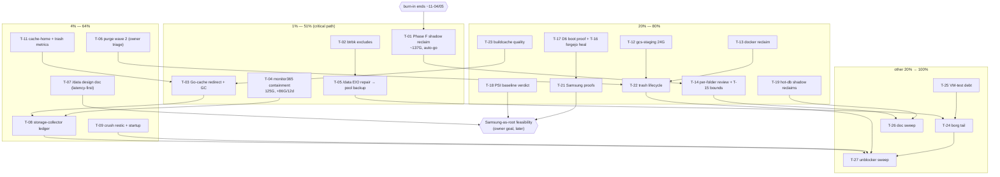

# SUPERB Storage Pareto Plan — QLC capacity, backup integrity, cache discipline

**Created:** 2026-11-03 20:49 CET (authoring finished 21:0x) · **HEAD at start:** `935bd2405` → authored against the post-session tree · **Status:** PLAN — `scripts/plan-marker.sh <this-file> start` marker owed before ANY execution session
**Relationship to SUPERB v3** (`docs/planning/2026-11-03_17-10_SUPERB-backlog-masterplan-v3.md`, EXECUTING since 17:33): v3 schedules all 2,092 rows repo-wide with mechanical buckets, authored BEFORE this session. This plan is the **storage-domain deep layer on top**: it re-ranks storage work with the 2026-11-03 evening evidence (owner Q&A decisions, purge wave findings, the `/var/lib` reveal) and **owns the storage execution order**; v3 remains the repo-wide index. Where v3's storage sprints conflict with this plan's sequencing, this plan wins for storage rows; nothing in v3 is edited ( Verschlimmbessern guard — purely additive).

## 0. Why this plan exists (context, evidence-backed)

Three same-day events reshaped storage priorities:

1. **The full QLC-vs-Samsung audit** (docs/status/2026-11-03_19-02_qlc-vs-samsung-storage-audit.md): QLC root 83% (580G/723G) with a frozen ~137G projects shadow pending Phase F; `~/.cache` had regrown to 119G in 6 days (+126G/6d root growth, zero alerting); `/data` pool backup dead-by-design behind the EIO gate since 2026-08-20.
2. **The owner decision Q&A** (docs/status/2026-11-03_20-44_storage-decisions-purge-qa.md): 15 decisions in 3 batches — reclaims approved (purge wave 1 executed: 4.2G freed after the important-data spot-check found Kernovia DBs and spared them), btrbk excludes ordered (NEVER pool-backup re-downloadable AI models), ClickHouse relocation RETIRED (stays on QLC), `/data` full design doc with latency-first constraint, Phase F auto-go, Go caches → buildcache, storage-collector extension, SSD-merge gated on benches, crush/ = important data + hourly/3h restic backup + dedicated session, Samsung-as-root long-term goal (preservation declined).
3. **The `/var/lib` reveal** (owner root-du, 2026-11-03 20:5x): **145G**, of which **monitor365-server = 125G, grown ~+86G in 12 days** — the largest hidden QLC-root consumer (agent-side du is permission-blind, read 3.9G), and the same service as v3's 1%-class wedge row (services:589: SQLite pool wedge + shutdown hang). The corrected root ledger: home-lars ~213G (cache ~115G + rest ~94G) + `/var/lib` 145G + frozen shadow ~137G + `/var`-rest/system ~40G + snapshot deltas ≈ the 580G used.

**The system-critical through-line:** the QLC root is 83% full with THREE independent 100G+ pressure sources (monitor365 growth, cache regrowth class, shadow pinning) and the `/data` pool backup is still gated. Everything in the 1% tier attacks exactly those four risks.

## 1. Pareto breakdown

### The 1% that deliver 51% — five moves that collapse the whole risk class

| # | Move | Why 1% |
|---|------|--------|
| P1 | **Phase F shadow reclaim** (~137G, owner pre-approved, burn-in ends ~11-04/05) | Single largest instant reclaim; ends the cutover saga; root 83%→~64% |
| P2 | **btrbk excludes** (/data/ai + SteamLibrary + gcs-staging never to pool) | Owner-ordered doctrine change; shrinks the T09 re-send from ~650G to ~24G; kills the pool-bloat class |
| P3 | **Go-cache redirect + GC** (ALL Go caches → buildcache; per-project dir writer identified) | Stops the +126G/6d regrowth class at the source; the only fix that prevents recurrence |
| P4 | **monitor365-server containment** (125G, +86G/12d) | The largest ACTIVE grower on the 83%-full root; rides v3's 1% wedge row — one session fixes capacity + reliability |
| P5 | **/data EIO repair chain** (gate-b scrub → T06a sign-off → delete 10 re-downloadable files → T09) | Unblocks the ONLY pool backup of /data; with P2 the re-send is trivial-sized; closes a 3-month-old P0 |

### The 4% that deliver 64% (P1–P5 plus)

| # | Move | Incremental value |
|---|------|-------------------|
| P6 | Purge wave 2 + trash lifecycle (4 mixed cache dirs after owner triage, `.Trash-1000` ×2, home Trash 55G + prune timer) | ~70G+ candidate reclaim; closes the trash-doctrine gap permanently |
| P7 | storage-collector ledger capability (PSI-gated, per-child budgets) | Makes every future audit a one-command artifact; kills the blind-spot class (du -x automount, /var/lib invisibility) |
| P8 | @cache-home + Trash metrics + alert tiers | The unalerted 119G-class surface becomes visible; early-warning for P3/P4 regressions |
| P9 | /data design doc (latency-first) | Owner-ordered; decides FS/layout/naming with migration cost before any change |
| P10 | crush/ restic incremental (1-3h) + startup mechanism session | Owner-declared important data gets an RPO for the first time |

### The 20% that deliver 80% (P1–P10 plus)

P11 gcs-staging purge (24G) · P12 docker inventory + reclaim (~10G, owner root ladder) · P13 D6 boot proof + btrbk-projects ladder verify (cutover closure) · P14 QLC PSI baseline close-out (the owner's crash-hypothesis test) · P15 buildcache quality batch (ec-hub 54G refill, gc watermark split, parity guard) · P16 hot-db shadow soak-end reclaims (~5G QLC) · P17 btrbk-forgejo stray heal (backup hygiene) · P18 root per-folder review wave (.local 34G / .config 15G / go 13G / .gotmp 6.4G / inboxclean 14G follow-up) · P19 journald + dnsblockd bounds (7.8G journal; 8.5G dnsblockd growth) · P20 Samsung health proofs (SMART owner check, boot-mirror VM leg, re-bench parity).

### The other 20% to reach 100% (the long tail — batched, mostly gated/small)

Offsite-Borg readiness tail (VM rehearsal, append-only, RSH asserts, fixture pins — rows storage:96-106) · hot-db/VM-test debt (rebuild hot-db + crush-hot-db tests green, shadow-split guard module, discordsync drill automation — rows 67/90/115/117) · doc-hygiene sweeps (stale-ref sweep, runbook figure inventory, root-window restatement grep-gate — rows 108/109/137) · trash/bak one-shots (@cache-home.regular-dir-bak runbook, Trash-in-@ pin measurement — rows 140/144) · snapshot-retention decisions (snapshot_preserve widening, transaction_log, second root window — rows 25/31/80) · misc M-class fixtures and parity guards (rows 35/85/92/96-103/135-136/143/148-155/179-181/188-189/197/199/201/203/207) · 60+ gated/watch/decision rows ride their named unblockers (owner/sudo/deploy/push/time).

## 2. Comprehensive plan — 27 medium tasks (30–100 min each), sorted by importance → impact → effort → customer-value

Customer-value axis = owner uptime + data safety + capacity headroom (the crash-history box: capacity exhaustion IS the freeze class).

| ID | Task (30–100 min) | Tier | Impact | Effort | Value | Prereq | Source rows |
|----|-------------------|------|--------|--------|-------|--------|-------------|
| T-01 | Execute Phase F: final parity check → umount QLC shadow → delete → df + pin-window proof | 1% | Critical | M | 137G, ends saga | burn-in end (~11-04/05), auto-go pre-approved | storage:221, planning 10-28 plan |
| T-02 | btrbk excludes: snapshots.nix edit + dry-run verify leg + eval + deploy + post-send proof | 1% | Critical | M | pool -600G/send class | — | storage:219 |
| T-03 | Go-cache writer identification → redirect (env+symlinks) → GC leg in buildcache-gc → verify zero regrowth 48h | 1% | Critical | M–L | stops +126G/6d class | SSD-capacity call (T-10 or strict GC) | storage:215, home.nix rows |
| T-04 | monitor365-server session: growth diagnosis (what retains 125G) + owner decision + implement (hot-tier / retention cap / pool-direct) | 1% | Critical | M–L | largest grower + wedge fix | owner decision inside | storage (new row), services:589 |
| T-05 | /data EIO repair: gate-b scrub delta → T06a sign-off → delete 10 files → T09 first send (with T-02 excludes) → marker | 1% | Critical | L | unblocks /data pool backup | calm window, owner T06a, T-02 first | storage:26, 100, 207 |
| T-06 | Purge wave 2: owner triage of 4 mixed dirs → delete/archive → `.cache/.Trash-1000` 4.8G purge (chmod u+w dance) | 4% | High | S–M | ~70G candidate | owner triage verdicts | storage:215 UPDATE |
| T-07 | /data design doc: FS candidates (btrfs keep vs XFS vs bcachefs), layout, mount name, migration cost — latency-first | 4% | High | L | owner-ordered architecture | — | storage:217 |
| T-08 | storage-collector ledger: PSI-gated per-child du budgets → textfile metrics (absorbs prereq rows dirSizes + spawn_blocking) | 4% | High | L | continuous ledger, kills blind-spot class | upstream push row (dirSizes) | storage:214, 222, TODO 1627/1630 |
| T-09 | crush/ session: restic 1–3h incremental job + startup mechanism (index/archive window decision) + VACUUM dedup note | 4% | High | L | RPO for owner-declared important data | — | storage:169 UPDATE |
| T-10 | SSD-merge bench campaign: bench-disk both SanDisks + rationale doc → owner merge/split verdict | 4% | Medium | M | enables T-03 full redirect | — | storage:220, 62-63 |
| T-11 | Metrics: @cache-home usage + trash_size_bytes collectors + Gatus tiers (+ pre-deploy warning leg) | 4% | High | S–M | visibility on both regrowth classes | — | storage:141, session §f.12 |
| T-12 | gcs-staging purge: merge-landed confirm → trash → pin-window note stamped | 20% | Medium | S | 24G | owner confirm (paperless) | storage:176 |
| T-13 | docker reclaim: owner root ladder (du → tar volumes → trash) → Twenty-DB verdict → close row | 20% | Medium | S | ~10G + closes 2-month residue | owner root run | storage:182, services row |
| T-14 | Root per-folder review wave: .local 34G / .config 15G / go 13G / .gotmp 6.4G + inboxclean 14G /var follow-up | 20% | High | M | next ledger depth + reclaim finds | — | storage:218, new |
| T-15 | journald retention verify + tighten (7.8G Samsung journal) + dnsblockd 8.5G growth bound | 20% | Medium | S | bounded churn surfaces | — | storage:216, services row |
| T-16 | btrbk-forgejo stray receive heal (btrbk clean per runbook) + pool-clean green verify | 20% | Medium | S | backup hygiene | — | storage:211 |
| T-17 | D6 boot proof: pre-reboot-check + owner-present reboot + writer-units green ≤2min | 20% | High | M | cutover closure, boot-path proof | owner reboot window | storage:210 |
| T-18 | QLC PSI baseline close-out: post-cutover series read → verdict on the crash hypothesis → stamp watch rows | 20% | High | S–M | validates the biggest architectural bet | few more boots of data | storage:208, 76 |
| T-19 | Hot-db shadow soak-end reclaims (dnsblockd 4.82G + gatus/browser-history/pocket-id) + landmine live-cycle confirms | 20% | Medium | M | ~5G QLC + doctrine closure | soak windows elapsed | storage:160-165 |
| T-20 | du-sb machine-readable baseline artifact + MB-grain re-verify + watch self-gate tightening | 20% | Medium | S | falsifiable watch verdicts | — | storage:149-153, TODO 46/47 |
| T-21 | Samsung health proofs: owner SMART + boot-mirror path-trigger VM leg + quiet-window re-bench parity | 20% | Medium | M | boot-drive assurance | owner SMART run | storage:33, 166, 168 |
| T-22 | Trash lifecycle: weekly trash-empty 30d timer + doctrine decision + owner runbook batch (55G home trash + subvol-bak delete) | 20% | Medium | M | closes the no-prune-loop gap forever | owner sudo batch | storage:123-126, 140, 146 |
| T-23 | Buildcache quality: ec-hub 54G refill attribution + golangci-lint-analysis recreator + probe dirs + parity guard + rust-cache watermark split | 20% | High | M | prevents the 100%-wedge class | — | storage:81-85, 135-136, 139, 174 |
| T-24 | Offsite-Borg readiness tail: VM rehearsal + append-only posture + RSH assert + §16 enable-blind fix + fixture pins | tail | Medium | M | 3-2-1 completion path | EIO (T-05) + owner go-live inputs | storage:96-106, 56 |
| T-25 | Hot-db/VM-test debt: rebuild hot-db + crush-hot-db VM tests green + shadow-split guard module + discordsync restore-drill automation + dbBackup VM coverage | tail | Medium | M–L | regression safety net | quiet-IO window | storage:67, 90, 91, 115, 117 |
| T-26 | Long-tail doc/fixture sweep: stale-ref sweep + runbook figure inventory + restatement grep-gate + pin-map second layer + hermes restore drill + btrbk one-shot observation | tail | Low | M | hygiene, audit-proofing | — | storage:24, 108-109, 179, 199, 201 |
| T-27 | Gated-row unblocker sweep: batch owner prompts (SMART, root ladders, T06a, decisions), push-gated rows (CV, crush-daily, dirSizes), deploy-gated verifies — one consolidated owner-prompt artifact | tail | Medium | M | converts 60+ parked rows into progress | owner attention | all GATED rows |

## 3. Fine breakdown — every task as ≤12-min steps (premise-check → do → verify → record)

Gated/watch rows carry no steps (unblocker lane, §5). Steps sorted within their medium task; medium tasks keep §2 order.

**T-01 Phase F (P1)**
1. Premise: burn-in clock + CHANGELOG 10-28 entry still the contract; grep plan Phase F section. 2. `scripts/plan-marker.sh <10-28 plan> start` + this plan marked EXECUTING. 3. Parity spot-check: `du -s` shadow vs Samsung projects + `git -C` HEADs identical. 4. Capture pre-df (`df -B1 /dev/nvme1n1p6`). 5. Owner-confirmed umount shadow fstab edit (or manual umount per runbook). 6. Verify `/home/lars/projects` still resolves Samsung UUID (findmnt). 7. Delete shadow tree (sudo ladder, owner window). 8. Post-df + journal `deleted` line; stamp 3d pin expectation. 9. Deploy the fstab removal (eval first). 10. Record: storage.md row tick + CHANGELOG + report cite.

**T-02 btrbk excludes (P2)**
1. Premise: btrbk-data instance location in snapshots.nix (grep `subvolume."data"`). 2. Draft excludes block (/data/ai, /data/SteamLibrary, /data/gcs-staging). 3. `btrbk -t dryrun` shape check (owner or dry-run mode). 4. Eval: `nix eval .#nixosConfigurations.evo-x2.config.system.build.toplevel.drvPath`. 5. Negative-test candidate: exclude-rot guard (assert excludes present in rendered config). 6. Deploy + §11 quiescence discipline. 7. Post: btrbk dry-run journal shows excluded paths skipped. 8. Record row tick + verify-leg note (sends that would carry models now skip).

**T-03 Go-cache redirect (P3)**
1. Premise: inventory the 4 surviving cache dirs' writers (mtime correlation + session logs). 2. Identify tool (tq pool? session env? GOCACHE per-project overrides). 3. Decide target layout on buildcache (or Samsung pending T-10). 4. Implement redirect (home.nix env + symlinks, HM activation reap pattern). 5. Add GC leg (buildcache-gc covers new dirs; watermark logic). 6. Eval + deploy. 7. 48h watch: `du` deltas zero on QLC (metric from T-11 if landed). 8. Record + stamp regrowth row DONE.

**T-04 monitor365 containment (P4)**
1. Premise: services:589 row + monitor365 docs; growth shape (files vs DB size? `ls -la` via owner if needed). 2. Query DuckDB retention config (docs/services/monitor365.md). 3. Options memo: hot-tier vs retention cap vs pool-direct (sizes + IO impact). 4. Owner decision (single_choice batch). 5. Implement chosen path (config edit or migrate script + fstab). 6. Deploy + verify writes land on new target. 7. Metric: growth watch on the new target. 8. Record: storage row + services:589 cross-stamp.

**T-05 EIO repair (P5)**
1. Premise: P0 row + `/data/.repair-done` absent + T-02 landed. 2. Calm-window check (PSI + guard-trip). 3. Owner: scrub /data + before/after csum delta (bounded-static proof). 4. T06a: per-file sign-off list (10 paths, all re-downloadable). 5. Owner/agent: trash the 10 files (lars-owned). 6. Nightly snapshot clean verify. 7. Remove/flip repair gate → first send fires. 8. Verify pool receive + `.last_success` + backup_all_healthy. 9. Record: marker file + rows + watch (memory.peak ≤4G).

**T-06 Purge wave 2** — 1. Owner verdicts captured (delete/archive/keep ×4). 2. Archive step for any "archive" (tar → /mnt/pool/archive). 3. Delete approved dirs (rm, cache doctrine). 4. `.cache/.Trash-1000`: chmod -R u+w → trash-rm → verify count. 5. df delta + 3d pin note. 6. Record.
**T-07 /data design doc** — 1. Read archived samsung-role plan + bench-nix-fs research. 2. Candidate matrix (btrfs/zstd keep, XFS, bcachefs; latency-first). 3. Layout proposal (ai/ split, versioned model dirs, staging separation). 4. Naming proposal (mount name options). 5. Migration-cost section (downtime, btrbk impact, Steam/ai moves). 6. Owner ratification session. 7. Record decision rows.
**T-08 storage-collector ledger** — 1. Read collector repo current state + prereq rows. 2. Design: per-child budgets + PSI gate + timeout contract. 3. Implement spawn_blocking fix (upstream). 4. Implement dirSizes capability wiring (deploy row). 5. Add ledger target set (root children, /data, /mnt/hot, /var/lib). 6. Deploy + textfile verify. 7. Gatus/alert wiring. 8. Record + absorb ledger-tooling row.
**T-09 crush session** — 1. Read crush-hot-db rows + crush-daily data flow. 2. restic job design (paths, schedule 1-3h, retention). 3. Implement unit + timer + hardening. 4. VACUUM/defrag interplay note (dedup cost). 5. Startup mechanism options (archive window vs index vs scan-off-boot) → owner pick. 6. Implement mechanism. 7. Deploy + first backup verify + startup timing proof. 8. Record.
**T-10 SSD benches** — 1. Premise: bench-disk.sh + fio fallback fix (row 167). 2. Bench SanDisk 1 standalone. 3. Bench SanDisk 2 standalone. 4. Merge simulation (btrfs single on loop/spare?) or rationale-only. 5. Comparative doc + failure-domain tradeoff. 6. Owner verdict prompt. 7. Record.
**T-11 Metrics** — 1. Premise: collector patterns (buildcache-metrics). 2. Implement @cache-home usage gauge (idle, timeout). 3. trash_size_bytes gauge (both Trashes + home Trash). 4. Gatus tiers (cachehome >90G, trash >10G). 5. Pre-deploy warning leg. 6. Deploy + metric presence verify. 7. Record.
**T-12 gcs-staging** — 1. Owner merge-landed confirm. 2. Trash tree. 3. Pin note (4-5w) stamp. 4. Row tick.
**T-13 docker** — 1. Owner du + volume tar ladder (row 182). 2. Twenty-DB verdict. 3. Trash or archive volumes. 4. Row tick.
**T-14 per-folder review** — 1. `.local` md2 walk (Trash share, share/caches). 2. `.config` md2. 3. `go` md2 (pkg vs bin vs src). 4. `.gotmp` writer check (env grep). 5. inboxclean /var/lib 14G shape (owner du or logs). 6. Findings → reclaim rows + purge batch. 7. Record.
**T-15 journald + dnsblockd** — 1. journald config grep (SystemMaxUse). 2. Reconcile 7.8G; propose bound. 3. dnsblockd DB query-log retention check (docs/services). 4. Bound or alert. 5. Record ×2.
**T-16 forgejo heal** — 1. `btrbk clean /mnt/pool/backups/forgejo-subvol` (per runbook). 2. Nightly green verify. 3. Row tick.
**T-17 D6 boot proof** — 1. pre-reboot-check run. 2. Owner reboot window. 3. Post-boot: projects mounts + writers green ≤2min. 4. Row tick.
**T-18 PSI baseline** — 1. Pull post-10-28 PSI series (SigNoz). 2. Compare pre-cutover baseline. 3. Verdict memo (hypothesis test). 4. Stamp watch rows + feed Samsung-as-root feasibility.
**T-19 shadow reclaims** — 1. Soak windows confirmed elapsed. 2. Owner call per shadow. 3. Remove contents (keep dirs). 4. Landmine live-cycle confirms (journal greps). 5. df + record.
**T-20 baseline artifact** — 1. Write baseline file (du -sb snapshot). 2. Compare one-liner script. 3. MB-grain re-verify run. 4. Self-gate clause amendment. 5. Rows tick.
**T-21 Samsung proofs** — 1. Owner SMART output captured. 2. VM-test authoring (boot-mirror path trigger). 3. VM run green. 4. Re-bench window + parity doc. 5. Record.
**T-22 trash lifecycle** — 1. Doctrine decision prompt (owner). 2. Timer (weekly trash-empty 30d) + deploy. 3. Owner runbook artifact (55G + subvol-bak + e2fsck ladder batched). 4. Owner executes; realized-reclaim measurement row closes. 5. Record.
**T-23 buildcache quality** — 1. ec-hub 54G writer attribution (probe + correlation). 2. golangci-lint-analysis recreator hunt. 3. Probe dirs disposition. 4. Parity guard impl. 5. rust-cache watermark split. 6. Fallback-regrowth triage re-run. 7. Records.
**T-24 borg tail** — 1. VM rehearsal authoring + run. 2. Append-only decision. 3. RSH assert. 4. §16 enable-blind fix. 5. Fixture pins. 6. Records.
**T-25 VM-test debt** — 1. hot-db test repair. 2. crush-hot-db test repair. 3. Shadow-split guard module. 4. discordsync drill automation. 5. dbBackup VM coverage. 6. Records.
**T-26 doc sweep** — 1. Stale-ref sweep (frozen-spare refs). 2. Runbook figure inventory. 3. Restatement grep-gate. 4. Pin-map second layer. 5. Hermes drill + btrbk observation. 6. Records.
**T-27 unblocker sweep** — 1. Gated-row census grouped by unblocker type. 2. Owner-prompt artifact (single doc, copy-paste commands). 3. Push-gated rows list for the push window. 4. Deploy-gated verify checklist. 5. Record.

## 4. Execution graph (mermaid)

## 5. Guardrails (the Verschlimmbessern guard)

1. **Purely additive**: this plan edits NO TODO/library file structure; rows live in `docs/todo/*` per the TODO system; this file is the storage-domain index and sequence.
2. **Every step 1 is a premise-check** — the ollama lesson (2026-11-03): live-verify the claimed state before touching it.
3. **Destructive ops** (T-01 delete, T-05 delete, T-06/T-12/T-13 purges) carry owner gates or pre-approvals recorded in this session's reports; spot-checks precede deletes (the Kernovia lesson).
4. **No new IO storms**: all walks idle-priority + PSI-gated; no walks during active storms (§d1); root-side jobs ride owner windows.
5. **Plan-marker discipline**: `scripts/plan-marker.sh` start/done around any execution instance; twin-executor guard.
6. **Multi-agent**: PATHSPEC commits; content-pin before writes; daemon-swept commits get `git show --stat` review before any amend.
7. **Gated rows are NOT executed** — T-27 batches their unblockers; agents never sudo/push/deploy around gates.

## 6. Errata + audit notes (authoring-time verification)

- `/data/ai/models/ollama` — ABSENT at 2026-11-03 probe (docs claimed pending-reclaim); stamped reclaimed-out-of-session.
- ClickHouse relocation rows — RETIRED by owner directive this session (stays on QLC); v3's storage sprint referencing it is superseded by this plan.
- `~/projects` — lives on the Samsung subvol since 2026-10-28 (storage.md pinning row corrected this session); v2-era claims of projects-in-`@` are stale everywhere they appear.
- `/data/tmp-bench` + `/data/cache` — rows already `[x]` (verified empty/regenerable); zz-test fixtures live in `.rescue/` (chattr-protected), deletion needs the designed cycle.
- `negative-test-lints.PR7oGL` (6.4G) — vanished mid-session 2026-11-03, unattributed; treat any claim about it as unverified.
- The `/var/lib` figures are owner-run (root); agent-side re-verification impossible — treat as point-in-time 20:5x truth.
- Effort buckets follow v3's step model (1 step ≤12 min; M=1, H1=3, H2=8, H4=20, D=48 steps); sprints here are sized 30–100 min per the authoring instruction (3–8 steps each).
