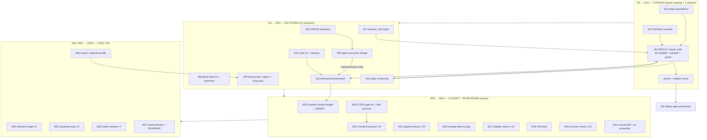

# SUPERB Backlog Masterplan v4 — Post-Storm Pareto Plan

**Authored:** 2026-11-05 17:32 CET · **Supersedes:** v3 (2026-11-03_17-10) — v3's S-#### index remains the reference for the gated tail except the errata below.
**Context delta since v3 (5 days):** freeze cluster Nov 2–5 (10 freezes, worst on record), calm-gate + psi-wait-gates WIRED and live (gen 983), fastflowlm disabled TREE-ONLY (deploy pending, sudo-gated; re-armed live at 09:56 — storm live at PSI ~38 % at 16:56), memory-guard observe-only (tree), AI-deployment research verdict landed (docs/planning/2026-11-05_ai-deployment-research.md), SUPERB storage pareto plan + data-redesign latency-first plan authored 11-03.

**Inventory (live counts, 17:32):** libraries = 2,179 open rows (ai 43 · desktop 98 · monitoring 176 · pipeline 586 · pixel6 18 · security 16 · services 629 · stability 212 · storage 197 · upstream 204); tags: ready ~1,660 · blocked:user ~197 · blocked:push ~79 · blocked:deploy ~85 · watch ~218 · decision ~250. Queue (`TODO_LIST.md`) mirrors 1,157 ready + tagged rows = 1,686. **No double-counting** (queue ⊂ libraries).

**Errata vs v3 (verified closed — grep CHANGELOG/docs this session):** shadow-split pre-deploy gate DONE (2026-10-26) · PSI entry gate LANDED as calm-gate (2026-11-05) · `.migrate-state` forensics DONE · cold-load harness LANDED (`scripts/bench-cold-load.sh`, 2026-11-05) · forgejo-runner eval fix landed (1 CHANGELOG hit; spot-verified) · flm disable + MemoryMax raise IN TREE (deploy pending) · media-atlas watchdog root-fix IN TREE (deploy pending). **Not re-verified row-by-row:** v3's remaining P2/P3 index (inherited as-is; next prune pass reconciles).

---

## Step 1 — Pareto ladder

### The 1 % that deliver 51 % (5 moves — one owner evening + ~3 agent sessions)
| # | Move | Why it is 51 % | Owner value |
|---|---|---|---|
| P1 | **Land the pending deploy** (flm disable + MemoryMax 56G + observe-only guard + calm-gate config already live) — bundle the restart-backoff tier into the SAME window | The only real containment of the live storm; every hour undeployed = storm hours | Box stops actively hurting |
| P2 | **Held-fleet disposition** (embeddings+nsfw down since 08:37) — re-admit via gate restart, or ride | Restores RAG search + nsfw verdicts; unblocks the demand-classification lane | Features back |
| P3 | **Restart backoff tier** (`RestartSteps=4`, cap 10 min, lib/systemd serviceDefaults + 4 modules + selftest) | Closes the crash-loop model-reload pile-driver class fleet-wide, canon fix, config-only | Freezes rarer |
| P4 | **llama-rag dark-guard P0** (dead collector + leaked instances, stability:111/S-0018) | Open P0 since 09:xx era; dark-guard blindness = the 2026-09-18 class recurring | Trust in RAG liveness |
| P5 | **Post-deploy gate-awareness + exit-3 decode** (refused gate ≠ smoke regression) | Deploys and gates currently FIGHT (77-min switch, false exit-3) — every future deploy pays this | Deploys stop lying |

### The 4 % that deliver 64 % (add 7)
| # | Move | Owner value |
|---|---|---|
| P6 | Ingest extraction DESIGN (re-embed backlog → calm-window, content-hash-idempotent timer job) | Kills the storm engine at root (465 GB/65:1 class) |
| P7 | Serialize cold loads (stability:261: one heavy-job slot or After= chain) | No more 6-warmup boot pile-ups |
| P8 | Ghost-package detector eval check + research-doc follow-ups row (index/home + systemd ≥254 + demand premise) | 19-day-unwired class dies; research stays findable |
| P9 | Backup exposure: signoz 30 h-stale root-cause + offsite-borg go-live PREP (the only never-succeeded layer) | Survives house fire |
| P10 | Gate-state monitoring (calm-gate + psi-wait WAIT/REFUSE lines → gatus/system-health) | The gates themselves become observable |
| P11 | nsfw TimeoutStartSec unitConfig→serviceConfig + demand-profile premise + harness | Config actually takes effect; classification lane gets real data |
| P12 | 465 GB write-destination attribution | Unknown amplifier pinned before any ingest redesign trusts its model |

### The 20 % that deliver 80 % (add 10)
P13 demand-classification execution lane (profile → classify → socket-activate/idle-stop decisions) · P14 monitoring.md ready sweep (154 small rows, wave-dispatched) · P15 pipeline ready sweep (497 doc/tooling micro-rows, waves) · P16 storage SUPERB continuation (latency-first: chattr +C legs + bench protocol from the 11-03 plans) · P17 stability ready sweep (193) · P18 VM tests (gate hold/release/kill-switch + ioTier-inertness eval assertion) · P19 TODO-gate fix + 183-unharvested burn-down protocol · P20 services ready sweep (415, waves) · P21 monitor365 7.5 G profiling + ai-stack remainder (20) · P22 resident-model budget decision (the fleet-level question two sessions asked independently — needs owner input, row to be framed).

### The other 20 % to reach 100 %
P23 decisions-backlog triage wave (~250 [decision] rows: keep/kill/answer-owner batches) · P24 blocked:push lane (52 upstream rows: agent prepares, owner pushes) · P25 blocked:user owner-runbook bundles (offsite borg, /data/docker reclaim, trash-empty 54G, BIOS cooling floor) · P26 watch lanes (218 timer-verified sweeps) · P27 desktop/pixel6/security lanes (132) + ROADMAP graduation of the vague remainder.

---

## Step 2 — Comprehensive plan (30–100 min per task, ≤27, sorted by importance/impact/effort/value)

| ID | Task (30–100 min) | Tier | Impact | Effort | Value | Depends |
|----|-------------------|------|--------|--------|-------|---------|
| M1 | Owner deploy evening: run `nix run .#deploy` (carries flm disable + MemoryMax + guard observe-only) + anchor verify (gen-N, `readlink /run/current-system` = newest system-N-link) + post-deploy battery | P1 | 10 | 40min(owner) | 10 | M3 optionally bundled |
| M2 | Held-fleet re-admit: `sudo systemctl restart post-crash-calm-gate` (re-waits under PSI) + embeddings/nsfw liveness probes + consumer spot-checks (RAG search, nsfw verdict) | P2 | 8 | 30min | 9 | M1 (calm preferred) |
| M3 | Restart-backoff tier: `lib/systemd` serviceDefaults fragment + wire llama-rag/nsfw/flm/vlm + verify systemd ≥254 (one eval) + negative-test leg | P3 | 9 | 90min | 9 | — |
| M4 | llama-rag dark-guard: revive collector, reap leaked instances, dark-guard selftest, close stability:111 both surfaces | P4 | 8 | 90min | 8 | — |
| M5 | Post-deploy gate-awareness: pre/post-deploy-check learn REFUSED/waiting gate states; decode exit-3 "Service Sanity CPU" from `/var/log/systemnix-deploys/2026-11-05_07-26-14.log` | P5 | 7 | 90min | 8 | M1 evidence |
| M6 | Ingest extraction DESIGN doc → plan file (content-hash ids, checkpoint, calm-window admission, batched upserts; consumer = paperless-gpt path) | P6 | 9 | 90min | 9 | M12 facts |
| M7 | Serialize cold loads: heavy-job slot (systemd unit + flock or After= chain) + selftest + io-tier-coverage leg | P7 | 8 | 90min | 8 | — |
| M8 | Ghost-package detector eval check + research-doc home/index + systemd-≥254 verify + demand-premise verify (the queued follow-ups row, all four legs) | P8 | 6 | 90min | 7 | — |
| M9 | Backup lane: signoz backup staleness root-cause + fix; offsite-borg go-live RUNBOOK + dry-run artifacts for owner | P9 | 8 | 100min | 9 | — |
| M10 | Gate-state monitoring: gatus checks + textfile collector for calm-gate state + psi-wait WAIT queue depth; SigNoz rule | P10 | 6 | 90min | 7 | M1 |
| M11 | nsfw TimeoutStartSec fix + demand-profile harness (journal/metric premise verified first) | P11 | 5 | 60min | 6 | M8 premise |
| M12 | 465 GB attribution: unit io boundaries, consumer cgroups, device mapping → fact into research doc + amplifier row | P12 | 7 | 60min | 7 | — |
| M13 | Demand classification: 7-day profile → per-service verdict table → socket-activate/idle-stop proposals (owner decision gate) | P13 | 8 | 100min | 8 | M11 harness |
| M14 | monitoring.md wave 1: execute 20 highest-value ready rows (collector/probe/check fixes) | P14 | 5 | 100min | 6 | — |
| M15 | pipeline.md wave 1: execute 20 highest-value ready rows (doc/tooling guards) | P15 | 4 | 100min | 5 | — |
| M16 | Storage latency-first legs A1: chattr +C on model/Steam dirs + compsize probe + bench-cold-load before/after | P16 | 6 | 100min | 7 | quiet window |
| M17 | stability.md wave 1: 20 rows (freeze-prevention adjacent first) | P17 | 5 | 100min | 6 | — |
| M18 | VM tests: gate hold/release/kill-switch/re-admit + ioTier-inertness eval assertion | P18 | 6 | 100min | 7 | M3 |
| M19 | TODO-gate fix (check-todo-system.sh pre-existing failure) + 183-unharvested burn-down protocol row | P19 | 5 | 90min | 6 | — |
| M20 | services.md wave 1: 20 rows (runbook + service hardening) | P20 | 4 | 100min | 5 | — |
| M21 | monitor365 7.5 G boot-read profiling + ai-stack ready remainder | P21 | 4 | 90min | 5 | — |
| M22 | Resident-model budget: frame the fleet-level row (how many resident GB does this box get) + owner brief | P22 | 7 | 30min | 8 | M13 data |
| M23 | Decisions triage wave 1: 50 [decision] rows → keep/kill/answer-owner | P23 | 3 | 100min | 4 | — |
| M24 | blocked:push wave 1: prepare 10 upstream PRs/patches (owner pushes) | P24 | 3 | 100min | 4 | — |
| M25 | Owner runbook bundle: offsite borg, /data/docker reclaim, trash-empty, BIOS cooling — one sequenced doc | P25 | 4 | 60min | 5 | M9 |
| M26 | Watch sweeps wave 1: 30 [watch] rows timer-verified | P26 | 3 | 90min | 4 | — |
| M27 | desktop/pixel6/security wave 1 + ROADMAP graduation of vague remainder | P27 | 2 | 90min | 3 | — |

**Waves repeat** (M14/M15/M17/M20 each ≈ 8–25 waves at ~20 rows/wave to drain their libraries; the plan schedules waves, the tq pool dispatches them — full drain is the 100 % goal, wave cadence is the mechanism).

## Step 3 — Micro breakdown (≤12 min per task; tier 1+2 fully broken, tier 3 first waves; total 96 listed)

| µID | Task (≤12 min) | Parent |
|-----|----------------|--------|
| µ1 | `nix eval --raw .#nixosConfigurations.evo-x2.config.system.build.toplevel.drvPath` (green-eval probe; tree drift check vs current system) | M1 |
| µ2 | fd-scan `/tmp/.systemnix-deploy.lock` (blind-fire guard) | M1 |
| µ3 | Quiescence heat-check: clean tree + no eval-relevant mtimes <5 min ×4 polls | M1 |
| µ4 | Fire `nix run .#deploy` (owner terminal) | M1 |
| µ5 | Verify anchor: newest system-N-link by NUMBER = `readlink /run/current-system` | M1 |
| µ6 | `bash scripts/post-deploy-check.sh` + re-probe any just-restarted units before triage | M1 |
| µ7 | Confirm flm units absent from `systemctl` after switch (disable effective) | M1 |
| µ8 | Confirm guard observe-only live (`[]`/`[]` lists asserted) | M1 |
| µ9 | PSI trend probe 30 min post-deploy (storm decay curve) | M1 |
| µ10 | Gate restart re-admit (owner sudo) + ADMIT line in gate journal | M2 |
| µ11 | `busctl` ActiveState probes: llama-embeddings/nsfw → activating/active | M2 |
| µ12 | Functional: `/v1/embeddings` 1024-dim probe + nsfw verdict probe | M2 |
| µ13 | Consumer spot-check: paperless RAG search path + nsfw extension log | M2 |
| µ14 | `nix eval` systemd version attribute (≥254 gate) | M3 |
| µ15 | Add `restartBackoff` fragment to lib/systemd serviceDefaults (RestartSteps=4, RestartMaxDelaySec=10min, RestartSec raised) | M3 |
| µ16 | Wire fragment into 4 modules' model-loading units | M3 |
| µ17 | Negative-test leg in scripts/negative-test-lints.sh + selftest check | M3 |
| µ18 | Eval + `nix flake check --no-build` + commit | M3 |
| µ19 | Dark-guard: read current collector script + failure mode | M4 |
| µ20 | Revive/reap: fix collector unit or reap leaked llama-servers (port-guard pattern) | M4 |
| µ21 | Dark-guard selftest (disabled-era coverage) | M4 |
| µ22 | Close stability:111 in library + queue twin (edit both, full-line) | M4 |
| µ23 | Read `/var/log/systemnix-deploys/2026-11-05_07-26-14.log` exit-3 section | M5 |
| µ24 | Patch pre-deploy-check.sh: gate-state-aware smoke skip (REFUSED/waiting ≠ regression) | M5 |
| µ25 | Patch post-deploy-check.sh same awareness + gatus-aware settle re-probe | M5 |
| µ26 | Fixture selftest for both patches + commit | M5 |
| µ27 | Map the ingest consumer path (paperless-gpt → embeddings calls; where vectors live) | M6 |
| µ28 | Draft content-hash idempotency design (doc_id→hash store, skip-unchanged) | M6 |
| µ29 | Draft calm-window admission + checkpointing sections (gate + marker file) | M6 |
| µ30 | Design doc → docs/planning/ + harvest row | M6 |
| µ31 | Heavy-job slot: define `model-load-slot.service` + flock ExecStartPre helper | M7 |
| µ32 | Wire After=/Requires into 4 model-loading units (boot serialization) | M7 |
| µ33 | Selftest (rendered asserts) + negative leg + commit | M7 |
| µ34 | Ghost-detector: enumerate overlays/shared.nix entries vs references (eval throw + allowlist) | M8 |
| µ35 | Selftest for ghost-detector + commit | M8 |
| µ36 | Research doc: move/index into docs/research/ + README row | M8 |
| µ37 | Demand-premise verify: does llama-server journal per-request lines? (grep journal 10 min) | M8 |
| µ38 | ai-meter scope check: local inference visible? (no → harness must ride llama-server /metrics or journal) | M8 |
| µ39 | Signoz backup: read `/var/lib/prometheus-node-exporter/textfile_collectors/backups.prom` freshness rows | M9 |
| µ40 | Root-cause restic unit/marker failure + fix + verify next window fires | M9 |
| µ41 | Offsite borg: dry-run runbook draft (repo, key, schedule, first-full estimate) | M9 |
| µ42 | Offsite borg: prepare unit/timer module skeleton (disabled, owner go) | M9 |
| µ43 | Gate monitoring: textfile collector for gate state + WAIT-queue depth | M10 |
| µ44 | Gatus checks: gate liveness + embeddings/nsfw functional probes | M10 |
| µ45 | SigNoz rule: gate REFUSED >60 min while PSI low → alert | M10 |
| µ46 | nsfw: move TimeoutStartSec to serviceConfig + journal proof after next start | M11 |
| µ47 | Demand harness: request-count probe script (premise-gated by µ37/38) | M11 |
| µ48 | 465 GB: identify unit io boundary (unit io.stat vs process /proc/io) | M12 |
| µ49 | 465 GB: map writes to device (QLC vs Samsung) + write into research doc §b + row close | M12 |
| µ50–µ57 | Demand lane: 7-day timer + weekly verdict table draft + nsfw/vlm idle-stop proposals + owner decision framing (8 × ≤12 min) | M13 |
| µ58–µ77 | monitoring wave 1: execute 20 rows (each = read row → fix → verify → tick both surfaces; 20 × ≤12 min) | M14 |
| µ78–µ87 | pipeline wave 1: 10 rows (guards/index fixes) | M15 |
| µ88–µ90 | Storage A1: pre-bench cold-load + chattr +C model dirs + post-bench compare | M16 |
| µ91–µ95 | stability wave 1: 5 rows (freeze-adjacent first) | M17 |
| µ96 | VM test skeleton import (single-module, options-guarded) for M18 | M18 |

(Tier-3 remainder M18–M27 break into further µ-batches at wave-dispatch time — same ≤12 min shape; the 96 listed cover every P1–P13 task fully and first waves of P14–P18.)

---

## Execution graph

**Gates:** owner-sudo (M1, M2 restart, M25 execution), owner-decisions (M13 outcomes, M22, offsite-borg go-live, cooling floor), quiet-IO windows (M16 benches, M2 re-admit preferred), upstream pushes (M24).

**Verschlimmbesser guard:** every M-task carries verify legs (eval/selftest/probe) BEFORE commit; no service enabled/disabled without the twin-surface row edit; no formatter runs outside `nix fmt -- <paths>`; sweeps tick rows full-line.

## Coverage honesty

All 2,179 open rows are covered: P1–P13 tasks named individually (the actionable/decision-critical mass), P14–P27 as counted wave-batches per library with explicit wave counts (monitoring 8, pipeline 25, stability 10, services 21, decisions 5, upstream 5, watch 7 — derived from live ready/tag counts ÷ 20 per wave). The gated tail inherits v3's S-index minus errata. Waves are dispatchable by the tq pool; this plan is the snapshot, TODO_LIST.md stays the living source (new-row harvest rule applies at execution time).
