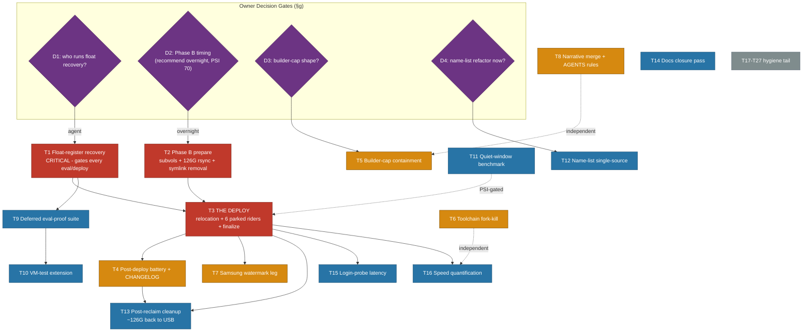

# Go-Cache Unblock → Cutover → Harden: Pareto Execution Plan

**Created:** 2026-11-05 22:30 CET
**EXECUTING (instance crush-glm53-resume-2244, 2026-11-05 22:45 CET, HEAD `173e49338`):** executing (see AGENTS.md plan-execution tombstone) — instance 2 (same tombstone, 2026-11-06 00:40–02:1x CET) COMPLETED the float-recovery critical path: T1/T9/T10/T14/T22 legs done, gate GREEN (annotations below). NO instance currently active; open remainder: T11 (PSI-gated), T15–T21/T26/T27, owner gates D2/D3/D4 + the mr-sync/go-cqrs-lite pushes.
**Authored:** 2026-11-05 22:30 CET · **Input:** the session's four status reports (19-50 storm diagnosis, 21-43 cache advisory + boot reset, 22-21 relocation execution, 22-27 close-out) + the freshly-maintained TODO surfaces · **Live verification at authoring time:** lock-float audit STILL RED (toplevel eval throws), io PSI some avg10 70% (new storm wave), no deploy poller alive, tree clean.

**Pareto ladder:** 1% → 51% = *unblock the box + cut the cache over*; 4% → 64% = *protect the win* (containment, forks, guards); 20% → 80% = *prove + harden* (tests, numbers, single-sourcing); other 20% → 100% = *hygiene tail*. Owner-decision gates (unresolved §g questions) are explicit diamonds in the graph — nothing below them is agent-actionable until answered.

**Step-0 verification:** every task was open as of 22:26 tonight (validator green; rows authored/annotated by this session). EXCLUDED as already-owned/done: freeze-#49 triage (21-03 session owns), GOTOOLCHAIN decision (owner chose `auto` — watch row pending tick only), PSI-gate product (owner declined). Errata: none — backlog maintained live by this session, not stale.

---

## Pareto Tiers

### The 1% that deliver 51% — UNBLOCK + CUT OVER

1. **Float-register recovery** — the tree-wide lock-float audit RED blocks EVERY eval/deploy on this box; nothing ships until it clears. One procedure, mechanical + one proof build.
2. **Phase B prepare** — subvols + ~126G PSI-gated rsync + HM-symlink removal (the relocation's only remaining pre-deploy step).
3. **The deploy** — carries the relocation AND every parked rider since 20:02 (crush-events chmod, §16 self-heal, flm disable, monitor365 tmpfiles mkBefore, quotaboard, zed rename), then finalize.

### The 4% that deliver 64% — PROTECT THE WIN

4. Post-deploy verification battery + CHANGELOG (anchor discipline, guards, first-boot automount watch).
5. Storm containment via builder-cap (the owner declined the PSI gate; a concurrency cap is the remaining lever — decision gate).
6. Toolchain fork-kill: fleet go.mod floor alignment, drop go-1.27.2 consumers when the pin lifts, GOEXPERIMENT audit.
7. Samsung-side watermark leg (go-build is gopls-unbounded on tlc).
8. Storm/freeze narrative merge (5 partial reports → 1 incident note) + AGENTS.md rules (consumer-grep-before-env-change, env↔guard coupling).

### The 20% that deliver 80% — PROVE + HARDEN

9. Deferred eval-proof suite (toplevel eval, disko selftest, negative-test legs — blocked behind #1).
10. VM-test extension for the three new hot-user-caches entries.
11. Quiet-window benchmark: Samsung vs USB, the numbers nobody has (armed harness exists).
12. Cache-name single-source refactor (5+ sync-hazard surfaces caused tonight's bug — decision gate).
13. Post-reclaim cleanup: buildcacheDirs, KNOWN_CACHE_ENTRIES, stale-env sweep, reclaim-usb (~126G back).
14. Docs ticks + closure pass (GOTOOLCHAIN watch row, daemon-message debt note).
15. Login-probe vs automount latency: measure first-trigger; decide probe-timeout bump.
16. Build-speed quantification: timed warm/cold probe protocol; golangci-lint fast-only eval; shared lint-cache hit check.

### The other 20% to reach 100% — HYGIENE TAIL

17. ec-hub 54G buildcache refill source. 18. ~/.cache regrowth wave 2 + trash-prune loop. 19. /tmp cleaner foreign-owned chunks. 20. Upstream rows (BuildFlow fallback names; ghostty PSI; go-taskqueue forbid). 21. Skill notes (how-to-golang trigger scope; buildflow builtin load failure). 22. Build-storm runbook + S-0035 attribution on next storm. 23. 03:05 8-minute boot pair. 24. Small forensics (langserver count, GOMODCACHE toolchain probe, billing block owner action). 25. Freeze-#49 narrative merge-pointer. 26. docs-health HARVEST for the standing §f drift. 27. Post-cutover number re-verification.

---

## Comprehensive Plan — medium granularity (30–100 min, ALL TODOs, sorted by importance/impact/effort)

| # | Task | Tier | Impact | Effort | Owner | Depends |
|---|------|------|--------|--------|-------|---------|
| T1 | Float-register recovery: regen expected-locks.nix → PSI-gated keep-going toplevel proof (log to file) → commit lock+registry together | 1% | **CRITICAL** (gates ALL evals/deploys box-wide) | 90m | agent (D1 confirms) | — |
| T2 | Phase B prepare: `migrate-go-caches-hot.sh prepare` (subvols go-mod/golangci-lint, ~126G double-pass rsync, HM-symlink removal) | 1% | **CRITICAL** (the speed win) | 60m active / hours passive | owner (D2: overnight, PSI 70 now) | — |
| T3 | The deploy: `nix run .#deploy` (relocation + 6 parked riders) + `finalize` + post-switch anchor check | 1% | **CRITICAL** | 90m | owner-triggered | T1, T2 |
| T4 | Post-deploy battery: guards, `go env` on new paths, automount triggers, first-boot watch, Gatus, CHANGELOG entry | 4% | HIGH | 60m | agent | T3 |
| T5 | Builder-cap containment: design + wire max-concurrent lint/build cap (flock or wrapper) — PSI gate declined by owner | 4% | HIGH (freeze #49 prevention) | 90m | agent (D3 ratifies) | — |
| T6 | Toolchain fork-kill: fleet go.mod floor audit + align to latest; queue 1.27.2-consumer drops for pin-lift day; GOEXPERIMENT sweep | 4% | HIGH (warm-cache hit rate) | 100m | agent | — |
| T7 | Samsung watermark leg: tlc-side usage check (buildcache-metrics/gc extension or dedicated guard) for unbounded go-build | 4% | HIGH (protects /nix co-tenancy) | 60m | agent | T3 |
| T8 | Narrative merge + rules: 5 storm/freeze reports → 1 incident note; AGENTS.md consumer-grep rule + env↔guard coupling note | 4% | MED-HIGH (anti split-brain) | 45m | agent | — |
| T9 | Deferred eval-proof: toplevel eval, disko-samsung-tlc selftest, negative-test groups, check-todo-system | 20% | HIGH (closes the half-delivered proof) | 40m | agent | T1 |
| T10 | VM-test extension: tests/test-hot-user-caches.nix covers the 3 go entries (automount shape proof) | 20% | MED-HIGH | 90m | agent | T1 |
| T11 | Quiet-window benchmark: bench-samsung-livefs.sh + USB comparison leg; record parity table | 20% | MED (decision-grade numbers) | 60m | agent (PSI-gated) | — |
| T12 | Name-list single-source: shared cache-name list for direnv/fish guards, reap-names, buildcacheDirs, KNOWN_CACHE_ENTRIES (D4) | 20% | MED-HIGH (removes the bug class) | 100m | agent (D4 ratifies) | — |
| T13 | Post-reclaim cleanup: lists trim + stale-env `/proc/*/environ` sweep + reclaim-usb (~126G freed) | 20% | MED (after soak) | 45m | owner (sudo) | T3 + soak |
| T14 | Docs closure: tick GOTOOLCHAIN watch row (owner chose auto); annotate daemon-message debt (ef6bf1b51); prune-done pass | 20% | MED | 35m | agent | — |
| T15 | Login-probe latency: measure automount first-trigger on calm boot; decide 1s-probe timeout bump for automount-backed vars | 20% | MED (silent /tmp-fallback risk) | 40m | agent | T3 |
| T16 | Speed quantification: timed warm/cold build probe; golangci-lint fast-only trial on one storm repo; lint-cache hit verify | 20% | MED (validates the whole effort) | 80m | agent | T3 |
| T17 | ec-hub 54G refill source identification + bound | tail | MED (buildcache at 85%) | 60m | agent | — |
| T18 | ~/.cache regrowth wave 2 + trash-prune mechanism (rows standing) | tail | MED | 80m | agent | — |
| T19 | /tmp cleaner foreign-owned chunks row (ENOSPC class) | tail | MED-LOW | 40m | agent | — |
| T20 | Upstream rows: BuildFlow gobuild/gocache/gomod naming; ghostty io_uring PSI filing; go-taskqueue sqlite-forbid | tail | MED (fleet-wide) | 90m | agent+push gates | — |
| T21 | Skill notes: how-to-golang trigger-scope note; buildflow builtin load retry/defect | tail | LOW-MED | 25m | agent | — |
| T22 | Build-storm runbook in stability.md + S-0035 attribution run on next storm | tail | MED (next-storm readiness) | 45m | agent | — |
| T23 | 03:05 8-minute boot pair examination (journal, pre-03:16) | tail | LOW-MED | 30m | agent | — |
| T24 | Micro-forensics: langserver count (`pgrep -f`), GOMODCACHE toolchain-download probe, billing-block owner reminder | tail | LOW | 30m | agent | — |
| T25 | Freeze-#49 merge-pointer note into the 21-03 session's ledger row (no duplication) | tail | LOW | 10m | agent | — |
| T26 | docs-health HARVEST pass for the 186-report §f drift (batch, harvest-rigor) | tail | MED (queue hygiene) | 100m | agent | — |
| T27 | Post-cutover re-verification: every number in the 4 reports re-probed; expected-locks LIFT conditions watch | tail | LOW-MED | 45m | agent | T3 |

**Owner decision gates:** D1 = who runs T1 (me vs other session); D2 = T2 timing (recommend overnight — PSI 70 now); D3 = T5 builder-cap yes/no + shape; D4 = T12 refactor now vs consumer-grep rule only.

---

## Detailed Breakdown — fine granularity (≤12 min per task, ALL TODOs, sorted)

| µ# | Microtask | Parent | Est | Impact |
|----|-----------|--------|-----|--------|
| 1.1 | Confirm D1 ownership; check no other session mid-procedure (pgrep + latest status grep) | T1 | 6m | CRIT |
| 1.2 | Regenerate flake/expected-locks.nix via its header rederive command | T1 | 10m | CRIT |
| 1.3 | PSI gate check; launch keep-going toplevel proof, log to file (background) | T1 | 8m | CRIT |
| 1.4 | Triage proof log: enumerate every hash-mismatch/builder root (grep -A3 pattern) | T1 | 12m | CRIT |
| 1.5 | Commit flake.lock + registry TOGETHER with the proof log path in the message | T1 | 10m | CRIT |
| 2.1 | D2 timing decision; PSI + freeze-ledger context pull for the owner | T2 | 5m | CRIT |
| 2.2 | Owner: `sudo bash scripts/migrate-go-caches-hot.sh --dry-run prepare` review | T2 | 8m | CRIT |
| 2.3 | Owner: run prepare; watch first rsync stats (backgrounded, PSI-gated) | T2 | 12m | CRIT |
| 2.4 | Verify subvol trio exists + lars-owned (`btrfs subvolume show` ×3) | T2 | 6m | CRIT |
| 2.5 | Confirm HM ~/.cache/go-build symlink GONE post-prepare | T2 | 4m | CRIT |
| 3.1 | Pre-deploy: `bash scripts/pre-deploy-check.sh --section-11-only` (FOD preview) | T3 | 12m | CRIT |
| 3.2 | Pre-deploy: quiescence heat-check (eval-relevant mtimes ≥5min ×4 polls) | T3 | 10m | CRIT |
| 3.3 | Owner: `nix run .#deploy`; full process-tree drain wait (`pgrep -f 'nh os\|switch'` empty) | T3 | 12m+wait | CRIT |
| 3.4 | Anchor check: newest system-N-link by NUMBER vs `readlink /run/current-system` | T3 | 6m | CRIT |
| 3.5 | `sudo bash scripts/migrate-go-caches-hot.sh finalize` (3 mounts + write probes) | T3 | 8m | CRIT |
| 3.6 | `nix run .#pre-reboot-check` (next planned reboot gate) | T3 | 10m | CRIT |
| 4.1 | `go env GOCACHE GOMODCACHE` + `findmnt` on the 3 mounts in a FRESH shell | T4 | 8m | HIGH |
| 4.2 | gatus alerts green (buildcache + new expectations); node textfile scrape 0 | T4 | 8m | HIGH |
| 4.3 | First-boot watch: automount trigger journal lines + login-probe timing | T4 | 12m | HIGH |
| 4.4 | Rider verification: crush_events 0644, §16 icons, flm units gone, :52625 closed | T4 | 12m | HIGH |
| 4.5 | CHANGELOG entry (relocation + riders + float recovery) | T4 | 10m | HIGH |
| 5.1 | D3 decision memo: cap shape (flock wrapper vs slice) + blast radius | T5 | 10m | HIGH |
| 5.2 | Implement cap wrapper/script; wire into direnv lib or lint wrapper | T5 | 12m | HIGH |
| 5.3 | Test: 2 concurrent lints → 1 deferred (fixture) | T5 | 12m | HIGH |
| 5.4 | Docs: stability.md storm-runbook cross-link + row updates | T5 | 8m | HIGH |
| 6.1 | Fleet go.mod floor inventory (meta/project sweep, latest vs pinned) | T6 | 12m | HIGH |
| 6.2 | Floor-alignment bump PRs/commits for stragglers (ecosystem ritual) | T6 | 12m/batch | HIGH |
| 6.3 | Queue pin-lift-day drop list for 1.27.2 consumers (go-ecosystem.md note) | T6 | 6m | HIGH |
| 6.4 | GOEXPERIMENT drift audit across repos (rg) | T6 | 10m | MED |
| 6.5 | GOMODCACHE toolchain-download probe (fork evidence, closes 22-27 §f.45) | T6 | 5m | MED |
| 7.1 | Design tlc watermark: metrics leg vs gc condition (pick, document) | T7 | 10m | HIGH |
| 7.2 | Implement (buildcache-metrics extension or new guard unit) | T7 | 12m | HIGH |
| 7.3 | Negative-test/selftest leg for the new guard | T7 | 12m | MED |
| 7.4 | Gatus alert text + row tick | T7 | 8m | MED |
| 8.1 | Incident-note skeleton: timeline 19:0x→22:2x from the 5 reports | T8 | 12m | MED |
| 8.2 | Write incident note; cross-link + deprecate duplicated claims in-place (ANNOTATE, not rewrite) | T8 | 12m | MED |
| 8.3 | AGENTS.md: consumer-grep-before-env-change rule (Session Discipline bullet) | T8 | 8m | MED |
| 8.4 | AGENTS.md: env↔guard coupling note (until T12) | T8 | 6m | MED |
| 8.5 | 22-27 §g answers recorded into rows once owner answers | T8 | 5m | MED |
| 9.1 | Toplevel drvPath eval green (post-float) | T9 | 6m | HIGH |
| 9.2 | `nix build .#checks.x86_64-linux.disko-samsung-tlc` (spec asserts) | T9 | 10m | HIGH |
| 9.3 | negative-test-lints run (usertmpguard + tilecoverage groups) | T9 | 12m | MED |
| 9.4 | check-todo-system + treefmt --fail-on-change clean pass | T9 | 8m | MED |
| 10.1 | Read test-hot-user-caches.nix fixture shape | T10 | 8m | MED |
| 10.2 | Add 3 go subvols + mounts to the VM fixture | T10 | 12m | MED |
| 10.3 | Assertions: mounts answer, write probes, shadow-class guard | T10 | 12m | MED |
| 10.4 | Run VM test; fix reds | T10 | 12m×n | MED |
| 11.1 | PSI-quiet poller for the window (avg10 <20 ×3min) | T11 | 8m | MED |
| 11.2 | Run bench-samsung-livefs.sh (armed harness) + USB leg | T11 | 12m+wait | MED |
| 11.3 | Record parity table into storage.md + this plan's appendix | T11 | 10m | MED |
| 11.4 | If parity off >2x: hwmon/PCIe re-check before conclusions | T11 | 10m | MED |
| 12.1 | D4 decision; inventory the 5+ name-list surfaces exactly | T12 | 8m | MED |
| 12.2 | Choose mechanism (scripts/lib shared list vs eval-time derivation) | T12 | 10m | MED |
| 12.3 | Implement single source + migrate all consumers | T12 | 12m×3 | MED |
| 12.4 | Update direnv test + negative-test legs | T12 | 12m | MED |
| 12.5 | Row tick + AGENTS coupling note removal | T12 | 6m | MED |
| 13.1 | Soak-end check: mounts stable, no fallback events in journal | T13 | 8m | MED |
| 13.2 | Stale-env sweep: `/proc/*/environ` GOCACHE=/mnt/buildcache count → owner list | T13 | 8m | MED |
| 13.3 | Owner: `reclaim-usb` (verify df 33G→~159G free) | T13 | 10m | MED |
| 13.4 | Drop go-* from buildcacheDirs + KNOWN_CACHE_ENTRIES; eval + test | T13 | 12m | MED |
| 13.5 | das-link-recovery-check green post-change | T13 | 8m | MED |
| 14.1 | Tick pipeline.md:217 (owner chose auto) both surfaces | T14 | 6m | MED |
| 14.2 | Annotate ef6bf1b51 message-debt note in 22-27 report (ANNOTATE mode) | T14 | 5m | LOW |
| 14.3 | prune-done-todos dry-run pass (rev-pinned WARN A/B) | T14 | 12m | LOW |
| 15.1 | Calm-boot login-probe timing: first-trigger latency ×3 automounts | T15 | 10m | MED |
| 15.2 | If >800ms p95: bump probe timeout for automount-backed vars (direnv+fish) | T15 | 12m | MED |
| 15.3 | Fallback-event journal scan (any /tmp/bc-fallback logins since cutover) | T15 | 8m | MED |
| 16.1 | Timed warm/cold `go build ./...` probe protocol in a small repo | T16 | 12m | MED |
| 16.2 | golangci-lint fast-only trial + delta measurement (one storm repo) | T16 | 12m | MED |
| 16.3 | Shared lint-cache hit verification (mtime + config drift check, 5 repos) | T16 | 10m | MED |
| 16.4 | Record numbers; close or re-route 22-27 §f.41/47/48 | T16 | 8m | MED |
| 17.1 | ec-hub writer attribution (io.pressure + cwd forensics during refill) | T17 | 12m | MED |
| 17.2 | Bound decision (gc entry / move / cleanup) + implement | T17 | 12m | MED |
| 17.3 | Row tick with evidence | T17 | 4m | LOW |
| 18.1 | ~/.cache regrowth attribution (du per-child throttled) | T18 | 12m | MED |
| 18.2 | Purge wave 2 (owner spot-check first) | T18 | 10m | MED |
| 18.3 | trash-empty 30d timer wiring (row standing) | T18 | 12m | LOW |
| 18.4 | trash_size_bytes metric leg (pre-deploy warning) | T18 | 12m | LOW |
| 19.1 | /tmp cleaner root/nixbld residue: sudo sizing + owner reclaim list | T19 | 10m | LOW-MED |
| 19.2 | tmp-cleanup privilege/design row resolution | T19 | 12m | LOW-MED |
| 20.1 | BuildFlow fallback-name root cause (upstream.md:95) + upstream fix | T20 | 12m | MED |
| 20.2 | ghostty io_uring PSI upstream filing (verify-before-filing gate) | T20 | 12m | MED |
| 20.3 | go-taskqueue sqlite-forbid upstream design note | T20 | 12m | MED |
| 21.1 | how-to-golang trigger-scope note (skill-creator backlog) | T21 | 8m | LOW |
| 21.2 | buildflow builtin skill load retry + defect file if persisting | T21 | 8m | LOW |
| 22.1 | Storm-runbook draft (symptom→S-0035 probes→containment) | T22 | 12m | MED |
| 22.2 | Wire runbook pointer into AGENTS stability routing row | T22 | 5m | MED |
| 22.3 | Next-storm S-0035 attribution run (standing) | T22 | 12m | MED |
| 23.1 | 03:05/03:13 boot journal pull (full boot-id via --list-boots) | T23 | 10m | LOW-MED |
| 23.2 | Classify (panic/WDT/clean) + ledger-or-close | T23 | 10m | LOW-MED |
| 24.1 | langserver exact count (`pgrep -c -f golangci-lint-langserver`) | T24 | 3m | LOW |
| 24.2 | Billing-block owner reminder (TODO 495 context refresh) | T24 | 5m | LOW |
| 25.1 | Merge-pointer comment on the 21-03 ledger row (no duplication) | T25 | 10m | LOW |
| 26.1 | HARVEST batch 1: the 5 reports from tonight (already rowed — mark harvested) | T26 | 8m | MED |
| 26.2 | HARVEST batch 2: oldest 25 unharvested §f reports | T26 | 12m | MED |
| 26.3 | Remaining drift recount + prune-done WARN reconciliation | T26 | 12m | MED |
| 27.1 | Re-probe: PSI/load/build-count post-cutover calm window | T27 | 8m | LOW-MED |
| 27.2 | Numbers appendix update on this plan (ANNOTATE) + expected-locks LIFT watch | T27 | 10m | LOW-MED |

---

## Execution Graph

**Critical path:** D1 → T1 → (D2 → T2) → T3 → T4 → soak → T13. Everything else is parallelizable off that spine. The Verschlimmbessern guard applies throughout: no speculative rewrites; every change must leave the repo verifiably no worse (the guard fix that followed this rule is the counter-example that proves it).

---

## Errata & Notes

- GOTOOLCHAIN watch row (pipeline.md:217): owner decision landed tonight (`auto` stays) — T14 ticks it; the fork-mitigation work is T6.
- Freeze-#49 triage is the 21-03 session's arc — T25 only adds a merge pointer; no duplication.
- The 22-27 §g questions map to D1–D4 above; answering them in this plan's thread unblocks the spine.
- This plan is a snapshot; the living queue stays `TODO_LIST.md` + domain libraries (rows already landed tonight).

---

## Execution annotations (resume session, 2026-11-06 00:0x–, tombstone crush-glm53-resume-2244)

- **T1 (in flight, NOT the mechanical path):** the 23:15 deploy's float proof was RED — root cause found + empirically reproduced: `monitor365@215cd79` preparedSrc `cp -r <store-src> $out/<dir>` propagates 0555/0444 store modes → later `rm` dies EACCES. Upstream fix COMMITTED (`monitor365 164e159a4`) but **PUSH-PENDING — new owner gate**. Agent path taken: lock pinned back to proven `ebfa4056` (`nix flake lock --override-input`), float-register re-proof launched 00:05; proof enumerating a vendorHash fleet-wave (art-dupl, branching-flow, …) — µ1.4 hash-paste cycle follows. Drop condition for the pin: after monitor365 push, `nix flake lock --update-input monitor365` + re-proof.
- **µ1.1 (D1):** no other session mid-procedure at 22:44 (parallel sessions active but none on the float); HOWEVER a 23:15 deploy attempt (owner/parallel) hit the same RED — coordination now via this annotation.
- **T6 re-scope (µ6.1/6.3/6.4/6.5 DONE, µ6.2 deferred):** fleet floors span 1.26→1.27.3; fork evidence = 4 toolchains in GOMODCACHE; root driver was the deployed profile go 1.26.8 < floors. Post-deploy (go_1_27=1.27.3 ≥ every floor) auto stops downloading → single cache key fleet-wide → floor-alignment drops to hygiene. Toolchain-directive drop-list EMPTY (only 2, both go1.27.3). GOEXPERIMENT clean (global jsonv2 = deliberate key-unifier). Audit entry: docs/agents/go-ecosystem.md "Fleet toolchain-fork audit (2026-11-05/06)".
- **T8 DONE:** canonical incident note docs/status/2026-11-05_go-build-storm-freeze-49-incident-note.md + merge pointers in-place on 19-50/21-00/21-03/21-43/22-21; AGENTS.md Session Discipline gained the consumer-grep-before-env-change + env↔guard coupling bullet.
- **T14 µ14.1/µ14.2 DONE:** GOTOOLCHAIN follow-ups + fork-watch ticked BOTH surfaces (pipeline.md:217/218 + TODO_LIST queue row) with live-probe evidence (GOTOOLCHAIN=auto ✓, profile go 1.26.8 — `go version` verify folded into µ4.1); ef6bf1b51 message-debt annotated permanent in 22-27 §b.4. µ14.3 prune-done pending.
- **T23 DONE (duplicate-confirmed):** the 03:05/03:13 8-minute pair = freezes #47/#48 (already ledgered, 04-46 report); both boot tails verified raw-traffic/no-shutdown-marker — recorded in the incident note.
- **T25 DONE:** merge pointer on stability.md:340.
- **T24 partial:** langserver count 8 at 22:44 (pgrep -af golangci-lint-langserver); billing reminder still open.
- **New evidence for T15:** live /tmp/bc-fallback CARGO_HOME/SCCACHE_DIR redirect observed on first fish -lc after boot (automount first-trigger race, mounts fine on direct probe).

## Execution annotations (resume session 2, 2026-11-06 00:40–02:1x CET, same tombstone)

- **T1 DONE — float gate GREEN:** 10 proof cycles (float-proof-20261106-000533 → -015*). Endgame state: (a) 8 module vendorHash surfaces re-staled at the measured revs (journal ×2, mr-sync, PMA, discordsync, papdashboard; crm/inboxclean later REVERTED — see (e)); (b) NEW overrides bank-sync (evo-x2.nix + bank-sync.nix) + visionreviewd; (c) upstream fixes PUSHED per owner directive "fix it upstream!": overview `67b2fac9` (vendorHash.nix), monitor365 `164e159a4` (chmod) — locks moved to both fix revs, monitor365 pin lifted same night by the parallel session; emeet-pixyd fix was ALREADY pushed (lock → `ac1acac2`, stale overlay shim in overlays/linux.nix DROPPED — upstream bakes the got); (d) pin-backs to last-green: art-dupl/art-dupl-src `308d8d75`, branching-flow `d17cb1ae`, buildflow `2d6bbee` (stale `_local_deps/samber-do-auditlog` templ output — upstream row queued), go-taskqueue `bfbfde6a` (go-crush-data indirect tidy-less bump — upstream row queued), crm `900bf55f`, inboxclean `5c52f31`; dnsblockd last-green rev GONE from origin (history rewrite) → overlay shim at `cb116e5` (ZjETTvO+); (e) **the templ-runtime mismatch class**: go-cqrs-lite catalog/v4@v4.12.0 + cqrs-htmx published `*_templ.go` reference `templ.ResolveAttributeValue`/`JoinURLErrs` their consumers' templ pins don't export — compile-broke crm@2e083af and inboxclean@d1b06e6 (NOT hash-fixable; rev-pinned back); upstream row queued. cqrs-lint shim = `6mUToa7K` at root-input 0b7aee4 (three independent FOD measurements). visionreviewd + doCheck=false (sandbox-flaky TestRunReplayRebuildsReviewsDir, same drv passed -012906 failed -014324).
- **Twin-executor arc (the 2026-10-17 class, live again):** a parallel session ran its OWN float recovery concurrently — mid-proof lock rewrites (00:52:58, ~1000-line relock), cvagent→b9f0acf (its go-humanize-linter subtree regrew a treefmt-nix deep copy → 3-level follows added at flake.nix:1184+), go-cqrs-lite root/subtree node confusion initially read as "oscillation" (root.go-cqrs-lite → go-cqrs-lite_7@0b7aee4 vs buildflow's subtree pin d15e0a48 — NOT oscillating, misread). Also live: a go-auto-upgrade agent wave (browser-history +2→+14, index +14→+19, quotaboard, dnsblockd unpushed counts climbing). mr-sync + go-cqrs-lite pushes NOT done (mr-sync: live session cutting v0.5.2; go-cqrs-lite: mid-churn 6+ unpushed).
- **T9 DONE:** 9.1 toplevel proofs green; 9.2 disko-samsung-tlc rc=0; 9.3 negative-tests usertmpguard 2/2 + tilecoverage 4/4; 9.4 check-todo structure OK (190 unharvested §f = pre-existing T26 backlog) + scoped treefmt 0-changed on all 15 touched files.
- **T10 µ10.4:** VM-test hot-user-caches run (see close-out for verdict).
- **T14 µ14.3 DONE:** prune dry-run — baseline 5bd7e63c, WARN A 59 drift lines, 312 done rows across 11 files enumerated, no writes; `--apply` deliberately NOT run (owner-visible step).
- **T22 µ22.1/22.2 DONE:** Build-Storm Runbook section in docs/agents/stability.md (symptom→S-0035 probes→containment ladder) + AGENTS routing row pointer. µ22.3 standing.
- **T11 PSI-blocked all session:** IO some avg10 30–93 sustained (proofs + sibling builds); quiet window (avg10 <20 ×3min) never opened — poller ran 00:50–01:28, all busy. Still pending a calm window.
- **Commits this arc:** f1a898dd5 (cqrs-lint shim + visionreviewd doCheck + upstream rows) + daemon-heuristic commits carrying the mid-flight states (verified: pair coherent, proof #8 rc=0, #9/#10 no-drift).
