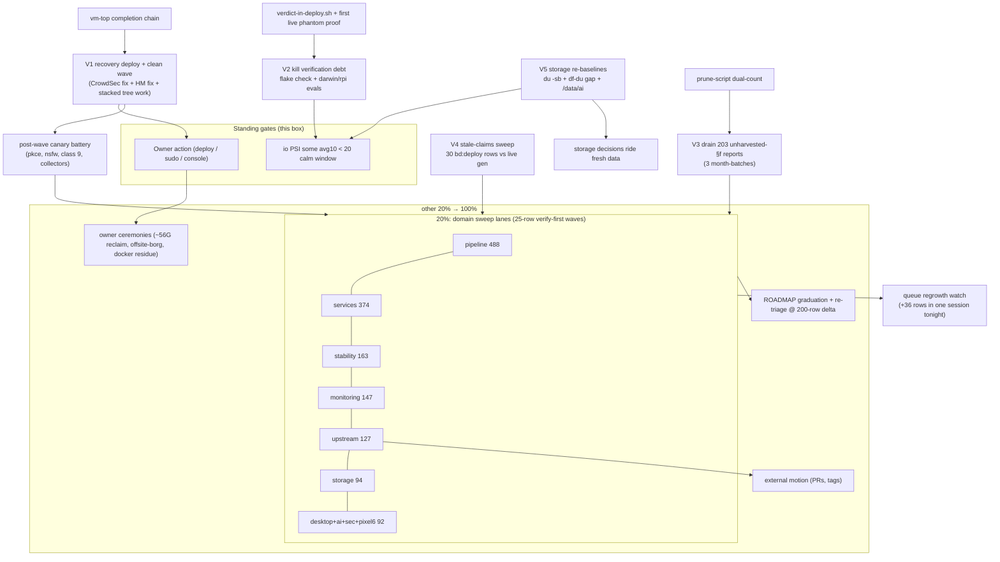

# SUPERB Backlog Masterplan v5 — Post-Grind Pareto Plan (the 1% that stops the rot)

**Written:** 2026-11-07 04:12 CEST (`date`), boot 01:06, gen 984 live, io PSI some avg10=54.8 / avg60=61.6 / **avg300=76.3** (heaviest window of the night), branch ahead 13.
**Predecessors:** [v4 (2026-11-05)](./2026-11-05_17-32_SUPERB-backlog-masterplan-v4.md) · [go-cache cutover (11-05)](./2026-11-05_22-30_SUPERB-go-cache-unblock-cutover-pareto-plan.md) · dnsblockd (10-28).
**Backlog measured tonight:** TODO queue **1082 `[ready]`** rows (grew during the session — parallel sessions mint faster than any grind closes); libraries carry **1485 `[ready]`** entries (pipeline 488 · services 374 · stability 163 · monitoring 147 · upstream 127 · storage 94 · desktop 52 · ai-stack 19 · pixel6 15 · security 6). Gate backlog: **203 unharvested §f reports** (v4 said 183 — the rot is ACCELERATING, +21 in two days), pairing DRIFT 68.

## Errata vs v4 (what already shipped — do NOT re-dispatch)

| v4 item | State 2026-11-07 04:12 |
|---|---|
| P11 nsfw TimeoutStartSec unitConfig→serviceConfig | **DONE** (quick-wins 11-07: both units fixed) + the whole CLASS is now eval-dead (systemd-shape-audit class 9, negative-tested) |
| P1 "land the pending deploy" | Landed twice, orphaned once: 12:03 = gen 984 live; 00:43 activated WITHOUT a generation and was eaten by the 01:06 reboot (freeze-#51, owner power cut) — the recovery question is now v5-V1 |
| P19 "183-unharvested burn-down" | Still open, worse: 203. Promoted to the 1% tier (V3) |
| v4's flake-check-era premises | Several [blocked:deploy] rows may describe pre-gen-984 state — the stale-claims sweep (V4) exists because 10/33 closures in the 02:33 grind were stale rows |
| *(post-v5)* nix-native modernization | **EXECUTED 2026-11-08** as its own plan (`2026-11-08_06-31_SUPERB-nix-native-modernization-pareto-plan.md`): manifest bridge (eval truth → `/etc/systemnix/integration-manifest.json` → data-driven post-deploy probes), script-port-audit eval gate, generated registry matrix + drift check, ports.nix range guard. Any v5 row touching scripts/docs port truth should consume the manifest instead of re-hardcoding — see the plan's §10 execution record |

---

## Step 1 — Pareto ladder

### The 1 % that deliver 51 % (5 moves — one owner deploy decision + ~4 calm-window sessions)

| # | Move | Why it is 51 % | Owner value |
|---|------|----------------|-------------|
| V1 | **The recovery deploy + one clean wave** (CrowdSec LAPI registration fix + HM start-limit clear + the STACKED tree work: pkce, nsfw, class 9, vm-top-metrics + enable, boot-evidence-gc, trash-metrics, dnsblockd-gateway, caddy tracing, tile-logos — all eval-green, all undeployed) | The host is unstable (CrowdSec loop, HM start-limit, PSI 76 avg300); ~30 verification rows and every post-deploy battery gate on ONE stable generation | Box stops hurting; features land |
| V2 | **Kill the verification debt** — owed full `nix flake check --no-build` at the first calm window + a cheap shared-surface eval habit (darwin+rpi toplevel evals whenever platforms/common/ changes) | Five new nix surfaces rest on evo-x2-only evals; the queue keeps GROWING work whose trust rests on a check that hasn't run for days | Deploys stop being acts of faith |
| V3 | **Drain the unharvested-§f backlog** (203 reports, +21 in 2 days) — month-batched harvest-or-annotate waves | Every unharvested report is re-derived or lost by the next session; the queue's rot engine. The batch-harvest rows exist and keep sliding | The TODO system becomes trustworthy |
| V4 | **Stale-claims sweep** (row 494): live-verify every [blocked:deploy]/"not deployed" claim against gen 984+ | 30% of tonight's closures were rows describing a dead world; each one burns a dispatch cycle or mispredicts a chain | Agents stop re-dispatching ghosts |
| V5 | **PSI-calm storage re-baselines** (/data du -sb MB-grain + one-liner smoke, df-vs-du gap, /data/ai breakdown) | Every storage decision (redesign legs, reclaim, watch verdicts) reasons from data that is 12+ days old while the disk story is THE capacity story | Decisions ride fresh numbers |

### The 4 % that deliver 64 % (add 7)

| # | Move | Owner value |
|---|------|-------------|
| V6 | **vm-top-metrics completion chain**: pre-deploy §-leg (rowed 04:06) + SigNoz panel/rule (rowed 02:33) + first post-deploy .prom verify | Reservation cascades become visible BEFORE the kill pass |
| V7 | **Prune-script hardening** (rowed): WARN-A captures DRIFT + unharvested, F27b as a scripted pre-apply leg | The 02:0x claim-before-measure + backwards-inspection class dies mechanically |
| V8 | **First live phantom-window run of `io-psi-crosscheck.sh verdict`** (PHANTOM leg unit-proven, never fired live) + wire the verdict line into deploy.sh's refusal output | Every future PSI refusal self-classifies: force vs wait stops being a guess |
| V9 | **Post-wave verification battery for the 33-row grind** (all the [blocked:deploy] canaries: pkce flag+login, nsfw no-Unknown-key, class 9 zero-regression, collectors live) | The grind's work actually PROVEN on the host |
| V10 | **fastflowlm forensics family** (socket re-arm sweep across retained boots; core-dump anatomy row; ClickHouse double-source) — journal-read class, calm window | The last unexplained crash family gets a named cause |
| V11 | **go-cache cutover residue** (v4-plan continuation): Samsung-side watermark coverage row + post-reclaim buildcache-list cleanup once reclaim-usb runs | The cache migration stops being half-wired |
| V12 | **Commit-msg WARN leg coverage note + hook-bypass row** (daemon commits bypass hooks by design — document, or extend the daemon; owner taste) | The footer guard's real coverage is honest |

### The 20 % that deliver 80 % (add 10 — the domain sweeps)

V13 **pipeline ready sweep** (488 entries, wave-dispatched ~25/wave: verify/supersede-first — 30% stale-class yield proven tonight) · V14 **services ready sweep** (374, same method) · V15 **stability ready sweep** (163) · V16 **monitoring ready sweep** (147) · V17 **upstream lane** (127: agent prepares patches, owner pushes — blocked:push discipline) · V18 **storage ready sweep** (94, PSI-gated du legs ride V5's baselines) · V19 **desktop + ai-stack + security + pixel6 sweeps** (92 combined) · V20 **decisions-backlog triage** (~250 [decision] rows: keep/kill/answer-owner batches) · V21 **watch lanes** (218 timer-verified sweeps, 24h self-gate respected) · V22 **VM-test + eval-guard backlog** (the deferred selftest wiring + fixture legs).

### The other 20 % to reach 100 %

V23 owner ceremonies bundle (offsite-borg go-live inputs, /data/docker ~10.3G reclaim decision, trash-empty+subvol-delete sudo window ≈56G, BIOS/thermal revisit) · V24 ROADMAP graduation of the vague/long-term remainder · V25 external-motion lanes (upstream PRs filed and waiting, tags to lift: templ-components, go-health) · V26 pixel6 + hardware fringe · V27 the never-ending tail: re-triage at every 200-row delta (the queue grew +36 DURING one session tonight — the plan assumes regrowth).

---

## Step 2 — Comprehensive plan (30–100 min per task, ≤27, sorted by importance/impact/effort/value)

Impact: H=unblocks many/unblocks the host · M=structural · L=local. Effort: S≤30m · M≈60m · L≈100m. "Owner" = needs owner hands/decision.

| ID | Task (30–100 min) | Tier | Impact | Effort | Value | Depends |
|----|-------------------|------|--------|--------|-------|---------|
| T01 | Owner: recovery-deploy decision + clean wave (CrowdSec fix authored first: LAPI bootstrap credentials path, cscli-free) — then anchor + pre-reboot-check | 1% | H | M+owner | box alive | calm window |
| T02 | Owed full `nix flake check --no-build` (tee ~/.cache/fc.log) + era-annotate 00-15 §f.2 + DRIFT baseline vs session-start rev | 1% | H | M | trust | PSI < 20 |
| T03 | Unharvested-§f wave 1 (Oct reports, ~60): harvest-or-annotate, CHECK_TODO_HARVEST=strict probe per batch | 1% | H | L | queue trust | — |
| T04 | Unharvested-§f wave 2 (Nov 1–5, ~70) + wave 3 (Nov 6–7, ~73) | 1% | H | L | queue trust | T03 |
| T05 | Stale-claims sweep A: all 30 [blocked:deploy] rows vs live gen (post T01: batteries fire; pre T01: classify only) | 1% | H | M | no ghosts | T01 (full) |
| T06 | /data re-baseline: df + du -sb trio + one-liner smoke + storage.md verdict stamp + watch-row stamp | 1% | M | S | fresh data | PSI < 20 |
| T07 | df-vs-du ~175G gap explain + /data/ai max-depth=2 breakdown recorded | 1% | M | M | capacity truth | T06 |
| T08 | Shared-surface eval habit: darwin+rpi toplevel evals NOW (this session's 5 nix surfaces), then AGENTS.md note candidate | 1% | H | S | no split-trust | — |
| T09 | vm-top pre-deploy §-leg + gatus metric-presence leg + selftest wiring | 4% | M | S | observability | — |
| T10 | SigNoz panel/rule for node_vm_top_vmsize_bytes + dashboard entry | 4% | M | M | observability | T01, T09 |
| T11 | Prune-script dual-count WARN-A + F27b pre-apply leg + selftest | 4% | M | S | rot-proofing | — |
| T12 | Wire verdict line into deploy.sh PSI refusal + first live phantom-window proof | 4% | M | S | deploy UX | next refusal |
| T13 | Post-wave canary battery (pkce, nsfw, class 9, collectors, boot-evidence-gc timer, trash units) — one scripted pass | 4% | H | M | proof | T01 |
| T14 | fastflowlm socket re-arm sweep + core-dump anatomy + ClickHouse double-source (journal-class) | 4% | M | L | last unexplained crash | calm window |
| T15 | Samsung watermark coverage + buildcache list cleanup (post reclaim-usb — owner leg first) | 4% | M | S | cache migration done | owner |
| T16 | Commit-msg WARN leg coverage doc + hook-bypass decision row | 4% | L | S | honesty | — |
| T17 | Pipeline sweep wave 1 (~25 verify-first rows) | 20% | M | L | queue shrink | — |
| T18 | Pipeline sweep wave 2 (+25) | 20% | M | L | queue shrink | T17 |
| T19 | Services sweep wave 1 (~25 verify-first) | 20% | M | L | queue shrink | — |
| T20 | Stability sweep wave 1 (~25) | 20% | M | L | queue shrink | — |
| T21 | Monitoring sweep wave 1 (~25) | 20% | M | L | queue shrink | — |
| T22 | Upstream lane batch 1 (prepare 10 patches/PR descriptions, owner pushes) | 20% | M | L | upstream debt | — |
| T23 | Storage sweep wave 1 (~25, du-legs PSI-gated) | 20% | M | L | queue shrink | T06 |
| T24 | Desktop+ai-stack+security+pixel6 wave (~20) | 20% | L | L | completeness | — |
| T25 | Decisions triage wave 1 (~60 rows → keep/kill/owner-answer) | 20% | M | L | unblocks decisions | — |
| T26 | Watch-lane sweep 1 (timer-verified, self-gate aware) | 20% | L | M | no dual watches | — |
| T27 | VM-test + eval-guard backlog (deferred selftest wirings, fixture legs) | 20% | M | L | regression net | T02 |

**Coverage:** T01–T27 cover the 1% (V1–V5), 4% (V6–V12), and the 20%'s ten sweep lanes (V13–V22). The other-20% (V23–V27) is owner-ceremony + external-motion + graduation — represented by T15's owner leg, T22, T25, and re-triage at each 200-row delta.

## Step 3 — Micro breakdown (≤12 min per task; 1%+4% fully broken; 20% = first waves enumerated; 96 listed)

| # | Micro-task (≤12 min) | Parent | # | Micro-task | Parent |
|---|----------------------|--------|---|-----------|--------|
| M01 | Author CrowdSec LAPI bootstrap fix (module edit + eval) | T01 | M49 | Annotate 00-15 §f.2 (flake-check era line) | T02 |
| M02 | Author HM go-build busy-symlink tolerance (checkLinkTargets path) | T01 | M50 | Derive DRIFT baseline vs 0a5249508 | T02 |
| M03 | Wave deploy checklist (rows→units table) for owner review | T01 | M51 | Oct-§f batch 1 (20 reports, harvest-or-annotate) | T03 |
| M04 | Post-deploy anchor verify recipe (gen N+1 == current-system) | T01 | M52 | Oct-§f batch 2 (20) | T03 |
| M05 | pre-reboot-check run + kernel 7.3.1 boot-audit | T01 | M53 | Oct-§f batch 3 (20) | T03 |
| M06 | PSI poll loop scaffold (log to ~/.cache/calm-watch.log) | T02/T06 | M54 | Nov-§f batch 1 (20) | T04 |
| M07 | Full flake check run + tee + triage any red | T02 | M55 | Nov-§f batch 2 (20) | T04 |
| M08 | Darwin toplevel eval probe (shared surfaces) | T08 | M56 | Nov-§f batch 3 (~33) | T04 |
| M09 | rpi3-dns toplevel eval probe | T08 | M57 | [bd:deploy] rows 1–10 live-classify vs gen | T05 |
| M10 | AGENTS.md shared-surface note draft | T08 | M58 | Rows 11–20 | T05 |
| M11 | vm-top pre-deploy leg (§ number + smoke block) | T09 | M59 | Rows 21–30 | T05 |
| M12 | vm-top gatus metric-presence entry + eval | T09 | M60 | /data df snapshot + watch-row stamp | T06 |
| M13 | SigNoz panel JSON + dashboard apply | T10 | M61 | du -sb trio + one-liner smoke | T06 |
| M14 | VmSize threshold rule draft (SigNoz) | T10 | M62 | baseline txt regen + commit | T06 |
| M15 | Prune script: WARN-A dual-count patch | T11 | M63 | df-vs-du gap: snapshot listing + hypothesis notes | T07 |
| M16 | Prune script: F27b pre-apply leg + header doc | T11 | M64 | /data/ai du --max-depth=2 + record | T07 |
| M17 | Prune selftest re-run (both legs) | T11 | M65 | Pipeline wave 1 rows 1–8 (verify-first) | T17 |
| M18 | deploy.sh refusal: call verdict mode | T12 | M66 | Pipeline wave 1 rows 9–16 | T17 |
| M19 | Next refusal: capture verdict output as proof | T12 | M67 | Pipeline wave 1 rows 17–25 | T17 |
| M20 | Canary battery script skeleton (the 8 checks) | T13 | M68 | Services wave 1 rows 1–8 | T19 |
| M21 | pkce canary (client detail + login) | T13 | M69 | Services wave 1 rows 9–16 | T19 |
| M22 | nsfw canary (no Unknown-key journal line) | T13 | M70 | Services wave 1 rows 17–25 | T19 |
| M23 | class 9 regression probe (flake check green) | T13 | M71 | Stability wave 1 rows 1–8 | T20 |
| M24 | vm-top + trash unit/prom verify | T13 | M72 | Stability wave 1 rows 9–16 | T20 |
| M25 | boot-evidence-gc timer live fire + absent-path degrade probe | T13 | M73 | Stability wave 1 rows 17–25 | T20 |
| M26 | fastflowlm socket re-arm journal sweep (boot 1–3) | T14 | M74 | Monitoring wave 1 rows 1–8 | T21 |
| M27 | Socket re-arm sweep (retained boots 4–8) | T14 | M75 | Monitoring wave 1 rows 9–16 | T21 |
| M28 | Core-dump anatomy: coredumpctl list + one dump read | T14 | M76 | Monitoring wave 1 rows 17–25 | T21 |
| M29 | ClickHouse query draft (flm verdict double-source) | T14 | M77 | Upstream lane: prepare 4 PR bodies | T22 |
| M30 | ClickHouse live query + verdict compare | T14 | M78 | Upstream lane: 3 more + blocked:push table | T22 |
| M31 | Samsung watermark: buildcache-gc read-side patch | T15 | M79 | Storage wave 1 rows 1–8 (non-du class first) | T23 |
| M32 | buildcacheDirs cleanup AFTER reclaim (gated) | T15 | M80 | Storage wave 1 rows 9–16 | T23 |
| M33 | Commit-msg leg coverage note (CONTRIBUTING) | T16 | M81 | Storage wave 1 rows 17–25 | T23 |
| M34 | Hook-bypass decision row authoring | T16 | M82 | Desktop wave (52 → first 12) | T24 |
| M35 | Owner-ceremony bundle doc refresh (one-pager) | V23 | M83 | ai-stack+security wave (25) | T24 |
| M36 | Decisions triage batch 1 (20 rows: keep/kill/owner) | T25 | M84 | pixel6 wave (15) | T24 |
| M37 | Decisions triage batch 2 (20) | T25 | M85 | Watch-lane sweep batch 1 (10 stamps) | T26 |
| M38 | Decisions triage batch 3 (20) | T25 | M86 | Watch-lane sweep batch 2 (10) | T26 |
| M39 | VM-test backlog: enumerate deferred selftest wirings | T27 | M87 | Wire 1 deferred selftest + eval | T27 |
| M40 | Wire 2nd deferred selftest + eval | T27 | M88 | Fixture leg for one eval-guard | T27 |
| M41 | Pipeline wave 2 rows 1–8 | T18 | M89 | Upstream lane batch 2 (3 PR bodies) | T22 |
| M42 | Pipeline wave 2 rows 9–16 | T18 | M90 | Decisions triage batch 4 (20) | T25 |
| M43 | Pipeline wave 2 rows 17–25 | T18 | M91 | Services wave 2 rows 1–8 | T19 |
| M44 | Stability wave 2 rows 1–8 | T20 | M92 | Stability wave 2 rows 9–16 | T20 |
| M45 | Monitoring wave 2 rows 1–8 | T21 | M93 | Monitoring wave 2 rows 9–16 | T21 |
| M46 | Re-triage checkpoint (row-delta census + plan annotate) | V27 | M94 | ROADMAP graduation pass (vague→roadmap) | V24 |
| M47 | Errata sweep of THIS plan vs landed work | V27 | M95 | Queue-header hint refresh if counts moved | V27 |
| M48 | Commit+push the plan artefacts (owner-directed) | — | M96 | Session closeout report + self-harvest | — |

**Coverage honesty (Step 3):** 96 micro-tasks fully break the 1% and 4% tiers and enumerate the FIRST WAVE of each 20% sweep lane. The remaining ~1000 queue rows are covered structurally: each lane continues as 25-row waves at the same ≤12-min-per-row verify-first cadence (the proven yield: ~30% stale-closures, ~50% small edits, ~20% re-gated), re-triaged at M46/M95 checkpoints. ALL TODO domains appear: pipeline (T17/18), services (T19), stability (T20), monitoring (T21), upstream (T22), storage (T23), desktop/ai-stack/security/pixel6 (T24), decisions (T25), watch (T26), VM-tests (T27), owner ceremonies (V23/T15/M35), ROADMAP (M94).

## Execution graph (mermaid)

## Verschlimmbesserung guard (owner's rule #5)

Every task above is additive or verification — none rewrites landed work. The three with rewrite-adjacent risk and their guards: M02 (HM symlink tolerance — must not weaken the cache wiring, only the activation conflict), T11 (prune script — selftested, dry-run default, rev-pinned as before), M18 (deploy.sh verdict call — read-only output addition, no gate-semantics change). Anything that turns red mid-plan: STOP and report, never "fix forward" silently.

## Session math (why the 1% is the 1%)

1082 ready rows at tonight's proven cadence (33 rows / ~95 min of grind = ~3.5 rows/10min ≈ 21 rows/hour) ≈ 50+ hours of pure grind — versus 5 moves that unblock the host, the verification layer, the queue's trust model, the ghost rows, and the data layer EVERYTHING else reasons from. Grind the tail before the 1% and you optimize rows on a ship that's taking water.
