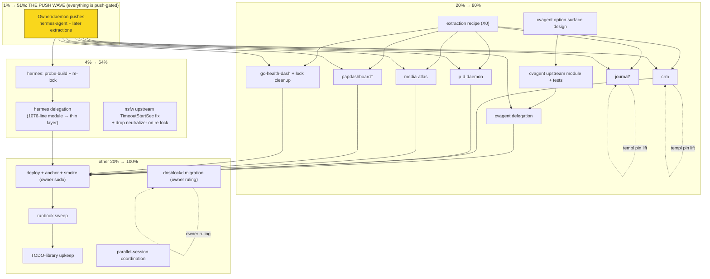

# SUPERB — Own-Project Module Upstreaming Completion (the last 30%)

**Date:** 2026-11-08 03:30 · **Author:** upstreaming-audit session (docs/status/2026-11-08_03-15_own-project-module-upstreaming-audit-two-delegations.md)
**Status:** PLANNED (not executing — marker protocol per docs/CONTRIBUTING + AGENTS.md plan-execution tombstone applies before ANY execution of this file)

## Context

The 2026-11-08 03-15 audit answered the owner's question ("should my own-project service modules live in their own repos?"): **yes, and it is already ~70% true.** 16 of ~30 own-project modules already consume upstream `nixosModules` (DiscordSync/Monitor365 doctrine, docs/agents/integration-registry.md); this session delegated 2 more (mr-sync → `nixosModules.dashboard`, nsfw-classifier → `nixosModules.default`, both verified: parity diffs, contract test green, isolation-proof eval EXIT:0). What remains: 2 gap-fixes (cvagent, hermes), 6 repos exporting no module, and the close-out loop (deploy + upstream fix + hygiene).

**Verified-open check (skill step 0):** every task below grep-verified against the tree this session — the 4 rows live in docs/todo/upstream.md (authored 03:1x), dnsblockd has its own pre-existing `[blocked:user]` row (TODO_LIST 2026-11-08), and no CHANGELOG entry claims any of them done.

## Pareto Breakdown

### The 1% that delivers 51%: THE PUSH WAVE
Every remaining delegation is `[blocked:push]`-gated: upstream repos carry the needed code (hermes-agent's `nix/nixosModules.nix` is WRITTEN, sitting unpushed at HEAD 686193c0; every future extraction lands locally first then needs the daemon/owner push + SystemNix re-lock). One push batch (hermes-agent first) + probe-build + re-lock unblocks the largest extraction in the repo. No push = zero progress on 100% of the remaining work.

### The 4% that delivers 64%: HERMES DELEGATION + THE NSFW UPSTREAM FIX
`hermes.nix` is 1,076 lines — the single largest duplicated deployment contract left (hermes-agent's module already shares options/renderers with its Home-Manager module, so SystemNix hand-maintains a parallel surface upstream also maintains). Delegating it + pushing the one-line nsfw `unitConfig.TimeoutStartSec → serviceConfig` fix (dropping our mkForce-null neutralizer) eliminates the bulk of the remaining duplication in two moves.

### The 20% that delivers 80%: CVAGENT MERGE + THE SIX EXTRACTIONS
cvagent (the only namespace-collision — needs a real upstream option-surface design, not a copy) plus the six no-module repos (crm, media-atlas, papdashboard, journal-serve, project-discovery-daemon, go-health-dashboard) — each is the SAME recipe (extract from the live SystemNix module per the nsfw-classifier 2026-10-18 precedent, document deltas, keep SystemNix thin). After this tier, every own-project service follows the doctrine.

### The other 20% to reach 100% (the tail that keeps it true)
Deploy + anchor + post-deploy batteries for the landed delegations; runbook/TODO-library upkeep as waves land; lock hygiene (4 duplicate go-health-dashboard_N nodes); dnsblockd migration (pre-existing owner-gated row); parallel-session coordination; and the per-delegation guard discipline (parity diff + probe-before-lock + quiescent-tree evals) — the exact discipline that caught 3 silently-dropped harden bounds today. **Skipping the tail is how you verschlimmbessern a doctrine into a ritual.**

## Comprehensive Plan (30–100 min tasks, sorted by impact → effort)

| # | ID | Task | Impact | Effort | Value (customer/owner) | Gate |
|---|----|------|--------|--------|------------------------|------|
| 1 | H1 | hermes push wave: owner/daemon pushes hermes-agent (HEAD 686193c0, contains nix/nixosModules.nix) | 🔴 unblocks all | 30m | portability of the agent product | push |
| 2 | H2 | hermes probe-build + re-lock past 0ea6ea9 (probe-before-lock protocol, integration-registry.md) | 🔴 | 30m | lock integrity | H1 |
| 3 | H3 | hermes delegation: hermes.nix 1076 → thin SystemNix layer + upstream module; rendered-unit parity diff (the bounds-check method from today) | 🔴 largest dedup | 100m | single source of deployment truth | H2 |
| 4 | C1 | cvagent upstream option-surface design: curated repo list, mesh-export target, AI model/baseurl/daily-cap, run-as-user, 90min budget — merge with upstream's discovery/serve model | 🟠 | 100m | cvagent usable outside SystemNix | — |
| 5 | C2 | cvagent upstream module implementation + upstream tests | 🟠 | 100m | upstream-tested contract | C1 |
| 6 | C3 | cvagent SystemNix delegation + parity diff | 🟠 | 45m | dedup | C2, push |
| 7 | D1 | Deploy wave (owner sudo): make mr-sync delegation live; deploy-anchor discipline (readlink current-system = newest system-N-link by NUMBER); post-deploy battery + mr-sync dashboard smoke | 🟠 live value | 30m +sudo | today's work reaches prod | quiescent tree |
| 8 | X0 | Write the extraction recipe checklist (from nsfw 2026-10-18 + today's 2): steps, deltas doc, audits to expect (io-tier class on new upstream oneshots, class-9 unitConfig traps, harden-bounds parity list) | 🟡 multiplies all X-tasks | 30m | repeatability, no per-repo rediscovery | — |
| 9 | X4 | media-atlas extraction (908 lines) + delegate | 🟡 | 90m | dedup | X0, push |
| 10 | X5 | papdashboard extraction (968; SERVICE UNIT ONLY — tile/icons-pack layer stays SystemNix-internal) + delegate | 🟡 | 90m | dedup | X0, push |
| 11 | X1 | crm extraction (543) + delegate (crm input is rev-pinned on the templ wave — ride the pin-lift) | 🟡 | 60m | dedup | X0, push, pin lift |
| 12 | X6 | go-health-dashboard extraction (health-dashboard.nix 302) + delegate + lock dupe-node cleanup (4 go-health-dashboard_N nodes) | 🟡 | 60m | dedup + lock hygiene | X0, push |
| 13 | X2 | project-discovery-daemon extraction (216) + delegate | 🟡 | 45m | dedup | X0, push |
| 14 | X3 | journal-serve extraction (168; journal input rev-pinned on templ wave) + delegate | 🟡 | 45m | dedup | X0, push, pin lift |
| 15 | N1 | nsfw upstream fix: unitConfig.TimeoutStartSec → serviceConfig; drop SystemNix mkForce-null neutralizer on re-lock past the fix | 🟢 small | 12m + push | journal-warning gone | push |
| 16 | D2 | dnsblockd migration to upstream module (PRE-EXISTING row, blocked:user — owner must rule the unit-identity question: unprivileged upstream user vs root) | 🟢 | 60m | dedup (65→110 keys reachable) | owner |
| 17 | Y1 | Post-delegation runbook sweep: verify docs/services/*.md headers still name the right owning module for every delegated service (mr-sync + nsfw verified today; repeat per wave) | 🟢 | 30m | doc truth | per wave |
| 18 | Y2 | TODO-library upkeep per wave: tick the docs/todo/upstream.md rows, prune-to-CHANGELOG discipline, WARN-count recount (prune unmasking) | 🟢 | 15m/wave | queue truth | per wave |
| 19 | Z1 | Coordination: parallel-session indexer-web start-limit work (fixed their duplicate serviceConfig at ~03:2x) — do NOT touch their lane; re-verify shared-surface eval at quiescence before D1 | 🟢 guard | 15m | no mid-edit races | — |

## Micro Breakdown (≤12 min tasks; ALL TODOs; sorted by impact → effort)

**Wave H — hermes (tasks 1–3):**

| µID | Task | Est | Dep |
|-----|------|-----|-----|
| H1a | Confirm hermes-agent HEAD still unpushed; `git log origin/master..HEAD -- nix/nixosModules.nix` enumerate module commits | 5m | — |
| H1b | Owner/daemon push hermes-agent; verify `branch -r --contains HEAD` non-empty | 5m | H1a |
| H2a | Probe-build outside lock: `nix build github:LarsArtmann/hermes-agent/<rev>#default` (or local path: flake) | 10m | H1b |
| H2b | `nix flake lock --update-input hermes-agent`; confirm lock rev == probed rev | 5m | H2a |
| H2c | Quick evo-x2 eval on the re-locked tree (capture-once-then-grep) | 10m | H2b |
| H3a | Read hermes-agent nix/nixosModules.nix + moduleCommon.nix fully; map option surface vs hermes.nix | 12m | H2c |
| H3b | Diff-Inventory hermes.nix: mark every block upstream-owns vs SystemNix-layer (sops/gates/registry/ioTier/onFailure/calm-gate class) | 12m | H3a |
| H3c | Write delegated hermes.nix (imports upstream; layer only host concerns) | 12m×4 | H3b |
| H3d | Eval + fix round 1 (expect audits: io-tier on new upstream units, shape classes) | 12m×2 | H3c |
| H3e | Rendered-unit parity diff old vs new for EVERY hermes unit (worktree method; baseline = last commit without your marker) | 12m×2 | H3d |
| H3f | Harden-bounds check: CPUQuota/MemoryHigh/ProtectHostname present post-merge (today's dropped-bounds class) | 8m | H3e |
| H3g | Tick upstream.md row §f.2 + CHANGELOG line + runbook header note | 10m | H3f |

**Wave C — cvagent (tasks 4–6):**

| µID | Task | Est | Dep |
|-----|------|-----|-----|
| C1a | Re-read both module surfaces; write the merged option-surface spec (which options survive, which generalize, list-vs-discovery) | 12m×3 | — |
| C1b | Verify upstream repo tests/VM harness exists for module changes; identify test seams | 8m | C1a |
| C2a | Implement merged module in Code-To-CV-Agent nix/module.nix (curated list, mesh target, AI opts, run-as-user, budget) | 12m×4 | C1 |
| C2b | Upstream tests green (repo's own battery) | 12m×2 | C2a |
| C2c | Owner/daemon push cvagent | 5m | C2b |
| C3a | Probe-build + re-lock cvagent input | 10m | C2c |
| C3b | Delegate SystemNix cvagent.nix (keep sops env, system-health row, schedule pin) | 12m×2 | C3a |
| C3c | Parity diff + eval + tick row §f.1 + CHANGELOG | 12m | C3b |

**Wave D — deploy/close-out (task 7, 19):**

| µID | Task | Est | Dep |
|-----|------|-----|-----|
| D1a | Quiescence check: tree clean of mid-edits 4×60s polls (deploy-vs-executor race protocol) | 10m | — |
| D1b | Deploy `nix run .#deploy` (owner present for sudo); watch /var/log/systemnix-deploys/<ts>.log | 12m+ | D1a |
| D1c | Anchor check: readlink /run/current-system == newest system-N-link (by NUMBER, not mtime) | 5m | D1b |
| D1d | Post-deploy battery: mr-sync-dashboard smoke (vHost + gatus check green + cache dir created), nsfw stays down (owner-disabled) | 10m | D1c |
| Z1a | Confirm indexer-web parallel work committed/landed; shared eval green at quiescence | 10m | — |

**Wave X — six extractions (tasks 8–14; X0 first, then any order):**

| µID | Task | Est | Dep |
|-----|------|-----|-----|
| X0a | Distill today's 2 delegations + nsfw 2026-10-18 into the recipe checklist (steps, expected audits, parity method, deltas-doc template) | 12m×2 | — |
| X0b | Park the recipe in docs/agents/integration-registry.md (the pattern doc owns it) | 10m | X0a |
| XRa | Per repo R ∈ {crm, media-atlas, papdashboard, journal, project-discovery-daemon, go-health-dashboard}: read SystemNix module, split upstream-vs-layer inventory | 12m | X0 |
| XRb | Extract module upstream (options+unit+hardening, portable defaults; SystemNix specifics OUT) | 12m×3 | XRa |
| XRc | Upstream eval/test of the extracted module | 10m | XRb |
| XRd | Push + probe-build + re-lock | 10m | XRc |
| XRe | Delegate SystemNix module to `lib.mkIf cfg.enable` thin layer | 12m | XRd |
| XRf | Parity diff + harden-bounds check + eval | 12m | XRe |
| XRg | Tick row §f.3 slice + CHANGELOG + runbook header | 10m | XRf |

*(XR repeats per repo: crm≈5×12m, media-atlas≈7×12m, papdashboard≈7×12m +tile-layer boundary note, journal≈4×12m +pin-lift dep, project-discovery-daemon≈4×12m, go-health-dashboard≈5×12m + lock dupe-node cleanup 12m.)*

**Wave N/Y/Z — tail (tasks 15–18):**

| µID | Task | Est | Dep |
|-----|------|-----|-----|
| N1a | One-line upstream nsfw-classifier fix (serviceConfig.TimeoutStartSec; drop unitConfig copy) + commit | 10m | — |
| N1b | On next nsfw re-lock past the fix: drop SystemNix `unitConfig.TimeoutStartSec = mkForce null` neutralizer + eval | 10m | N1a push |
| D2a | Owner ruling on dnsblockd unit identity (pre-existing row); then migrate dns-blocker.nix per its runbook | 12m×4 | owner |
| Y1a | Runbook sweep per landed delegation (header owning-module line correct) | 12m/wave | waves |
| Y2a | Library tick + prune discipline + WARN recount per wave | 15m/wave | waves |

## Execution Graph (mermaid)

`*` journal + crm ride the templ-wave pin lift · `†` papdashboard service unit only; tile/icons layer stays SystemNix-internal.

## Verschlimmbessern-Guardrails (non-negotiable per delegation)

1. **Rendered-unit parity diff** against the last commit WITHOUT your marker (never assume HEAD~N — today's baseline-contamination near-miss).
2. **Harden-bounds check**: CPUQuota / MemoryHigh / ProtectHostname survive the merge (today's silent-drop class).
3. **Probe-before-lock** every upstream re-lock (integration-registry.md; the lock is the only verified gate).
4. **Quiescent-tree evals only** for shared surfaces (evo-x2) — the indexer-web mid-edit race cost two eval cycles today.
5. **PATHSPEC commits** in the shared tree; never bare `git add && git commit` (12-file sweep, 2026-08-30).
6. **New upstream units trip audits by design**: io-tier on boot-started oneshots, class-9 unitConfig traps — layer floors SystemNix-side, fix the source upstream.
7. **No behavior change without intent**: every diff hunk is either an upstream improvement (documented) or byte-identical.

## Self-Harvest Note

No NEW TODO_LIST.md rows: every actionable item here is push-gated or owner-gated (library-only per the TODO system contract); the 4 upstream.md rows + dnsblockd row already carry them. The deploy (D1) is owner/sudo — not queueable `[ready]`.
