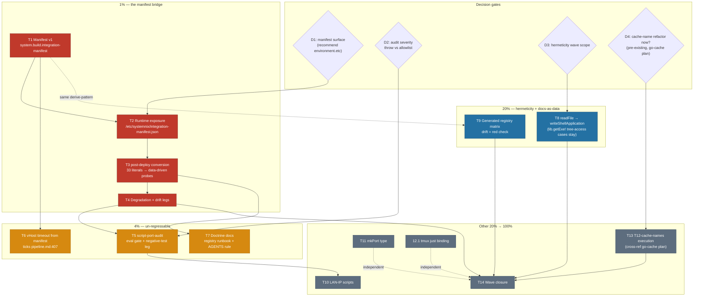

# SUPERB: Nix-Native Modernization — Pareto Plan

**Created:** 2026-11-08 06:31 · **HEAD:** `74e96d9f` · **Status:** PLANNED (awaiting owner go / dispatch)
**EXECUTING (instance full-wave execution session, owner GO directive, 2026-11-08 07:18 CET, HEAD `9a37d2ee2`):** executing (see AGENTS.md plan-execution tombstone)
**Trigger:** owner question "How can we do things in a more nix native/smarter way? Don't forget nix is a PROGRAMMING LANGUAGE!" (2026-11-08 session) → this plan.
**Premise:** SystemNix is already native where it counts (integration-registry fan-out, eval-guard army, features-drift re-derivation). The remaining frontier is **surfaces that duplicate data Nix already owns** — operational scripts, embedded unit scripts, and prose docs. Nix becomes the single owner of that data; everything else becomes a pure consumer.

---

## §0 Verification evidence (live-probed this session, 2026-11-08)

Every claim below was verified before ranking — no doc-cite-only premises.

| # | Claim | Evidence (command + result) |
|---|-------|------------------------------|
| V1 | `post-deploy-check.sh` hardcodes ports | `rg -o "localhost:[0-9]+"` → **33 literals across 12 ports** (8085×6, 9421×5, 8080×4, 3001×4, 1411×4, 8087×2, 8086×2, 8081×2, 9400, 8889, 8849, 8848); 2605 lines; **zero** `nix eval` consumption |
| V2 | `services.integration` evals to JSON | `nix eval --json …config.services.integration --apply '…attrNames'` → rc=0, **74 enabled entries** |
| V3 | Full integration entry is JSON-safe | `nix eval --json …services.integration.pocket-id` → rc=0; carries `subdomain`, `port`, `unit`, `vHost.layer`, `checks[]` (path/url/`client.timeout`/conditions), `backup`, `monitored` |
| V4 | `services.catalog` carries probe truth | `nix eval --json …services.catalog` → rc=0, **28 entries** with `port` + `healthPath` + `subdomain` + `description` (e.g. pocket-id 1411, crm 8091 + `/healthz`) |
| V5 | Ports move in practice | monitor365 9191→9421, netbird →9465 (Oct 2026, ocis band-vacuation) — the hardcode class is not hypothetical |
| V6 | `port-registry-audit.nix` gates UNITS only | scripts surface is ungated today |
| V7 | Bridge pattern already proven | `system.build.sops-nix-manifest` feeds the §19 sops gate (flake/parts + scripts/sops-predeploy-gate.sh) |
| V8 | Docs-as-data precedent exists | `lib/features-drift.nix` re-derives FEATURES.md enable-truth from eval; violations fail `nix flake check` |
| V9 | 7 scripts embed via `builtins.readFile` into unit text | snapshots.nix:249,275 · backup.nix:72 · scheduled-tasks.nix:407 · niri-config.nix:25,35 · display-manager-heal.nix:27 (text pinned, **deps NOT**) |

## §1 Errata & prior-work cross-references (read before executing anything)

1. **T12 cache-name single-sourcing is ALREADY PLANNED** — `docs/planning/2026-11-05_22-30_SUPERB-go-cache-unblock-cutover-pareto-plan.md` T12 + `docs/todo/pipeline.md:1054` [decision], gated on owner decision **D4** (refactor now vs consumer-grep rule only). This plan does NOT re-plan it; T13 here is "execute that, if D4 ratifies".
2. **`boot-evidence-gc.nix` live-checkout script ref is DELIBERATE** — the module documents the rationale (catalog-inventory-sync precedent; absent checkout degrades to a no-op note, never a failing timer). NOT a defect; excluded from T8. Same for `scheduled-tasks.nix` dns-update (needs the tree WorkingDirectory intentionally).
3. **`pre-deploy-check.sh` is clean** — zero port literals. The class lives in post-deploy-check.sh only. (The initial session hypothesis "12 scripts with port literals" collapsed under verification: the other matches are selftest fixtures, e.g. boot-evidence-pull.sh's `localhost:9000` connect-failure fixture.)
4. **vHost probe timeout row already queued** — `docs/todo/pipeline.md:407` [ready] (VHOST_PROBE_TIMEOUT=20 global hardcode). Folded here as T6 riding the manifest; tick BOTH surfaces when done.
5. **No justfile exists** — `platforms/common/programs/tmux.nix:34` binds a `just` window into a dead command (fine-only fix 12.1).

## §2 Pareto breakdown

### The 1% that delivers 51% — THE MANIFEST BRIDGE
Bake eval truth (catalog `port`+`healthPath`, integration `checks`+`vHost`+`unit`) into the **system build** as a JSON manifest; convert post-deploy-check.sh's mechanical probes to consume it. Kills the 33-literal class at the root and installs the reusable bridge every future "script needs config truth" problem will use (same shape as V7).

### The 4% that delivers 64% — MAKE THE CLASS UN-REGRESSABLE
A `script-port-audit` eval gate (mirror of port-registry-audit onto the scripts surface) so new hardcodes fail `nix flake check` + the vHost-timeout single-source riding the same manifest.

### The 20% that delivers 80% — HERMETICITY + DOCS-AS-DATA
Migrate the dep-bearing `readFile` embeds to `writeShellApplication` (deps pinned, shellchecked — with the `lib.getExe` scrubGuard trap guarded) + a generated, drift-checked registry matrix in the integration-registry doc.

### The other 20% (→ 100%)
LAN-IP diagnostic scripts, `mkPort` type hardening, dead tmux binding, T12 cache-names execution (owner-gated), wave documentation + queue hygiene.

---

## §3 Comprehensive plan (medium granularity, 30–100 min per task)

Sorted by importance/impact/effort/customer-value (deploy-gate correctness first, prevention second, polish last).

| ID  | Task                                                                                                                                        | Tier | Impact | Effort | Value                                                                 |
| --- | ------------------------------------------------------------------------------------------------------------------------------------------- | ---- | ------ | ------ | --------------------------------------------------------------------- |
| T1  | **Manifest v1**: Nix builder merging catalog (port/healthPath/subdomain) + integration (checks/url+timeout/vHost.layer/unit) into one JSON attrset; `system.build.integration-manifest`; fixture check pinning shape + JSON-safety throw naming any non-serializable field                                               | 1%   | CRITICAL (root fix)   | 90m  | every downstream task depends on this |
| T2  | **Runtime exposure** (decision D1): manifest readable from the RUNNING system (`environment.etc` → `/etc/systemnix/integration-manifest.json`), so post-deploy always probes exactly the deployed gen — zero `nix eval` at deploy time                                                                                                                                 | 1%   | HIGH     | 45m  | correctness (tree drift can't lie to the check) |
| T3  | **post-deploy-check.sh conversion**: manifest loader + port-driven probe loop for the mechanical sections (1411 pocket-id, 8085 discordsync, 3001 monitor365, 9421, 8080/8081/8086/8087, 9400, 8889, 8848/8849); bespoke flows (OIDC gate, backoff-aware skips) keep their logic, only their port literals become data                                                                                                                                                            | 1%   | CRITICAL | 100m | the 33-literal class dies |
| T4  | **Degradation + drift legs**: absent manifest → WARN-skip (never blocks a deploy); script probing a port the manifest doesn't know → loud line; selftest legs in `checks`                                                                                                                                 | 1%   | HIGH     | 60m  | no new silent-failure class |
| T5  | **`script-port-audit` eval gate**: `builtins.readFile` over `scripts/*.sh`, flag port literals absent from `lib/ports.nix` (reuse port-registry-audit's matcher semantics); allowlist mechanism for selftest fixtures; `CASES=scriptport` negative-test leg in the SAME change                                             | 4%   | HIGH (un-regressable) | 90m  | class can never return |
| T6  | **vHost probe timeout from manifest**: carry `client.timeout`; retire `VHOST_PROBE_TIMEOUT=20` global; ticks `pipeline.md:407` + its queue row (edit BOTH surfaces)                                                                                                                                       | 4%   | MED      | 30m  | closes a queued row, kills a 3-place split brain |
| T7  | **Bridge doctrine docs**: runbook section (docs/agents/integration-registry.md) + AGENTS.md rule "scripts consume eval truth via the manifest — never hardcode ports"                                                                                                                                     | 4%   | MED      | 30m  | future sessions don't re-invent or re-hardcode |
| T8  | **Hermeticity wave** (decision D3): classify all 7 readFile embeds (deps vs intentional tree access); migrate the dep-bearing ones to `writeShellApplication` + `lib.getExe` (the scrubGuard `Is a directory` trap); leave + document intentional tree-access cases                                                                                                                       | 20%  | MED      | 90m  | units stop depending on ambient PATH |
| T9  | **Generated registry matrix**: Nix-side markdown generator (subdomain/port/layer/tile/checks/backup per service) + drift check against the committed table in docs/agents/integration-registry.md (features-drift pattern — drift = red check, not stale prose)                                                                                                                             | 20%  | MED      | 90m  | docs can't lie |
| T10 | **LAN-IP scripts**: inventory the 5 `192.168.1.x` scripts (wifi-failover-watch, mptcp-endpoint-manager, dns-diagnostics, route-health-monitor, internet-diagnostic); derive shared host constants or register documented allowlist rows under the T5 gate                                                                                                                                 | tail | LOW-MED  | 45m  | consistency, not correctness |
| T11 | **`mkPort` type hardening**: `types.ints.between 1 65535` wrapper in lib/ports.nix so registry values are range-guaranteed at eval                                                                                                                        | tail | LOW      | 30m  | cheap invariant |
| T13 | **T12-cache-names execution** (CROSS-REF, owner-gated D4): execute the 2026-11-05 go-cache plan's T12 (name-list single-source, Nix-owns-data direction) once D4 ratifies — NOT re-planned here                                                                                                                          | tail | MED (bug-class removal) | 100m | retires the AGENTS coupling note |
| T14 | **Wave closure**: CHANGELOG entry, masterplan-v5 cross-link, errata ticks, TODO harvest verification, AGENTS notes                                                                                                                                 | tail | MED      | 45m  | house hygiene |

Total medium estimate: ≈ 14.5 h. (T12.1 tmux fix and other <30m items live only in §4.)

## §4 Fine breakdown (≤ 12 min per task, ALL TODOs)

Sorted by importance/impact/effort within parent order. `→` = gates the next row.

| #      | Task (12m unless noted)                                                                                          |
| ------ | ----------------------------------------------------------------------------------------------------------------- |
| 1.1 →  | Extract the post-deploy section inventory: classify all 12 port-touching sections mechanical vs bespoke (10m)      |
| 1.2    | Write `lib/integration-manifest.nix`: merge + filter catalog/integration fields (12m)                             |
| 1.3    | JSON-safety guard: `builtins.toJSON` whole manifest, throw naming the first non-serializable field (8m)            |
| 1.4    | `flake/parts/checks` fixture: `integration-manifest-shape-selftest` pinning required fields (12m)                 |
| 1.5    | evo-x2 + rpi3-dns toplevel eval proof, record drvPaths (5m)                                                       |
| 2.1 →  | **D1 decision**: `environment.etc` (recommended — always matches running gen) vs runtime `nix eval` (5m)           |
| 2.2    | Land `environment.etc.systemnix-integration-manifest` (or chosen surface) + unit-less read path (10m)             |
| 2.3    | Live read-only probe once deployed: manifest fields via jq **stdin form** (DIRENV_DIFF trap) (6m)                 |
| 3.1 →  | Manifest loader lib in post-deploy-check.sh (jq stdin form; degrade to WARN if absent) (12m)                       |
| 3.2    | Convert pocket-id section (1411) — healthz + page probes (12m)                                                     |
| 3.3    | Convert discordsync section (8085) — KEEP the startup-backoff SKIP branch logic (12m)                              |
| 3.4    | Convert monitor365 (3001) + metrics (9421) sections (10m)                                                          |
| 3.5    | Convert 8080/8081/8086/8087 quartet sections (12m)                                                                 |
| 3.6    | Convert 9400 collector + 8889 + 8848/8849 AI-stack sections (12m)                                                  |
| 3.7    | Output-parity diff: pre/post conversion section-by-section against live host (12m)                                 |
| 3.8    | Grep proof: zero `localhost:[0-9]` outside the loader in post-deploy-check.sh (3m)                                 |
| 4.1    | Degradation path: absent manifest → WARN-skip, never FAIL (12m)                                                    |
| 4.2    | Unknown-port drift: probe target missing from manifest → loud WARN line (10m)                                      |
| 4.3    | Selftest legs: manifest-shape + degradation fixtures into checks (12m)                                             |
| 5.1 →  | Design `script-port-audit`: file set, literal matcher (reuse port-registry-audit semantics) (12m)                  |
| 5.2    | Allowlist mechanism + first entries (boot-evidence-pull selftest `:9000` fixture) (12m)                            |
| 5.3    | Wire gate into eval-guard army + flake check (10m)                                                                 |
| 5.4    | `negative-test-lints.sh` CASES=scriptport leg (neuter/restore ATOMIC — shared-tree rule) (12m)                     |
| 5.5    | Selftest for the gate itself (fixtures red/green) (12m)                                                            |
| 6.1    | Carry `client.timeout` (max per entry) into manifest (8m)                                                          |
| 6.2    | post-deploy vHost probe consumes timeout; retire VHOST_PROBE_TIMEOUT global (12m)                                  |
| 6.3    | Tick `pipeline.md:407` + the queue row — BOTH surfaces (6m)                                                        |
| 7.1    | Runbook section: "Manifest bridge — how scripts consume eval truth" in integration-registry.md (12m)               |
| 7.2    | AGENTS.md Critical Rules amendment + shell-devtools pointer (8m)                                                   |
| 8.1 →  | Classification table for all 7 embeds: deps-needed vs tree-access-intentional (12m)                                |
| 8.2    | Migrate snapshots.nix root-prune-guard (writeShellApplication + `lib.getExe`) (12m)                                |
| 8.3    | Migrate snapshots.nix btrbk-data-gate (12m)                                                                        |
| 8.4    | Migrate backup.nix borg-restore-drill default (12m)                                                                |
| 8.5    | Migrate niri-config.nix niri-drm-healthcheck + display-watchdog (12m)                                              |
| 8.6    | Migrate display-manager-heal.nix (10m)                                                                             |
| 8.7    | Document dns-update's intentional tree access (WorkingDirectory) — no migration (5m)                                |
| 8.8    | Regression grep: no bare writeShellApplication store-path interpolation (the scrubGuard `Is a directory` trap) (8m) |
| 8.9    | VM-test / eval proof for every migrated unit (12m)                                                                 |
| 9.1    | Matrix generator: Nix → markdown table (subdomain/port/layer/tile/checks/backup) (12m)                             |
| 9.2    | Drift check: generated vs committed table, features-drift pattern (12m)                                            |
| 9.3    | First-generation commit + flake check green (10m)                                                                  |
| 10.1   | LAN-IP inventory: consumer analysis of the 5 scripts (are IPs config or environment facts?) (12m)                  |
| 10.2   | Per-script decision: derive vs documented allowlist under T5 gate (10m)                                            |
| 10.3   | Land chosen form + allowlist rows (12m)                                                                            |
| 11.1   | `mkPort` type in lib/ports.nix + convert values (12m)                                                              |
| 11.2   | Eval proof both hosts (5m)                                                                                         |
| 12.1   | tmux.nix: replace the dead `just` window binding (justfile removed 2026-10) (6m)                                   |
| 13.1 → | Refresh the 5-surface cache-name inventory; put D4 to the owner with costs (8m)                                    |
| 13.2    | *(D4-ratified)* mechanism: Nix attrset as owner, generate shell lists (12m)                                        |
| 13.3    | *(D4-ratified)* migrate all consumers in ONE change (consumer-grep rule) (12m)                                     |
| 13.4    | *(D4-ratified)* update direnv test + negative legs (12m)                                                            |
| 13.5    | *(D4-ratified)* tick pipeline.md:1054 + remove AGENTS coupling note (8m)                                           |
| 14.1   | CHANGELOG entry for the wave (12m)                                                                                 |
| 14.2   | Masterplan v5 cross-link + this plan's errata closure (8m)                                                         |
| 14.3   | Queue/library drift check for every row this plan ticks (8m)                                                       |

## §5 Execution graph (mermaid)

## §6 Decision gates

- **D1 — manifest exposure surface.** Recommend `environment.etc."systemnix/integration-manifest.json"`: the file rides `/run/current-system`, so post-deploy-check ALWAYS probes the deployed generation even if the tree drifted mid-deploy (the deploy-vs-executor race lesson), and costs zero eval at deploy time. Alternative (runtime `nix eval`) rejected: measures the TREE, not the running system.
- **D2 — script-port-audit severity.** Recommend: `throw` for operational scripts (post/pre-deploy, health), documented allowlist rows for selftest fixtures + environment-fact diagnostics (LAN IPs are facts about the LAN, not config — see 10.2).
- **D3 — hermeticity scope.** Set by the 8.1 classification table; anything with intentional tree access (dns-update, boot-evidence-gc, catalog-inventory-sync) is documented, not migrated.
- **D4 — pre-existing** (go-cache plan): cache-name refactor now vs consumer-grep rule only. T13 executes the ratified side.

## §7 Anti-verschlimmbessern rules (binding)

1. **post-deploy-check.sh is a battle-tested 2605-line gate** — data injection ONLY, section-at-a-time, each converted section shows output parity (3.7) before the next converts. No restructuring of the 19-section battery, no "while we're here" refactors.
2. **The manifest is ADDITIVE**: absent manifest = WARN + legacy behavior, never a blocked deploy (4.1 proves it).
3. **Every new gate lands with its negative-test leg in the SAME change** (house rule; 5.4/5.5).
4. **Never force-enable or manually activate** to verify any of this (AGENTS rule); proofs are eval + `--keep-going` builds + the throwaway `extendModules` pattern where needed.
5. **Tree-access units stay tree-access** where the module documents intent (§1 errata 2) — migrating them would be a regression, not an improvement.
6. **Every ticked TODO edits BOTH surfaces** (queue one-liner + domain library row) — the 2026-09-29 count-claim class.

## §8 Verification doctrine (per wave)

- Wave 1 (T1-T4): `nix eval --json` round-trip + both-host toplevel evals + fixture check green + **live post-deploy run showing section parity** + zero remaining literals (3.8 grep proof).
- Wave 2 (T5-T7): red/green fixture selftests + `CASES=scriptport` negative leg + one deliberate hardcode attempt rejected by the gate (commit-message evidence rule: an actual run in-session).
- Wave 3 (T8-T9): per-unit eval + rendered-unit readback (`etc/systemd/system/<unit>`) — a green eval is NOT evidence a unit renders (the mkIf-`//` lesson) + matrix drift check red/green fixture.
- Tail: grep proofs + CHANGELOG.

## §9 Harvest record

Queued at authoring time (queue + library, both surfaces):

1. `TODO_LIST.md` — `[ready]` manifest bridge (T1-T4, one dispatchable unit) → `docs/todo/pipeline.md`
2. `docs/todo/pipeline.md` — full-context library row for the same

Remaining tasks harvest later via docs-health HARVEST (the plan is the snapshot; the queue is the living source).
