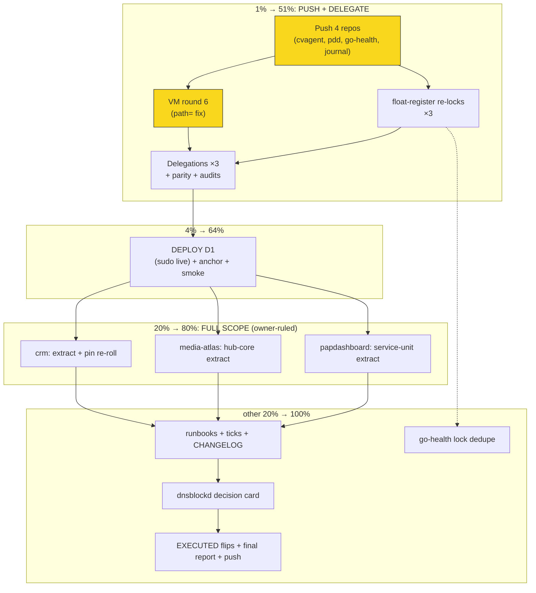

# SUPERB — Own-Project Upstreaming Completion, Phase 2 (owner-ruled)

**Created:** 2026-11-08 10:44
**EXECUTING (instance SUPERB-executor-2026-11-08, 2026-11-08 12:48 CET, HEAD `494c0eab5`):** executing (see AGENTS.md plan-execution tombstone)
**Date:** 2026-11-08 10:44 · **Author:** SUPERB-executor session (continuation of `2026-11-08_03-30_SUPERB-own-project-module-upstreaming-completion.md`; mid-flight status: `docs/status/2026-11-08_08-33_superb-upstreaming-execution-status.md`)
**Status:** EXECUTING (owner rulings 2026-11-08 ~10:40: Q1 = agent MAY push the four ahead repos; Q2 = deploy NOW at quiescence; Q3 = FULL scope for crm/media-atlas/papdashboard)

## Context

Phase 1 (03:59–08:33) banked: X0 recipe, hermes premise correction + re-lock `0ea6ea9→21ae0e12` (float-register proof GREEN), nsfw Wave N complete end-to-end, cvagent upstream module extended (wrapper mode: curated/AI/spend-cap/combined-mesh) with VM test one assertion-fix from green, and three upstream modules written+committed (journal — pin-gated, project-discovery-daemon, go-health-dashboard). ZERO SystemNix delegations landed: all serialized on pushes (repos ahead: cvagent 4, pdd 2, go-health 1, journal 8) because a delegated module imports `nixosModules` absent at the locked rev — delegation + re-lock must land as ONE float-register wave.

Owner rulings unblock the entire tail. Standing rules from phase 1 (non-negotiable): **float-register FIRST for any lock move** (it owns probe+registry+daemon-race absorption); **parity diff vs the last commit WITHOUT my marker** (`git log -S "EXECUTING (instance SUPERB-executor"` — the tombstone string is the marker); assert unit-file RENDERS not `systemctl show` formats; commit upstream before building checks; harden-bounds check (CPUQuota/MemoryHigh/ProtectHostname + per-service bounds) after every merge; PATHSPEC commits only.

## Pareto Breakdown

### The 1% that delivers 51%: PUSH BATTERY + THE THREE DELEGATIONS
Four `git push` commands unblock three ALREADY-WRITTEN modules. Each repo then: float-register re-lock (proof included) → SystemNix delegation rewrite → parity diff + audits → tick. Takes live delegations from 2 (mr-sync, nsfw) to 5. Everything else in this plan sits behind or beside it.

### The 4% that delivers 64%: THE DEPLOY (D1)
Sudo verified working this session. Undeployed payload: mr-sync delegation, nsfw fix + neutralizer drop, hermes float, plus the three delegations above. Until deployed, two sessions' work is theory. Deploy at quiescence AFTER the trio lands (minutes post-push), anchor by system-N-link NUMBER, full post-deploy battery.

### The 20% that delivers 80%: FULL-SCOPE EXTRACTIONS (owner-ruled)
crm (product deployment contract: addr/db-paths/api-token-env/auth flags/oidc opts; OIDC provisioning + sops stay SystemNix), media-atlas (full read; portable set honestly maximized — hub core + schedules; pg-ro/immich/backup site wiring stays), papdashboard (service unit; tile/icons layer stays SystemNix-internal by plan note). Each: read fully → extract upstream → repo eval → push → re-lock → delegate → parity → tick. journal stays pin-gated (templ regen not done at tip — verified 2026-11-08).

### The other 20% to reach 100% (the tail that keeps it true)
VM round 6 (the `path=` one-liner — gates the cvagent delegation proof); Y1 runbook sweep; Y2 library ticks (hermes premise correction + state, nsfw close, cvagent progress, 3 new module rows, scope notes); CHANGELOG; go-health-dashboard lock dupe-node cleanup (4 `_N` nodes); D2 dnsblockd decision card; EXECUTED flips on BOTH plan files; final status report; SystemNix commit + push. Skipping the tail is how a doctrine becomes a ritual.

## Comprehensive Plan (30–100 min tasks, impact → effort)

| # | ID | Task | Impact | Effort | Value | Gate |
|---|----|------|--------|--------|-------|------|
| 1 | P1 | Push battery (cvagent, pdd, go-health, journal) + VM round 6 (`cut -d= -f2` fix, expect behavioral tail green) + cvagent delegation (incl. sops.nix restartUnits rename ×2, system-health rename, tmpfiles dataDir) + parity + audits | 🔴 3 delegations live | 100m | doctrine on 5 repos | Q1 ✓ |
| 2 | P2 | pdd delegation (package shim stays consumer-side, user=primaryUser, mount gate, ioTier, harden 8G/400%) + go-health delegation (addr from ports, rediscover stays) + parity + audits | 🔴 2 more live | 60m | P1 pushes |
| 3 | D1 | Deploy at quiescence: 4×60s polls + green-eval probe, `nix run .#deploy`, watch /var/log/systemnix-deploys/, anchor by NUMBER, post-deploy battery + mr-sync-dashboard smoke (vHost/gatus/cache dir), nsfw stays down | 🔴 everything real | 30m+sudo | P1+P2 |
| 4 | F1 | crm full extraction: read 543 lines fully → upstream module (product contract) → repo eval → push → pin RE-ROLL to new rev (policy allows) → delegate → parity | 🟠 | 100m | push |
| 5 | F2 | media-atlas full extraction: read 908 fully → upstream module (hub core + schedules; site wiring stays) → forgejo push → re-lock → delegate → parity | 🟠 | 100m | push (forgejo) |
| 6 | F3 | papdashboard extraction: read 968 fully → service-unit boundary per plan → extract what's honest → push → re-lock → delegate → parity | 🟡 | 60m | push |
| 7 | Z1 | go-health-dashboard lock dupe-node cleanup (inspect the 4 `_N` nodes first — why they exist) | 🟢 lock hygiene | 30m | P2 |
| 8 | Y1 | Close-out: runbook sweep, upstream.md ticks (hermes/nsfw/cvagent/3-module rows), CHANGELOG, D2 decision card, EXECUTED flips ×2, final report, SystemNix commit + push | 🟠 truth | 60m | waves |

## Micro Breakdown (≤12 min each)

**P1 — push + cvagent (task 1):**

| µID | Task | Est |
|-----|------|-----|
| P1a | Push cvagent, pdd, go-health, journal (`git push` each; verify ahead=0) | 5m |
| P1b | VM round 6: add `cut -d= -f2` to wrapper extraction; rerun check | 10m |
| P1c | If behavioral tail green: commit test fix; if red: read journal lines, fix MODULE not test | 12m×n |
| P1d | float-register re-lock cvagent (proof = toplevel incl. new module's FOD) | 12m |
| P1e | Rewrite SystemNix cvagent.nix: imports upstream; set user/group/dataDir/serve.enable=false/curated+AI+cap+90min/calendar/randomized; mesh.runWithScan | 12m×2 |
| P1f | sops.nix: restartUnits cvagent.service → cvagent-scan.service (×2 sites) | 5m |
| P1g | Layer: ioTier.background, onFailure, system-health "cvagent-scan", HOME, tmpfiles dataDir, ProtectHome mkForce false, MemoryMax mkForce 512M, serviceOneshotDefaults | 12m |
| P1h | Parity: baseline commit via `git log -S "EXECUTING (instance SUPERB-executor"`; worktree; render cvagent + cvagent-scan + timer old/new; diff; harden-bounds | 12m×2 |
| P1i | Eval green (flake check --no-build capture-once) + tick cvagent row §f.1 | 10m |

**P2 — pdd + go-health (task 2):**

| µID | Task | Est |
|-----|------|-----|
| P2a | float-register re-lock pdd; rewrite pdd.nix as import+layer (shim/user/gate/ioTier/harden/serviceDefaults) | 12m×2 |
| P2b | pdd parity (daemon unit) + audits (io-tier on notify unit, socket gate) | 12m |
| P2c | float-register re-lock go-health; rewrite health-dashboard.nix (addr from ports; rediscover+integration stay) | 12m×2 |
| P2d | go-health parity (hub + rediscover units) + harden-bounds (MemoryMax 256M) | 12m |

**D1 — deploy (task 3):**

| µID | Task | Est |
|-----|------|-----|
| D1a | Quiescence: tree clean ×4×60s + eval-relevant mtime check + green drvPath probe | 10m |
| D1b | `nix run .#deploy`; tail /var/log/systemnix-deploys/<ts>.log | 12m+ |
| D1c | Anchor: readlink /run/current-system == newest system-N-link BY NUMBER | 5m |
| D1d | Post-deploy battery; mr-sync smoke (vHost, gatus, cache dir); nsfw down check | 12m |

**F1–F3 — full-scope extractions (tasks 4–6, same recipe each):**

| µID | Task | Est |
|-----|------|-----|
| FRa | Read the SystemNix module FULLY; split portable vs layer (stop-gate if portable set empty — papdashboard risk noted) | 12m×2 |
| FRb | Write upstream module + flake export; repo `nix flake check --no-build`; commit; push | 12m×3 |
| FRc | crm only: pin RE-ROLL (?rev= to new commit; flake.nix + pin-audit allowlist row together); others: float-register re-lock | 12m |
| FRd | SystemNix delegation rewrite + layer + parity + harden-bounds + eval | 12m×3 |
| FRe | Tick row + runbook header + CHANGELOG line | 10m |

**Tail (tasks 7–8):**

| µID | Task | Est |
|-----|------|-----|
| Z1a | Inspect the 4 go-health-dashboard_N lock nodes (nix flake metadata / lock jq); dedupe only with cause understood | 12m |
| Y1a | docs/services/*.md owning-module lines for all delegated services | 12m |
| Y1b | docs/todo/upstream.md: hermes row rewrite (premise + re-lock + external-wave), nsfw row CLOSE, cvagent row update, +3 new module rows, journal pin note | 12m |
| Y1c | CHANGELOG entry (session-wide) | 10m |
| Y1d | D2 dnsblockd decision card (unit identity: unprivileged upstream user vs root; restore paths; the [blocked:user] row) | 12m |
| Y1e | EXECUTED flip on BOTH plan files (plan-marker.sh done) + final status report + harvest note | 12m |
| Y1f | SystemNix: git status, PATHSPEC commits if anything uncommitted, push | 10m |

## Execution Graph (mermaid)

## Verschlimmbessern Guardrails (standing, from phase 1 + registry recipe)

1. float-register owns every lock move (never a bare `--update-input` without immediately running it).
2. Parity vs the pre-marker baseline, never HEAD~N; every hunk byte-identical or documented intent.
3. Harden-bounds survive: CPUQuota/MemoryHigh/ProtectHostname + per-service bounds re-read post-merge.
4. Upstream plain-priority keys beat mkDefault — mkForce where SystemNix must win; prove with nix eval.
5. No delegated module lands before its locked rev contains the upstream module (tree stays green for parallel sessions).
6. Unit renames (cvagent → cvagent-scan) update EVERY consumer surface in the same wave (sops restartUnits, system-health).
7. Commit upstream before building checks (kills -dirty FOD churn); PATHSPEC commits; never amend pushed.
8. If a stop-gate honestly fires (papdashboard), document the verdict with the evidence instead of forcing a hollow extraction — full scope means "fully assessed", not "extract at any cost".
