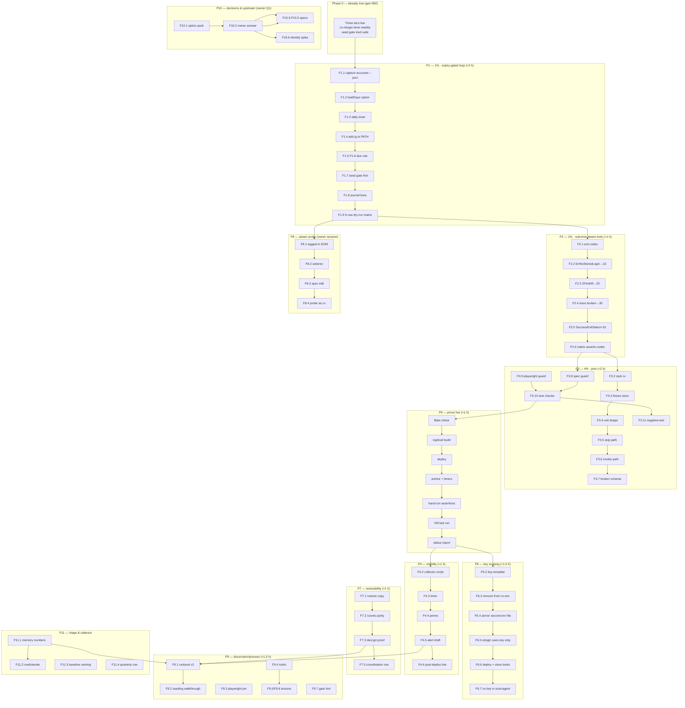

# SUPERB plan — CV credential & session management: from "good bones" to genuinely superb

- **Date:** 2026-11-09 19:45 CET
- **Status:** PLANNED (not executing yet — owner gates below)
- **Author:** Crush session (hf:deepseek-ai/DeepSeek-V4.1-Flash-1017)
- **Inputs (source of truth for the item list):**
  - `docs/status/2026-11-09_19-17_cv-credential-storage-relogin-loop-status.md`
  - `docs/status/2026-11-09_19-30_cv-credentials-session-management-audit-and-self-review.md`
  - Live probes re-run for this plan (appendix A)
- **Related runbook:** `docs/services/cv.md` §Credential storage
- **Live baseline:** gen-992, `cv-relogin.timer` active (Mon 09:11), sealed store
  **empty**, both operator sessions **stale**, `ateam` **unprobeable**

---

## 0) What "superb" means here (acceptance criteria)

Credentials & session management is superb when **all six** hold. Today four of
six fail, and the two that hold are design wins, not operational ones.

| # | Criterion | Today |
| --- | --- | --- |
| AC1 | Every credential lives in exactly one place, sealed at rest, readable only by the process that needs it | ⚠ tiers exist; the master key is over-exposed to 3 units (§1.4) |
| AC2 | A session is refreshed **before** it dies, not on a calendar | ❌ expiry exists as a *display* value only (§1.2) |
| AC3 | One session store of record; no divergent copies | ❌ three homes (§1.5) |
| AC4 | The system says out loud when it cannot act (unseeded, invalid, drifted) | ❌ journal-only; no metric/check (§1.6) |
| AC5 | Every claim is pinned by a test that can fail | ❌ zero pins for the new loop (§1.7) |
| AC6 | A human can seed/rotate in under a minute without touching a shell secret | ⚠ admin UI exists; asks for passkey or API key; no CLI |

---

## 1) Verified premises (do not re-derive — cite these)

### 1.1 The sealed store is empty, so no login can happen

`meta_stream_log` = 0 events, `meta_planned_credentials_by_platform` = 0 rows
(2026-11-09). The loop is installed; it WARN-skips all three platforms.

### 1.2 Nothing schedules on expiry — **verified**, not assumed

`ExpiringWithin` / `EarliestFutureExpiry` appear **only** on display surfaces:

- `internal/features/admin/handlers/admin_handler.go:857` (hub chip)
- `internal/cli/profiles/accounts.go:555` (table warn window)
- `internal/agent/platforms.go:83` (agent note)
- `internal/cli/profiles/profiles.go:311` (apply session line)

No timer, unit, or scheduler consumes them. My earlier "probably true" claim in
report #2 §d.7 is now a verified fact.

### 1.3 `cv profile accounts --json` gives the gate everything it needs

Ran as the service identity against the served state dir (exit 0):

```json
[ { "platform": "ateam", "name": "A.Team", "sessionState": "none",
    "loginUrl": "https://platform.a.team/" }, … ]
```

Fields available: `sessionState` (`fresh|stale|none|expiring|unknown`),
`earliestExpiry` (omitzero), `lastProbedAt`, `classifyError`, `loginUrl`
(`career-pipeline/profileagent/account_status.go:32-62`). **No upstream change
needed for expiry gating.**

### 1.4 The store master key is in `cv-env`, which four units read

`CREDENTIALS_MASTER_KEY_V1` is inside the `cv-env` template
(`modules/nixos/services/sops.nix:931`), and `cv-env` is consumed by
`cv-server` (`cv.nix:284`), `cv-scan` (EnvironmentFile), `cv-agent`
(`cv.nix:1158`) and `cv-relogin` (new). `cv-scan` and `cv-agent` never call
`credentials.Active()` → the key is over-exposed (AC1 gap).

Note the name collision that misled report #2: **`cv-agent`** (agent-brain pass,
cv.nix:1137) reads `cv-env`; **`cvagent`** (Code-To-CV scanner) reads its own
`cvagent-env` (sops.nix:621) and is **not** exposed. Any future text must say
which one.

### 1.5 Three session homes (AC3 gap)

| Home | Written by | Read by |
| --- | --- | --- |
| sealed `session_blob` (prod store) | admin UI / ledger import only (no rotate API) | `credentials.Active()` consumers |
| `/var/lib/cv/data/accounts/<p>/state.json` | `cv-relogin` (as `cv`) | cv-run CLI |
| `/home/lars/projects/CV/data/accounts/<p>/state.json` | operator `cv profile login/relogin` | lars-run timers (gunio-weekly, ateam bridge) |

Live rot: freelancermap `lastLoginAt` **2026-09-14**, `sessionState: stale`;
gun.io `stale`; both probed 2026-11-09 09:41.

### 1.6 `ateam` has no `auth_marker` → the probe skips it

`auth_marker` exists in 5 specs (freelancermap, gun.io, gulp, wellfound, xing).
`ateam.yaml` has `verify.profile_endpoint: https://platform.a.team/user` but no
marker, so the weekly probe prints `skipped — no auth_marker`: the one platform
with a password path has zero health signal (AC4 gap).

### 1.7 Zero pins for the new loop (AC5 gap)

No VM-test leg, no eval guard for spec fields or playwright resolution. Every
proof from the implementation session is ephemeral (journal, transient unit,
hand-run script).

### 1.8 Other verified constraints

- Store SDK exposes **no** public create/rotate seam (`internal/domain/commands.go`
  only) → seeding is admin-UI-only; relogin cannot rotate the blob.
- `tests/test-cv.nix` = 203 lines, already builds a CV VM with a chromium stub →
  extending it with a `cv-relogin` leg is cheap.
- `pkgs.playwright` = 1.64.1 (nixpkgs), independent of the CV repo's
  `package.json` pin; nothing asserts agreement.
- `pkgs.jq` is **not** in the relogin unit's PATH today (the expiry gate needs it).
- `cv-backup` writes `credentials-<ts>.sqlite` (proved once), but
  backup-coordination tracks only the pipeline snapshot.

---

## 2) Pareto analysis — 1% / 4% / 20% / the rest

### 2.1 The 1% that delivers 51%

**Make the loop condition-driven and self-proving.** Two things, together:

1. **Expiry-gated refresh** — replace the calendar tick with a daily run gated on
   `cv profile accounts --json` (refresh when `sessionState != fresh` or
   `earliestExpiry` inside `leadDays`). This is the difference between "a timer
   exists" and "sessions stop dying" — the actual customer outcome.
2. **Outcome-aware exits + one visible signal** — the unit must distinguish
   `skipped-unseeded` / `refreshed` / `invalid (2FA|drift)` and expose the
   unseeded state outside the journal. Otherwise the loop can be green and
   useless (exactly today's shape).

Why 51%: every other criterion depends on the loop *acting at the right time*
and on a human being able to *see* when it cannot. Both are cheap (~2 h total).

### 2.2 The 4% that delivers 64%

1% **plus** the regression pin:

3. **VM-test leg** (stub `cv`, fixture store, assert skip/fail/invoke paths).
4. **Two eval/build guards** (spec has `login_url`+`session_cookie` for every
   configured platform; `playwright` resolves with `index.js`).

Why: without these, items 1–2 rot silently the first time a spec or a nixpkgs
bump moves — AC5. Effort ~2.5 h; it is the difference between "works today" and
"still works in March".

### 2.3 The 20% that delivers 80%

4% **plus**:

5. **Key scoping** — key out of `cv-env` into `cv-store-key-env`, read by
   `cv-server` + `cv-relogin` only (AC1).
6. **`ateam` `auth_marker`** so the probe stops skipping the only
   password-capable platform (AC4).
7. **Credentials backup = restorable** — restore drill + backup-coordination
   freshness row (the snapshot exists; proof of restore does not).
8. **Docs/prose truth-up** (runbook v2 loop, key split, metric) so the next
   session does not rediscover any of §1.

### 2.4 The remaining 20% (last-mile, keep it explicit)

9. Single-source-of-truth decision → upstream write API adoption
   (`set-password`, `session_blob` rotation, `credentials status`).
10. Operator-identity option implementation (whatever the owner picks in Q1).
11. Playwright pin contract (nixpkgs major vs CV `package.json`).
12. Cross-service grading rubric (so "superb" becomes comparable).
13. Out-of-scope-but-noticed service issues (cv-server `MemoryHigh` thrash,
    baseline smoke FAILs) — routed, not owned here.
14. Process lessons (`docs/agents/systemd.md` NODE_PATH pattern, gate-hint in
    deploy.sh, float-diagnosis lesson).
15. Quarterly re-audit row.

---

## 3) COARSE PLAN — every task 30–100 min, all TODOs, sorted

Legend — **Imp** (impact 1–5), **Eff** (minutes), **CV** (customer value 1–5),
**Owner** (A = agent, O = owner, A+O = both), **Gate** (what blocks it).

| # | Task | Imp | Eff | CV | Owner | Depends / Gate |
| --- | --- | --- | --- | --- | --- | --- |
| C1 | **Expiry-gated daily relogin** (`relogin.leadDays`, daily timer, `accounts --json` gate, `jq` in PATH, per-platform log lines) | 5 | 90 | 5 | A | none |
| C2 | **Outcome-aware exits + alert text** (distinct exit codes: 0 refreshed/nothing-due, 10 skipped-unseeded, 20 invalid-2FA/drift, 30 store broken) | 4 | 45 | 4 | A | C1 |
| C3 | **Visible "stored logins" signal** (textfile metric from the store read model + SigNoz rule draft) | 4 | 60 | 4 | A | C1 |
| C4 | **VM-test leg** in `tests/test-cv.nix` (unit shape, seed gate skip/fail, stub-CLI invoke with a fixture store) | 5 | 90 | 3 | A | C1 |
| C5 | **Build guards**: `checks.cv-relogin-specs` (login_url+session_cookie per platform) and playwright `index.js` presence | 4 | 45 | 3 | A | none |
| C6 | **Deploy + live verify** of C1–C5 (timer, gated run, journal, metric scrape, anchor) | 4 | 60 | 4 | A | C1–C5 |
| C7 | **Key scoping**: new `cv-store-key-env` sops template, key moved out of `cv-env`, `cv-server` second EnvironmentFile, `cv-relogin` uses the key template only | 4 | 60 | 3 | A | C6 |
| C8 | **Deploy + verify key scoping** (`systemctl show -p EnvironmentFile`, store boots for server, relogin still resolves, cv-scan/cv-agent without key) | 4 | 45 | 3 | A | C7 |
| C9 | **Credentials backup = restorable** (restore drill to scratch, verify event counts, backup-coordination row, runbook step) | 3 | 45 | 3 | A | none |
| C10 | **`ateam` `auth_marker`** (derive structural selector, add to spec, run probe as `cv`, prove verdict flips off "skipped") | 4 | 45 | 3 | A+O | needs one live student session → Q2 |
| C11 | **Runbook v2** (loop semantics, exit codes, metric, key split, seeding, restore) | 3 | 45 | 3 | A | C1–C9 |
| C12 | **Playwright pin contract** (build check comparing nixpkgs major to CV `package.json`; fail loud on drift) | 3 | 45 | 2 | A | none |
| C13 | **Single-source-of-truth decision pack** (A: blob canonical / B: file canonical / C: staggered) with cost + risk per option | 4 | 60 | 4 | A+O | Q1 |
| C14 | **Upstream CV write-API design** (`set-password` prompt verb, post-relogin blob rotation, `credentials status`), ready-to-implement spec | 3 | 60 | 3 | A | C13 |
| C15 | **Operator-identity implementation** (only the chosen option: group+caps+root-env-file, or cv-only automation hardening) | 3 | 90 | 4 | A+O | Q1/C13 |
| C16 | **Credential/session grading rubric** (docs: dimensions, weights, evidence class read/ran/probed) so future audits compare | 2 | 30 | 2 | A | none |
| C17 | **Fleet observation triage** (cv-server `MemoryHigh` 27 445 hits; 5 smoke baseline FAILs named; each rowed or consciously tolerated) | 3 | 60 | 2 | A | none |
| C18 | **Process lessons** (`docs/agents/systemd.md` NODE_PATH pattern; `CONTRIBUTING.md` float-diagnosis + eval-gate-placement lesson; deploy.sh phantom-class hint) | 2 | 45 | 1 | A | none |
| C19 | **Close-out**: status report, TODO drift check, commit/push | 3 | 30 | 2 | A | all |
| C20 | **Quarterly re-audit cadence** (row + rubric reference + trigger condition) | 1 | 12 | 1 | A | C16 |

### 3.1 Import/impact ordering (what to do first)

`C1 → C2 → C4 → C5 → C6 → C3 → C7 → C8 → C9 → C10 → C11 → C13 → C14 → C15 →
C12 → C17 → C18 → C16 → C19 → C20`

Rationale: C1+C2 is the 1% (2 h). C4+C5 make it permanent (2 h 15). C6 proves it
live. Only then spend on keys (C7/C8) and the rest.

---

## 4) FINE PLAN — every task ≤12 min

Legend: **Imp** 1–5, **Min** ≤12, **Owner** A/O, **DoD** = done definition.

### Phase P1 — expiry-gated loop (C1)

| # | Task | Imp | Min | Owner | DoD |
| --- | --- | --- | --- | --- | --- |
| F1.1 | Capture `cv profile accounts --json` as `cv` from `/var/lib/cv` **and save it into the plan appendix** | 3 | 5 | A | output pasted in appendix A |
| F1.2 | Add `leadDays = 7` option (+ description) to `services.cv-server.relogin` | 4 | 8 | A | `nix eval` of the option |
| F1.3 | Change default schedule to daily (`*-*-* 09:11:00`), keep `Persistent` | 4 | 5 | A | timer eval shows daily |
| F1.4 | Add `pkgs.jq` to the unit PATH | 4 | 3 | A | PATH contains jq |
| F1.5 | Write the gate helper inside the ExecStart script: read `accounts --json`, select `platforms` rows, classify due/not-due | 5 | 12 | A | shellcheck-clean, dry run as cv |
| F1.6 | Implement due rule: `sessionState != "fresh"` ⇒ due; `earliestExpiry` within `leadDays` ⇒ due (parse with `date -d`) | 5 | 12 | A | unit test rows in F1.9 |
| F1.7 | Keep the store seed gate **first**; skip with WARN when no `kind=password` row | 5 | 8 | A | WARN path intact |
| F1.8 | Emit one journal line per platform: `<platform> <state> expiry=<date|-> -> refresh|skip` | 3 | 8 | A | sample lines in journal |
| F1.9 | Local dry-run matrix as `cv`: no store / store+no row / store+row / stale state / fresh+far expiry | 5 | 12 | A | 5 rows behave as specified |
| F1.10 | Update the unit's inline comment block to the new semantics | 2 | 5 | A | reads correctly |

### Phase P2 — outcome-aware exits (C2)

| # | Task | Imp | Min | Owner | DoD |
| --- | --- | --- | --- | --- | --- |
| F2.1 | Define exit codes 0/10/20/30 in the script + comment | 4 | 6 | A | documented in code |
| F2.2 | Map `ErrNoStoredLogin` (grep of the CLI output) to 10, not a failure | 4 | 12 | A | exit 10 observed in a run |
| F2.3 | Map 2FA/SSO/form-drift failures to 20 with a runbook pointer | 4 | 10 | A | message text verified |
| F2.4 | Fail 30 on unreadable store/schema | 4 | 6 | A | negative run exits 30 |
| F2.5 | Decide systemd handling: `SuccessExitStatus=10` (unseeded is not an error) + `onFailure` only for 20/30 | 4 | 8 | A | unit shows SuccessExitStatus |
| F2.6 | Re-run the 5-row dry-run matrix asserting codes | 4 | 10 | A | matrix table in appendix |
| F2.7 | Update runbook exit-code table | 2 | 6 | A | doc line |

### Phase P3 — pins (C4, C5)

| # | Task | Imp | Min | Owner | DoD |
| --- | --- | --- | --- | --- | --- |
| F3.1 | Read `tests/test-cv.nix` structure; note where to add the leg | 3 | 10 | A | insertion point chosen |
| F3.2 | Add a stub `cv` derivation that logs argv and exits 0 | 4 | 10 | A | stub builds |
| F3.3 | Add fixture store: sqlite with `meta_planned_credentials_by_platform` + one `password` row | 5 | 12 | A | gate passes in VM |
| F3.4 | Assert unit shape in the VM (User=cv, TimeoutStartSec, MemoryMax, NODE_PATH, EnvironmentFile) | 4 | 12 | A | test fails if changed |
| F3.5 | Assert seed-gate skip: no credential row ⇒ WARN, exit 0, stub NOT called | 5 | 10 | A | assertion red on regress |
| F3.6 | Assert invoke path: row present + stale state ⇒ stub called with `profile relogin --platform X --headless` | 5 | 12 | A | assertion red on regress |
| F3.7 | Assert unreadable schema ⇒ exit 30 | 4 | 10 | A | assertion red on regress |
| F3.8 | `checks.cv-relogin-specs`: runCommand greps package share dir for `login_url` + `session_cookie` per platform | 4 | 12 | A | fails when a spec loses a field |
| F3.9 | Build check: `${playwrightModules}/lib/node_modules/playwright/index.js` exists | 4 | 6 | A | fails on layout change |
| F3.10 | Wire both checks into `flake/parts/checks/` following an existing example | 4 | 10 | A | `nix flake check` lists them |
| F3.11 | Negative-test the guards once (temporarily break a copy, expect red, restore) | 4 | 12 | A | red proven, tree restored |

### Phase P4 — visible signal (C3)

| # | Task | Imp | Min | Owner | DoD |
| --- | --- | --- | --- | --- | --- |
| F4.1 | Pick the metric shape: `cv_stored_logins{platform,kind}` + `cv_relogin_last_result{platform}` | 4 | 8 | A | names in the plan |
| F4.2 | Write the collector script (read store read model read-only via sqlite, emit Prom textfile) | 5 | 12 | A | script prints valid format |
| F4.3 | Wire it as a oneshot + timer (or fold into system-health's collector run) | 4 | 12 | A | unit active after deploy |
| F4.4 | Add CAP_DAC_READ_SEARCH / run as cv so the 0700 store is readable | 4 | 10 | A | metric appears live |
| F4.5 | Add a SigNoz alert draft (stored_logins{kind="password"} == 0 for >7d) | 3 | 10 | A | rule JSON drafted |
| F4.6 | Add the check to post-deploy-check CV section | 3 | 8 | A | section prints it |
| F4.7 | Runbook paragraph on reading the metric | 2 | 6 | A | doc line |

### Phase P5 — deploy & prove (C6)

| # | Task | Imp | Min | Owner | DoD |
| --- | --- | --- | --- | --- | --- |
| F5.1 | `nix flake check --no-build --all-systems` → capture log | 5 | 12 | A | rc=0, log path recorded |
| F5.2 | Toplevel build `--keep-going` → capture log | 5 | 12 | A | rc=0 |
| F5.3 | Deploy (respect the PSI gate; do not force without cause) | 5 | 12 | A | gen increments |
| F5.4 | Anchor check (`readlink /run/current-system` vs newest link) | 5 | 5 | A | equal |
| F5.5 | `systemctl list-timers cv-relogin` shows daily cadence | 4 | 3 | A | next run tomorrow |
| F5.6 | Hand-trigger; assert the gated log lines + exit code | 5 | 8 | A | 3 platforms reported |
| F5.7 | VM test actually runs (not eval-only) | 5 | 12 | A | driver exit 0 |
| F5.8 | Record all evidence in a status report | 4 | 12 | A | report filed |

### Phase P6 — key scoping (C7, C8)

| # | Task | Imp | Min | Owner | DoD |
| --- | --- | --- | --- | --- | --- |
| F6.1 | Check how the upstream module types `environmentFile` (scalar vs list) | 4 | 8 | A | merge strategy chosen |
| F6.2 | Add `cv-store-key-env` template (owner cv, 0400, `CREDENTIALS_MASTER_KEY_V1`, restartUnits cv-server+cv-relogin) | 5 | 12 | A | template renders |
| F6.3 | Remove the key from `cv-env` content | 5 | 5 | A | grep shows one home |
| F6.4 | Give `cv-server` the second EnvironmentFile via `serviceConfig.EnvironmentFile` | 5 | 12 | A | rendered unit lists both |
| F6.5 | Point `cv-relogin` at the key template only | 5 | 6 | A | env file list |
| F6.6 | Eval + build + deploy + verify store still boots (`credentials store booted`) | 5 | 12 | A | journal line |
| F6.7 | Verify `cv-scan`/`cv-agent` no longer see the key (`systemctl show -p EnvironmentFile` + no env var) | 5 | 10 | A | proof captured |
| F6.8 | Negative check: break the key (chmod) in a scratch run → server fails closed, as designed | 4 | 12 | A | documented |
| F6.9 | Runbook update for the split | 3 | 8 | A | doc line |

### Phase P7 — backup restorability (C9)

| # | Task | Imp | Min | Owner | DoD |
| --- | --- | --- | --- | --- | --- |
| F7.1 | Restore `credentials-<ts>.sqlite` to a scratch dir | 4 | 8 | A | file lands 0600 |
| F7.2 | Verify integrity + event count parity vs source | 5 | 10 | A | counts equal |
| F7.3 | Prove decryptability: boot a store against the restored copy with the key (read one row) | 5 | 12 | A | row counts match |
| F7.4 | Add the drill to the runbook (steps + expected output) | 3 | 10 | A | doc section |
| F7.5 | Register the artifact with backup-coordination (freshness) | 4 | 12 | A | `backup_healthy` covers it |
| F7.6 | Row the "lost store + rotated key" failure mode in the runbook | 3 | 6 | A | doc line |

### Phase P8 — ateam probe coverage (C10) — needs a live session

| # | Task | Imp | Min | Owner | DoD |
| --- | --- | --- | --- | --- | --- |
| F8.1 | Fetch `https://platform.a.team/user` logged-in DOM (owner session or cv state) | 4 | 10 | A+O | DOM snippet captured |
| F8.2 | Choose a structural selector (href/aria, not text) | 4 | 10 | A | selector justified |
| F8.3 | Add `auth_marker` to `ateam.yaml` in the CV repo | 4 | 6 | A | YAML valid |
| F8.4 | Run `cv profile accounts --probe --platform ateam` as `cv` against the served spec | 5 | 12 | A | verdict no longer "skipped" |
| F8.5 | If the UI moved, fall back to the profile endpoint body assertion | 3 | 10 | A | documented |
| F8.6 | Note the spec change needs a CV input bump (do not float blindly) | 4 | 6 | A | row/comment |

### Phase P9 — docs, rubric, process (C11, C12, C16, C18)

| # | Task | Imp | Min | Owner | DoD |
| --- | --- | --- | --- | --- | --- |
| F9.1 | Runbook: loop v2 semantics + exit codes + metric + key split | 3 | 12 | A | sections updated |
| F9.2 | Runbook: seeding walkthrough (exact clicks, what to expect) | 3 | 10 | A | checklist |
| F9.3 | Playwright pin check (parse CV `package.json` pin, compare major to nixpkgs) | 3 | 12 | A | check fails on drift |
| F9.4 | Grading rubric doc (dimensions, weights, evidence classes) | 2 | 12 | A | doc filed |
| F9.5 | `docs/agents/systemd.md`: NODE_PATH node_modules pattern | 2 | 10 | A | bullet added |
| F9.6 | `CONTRIBUTING.md`: float-diagnosis + eval-gate-placement lesson | 2 | 10 | A | section added |
| F9.7 | deploy.sh: phantom-class hint when `%util<1` and D-state≤1 | 2 | 10 | A | text printed |
| F9.8 | Status report + TODO drift check + commit | 3 | 12 | A | clean tree |

### Phase P10 — decisions & upstream prep (C13, C14, C15)

| # | Task | Imp | Min | Owner | DoD |
| --- | --- | --- | --- | --- | --- |
| F10.1 | Write the single-source-of-truth option pack (A/B/C, cost, risk, what breaks) | 4 | 12 | A | doc section |
| F10.2 | Ask the owner (Q1) and record the answer | 4 | 6 | A+O | decision logged |
| F10.3 | Draft `cv credentials set-password` CLI spec (flags, prompt, error codes) | 3 | 12 | A | spec in upstream doc |
| F10.4 | Draft post-relogin `session_blob` rotation flow | 3 | 12 | A | spec in upstream doc |
| F10.5 | Draft `cv credentials status` output shape | 3 | 10 | A | spec in upstream doc |
| F10.6 | Implement the chosen operator-identity option (spike, timeboxed) | 3 | 12+ | A | spike notes |
| F10.7 | Row the CV-repo work as `[blocked:push]` with the spec links | 2 | 6 | A | queue row |

### Phase P11 — fleet triage & cadence (C17, C20)

| # | Task | Imp | Min | Owner | DoD |
| --- | --- | --- | --- | --- | --- |
| F11.1 | cv-server `MemoryHigh` 27 445 hits: re-derive MemoryHigh/Max/GOMEMLIMIT coherence | 3 | 12 | A | numbers + verdict |
| F11.2 | Row it (services.md) or consciously tolerate | 3 | 6 | A | row or note |
| F11.3 | Name the 5 smoke baseline FAILs inside the baseline file | 2 | 8 | A | file annotated |
| F11.4 | Quarterly re-audit row + rubric link | 1 | 5 | A | queue row |

**Total fine tasks: 79 (≈ 12 h at the 12-min ceiling, realistically ~14 h across
2–3 sessions; the P1+P2+P3+P5 slice ≈ 3.5 h and delivers the 64%).**

---

## 5) Execution graph

```mermaid
gantt
    title Execution order (dependencies, not calendar days)
    dateFormat  X
    axisFormat  %s
    section 1% (expiry loop + exits)
    P1 gate+leadDays+daily      :p1, 0, 90
    P2 outcome exits            :p2, after p1, 45
    section 4% (pins)
    P3 VM leg + guards          :p3, after p2, 120
    section prove
    P5 build+deploy+verify      :p5, after p3, 60
    section 20%
    P4 visibility metric        :p4, after p5, 60
    P6 key scoping              :p6, after p5, 90
    P7 backup restorability     :p7, after p6, 60
    P8 ateam marker             :p8, after p5, 45
    P9 docs/rubric/process      :p9, after p7, 90
    section rest
    P10 decisions/upstream      :p10, after p9, 90
    P11 triage/cadence          :p11, after p10, 45
```





---

## 6) Risk register / anti-Verschlimmbesserung (the "don't cut my balls" rules)

| Risk | Guard |
| --- | --- |
| **Loop turns into a page-storm** | exit code 10 = `SuccessExitStatus` (unseeded never alerts); only 20/30 hit `onFailure`; one attempt per platform per day |
| **Account lockout from repeated logins** | `leadDays` refresh only when due; never retry within the same run; headless-only; alert instead of retry on failure |
| **Key split breaks cv-server boot** | key template added BEFORE removal from `cv-env`; deploy is fail-closed and smoke-checked; rollback = re-add the line (one-line revert) |
| **VM test makes the CV gate slow** | keep the leg inside `tests/test-cv.nix` (already excluded from pre-commit); no new heavy closure (stub `cv`, no chromium) |
| **Eval guard false-positives on legit spec change** | guard asserts only `login_url` + `session_cookie` presence, not rows; message names the file |
| **Metric collector becomes a second privileged reader** | reuse the `cv-backup` CAP_DAC_READ_SEARCH precedent; read-only URI; no writes outside the textfile dir |
| **Session-blob rotation half-done** | C13/C14 are decision + spec only; no partial write path is introduced before the upstream seam exists |
| **Touching the lock again** | no `nix flake update` in this plan; any float needs its own proof (the 2026-11-09 lesson) |
| **Secret leakage** | no secret values in any command line, doc, or test; the metric name carries counts only |
| **Forcing the deploy gate again** | wait for PSI to drain; if forced, record util% + D-state count as evidence |

---

## 7) Verification protocol (per phase)

1. **Eval:** `nix flake check --no-build --all-systems > log 2>&1` (capture once, grep after).
2. **Build:** `nix build .#nixosConfigurations.evo-x2.config.system.build.toplevel --keep-going --no-link` → rc=0.
3. **VM:** `nix build .#checks.x86_64-linux.cv.driver` + run the driver (the CV VM test).
4. **Deploy:** `nix run .#deploy` (never bypass the PSI gate without the §6 evidence).
5. **Anchor:** `readlink /run/current-system` == newest `system-N-link`.
6. **Loop:** `systemctl list-timers cv-relogin` (daily) + hand-trigger + journal lines + exit code.
7. **Keys:** `systemctl show cv-server cv-scan cv-agent cv-relogin -p EnvironmentFile`.
8. **Metric:** textfile present + value matches the store read model.
9. **Restore:** scratch restore + event-count parity.
10. **Report:** every claim carries an evidence class (read/ran/probed) and a rev stamp.

---

## 8) Owner gates (cannot be done by an agent)

| Gate | Why | Asked in |
| --- | --- | --- |
| Seed the first credential at `https://cv.home.lan/admin/credentials/` | store has no write API; agents must not handle passwords | Q1 of report #2 (still open) |
| Single-source-of-truth decision (blob / file / staggered) | risk-posture call on a plaintext bearer token | **Q1 below** |
| Refresh aggressiveness (daily-lead vs twice-weekly) | portal anti-bot tolerance | **Q2 below** |
| One logged-in `ateam` session (for `auth_marker`) | selector must come from a real authenticated DOM | **Q3 below** |
| CV-repo push (write API, set-password, blob rotation) | agents never push upstream | after C14 |

---

## 9) Traceability — every reported follow-up has a task

| Report item (19:17 + 19:30 §f) | Plan task |
| --- | --- |
| f.1 premise check (expiry scheduler) | §1.2 (verified) + F1.1 |
| f.2 daily gated tick | C1 / F1.2–F1.10 |
| f.3 expiry in JSON | §1.3 (already there) |
| f.4 alert when stale 2 runs | F2.3 + F4.5 |
| f.5 probe exit-3 → relogin chain | F2.5 + P2 (not auto-triggered; see risk) |
| f.6–f.12 VM leg + guards | C4, C5 / F3.1–F3.11 |
| f.13–f.17 visibility | C3 / F4.1–F4.7 |
| f.18–f.24 secrets hygiene | C7, C9 / F6.*, F7.* |
| f.25–f.30 upstream write seam | C13, C14 / F10.1–F10.7 |
| f.31–f.39 process lessons | C18 / F9.5–F9.7 |
| f.40–f.46 service observations | C17 / F11.1–F11.3 |
| f.47–f.49 CV input re-float, CV pre-commit, dashboard tile | C14 (decision) + rowed separately |
| f.50 quarterly audit | C20 / F11.4 |
| report #2 §c.1 expiry-driven | C1 |
| report #2 §c.2 ateam auth_marker | C10 |
| report #2 §c.3 key scoping | C7 |

---

## Appendix A — live evidence captured for this plan (2026-11-09 19:4x)

```
$ date
Mon Nov  9 07:41:41 PM CET 2026

$ sudo -u cv sh -c 'cd /var/lib/cv && HOME=/var/lib/cv PATH=/run/current-system/sw/bin cv profile accounts --json'
[ { "platform": "10x-team", "name": "10x.Team", "sessionState": "none" },
  { "platform": "ateam", "name": "A.Team", "sessionState": "none",
    "loginUrl": "https://platform.a.team/" },
  … ]                       # exit 0 — gate data available, all sessions "none"

$ rg 'ExpiringWithin|EarliestFutureExpiry' (non-test)
internal/features/admin/handlers/admin_handler.go:857      # display only
internal/cli/profiles/accounts.go:555                      # display only
internal/agent/platforms.go:83                             # display only
internal/cli/profiles/profiles.go:311                      # display only
# ⇒ nothing schedules on expiry (premise CONFIRMED)

$ grep -n CREDENTIALS_MASTER_KEY_V1 modules/nixos/services/sops.nix
931:  CREDENTIALS_MASTER_KEY_V1 = config.sops.placeholder.cv_credentials_master_key;   # inside cv-env
$ rg 'templates."cv-env"' → cv.nix:284 (cv-server) + cv-scan + cv-agent (cv.nix:1158) + cv-relogin

$ cvagent env check
sops.nix:621 → "cvagent-env" (own template, OPENAI_API_KEY only) ⇒ cvagent is NOT exposed;
              the exposed unit is cv-agent.service (agent pass) — naming trap recorded.

$ wc -l tests/test-cv.nix → 203
$ nix eval nixpkgs#playwright.version → 1.64.1
```

## Appendix B — what this plan deliberately does NOT do

- No `nix flake update` / lock movement.
- No new daemon or long-running service (collector is a timer oneshot).
- No secrets in sops for portal passwords (the sealed store stays canonical).
- No writes into the sealed store from SystemNix (upstream seam only).
- No touching `cv`'s server code in this plan (C14 is a spec, not code).
- No hidden privilege escalation (`sudo` in agent sessions stays unusable;
  everything is a systemd unit).
